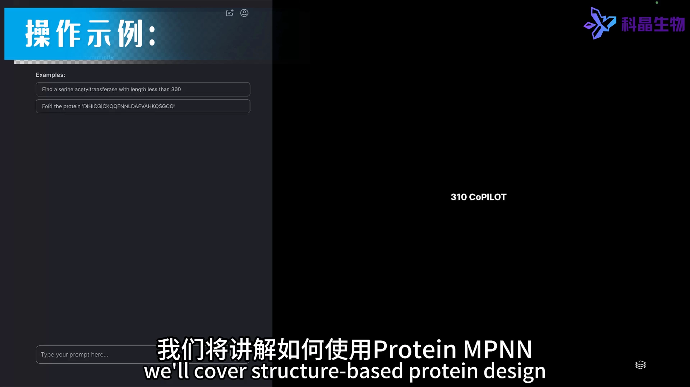
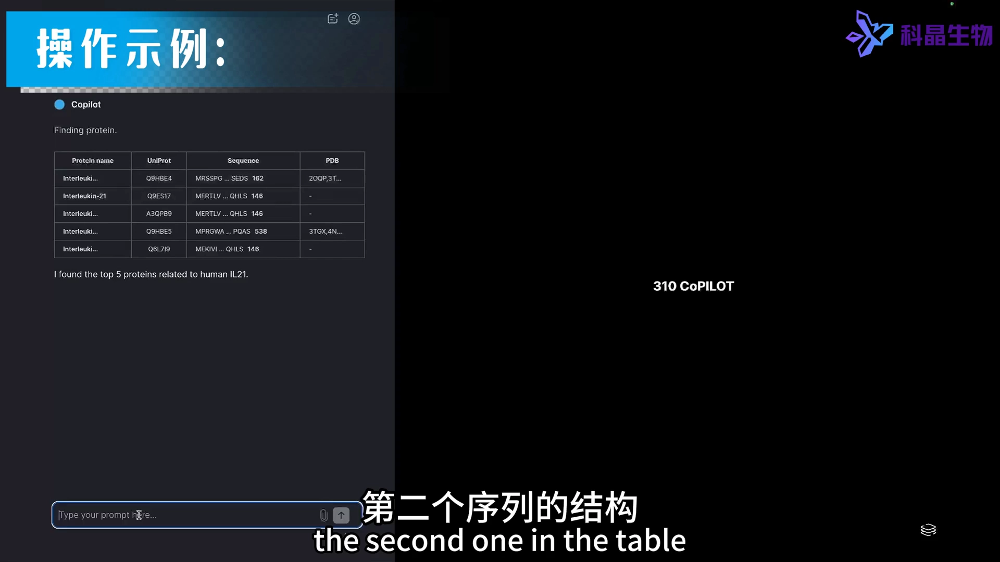
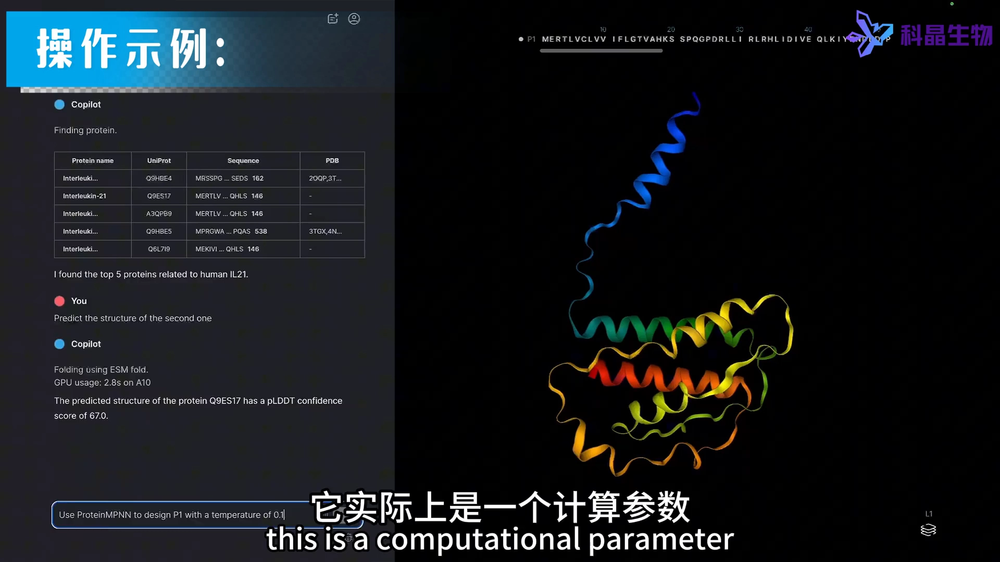
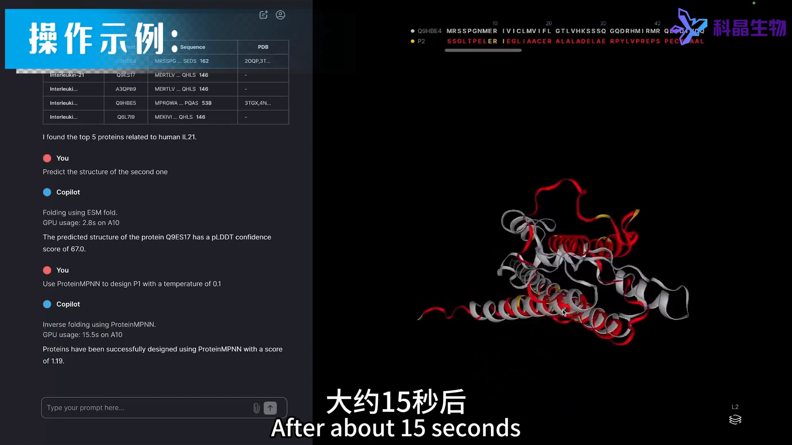
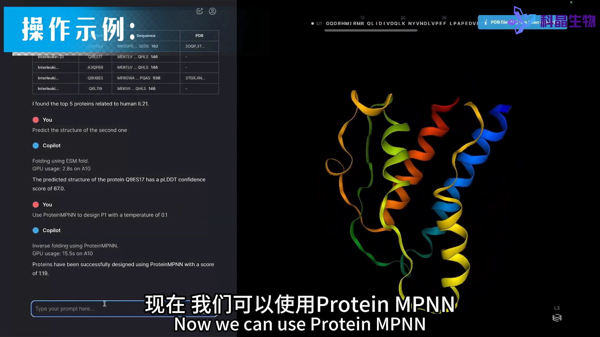
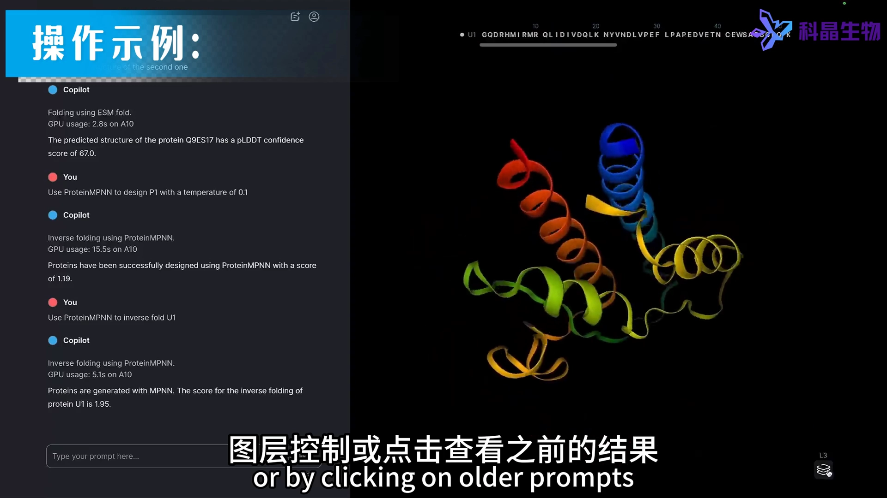
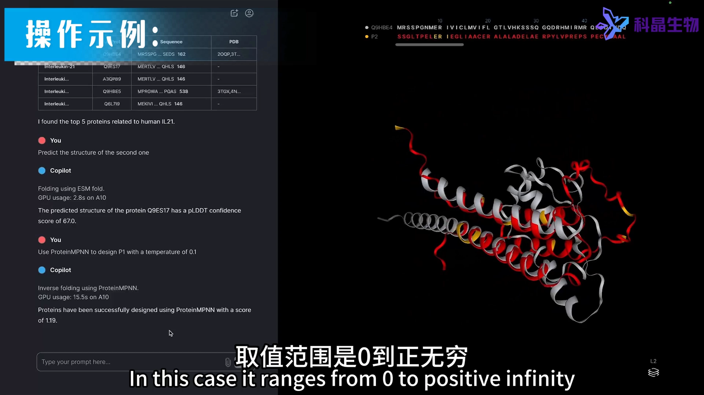
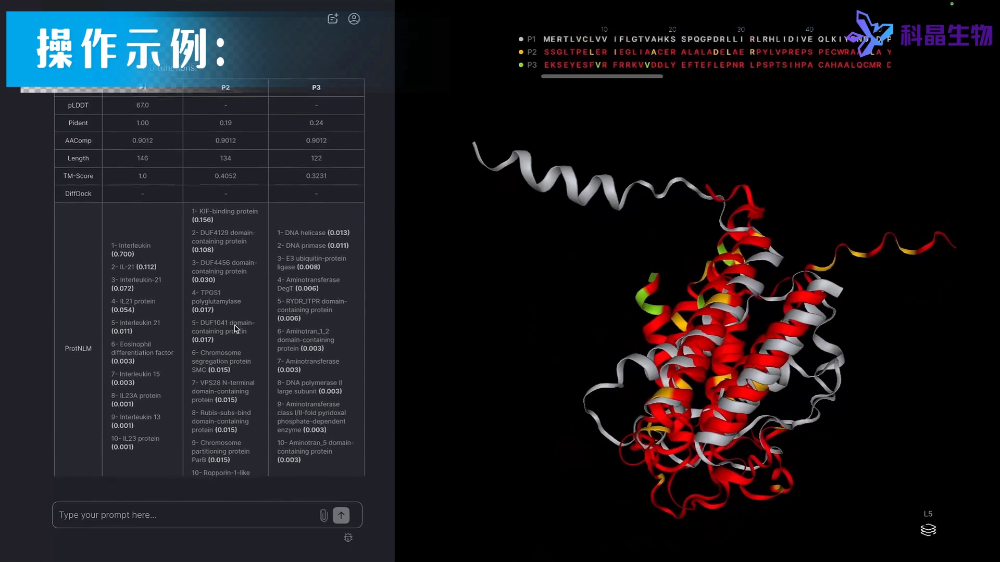

# 3 分钟上手 ProteinMPNN 逆折叠：temperature 参数语义与结果解读（网页工具实操）

> 视频来源：[实操演示：ProteinMPNN定向进化改造蛋白质](https://www.bilibili.com/video/BV1hN6HYnEPR/)（Bilibili，3 分 14 秒，网页工具实操演示，AI 配音）

## 本讲要解决的核心问题（SCQA）

**背景**：拿到一个 PDB 结构，想「换序列、保结构」——这正是**逆折叠**（inverse folding），也是 binder 设计三部曲第二步 ProteinMPNN 的本职工作。

**冲突**：工具里最关键的参数叫 **temperature**——名字很唬人：它与蛋白表达或稳定性的物理温度有关吗？调高调低分别会发生什么？新手往往不敢动它。

**疑问**：网页工具上的两步操作怎么走？输出里的红色区域、scRMSD 分数、以及「改造后序列大变样」到底该怎么解读？

**回答（中心思想）**：temperature 是**纯计算参数**：取值 0~+∞，越高允许的突变越多，**超过 1.0 接近随机采样**，建议保持低值（示例用 0.1）；工具输出改造序列并自动构建 3D 结构与输入比对（红色 = 与输入的差异），**scRMSD 越接近 0 越好**；对 ProteinMPNN 而言，改造序列中 **50% 或更多残基变化是正常的**。

## 一、两步流程：ESMFold 建模 → ProteinMPNN 改造

要进行逆折叠，需要一个蛋白质的 PDB 文件；在网页工具里两步就能走完：

**第一步，拿到结构**：在 UniProt 检索人类 IL1R1 蛋白并得到前五个结果，然后用 ESMFold 预测第二个结果的结构——几秒内出结果，显示在右侧，并自动命名为 **P1**。[【跳转到 00:10】](https://www.bilibili.com/video/BV1hN6HYnEPR/?t=10)

**第二步，逆折叠改造**：使用 ProteinMPNN、以 **temperature 参数 0.1** 来设计改造 P1，约 15 秒后就能在可视化工具中看到新设计的蛋白。[【跳转到 00:35】](https://www.bilibili.com/video/BV1hN6HYnEPR/?t=35)

## 二、temperature：计算参数，不是物理温度

这段 30 秒的解释值得逐字记住：[【跳转到 01:00】](https://www.bilibili.com/video/BV1hN6HYnEPR/?t=60)

- temperature **实际上是一个计算参数**，与蛋白质表达或稳定性的**物理温度无关**；
- 通常 temperature **越高，允许的突变越多**；
- 取值范围是 **0 到正无穷**；但对 ProteinMPNN 来说，**参数超过 1.0 通常会导致（接近）随机采样**——因此建议保持在较低范围内。

## 三、读结果：红色差异、scRMSD、50% 突变正常

ProteinMPNN 输出的是**蛋白序列**，但工具会自动构建三维结构，并与输入结构比对——**用红色突出与输入结构的差异**。[【跳转到 01:25】](https://www.bilibili.com/video/BV1hN6HYnEPR/?t=85)

**scRMSD 是衡量模型置信度的一个指标**：取值范围 0 到正无穷，**0 表示最佳结果**。也就是说，把设计序列重新折叠回去、与设计骨架对比，偏差越小越可信。[【跳转到 01:25】](https://www.bilibili.com/video/BV1hN6HYnEPR/?t=85)

多轮设计的结果会显示在可视化工具的**不同图层**上——通过右下角的图层控制或点击即可查看之前的结果；也可以直接把 P1、P2、P3 放在一起，**以 P1 为参考**自动比较改造序列和结构，并提供一个对照表格。可以看到，改造蛋白质的序列与原始序列有很大不同——**对 ProteinMPNN 来说，改造序列中 50% 或更多位置发生变化是正常的**。[【跳转到 02:07】](https://www.bilibili.com/video/BV1hN6HYnEPR/?t=127)

## 四、上传自有 PDB 与结果导出

除了用 UniProt + ESMFold 现场建模，也可以**上传任意蛋白质 PDB 文件**来运行 ProteinMPNN——上传的文件会被自动命名（示例中为 U1），然后用同样的方式改造。[【跳转到 01:50】](https://www.bilibili.com/video/BV1hN6HYnEPR/?t=110)

最后，平台可一键导出所有结果：**所有序列、PDB 文件和工作日志**——序列喂给下游验证（如 AlphaFold 回折）、结构直接可视化检查、日志留档复盘。[【跳转到 02:57】](https://www.bilibili.com/video/BV1hN6HYnEPR/?t=177)

## 小结

- 逆折叠 = 给定 PDB 结构、生成保持该结构的新序列；网页工具两步走：ESMFold 建模（或上传自有 PDB）→ ProteinMPNN 改造。
- **temperature 是计算参数**：与物理温度无关；0~+∞，越高突变越多；**>1.0 接近随机采样，建议低值**（示例 0.1）——这正是条目「sampling_temp 控制多样性」的参数语义。
- 结果三层读法：红色区域看**差异分布**、scRMSD 看**自洽置信度**（越接近 0 越好）、对照表看**突变比例**（50%+ 正常）。
- 多轮设计放不同图层、可互相参照；产物一键导出（序列 + PDB + 日志），衔接三部曲第三步的回折验证。

## 关键术语速查

| 术语 | 一句话解释 |
| --- | --- |
| 逆折叠（inverse folding） | 给定目标结构，设计能折叠成它的氨基酸序列；ProteinMPNN 的本职任务 |
| temperature | 采样温度：纯计算参数（0~+∞），越高允许突变越多，>1.0 接近随机采样，建议低值 |
| scRMSD | 自洽 RMSD：设计序列重新折叠后与设计骨架的偏差，0 表示最佳结果 |
| ESMFold | Meta 的快速结构预测模型，本例用于把 UniProt 序列秒级变成 PDB 结构 |
| UniProt | 蛋白序列数据库，检索目标蛋白获取序列与编号 |

> 配套阅读：方法原理见同条目《MPNN - ML for protein sequence design》；三部曲完整实操（RFdiffusion contigs + ProteinMPNN + AlphaFold 验证）见《Learn Protein Design From Theory to Practical - Part 3》。
