# 核苷酸上下文模型胜过蛋白质语言模型：抗体亲和力成熟预测的系统评测

> 视频：[Nucleotide Context Models Outperform Protein Language Models Predicting Antibody Affinity Maturation](https://www.youtube.com/watch?v=m19JjRRIkGM)（17 分 26 秒，中文字幕）
> 讲者：Kevin Sung（美国弗雷德·哈钦森癌症研究中心 Matsen 实验室研究科学家）
> 对应论文：Johnson M M, Sung K, Haddox H K, et al. *Nucleotide context models outperform protein language models for predicting antibody affinity maturation*. **PLOS Computational Biology**, 2025;21(12):e1013758（2025-12-01 发表）。评测框架 EPAM 开源于 [github.com/matsengrp/epam](https://github.com/matsengrp/epam)。

## 本讲要解决的核心问题

**背景**：抗体要成为好药，得先经历**亲和力成熟**——免疫系统里"突变 + 选择"的定向进化过程，让抗体对抗原的结合越来越强。如今给这个过程建模的工具箱里，蛋白质语言模型（PLM）几乎是默认选项：它见过海量序列，参数动辄千万上亿。

**冲突**：但亲和力成熟的"原料"突变发生在 **DNA 层面**——负责引入突变的酶只认特定的核苷酸序列基序。只看氨基酸序列的语言模型，天然看不到这一层信息。此前也一直缺少一个把各路模型放在一起公平评测的框架。

**疑问**：预测亲和力成熟，到底该信蛋白质语言模型，还是老派的分子进化模型？而且"预测哪里会突变"和"预测突变成什么氨基酸"是两件不同的事，答案会不会不一样？

**回答（中心思想）**：讲者所在的 Matsen 实验室用统一评测框架 **EPAM**（Evaluating Predictions of Affinity Maturation）系统比较后发现——**核苷酸上下文模型（S5F、Thrifty）整体胜过蛋白质语言模型（AbLang2、ESM-1v）**：一个只有几千参数的核苷酸卷积模型，在预测"替换发生的位置"上能打赢数千万到数亿参数的语言模型。体细胞高频突变的核苷酸上下文，才是预测力的主要来源。作为后续工作，他们提出的 **DASM** 模型把两种视角真正合体，与实验功能测量的相关性比语言模型更好。

## 一、亲和力成熟：免疫系统里的"定向进化"

**亲和力成熟**，指免疫系统通过 B 细胞进化产生强效且特异性抗体的过程。看视频开头这幅示意图就能明白它的"进化算法"：

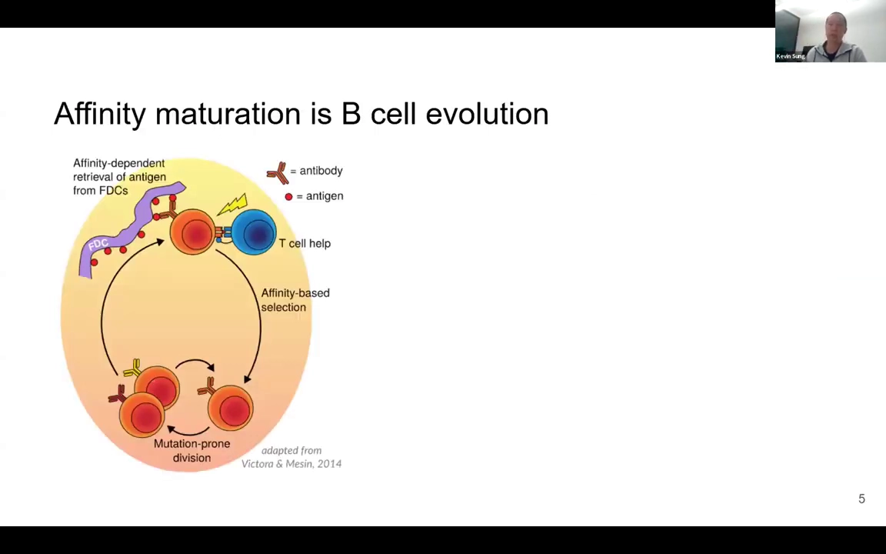

1. B 细胞们竞争结合抗原，能捕获抗原的 B 细胞通过与辅助性 T 细胞的相互作用**被选中**；
2. 被选中的 B 细胞**分裂**并发生**体细胞高频突变**（SHM），产生一群受体略有不同的克隆；
3. 受体更好的克隆胜出，进入下一轮循环。

这个克隆发育过程可以用**系统发育树**来描述：

- 树的**根部**：启动这条谱系的幼稚 B 细胞（初始序列）；
- 树的**每一层**：一轮"突变 + 选择"；
- 树的**叶子**：最终成熟、被测序观察到的 B 细胞。

一个关键的现实限制：实验里我们绝大多数时候**只观察得到叶子**（成熟 B 细胞的序列），根部序列、树结构、祖先序列都得靠计算推断。

## 二、两路模型同台竞技：分子进化 vs 语言模型

讲者的研究建立在 Spisak 等人体细胞高频突变建模工作的基础上：把 BCR 序列数据集转成一系列进化树，再拆成一系列**父子对**（parent-child pair）——每个分支就是一次"父序列 → 子序列"的进化事件。之所以按分支处理，是因为突变效应、突变模式和选择压力都依赖于序列本身，随着序列沿谱系变化，这些模式也在变。

评测的模型分属两个视角：

**分子进化视角（核苷酸层，显式建模）**

- **S5F**：来自 Shazam 代码库的经典体细胞高频突变模型，报告每个**核苷酸 5 聚体上下文**的突变率——只看核苷酸上下文，不含选择；
- **Thrifty**：出自 Matsen 实验室，用卷积网络高效查看 **13 聚体窗口**。它有两个版本：用**非功能性序列**训练的 Thrifty-SHM（只模拟突变），以及换用**功能性序列**训练的 **Thrifty-prod**（同时包含突变与选择两种效应）。

**语言模型视角（氨基酸层，隐式学习）**

- **AbLang2**：只用抗体氨基酸序列训练的掩码语言模型，原则上应能同时预测突变与选择效应；
- **ESM-1v**：只用通用蛋白质序列训练的语言模型，但因已被用于抗体工程研究，值得纳入比较。

[【跳转到 04:08】](https://www.youtube.com/watch?v=m19JjRRIkGM&t=248) 两种视角的分歧点在于：分子进化模型**显式地**刻画核苷酸序列背景下的突变特征；语言模型则**隐式地**假设"蛋白质特性都写在氨基酸序列里"，指望用海量氨基酸序列把这些规律学出来。

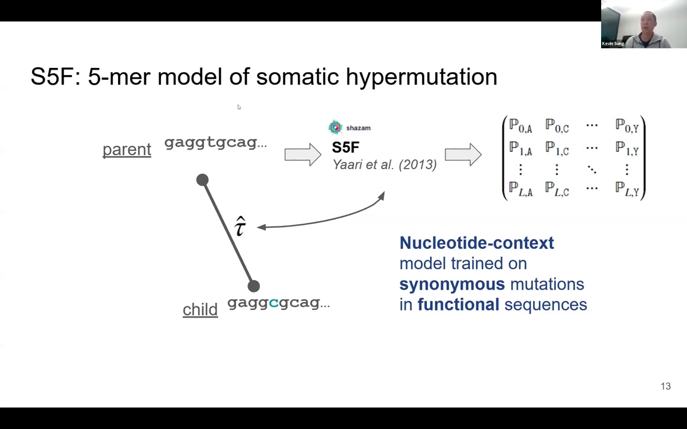

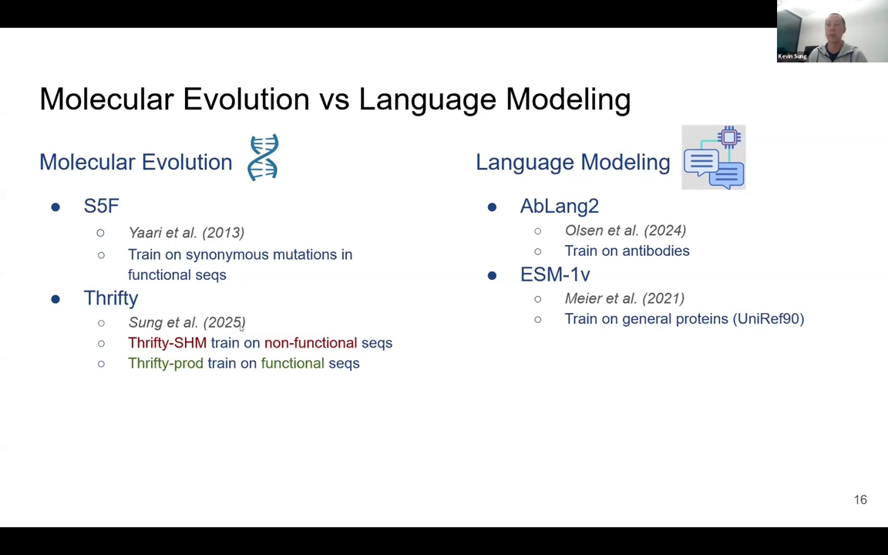

评测还包括一类**组合模型**：从 S5F 或 Thrifty-SHM 取突变概率，再乘以一个由语言模型（此处用 ESM）给出的**选择因子**——大于 1 表示该氨基酸结果比亲本更受欢迎，小于 1 表示更不受欢迎。

## 三、评测框架：沿进化树逐分支给模型打分

对每个父子对，模型的输入是**父序列 + 父子之间的进化时间**，输出是一个矩阵：每一行对应序列中一个氨基酸位点，每行给出 20 种氨基酸各自的概率。

[【跳转到 03:43】](https://www.youtube.com/watch?v=m19JjRRIkGM&t=223) 评测两个任务、两个指标：

- **重叠度（overlap）**——衡量模型能否预测"**哪里**发生替换"。把观察到的替换次数按 IMGT 编号位置统计成分布，再由模型概率跨分支求和得到期望分布，重叠度 = 两个分布**交集面积 ÷ 平均面积**，越接近 1 越好；
- **困惑度（perplexity）**——衡量模型能否预测"**变成什么**氨基酸"。本质是"子代实际出现的那个氨基酸"在模型下的概率的倒数，再对所有替换事件取几何平均，越低越好。

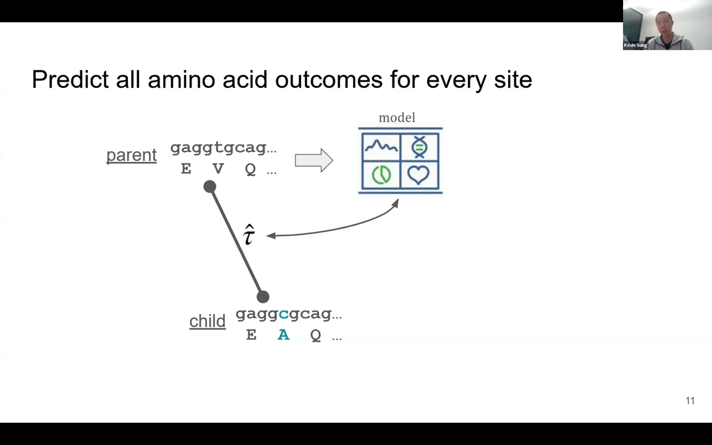

先看**观察分布**。在一个包含 440 对父子关系的数据集里，按 IMGT 位置统计替换次数，分布的峰值对应 CDR 区——正是抗体与抗原接触、被选择压力青睐的区域：

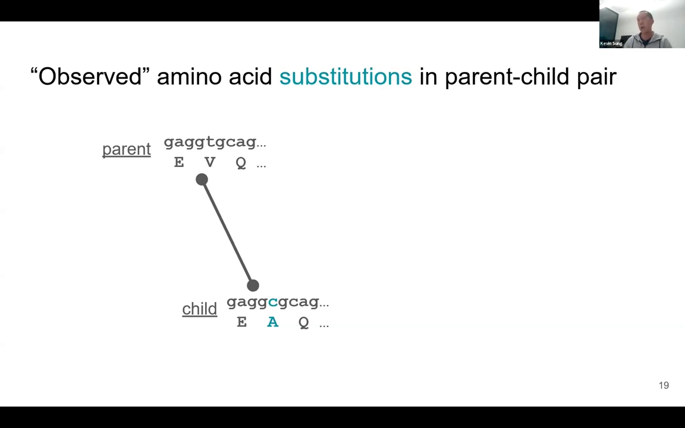

顺带一提：CDR3 处出现了一个奇怪的凹陷，这只是 IMGT 编号的处理方式造成的假象——不同 CDR3 长度会引入不同的编号位置，而比对的是不同长度的序列，**没有任何真实的生物学原因**。

再看**期望分布**：选定模型后，把模型预测的每位点替换概率跨所有分支相加，就得到模型"以为"的替换次数分布（下图为 S5F）：

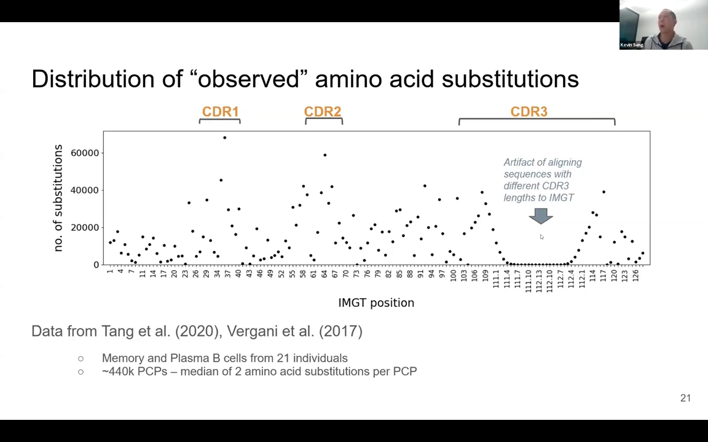

## 四、结果一：预测"哪里会突变"——核苷酸上下文说了算

[【跳转到 09:58】](https://www.youtube.com/watch?v=m19JjRRIkGM&t=598) 第一个反直觉的结果出现了：**S5F 的重叠度为 0.783，实际并不比 AbLang2 差**。这很有意思——S5F 只是个体细胞突变模型，连选择都没建模，而 AbLang2 本应同时模拟突变与选择两种效应。

这说明：就预测替换发生的位置而言，**体细胞高频突变是更主导的影响因素**；同时也表明，核苷酸环境对精确建模体细胞高频突变至关重要——而这正是只看氨基酸序列的语言模型缺失的信息。

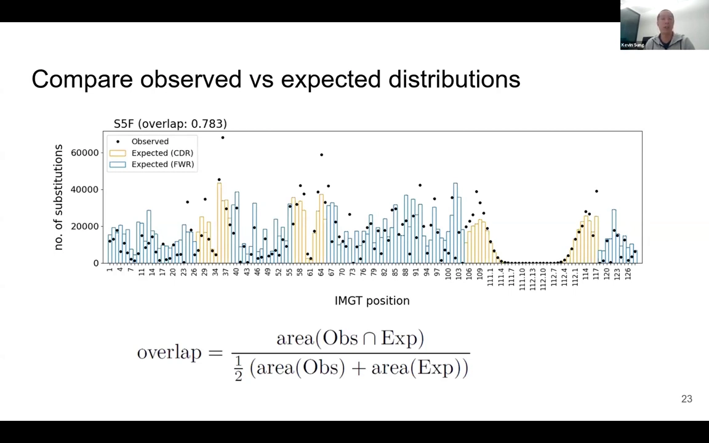

更进一步，用功能性序列训练、同时包含突变与选择的 **Thrifty-prod 拿到了 0.923 的高重叠度，是整个研究中综合表现最好的模型**：

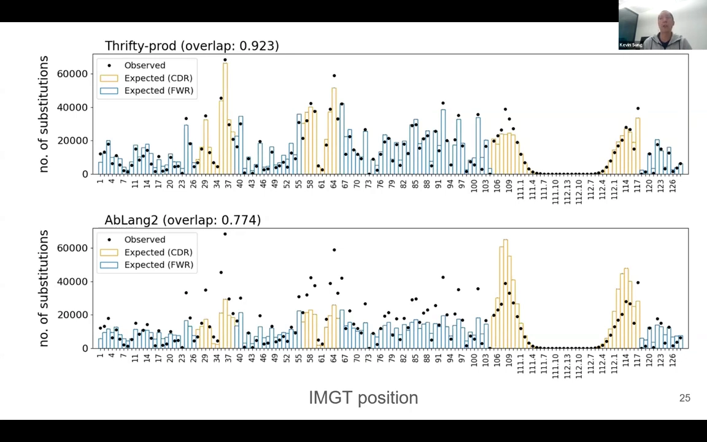

把所有模型的重叠指标汇总成表：前三个是分子进化模型，AbLang 与 ESM 是语言模型，下面是组合尝试。

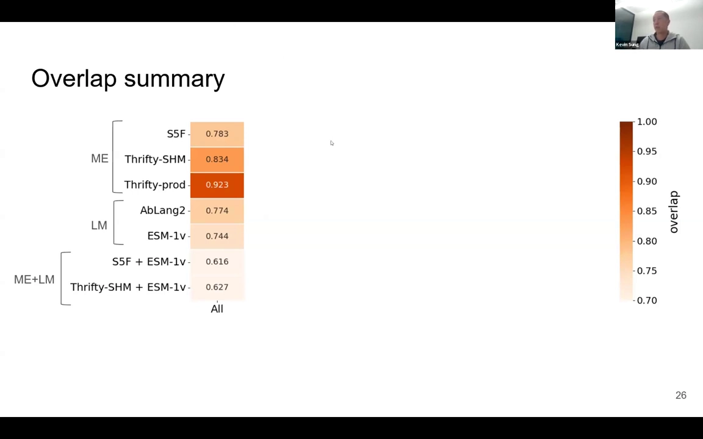

两条结论：

1. **分子进化模型确实优于语言模型**；
2. 有趣的是，**"突变模型 × 语言模型选择因子"的组合模型表现反而更差**——直接拿通用语言模型当选择因子，并不好用。

## 五、结果二：预测"突变成什么"——困惑度的区域模式

第二个指标困惑度考察的是：给定某处发生了替换，模型能否押中那个实际出现的氨基酸。先把规则摆清楚：模型给的概率高，困惑度就低，是好事；概率小，困惑度就高，说明模型对观察到的替换很"困惑"。

汇总表（越低越好，颜色越深越好）：

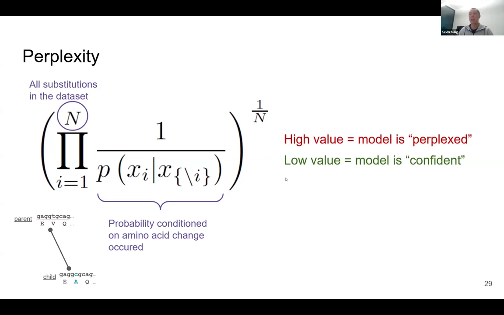

[【跳转到 13:35】](https://www.youtube.com/watch?v=m19JjRRIkGM&t=815) 读表要点：

- 三个分子进化模型都好于 ESM，而 **AbLang 在困惑度上胜过了 S5F**——语言模型在"押中具体氨基酸"这件事上有自己的长处；
- 组合模型的表现依然不好；
- 分区域看，各模型呈现一致的总体模式：**框架区（FW）表现更好、困惑度更低，CDR 区困惑度更高**。讲者的解释是：框架区存在更多受纯化选择约束的位点，替换结果因此更容易被准确预测。

## 六、后续工作 DASM：把突变与选择真正捏合到一起

前面简单的"相乘式"组合失败了，讲者在收尾前介绍了他们更有前景的合体方案——**深度氨基酸替换模型 DASM**（Deep Amino acid Substitution Model）。

[【跳转到 14:43】](https://www.youtube.com/watch?v=m19JjRRIkGM&t=883) 核心想法是**残差学习**：

1. 突变部分继续用已训练好的 Thrifty-SHM 突变模型；
2. 把突变效应"减掉"后，剩下的**残差**再训练一个模型去学，并把残差解释为**选择**的结果——这次是用类似语言模型的方式来训练这个选择因子。

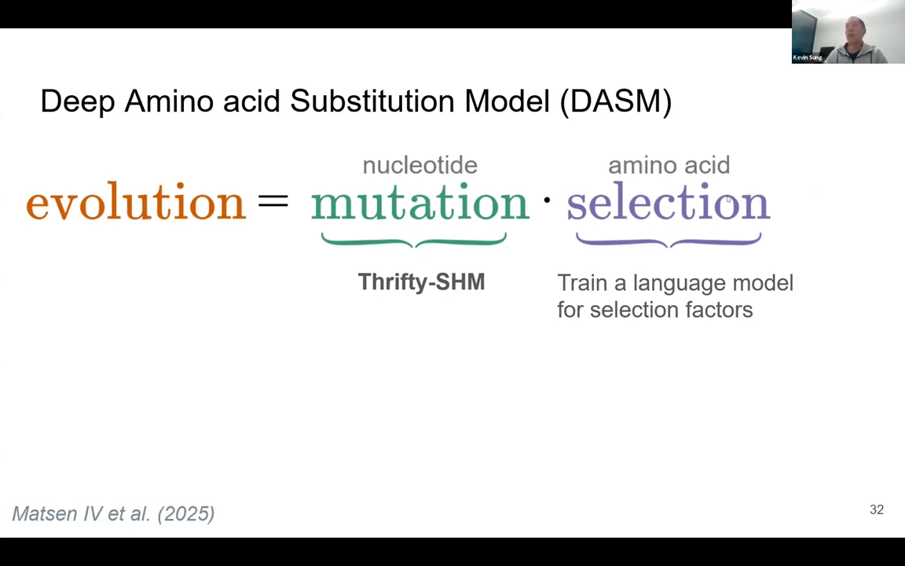

结果是：加上 DASM 选择因子后，观察分布与预测分布的**重叠度非常高**。讲者坦言这或许不足为奇——毕竟就是在训练它拟合亲和力成熟过程。但真正有意思的验证在下一步：把 DASM 的选择因子与**深度突变扫描（DMS）实验**测得的结合、表达测量值算相关性：

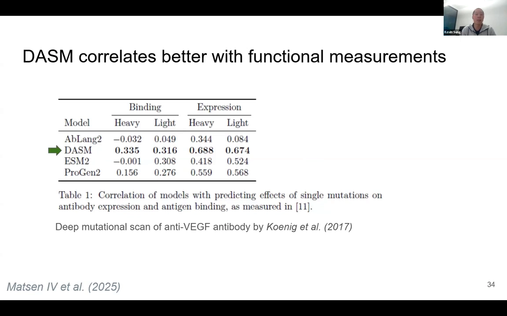

[【跳转到 16:11】](https://www.youtube.com/watch?v=m19JjRRIkGM&t=971) **DASM 的相关性高于各个蛋白质/抗体语言模型**。这给了团队很大鼓舞：它在可解释性上很有前景，而且确实捕捉到了一些真实的生物学效应——不只是背下了训练分布。

## 小结

- 亲和力成熟 = 生发中心里"突变（SHM）+ 选择"的循环；实验只见叶子（成熟 B 细胞），祖先与树靠计算推断，模型沿进化树逐分支（父子对）评测。
- 两个任务两种尺子：**重叠度**量"哪里突变"，**困惑度**量"突变成什么"；前者看观察分布与期望分布的吻合，后者是观察氨基酸概率倒数的几何平均。
- 核心发现：**预测替换位置，核苷酸上下文说了算**——只建模突变的 S5F（重叠度 0.783）不输本应同时建模选择的 AbLang2；Thrifty-prod 以 0.923 成为全场最佳。
- **简单相乘的组合模型（突变 × 通用语言模型选择因子）反而更差**；困惑度上 AbLang 胜过 S5F，说明语言模型在氨基酸层面仍有长处。
- 区域模式：框架区受纯化选择约束更强、更易预测（困惑度更低）；CDR 区替换更多样、更难预测。
- 后续工作 **DASM** 用残差学习把"突变模型 + 语言模型式选择因子"真正合体，与 DMS 功能测量的相关性优于各语言模型。
- 一句话结论：**核苷酸环境对准确建模抗体亲和力成熟至关重要**；论文已把整套评测流程开源为 EPAM 框架（`matsengrp/epam`），并据论文补充：Thrifty-SHM 仅 5931 个参数，对照 S5F 的 3072、AbLang2 的 4500 万与 ESM-1v 的 6.5 亿——小模型打赢大模型的差距正来自"看对了层次"。

## 关键术语速查

| 术语 | 一句话解释 |
| --- | --- |
| 亲和力成熟（affinity maturation） | B 细胞经"体细胞高频突变 + 选择"循环、结合抗原能力越来越强的进化过程 |
| 体细胞高频突变（SHM） | B 细胞分化中由酶靶向特定核苷酸基序、高频率引入 DNA 突变的过程 |
| 父子对（PCP） | 系统发育树上一条分支两端的两条序列，构成一次可评测的进化事件 |
| 重叠度（overlap） | 观察替换分布与模型期望分布的交集面积 ÷ 平均面积，衡量"预测哪里突变"，越接近 1 越好 |
| 困惑度（perplexity） | 实际出现氨基酸的模型概率的倒数之几何平均，衡量"预测变成什么"，越低越好 |
| IMGT 编号 | 抗体序列的标准化编号方案，使不同长度、不同序列的位点可以按位置对齐比较 |
| 选择因子（selection factor） | 乘在突变概率上的倍数：>1 表示该氨基酸比亲本更受欢迎，<1 表示更不受欢迎 |
| DMS（深度突变扫描） | 对序列每个单突变体批量测量结合/表达等功能的实验，用作模型评测的金标准 |
| EPAM | Evaluating Predictions of Affinity Maturation，本研究的统一评测框架（matsengrp/epam） |
| DASM | 深度氨基酸替换模型：以 Thrifty-SHM 为突变底座、残差式学习选择因子的后续模型 |
