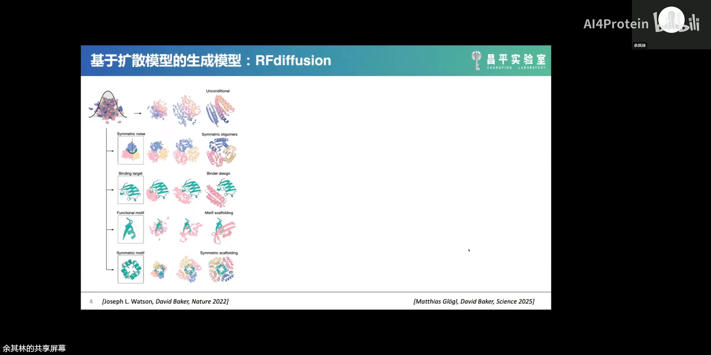
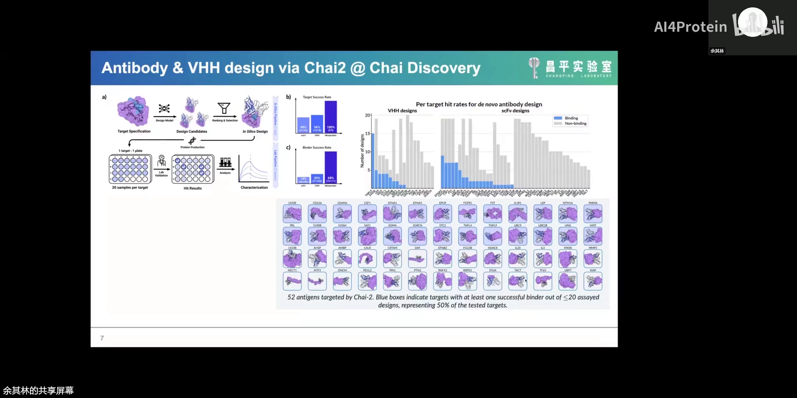
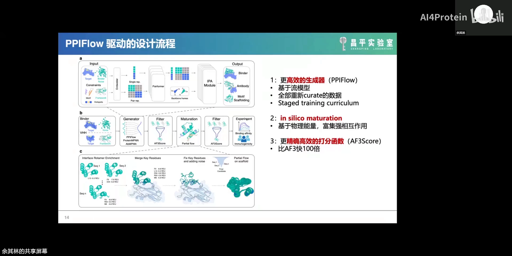
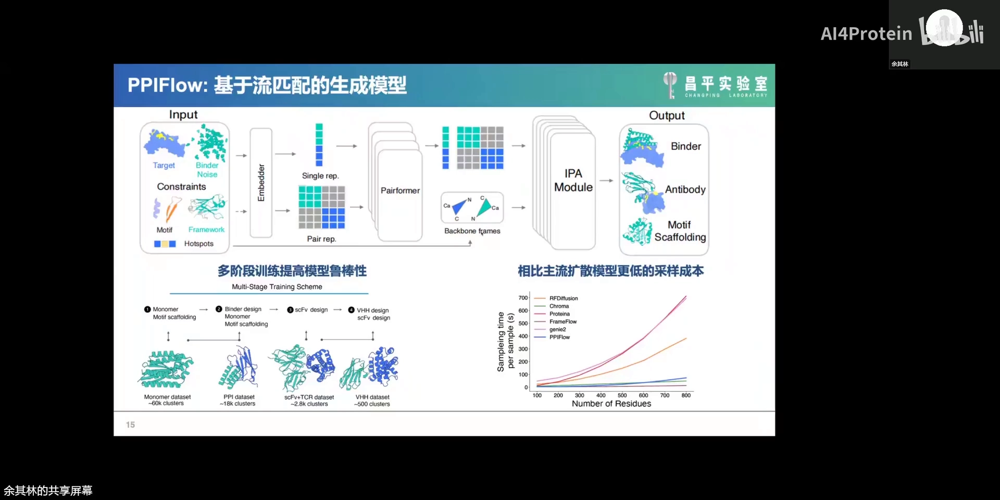
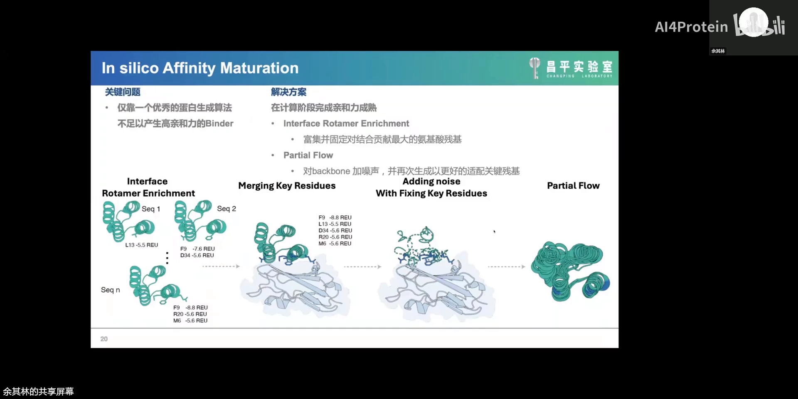
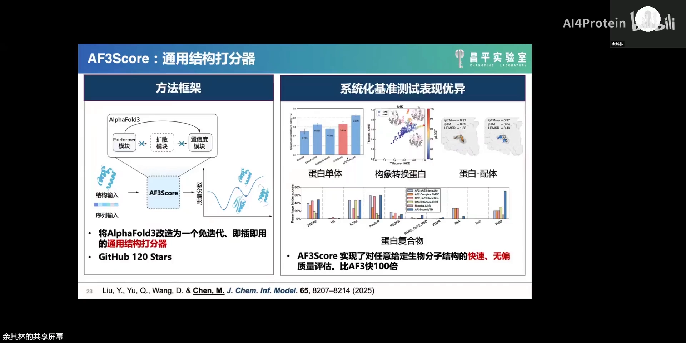
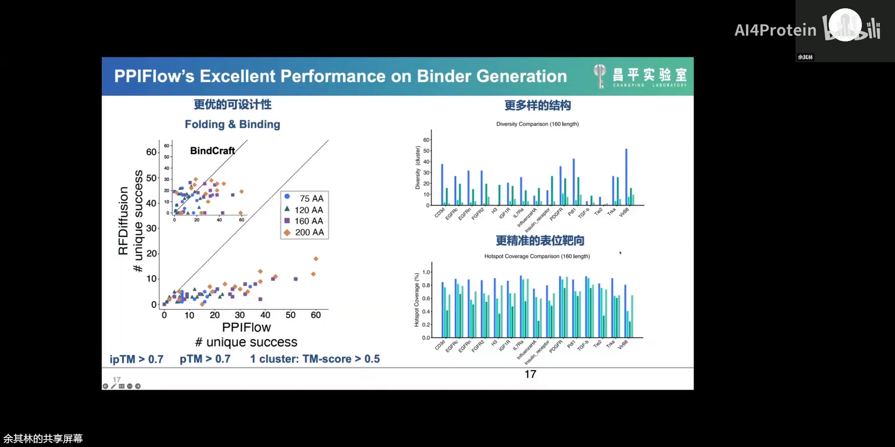
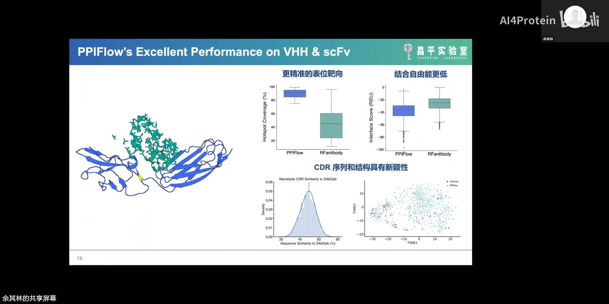
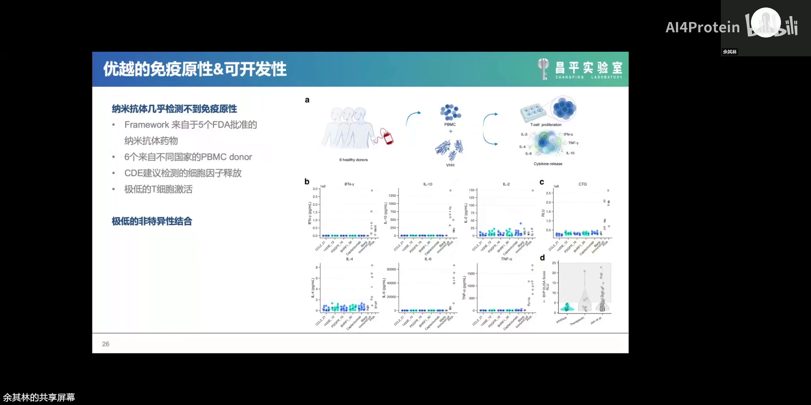
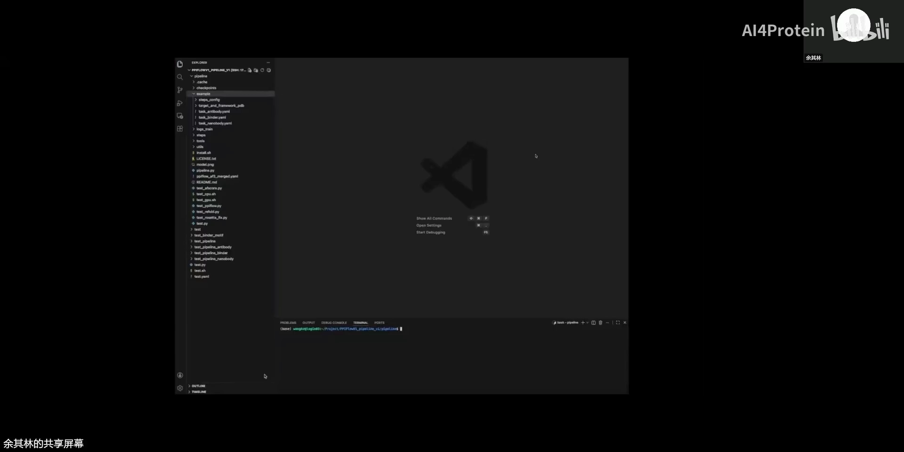

# 抗体设计 PPIFlow：流匹配 + 计算亲和力成熟，把 binder 一步设计到皮摩尔级

> 视频：[余其林｜抗体设计PPIFlow](https://www.bilibili.com/video/BV129GE6wENC)（76 分 34 秒，AI4Protein 第 18 期报告；B 站标题中的"余其林"为 up 主误记，经论文核实讲者为 PPIFlow 一作 Qian Yu）
> 讲者：Qian Yu（昌平实验室副研究员，曾任 Neox Biotech 生物计算科学家，合作导师为昌平实验室领衔科学家陈明；核心方向为蛋白质生成与蛋白质药物设计）
> 对应工作：PPIFlow — *High-affinity binder design with flow matching and in silico affinity maturation*（bioRxiv 2026 年 1 月公开，4 月更新；算法与全部实验数据开源）

## 本讲要解决的核心问题

**背景**：AlphaFold2 拿下 2024 年诺贝尔化学奖后，"RFdiffusion 生成骨架 → ProteinMPNN 设计序列 → AlphaFold2 回折验证"已成为 de novo binder 设计的标准范式；2025 年 Chai-2、Nabla Bio JAM-2、LatentX 等工作又展示了 AI 一步生成抗体/纳米抗体的真实成绩单。

**冲突**：但讲者团队长期跟踪 Dave Baker、Bruno Correia 的工作后发现一个最严重的问题——**affinity 一直做不上去**：算出来的 binder 往往结合不够强，还要靠后续优化；基于折叠模型的"幻想（hallucination）"类方法更是普遍存在三个毛病——亲和力有限、受折叠算法自身偏好约束、精准靶向指定表位（epitope）的能力非常有限。与此同时，2025 年成绩最好的三个模型（Chai-2、LatentX2、JAM-2）**全部闭源**，抗体生成成功率也只在 10%~30% 之间。

**疑问**：能不能让"结合力"不再是事后补课——在计算阶段就把亲和力成熟模拟掉，一步生成就有药用价值？而且把整套东西开源出来？

**回答（中心思想）**：昌平实验室给出的答案是 **PPIFlow**：用「流匹配生成器 + in silico 亲和力成熟 + AF3 score 快速打分」三件套组成的设计平台，在 15 个靶点上做到 **14 个拿到成功 binder、成功率 30%~40%、多个靶点皮摩尔级亲和力**，并且算法与全部实验数据开源。

## 一、背景与痛点：AI binder 设计的"最后一纳米"

先交代方法谱系。一级序列决定三级结构；反过来，有了三级结构也可以反推最适合折叠成它的序列——这就是逆折叠。RFdiffusion（2023，Dave Baker 组）把"生成骨架 → ProteinMPNN 配序列 → AlphaFold2 验证"变成标配，范式下最好的结果是 2025 年发表在 Science 上的工作：在 TNF receptor 1 及整个家族上做到很不错的亲和力。

[【跳转到 04:12】](https://www.bilibili.com/video/BV129GE6wENC/?t=252) 另一条路线是"幻觉"类：代表是 BindCraft——基于 AlphaFold2 前向传播，从随机序列出发，用 confidence head 算 loss 回传优化序列、迭代到能折叠成目标结构为止（方法 2022 年就公开在 GitHub，2025 年才随大量应用一起登上 Nature）。同类还有 AlphaProteo（基于 AF3）、BoltzDesign（基于 Boltz）、基于 Protenix 的 px design 等。但这类模型普遍：① 亲和力有限；② 生成受 folding algorithm 自身偏好限制；③ 精准靶向 epitope 的能力非常有限，容易脱离指定表位。

再看 2025 年的同侪成绩单（这页也是全场信息量最大的背景板）：

- **Chai-2**（Chai Discovery）：52 个靶点做 scFv 与纳米抗体生成，26 个靶点拿到至少一个 5 μM 以内的抗体/纳米抗体，且每个靶点只测试了 20 个候选设计以内——当然这些靶点本来就有已知 binder 能结合的 epitope；
- **Nabla Bio JAM-2**：16 个靶点，每靶点 45 个 scFv + 45 个 VHH，基本每个靶点至少一类成功；
- **LatentX**（前 DeepMind 团队创业公司）：7 个靶点做 VHH，几个达到 100 nM 以内。

三个最好的模型成功率都在 10%~30%，而且都是闭源。讲者引用了一句评论："The future is already here — it's just not evenly distributed."（未来已来，只是分布不均。）——**最好的模型握在闭源方手里，不利于行业发展**；作为昌平实验室的项目组，他们坚定选择开源。

## 二、PPIFlow 平台三件套

PPIFlow = **P**rotein-**P**rotein **I**nteraction **Flow**：一个基于流匹配（flow matching）模型的大分子生成框架。流匹配同样基于常微分方程学习向量场，与扩散模型一样是"加噪—去噪"，但训练目标更直接、恢复路径更直接，采样效率更高。它也是**首个经过实验验证的流匹配生成模型**。

[【跳转到 14:08】](https://www.bilibili.com/video/BV129GE6wENC/?t=848) 整个平台由三部分组成：

### 2.1 更高效的生成器：流匹配 + 多阶段课程

模型框架直接复用 AF3 的关键组件：Performer、IPA module、ipTM model。输入侧对 target 的 epitope 做信息提取，并接受三类约束——motif、target 的 hotspot、想用的 VHH framework——然后输出生成的蛋白。

鲁棒性的另一半来自**从头重新整理的数据集和 multi-stage 训练课程**：先在约 60 万个 cluster 的 monomer 数据（含 domain 与 monomer，内部严格 curation）上训练，再学约 1.8 万个 cluster 的 binder 数据，再学 2800 个 cluster 的 scFv，最后学只有 500 个 cluster 的 VHH——数据一步步变小，模型却一步步变得鲁棒。Q&A 里讲者特别强调：即使实验室资源有限，**从 monomer 开始训也是非常必要的**——后面的数据太少，monomer 阶段让模型见过更多数据、更多样的 pattern 和 interaction。

### 2.2 In silico 亲和力成熟：两步走

这是回应"亲和力上不去"的核心创新。仅靠优秀的生成算法常常不够——这个坑在 RFantibody、RFdiffusion、BindCraft 里都出现过。PPIFlow 的做法是在计算阶段模拟完成亲和力成熟，分两步：

1. **Interface rotamer 富集**：基于 Rosetta 的 score，挑出能量比较低（对结合贡献最大）的关键残基，把它们富集并固定下来；
2. **骨架重去噪**：在固定这些残基的基础上，把 backbone 回退到 t=0.6 重新加噪去噪，让 backbone 更好地贴合这些被固定的残基，再次产生更好的结构和序列。

效果在 in silico 指标上即可验证：成熟前后的 AF3 score complex ipTM 有非常明显提升（binder 与 VHH 都成立）；"good key rescue"的数量在富集后明显变多。更硬核的泛化验证：拿曹龙兴老师 2022 年那批**已在实验中验证可结合的 1303 个蛋白**的 AF2 结构，过滤出最好的 900 多个后再做 in silico maturation——AF3 ipTM 依然显著提升。也就是说，**哪怕对实验上已经成功的分子，计算阶段的亲和力成熟还有油水可榨**。

[【跳转到 24:33】](https://www.bilibili.com/video/BV129GE6wENC/?t=1473) 关于 t=0.6：团队在 binder 上做过 0.1~0.9 的消融——0.1 基本等于重新设计；0.6 是"interface 基本不动、backbone 略微重构"的折中；想要更高多样性可以把 t 调高，做 VHH 时对 CDR 部分也可以退得更多。

### 2.3 AF3 score：快 100 倍的即插即用打分器

把 AlphaFold3 中间的**扩散模块整个去掉**：Performer 信息提取完直接进置信度读出模块打分——不迭代、不用 MSA，变成一个即插即用的通用结构打分器，单体、复合物、蛋白-小分子都能打。效率比 AF3 快 100 倍。

为什么快？Q&A 里讲得很直白：AF3 里最耗时的是信息提取模块（再加上 MSA 与多轮迭代），而去掉扩散、跳过 MSA 后，单次前向就能出分——几千到上万的量级随便跑；AF3 复验则留给筛完之后挑出的 500~1000 个。

## 三、成绩单：从 monomer 到纳米抗体

**计算侧**四个维度：

- **Monomer designability**：用 ESMfold 评估（RMSD ≤ 2Å 口径，follow 公认评测基准的设定），PPIFlow 在所有长度范围的 designability 都高于其他已公开方法；
- **Motif scaffolding**：benchmark 30 个 case（motif RMSD < 1Å 且 monomer RMSD < 2Å 为成功），大部分 case 上优于 RFdiffusion 等，segment 越多（酶设计常见 3~6 个 motif）优势越明显；
- **Binder unique success rate**（结构不重复且成功，TM-score < 0.5 视为同一家族）：200 氨基酸 binder 上，PPIFlow 设计 100 个能拿到 **60 个 unique success，而 RFdiffusion 只有约 10 个**（判定口径：AF3 score 的 ipTM > 0.7 且 pTM > 0.7）；
- **采样速度**：75 长度采样一个成功结构只要四五十秒、200 长度约 100 秒；BindCraft 这类幻觉模型的时间随长度指数级增长，同时还有与 BoltzGen 的对比数据。

**抗体面**的两张王牌：de novo 设计中大家容易忽略"指哪儿打哪儿"——PPIFlow 的 **hotspot coverage 达到 90%**（选 3~6 个氨基酸做 hotspot，生成结构中落在 10Å 内的比例），而 AlphaFold-antibody 只有 40% 左右；同时 Rosetta 评估的 interface 结合自由能更低，且 **CDR 的结构与序列都是全新的**。

## 四、湿实验验证与可开发性

[【跳转到 11:07】](https://www.bilibili.com/video/BV129GE6wENC/?t=667) 实验设定很克制：每个 target 送 **30 个序列**做实验评估。整体战绩：

- **15 个靶点，14 个拿到成功 binder**；binder 结合成功率普遍 30%~40%；
- **7 个靶点中 6 个获得皮摩尔级结合**，其中 5 个优于此前的工作（包括商业上未公开、未经同行评审的）；
- **VHH：8 个靶点每个验证 30 个纳米抗体，全部可表达**；8 个中 7 个拿到成功结合的纳米抗体，4 个达到皮摩尔或个位数纳摩尔；4 个 target 拿到皮摩尔或个位数纳摩尔 VHH；
- 汇总：从头生成迷你蛋白成功率 **37%**、纳米抗体 **33%**，整体 30%~40%，且大量 binder 低于 1 nM。

值得强调靶点背景：这 8 个蛋白都有晶体结构，但**此前都没有 VHH**（个别有天然 binder 或抗体的复合物结构）——所以这些纳米抗体是名副其实的 de novo。

**可开发性是这份成绩单的另一半**。纳米抗体药物到目前为止 FDA 一共批准了 5 个，PPIFlow 全部采用这 5 个药物的 framework——于是免疫原性风险的唯一来源只剩 CDR1/2/3，而 CDR 靠近 framework 的区域又相当保守，真正带来的氨基酸改变总共也就十几二十个，所以免疫原性风险天然较低。实验面：6 个不同国家的 PBMC donor 的细胞因子释放都非常低；T 细胞激活实验阴性；BVP 非特异性检测中特异性优于一排已上市治疗性抗体/纳米抗体参照；SEC 大部分样品表现良好（个别较差）。

## 五、开源与上手：从输入到 HTML 报告

算法 1 月公开、4 月更新，GitHub 已有 160 star；**序列、表达量、结合亲和力数据全部公开**。更新后的 end-to-end 流程：填 target chain 与 PDB、在 binder 上勾选 hotspot 氨基酸、设定生成最大/最小长度与每靶点采样数 → stage one 采样 → stage two in silico maturation → 跑完输出 CSV（全部 metrics，含 AlphaFold、AF3 score 等）与 HTML design report（设计数量、stage two 数量、分数、最优结构一页尽览）。设计可以分批跑——没有明显的种子效应，第一步生成就可以拆成几十个任务。

上手建议（Q&A 原话）：想要高亲和力 binder，蛋白做到 **120~150** 比较好，不建议两三百；能化学合成就做多肽（50 氨基酸以内）；SASA（界面面积）与亲和力是弱相关——想亲和力就把做大面积，想成药性就做 VHH；filter 阶段对平坦、缺疏水残基的靶点要更关注 hydrogen bond（Rosetta 流程里也有对应的 hbond energy 可用）。

## 六、Q&A 精华（节选）

- **流匹配 vs 扩散**：两者都是加噪—去噪，区别在路径——流匹配生成路径更直接、采样更快；训练步数是否更少，团队没做过专门对比。
- **为什么无模板 AF3**：担心靶点上已有大量 binder/antibody 时，带模板的 AF3 会把设计"预测回它学过的位置"；无模板更中立。有模板/无模板的保真性差异未做大批量评测，更多是理论推断。
- **AF3 score ≠ 亲和力**：现在没有任何结构预测算法的 ipTM/confidence 与亲和力有强相关，AF3 也一样。团队做了回溯分析：SASA（界面面积）与亲和力弱相关；Rosetta interface score 与 AlphaFold ipTM 的加权组合相关性约 0.3 出头。
- **L13 失败复盘**：唯一全军覆没的靶点——设计界面面积偏小，Rosetta interface score 只有 -20~-30，加上当时发得急、采样不充分、hotspot 选得不好。
- **为什么敢送测低 ipTM 设计**：送测选的是 round two 之后 AF3 score 的 top，而不是"大于 0.2 就行"；完整 AF3 复验时因为搜到更多 template、MSA 更充足（VHH MSA + target MSA），分数普遍反弹到 0.8 以上。
- **四个 checkpoint**：monomer（含 monomer motif scaffolding）、binder（含 binder motif）、scFv、VHH 各一个。
- **设计失败的通用解法**：扩大采样，或者把 hotspot 挪到任何你想探索的区域多试几次——前期先跑一两百个试方向。
- **一个上手脚本坑**：PyMOL 里 hotspot 出现整体偏移，通常是 target index 没从 1 开始导致的编号错位，不是要先减 2。

## 小结

- PPIFlow = 流匹配生成器 + in silico 亲和力成熟 + AF3 score 快速打分，三件套把"生成—成熟—筛选"压缩进一个开源平台。
- 流匹配与扩散同为加噪去噪，但路径更直接、采样更快；模型本体是 AF3 组件（Performer/IPA/ipTM）加上约束输入（motif / hotspot / framework）。
- 数据课程的"漏斗式"设计（60 万 monomer → 1.8 万 binder → 2800 scFv → 500 VHH cluster）是鲁棒性的另一半来源。
- 亲和力成熟两步走：Rosetta 低能关键残基富集固定 + t=0.6 骨架重去噪；对已实验成功的分子池再跑一轮仍有提升。
- 成绩单：15 靶点 14 成功、成功率 30~40%（迷你蛋白 37%、纳米抗体 33%）、7/6 皮摩尔、VHH 8/7 成功且 4 个皮摩尔级；hotspot coverage 90% vs AlphaFold-antibody 40%。
- 可开发性由"FDA 批准 framework + CDR-only 变化"兜底：PBMC 细胞因子释放低、T 细胞激活阴性、BVP 特异性好。
- 全部算法、序列、表达与亲和力数据开源，并给出 end-to-end 协议——用作者的话说，未来已来，只是分布不均；他们选择把分布摊平。

## 关键术语速查

| 术语 | 一句话解释 |
| --- | --- |
| 流匹配（flow matching） | 基于常微分方程学习向量场的生成模型；与扩散同为加噪去噪，但路径更直接、采样更快 |
| 幻想 / hallucination | 直接在可微结构预测模型上做梯度迭代"白日梦"式设计（BindCraft、AlphaProteo 等属此类） |
| epitope / hotspot | 抗原上被结合的表位 / 其中被刻意约束的关键残基（通常选 3~6 个） |
| hotspot coverage | 生成的 binder 中，落在所选 hotspot 周围 10Å 以内的比例，衡量"指哪儿打哪儿" |
| in silico 亲和力成熟 | 在计算阶段模拟体细胞亲和力成熟：界面 rotamer 富集固定 + 骨架回退重去噪 |
| t=0.6 回退 | 亲和力成熟第二步的去噪起点：interface 基本保持、backbone 略微重构；调高则多样性更大 |
| AF3 score | 去掉 AF3 扩散模块、免 MSA 免迭代的即插即用结构打分器，比 AF3 快约 100 倍 |
| unique success rate | 设计 100 个中"结构不重复（TM-score < 0.5）且成功"的数量 |
| Rosetta interface score | 用 Rosetta（interface analyzer）评估的界面能量，越负代表界面越有利 |
| FDA 批准 framework | 已获批纳米抗体药物的骨架区序列；沿用它们可把免疫原性风险压缩到 CDR 区 |
| BVP | 一种常见的非特异性/多反应性检测实验，用于评估抗体是否"乱结合" |
