# MOE 抗体药物设计系列讲座第二讲：基于结构的抗体人源化设计

> 视频来源：[Bilibili《MOE抗体药物设计系列讲座第二讲 - 基于结构的抗体人源化设计》](https://www.bilibili.com/video/BV1av4y1j7vR/)（62 分 31 秒，主讲人：肖兴哲）
> 本文基于视频演说图文稿撰写，观点与数据均可回看视频核对。

## 本讲要解决的核心问题（SCQA）

**背景**：治疗性抗体常常来自小鼠等非人物种（杂交瘤/鼠源单抗）。直接用于人体会引发免疫反应，因此要做"人源化"——让它看起来更像人类自己的抗体。上一讲介绍了用 MOE（Molecular Operating Environment，加拿大化学计算集团 CCG 研发的大小分子药物设计软件）进行抗体结构模建。

**冲突**：最常见的 CDR 嫁接法只把非人 CDR 换到人源框架上，操作简单，但经常出现活性下降——因为 CDR 和框架区（FR）并不相互孤立，距离 CDR 很远的框架残基也会影响 CDR 的结合功能。

**疑问**：如何系统地判断哪些框架残基必须"改回"非人形式（反向突变），哪些可以放心换成人的，从而在降低免疫原性的同时保住活性？

**回答（中心思想）**：MOE 把这件事变成了一个基于抗体三维结构的五步流程：**结构模建 → 鉴定经典残基（canonical rescue）→ 搜索人源 V 基因（按 FR 同源性排序、剔除假基因）→ 组合打分生成人源化序列 → 实验验证**；其中"经典残基"三类型分析是全流程的灵魂，它把"哪些位点必须反向突变"从猜变成了按优先级排序的决策。官方给出的经验数据是：一轮人源化成功率约 80%，第一轮不理想再做一轮可到 90% 以上。

## 一、先看清两难：CDR 嫁接为什么掉活性

### 1.1 人源化抗体的一般流程

讲座先回顾了人源化抗体的经典闭环（[01:59](https://www.bilibili.com/video/BV1av4y1j7vR/?t=119)）：

1. 从异源杂交瘤 B 细胞出发，克隆并测序，得到**非人源序列**；
2. 设计 CDR 嫁接：非人源 CDR 区 + 人源化后的 FR 区；
3. 生成人源化轻链/重链组合，构建表达体系，做**重组抗体表达**；
4. 测试人源化抗体对抗原的结合能力（binding、细胞层面实验）。

结果足够好 → 直接得到结合活性（binding potency）最高的人源化抗体；活性下降太多、达不到预期 → 回到设计端，查看人源化抗体上有哪些位点可以做**回复突变（反向突变）**或其他改造，把活性提回来、或保留亲本抗体中的活性。

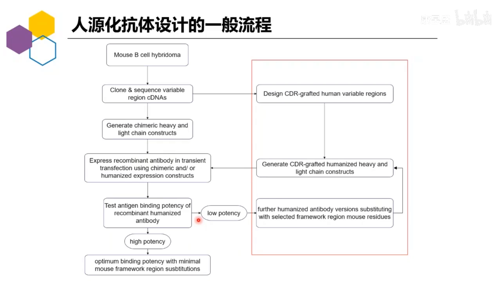

### 1.2 直接嫁接的风险

CDR 嫁接的思路（[02:57](https://www.bilibili.com/video/BV1av4y1j7vR/?t=177)）：把非人源 CDR 嫁接到人源框架之上。这样整条抗体只有轻链和重链的 CDR 是异源的，序列上与人类自然产生的抗体高度相似，免疫原性随之降低。

但风险在于（[03:57](https://www.bilibili.com/video/BV1av4y1j7vR/?t=237)）：**CDR 和 FR 并不相互孤立**。直接嫁接虽然免疫原性降了，活性却常见下降——距离 CDR 区较远的框架氨基酸残基，也会影响 CDR 发挥结合功能。因此必须采用合理的设计方法：**选择合适的 FR 模板，并针对关键残基做"最少反向突变"（back mutation），保住人源化后的活性**。

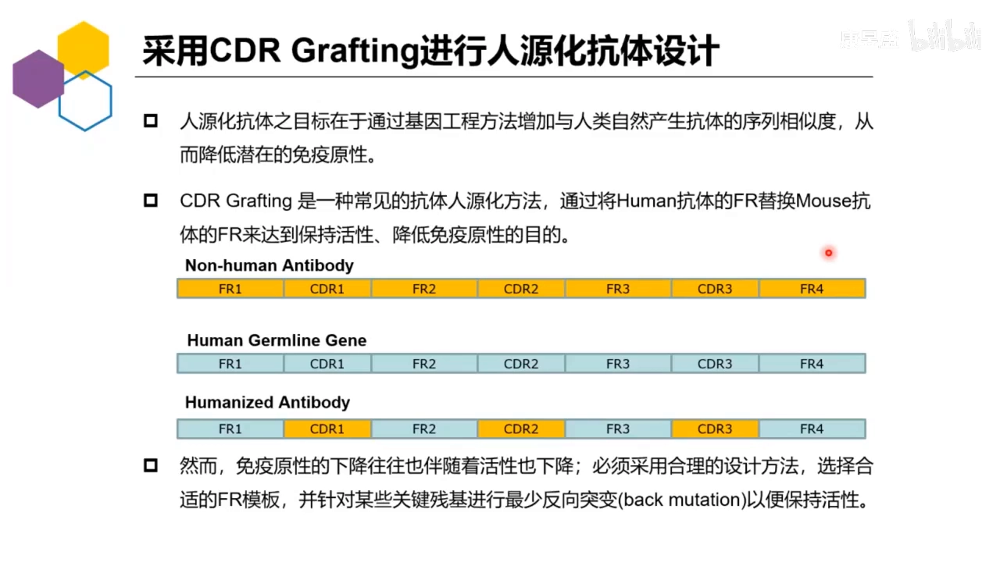

## 二、MOE 的解法：基于结构的五步人源化流程

### 2.1 流程总览

在 MOE 中，人源化抗体的设计流程是（[04:24](https://www.bilibili.com/video/BV1av4y1j7vR/?t=264)）：

1. 拿到非人源序列，做**三维结构模建**，得到异源序列抗体的结构；
2. 通过结构鉴定**经典残基（canonical rescue）**；
3. 选择合适的人源 V 基因（人类自然产生的抗体基因），考察其 **FR 区序列同源性**；
4. 根据 **FR、CDR 与 canonical rescue 的组合打分**，生成人源化抗体序列；
5. 实验做重组抗体表达，测试抗原结合亲和性——足够好即拿到最终序列；不够好则回到优化与回复突变。

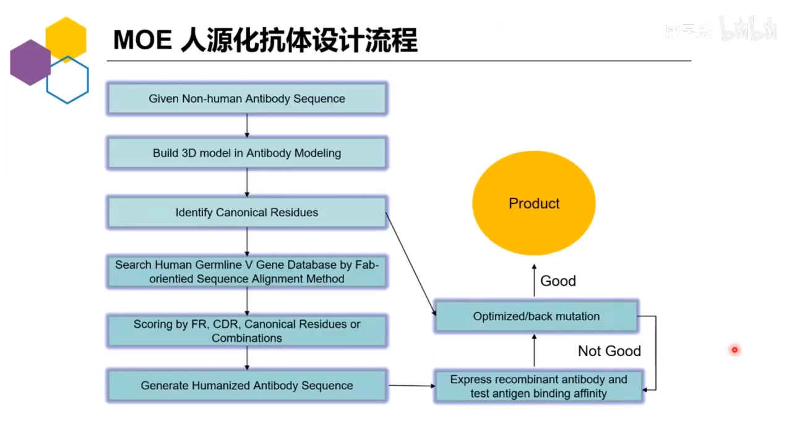

### 2.2 工具包与成功率

MOE 的抗体人源化工具包结合其已有工具，主要包括（[19:31](https://www.bilibili.com/video/BV1av4y1j7vR/?t=1171)）：抗体三维结构建模、抗体经典残基分析、人源化模板搜索与人源化序列生成、基于经典残基分析的反向突变分析。这套流程已被客户广泛应用于抗体人源化设计。成功率方面：**一轮人源化约 80%；第一轮活性掉太多，对候选结果再做一轮，可达 90% 以上**。主讲人表示该模块"广受认可"。

## 三、灵魂概念：经典残基（canonical rescue）三类型

这是全讲座的核心。MOE 通过大量实验数据分析证实：有三类框架残基对 CDR 区的活性非常重要，称之为**经典残基（canonical rescue）**（[09:50](https://www.bilibili.com/video/BV1av4y1j7vR/?t=590)）。它们绝大部分不直接接触抗原，但会间接影响 CDR 构象，进而影响 CDR 与抗原的结合。

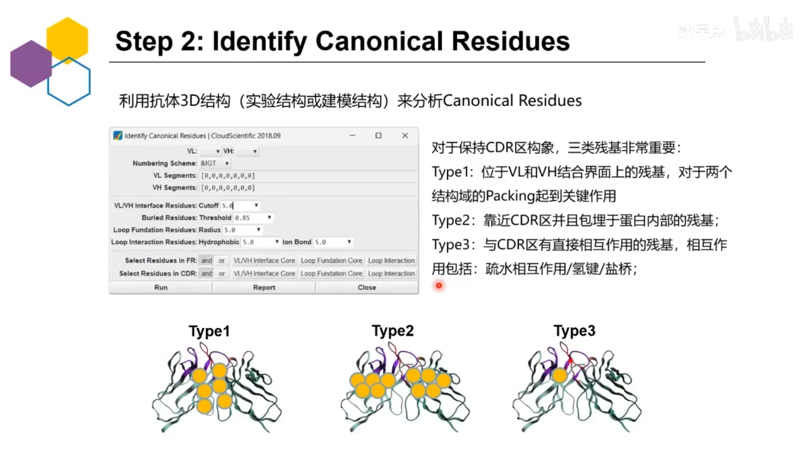

- **Type 1：轻链-重链结合界面上的残基**。对两个结构域的 packing（堆叠）起关键作用；这类残基变化可能影响轻链-重链之间的结构堆叠（[10:00](https://www.bilibili.com/video/BV1av4y1j7vR/?t=600)）。
- **Type 2：靠近 CDR 且包埋在蛋白内部的残基**（软件会计算包埋率）。它们像地基一样支撑 CDR 构象，被称为 **loop foundation**。若此位置出现差异且空间位阻变化过大——比如丙氨酸变成精氨酸、苯丙氨酸变成甘氨酸——支撑作用受影响，可能把其上的 CDR 环顶起来或塌陷下去（[10:25](https://www.bilibili.com/video/BV1av4y1j7vR/?t=625)）。
- **Type 3：直接与 CDR 发生相互作用的残基**，相互作用形式包括疏水相互作用、氢键和盐桥。人源化时这些残基原本在稳定 CDR 构象，若相互作用消失就要重新考虑（[11:00](https://www.bilibili.com/video/BV1av4y1j7vR/?t=660)）。

还有一个**不易察觉的陷阱**（[11:50](https://www.bilibili.com/video/BV1av4y1j7vR/?t=710)）：某位点之前并不与 CDR 相互作用，但反向突变之后形成了**全新的相互作用**。这要求在整体做完人源化后，用候选序列重新做人源化抗体模建，再做不同程度的结构优化（得到能量较小或动力学稳态的结构），然后重新分析 CDR 的差异。

对**纳米抗体**而言没有轻链-重链界面，因此不用考虑 Type 1（[12:00](https://www.bilibili.com/video/BV1av4y1j7vR/?t=720)）。

## 四、贯穿全场的案例：鼠源 GC33 抗 GPC3 抗体

讲座用一个真实案例演示整条流程（[09:08](https://www.bilibili.com/video/BV1av4y1j7vR/?t=548)）：一篇 2010 年发表的研究中，靶点是**GPC3**（磷脂酰肌醇蛋白聚糖 3，一个主要表达在肝癌组织细胞表面的蛋白多糖）；鼠源单克隆抗体 **GC33** 能特异性结合 GPC3 的 C 末端，从而杀死肝癌细胞。为了把 GC33 推向临床实际应用，研究采用 CDR grafting（CDR 嫁接）方法对其进行人源化改造——这正是本次演示要复现的对象。

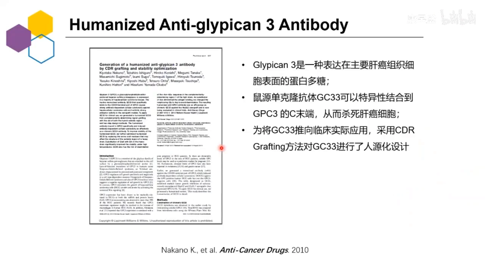

## 五、实操第一步：序列注释与抗体结构模建

### 5.1 注释方式的选择是个权衡

把 GC33 序列导入 MOE 后，第一步是**抗体结构注释**（Annotate Antibody）。MOE 提供多种注释方式：常用的 **Kabat、Chothia、IMGT**，以及 MOE 自己的 **CCG**，也可以人工注释（[10:07](https://www.bilibili.com/video/BV1av4y1j7vR/?t=607)）。

注释方式会影响人源化结果，因为不同方法对 CDR 区和 FR 区边界的判断不一样（[10:42](https://www.bilibili.com/video/BV1av4y1j7vR/?t=642)）：

- **IMGT** 相对"激进"：CDR 序列会变得非常短（可能只有几个残基），FR 区相应更长；实操中轻链 CDR-L1 在 IMGT 下只剩 3 个残基。
- **CCG** 则会把更多部分划为 CDR、更少部分划为 FR——人源化分析的工作量会减少，但 CDR 太长会让序列整体更偏向异源、不够"人"。

因此要做权衡，本案例选用 **CCG** 进行注释。

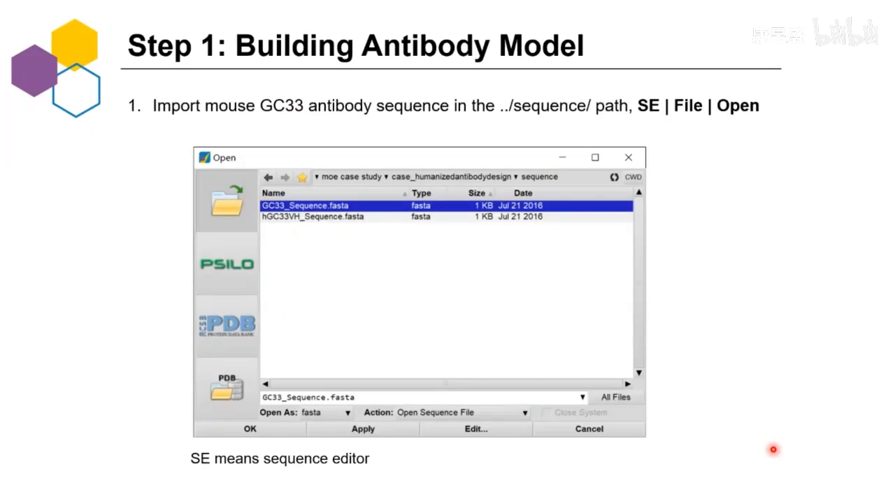

### 5.2 结构模建：模板挑选的四个考量

注释完成后用 **Antibody Model**（上一讲的主题）做抗体结构模建。常用做法是构建 **Fv**（可变区片段），足够后续经典残基鉴定使用；也可以构建纳米抗体等其它类型——单域抗体（VHH）模式只需选择一条重链（[12:22](https://www.bilibili.com/video/BV1av4y1j7vR/?t=742)）。

模板挑选要综合考虑（[12:49](https://www.bilibili.com/video/BV1av4y1j7vR/?t=769)）：

1. **序列相似性/同源性**；
2. **晶体结构分辨率**——实操建议挑 2.5 或 2.8 Å 以下、不要超过 3 Å；
3. **种属因素**——对特定种属的抗体序列做模建时，种属应占更大权重：鼠源抗体尽量挑鼠源/啮齿类模板，纳米抗体（羊驼、骆驼、美洲驼等）则挑 camelid 模板。

无论框架区还是 CDR 区的模板，都遵从这些原则。结构模建平均耗时约 **90 秒**。

### 5.3 纳米抗体的特殊问题：CDR-H3"耷拉"

纳米抗体没有轻链支撑，其 CDR-H3 并不一定保持直立状态，有可能"耷拉下来"与 FR 区形成相互作用（[14:52](https://www.bilibili.com/video/BV1av4y1j7vR/?t=892)）。解决办法：对这个结构做**长时间的分子动力学模拟**，检查能否达到稳态；若能稳定下来，就用稳定后的结构做后续分析。

### 5.4 GC33 模板搜索实录：排序、聚类与"手动捞回 3I75"

软件演示中（Antibody Engineering 模块位于 MOE 的 SE（Sequence Editor）界面之下，含 Antibody Model、Canonical Rescues、Identify Canonical Residues、Search Fv Sequence Database 等入口，[21:59](https://www.bilibili.com/video/BV1av4y1j7vR/?t=1319)）：

- **框架模板**：按 score 排序，打分考虑分辨率、种属、整体结构同源性、MD B-factor 等。因为 GC33 是鼠源，优先挑鼠源模板：排名第一的是 Mouse，FR similarity 达 95.7%；排在后面的候选有的 VL FR 略高但 VH 更低、有的 VL FR 高但 VH FR 偏低——总体评价第一个最好，选默认即可（[23:54](https://www.bilibili.com/video/BV1av4y1j7vR/?t=1434)）。
- **CDR 模板**按结构域筛选：L1 选中 5MO9，similarity 与 identity 均为 100%（前几个候选都是 100%）。界面还有"井号 C"列，代表 **CDR 的聚类 ID——ID 差异越大，说明这些 CDR 构象差异越大**。演示中 L1 的第一与第三候选聚类 ID 不同（41 与 43，另一处为 15），但 load 进 3D 视图后整体仍然很相似（[24:29](https://www.bilibili.com/video/BV1av4y1j7vR/?t=1469)）。L2、L3 同样分析，默认均为 5MO9。

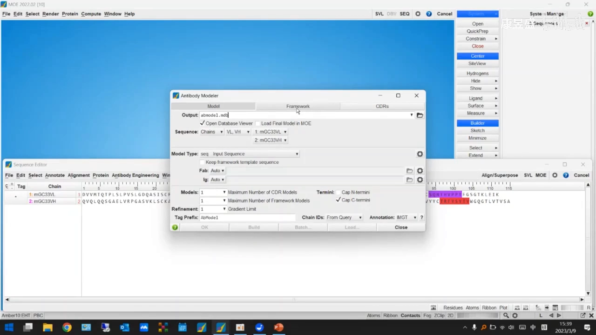

- **H1 差异就比较大**：选中的 6KS2 其 CDR-H1/H2 similarity 只有 75%，略差于前三名；而前三名中前两个分辨率较低。主讲人注意到 **3I75 居然没被选上**——load 进来看，两者虽然被软件标为不同聚类（41 与 7337），但通过序列分析发现整个 CDR 走向完全一样、构象完全一样，因此可以手动双击选择 3I75（想选多条可 mark，编号处会显示 2；本例只 mark 一条）（[25:28](https://www.bilibili.com/video/BV1av4y1j7vR/?t=1528)）。
- **CDR-H3 是模建中最要紧的一环**：它的构象差异在所有 CDR 中最大，一定程度上会影响后续建模以及经典残基鉴定。H3 模板搜索中软件"抛弃"了排序靠前的四个候选——它们虽然排序靠前但 simi 值相同、都是 Mouse，其中两个分辨率不佳；相对较好的是 1H7 与 1H8。load 进来发现 CDR-H3 差异很大：1H7 与 1H8 的 H3 分别朝两个方向，而 3I75 处在中间——这种情况可以**构建多个模型**：第三、第四个候选相同，只需选 1、2、3，把 model number 设为 3 再构建即可生成三个模型；演示中因时间关系只构建了一个，点击 build 约 1–1.5 分钟返回（[43:17](https://www.bilibili.com/video/BV1av4y1j7vR/?t=2597)）。

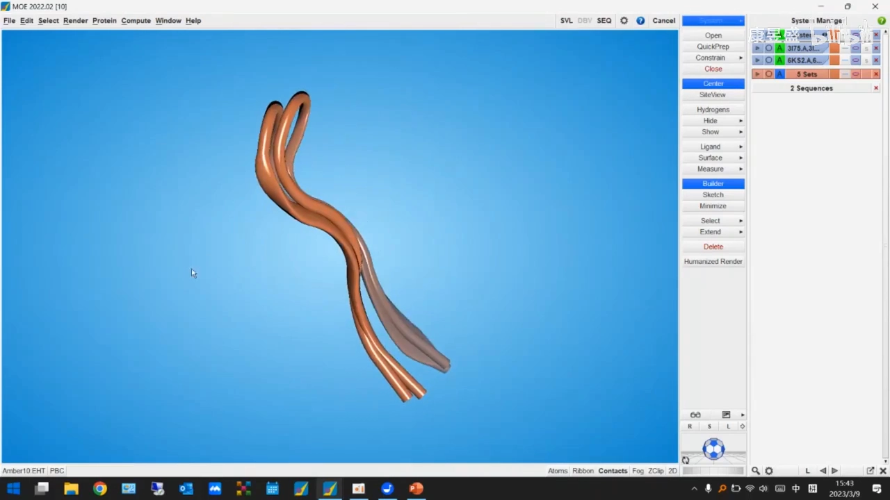

- 模建结果导入后有个细节：序列 C 末端带了两个 **X（cap，乙酰基）**，用于保护构象不受影响；可以直接右键删除，或在 Antibody Model 中不勾选 cap 选项——它不会影响整个序列，只是末端的乙酰基（[46:11](https://www.bilibili.com/video/BV1av4y1j7vR/?t=2771)）。

## 六、实操第二步：Identify Canonical Residues 鉴定经典残基

### 6.1 面板与参数

回到 Antibody Engineering 菜单的 **Identify Canonical Residues**，分别对 VL 和 VH 运行（[28:01](https://www.bilibili.com/video/BV1av4y1j7vR/?t=1681)）。可以直接输入轻链和重链、选择 numbering scheme；阈值参数都经过大量实际实验验证，**建议保持默认**（也可自行调整）。界面还提供 **FR rescues / CDR rescues** 的选择，以及 **and（交集）/ or（并集）**两种组合方式（[21:20](https://www.bilibili.com/video/BV1av4y1j7vR/?t=1280)）。点击 run 约 10 秒即打开一个全新的报告。

### 6.2 报告怎么读：三类型占得越多，优先级越高

报告会列出每个 rescue 的编号、所处位置，以及属于三类型中的哪一种（[13:48](https://www.bilibili.com/video/BV1av4y1j7vR/?t=828)）：

- **D1**：只属于 Type 3（直接相互作用）；
- **M4**：属于 Type 1 和 Type 2——既是界面残基又起支撑作用，还与 CDR 直接相互作用；
- **Y41**：处在轻链 FR 上，同时属于界面、支撑、直接相互作用三类。

主讲人的经验规则（[23:18](https://www.bilibili.com/video/BV1av4y1j7vR/?t=1398)）：**三种类型全占的残基，突变概率非常大、优先级最高——一般直接保留异源抗体原框架的残基（即做反向突变）**；只占两种或一种的要酌情考虑。

报告可另存（File → Save）；直接关掉重跑结果一致。鉴定出的 Type 1 / Type 2 / Type 3 会以原子集合的形式写进 System Manager，保持界面打开即可用于后续选择（[29:08](https://www.bilibili.com/video/BV1av4y1j7vR/?t=1748)）。

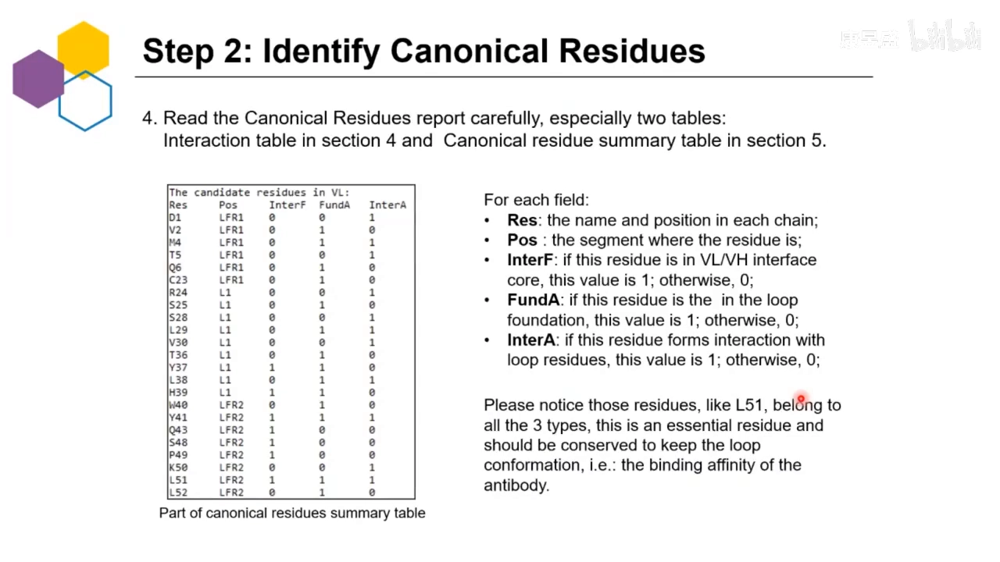

实操中的报告与理论 PPT 一致：列出与 CDR 有相互作用的部分、相互作用界面之上的 Type 1（loop residue in interface）、以及起 foundation 作用的 Type 2；VL 结果中的 D1、E、V2 各属其中一类，H39 与 Y41 属于三类型中的三个，VH 结果中还有 S94（[28:49](https://www.bilibili.com/video/BV1av4y1j7vR/?t=1729)）。

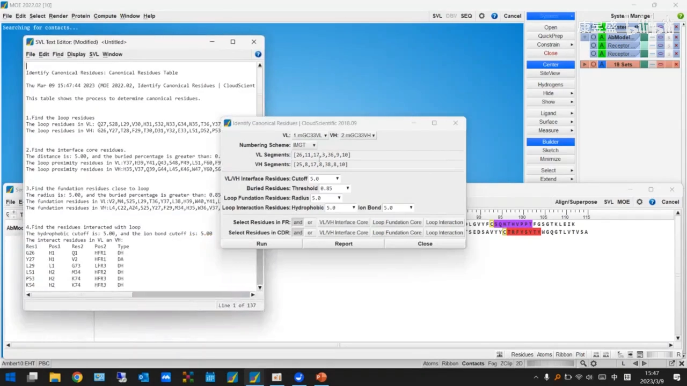

## 七、实操第三步：Search Fv Sequence Database 搜人源框架

鉴定完经典残基，下一步是找"把 CDR 放到谁的框架上"。点击 **Search Fv Sequence Database**，选择 VL 和 VH；先建立 VL，scheme 方法用 IMGT，点击 search（[29:32](https://www.bilibili.com/video/BV1av4y1j7vR/?t=1772)）。

结果按 **FR 区相似性**排序：第一名是 **IGKV2-28**，把前十条 send selected 到 MOE（[29:46](https://www.bilibili.com/video/BV1av4y1j7vR/?t=1786)）。接着对全部候选做一次 IMGT 注释；勾选 enable multiple subunit view 可把重链放一边、只看轻链，再做 Align 对齐。

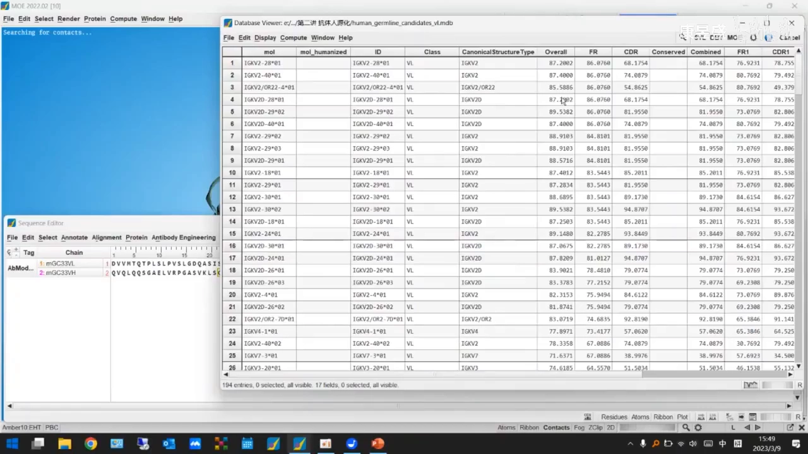

对齐后逐列排查（[29:49](https://www.bilibili.com/video/BV1av4y1j7vR/?t=1789)）：

- 有两条的 **CDR-L1 多了一个残基**——不一定有影响，但要留意；
- **带 or 与带 d 标记的是假基因（pseudogene），实际上不表达，必须从候选中剔除**；
- 更高效的做法是 pick master chain：把第一条设为 master chain，界面只显示差异残基、隐藏完全一致的残基，再叠加 Type 1/2/3 残基集合来对照关键位点；
- 逐列看：第一列完全一致；第二条五条链都是 I；第四列完全一致；某位置两条是 H、五和六都是 F 而三、四、七不是。

演示最终直接选了排序第一的 IGKV2-28，删掉其余候选链。

## 八、实操第四步：逐位点分析，排出反向突变优先级

选好框架后，把注意力放回差异位点。Type 1 集合中要分析的是 **39、60、92** 三个位点（39 号在报告里三类型全占，[31:10](https://www.bilibili.com/video/BV1av4y1j7vR/?t=1870)）。主讲人用自写脚本 Human Render 把位点在 3D 结构中呈现出来，逐个检查：

- **39 号**：与周围残基形成相互作用；位点直接位于 CDR 之上，同时又是支撑性的——Type 1 里它在界面上，Type 2 里它是支撑，Type 3 里它有直接相互作用。
- **60 号（F）**：处在界面上；目前未见相互作用；是否起支撑需软件分析；可能与旁边形成 packing，但目前看距离较远。
- **92 号（F）**：处在界面上。若人源化把它变成 Y（酪氨酸），只是在苯环上加了一个羟基，对 packing 不一定有影响——差异不大。

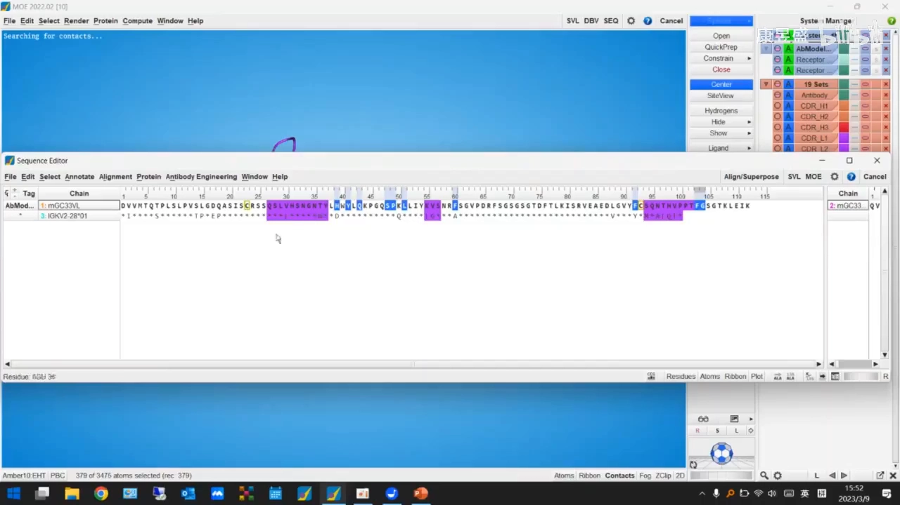

Type 2 集合包含 **2 号（V/I）、39、60、92**——39、60、92 同时是 Type 1 和 Type 2，优先级要提高（[32:57](https://www.bilibili.com/video/BV1av4y1j7vR/?t=1977)）。2 号的 V→I 单独分析：Type 2 是支撑作用，用 builder 看空间位置——它自身是缬氨酸，两侧链都是脂肪链，空间位阻变化不大：缬氨酸末端是异丙基，异亮氨酸只是在异丙基基础上多一个分支；有一定影响但没有想象中大，而且处在末端（[33:02](https://www.bilibili.com/video/BV1av4y1j7vR/?t=1982)）。

Type 3 集合包含 **39、73、41、1** 等，其中 73、41、1 与人源框架完全一致，无需突变（[33:44](https://www.bilibili.com/video/BV1av4y1j7vR/?t=2024)）。

逐位点过完，优先级自然浮现（[33:49](https://www.bilibili.com/video/BV1av4y1j7vR/?t=2029)）：

| 位点 | 三类型归属 | 优先级 | 决策 |
| --- | --- | --- | --- |
| 39 | Type 1 + 2 + 3 全占 | 最高 | 必须反向突变 |
| 60、92 | Type 1 + Type 2 | 中 | 纳入突变组合 |
| V2 | 仅 Type 2，且侧链差异小、位置在末端 | 低 | 可以不突变 |

最终得到组合：优先级"高+中" = **39、60、92**；完整的高/中/低排序 = V2、39、60、92。这些结论可以在输出报告里做额外记录，随后选中所有相关位点，回到 Sequence Editor 点击最后一步。

## 九、实操收尾：生成人源化序列与 FR4（J 基因）

最后一步"生成人源化序列"（[34:58](https://www.bilibili.com/video/BV1av4y1j7vR/?t=2098)）：异源序列是 GC33，人源序列选 V 基因，点击 generate——生成的序列已包含 39、60、92 位点的处理。

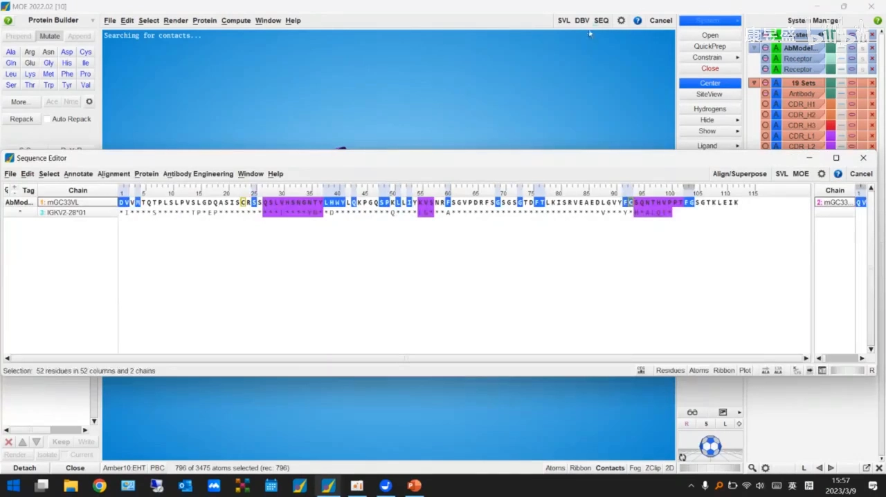

别忘了可变区末端的 **FR4**：它由专门的种系基因——**J 基因**——编码（[35:01](https://www.bilibili.com/video/BV1av4y1j7vR/?t=2101)）。把 J 基因文件导入 MOE（含重链 H 与轻链 K 两组），屏蔽非 J 部分做 Align 对齐后，比较发现差异只有最后的 **105 号位点：从 S 变成 Q，差异比较大**；而四条 J 基因（2-1、2-2、2-3、2-4）其实都一样，因为这一段会被直接替换。于是把 105 号位突变成 S——保持原样——再把序列贴到最后，就得到了最终的人源化轻链（[36:25](https://www.bilibili.com/video/BV1av4y1j7vR/?t=2185)）。

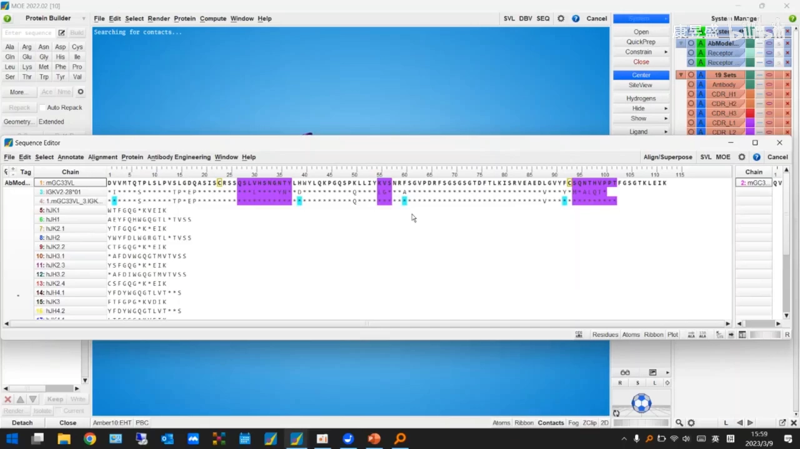

重链的操作与轻链完全相同，演示因时间关系从略。**单域抗体**（只有重链）同样可行：在 Identify Canonical Residues 中把两条链都选成 VH 即可执行鉴定（[36:35](https://www.bilibili.com/video/BV1av4y1j7vR/?t=2195)）。

## 十、回头看实验数据：为什么"逐位点优先级"优于"一把梭"

GC33 案例有实验验证数据（[17:10](https://www.bilibili.com/video/BV1av4y1j7vR/?t=1030)）：鼠源抗体 EC50 为 4.1 纳摩尔每升；不同人源化组合的 EC50 都在同一数量级，最好的组合是 **4.18——几乎与鼠源持平**。

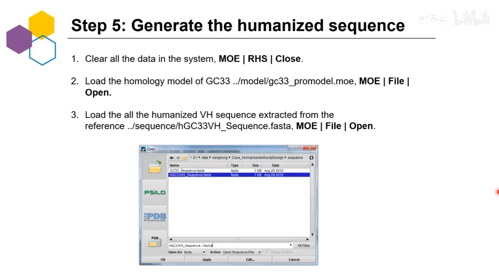

但主讲人提醒：如果只是"检索匹配后把所有差异位点一把突变回去"，操作虽然简单，**你并不知道哪一个 rescue、哪一个残基有更高的突变优先级**。MOE 的做法是：把序列对齐后隐藏完全一致的同源残基，只显示差异残基，再叠加经典残基鉴定结果，得到优先级排序——轻链和重链各自排出最高、第二、第三优先级的三条序列，排列组合或按实际需求挑选来完成人源化（[17:50](https://www.bilibili.com/video/BV1av4y1j7vR/?t=1070)）。

一个"回复突变建议"的分析示例（[18:22](https://www.bilibili.com/video/BV1av4y1j7vR/?t=1102)）：某位点 Q5、Q6 分别要变成 V 和 E——先查它们属于哪种 Type：一个属于 Type 2，另一个属于 Type 1、2、3 全占。预测后者对活性影响较大，必须突变；**属于三类型的经典残基越多，突变的优势（必要性）就越高**；若不属于、或只属于其中一类——比如 K38 和 K46——可以不做突变。对照实验结果：绝大部分预测与实验吻合；未被鉴定为经典残基的位置，实验上也确实可以不动。

## 十一、模块获取与下讲预告

- 该定制化人源化模块由康昱盛开发，向 **MOE 正式授权用户免费提供**；暂未购买但想了解的也可以联系他们（[36:40](https://www.bilibili.com/video/BV1av4y1j7vR/?t=2200)）。
- 系列讲座最后一讲（下下周四）：MOE 在**抗体成药性评估与可开发性分析**中的应用。

## 小结

- CDR 嫁接掉活性的根因是 CDR 与 FR 相互影响；解法是"选合适 FR 模板 + 针对关键残基最少反向突变"。
- MOE 五步流程：结构模建 → 鉴定经典残基 → 搜人源 V 基因 → FR/CDR/canonical rescue 组合打分生成序列 → 实验验证。
- 经典残基三类型：Type 1 轻重链界面 packing、Type 2 loop foundation（靠近 CDR 且包埋）、Type 3 与 CDR 直接相互作用（疏水/氢键/盐桥）；三型全占者优先级最高，直接保留原残基。
- 注释方式决定 CDR/FR 边界：IMGT 激进（CDR 很短）、CCG 折中；本例选 CCG。模板挑选看分辨率（≤2.5–2.8 Å）、种属（鼠源挑鼠源）、同源性与 MD B-factor；CDR 聚类 ID 差异大提示构象差异大，但 load 进 3D 核实后可手动换选（如 3I75）。
- 搜库按 FR 相似性排序（IGKV2-28 居首），剔除带 d/or 标记的假基因，警惕 CDR-L1 多一个残基的候选。
- 逐位点分析排出优先级：39（三型全占）最高必突变，60/92 中等纳入组合，V2（Val→Ile 差异小且在末端）可不突变。
- FR4 用 J 基因种系处理：105 位 S→Q 差异较大，选择保持 S。
- 官方成功率：一轮约 80%，两轮 90%+；GC33 各人源化组合 EC50 与鼠源（4.1 nM）同数量级，最佳 4.18。

## 关键术语速查

| 术语 | 一句话解释 |
| --- | --- |
| MOE | Molecular Operating Environment，加拿大 CCG 开发的大小分子药物设计软件 |
| CDR grafting | 把非人 CDR 嫁接到人源框架上的人源化方法 |
| back mutation（反向突变/回复突变） | 把人源框架上影响 CDR 功能的关键残基改回非人形式，以保住活性 |
| canonical rescue（经典残基） | 三类对 CDR 活性重要的框架残基的统称 |
| Type 1 / 2 / 3 | 轻重链界面 packing 残基 / 靠近 CDR 且包埋的支撑残基 / 与 CDR 直接相互作用的残基 |
| loop foundation | Type 2 残基对 CDR 环构象的"地基"支撑作用 |
| numbering scheme | 抗体序列注释方案（Kabat / Chothia / IMGT / MOE 自家 CCG） |
| Fv / VHH | 只含可变区的片段 / 单域抗体（纳米抗体） |
| 假基因（pseudogene） | 数据库中带 d/or 标记、无法表达的序列，搜库时应剔除 |
| FR4 / J 基因 | CDR-H3 之后的末端框架区 / 编码该段的种系基因 |
| EC50 | 半最大效应浓度，数值越低结合活性越强 |
| GPC3 | 磷脂酰肌醇蛋白聚糖 3，表达在肝癌组织细胞表面的蛋白多糖，GC33 的靶点 |
| MD B-factor | 分子动力学相关温度因子，参与模板打分 |
