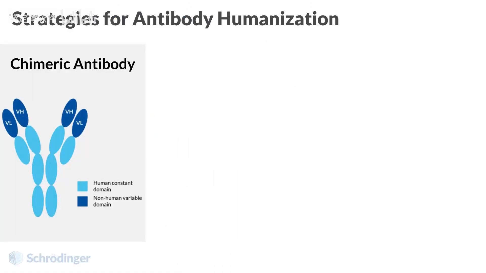
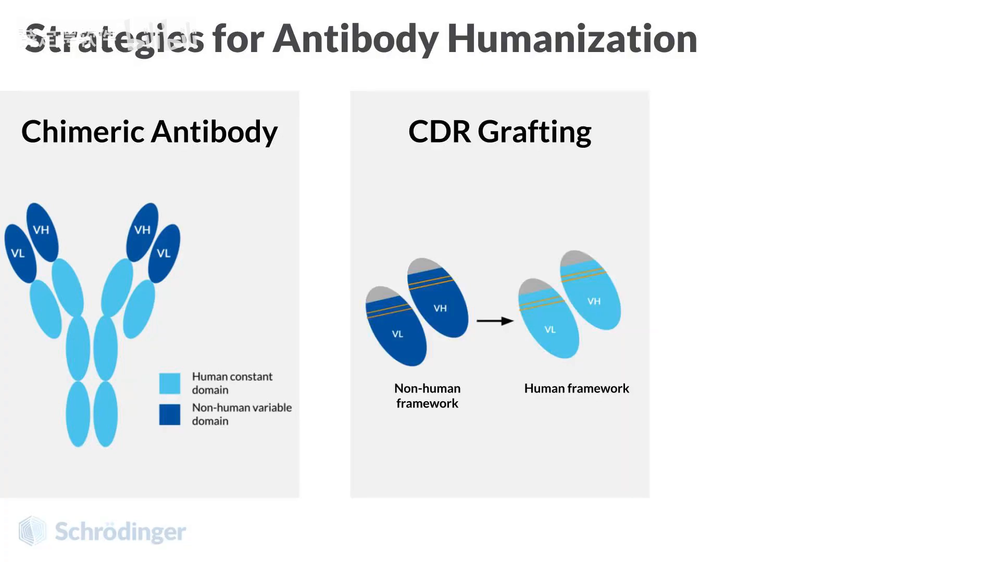
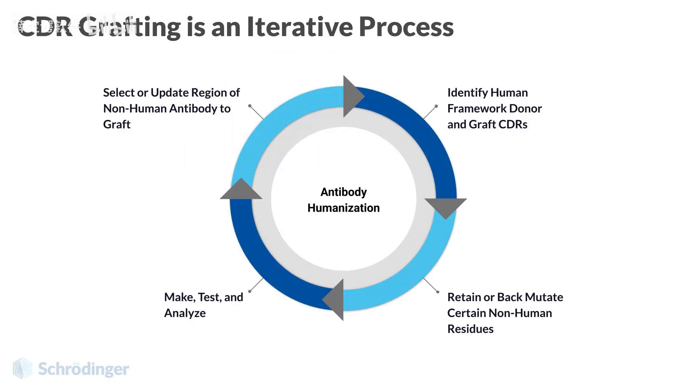
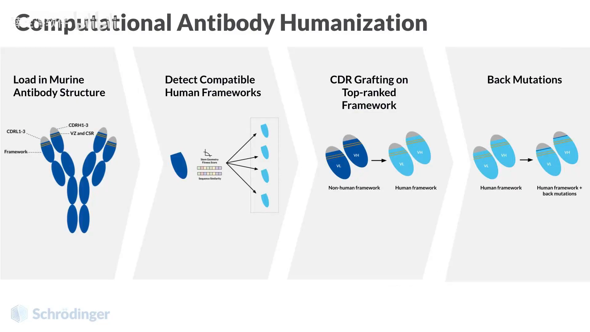
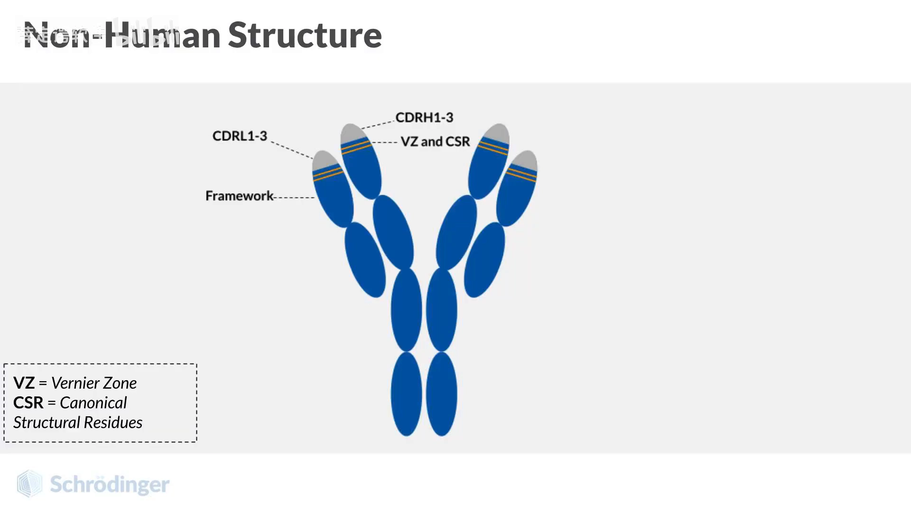
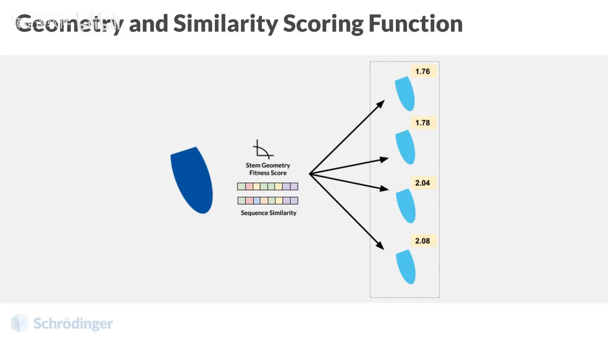
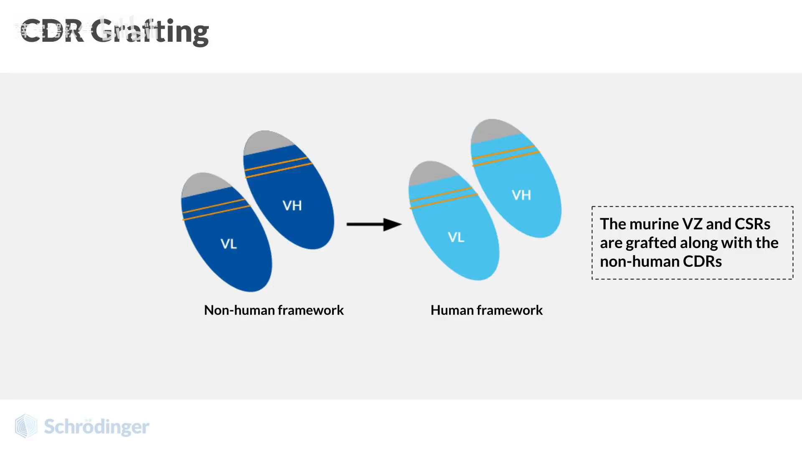

# 抗体人源化和反向突变：从策略史到一套可落地的计算流程

> 视频来源：[Bilibili《抗体人源化和反向突变》](https://www.bilibili.com/video/BV1yY2VBcEdE/)（约 4 分 38 秒）
> 本文基于视频演说图文稿撰写，观点与数据均可回看视频核对。

## 这支视频要解决的核心问题（SCQA）

**背景**：药物抗体常常来自小鼠等非人物种（如杂交瘤、鼠源单克隆抗体），直接用于人体会被人免疫系统识别为"外来物"，引发免疫反应（即免疫原性风险），也会缩短药效。

**冲突**：把整条非人抗体换成人的抗体，抗原结合活性往往保不住；但什么都不改，免疫原性又降不下来。

**疑问**：有没有一套既降低免疫原性、又尽量保住结合活性的系统性改造方法？

**回答（中心思想）**：主流做法是 CDR 嫁接——只把负责结合抗原的非人 CDR 移植到人源框架上；而要让嫁接后的抗体既"像人"又"有活性"，关键在三点：**嫁接时一并保留 CSR 与 Vernier 区残基、用"序列相似性 + 茎区几何"双评分挑选人源框架、再用反向突变（back mutation）修复个别关键位点**。视频用一个软件工作流把这条链路完整走了一遍。

## 一、三代人源化策略：嵌合抗体 → CDR 嫁接 → 转基因小鼠

视频先快速回顾了历史上流行的三种策略（[00:07](https://www.bilibili.com/video/BV1yY2VBcEdE/?t=7)）：

1. **嵌合抗体**：把一个物种抗体的可变结构域（V 区）与人类抗体的恒定结构域（C 区）融合。首个嵌合抗体 1994 年获 FDA 批准；相比后来的 CDR 嫁接等技术，如今已不那么流行（[00:22](https://www.bilibili.com/video/BV1yY2VBcEdE/?t=22)）。

   

2. **CDR 嫁接（CDR grafting）**：只把非人抗体的 CDR（互补决定区，负责识别抗原的 6 个环）嫁接到人源框架（FR）上，是本支视频的主线。

3. **转基因小鼠**：通过基因改造，把小鼠基因组中的内源免疫球蛋白基因替换成人类免疫球蛋白基因，让小鼠直接"生产"人源抗体，从源头减少免疫原性担忧（[00:47](https://www.bilibili.com/video/BV1yY2VBcEdE/?t=47)）。视频提到，2018 至 2022 年间 FDA 批准的人源化抗体，多数使用了某种转基因小鼠（[01:12](https://www.bilibili.com/video/BV1yY2VBcEdE/?t=72)）。

本示例聚焦的是第 2 条路线：CDR 嫁接。

## 二、CDR 嫁接是"迭代过程"，不是一锤子买卖

视频强调（[00:52](https://www.bilibili.com/video/BV1yY2VBcEdE/?t=52)、[01:12](https://www.bilibili.com/video/BV1yY2VBcEdE/?t=72)）：CDR 嫁接要**寻找潜在的人类框架供体**，而且是一个循环：

- 嫁接后可能保留某些非人残基，也可能**反向突变**——把人源框架上的某些残基"改回"非人形式；
- 实验评估生成的抗体（结合活性等）；
- 根据结果进一步调整嫁接的非人残基，甚至**换一个框架供体重来**。

落到计算端的整体流程是四步（[01:16](https://www.bilibili.com/video/BV1yY2VBcEdE/?t=76)）：**导入结构模型 → 筛选 PDB 并用评分函数检测潜在人类框架 → 运行嫁接任务 → 可选的反向突变**。

## 三、别只盯 CDR：CSR 与 Vernier 区残基同样决定成败

这是本支视频最有信息量的部分。嫁接时如果只保留 CDR、把框架全部换成人的，经常会掉活性，原因是框架里藏着一类"隐形支撑"：

- **CSR（规范结构残基，canonical structure residues）**：框架中决定 CDR 构象的残基。视频引述一篇 Biogen 论文：这些 CSR 与抗体亲和力和稳定性相关，突变 CSR 通常导致稳定性与亲和力双双下降（[01:35](https://www.bilibili.com/video/BV1yY2VBcEdE/?t=95)）。
- **Vernier 区残基**：靠近 CDR 的约 30 个框架残基（重链可变区 16 个、轻链 14 个），垫在 CDR"下方"影响其构象。有论文发现 Vernier 区残基的突变有重大热力学影响，指示了它们在抗体-抗原结合中的作用以及突变带来的风险（[01:40](https://www.bilibili.com/video/BV1yY2VBcEdE/?t=100)）。

正因为如此，"保留 Vernier 区残基的 CDR 嫁接"已成为成功范式，最具代表性的例子就是**赫赛汀（曲妥珠单抗）**（[01:45](https://www.bilibili.com/video/BV1yY2VBcEdE/?t=105)）。

## 四、人源框架怎么挑：序列相似性 + 茎区几何双评分

候选人源框架可能来自预包装数据库，也可能来自自定义数据库，需要一个评分函数来排序（[02:01](https://www.bilibili.com/video/BV1yY2VBcEdE/?t=121)）：

- **序列项**：结合抗体重链和轻链的序列相似性；
- **几何项**：给 CDR 环"茎区"残基（框架中直接连接 CDR 环的残基）的几何适应度打分，几何评分与原生抗体和嫁接抗体之间的 RMSD 相关。

几何项具体考察三个量（[02:26](https://www.bilibili.com/video/BV1yY2VBcEdE/?t=146)）：茎区残基与首个/末尾环残基之间的 **Cα-N 距离、Cα-N-Cα 角度、Cα-N-Cα-C 二面角**。评分函数数值越低越好。

## 五、收尾：建人源化模型 + 反向突变兜底

框架选定后即可构建人源化模型：Vernier 区残基与 CSR 一并嫁接，同时保留非人源 CDR。此时模型已经能处理空间位阻问题；对于其余"问题残基"，用**反向突变**解决——要么恢复非人抗体中的原残基，要么替换为该位置在人种系（germline）中更常见的残基（[02:45](https://www.bilibili.com/video/BV1yY2VBcEdE/?t=165)）。

## 小结

- 人源化三代策略：嵌合抗体（1994 首批）→ CDR 嫁接 → 转基因小鼠（2018–2022 年 FDA 批准的人源化抗体多数用此路线）。
- CDR 嫁接是迭代过程：嫁接 → 评估 → 反向突变/换框架，可反复。
- 只换 CDR 保不住活性，因为 CSR 与 Vernier 区残基（约 30 个：VH 16 + VL 14）从下方支撑 CDR 构象；赫赛汀是保留 Vernier 残基嫁接成功的代表。
- 人源框架挑选用双评分：重链+轻链序列相似性，加 CDR 环茎区的几何适应度（Cα-N 距离、Cα-N-Cα 角度、Cα-N-Cα-C 二面角，与 RMSD 相关），数值越低越好。
- 最终用反向突变修复问题残基：恢复原残基，或换成种系常见残基。

## 关键术语速查

| 术语 | 一句话解释 |
| --- | --- |
| 免疫原性 | 非人抗体进入人体后被免疫系统识别、引发免疫反应的倾向 |
| 嵌合抗体 | 非人可变区 + 人恒定区的融合抗体 |
| CDR / FR | 互补决定区（识别抗原的 6 个环）/ 支撑 CDR 的框架区 |
| CDR 嫁接 | 把非人 CDR 移植到人源框架上的人源化方法 |
| CSR | 规范结构残基，框架中决定 CDR 构象的残基 |
| Vernier 区残基 | 靠近 CDR 的约 30 个框架残基（VH 16 + VL 14），影响 CDR 构象 |
| 茎区残基 | 框架中直接连接 CDR 环的残基 |
| 反向突变（back mutation） | 把人源框架上的关键残基"改回"非人形式（或种系常见残基） |
| 转基因小鼠 | 基因组中免疫球蛋白基因被替换为人类版本、可直接产生人源抗体的工程小鼠 |
