# MOE 第三讲：抗体可开发性预测与优化——把临床失败挡在早期

> 视频来源：[MOE抗体药物设计系列讲座第三讲 - 抗体可开发性预测及优化改造](https://www.bilibili.com/video/BV1Gc41157U4/)（康昱盛 / CCG，主讲：MOE 工程师谭畅，时长约 61 分钟）
> 本博客基于视频演说图文稿撰写，关键数据均可通过时间戳回看核查。

## 本讲要解决的核心问题（SCQA）

**背景**：全球处于临床前的候选抗体数以万计。MOE 系列讲座前两讲已经解决了"把抗体结构建出来"（第一讲：建模与结构评估）和"把抗体改成人源的"（第二讲：人源化）两个问题。

**冲突**：好不容易筛出来的候选抗体，进入临床后才暴露出各种问题——某些氨基酸化学活性高，容易发生异构化、脱酰胺、氧化而失活或降解；有的被酶切；有的清除率太快；有的聚集沉降。等到临床阶段才发现，代价是整个开发项目的失败。

**疑问**：能不能在研发早期就用计算手段预测这些风险，并把高风险抗体挡在临床之前？

**回答（中心思想）**：可以。MOE 把"抗体建模 → 111 种属性描述符 → 溶解度/粘度/清除率/PTM 预测模型 → 风险位点定向改造"整合成一条完整的可开发性评估工作流。本讲（第三讲）就是这条工作流的完整拆解。

## 一、早期预测为什么是刚需

临床失败的几类常见根因（[【跳转到 08:59】](https://www.bilibili.com/video/BV1Gc41157U4/?t=539)）：

- **化学失活**：氨基酸本身化学反应活性高，容易发生异构化、脱酰胺、氧化，导致抗体失活或降解；
- **酶切与其他降解**：蛋白酶切位点等问题导致活性下降；
- **清除率过快**：药代动力学不达标；
- **聚集沉降**：抗体之间互相"粘"起来，活性下降甚至失活。

这些问题如果等到临床才发现，损失巨大。所以思路是：**在开发早期就用模拟功能预测相关属性**，把有化学稳定性或代谢问题的抗体提前排除。

## 二、工作流总览：序列 → 结构 → 属性 → 改造

[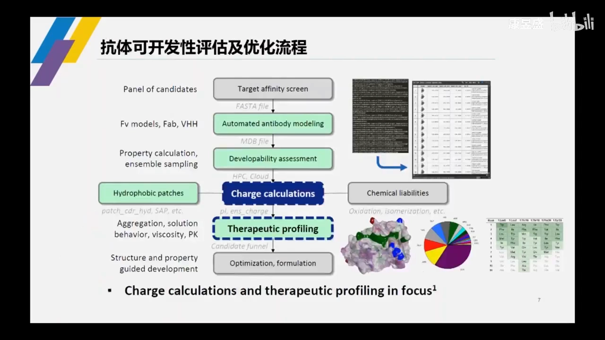](https://www.bilibili.com/video/BV1Gc41157U4/?t=624)

MOE 中整理出的 workflow（[【跳转到 10:24】](https://www.bilibili.com/video/BV1Gc41157U4/?t=624)）是这样的：

1. **批量建模**：实验筛选到一批候选序列后，用 MOE 抗体模块一键建模——一条还是十条、一百条、一千条序列都支持；Fv 区、Fab 区、完整 IgG，还是 scFv、VHH 等特殊形式都能处理（[【跳转到 11:14】](https://www.bilibili.com/video/BV1Gc41157U4/?t=674)）。
2. **属性预测**：用 Protein Properties 功能预测抗体性质。
3. **发现风险位点**：比如某位点甲硫氨酸有氧化风险、某天冬酰胺有脱酰胺风险。
4. **反向优化**：针对预测出的风险位点，可以基于经验直接突变，也可以查抗体结构数据库统计该位点的氨基酸分布，再用虚拟扫描（Residue Scan）做定向突变——在保持热稳定性和结合活性的同时改善化学稳定性（[【跳转到 15:25】](https://www.bilibili.com/video/BV1Gc41157U4/?t=925)）。

为什么一定要先建模？因为**基于结构的 descriptor 预测，准确率通常高于仅基于序列的预测**（[【跳转到 10:49】](https://www.bilibili.com/video/BV1Gc41157U4/?t=649)）。

## 三、结构精度决定一切：MOE 抗体建模有多准

### 3.1 framework / CDR 分治，结构聚类选模板

MOE 抗体建模的独特之处（[【跳转到 15:39】](https://www.bilibili.com/video/BV1Gc41157U4/?t=939)）：不是简单同源模建，而是把保守的 framework 区和柔性大的 CDR 区分开处理——

- framework 区：传统同源建模，搜序列相似性高的结构当模板；
- CDR 区：除了序列相似性，还引入**结构聚类分析**。因为 CDR 柔性大，序列相似但结构摆向可能千差万别，选"最大类"的模板能保证建模的普适性和准确性。

选定 framework 和 CDR 模板后，把两者嫁接、侧链突变成目标序列氨基酸、packing、能量优化，得到完整抗体结构。

### 3.2 1000 个晶体结构的回测

[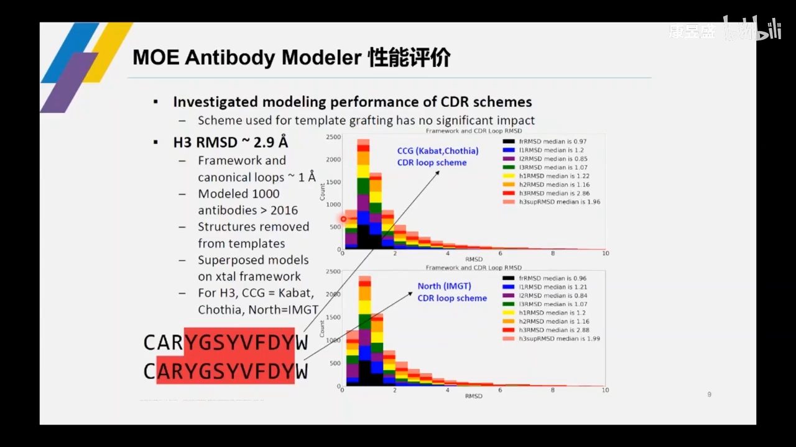](https://www.bilibili.com/video/BV1Gc41157U4/?t=1056)

MOE 选了 1000 个晶体结构做测试（选模板时剔除自身晶体，保证公允）。结果（[【跳转到 18:01】](https://www.bilibili.com/video/BV1Gc41157U4/?t=1081)）：

- framework 区、CDR 区的 RMSD 基本 **1 Å 左右**；
- 只有熟知的重链 CDR-H3 柔性大，结合抗原后 RMSD 约 **2 Å**——也算很小的偏差。

### 3.3 编号方式不影响精度

用 Kabat、Chothia、Martin、IMGT 不同编号/注释方式建模，准确率差异都在 0.02 Å 以内（有的 0.01 Å、有的完全一致），无需担心（[【跳转到 18:26】](https://www.bilibili.com/video/BV1Gc41157U4/?t=1106)）。

### 3.4 CDR-H3：序列相同 ≠ 结构相同

对重链 CDR3 的专项研究（[【跳转到 19:41】](https://www.bilibili.com/video/BV1Gc41157U4/?t=1181)）发现：**即使 CDR3 序列 100% 一致，结构 RMSD 也非常多样，最高能到 7 Å 左右**。这正是 MOE 在 CDR 模板挑选上引入 RMSD 聚类的原因。

另一个规律：重链 CDR-H2 越长、柔性越大；拿到序列注释后如果发现 CDR-H3 很长，做复合物建模时模板要慎重，特别长的可能要取多个 cluster 的不同摆向（[【跳转到 20:56】](https://www.bilibili.com/video/BV1Gc41157U4/?t=1256)）。

### 3.5 模板库逐年增长，精度逐年提升

PDB 中抗体晶体结构逐年上涨，重链 CDR3 预测与晶体结构的偏差从 2004 年到 2016 年逐年下降；统计虽止于 2016 年，讲者估计现在 CDR-H3 的 RMSD 已在 2 Å 左右（[【跳转到 21:47】](https://www.bilibili.com/video/BV1Gc41157U4/?t=1307)）。

## 四、Protein Properties：111 种描述符 + 动态采样

[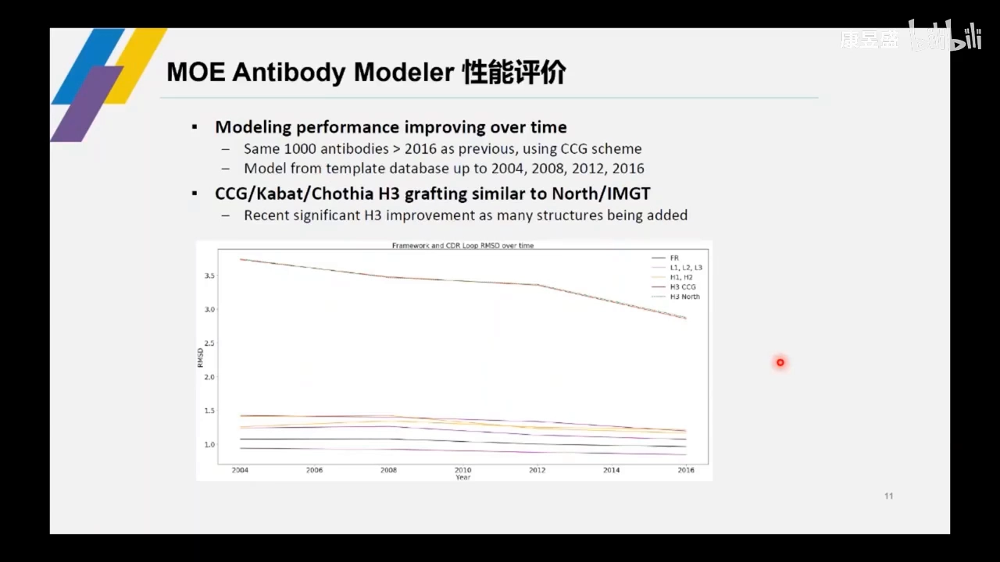](https://www.bilibili.com/video/BV1Gc41157U4/?t=1381)

MOE 内置 **111 种属性描述符**（加载扩展后更多），覆盖基于结构和基于序列两类（[【跳转到 23:01】](https://www.bilibili.com/video/BV1Gc41157U4/?t=1381)）：分子量、亲疏水表面积（决定溶解度/沉降问题）、等电点、pKa、摩尔消光系数、静电荷等。这些都采用已公开发表或公认的模型实现。

### 4.1 不只算静态结构：侧链柔性采样 + 实验环境模拟

这些描述符可以结合采样功能（[【跳转到 24:41】](https://www.bilibili.com/video/BV1Gc41157U4/?t=1481)）：

- 侧链构象采样，涵盖不同质子化状态；
- 可指定实验温度、盐浓度；
- pH 梯度采样：默认人体 pH 7.4 ± 1（6.4~8.4），**每 0.2 个 pH 单位采一个构象，共 100 个构象**，面板可画曲线分析属性随 pH 的走势。

[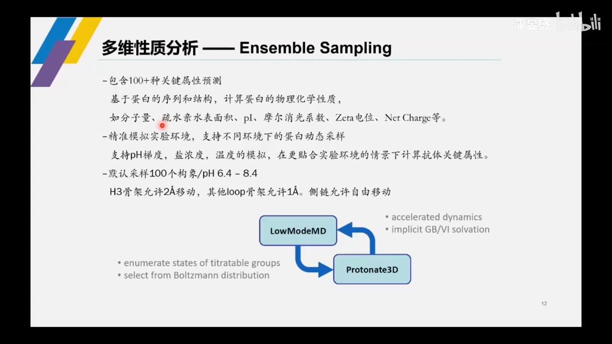](https://www.bilibili.com/video/BV1Gc41157U4/?t=1531)

而且重链 CDR3 柔性大这个因素也被考虑进来了：采样时 CDR-H3 骨架允许在两个极端之间做较大移动，其他 loop 只允许小幅变化，侧链完全柔性采样（[【跳转到 25:56】](https://www.bilibili.com/video/BV1Gc41157U4/?t=1556)）。

## 五、溶解度：疏水 patch 是聚集的根源

蛋白-蛋白相互作用往往由较大的疏水 patch（或带电 patch）驱动，进而导致抗体聚集、沉降、溶解度差（[【跳转到 26:33】](https://www.bilibili.com/video/BV1Gc41157U4/?t=1593)）。

### 5.1 三种算法与实验的相关性对比

[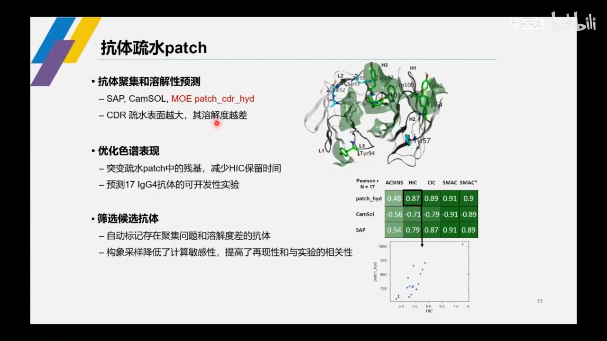](https://www.bilibili.com/video/BV1Gc41157U4/?t=1683)

用 17 个 IgG4 抗体做相关性矩阵分析（[【跳转到 28:03】](https://www.bilibili.com/video/BV1Gc41157U4/?t=1683)）：HIC（疏水相互作用色谱）保留时间与 SAP、CamSol、以及 **MOE 的 CDR 区属性 patch** 相关——MOE 的相关性还相对更高。当然测试集不同（如换 IgG1）结论可能不同。

SAP 和 CamSol 两种算法现已整合进 MOE。CamSol 有序列打分、结构打分、优化打分三种，面板上每个位置的 CamSol 分数可视化，框选问题位置会联动选中结构上的氨基酸（[【跳转到 31:17】](https://www.bilibili.com/video/BV1Gc41157U4/?t=1877)）。

### 5.2 Patch Analyzer + Residue Scan：从发现到改造

[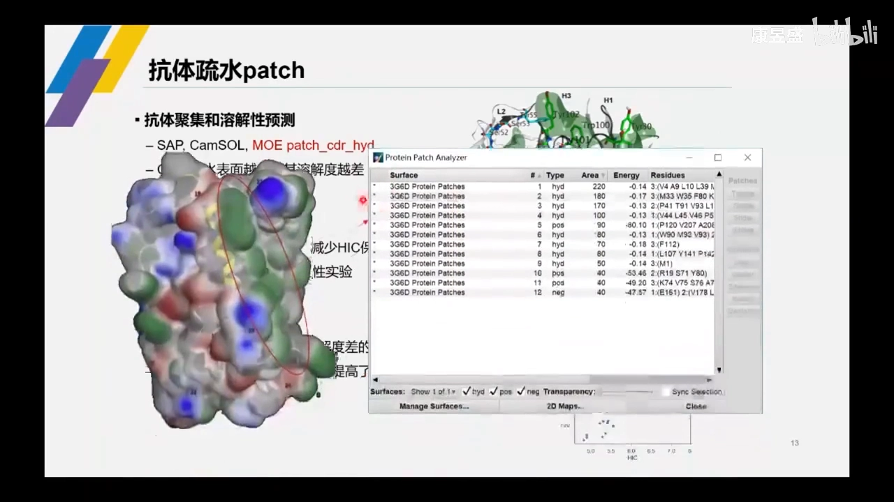](https://www.bilibili.com/video/BV1Gc41157U4/?t=1756)

实操路径（[【跳转到 29:16】](https://www.bilibili.com/video/BV1Gc41157U4/?t=1756)）：Protein Patch 用不同颜色渲染表面性质（绿色 = 疏水 patch）→ Patch Analyzer 分析每个 patch 的面积和包含的氨基酸 → 选中风险 patch 的氨基酸 → Residue Scan 定向突变成非疏水氨基酸 → 把 patch 打散、面积减小 → 再做实验验证。

## 六、粘度：Fv 区电荷是第一预测因子

大量文献记载：**降低 CDR 区电荷的突变往往导致抗体粘度增加**（[【跳转到 33:52】](https://www.bilibili.com/video/BV1Gc41157U4/?t=2032)）。

[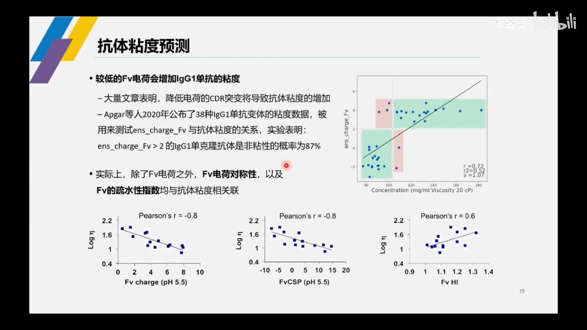](https://www.bilibili.com/video/BV1Gc41157U4/?t=2032)

对 22 条人源 IgG1 做描述符与实验粘度的相关性分析（[【跳转到 34:07】](https://www.bilibili.com/video/BV1Gc41157U4/?t=2047)）：

- **Fv 区系综电荷（ensemble charge）> 2 时，87% 的单克隆抗体为非粘性**；
- 除电荷外，Fv 电荷**对称性**、Fv 区**疏水指数**也与粘度相关（与粘度的对数相关，并非简单线性）；
- 基于这些描述符构建的机器学习模型可在 MOE 中统一预测粘度、清除率、Asp/Asn 异构化、氧化（[【跳转到 36:22】](https://www.bilibili.com/video/BV1Gc41157U4/?t=2182)）。

## 七、清除率：非线性的"规则"比线性相关更有用

[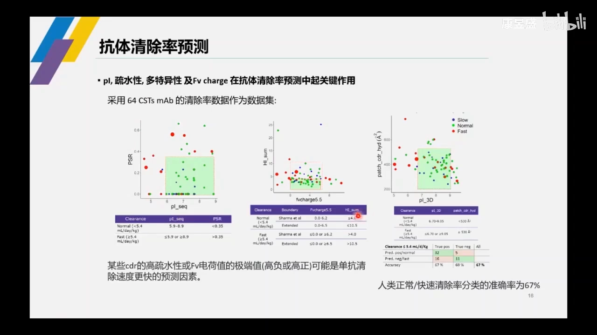](https://www.bilibili.com/video/BV1Gc41157U4/?t=2220)

两两 plot 探索发现**没有线性相关，但有可总结的规律**（[【跳转到 37:00】](https://www.bilibili.com/video/BV1Gc41157U4/?t=2220)）：等电点在 6~9 之间、多反应性（polyspecificity）约 0.35 以下的"方框"里，几乎全是清除率 normal/slow 的抗体；快速清除的红色点几乎都在方框外。

整理成规则：**等电点 5.9~8.9 且多反应性 < 0.35 的抗体，大概率不存在清除率问题**。基于这类规则构建的模型区分正常/快速清除的准确率约 **67%**（[【跳转到 38:15】](https://www.bilibili.com/video/BV1Gc41157U4/?t=2295)）。

## 八、629 个临床抗体的"Lipinski 式"统计规律

类似小分子的 Lipinski 类药五规则，讲者团队为抗体总结了统计学规律（[【跳转到 39:12】](https://www.bilibili.com/video/BV1Gc41157U4/?t=2352)）：选取 **629 个已进入临床的抗体**，统计 Fv 区电荷、CDR 区疏水 patch 面积、CDR 长度、恒定区电荷差异等。

[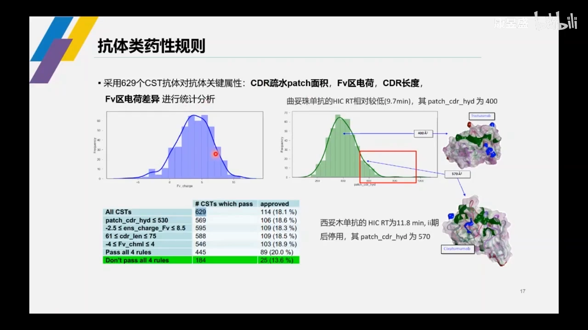](https://www.bilibili.com/video/BV1Gc41157U4/?t=2370)

关键数字（[【跳转到 39:30】](https://www.bilibili.com/video/BV1Gc41157U4/?t=2370)）：

- Fv 区电荷分布**中位值约 4.5**；CDR 疏水 patch 面积**中位值约 400 Ų**；
- **正例**：曲妥珠单抗（已上市）HIC 保留时间低（9.7）、CDR 疏水面积约 400 Ų，正处分布中部；
- **反例**：一支单抗（字幕记为"稀土木单抗"，专名待核）HIC 保留时间更长、CDR 疏水 patch 达 **570 Ų**（明显靠分布后端），后来在临床 II 期之后被停用（[【跳转到 40:45】](https://www.bilibili.com/video/BV1Gc41157U4/?t=2445)）；
- 参考阈值：CDR 疏水面积 **< 130 Ų** 视为正常；按 90% 分位卡在 **530 Ų** 左右；629 个抗体中约 569 个符合，仅看已获批抗体约 106/114（[【跳转到 41:10】](https://www.bilibili.com/video/BV1Gc41157U4/?t=2470)）。

## 九、PTM 与 Liabilities：知识 + 结构 + 公开模型三层叠加

[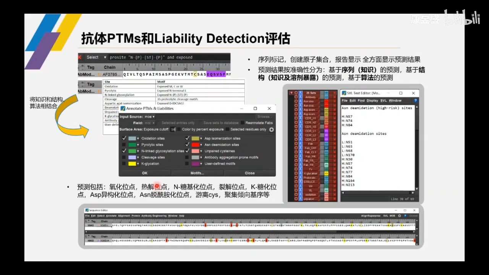](https://www.bilibili.com/video/BV1Gc41157U4/?t=2566)

### 9.1 第一层：序列知识（无结构也能预测）

纯序列预测基于知识规则（[【跳转到 42:46】](https://www.bilibili.com/video/BV1Gc41157U4/?t=2566)）：氧化位点找甲硫氨酸、半胱氨酸等易氧化氨基酸；糖基化位点用 selection 表达式搜索（与天冬酰胺相连的 N-糖基化位点）。

### 9.2 第二层：结构修正——溶剂暴露才算真风险

有结构时更准确：容易反应的氨基酸若被周围氨基酸包埋，实际不易发生反应。MOE 设置了 cut off——**溶剂暴露比 ≥ 10% 才认为可能发生化学反应**（[【跳转到 43:36】](https://www.bilibili.com/video/BV1Gc41157U4/?t=2616)）。

### 9.3 第三层：动态采样 + 机器学习模型

静态晶体结构只是蛋白某一时刻的构象，会带来预测误差，所以引入支持动态采样的模型（[【跳转到 48:18】](https://www.bilibili.com/video/BV1Gc41157U4/?t=2898)）：

- **异构化/脱酰胺模型一**：基于侧链/主链 RMSD（柔性）+ Asn 溶剂可及性 + pKa，脱酰胺是氮进攻羰基碳、成环、再异构化或水解的反应，需要侧链柔性大、pKa 低（越酸越易进攻）。预测 Asp 异构化准确率约 **94.7%**、脱酰胺约 **93.5%**（[【跳转到 50:23】](https://www.bilibili.com/video/BV1Gc41157U4/?t=3023)）。
- **脱酰胺模型二**（另一篇文献）：用天冬酰胺所在二级结构衡量柔性（loop 区柔性远高于折叠区），并考虑氢键——有氢键则稳定、不易反应。输出 deamidation score：**< 1 高概率易脱酰胺；< 5 需关注；> 5~10 基本不用考虑**（[【跳转到 52:53】](https://www.bilibili.com/video/BV1Gc41157U4/?t=3173)）。

[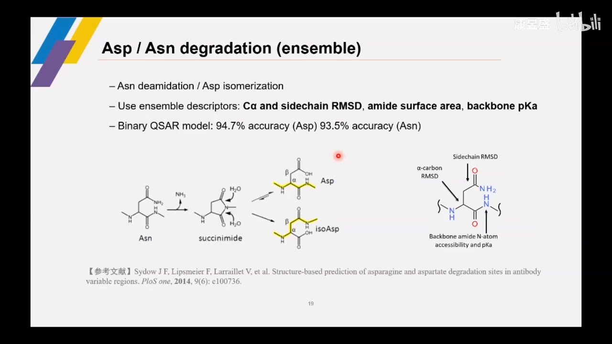](https://www.bilibili.com/video/BV1Gc41157U4/?t=3048)

- **氧化模型**：主要考虑甲硫氨酸的暴露环境/溶剂可及性，准确率约 **97%**（[【跳转到 53:43】](https://www.bilibili.com/video/BV1Gc41157U4/?t=3223)）。实操中用两种打分方法（溶剂可及性、加和）交叉验证，两种方法一致指出 92 位有氧化风险时才重点关照（[【跳转到 54:33】](https://www.bilibili.com/video/BV1Gc41157U4/?t=3273)）。

### 9.4 结果的三种呈现形式

- Sequence Editor 里不同风险位点不同颜色标注（局限：一个氨基酸同时是两类风险时无法双色）；
- Atom Manager 里为每类风险创建原子集合，点选即可在 3D 界面联动选中；
- 生成报告，列出每个风险对应哪些氨基酸（[【跳转到 47:46】](https://www.bilibili.com/video/BV1Gc41157U4/?t=2866)）。

## 十、实操演示：从 patch 到定向突变

### 10.1 Patch 分析与改造

[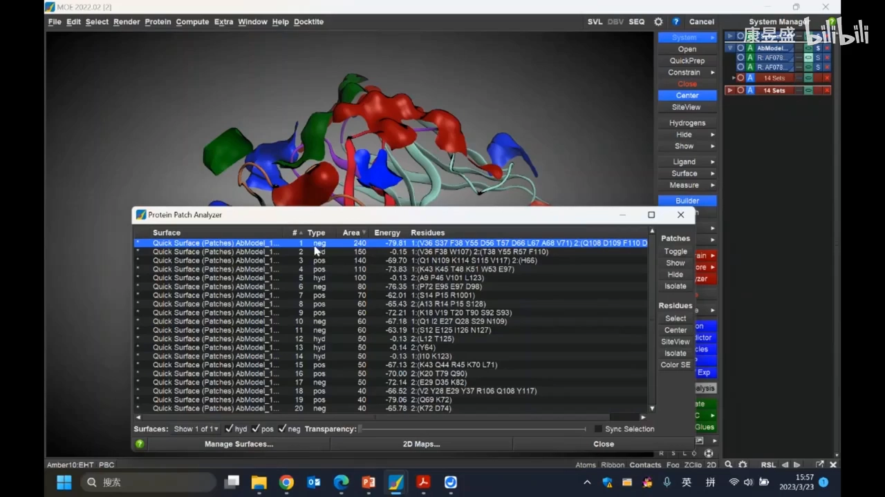](https://www.bilibili.com/video/BV1Gc41157U4/?t=3395)

演示流程（[【跳转到 56:35】](https://www.bilibili.com/video/BV1Gc41157U4/?t=3395)）：Surface → Protein Patch 生成彩色 patch 表面 → 最大 patch 面积 240 Ų、带电性 → 高亮/Isolate 定位区域（覆盖 CDR、重链 CDR3 与轻链 CDR2）→ 若正负电 patch 都大，会因**电性互补发生自身相互作用**导致聚集沉降 → 在 Patch Analyzer 下方 Select 选中包含的氨基酸 → Protein → Design → Residue Scan → 选择突变类别（positive / hydrophobic）→ 点击 OK，同时评判突变并保证稳定性 → 挑选 patch 较小的结构。

### 10.2 PTM 注释演示

[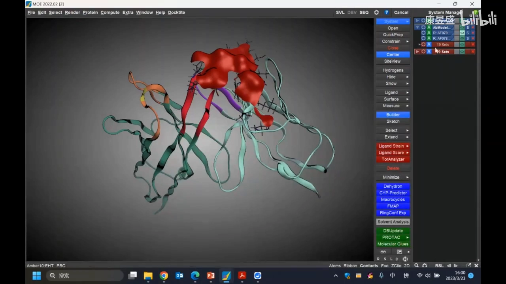](https://www.bilibili.com/video/BV1Gc41157U4/?t=3589)

Annotate → 勾选感兴趣的 PTM 位点类别 → 序列上快速注释，Atom Manager 标记对应氨基酸并带 **High Risk** 标注（经模型评估的高概率高风险位点）→ 结合经验或用 Residue Scan 定向突变掉风险位点（[【跳转到 59:49】](https://www.bilibili.com/video/BV1Gc41157U4/?t=3589)）。粘度、清除率、稳定性评估与 CamSol 等也都在 MOE 中可用。

## 小结

- **可开发性评估的目的**：在临床前就把化学失活、清除率、聚集等风险找出来，避免临床阶段失败。
- **结构是基础**：MOE 建模 framework/CDR 约 1 Å、CDR-H3 约 2 Å 的精度，是一切属性预测的前提。
- **属性预测三层递进**：111 种静态描述符 → 侧链/系综采样（含 pH 梯度）→ 规则与机器学习模型。
- **四大属性各有抓手**：溶解度看疏水 patch（SAP/CamSol 已整合）；粘度看 Fv 电荷（>2 → 87% 非粘性）；清除率看等电点+多反应性规则（准确率 67%）；PTM 看知识+溶剂暴露+动态采样模型（94.7%/93.5%/97%）。
- **统计规律兜底**：629 个临床抗体的分布中位数与 cut off，类似 Lipinski 规则，用于判断候选是否"正常"。
- **闭环在改造**：Patch Analyzer / PTM 注释定位风险位点，Residue Scan 定向突变，保持活性与稳定性的同时打散风险。

## 关键术语速查

| 术语 | 一句话解释 |
| --- | --- |
| 可开发性（Developability） | 抗体能否顺利开发成药：生产性（聚集、溶解度、稳定性）、药代（清除率）、化学稳定性（PTM）等的综合评估 |
| HIC 保留时间 | 疏水相互作用色谱中抗体被保留的时间，越长说明表面越疏水，与聚集风险相关 |
| 疏水 patch（Protein Patch） | 蛋白表面连片的疏水（或带电）区域，是蛋白-蛋白相互作用与聚集的结构根源 |
| SAP / CamSol | 两种公开发表的抗体溶解度预测算法，已被整合进 MOE |
| Fv ensemble charge | Fv 区在系综采样下的平均净电荷，> 2 时 87% 的 IgG1 非粘性 |
| 多反应性（Polyspecificity, PSR） | 抗体与非靶标分子发生非特异结合的倾向，过高与快速清除相关 |
| PTM（翻译后修饰） | 糖基化、氧化、脱酰胺、异构化等翻译后化学修饰，是化学稳定性的主要风险源 |
| Residue Scan | 对选定残基逐一虚拟突变并用能量/稳定性/活性打分的 MOE 功能 |
| Deamidation score | 逐天冬酰胺的脱酰胺风险分值：< 1 高风险、< 5 需关注、> 5~10 基本安全 |
| Liabilities | 可开发性风险位点清单：氧化、脱酰胺、异构化、糖基化、裂解位点等的统称 |
