# 深度学习在抗体成药性分析中的应用——从结构预测到聚集与免疫原性的全景路线图

> 视频来源：[最前沿 人工智能之深度学习在抗体成药性分析中的应用](https://www.bilibili.com/video/BV1Um411o74k/)（药渡数据库，主讲：肖聪，时长约 62 分钟，含 Q&A）
> 本博客基于视频演说图文稿撰写，关键数据均可通过时间戳回看核查。

## 本讲要解决的核心问题（SCQA）

**背景**：一个抗体能否成药，取决于生产性、安全性、生物活性三大维度上的几十种性质——聚集性、溶解度、稳定性、免疫原性、翻译后修饰、抗原性……每种性质背后都有实验表征手段，但慢且贵。

**冲突**：可开发性性质太多、彼此关联（比如聚集与溶解度相关、翻译后修饰同时影响有效性与安全性），逐项实验评估的成本让早期筛选难以为继；而计算工具又五花八门：同源建模、深度学习结构预测、经验公式、序列编码、图神经网络……

**疑问**：深度学习能否把这些性质预测串成一条系统化的路线？

**回答（中心思想）**：能。本讲给出一条清晰的路线图：**先拿结构（同源建模/AlphaFold 系 → 抗体专用的 DeepAb/IgFold/ABlooper）→ 再做序列编码（one-hot → AbLang）→ 然后是性质预测（溶解度 CNN 与图神经网络、PTM 位点、免疫原性）→ 最后落到蛋白相互作用与工业服务**。结构提供最多信息，编码决定模型能"看到"什么，性质模型则直接服务成药性决策。

## 一、抗体成药性地图：三个维度与一张工具表

[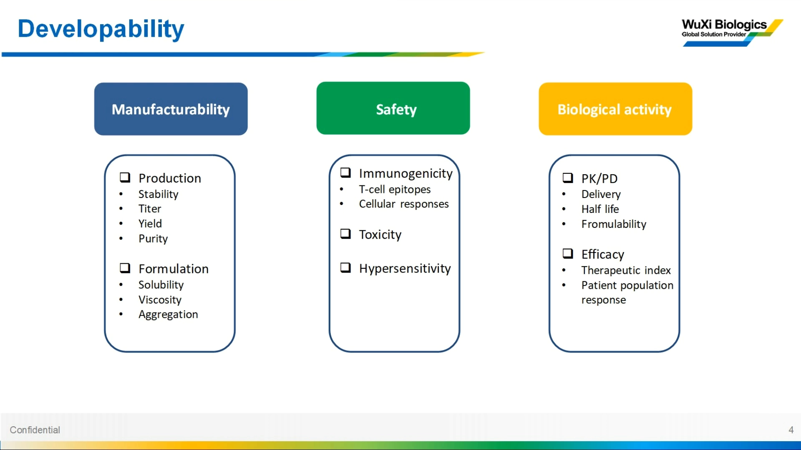](https://www.bilibili.com/video/BV1Um411o74k/?t=45)

成药性三个维度（[【跳转到 00:45】](https://www.bilibili.com/video/BV1Um411o74k/?t=45)）：

- **生产性**：能否有效、顺利地生产出来——关键是聚集性、溶解度、稳定性；
- **安全性**：主要是免疫原性和毒性；
- **生物活性**：与药效相关，如半衰期、药物活性。

注意性质之间**不是一对一关系**：翻译后修饰既影响有效性也影响安全性；疏水性与稳定性、粘性、聚集性都有关；聚集性和溶解度有一定相关性（[【跳转到 01:10】](https://www.bilibili.com/video/BV1Um411o74k/?t=70)）。

[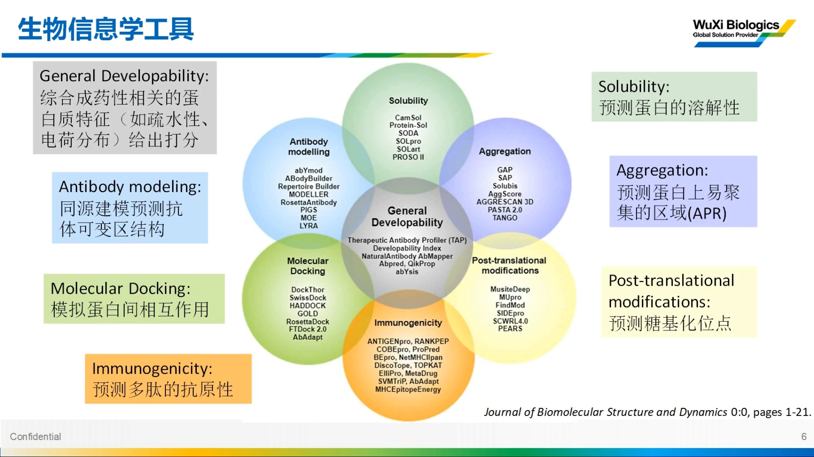](https://www.bilibili.com/video/BV1Um411o74k/?t=126)

工具分类（[【跳转到 02:06】](https://www.bilibili.com/video/BV1Um411o74k/?t=126)）：结构（同源建模或深度学习预测 → 表面电荷/表面疏水性直接可得）、溶解性与聚集性（传统方法/经验公式/深度学习）、翻译后修饰（糖基化、磷酸化——有些糖基化位点影响安全）、抗原性、蛋白相互作用模拟（基于 MD 或基于深度学习）。

## 二、一切从结构开始：同源建模 vs 深度学习

### 2.1 同源建模四步法（ABodyBuilder）

[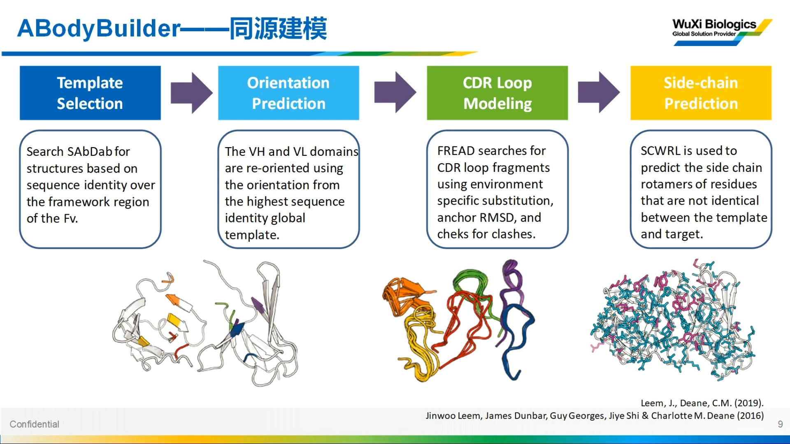](https://www.bilibili.com/video/BV1Um411o74k/?t=386)

传统同源建模（以 ABodyBuilder 为代表）遵循经典四步（[【跳转到 06:26】](https://www.bilibili.com/video/BV1Um411o74k/?t=386)）：

1. 在已知结构数据库中搜索同源性高的模板；
2. 把重链、轻链按一定角度拼在一起；
3. 对多变的 CDR loop 区建模修正（主链操作）；
4. 侧链建模。

完成即得到完整抗体可变区（Fv）结构。注意：ABodyBuilder、RoseTTAFold 抗体版只能预测可变区；AlphaFold、RoseTTAFold 则针对完整蛋白（[【跳转到 05:30】](https://www.bilibili.com/video/BV1Um411o74k/?t=330)）。

### 2.2 AlphaFold：MSA + pair 双路信息

[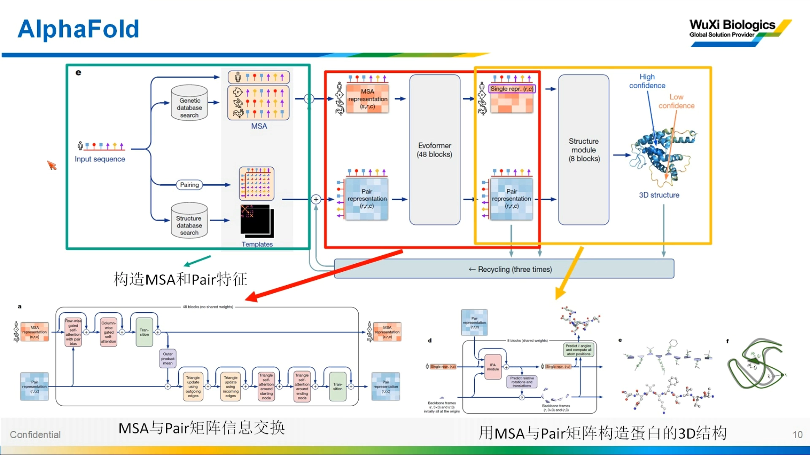](https://www.bilibili.com/video/BV1Um411o74k/?t=495)

AlphaFold 的思想（[【跳转到 08:15】](https://www.bilibili.com/video/BV1Um411o74k/?t=495)）：

- 输入序列，提取两路信息：**MSA**（与数据库同源序列的比对信息）和 **pair**（类似 contact map，表征两两残基的距离/相关性——相关性高则结构上可能靠近）；
- 两路信息进入 Evoformer：对 MSA 做**行、列两个方向的 attention**（attention 是语言模型常用模块，提取序列间相关性），得到新 MSA 矩阵，变换后传递给 pair——实现 MSA↔pair 信息交换；再用 48 个模块反复处理更新；
- 最后由 **IPA 模块**把两路信息结合生成 3D 结构，并有 **recycle 机制**：结果返回再处理，三次相当于一次迭代。

### 2.3 RoseTTAFold：1D/2D track，异曲同工

RoseTTAFold 与 AlphaFold 齐名（[【跳转到 12:17】](https://www.bilibili.com/video/BV1Um411o74k/?t=737)）：输入同样是 MSA + pair 矩阵，但把 MSA 叫 **1D track**、pair 矩阵叫 **2D track**，同样做两个维度的 attention，再经 structure module（含 transformer）变成主链/侧链角度信息，最终输出 3D 结构。网络结构不同，思想相似。

### 2.4 复合体预测：AlphaFold-Multimer 与链拼接技巧

[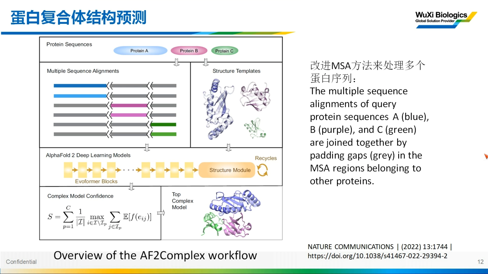](https://www.bilibili.com/video/BV1Um411o74k/?t=867)

抗体是重链+轻链的复合体（[【跳转到 14:27】](https://www.bilibili.com/video/BV1Um411o74k/?t=867)）：AlphaFold-Multimer 可预测复合体；简单做法是在重轻链之间加一条较长 linker 拼成"一个蛋白"再喂给 AlphaFold。进阶技巧是对 MSA 步骤做改进：两条链拼进同一 MSA 时中间会有空缺（有的位置只匹配到链 A、有的只匹配到链 B），把几条链的 MSA 组合起来形成完整矩阵，再走标准流程。加 linker 其实也是"把不同链拼成一个蛋白"的同类思想。

## 三、抗体专用结构预测器

### 3.1 DeepAb：LSTM + 残差网络 + Rosetta 精修

[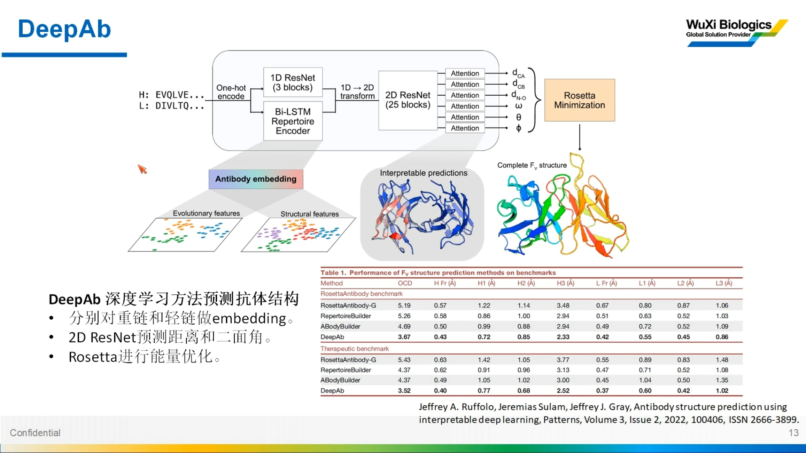](https://www.bilibili.com/video/BV1Um411o74k/?t=1040)

DeepAb（[【跳转到 17:20】](https://www.bilibili.com/video/BV1Um411o74k/?t=1040)）：先对重链、轻链编码，丢进残差网络 + LSTM（LSTM 是语言模型，但 transformer/attention 在语言模型上表现更好），拼合后经过 25 个模块的残差网络与 attention 处理，得到主链长度、角度信息，最后用 Rosetta 做能量最小化与结构补全。基准比较中 DeepAb 的 RMSD 优于 RoseTTAFold 抗体版与 ABodyBuilder 等，CDR loop 区同样占优（[【跳转到 19:00】](https://www.bilibili.com/video/BV1Um411o74k/?t=1140)）。

### 3.2 IgFold：更简化、更快

IgFold 思路与 DeepAb 相近，但更简化：计算资源消耗更少、速度更快，准确性略降（[【跳转到 19:46】](https://www.bilibili.com/video/BV1Um411o74k/?t=1186)）。

### 3.3 ABlooper：图神经网络专攻 CDR loop

[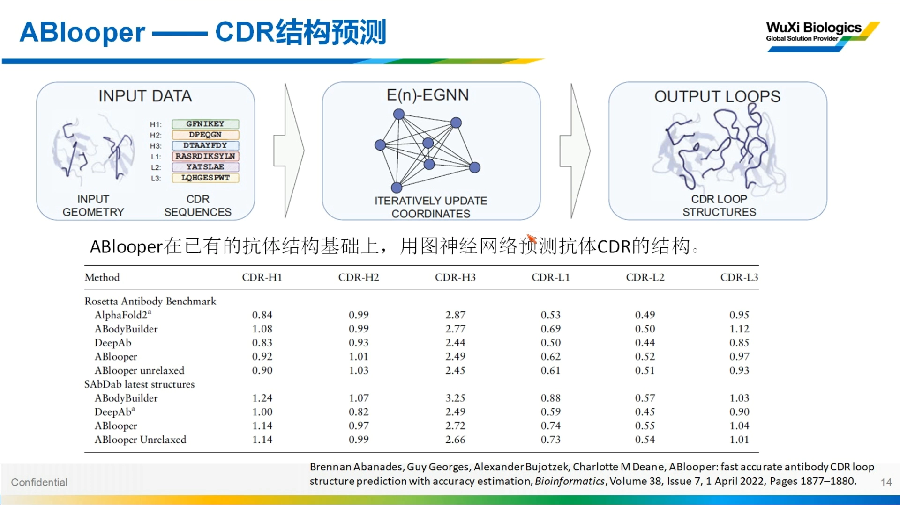](https://www.bilibili.com/video/BV1Um411o74k/?t=1261)

抗体可变区多变、难预测，因此催生了 ABlooper——专门针对可变区的预测工具（[【跳转到 20:26】](https://www.bilibili.com/video/BV1Um411o74k/?t=1226)）：输入是同源建模或深度学习建好的可变区模型，对其 CDR loop 做更好的预测或校正；因为只看 loop，只处理重轻链的三个 CDR。它用**图神经网络**：把蛋白结构表示成图（节点=氨基酸残基，边=残基间距离/关系），节点/边都可编码成矩阵后深度学习建模。同源建模或深度学习建出的模型 loop 区一般结构简单（就是往外伸的 loop），正适合用 ABlooper 精修（[【跳转到 22:47】](https://www.bilibili.com/video/BV1Um411o74k/?t=1667)）。

## 四、序列编码：从 one-hot 到 AbLang

[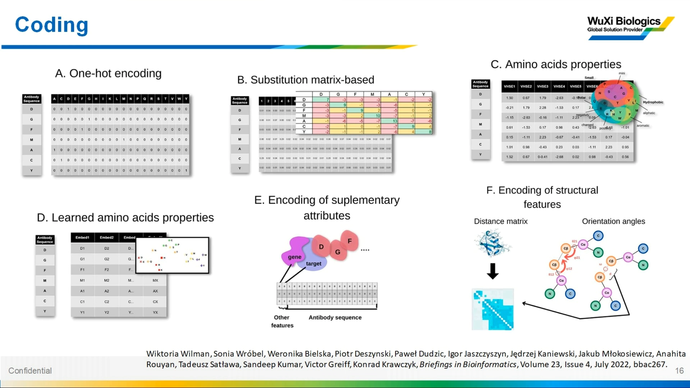](https://www.bilibili.com/video/BV1Um411o74k/?t=1444)

深度学习的输入是矩阵，编码（encoding）决定信息量（[【跳转到 24:04】](https://www.bilibili.com/video/BV1Um411o74k/?t=1444)）：

1. **one-hot 编码**：20 种氨基酸 → 20 维，哪位残基哪位是 1——不含任何性质信息；
2. **替换矩阵**：类似蛋白比对打分矩阵，加入进化特征，比 0/1 信息多；
3. **加入氨基酸自身性质**：来自不同维度的理化性质；
4. **加入位置信息**：残基在序列中的位置关系也编码进去。

信息越丰富，越有利于模型拟合。

### 4.1 AbLang：用 OAS 训练的抗体语言模型

AbLang 专门针对抗体序列做编码（[【跳转到 26:16】](https://www.bilibili.com/video/BV1Um411o74k/?t=1576)）：从 OAS 数据库（Observed Antibody Space，抗体序列库）筛选序列训练 transformer encoder。它不仅记录残基本身性质，还记录残基位置信息（位于 CDR 还是框架区）。编码结果做 t-SNE 降维能很好分开，说明记录了大量有效信息（可解释性则较差）。

与 ESM 的差别在**训练数据**：ESM 用通用蛋白训练，AbLang 用 OAS 抗体序列训练——ESM 也能提特征，但不如 AbLang 的抗体特征多（[【跳转到 28:21】](https://www.bilibili.com/video/BV1Um411o74k/?t=1701)）。

### 4.2 restore 补全与人源化应用

AbLang 的两大功能：编码 + restore（补全）（[【跳转到 29:11】](https://www.bilibili.com/video/BV1Um411o74k/?t=1751)）。OAS 中有些序列因测序不完整有缺失：把序列丢进 AbLang，用多头注意力对被 mask 的位置计算每个位置的 likelihood，取概率最高者补回。不 mask 也能算 likelihood：若某位置 likelihood 高但与输入序列不同，说明该位置不常见。

人源化应用（[【跳转到 30:01】](https://www.bilibili.com/video/BV1Um411o74k/?t=1801)）：用**人的序列**训练语言模型，把需要人源化的抗体序列丢进去，likelihood 与人源序列差异大的位置就是"不像人"的位置，替换成模型指导的高 likelihood 残基即可。restore 后的准确性与其他信息得到的结果相当，且包含更多额外信息（[【跳转到 31:16】](https://www.bilibili.com/video/BV1Um411o74k/?t=1876)）。

## 五、溶解度预测两条路线

### 5.1 DIO：CNN + 生物学特征

[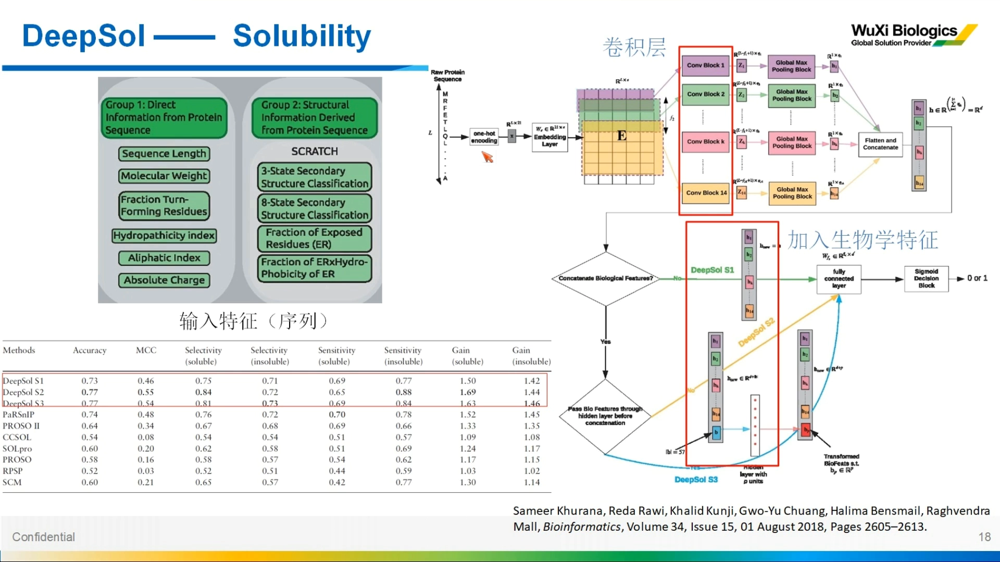](https://www.bilibili.com/video/BV1Um411o74k/?t=1936)

与成药性直接相关的第一个性质是**溶解度**（[【跳转到 31:51】](https://www.bilibili.com/video/BV1Um411o74k/?t=1911)）。DIO 模型以序列为输入、one-hot 编码、14 个卷积层结合。只用序列到这就结束了；S2/S3 版本加入生物学信息——分子量、疏水性、结构特征——准确性显著提升。架构其实不复杂：很多卷积层叠起来。

### 5.2 GRAS：图神经网络

[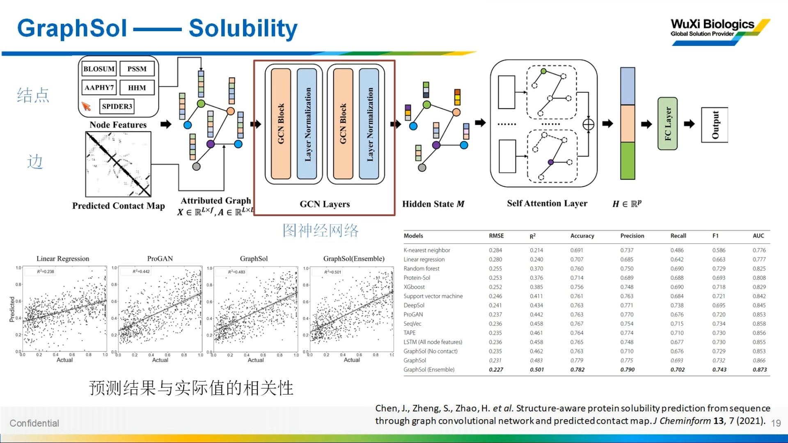](https://www.bilibili.com/video/BV1Um411o74k/?t=2081)

另一个有意思的溶解度预测工具叫 GRAS，从名字就能看出用了图（Graph）方法（[【跳转到 33:26】](https://www.bilibili.com/video/BV1Um411o74k/?t=2006)）。它**不用结构作输入**：

- **节点**：氨基酸理化性质数据库（AAindex 等，电荷、疏水性等内在性质）+ PSSM/HMM（序列比对得到的进化信息）；
- **边**：用其他方法预测的 contact map——两两残基的距离正好作边。

graph 输入 GCN 层建模，再过 attention 层，拼合后分类输出。亮点在节点/边的定义：很多方法节点只是 one-hot 编码，而它引入了大量残基本身信息（当然也可以用 AbLang 编码，信息更多）。与基线比较它占优。

三个亚种（[【跳转到 36:46】](https://www.bilibili.com/video/BV1Um411o74k/?t=2206)）：no-contact 版（没有 contact map，用相邻位置连线作边）效果最差；contact 版更好；ensemble 版（五个模型集成）又有所提升。

## 六、翻译后修饰、免疫原性与蛋白相互作用

### 6.1 磷酸化位点：双向 attention

翻译后修饰的应用以磷酸化位点预测为代表（[【跳转到 37:36】](https://www.bilibili.com/video/BV1Um411o74k/?t=2256)）：只用序列 + one-hot 编码 + 多个卷积层；亮点是把最后的卷积特征做了**两个方向的 attention**（矩阵旋转后对行、列分别 attention，类似 AlphaFold/RoseTTAFold 的做法），再进全连接分类。不仅预测一般磷酸化位点，还预测激酶特异性位点，表现优于其他方法。

### 6.2 表位预测 + 对接 + DNN 打分

免疫原性与蛋白相互作用方面，有一款软件（字幕记为"apt"，专名待核）的思路是（[【跳转到 39:46】](https://www.bilibili.com/video/BV1Um411o74k/?t=2386)）：先用深度神经网络对抗体-抗原的表位/结合位点建模 → 再针对这些位点做对接（知道结合位点后对接容易很多——有些 docking 软件本来就要指定接触面）→ 对接结果打分再进 DNN 建模。预测表位用简单 DNN，最终给出 AUC 等指标。

### 6.3 图神经网络 + 迁移学习 + attention 可视化

[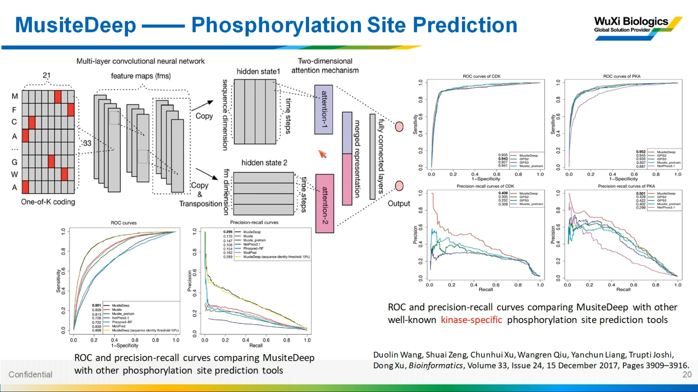](https://www.bilibili.com/video/BV1Um411o74k/?t=2311)

另一个蛋白相互作用建模方法（字幕记为"先"，专名待核）也用图神经网络（[【跳转到 40:44】](https://www.bilibili.com/video/BV1Um411o74k/?t=2444)）：把抗体和抗原按受体、配体**两个方向**分别建模（正着和调过来位置信息不同），中间加卷积层，再用多层 attention，最后全连接分类。训练采用**迁移学习**。attention 矩阵可直接解读：红色=attention 高、蓝色=低，attention 即"相关性"——CDR 与抗原之间相关性强的区域就是可能的接触位置；3D 结构图给出了直观展示（[【跳转到 42:23】](https://www.bilibili.com/video/BV1Um411o74k/?t=2543)）。

## 七、落地：药明生物的服务清单与游离半胱氨酸案例

药明生物在抗体可开发性分析方面提供/正在研发的服务（[【跳转到 43:46】](https://www.bilibili.com/video/BV1Um411o74k/?t=2626)）：ECDC 相关分析（与可开发性分析最靠近）、密码子优化（提高宿主表达产量与稳定性）、高通量测序（基因组组装、质粒测序，确保菌株可靠）、基因编辑工具（sgRNA 设计）以及生信分析。

分析内容覆盖序列整体：可变区/恒定区元件复杂，可变区 CDR 可能有 hotspot（氧化、脱酰胺热点等）、PTM、密码子优化、质粒测序、免疫原性等（[【跳转到 45:24】](https://www.bilibili.com/video/BV1Um411o74k/?t=2724)）。

### 7.1 游离半胱氨酸 → 二聚体：SASA 判据

[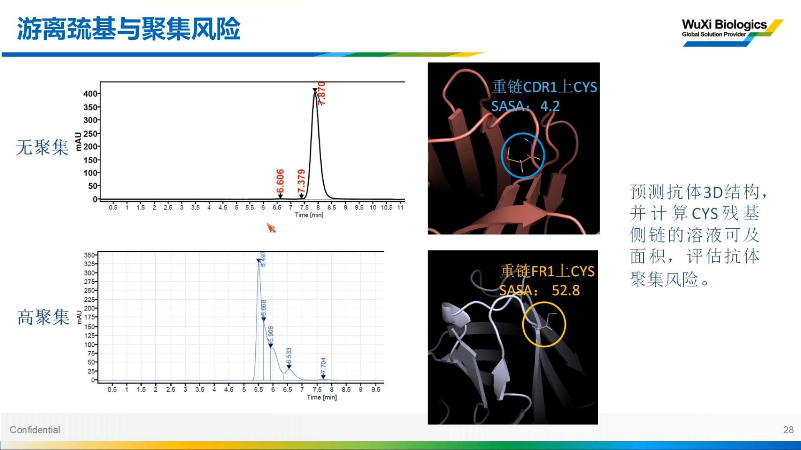](https://www.bilibili.com/video/BV1Um411o74k/?t=2833)

二硫键分析的重要应用点（[【跳转到 46:52】](https://www.bilibili.com/video/BV1Um411o74k/?t=2812)）：抗体上有游离半胱氨酸（free cysteine）时，可能跟另一个抗体分子形成二硫键二聚体。SEC（尺寸排阻色谱）实例：有的含游离半胱氨酸的样品出现高分子量聚集体峰（单体峰之外多出的峰），另一些虽也有游离半胱氨酸却几乎全是单体峰。

计算路径：用 3D 结构预测（同源建模或深度学习）得到结构 → 算 **SASA**（溶剂可及面积）→ 不聚集的样品 SASA 非常低（巯基被包裹在结构内部，不易形成二硫键）；聚集样品的巯基侧链暴露在外、SASA 大（[【跳转到 49:43】](https://www.bilibili.com/video/BV1Um411o74k/?t=2883)）。由此可以用结构预测+SASA 评估游离半胱氨酸的聚集风险。

### 7.2 自研聚集预测模型（研发中）

免疫原性用深度学习加 segmentation 机制预测。聚集性模型则是自研、在研（[【跳转到 49:51】](https://www.bilibili.com/video/BV1Um411o74k/?t=2991)）：AbLang 这类 transformer 编码 + 氨基酸性质维度（序列一路、性质一路），分别过卷积层和 attention 层，两个 attention 结果合在一起进全连接分类器，预测是否聚集。难点在**小数据集**：聚集样本本身就难找（大部分抗体不聚集），模型准确性暂无指导意义，后续计划收集更易聚集的样本再优化。

## 八、Q&A 精华

[【跳转到 51:14】](https://www.bilibili.com/video/BV1Um411o74k/?t=3074) 起的问答环节浓缩了很多实操经验：

- **结构预测工具怎么选**（[【跳转到 52:04】](https://www.bilibili.com/video/BV1Um411o74k/?t=3124)）：只看可变区→专用软件；重点看 CDR→CDR loop 专项工具（ABlooper）；看整体→AlphaFold/RoseTTAFold。
- **深度学习 vs 传统机器学习**（[【跳转到 52:54】](https://www.bilibili.com/video/BV1Um411o74k/?t=3174)）：深度学习能拟合更复杂的函数、利用更多维度信息，代价是可解释性差；传统方式基于经验公式，但现实关系未必一个式子能表征清楚。
- **SASA 用什么算**（[【跳转到 54:24】](https://www.bilibili.com/video/BV1Um411o74k/?t=3264)）：FreeSASA 好用，可调用两个工具（默认 NACCESS），先算逐原子 SASA，再在残基维度对主链/侧链统计加和。
- **二硫键对免疫原性的影响**（[【跳转到 55:05】](https://www.bilibili.com/video/BV1Um411o74k/?t=3305)）：主要影响聚集性；游离半胱氨酸在框架区还是 CDR 区、抗原表位是否暴露，决定了风险场景。
- **双抗建模**（[【跳转到 56:38】](https://www.bilibili.com/video/BV1Um411o74k/?t=3398)）：链长结构复杂，深度学习对计算资源/内存要求高；实践是分区域结构预测 + 手动在 PyMOL 加 linker 拼接 + 能量优化，或用预测结构作模板做同源建模。
- **免疫原性预测软件**（[【跳转到 57:43】](https://www.bilibili.com/video/BV1Um411o74k/?t=3463)）：NetMHCpan 比较有名。
- **CDR loop 准确性如何评价**（[【跳转到 58:44】](https://www.bilibili.com/video/BV1Um411o74k/?t=3524)）：没有足够已有结构很难评——CDR 是 loop，不同环境构象本就不同；只能用已有结构评主链，或用 FoldX 类工具看能量，方法都有限。
- **不同软件预测结构不一致怎么办**（[【跳转到 1:00:57】](https://www.bilibili.com/video/BV1Um411o74k/?t=3657)）：有同源结构就跟同源结构比；没有就只能靠能量评估等模拟手段，目前没有通用性特别好的判断方法。

## 小结

- **成药性三维度**（生产性/安全性/活性）映射到可计算性质：聚集、溶解度、稳定性、免疫原性、PTM、抗原性——且彼此关联，需系统评估。
- **结构是信息最丰富的起点**：同源建模（ABodyBuilder 四步）与深度学习（AlphaFold 的 MSA+pair 双路、RoseTTAFold 的 1D/2D track）殊途同归；复合体用 Multimer 或 linker/MSA 拼接技巧。
- **抗体有专用工具**：DeepAb（准确）、IgFold（快）、ABlooper（CDR loop 精修）。
- **编码决定上限**：one-hot → 替换矩阵 → 性质 → 位置信息；AbLang（OAS 训练）带来抗体特异的编码与 restore 能力，可服务人源化。
- **性质预测已有成熟范式**：溶解度（CNN 加生物学特征 / 图神经网络加 contact map 边）、磷酸化（双向 attention）、表位+对接+DNN 打分、GNN 相互作用建模（attention 热图即接触图）。
- **工业落地的样板**：药明生物把游离半胱氨酸风险转化为"结构预测 → SASA → 聚集风险"的可计算判据；聚集/免疫原性模型仍在小数据困境中迭代。

## 关键术语速查

| 术语 | 一句话解释 |
| --- | --- |
| 成药性（Developability） | 抗体能否顺利开发成药的综合评估：生产性、安全性、生物活性三维度 |
| MSA | 多序列比对：目标序列与同源序列的比对矩阵，AlphaFold 的两路输入之一 |
| pair / contact map | 两两残基间的距离/相关性矩阵，编码"谁可能挨着谁" |
| Evoformer / IPA | AlphaFold 的核心模块：双路信息交换更新的注意力网络 / 生成 3D 坐标的结构模块 |
| recycle | 把预测结果返回再处理的迭代精修机制，处理三次相当于一次迭代 |
| AlphaFold-Multimer | AlphaFold 的复合体版本，可预测抗体这类多链复合物 |
| DeepAb / IgFold / ABlooper | 三个抗体专用结构预测器：准确 / 快 / CDR loop 精修（图神经网络） |
| AbLang | 用 OAS 抗体序列训练的抗体语言模型，功能：序列编码 + restore 补全 |
| OAS | Observed Antibody Space，大规模抗体序列（及结构）数据库 |
| one-hot 编码 | 最简单的序列编码：20 种氨基酸变 20 维 0/1 向量，不含性质信息 |
| PSSM / HMM | 从序列比对得到的进化信息（位置特异打分矩阵 / 隐马尔可夫模型），常用作模型输入特征 |
| SASA | 溶剂可及面积：残基/原子暴露在溶剂中的面积，FreeSASA（默认 NACCESS）可计算 |
| 游离半胱氨酸（free cysteine） | 未配对形成二硫键的半胱氨酸；若暴露（SASA 大）易导致抗体间二硫键二聚与聚集 |
| SEC | 尺寸排阻色谱：聚集体（高分子量峰）与单体峰的实验表征手段 |
| NetMHCpan | 知名的免疫原性（MHC 呈递）预测软件 |
