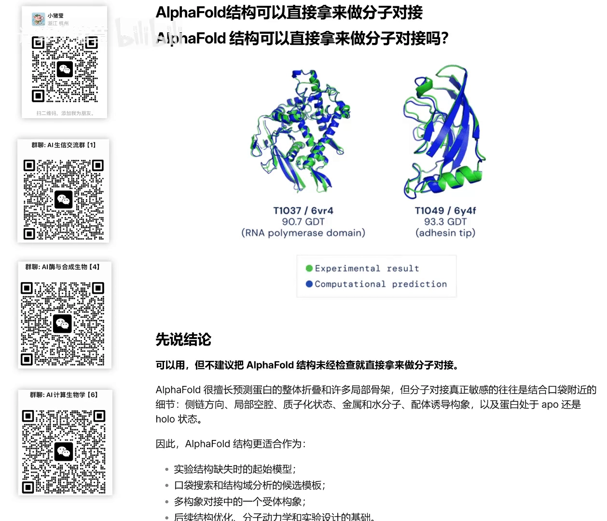
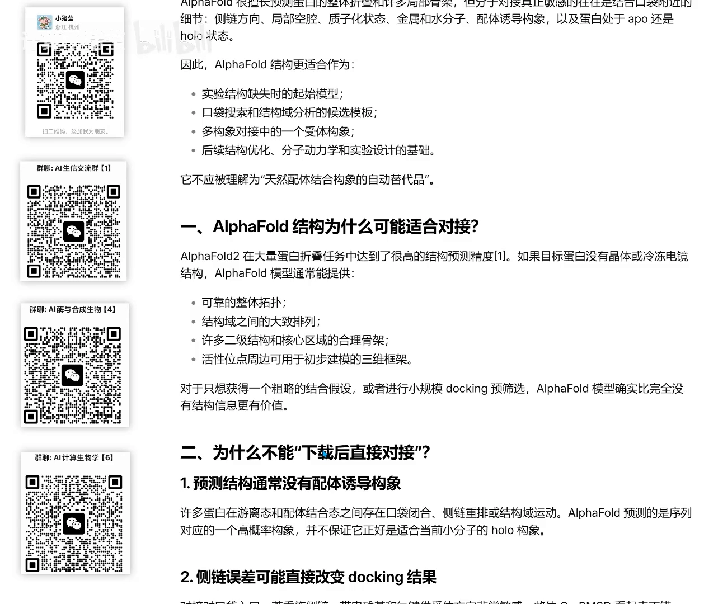
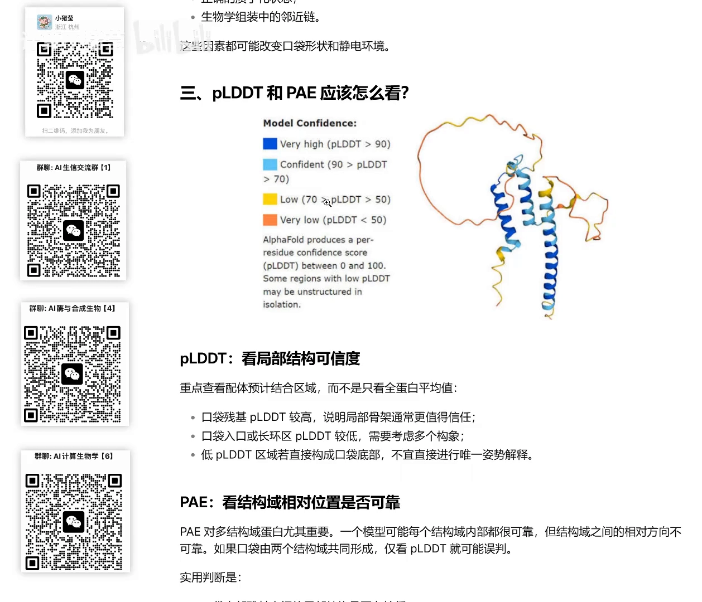
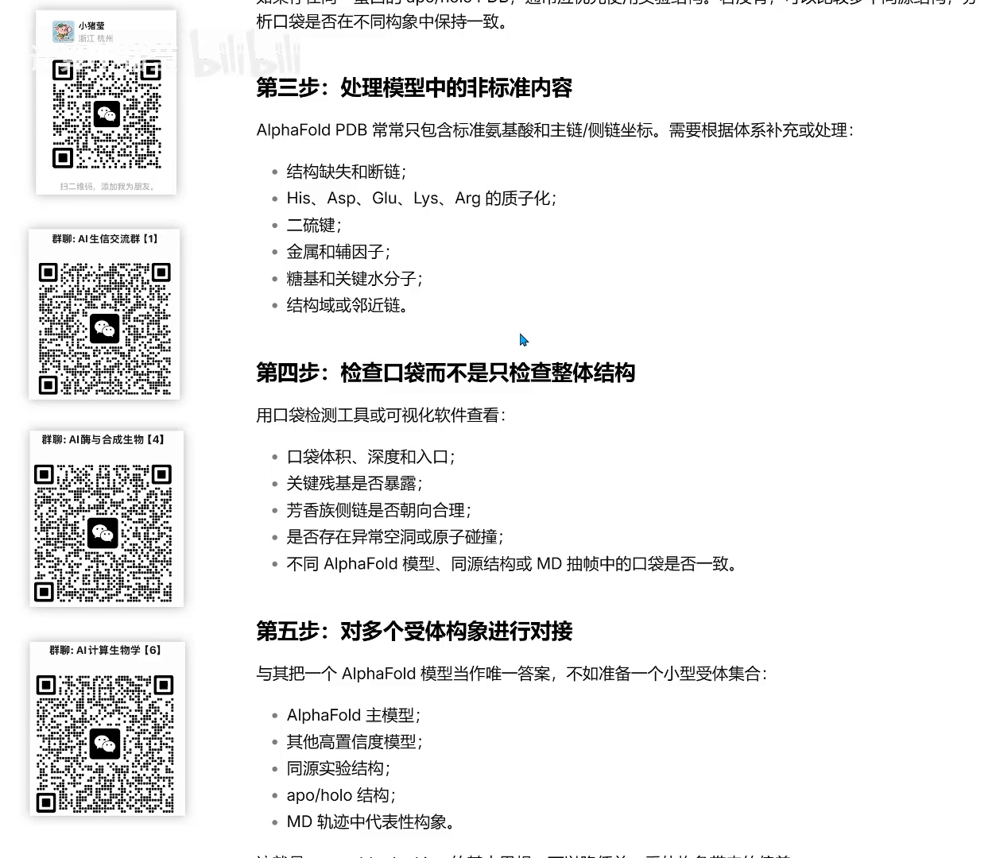

# AlphaFold 结构能直接拿来做分子对接吗？——能，但先过这五道检查

> 视频来源：[Bilibili《AlphaFold结构可以直接拿来做分子对接吗？》](https://www.bilibili.com/video/BV1dQba6ZEJp/)（约 4 分 58 秒）
> 本文基于视频演说图文稿撰写，观点与数据均可回看视频核对。

## 这支视频要解决的核心问题（SCQA）

**背景**：AlphaFold（下称 AF）让"有序列就有结构"成为日常。在抗体药物设计管线里，拿到 AF 预测的抗原结构后，下一步往往就是分子对接——把小分子或对接伙伴"放"进蛋白口袋。

**冲突**：但 AF 擅长预测的是蛋白整体结构和局部骨架，分子对接敏感的恰恰是结合口袋附近的细节，以及蛋白处于 APO（无配体）还是 HOLO（结合配体）状态——这些正是预测结构最容易"差之毫厘、谬以千里"的地方。

**疑问**：AF 的结构到底能不能直接喂给对接流程？用之前要检查什么、置信度又该怎么读？

**回答（中心思想）**：可以用，但它的正确定位是"**对接的受体起始模型**"，而不是"天然结合构象的保证书"。使用前必须过五道检查：①确认序列与生物学状态；②优先找实验结构；③处理模型中的非标准内容；④**重点检查口袋局部（pLDDT + PAE），而不是只看整体**；⑤不要把 AF 模型当唯一答案，准备一个受体构象集合去对接。

## 一、结论先行：起始结构，不是天然构象的替代品

视频开篇就给出结论（[【跳转到 00:00】](https://www.bilibili.com/video/BV1dQba6ZEJp/?t=0)）：AF 的结构**可以**用于分子对接，但不建议"连检查都不经过"就直接用。AF 擅长整体结构与局部骨架，而对接敏感的是口袋附近细节与 APO/HOLO 状态。

因此 AF 结构的定位是**起始结构**（[00:25](https://www.bilibili.com/video/BV1dQba6ZEJp/?t=25)）——它不应该被理解成天然配体结合构象的自动替代品（[00:31](https://www.bilibili.com/video/BV1dQba6ZEJp/?t=31)）。视频给了一个"生命周期"类比：蛋白有青年、中年、老年时期的各种构象，AF 采样的一般是它最有代表性的"中青年"构象；如果你的对接恰好需要"幼年或老年"构象，AF 就帮不上忙——但大多数情况下没有特殊要求，直接使用即可（[00:56](https://www.bilibili.com/video/BV1dQba6ZEJp/?t=56)）。

## 二、为什么"下载即对接"会翻车

两个原因（[【跳转到 01:15】](https://www.bilibili.com/video/BV1dQba6ZEJp/?t=75)）：

1. **缺配体诱导**：如果你需要的是配体诱导出的构象，下载后的 AF 结构没有经过配体诱导，口袋可能根本还没形成；
2. **预测误差**：预测的测量误差也可能改变对接结果。

视频还回应了一个高频问题：直接用 AF3 同时预测蛋白+小分子、然后只看 pLDDT 行不行？（[01:40](https://www.bilibili.com/video/BV1dQba6ZEJp/?t=100)）

## 三、pLDDT 与 PAE：读预测结构的两把尺子

**不能只看 pLDDT**。pLDDT 主要反映结构建模的置信度（建模好不好、像不像真实结构），**它不等于蛋白和配体能结合**。更应该查看的是（[01:40](https://www.bilibili.com/video/BV1dQba6ZEJp/?t=100)）：

- 口袋残基的**局部 pLDDT**；
- **PAE**（预测对齐误差）；
- 对接界面分数、保守性与已知功能信息。

另外，早期 AF 模型不含配体；AF3 已经可以包含配体（[02:05](https://www.bilibili.com/video/BV1dQba6ZEJp/?t=125)）。

读图时有两条要领（[02:30](https://www.bilibili.com/video/BV1dQba6ZEJp/?t=150)）：

- **着重看配体结合区域，而不是蛋白平均分**：无序 loop 区分数低无所谓（可能无关紧要），但结合位点这片区域分数必须高；
- **PAE 对多结构域蛋白尤为重要**：一个模型可能每个结构域内部都很可靠，但**结构域之间的相对方向不可靠**——如果口袋由两个结构域共同形成，只看 pLDDT 就可能误判（[02:55](https://www.bilibili.com/video/BV1dQba6ZEJp/?t=175)）。

## 四、对接前的五步检查清单

视频把 AF 结构用于对接前的准备总结成五步（[【跳转到 03:20】](https://www.bilibili.com/video/BV1dQba6ZEJp/?t=200)）：

1. **确认目标序列和生物学状态**：是不是信号肽、跨膜区、标签、剪切区域？确认对接的结构域对不对；
2. **优先寻找实验结构**：建模之前先查有没有实验解析的结构；
3. **处理模型中的非标准内容**：手动建模较纯净时可能没有，但不排除特殊情况；
4. **检查口袋而不是只检查整体**；
5. **对多个受体进行对接**：不要把 AF 模型当唯一答案，而是准备一个受体集合——把 AF 预测结构跑分子动力学模拟，或用 AI 生成式采样模型生成多个构象，再分别对接。

## 五、AF、AF3、AF-Multimer 不应混为一谈

视频特别提醒（[03:45](https://www.bilibili.com/video/BV1dQba6ZEJp/?t=225)）：AlphaFold、AlphaFold 3、AlphaFold-Multimer 三者作用完全不一样，不要混为一谈；并给出一张直接判断的对照表格（[04:10](https://www.bilibili.com/video/BV1dQba6ZEJp/?t=250)）。

## 小结

- **能用，但有前提**：AF 结构适用于做对接的**受体起始模型**，不是天然结合构象的保证书（[04:15](https://www.bilibili.com/video/BV1dQba6ZEJp/?t=255)）。
- **预测出结构 ≠ 能结合**：pLDDT 是建模置信度；要结合口袋局部 pLDDT、PAE、界面分数、保守性综合判断。
- **多结构域蛋白看 PAE**：结构域之间相对方向不可靠时，只看 pLDDT 会误判。
- **五步检查**：序列/生物学状态 → 找实验结构 → 清理非标准内容 → 查口袋局部 → 受体集合对接。
- **变构场景要当心**：变构结合时 AF 结构只能提供参考，还需要进一步确认变构后/打开的构象（[04:40](https://www.bilibili.com/video/BV1dQba6ZEJp/?t=280)）。

## 关键术语速查

| 术语 | 一句话解释 |
| --- | --- |
| APO / HOLO | 蛋白未结合配体 / 已结合配体的两种状态；对接敏感于此差异 |
| pLDDT | AF 逐残基建模置信度（0-100，蓝-黄-红着色），反映"建模好不好"，不等于"能结合" |
| PAE（预测对齐误差） | 两个残基之间相对位置（距离）的预测误差；对多结构域蛋白的"结构域间方向"尤其关键 |
| 受体集合（ensemble docking） | 用 MD 模拟或生成式采样准备多个受体构象分别对接，而不是只信单一 AF 结构 |
| 变构（allosteric）结合 | 配体结合在非正构位点并改变蛋白构象；此类场景 AF 参考价值有限 |
