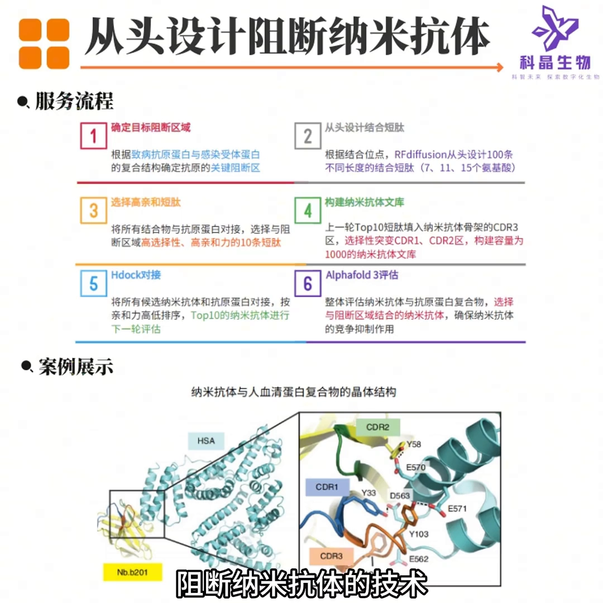

# AI算法从头设计阻断纳米抗体

> 视频来源：B 站《AI算法从头设计阻断纳米抗体》（BV1rja6z1EWi，约 5 分钟，AI 双人播客形式）。内容为拆解一家公司「从头设计阻断纳米抗体」服务的核心技术原理、实验流程与交付成果（口播公司名在 AI 字幕中同音拼作「科精/科金/氪金」，确切商号不作断言，下文统称「该公司」）。对应系列条目 **6.2.2 骨架：RFantibody（design_loops + hotspots）**：管线 B（抗体药物设计）的第二步是「生成抗体骨架」——RFantibody 的官方做法是用 design_loops（CDR loop 长度规格）+ hotspots（表位热点约束）直接生成抗体 CDR 与骨架（见 5.2.2 的 Nano Helix 官方教程）；本视频给出的是同一问题域的另一条 RFdiffusion 路线：先设计与 CDR3 等长的结合物，再嫁接到纳米抗体骨架上。

## 本讲要解决的核心问题（SCQA）

**背景**：在本系列里，管线 B 的第一步已经解决——用 Protenix 预测或 PDB 下载拿到抗原三维结构（见 6.2.1）。下一步自然就是：对着这个结构，造出能结合它、并且「占住关键位置」的抗体。

**冲突**：抗体靠 6 个 CDR 环「摸」抗原，其中 CDR3 最灵活也最难设计——直接让 AI 一步生成整只抗体，序列长、折叠难验证；而「负责结合的一段」和「负责折叠的骨架」，其实是两个可以分开解决的问题。

**疑问**：能不能先用 AI 只生成「负责结合的那一小段」，再把它装进现成的抗体骨架里，然后用计算工具层层筛掉不可行的候选，最后交付一批可用的序列？

**回答（中心思想）**：该公司的做法正是如此——一条「生成 → 筛选 → 再生成 → 再筛选」的五步工作流：分析结合位点 → RFdiffusion 设计 3 种长度 × 各 100 个、共 300 个「CDR3 等长」结合物 → 分子对接 + 亲和能两轮筛出 top 10 → 嫁接进纳米抗体 CDR3、并对 CDR1/CDR2 随机突变扩到 1000 条序列 → HDock 结合能 + AlphaFold 3 的 pTM/ipTM 筛出 top 20，连同序列表、分值、绘图与原始 PDB 一并交付，并承诺至少一条满足 pTM + ipTM ≥ 1。

## 一、这门技术到底「独到」在哪

播客给这门技术的定位是：把**人工智能**和**蛋白质工程**结合起来，用先进的分子设计工具，搭一条「从抗原功能区域分析 → 纳米抗体筛选优化」的全流程方案（[【跳转到 00:30】](https://www.bilibili.com/video/BV1rja6z1EWi/?t=30)）。具体能力三句话：

- **精准预测阻断区域**——在抗原上找到「按住它就不能工作」的关键位置；
- **智能化设计短肽和纳米抗体**——在计算机里直接造分子，而不是从文库里碰运气；
- **高通量计算筛选**——用打分代替实验初筛，快速获得针对目标蛋白的高亲和力纳米抗体（[【跳转到 00:55】](https://www.bilibili.com/video/BV1rja6z1EWi/?t=55)）。

这里的**从头设计（de novo）**指：不依赖动物免疫、也不依赖天然或合成文库筛候选，直接在计算机里从零造出靶向指定靶点的序列——这是它与 1.4.5 里「从羊驼体内淘纳米抗体」那条传统路线的根本区别。「阻断」则指设计的纳米抗体结合目标蛋白的功能区域/活性位点，占住位置让蛋白无法正常工作。

## 二、核心原理：只造「结合的那一段」，骨架用现成的

全片最核心的一句话（[【跳转到 00:55】](https://www.bilibili.com/video/BV1rja6z1EWi/?t=55)）：**利用 RFdiffusion 设计与「诱饵蛋白」（即要结合的目标靶蛋白）高互作的结合物，其氨基酸长度模拟纳米抗体 CDR3 区域的长度；再通过拼接（嫁接），把结合物装到纳米抗体骨架上**。

拆开解释三个名词：

- **纳米抗体（VHH）**：只有重链可变区的单域抗体（见 1.4.5）。它小、稳定、好表达，只有一个结构域要设计，是「从头设计」的理想对象。
- **CDR3**：互补决定区第 3 环（见 1.4.2）。抗体一共 6 个 CDR 环负责接触抗原，其中重链 CDR3 处在口袋正中央、变化空间最大，对结合特异性贡献最大——所以「结合」这一步的设计主战场就是 CDR3。
- **骨架（framework）**：抗体中保守的支架部分，本身不直接决定特异性，但保证整只抗体能正确折叠。天然纳米抗体骨架是被进化验证过的「可靠底盘」。

打个比方：CDR3 像**钥匙的齿纹**，骨架像**标准钥匙坯**。RFdiffusion 负责「对着锁芯（抗原口袋）配齿纹」——生成一段长度与 CDR3 一致、能与靶蛋白高亲和结合的短肽；嫁接这步负责「把齿纹装回钥匙坯」——让这段 loop 长在天然纳米抗体的骨架上。这样就把「结合」与「折叠」两个难题解耦：loop 管结合，骨架管折叠。

## 三、五步工作流：300 → 10 → 1000 → 20 的漏斗

具体流程从「实验流程怎么操作」这个问题展开（[【跳转到 02:10】](https://www.bilibili.com/video/BV1rja6z1EWi/?t=130)）：

**第 1 步：分析结合位点。** 先分析纳米抗体（对抗原）的结合位点——在靶蛋白上找到应该结合的功能区域/活性位点，这是后面所有设计的「靶心」。

**第 2 步：RFdiffusion 造结合物。** 用 RFdiffusion（见 4.3.2，Baker 实验室的蛋白骨架扩散生成模型）设计针对活性位点的结合物。**设计 3 种不同长度，每个长度 100 个，总共 300 个结合物**——多试几种 loop 长度，是因为不同长度能长成不同的环形状，覆盖不同的口袋几何。

**第 3 步：两轮计算筛短肽。** 先用**分子对接**（预测两个分子如何结合并打分，见 1.5.2）筛选出与诱饵蛋白亲和率最高的短肽；这一步之后再做一轮精细筛选——**计算它们的亲和能，选出前 10 个结合物**进入下一轮（[【跳转到 02:35】](https://www.bilibili.com/video/BV1rja6z1EWi/?t=155)）。播客对此的总结是「每一步都在不断精细化、去粗取精」。

**第 4 步：嫁接 + 突变扩充。** 把这 10 个短肽**替换到纳米抗体的 CDR3 区域**；同时对 **CDR1 和 CDR2 区域进行随机突变**——每个纳米抗体会产生 100 个突变体，10 × 100 = **总共 1000 条纳米抗体序列**（[【跳转到 03:00】](https://www.bilibili.com/video/BV1rja6z1EWi/?t=180)）。CDR1/CDR2 不直接对准口袋中心，但对环的形状与稳定性有贡献，随机突变相当于给候选加一层「微调噪音」，扩大多样性。

**第 5 步：双重打分收口。** 用 **HDock**（蛋白-蛋白对接工具）计算这 1000 个纳米抗体与诱饵蛋白的结合，选出结合能最好的；再用 **AlphaFold 3**（全原子复合物结构预测，开源复现 Protenix 见 5.1.1）做结构预测，**根据 pTM 和 ipTM 的值选出最靠谱的 20 个**（[【跳转到 03:25】](https://www.bilibili.com/video/BV1rja6z1EWi/?t=205)）。pTM/ipTM 是 0~1 的置信度指标（见 3.1.2）：前者衡量整体折叠，后者衡量界面——两个都高，才说明「预测出来的复合物本身可信」。

整条链路是一个不断收窄的漏斗：**300 个结合物 → top 10 短肽 → 1000 条突变序列 → top 20 纳米抗体**，每一步都「用最先进的工具做优化和筛选」。

## 四、交付什么：能直接开工的「全套材料」

播客专门问了「项目交付的结果一般包含什么」，答案是一整套可深入分析的材料（[【跳转到 03:25】](https://www.bilibili.com/video/BV1rja6z1EWi/?t=205)）：

- **Excel 表**：设计的 binder 序列、纳米抗体序列，以及 HDock 和 AlphaFold 3 的对接分值；
- **核心位点精细化绘图**：抗原与纳米抗体关键相互作用位点的图示；
- **原始文件**：如 PDB 结构文件等——可自行导入 PyMOL/ChimeraX 深入分析；
- **质量承诺**：保证**至少一条纳米抗体满足「pTM + ipTM ≥ 1」**（字幕原话「PTM 加 IPTM 大于等于一」；pTM 与 ipTM 各取 0~1，相加 ≥ 1 意味着整体与界面置信度都不低）；
- **项目报告**：「拿过来就用」，直接推进科研或药物研发进程。

## 五、放进系列看：和管线 A 是同一套「生成-筛选」哲学（编者按）

把这条流程和 6.1 管线 A（蛋白 Binder 设计三部曲）放在一起看，结构是同构的：

| 环节 | 管线 A（6.1） | 本视频（管线 B 思路） |
| --- | --- | --- |
| 生成 | RFdiffusion 生成 binder 骨架（contigs，见 6.1.2） | RFdiffusion 生成 CDR3 等长结合物 |
| 序列化 | ProteinMPNN 配序列（见 6.1.3） | 嫁接到天然纳米抗体骨架 + CDR1/CDR2 随机突变 |
| 验证 | Protenix/OpenFold3 回折，看 ipTM（见 6.1.4） | HDock 结合能 + AlphaFold 3 的 pTM/ipTM |

差别在「序列从哪来」：管线 A 用逆折叠网络为骨架配全新序列；本路线直接**嫁接**——骨架是天然纳米抗体（折叠有保障），只有 CDR3 是新造的，再用 CDR1/CDR2 随机突变补充多样性。而 RFantibody（见 5.2.2）走的是第三条路：在 RFdiffusion 上微调出抗体专用权重（RFdiffusion_Ab.pt），用 design_loops + hotspots 直接生成 CDR 与骨架。三条路线，同一个漏斗逻辑：**每一步都用当下最准的工具把候选池收窄一档**。

**阅读提醒**：本视频为公司技术播客，形式为 AI 双人对谈，内容以流程与数字为主、无论文出处与实验数据；文中 3×100=300、top 10、1000 条、top 20、pTM+ipTM≥1 等数字均转写自视频口播，实际以该公司或相应文献为准。AI 字幕存在错拼（RFdiffusion 拼作「rf to fusion/rf diffusion」、AlphaFold 3 拼作「off for foto three/alpha fort three」、HDock 拼作「h doc/h dock」、pTM/ipTM 拼作「PTM/IPTM」），本文已按上下文还原。

## 小结

- 抗体设计可以把「结合」和「折叠」拆开：RFdiffusion 只造与 CDR3 等长、能高亲和结合靶点的短肽，折叠交给天然纳米抗体骨架。
- 五步漏斗：分析结合位点 → RFdiffusion 造 300 个结合物（3 长度 × 100）→ 分子对接 + 亲和能筛出 top 10 → 嫁接 CDR3 + CDR1/CDR2 随机突变扩到 1000 条 → HDock + AlphaFold 3 双重打分收口到 top 20。
- 每一步都是「生成 → 打分 → 收窄」：分子对接、亲和能、结构预测置信度（pTM/ipTM）在不同尺度上为候选排序。
- 交付不止序列：Excel 分值表、核心位点绘图、PDB 原始文件与项目报告，构成可直接开工的设计包。
- 与 6.1 管线 A 同构（生成-筛选交替），与 5.2.2 的 RFantibody 互为参照：一个嫁接、一个微调直出，两条路都建立在 RFdiffusion 的骨架生成能力上。

## 关键术语速查

| 术语 | 一句话解释 |
| --- | --- |
| 纳米抗体（VHH） | 只有重链可变区的单域抗体（驼科动物天然存在）；小、稳定、易表达（见 1.4.5） |
| CDR1/2/3 | 互补决定区：抗体上直接接触抗原的 6 个环；重链 CDR3 最可变、对特异性贡献最大（见 1.4.2） |
| 骨架（framework） | 抗体中保守的支架部分，保证整体正确折叠，不直接决定特异性 |
| RFdiffusion | Baker 实验室的蛋白骨架扩散生成模型：从噪声出发逐步去噪生成主链（见 4.3.2） |
| 嫁接（grafting） | 把一段序列/结构装进另一个支架的对应位置，本视频指把短肽替换进 CDR3 |
| 分子对接 | 预测两个分子如何结合并打分（pose + 亲和力），见 1.5.2 |
| HDock | 蛋白-蛋白对接工具，输出结合能/打分用于候选筛选 |
| AlphaFold 3 | 全原子复合物结构预测模型（开源复现 Protenix 见 5.1.1） |
| pTM / ipTM | AF 系列全局/界面置信度，0~1，越高越可信（见 3.1.2） |
| 从头设计（de novo） | 不依赖动物免疫与天然文库，直接在计算机里从零创造靶向分子 |
