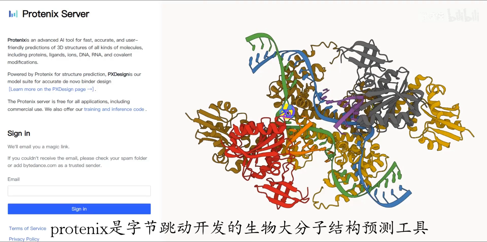
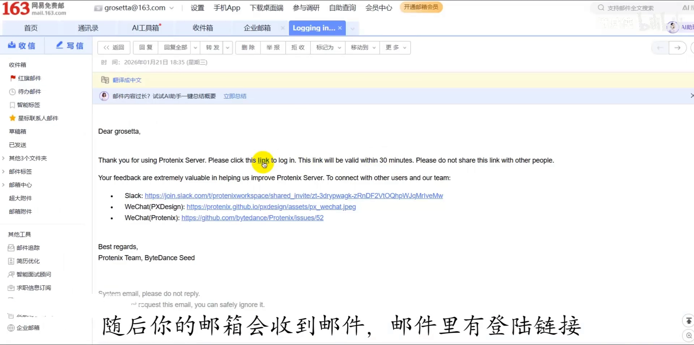
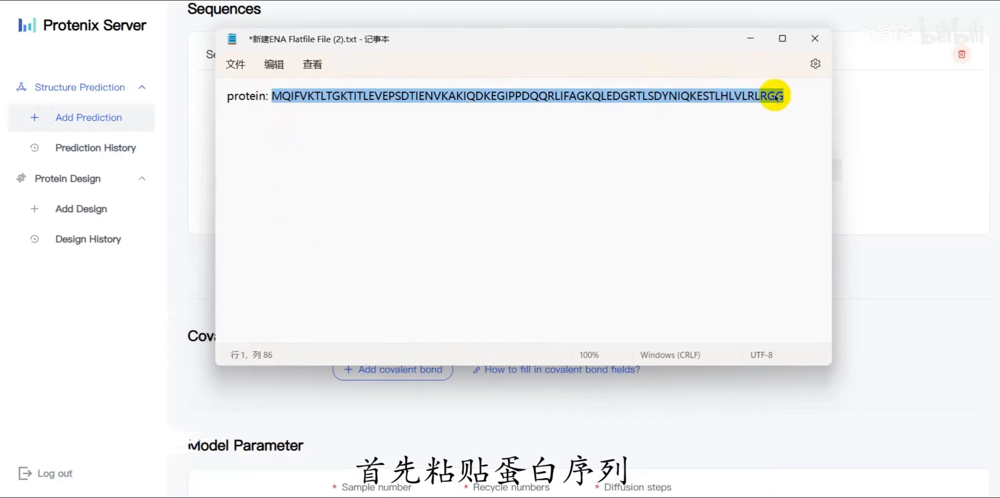
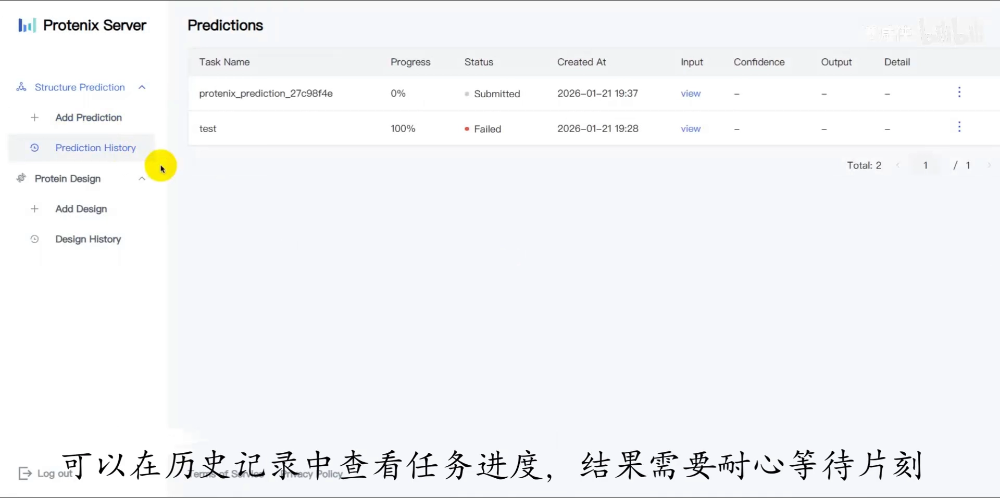
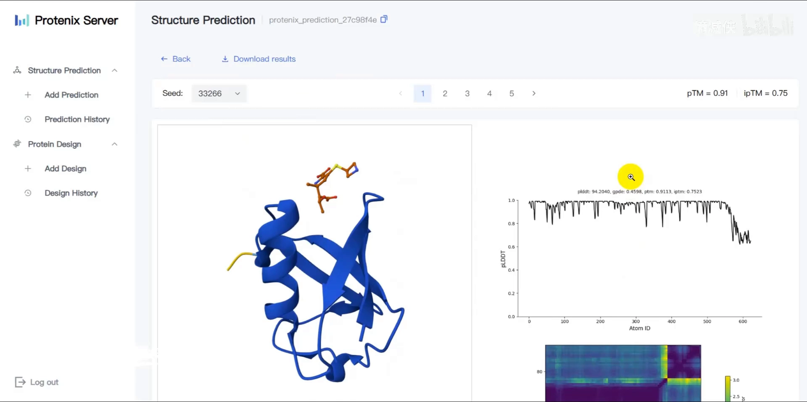
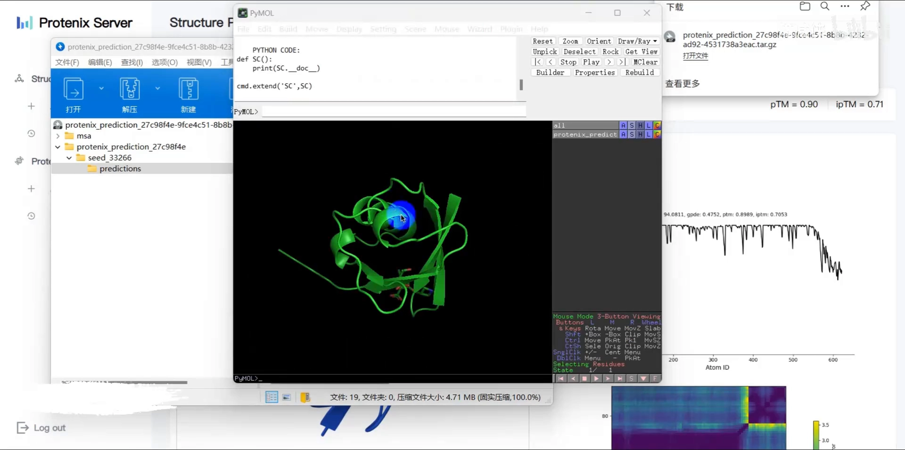
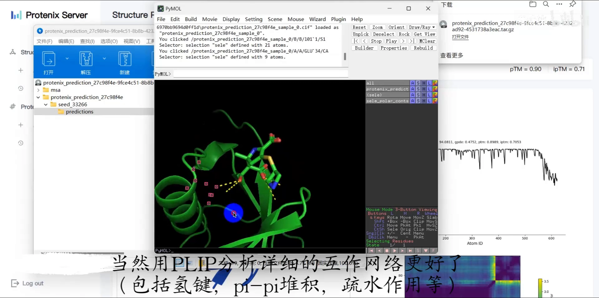

# Protenix蛋白-小分子结构预测教程

> 视频来源：[B站《Protenix蛋白-小分子结构预测教程》](https://www.bilibili.com/video/BV1dAzEB6EGP)（3:01）。UP 主演示用 Protenix Server 网页版，从一条蛋白序列加一个小分子 SMILES 出发，几分钟内拿到蛋白-小分子复合物结构，再用 PyMOL 直观检查配体与蛋白之间的氢键相互作用。视频字幕为 B 站 AI 字幕（kedou 配额耗尽，经 cookie 降级链抓取 ai-zh 轨道），已逐窗口纠正错拼（"PROTEANEX"→Protenix、"camdraw"→ChemDraw、"pymode"→PyMOL、"轻剑派杠派堆积"→氢键/π-π 堆积等）；本文基于文稿整理，所有操作可点时间戳回看核对。

## 本教程要解决的核心问题（SCQA）

**背景**：小分子药物发现管线的第一步是拿到**靶标蛋白**的三维结构（理想情况下还有靶标-配体复合物结构），后续的口袋发现、配体生成、对接都要在它之上进行。实验解析结构又贵又慢；Protenix（字节跳动开源的 AlphaFold3 类生物分子结构预测工具）除了本地部署，还提供**免安装的网页版 Server**。

**冲突**：本地部署要配 GPU 环境；许多初学者只想快速验证"我的蛋白 + 我的小分子"结合长什么样、结合位点上有没有氢键，不想折腾环境。

**疑问**：不装任何环境，网页上点几下，能不能直接预测蛋白-小分子复合物结构？

**回答（中心思想）**：能。Protenix Server 用**邮箱即可登录**，粘贴蛋白序列、新增输入框填小分子 SMILES、其余默认直接提交，约 3 分钟后就能在线查看并**下载复合物结构文件**；再用 PyMOL 打开即可直观检查配体与蛋白间的氢键等相互作用——正好覆盖管线 C 第一步"靶标蛋白（复合物）结构获取"的轻量路线。

## 操作全流程

### 1. 邮箱登录

[【跳转到 00:00】](https://www.bilibili.com/video/BV1dAzEB6EGP/?t=0)

打开 Protenix Server 网页，在登录页输入自己的邮箱，点击 Sign in（[【跳转到 00:00】](https://www.bilibili.com/video/BV1dAzEB6EGP/?t=0)）。随后邮箱会收到一封邮件，**邮件里的登录链接**就是进入工作台的入口（[【跳转到 00:13】](https://www.bilibili.com/video/BV1dAzEB6EGP/?t=13)）。

### 2. 粘贴蛋白序列 + 填小分子 SMILES

本视频的演示任务是**蛋白-小分子复合物结构的预测**，输入分两侧（[【跳转到 00:13】](https://www.bilibili.com/video/BV1dAzEB6EGP/?t=13)）：

- **蛋白一侧**：直接把蛋白**序列**粘贴进输入框；
- **小分子一侧**：点击**新增一个输入框**，填入小分子的 **SMILES** 结构。UP 主的做法是先在 ChemDraw 里把小分子画出来，再复制它的 SMILES 式（[【跳转到 00:21】](https://www.bilibili.com/video/BV1dAzEB6EGP/?t=21)、[【跳转到 00:33】](https://www.bilibili.com/video/BV1dAzEB6EGP/?t=33)）。

其余参数**保持默认**，最后点击提交即可（[【跳转到 00:42】](https://www.bilibili.com/video/BV1dAzEB6EGP/?t=42)）。

### 3. 等待任务：约 3 分钟出结果

预测在云端跑，**在历史记录（History）里查看任务进度**（[【跳转到 00:54】](https://www.bilibili.com/video/BV1dAzEB6EGP/?t=54)）。视频里等了约 3 分钟，刷新页面后任务即显示结束（[【跳转到 00:59】](https://www.bilibili.com/video/BV1dAzEB6EGP/?t=59)）。

### 4. 在线查看与下载结构

点击 **View** 可以在线查看预测结果（[【跳转到 00:59】](https://www.bilibili.com/video/BV1dAzEB6EGP/?t=59)）；点击左上角 **Download** 可把结构文件下载到本地（[【跳转到 01:30】](https://www.bilibili.com/video/BV1dAzEB6EGP/?t=90)）。

### 5. PyMOL 检查氢键，PLIP 看完整互作网络

UP 主用 **PyMOL** 打开预测结构，演示如何简单查看小分子和蛋白之间的**氢键相互作用**（[【跳转到 01:56】](https://www.bilibili.com/video/BV1dAzEB6EGP/?t=116)）。如果想得到更完整的互作网络，UP 主推荐用 **PLIP** 工具分析——包括氢键、**π-π 堆积**、疏水作用等相互作用类型（[【跳转到 01:56】](https://www.bilibili.com/video/BV1dAzEB6EGP/?t=116)），并留言征求是否需要出 PLIP 相关的一期教程（[【跳转到 02:21】](https://www.bilibili.com/video/BV1dAzEB6EGP/?t=141)）。

## 小结

- Protenix Server = Protenix 的网页版：**邮箱登录即用**，无需本地 GPU 环境；
- 输入两件套：**蛋白序列** + **小分子 SMILES**（ChemDraw 画好直接拷贝）；
- 其余参数默认提交，历史记录看进度，**约 3 分钟**出结果；
- 结果支持在线 View 与本地 Download，用 **PyMOL** 打开即可检查氢键互作；
- 更系统的互作分析交给 **PLIP**（氢键、π-π 堆积、疏水作用等）；
- 在管线 C（小分子药物发现）里，这一步产出的复合物结构可直接衔接后续口袋发现与对接。

## 关键术语速查

| 术语 | 一句话解释 |
| --- | --- |
| Protenix | 字节跳动开源的 AlphaFold3 类生物分子结构预测工具，支持蛋白、核酸、小分子等复合物预测（见 5.1.1） |
| Protenix Server | Protenix 的网页版服务，邮箱登录即可提交预测任务，无需本地部署 |
| 复合物结构预测 | 同时预测蛋白与小分子（配体）结合在一起时的三维结构 |
| SMILES | 分子的线性文本表示，一行字符串描述分子结构（见 1.3.1） |
| PyMOL | 常用分子可视化软件，可打开结构文件、显示氢键等相互作用 |
| PLIP | 蛋白-配体互作分析工具，系统输出氢键、π-π 堆积、疏水作用、盐桥等互作网络 |
