# 小分子虚拟筛选与分子模拟课程——2.小分子结合口袋预测

> 视频来源：Bilibili《小分子虚拟筛选与分子模拟课程——2.小分子结合口袋预测》（10 分 06 秒）。
> 本文基于视频「图-字幕」文稿整理；所有操作与结论都可点文中时间戳回看视频核对。

## 本讲要解决的核心问题（SCQA）

**背景**：做小分子虚拟筛选，第一步是拿到靶标蛋白的三维结构。上一课我们刚用 PyMOL 完成了新冠主蛋白酶（Mpro）与 SARS 蛋白酶的结构叠加 [【跳转到 00:20】](https://www.bilibili.com/video/BV1kV411z7qF/?t=20)。

**冲突**：蛋白表面这么大，小分子到底应该「停靠」在哪里？靠肉眼去猜，对接盒子（box）就会画错位置——盒子选不对，对接全白费。

**疑问**：能不能让计算机自动找出蛋白上所有「可能结合小分子的口袋」，并告诉我们每个口袋里有哪些氨基酸？

**回答（中心思想）**：可以。用 ProteinsPlus 网站上的 **DoGSiteScorer** 在线工具：上传 PDB → 一键计算 → 得到口袋列表和口袋残基清单；再用 **UCSF Chimera** 可视化、复现文献配图。这份「口袋残基清单」正是后续设定对接盒子位置的直接依据 [【跳转到 07:57】](https://www.bilibili.com/video/BV1kV411z7qF/?t=477)。

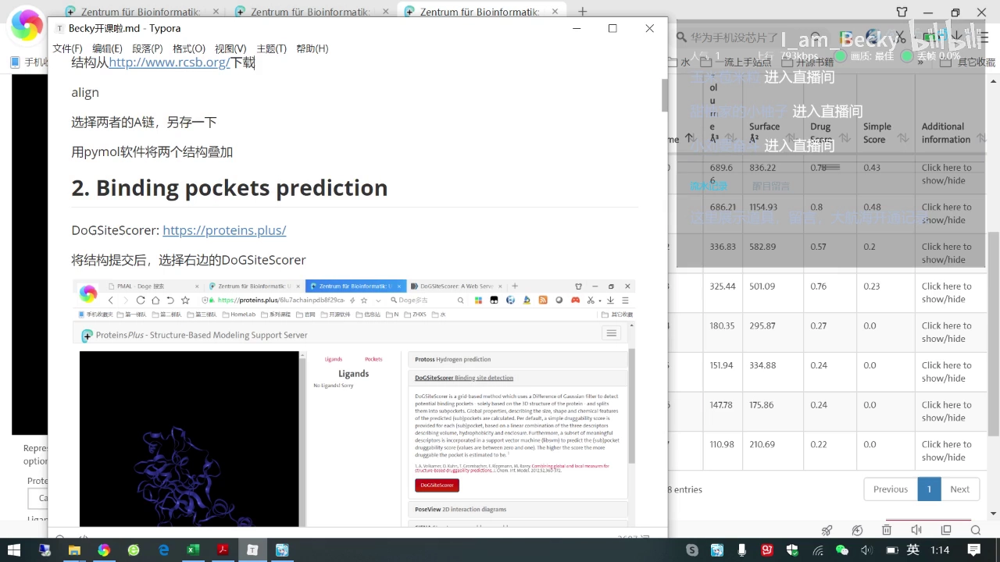

## 一、为什么对接前必须先找口袋：盒子错，全盘输

分子对接（docking）本质上是让小分子在蛋白的某个区域内搜索最佳姿态，这个「区域」就是**结合口袋（binding pocket）**——蛋白表面能容纳小分子的凹陷部位。如果一开始就把搜索框画错了地方，后面的打分再高也没有意义。

所以本课任务非常明确：**预测新冠主蛋白酶的活性口袋** [【跳转到 00:30】](https://www.bilibili.com/video/BV1kV411z7qF/?t=30)。方法不是自创的，而是直接复现文献里的流程——这也是本系列课程的特色：跟着论文走一遍完整链条。

## 二、DoGSiteScorer 实操：上传 PDB，四步出结果

### 2.1 文献用什么工具？

文献里写的是：用 **DoGSiteScorer** 这个在线工具预测蛋白酶的活性口袋——它能预测出蛋白上潜在的小分子结合位置 [【跳转到 00:43】](https://www.bilibili.com/video/BV1kV411z7qF/?t=43)。

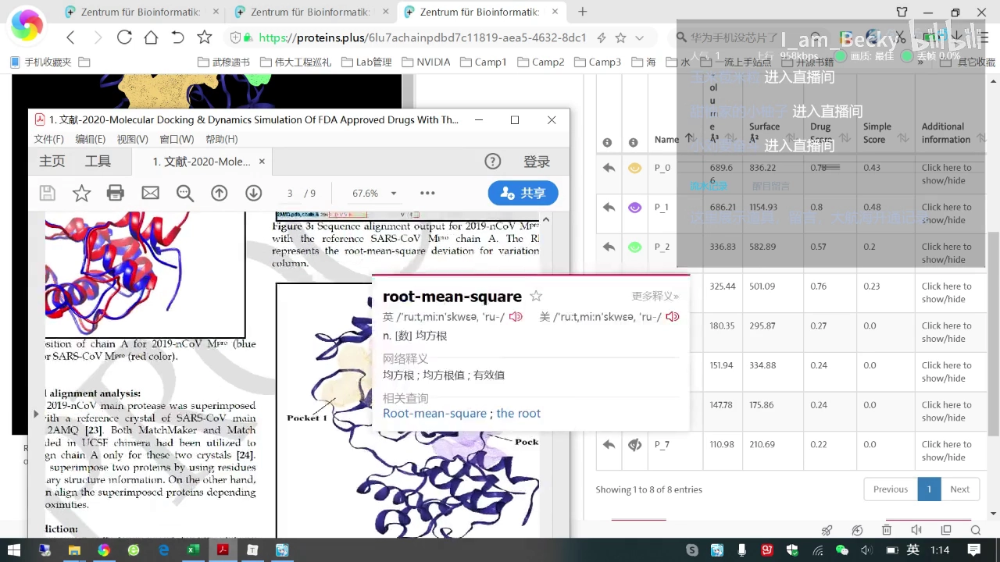

它的「家门」是 **ProteinsPlus**（proteins.plus）——一个把多种蛋白结构分析工具集成在一起的免费网站 [【跳转到 01:13】](https://www.bilibili.com/video/BV1kV411z7qF/?t=73)。

### 2.2 四步操作

1. **上传结构**：在网站首页选择文件，选昨天保存的新冠主蛋白酶 **A 链**的 PDB 结构 [【跳转到 01:19】](https://www.bilibili.com/video/BV1kV411z7qF/?t=79)；
2. **点击 Go**：提交后出现结果界面（这个网站有时会比较慢，属于正常现象，重新点击即可）[【跳转到 01:38】](https://www.bilibili.com/video/BV1kV411z7qF/?t=98)；
3. **选择工具**：在界面里选中 **DoGSiteScorer**，再点红色按钮 [【跳转到 01:53】](https://www.bilibili.com/video/BV1kV411z7qF/?t=113)；
4. **设置参数并计算**：参数选择 **pocket** 模式，点 **Calculate**，稍等片刻结果就出来了 [【跳转到 02:08】](https://www.bilibili.com/video/BV1kV411z7qF/?t=128)。

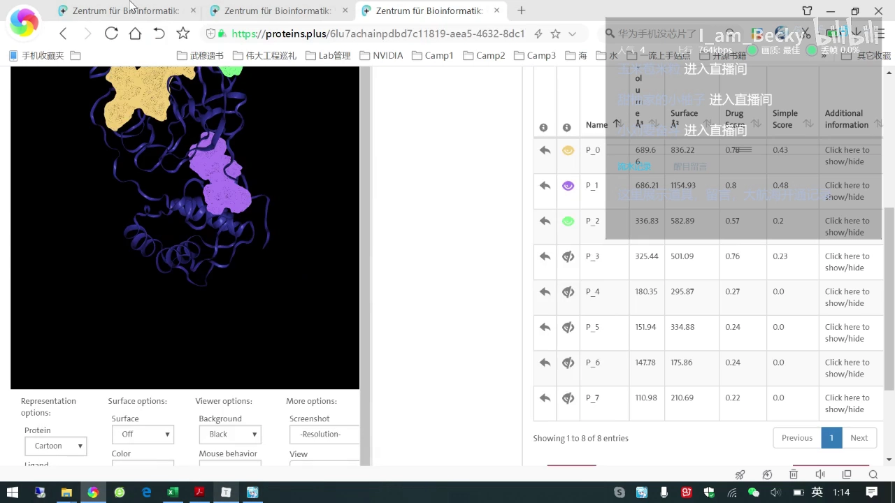

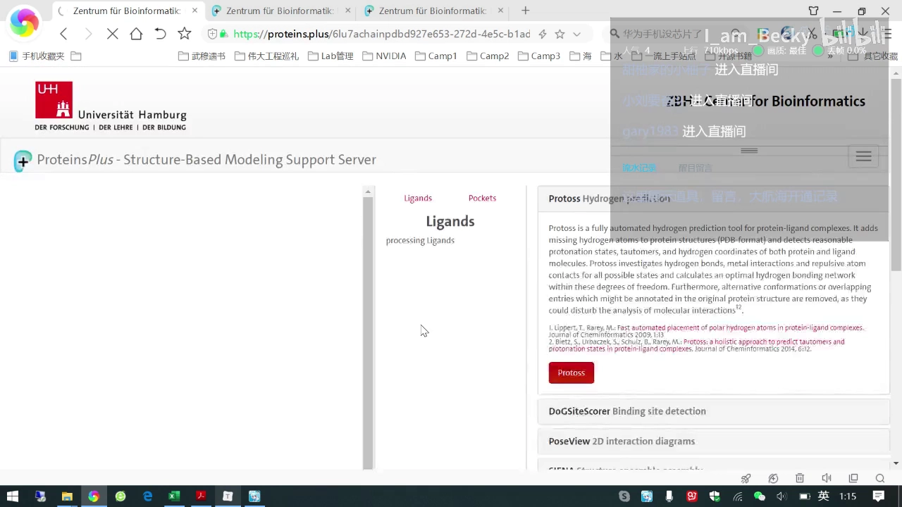

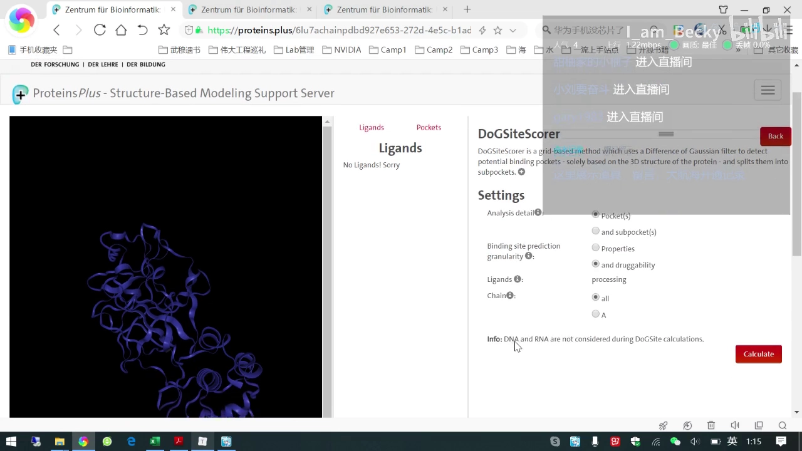

## 三、结果怎么读：七个口袋与两份关键文件

### 3.1 七个活性口袋，前三名与文献一致

计算结果显示，**它预测了七个活性口袋** [【跳转到 02:22】](https://www.bilibili.com/video/BV1kV411z7qF/?t=142)——说明这个蛋白上可能有七个区域都能插入小分子。把前三个口袋的位置与文献给出的结果对照：**一模一样** [【跳转到 02:48】](https://www.bilibili.com/video/BV1kV411z7qF/?t=168)。这就是「可复现」的价值：工具靠谱，流程可以迁移到自己的靶标上。

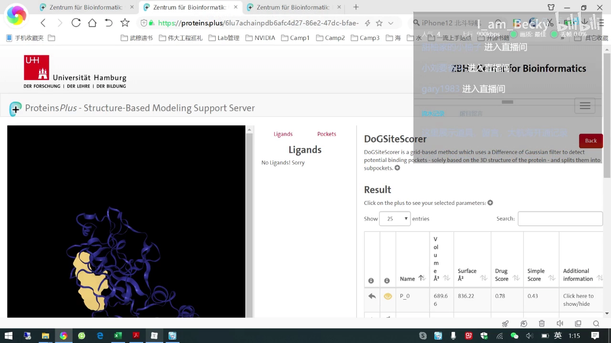

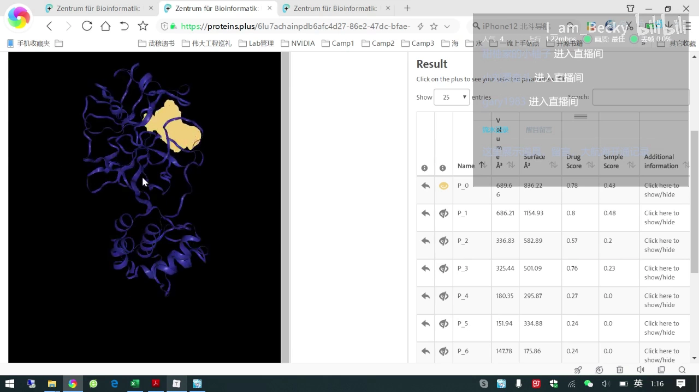

### 3.2 结果压缩包：pockets 与 residues 两份文件

点击结果页下方的 **Download** 即可保存 [【跳转到 02:58】](https://www.bilibili.com/video/BV1kV411z7qF/?t=178)。解压后是两个文件夹加三个文本文件 [【跳转到 03:10】](https://www.bilibili.com/video/BV1kV411z7qF/?t=190)，其中重要的是两份：

- **pockets 文件**：口袋的几何数据，用 Chimera 打开就能画出口袋位置图 [【跳转到 08:32】](https://www.bilibili.com/video/BV1kV411z7qF/?t=512)；
- **residues 文件**：记录每个口袋（P0、P1……）分别包含哪些氨基酸 [【跳转到 08:51】](https://www.bilibili.com/video/BV1kV411z7qF/?t=531)。

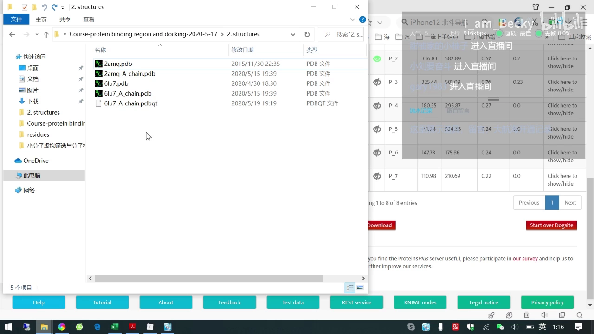

## 四、Chimera 复现文献图：mesh 展示与配色

### 4.1 导入口袋与蛋白结构

pockets 文件用 **UCSF Chimera** 打开——它是免费的，官网可直接下载（上一节介绍过这个软件），感兴趣还可以搜一些它的教程 [【跳转到 07:10】](https://www.bilibili.com/video/BV1kV411z7qF/?t=430)。File→Open 时可以先把文件所在目录地址 Ctrl+C 拷贝、Ctrl+V 粘贴到路径栏，然后**选中前三个口袋文件、点 Open** [【跳转到 04:16】](https://www.bilibili.com/video/BV1kV411z7qF/?t=256)；再用同样的方法打开新冠主蛋白酶 A 链结构 [【跳转到 04:51】](https://www.bilibili.com/video/BV1kV411z7qF/?t=291)。鼠标**右键拖动**可缩放视图 [【跳转到 05:00】](https://www.bilibili.com/video/BV1kV411z7qF/?t=300)。

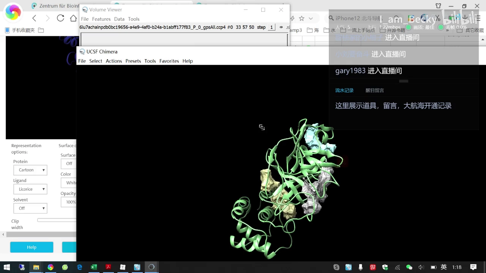

### 4.2 mesh 网状展示与配色调整

刚打开时口袋是实心展示，而文献里是**网状（mesh）**效果 [【跳转到 05:26】](https://www.bilibili.com/video/BV1kV411z7qF/?t=326)。把每个口袋的展示方式都改成 mesh 之后，画面就**和文献里的图非常相似**了 [【跳转到 05:48】](https://www.bilibili.com/video/BV1kV411z7qF/?t=348)，此时可以保存 image 输出图片 [【跳转到 05:53】](https://www.bilibili.com/video/BV1kV411z7qF/?t=353)。

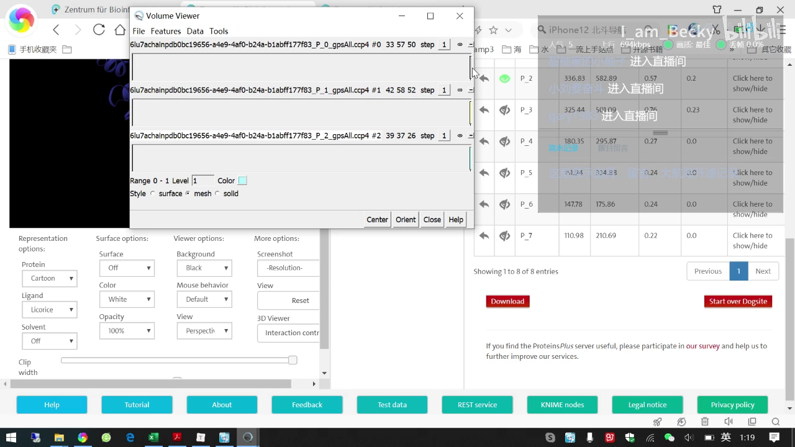

背景色、蛋白卡通结构颜色（比如选 blue）、口袋颜色（比如选红色）与显示样式等参数都可以按需调整 [【跳转到 06:02】](https://www.bilibili.com/video/BV1kV411z7qF/?t=362)~[【跳转到 06:35】](https://www.bilibili.com/video/BV1kV411z7qF/?t=395)。

## 五、口袋残基 → 对接盒子：虚拟筛选的「定位钉」

residues 文件的价值在于：**它把「口袋」落到了具体氨基酸上**。比如 P0 就列出了预测的第一个口袋里包含的蛋白残基 [【跳转到 07:26】](https://www.bilibili.com/video/BV1kV411z7qF/?t=446)。文件名太长时 PyMOL 打开慢，可以先把名字改短，很快就能打开 [【跳转到 07:51】](https://www.bilibili.com/video/BV1kV411z7qF/?t=471)。

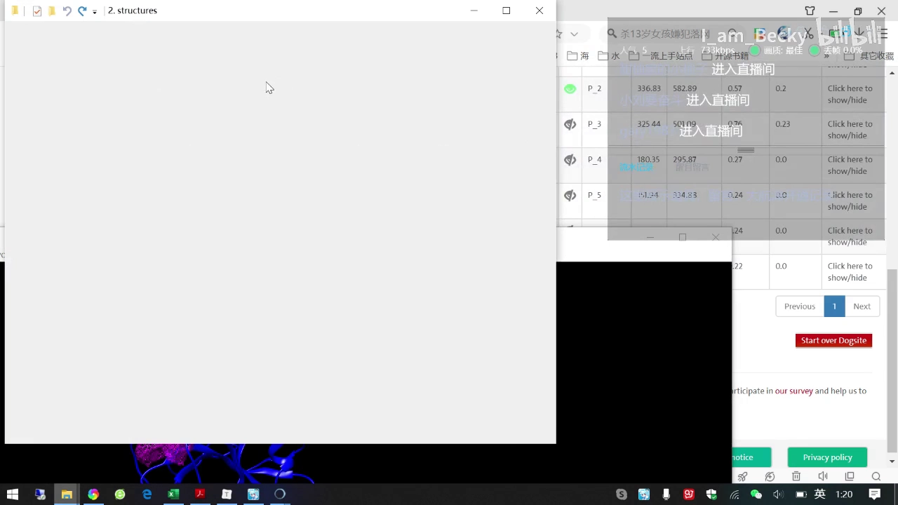

对后续虚拟筛选来说，这份清单是**限定小分子结合区**的重要信息：根据口袋残基就能设置对接 box 的**位置和大小**（后续课程会专门讲解）[【跳转到 07:57】](https://www.bilibili.com/video/BV1kV411z7qF/?t=477)。一句话总结：pockets 文件负责「画口袋」，residues 文件负责「定盒子」。

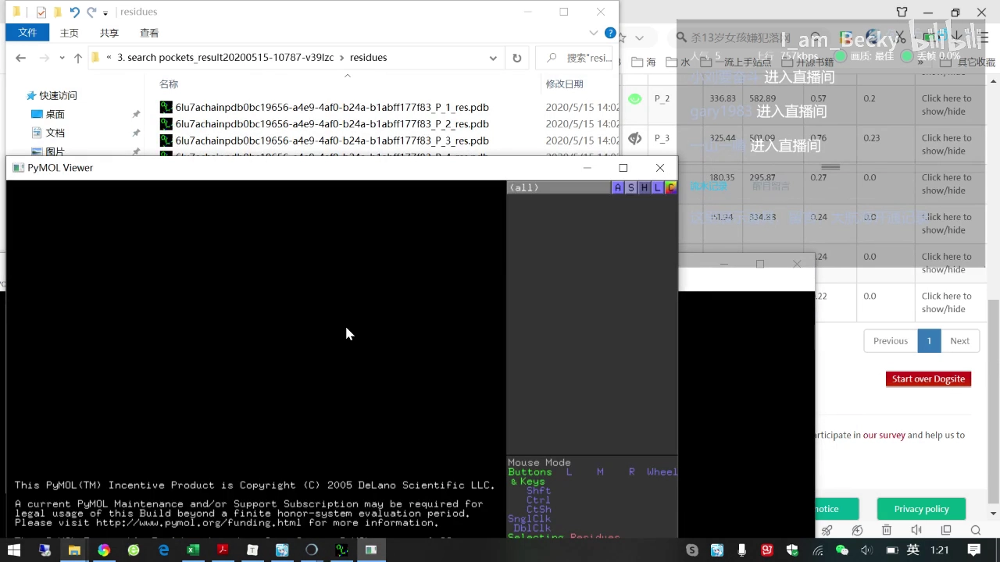

## 小结

- 结合口袋是分子对接/虚拟筛选的「停车位」：口袋找错，盒子就错，对接全白费。
- **DoGSiteScorer**（ProteinsPlus 在线工具）：上传 PDB → 选 pocket 模式 → Calculate，一键预测全部口袋。
- 本次靶标新冠主蛋白酶共预测出 **7 个活性口袋**，前三个与文献完全一致。
- 结果文件 = **pockets**（口袋几何，用 UCSF Chimera 做 mesh 图复现文献）+ **residues**（口袋残基清单）。
- residues 清单是设置对接 box 位置与大小的直接依据，为下一阶段的虚拟筛选铺路。
- 课程下一讲：小分子数据库与批量下载；讲者照例安利了自己的生信公众号与知乎。

## 关键术语速查

| 术语 | 一句话解释 |
| --- | --- |
| 结合口袋（binding pocket） | 蛋白表面可容纳小分子的凹陷区域 |
| DoGSiteScorer | ProteinsPlus 上的在线口袋检测工具，输入 PDB 输出口袋及打分 |
| ProteinsPlus | 免费的蛋白结构在线分析工具集网站（proteins.plus） |
| UCSF Chimera | 免费的分子结构可视化软件，可打开口袋文件并调整展示 |
| mesh | 网状显示模式，常用于展示口袋的表面形状 |
| 对接盒子（box） | 虚拟筛选时限定小分子搜索范围的立方区域，由口袋残基定位 |
| Mpro | 新冠病毒主蛋白酶，本讲的示例靶标 |
