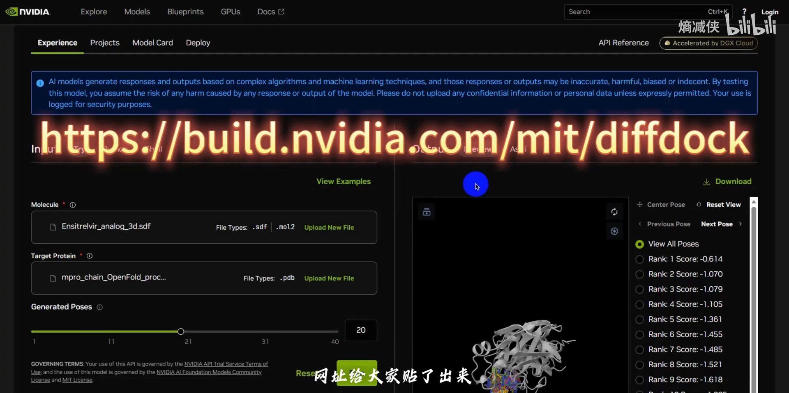
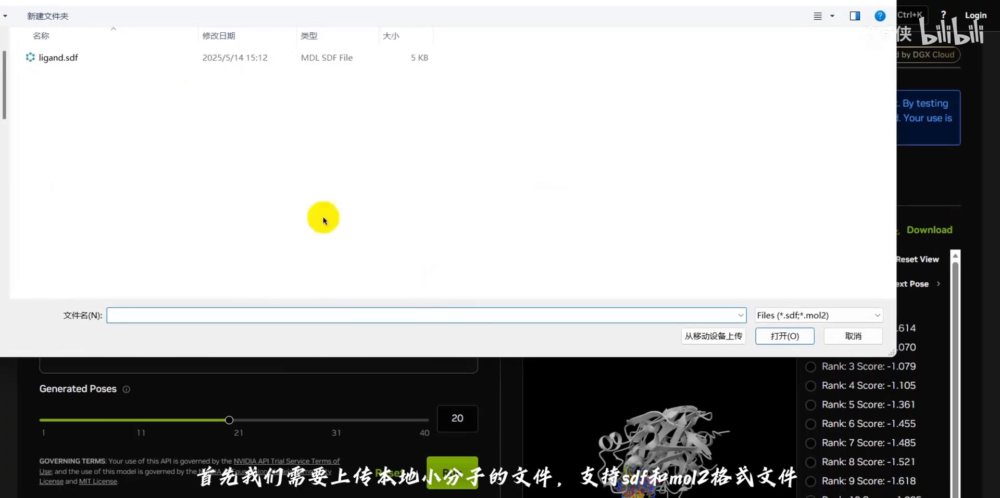
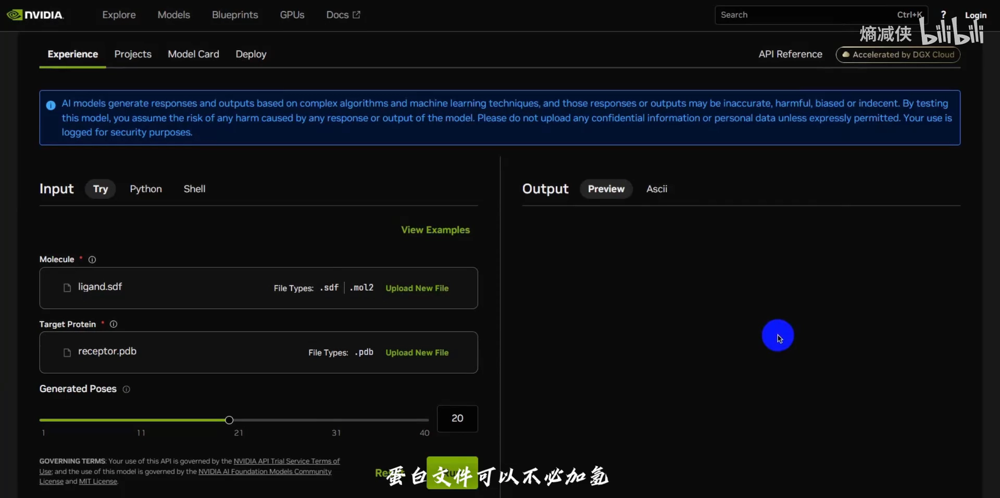
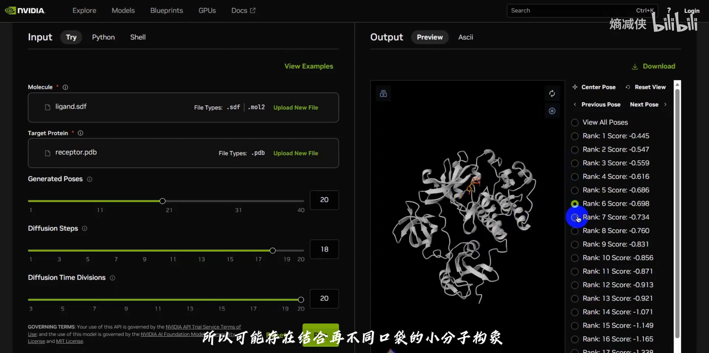
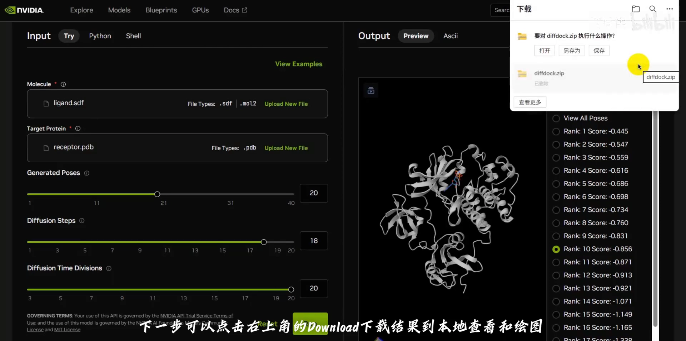
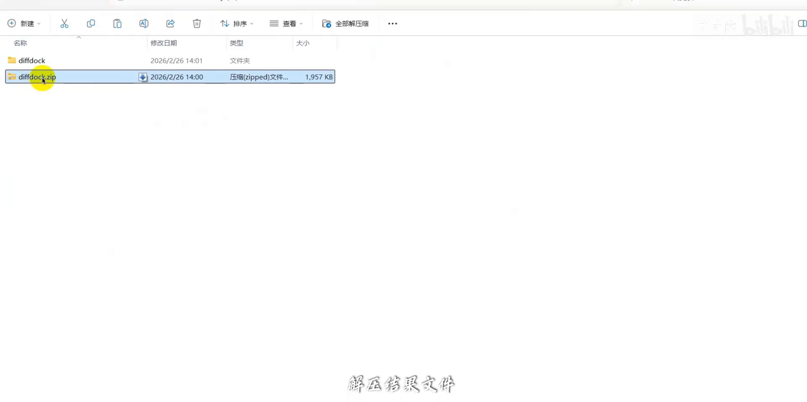
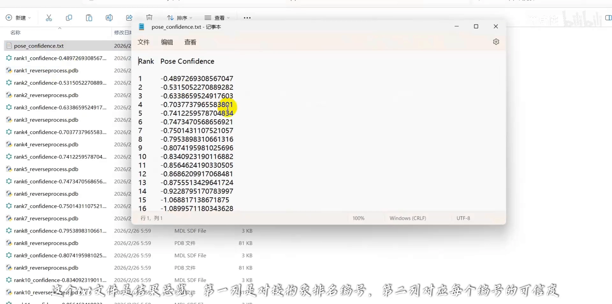
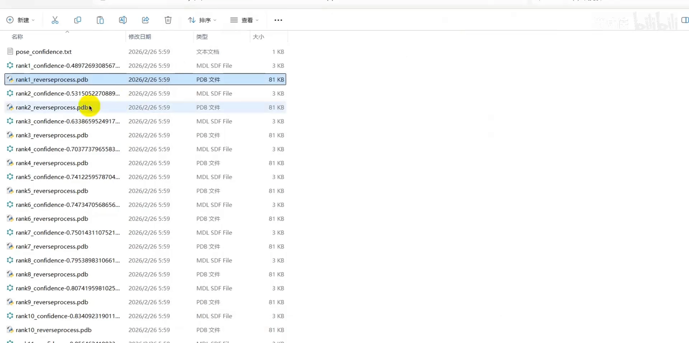
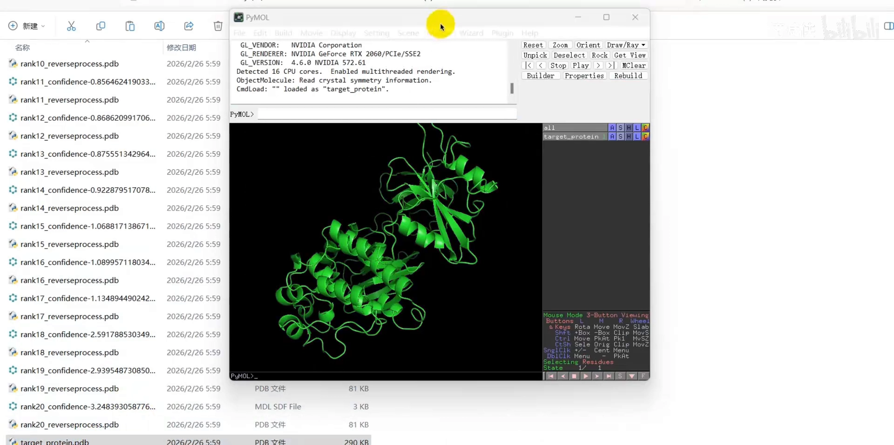
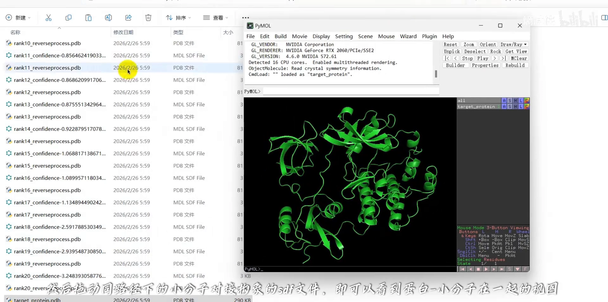

# Diffdock： 无需指定结合位点的分子对接工具

> 视频来源：[B站《Diffdock: 无需指定结合位点的分子对接工具》](https://www.bilibili.com/video/BV1EKfvBGEZQ)（2:39，UP 主：熵减侠）。UP 主用两分多钟讲清一次"极简版"DiffDock 对接：上传小分子与蛋白 PDB、**默认生成 20 个结合姿态**、下载结果包，并逐项拆解**结果总览 TXT 的两列**（排名编号、可信度）与每个构象的 SDF/PDB 文件。视频字幕为 B 站 AI 字幕（kedou 配额耗尽，经 cookie 降级链抓取 ai-zh 轨道），已逐窗口纠正错拼（"Def dog"→DiffDock、"more2"→mol2、"P1B"→PDB、"轻程序"→氢、"对接构项"→对接构象、"互座"→互作等）；本文基于文稿整理，所有操作可点时间戳回看核对。

## 本讲要解决的核心问题（SCQA）

**背景**：手头有小分子和靶标蛋白结构，下一步要做**分子对接**——找到小分子在蛋白上的结合姿态。但结合位点（口袋）在哪里，往往并不知道。

**冲突**：传统对接程序必须**先指定结合位点**才能算；初学者很容易在"选口袋"这一步卡住，选错了后续全白做。

**疑问**：有没有连口袋都不用管、上传两个文件就出结果的对接方法？

**回答（中心思想）**：有。DiffDock 这类基于生成扩散模型的对接方法，**不需要已知结合位点信息**即可自动预测配体的结合姿态（[【跳转到 00:00】](https://www.bilibili.com/video/BV1EKfvBGEZQ/?t=0)）：上传小分子（SDF/mol2）+ 蛋白 PDB，**默认生成 20 个姿态**；结果包里的 TXT 总览**第一列给排名编号、第二列给每个编号的可信度**，按可信度取排名靠前的构象做后续分析即可。

## 一、两步输入：小分子文件 + 蛋白 PDB

整个流程只有两步输入（[【跳转到 00:15】](https://www.bilibili.com/video/BV1EKfvBGEZQ/?t=15)）：

- **小分子**：上传本地文件，支持 **SDF 和 mol2** 格式；
- **蛋白**：上传 **PDB 格式**文件，蛋白文件**可以不必加氢**（[【跳转到 00:22】](https://www.bilibili.com/video/BV1EKfvBGEZQ/?t=22)）。

## 二、一次生成 20 个姿态：为什么会出现"结合在不同口袋"的构象

默认设置会**生成 20 个小分子结合姿态**，点击 **run** 开始运行；运行结束后可以**在线查看**这些姿态（[【跳转到 00:30】](https://www.bilibili.com/video/BV1EKfvBGEZQ/?t=30)）。

因为 DiffDock **不需要指定结合位点**，所以结果中**可能存在结合在不同口袋的构象**——模型把各种可能的口袋都探索了一遍。那怎么看哪个更可信？**一般而言，排名靠前的构象和结合位点可信度更高**（[【跳转到 00:55】](https://www.bilibili.com/video/BV1EKfvBGEZQ/?t=55)）。要仔细查看和绘图，就点右上角的 **download** 把结果下载到本地。

## 三、结果包怎么读：TXT 总览（排名 + 可信度）与逐构象文件

这是本篇最有价值的部分——**结果包的文件结构**。下载后先**解压结果文件**（[【跳转到 01:08】](https://www.bilibili.com/video/BV1EKfvBGEZQ/?t=68)）：

- **TXT 文件是结果总览**（[【跳转到 01:14】](https://www.bilibili.com/video/BV1EKfvBGEZQ/?t=74)）：**第一列是对接构象的排名编号，第二列对应每个编号的可信度**（[【跳转到 01:24】](https://www.bilibili.com/video/BV1EKfvBGEZQ/?t=84)）——按可信度排序取号，就完成了"position_confidence 排序"这一步；
- **每个对接构象都有两个格式的结果文件**：SDF 格式和 PDB 格式，对应同一个姿态的两种存法；
- **滑到最后**，可以找到我们上传的**蛋白受体文件**（[【跳转到 02:07】](https://www.bilibili.com/video/BV1EKfvBGEZQ/?t=127)）。

## 四、本地查看与互作分析衔接

拿到构象文件后，**拖动同路径下的小分子对接构象 SDF 文件**，就能看到**蛋白-小分子在一起**的可视化视图（[【跳转到 02:13】](https://www.bilibili.com/video/BV1EKfvBGEZQ/?t=133)）。后续想看氢键、盐桥等**互作分析**，UP 主建议参考往期介绍的 **PLIP** 工具（[【跳转到 02:18】](https://www.bilibili.com/video/BV1EKfvBGEZQ/?t=138)）——PLIP 也在本系列 6.3.1 的博客中被推荐用于蛋白-配体互作网络分析。

## 小结

- DiffDock **无需已知结合位点**即可预测配体结合姿态，输入只要两个文件：小分子（SDF/mol2）+ 蛋白 PDB（可不必加氢）。
- **默认生成 20 个结合姿态**；因为不指定口袋，构象可能分布在不同口袋——**排名靠前的构象可信度更高**。
- 结果包核心是 **TXT 总览**：第一列**排名编号**、第二列**可信度**；每个构象另有 **SDF + PDB** 两个文件，包末尾是上传的蛋白受体文件。
- 本地拖动构象 SDF 即可与蛋白合并显示；互作分析交给 **PLIP**。

## 关键术语速查

| 术语 | 一句话解释 |
| --- | --- |
| 结合位点（口袋） | 蛋白表面上实际容纳配体的位置；传统对接需要先指定它 |
| 结合姿态（pose） | 小分子在蛋白上的一个三维结合构象 |
| 可信度（confidence） | DiffDock 给每个构象的打分；结果总览第二列，分数越高越可信 |
| TXT 结果总览 | 汇总所有构象"排名编号 + 可信度"的文件，排序取号的依据 |
| SDF / PDB | 同一构象的两种文件格式；PDB 也常用于蛋白受体本身 |
| PLIP | 在线蛋白-配体互作分析工具，识别氢键、盐桥、疏水等相互作用 |
