# QureGenAl平台教程：使用DiffDock进行配体和受体

> 视频来源：[B站《QureGenAl平台教程:使用DiffDock进行配体和受体》](https://www.bilibili.com/video/BV1tqBeBzE7f)（4:55，UP 主：QureGenAI医图生科）。QureGenAI 平台教程：从 RCSB PDB 下载 COVID-19 相关受体蛋白复合物 **8FTL**，PyMOL 预处理（去水、选链、导出 mol2 配体与单链蛋白），在平台内用 **DiffDock** 对接并读 **rank1 的 confidence**，再与晶体复合物叠合、用 PyMOL `align` 比对 **RMSD（1 埃以内）**验证对接准确度。视频字幕为 B 站 AI 字幕（kedou 配额耗尽，经 cookie 降级链抓取 ai-zh 轨道），已逐窗口纠正错拼（"rcsepdB"→RCSB PDB、"拍more"/"拍mod"→PyMOL、"残疾选择模式"→残基选择模式、"蛋白垫"→蛋白链、"IMSD"→RMSD、"1亿"→1 埃、"defdog"/"diptoe"→DiffDock 等）；本文基于文稿整理，所有操作可点时间戳回看核对。

## 本讲要解决的核心问题（SCQA）

**背景**：管线 C 的对接步需要一对输入——**受体（蛋白）与配体（小分子）**。初学时最值得做的练习，是找一个**已经有晶体复合物**的靶标：先自己对接一遍，再把结果与已知晶体姿态对比，就能亲眼看到"对接到底准不准"。

**冲突**：从 PDB 直接下载的复合物往往**同源多聚体**（多条相同的链）、**带水分子**；配体格式又要求 SDF/mol2/mol——直接把原始文件扔给对接工具，不是报错就是结果混乱。

**疑问**：从 PDB 下载到拿到一个"能和晶体对上号"的对接结果，中间要做对哪几件事？

**回答（中心思想）**：四步——① RCSB PDB 下载复合物（8FTL，COVID-19 相关受体蛋白）；② PyMOL 预处理：去水、单选一条蛋白链、导出配体（mol2）与该链蛋白；③ DiffDock 对接并读 **rank1 的置信度**（本例 confidence −0.72 为排名最高）；④ 把 top 姿态导入晶体复合物、用 `align` 算 **RMSD**——本例在 **1 埃以内**，说明对接姿态与晶体高度重合。

## 一、第一步：从 RCSB PDB 下载靶标复合物

打开 **RCSB PDB 数据库**（[【跳转到 00:05】](https://www.bilibili.com/video/BV1tqBeBzE7f/?t=5)），检索并下载 **8FTL** 这个受体蛋白复合物（[【跳转到 00:16】](https://www.bilibili.com/video/BV1tqBeBzE7f/?t=16)）——这是一个**与 COVID-19 相关的受体蛋白**（[【跳转到 00:24】](https://www.bilibili.com/video/BV1tqBeBzE7f/?t=24)）。点击下载它的 **PDB 格式文件**（[【跳转到 00:29】](https://www.bilibili.com/video/BV1tqBeBzE7f/?t=29)）。

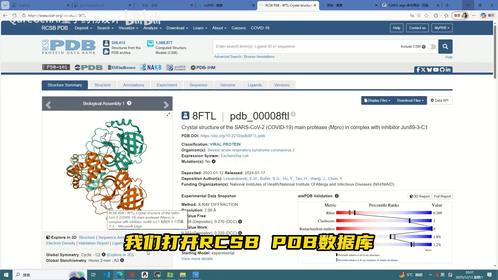

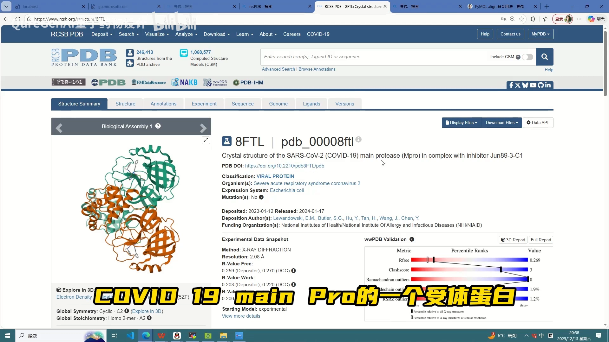

## 二、第二步：PyMOL 预处理——去水、选链、导出 mol2 与蛋白

### 2.1 去水与选链

把复合物**导入 PyMOL 查看**（[【跳转到 00:38】](https://www.bilibili.com/video/BV1tqBeBzE7f/?t=38)）：它是一个**同源多聚体蛋白**（多条一样的链）（[【跳转到 00:43】](https://www.bilibili.com/video/BV1tqBeBzE7f/?t=43)），并且**含有水分子**（[【跳转到 00:48】](https://www.bilibili.com/video/BV1tqBeBzE7f/?t=48)）。预处理两件事：

- 点 **remove waters** 去掉水分子（[【跳转到 00:53】](https://www.bilibili.com/video/BV1tqBeBzE7f/?t=53)）；
- 切到**残基选择模式**，**选择其中一条蛋白链**用于分子对接（[【跳转到 01:01】](https://www.bilibili.com/video/BV1tqBeBzE7f/?t=61)）——同源多聚体只需留一条，避免结果冗余。

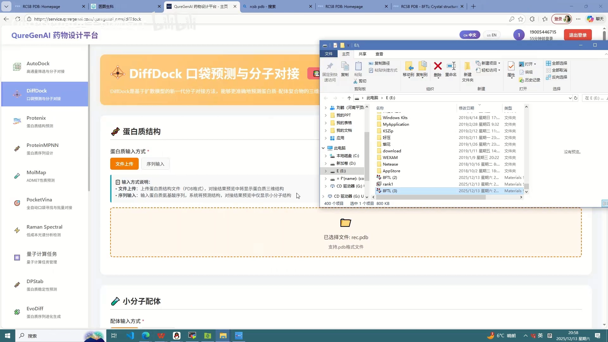

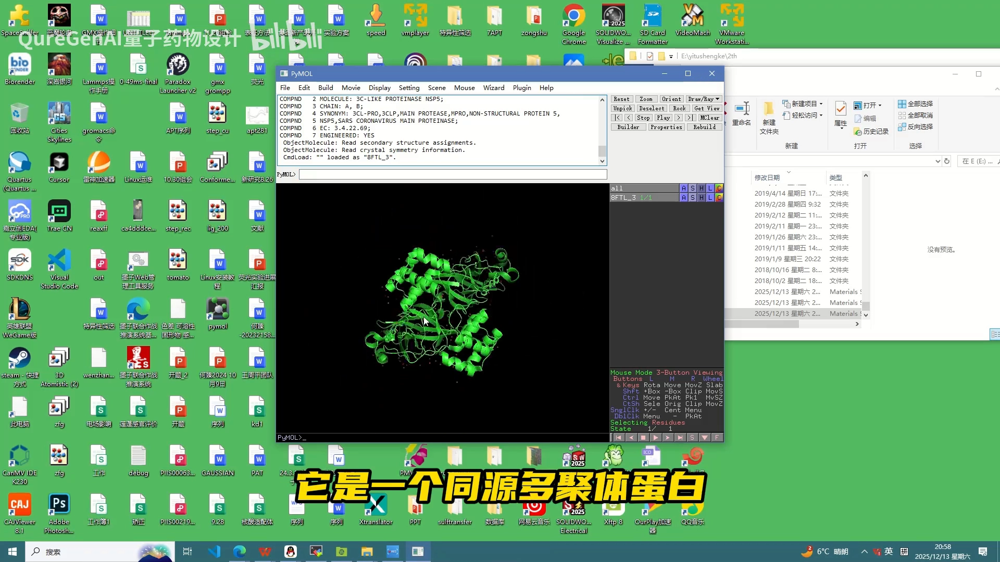

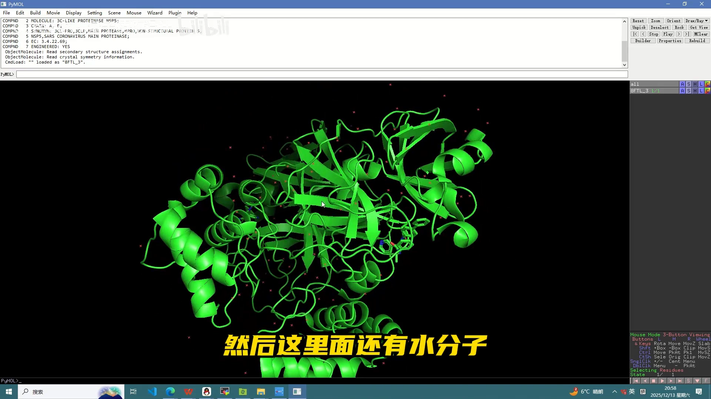

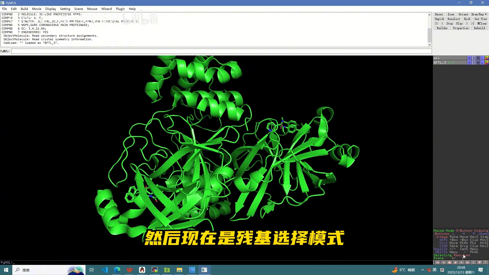

### 2.2 按格式要求导出配体（mol2）与蛋白

先选中它的**配体**（[【跳转到 01:06】](https://www.bilibili.com/video/BV1tqBeBzE7f/?t=66)）。DiffDock 对小分子配体的格式要求是 **SDF、mol2 或 mol**，所以在 PyMOL 里要把配体**导出为 mol 或 mol2**（[【跳转到 01:16】](https://www.bilibili.com/video/BV1tqBeBzE7f/?t=76)）——UP 主选择了 **mol2**（[【跳转到 01:29】](https://www.bilibili.com/video/BV1tqBeBzE7f/?t=89)）；然后**导出选中的这一条蛋白**（[【跳转到 01:43】](https://www.bilibili.com/video/BV1tqBeBzE7f/?t=103)）。

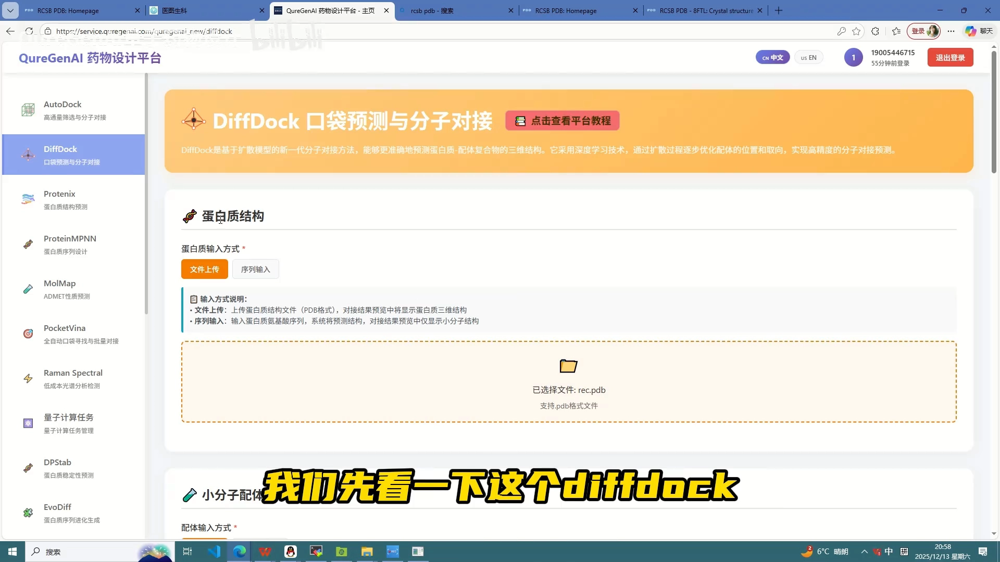

### 2.3 对接前检查：别把小分子带进受体

**对接前的检查**（[【跳转到 02:03】](https://www.bilibili.com/video/BV1tqBeBzE7f/?t=123)）很有必要：UP 主发现**导出受体时不小心把小分子也导出了**（[【跳转到 02:13】](https://www.bilibili.com/video/BV1tqBeBzE7f/?t=133)），于是**删掉重新导出**（[【跳转到 02:18】](https://www.bilibili.com/video/BV1tqBeBzE7f/?t=138)、[【跳转到 02:23】](https://www.bilibili.com/video/BV1tqBeBzE7f/?t=143)）；再检查配体文件，**没有问题**（[【跳转到 02:33】](https://www.bilibili.com/video/BV1tqBeBzE7f/?t=153)）——受体里混入配体，会让"对接回原位"变成作弊，初学者务必检查这一步。

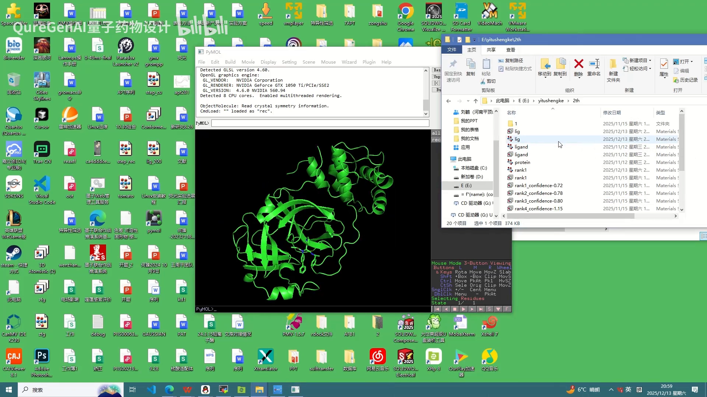

## 三、第三步：DiffDock 对接与置信度排序（rank1 = confidence 最高）

回到 **DiffDock 界面**（[【跳转到 02:43】](https://www.bilibili.com/video/BV1tqBeBzE7f/?t=163)），**选择受体、再选择配体**（[【跳转到 02:48】](https://www.bilibili.com/video/BV1tqBeBzE7f/?t=168)），就可以进行 DiffDock 对接了。视频里直接查看**之前对接好的结果**：先看 **rank1——对接排名第一**的姿态（[【跳转到 02:53】](https://www.bilibili.com/video/BV1tqBeBzE7f/?t=173)）。

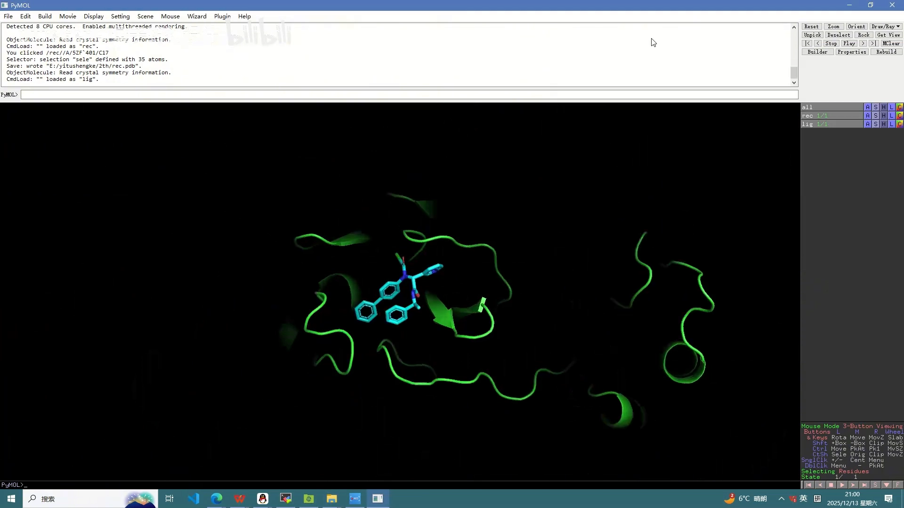

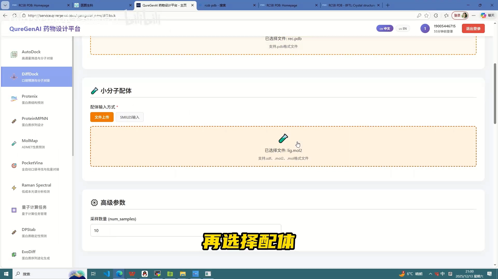

rank1 就是**置信度最高的一个结果**：可以看到它的 **confidence 为 −0.72**，是所有姿态里置信度排名最高的（[【跳转到 03:17】](https://www.bilibili.com/video/BV1tqBeBzE7f/?t=197)）——结果**按置信度从高到低排序**，负数只代表本例的数值区间，排序看相对大小。可以**在网页端查看构象**，然后**把它导出、点击下载**（[【跳转到 03:30】](https://www.bilibili.com/video/BV1tqBeBzE7f/?t=210)、[【跳转到 03:37】](https://www.bilibili.com/video/BV1tqBeBzE7f/?t=217)）。

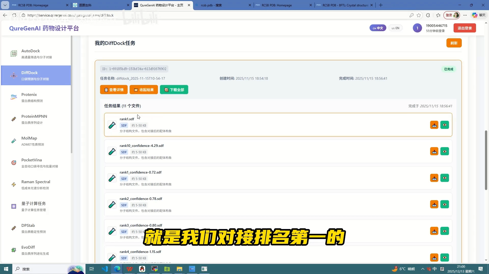

## 四、第四步：与晶体复合物叠合验证（RMSD 在 1 埃以内）

把下载的 top 姿态**导入刚打开的配体-受体复合结构**（[【跳转到 03:43】](https://www.bilibili.com/video/BV1tqBeBzE7f/?t=223)）——可以看到预测的配体构象**与晶体里的配体非常相似、几乎重合**（[【跳转到 03:58】](https://www.bilibili.com/video/BV1tqBeBzE7f/?t=238)）。

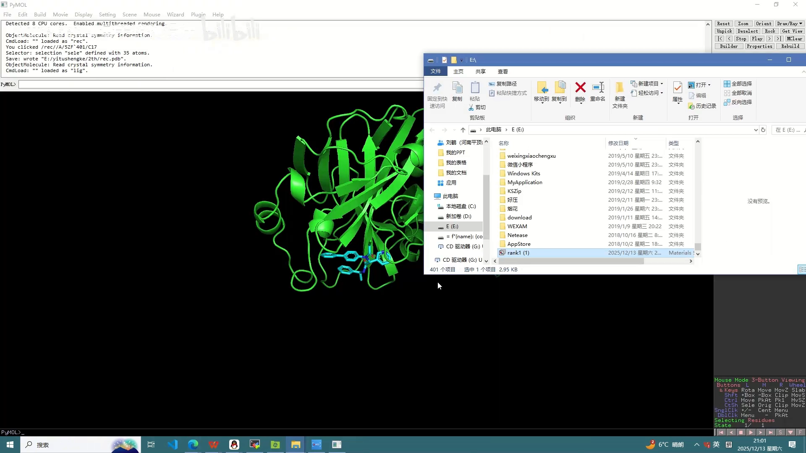

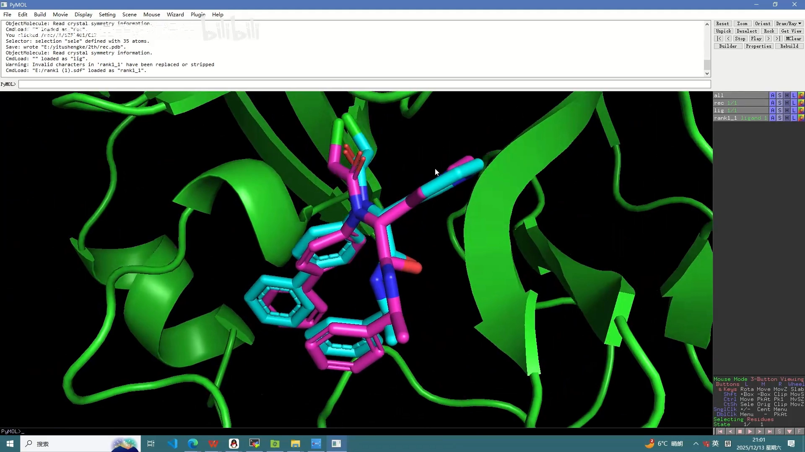

定量验证：用 PyMOL 的 **`align` 命令**对齐两个结构，比较它们之间的 **RMSD（均方根偏差）**（[【跳转到 04:03】](https://www.bilibili.com/video/BV1tqBeBzE7f/?t=243)）。UP 主对比的结果是 **RMSD 在 1 埃（Å）以内**（[【跳转到 04:08】](https://www.bilibili.com/video/BV1tqBeBzE7f/?t=248)）——重合度非常高（[【跳转到 04:13】](https://www.bilibili.com/video/BV1tqBeBzE7f/?t=253)），也就说明 **DiffDock 的对接准确度非常高**（[【跳转到 04:18】](https://www.bilibili.com/video/BV1tqBeBzE7f/?t=258)）。

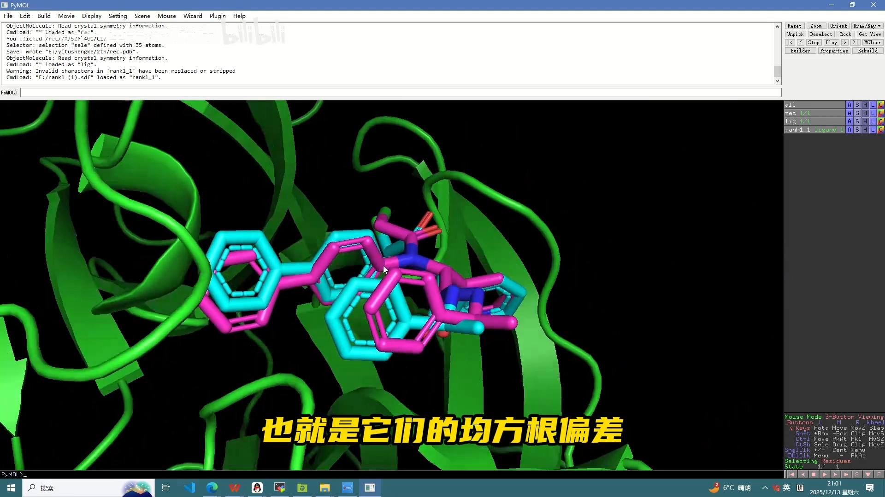

至此就完成了"**口袋预测 + 分子对接**"的完整闭环，且结果与下载的复合物晶体结构非常相似（[【跳转到 04:28】](https://www.bilibili.com/video/BV1tqBeBzE7f/?t=268)、[【跳转到 04:38】](https://www.bilibili.com/video/BV1tqBeBzE7f/?t=278)）。

## 小结

- **选靶有讲究**：拿一个有晶体复合物的靶标（8FTL）做练习，对接结果可以直接与已知姿态对照验证。
- **预处理三件事**：去水（remove waters）、同源多聚体只留一条链、按 DiffDock 的格式要求导出配体（mol2）与蛋白。
- **对接前检查**：确认受体文件里没混入小分子、配体文件无误——否则验证就失去了意义。
- **读结果**：结果按置信度排序，**rank1 = confidence 最高**（本例 −0.72）；网页端查看并导出 top 姿态。
- **验证闭环**：top 姿态与晶体复合物叠合，`align` 算 RMSD——**1 埃以内**即说明姿态几乎重合、对接准确度高。

## 关键术语速查

| 术语 | 一句话解释 |
| --- | --- |
| RCSB PDB | 蛋白结构数据库，可下载实验解析的蛋白/复合物结构文件 |
| 同源多聚体 | 由多条相同链组成的蛋白；对接练习通常只取其中一条链 |
| remove waters | PyMOL 中删除结构内水分子的操作，对接前常规清理步骤 |
| 残基选择模式 | PyMOL 的选择方式，按氨基酸残基点选链/配体 |
| mol / mol2 / SDF | DiffDock 接受的小分子配体格式 |
| rank1 / confidence | 按置信度排序后第一名；confidence 是 DiffDock 给每个姿态的打分，越高越可信 |
| align | PyMOL 命令，把两个结构对齐，用于计算 RMSD |
| RMSD（均方根偏差） | 两组原子坐标的平均偏离距离；对接验证中越小越好，本例 <1 Å |
