# 基于扩散模型的Diffdock做对接

> 视频来源：[B站《基于扩散模型的Diffdock做对接》](https://www.bilibili.com/video/BV1hDPzzxEUr)（5:05，UP 主：计算小猪莹）。UP 主演示在一个在线 DiffDock 平台上完成一次完整的盲对接：上传小分子（mol2）与蛋白（溶菌酶），设置**生成的 pose 数**与**迭代次数**，运行后在结果包里读**置信度打分文件**，并把 top1 姿态与已知晶体结构叠加验证。视频字幕为 B 站 AI 字幕（kedou 配额耗尽，经 cookie 降级链抓取 ai-zh 轨道），已逐窗口纠正错拼（"discodoc"/"defaddog"→DiffDock、"猫兔"→mol2、"用PO打开"→用 PyMOL 打开、"C2F"→CIF、"能叠在次数"→迭代次数、"大环钛"→大环肽等）；本文基于文稿整理，所有操作可点时间戳回看核对。

## 本讲要解决的核心问题（SCQA）

**背景**：小分子药物发现管线（本系列管线 C）的对接步，要把小分子"放"进靶标蛋白里，找到它可能的结合姿态。传统对接工具（如 AutoDock 之类）需要**先指定结合位点**，打分函数基于经验公式、并没有引入 AI 模型（[【跳转到 00:05】](https://www.bilibili.com/video/BV1hDPzzxEUr/?t=5)）。

**冲突**：靶标蛋白的口袋位置往往**未知**——手工指定口袋费时又可能选错；而且经验打分对复杂体系姿态的排序未必可靠。

**疑问**：能不能不预定义口袋，让模型端到端地"生成"小分子的结合构象，并且给出一个可信的**排序**？

**回答（中心思想）**：能。DiffDock 把扩散模型引入分子对接：**无需预定义结合口袋**、端到端生成结合构象（[【跳转到 00:30】](https://www.bilibili.com/video/BV1hDPzzxEUr/?t=30)），一次生成 **num_poses 个姿态**并**按置信度从高到低排序**。本视频在线上平台完整走了一遍：上传小分子与蛋白 → 设参数 → 运行 → 读结果包的置信度文件 → top1 与晶体叠加核对。

## 一、DiffDock 是什么：不需要口袋的"生成式"对接

传统工具（AutoDock 之类）有两个门槛：一是要**指定结合位点**（口袋），二是打分靠**经验函数**、没有 AI 模型（[【跳转到 00:05】](https://www.bilibili.com/video/BV1hDPzzxEUr/?t=5)）。DiffDock 的不同在于：

- **无需预定义结合口袋**，端到端生成结合构象；
- 核心思想是把分子对接建模为**逆向扩散过程**：从无序的配体状态（好比把小分子随机撒在蛋白周围）**逐步"去噪"到真实的结合状态**（[【跳转到 00:30】](https://www.bilibili.com/video/BV1hDPzzxEUr/?t=30)）。

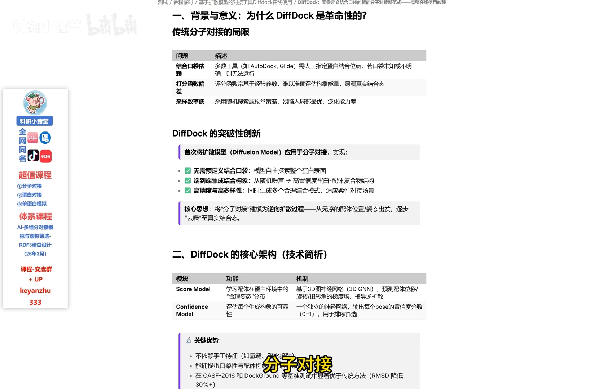

方法与架构细节（生成式采样、置信度模型等）本视频不展开，可参见方法层条目（3.5.2 扩散置信度、5.3.1 DiffDock 原作者报告）的博客；本篇聚焦**怎么用**。

## 二、准备输入：小分子与蛋白各一个文件

### 2.1 平台的两个输入框

打开在线平台后，界面要求输入两个选项：**第一个是小分子，第二个是大分子（蛋白）**（[【跳转到 01:04】](https://www.bilibili.com/video/BV1hDPzzxEUr/?t=64)）。

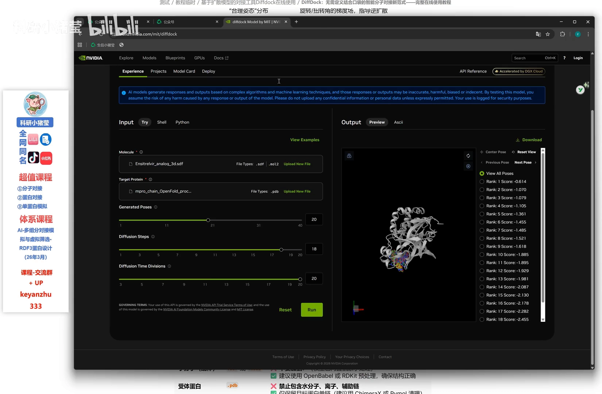

### 2.2 小分子：SDF 或 mol2，PyMOL 一键转换

小分子支持 **SDF 或 mol2 格式**。UP 主手头的小分子是 PDB 格式（用 PyMOL 打开的），怎么办？用 PyMOL 就可以转换：**导出结构 → 导出小分子 → 保存**；保存对话框里可以直接选择 PDB、SDF 等格式，**CIF 也可以用这个选项保存成 PDB 或 SDF**（[【跳转到 01:09】](https://www.bilibili.com/video/BV1hDPzzxEUr/?t=69)、[【跳转到 01:33】](https://www.bilibili.com/video/BV1hDPzzxEUr/?t=93)）。

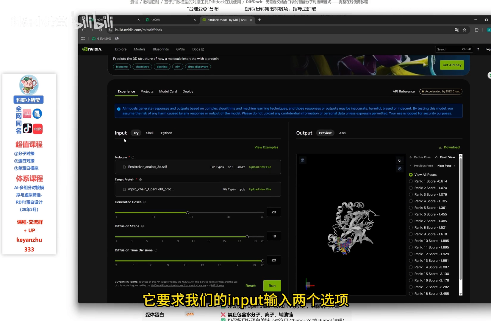

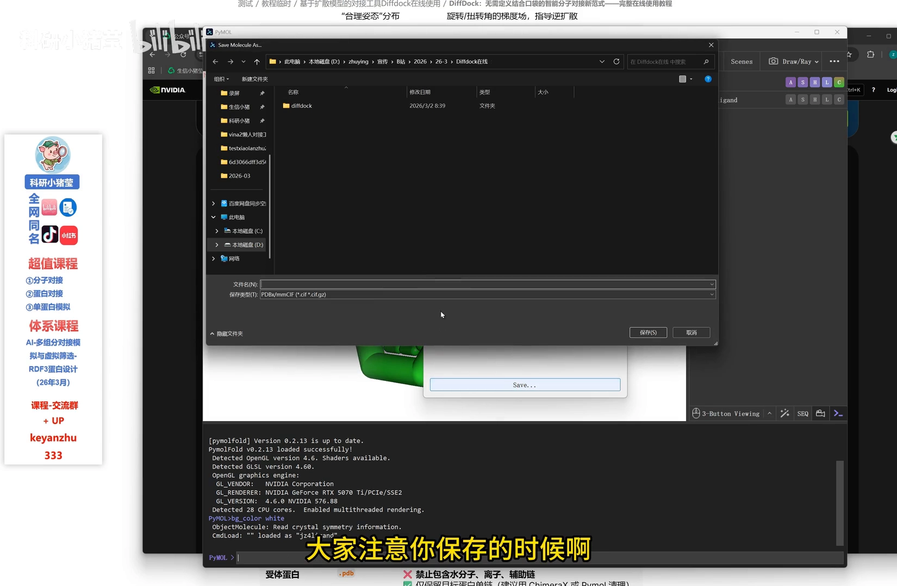

UP 主把 ligand 的 **mol2** 小分子上传（[【跳转到 01:44】](https://www.bilibili.com/video/BV1hDPzzxEUr/?t=104)），蛋白则用一个**溶菌酶蛋白**（[【跳转到 01:49】](https://www.bilibili.com/video/BV1hDPzzxEUr/?t=109)）。

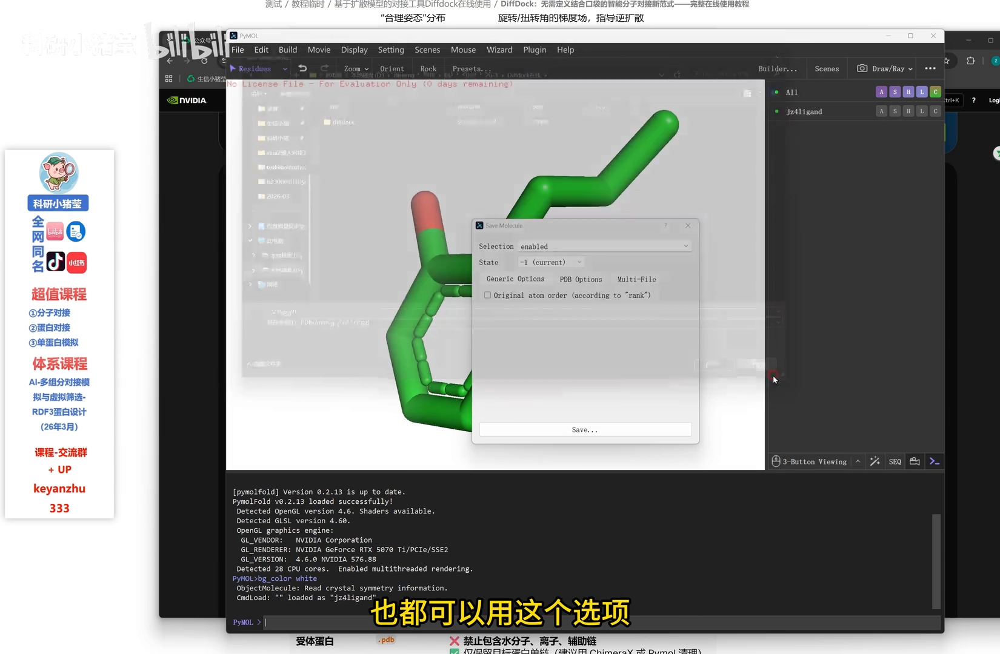

## 三、核心参数：生成 pose 数、迭代次数与扩散时间

这些参数都有给定的上限，平台也给了**推荐配置**可以照抄（[【跳转到 02:22】](https://www.bilibili.com/video/BV1hDPzzxEUr/?t=142)）。对管线最关键的是第一个参数：

### 3.1 生成的 pose 数（num_poses）：一次要几个候选姿态

"生成的 pose"可以理解为**一次生成多少个构象**（[【跳转到 02:03】](https://www.bilibili.com/video/BV1hDPzzxEUr/?t=123)）：设 10 就生成 10 个，设 20 就变成 20（[【跳转到 02:08】](https://www.bilibili.com/video/BV1hDPzzxEUr/?t=128)）。pose 越多，采样的结合姿态越多样，可供筛选的候选也越多。

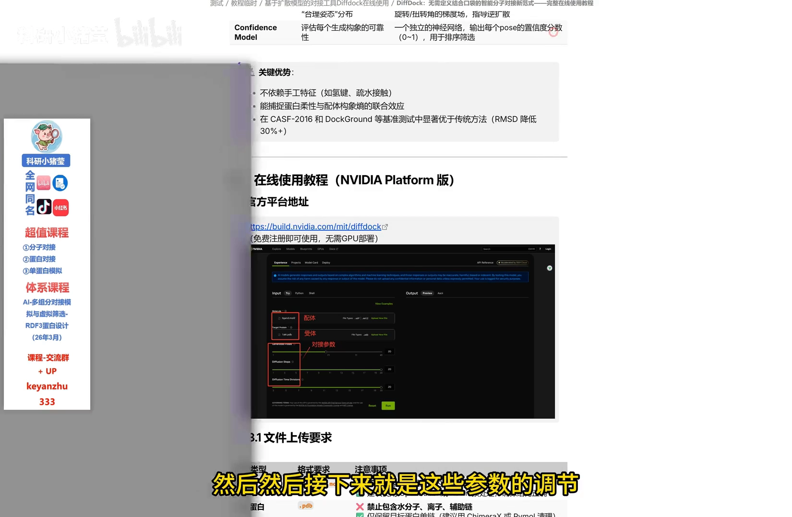

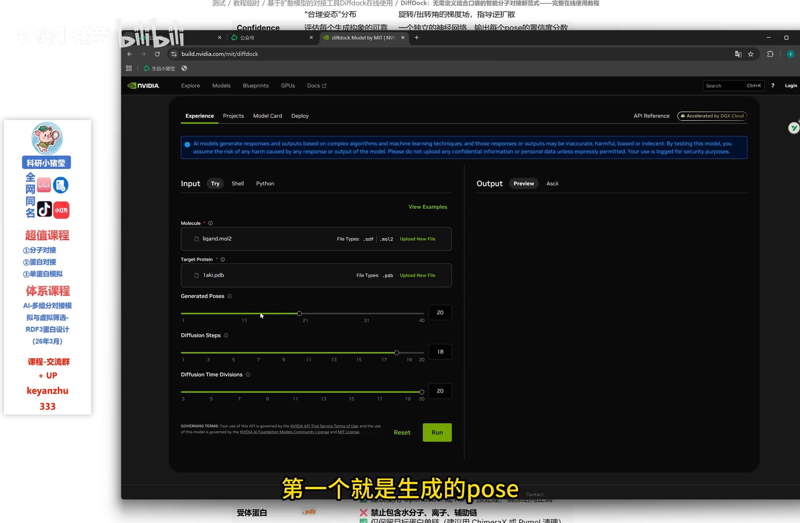

### 3.2 输入"体检"：小分子别带氢、蛋白尽量单链

同时注意两条输入约定：**小分子尽量不要带有氢**；**蛋白尽量用单链**（[【跳转到 02:17】](https://www.bilibili.com/video/BV1hDPzzxEUr/?t=137)、[【跳转到 02:22】](https://www.bilibili.com/video/BV1hDPzzxEUr/?t=142)）。

### 3.3 迭代次数与扩散时间：精度与算力的权衡

- **迭代次数**（扩散去噪的步数）：设得越高精度越高，但**服务器压力越大**，设得太高服务器可能直接崩溃——UP 主演示设了 **15**（[【跳转到 02:32】](https://www.bilibili.com/video/BV1hDPzzxEUr/?t=152)）；
- **扩散时间**：即噪音衰减的精确度，**默认即可**，一般不用修改（[【跳转到 02:47】](https://www.bilibili.com/video/BV1hDPzzxEUr/?t=167)）。

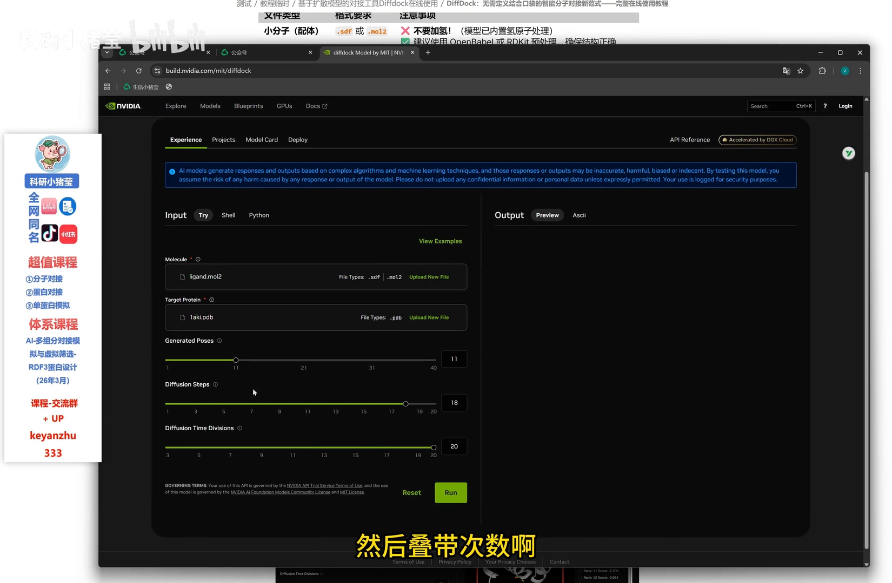

## 四、点击运行：30 秒到 5 分钟拿到姿态

上传完直接**点击运行**（[【跳转到 02:52】](https://www.bilibili.com/video/BV1hDPzzxEUr/?t=172)），右侧会出现生成界面；**大概需要 30 秒到 5 分钟**，具体取决于蛋白大小（[【跳转到 03:03】](https://www.bilibili.com/video/BV1hDPzzxEUr/?t=183)）。

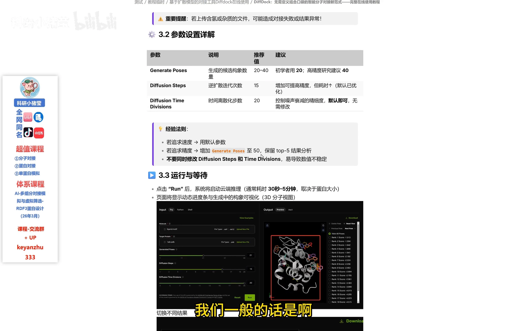

UP 主之前选了 11 个 pose，运行结束后蛋白上同时展示了 **1~11 号姿态**：可以查看所有姿态，也可以单独查看某一个、定位到某一张——不过网页端的查看比较粗略，想进一步作图研究就要**下载结果**（[【跳转到 03:18】](https://www.bilibili.com/video/BV1hDPzzxEUr/?t=198)）。

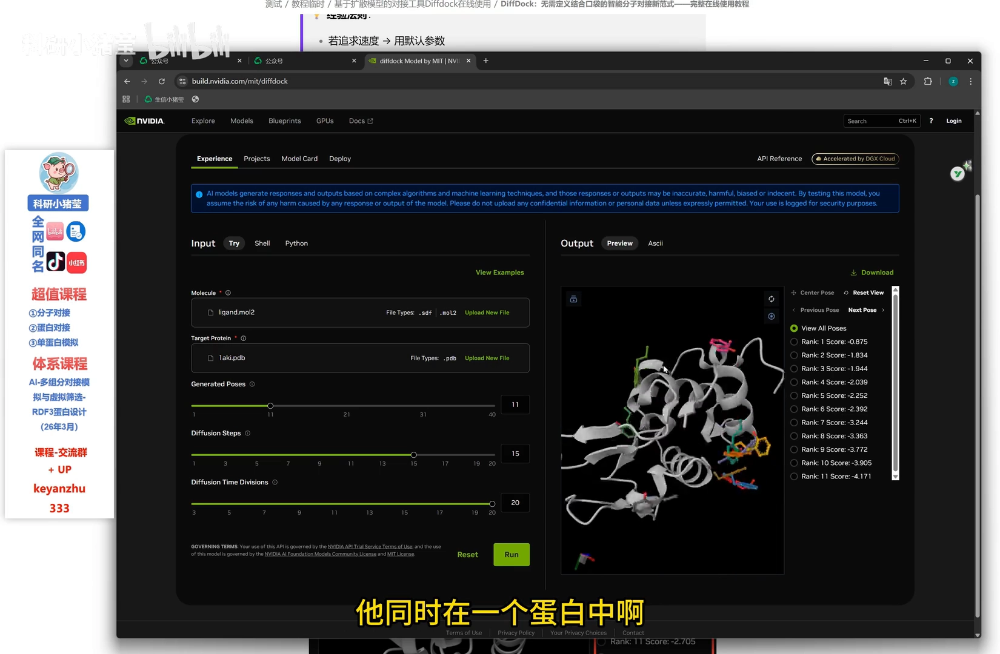

## 五、读懂结果包：置信度文件与"从好到坏"的排序

### 5.1 下载与解压

点击 **download** 下载到本地（[【跳转到 03:43】](https://www.bilibili.com/video/BV1hDPzzxEUr/?t=223)），得到一个**压缩包**（[【跳转到 03:53】](https://www.bilibili.com/video/BV1hDPzzxEUr/?t=233)）。

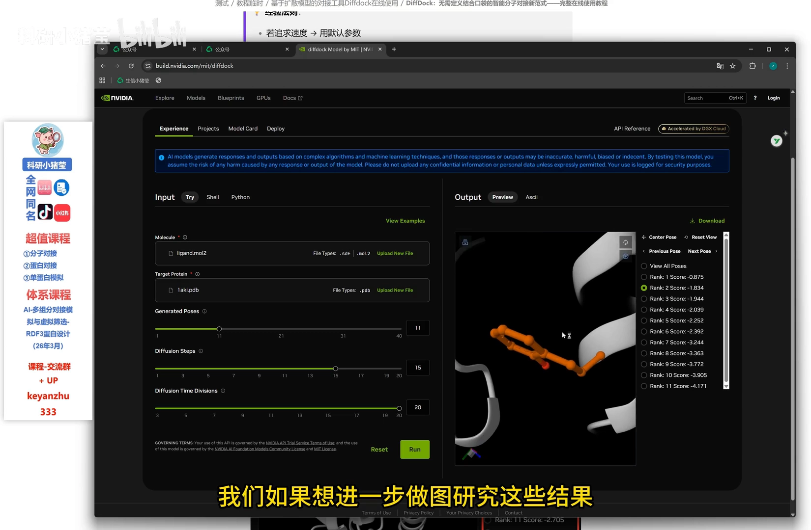

### 5.2 置信度：分数越高越可信

解压后，包里首先有一个**置信度打分文件**（[【跳转到 04:05】](https://www.bilibili.com/video/BV1hDPzzxEUr/?t=245)）。这个置信度分数**越高，代表该构象的置信度越高**（[【跳转到 04:10】](https://www.bilibili.com/video/BV1hDPzzxEUr/?t=250)）——条目名里的 `position_confidence` 指的就是这个**逐姿态置信度分数**，管线脚本按它给候选姿态排序。

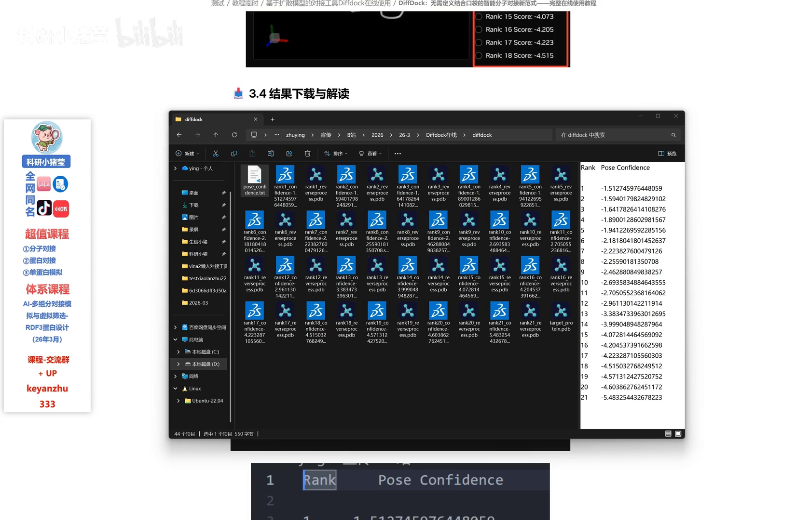

### 5.3 1~20 依次变差：排序本身就是筛选

UP 主这次预测了 20 个 pose，**从 1 到 20 构象依次变差**（[【跳转到 04:15】](https://www.bilibili.com/video/BV1hDPzzxEUr/?t=255)）——也就是说结果**已按置信度从高到低排好序**，rank1 就是模型认为最可信的姿态，先看排名靠前的即可。

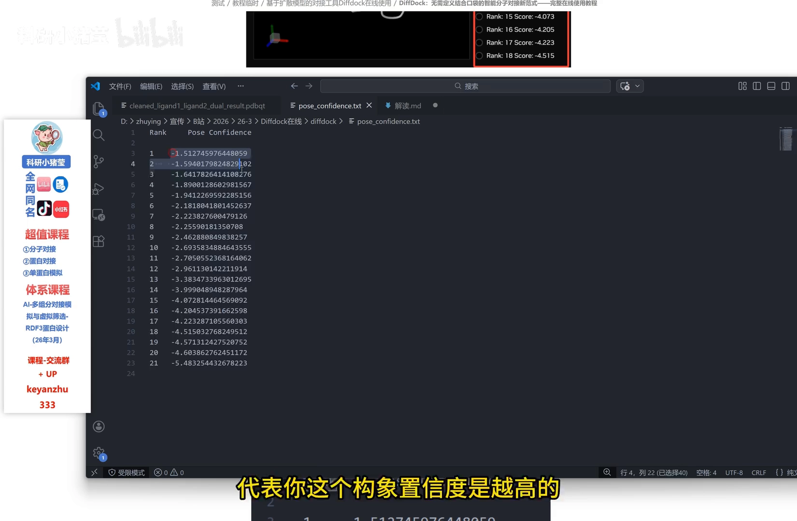

### 5.4 top1 与晶体叠加核对

每个 pose 都附有构象文件，可以逐个打开查看（[【跳转到 04:20】](https://www.bilibili.com/video/BV1hDPzzxEUr/?t=260)）。最有说服力的验证方式：**把 top1 的结合姿态与已知的晶体结构叠加**（[【跳转到 04:30】](https://www.bilibili.com/video/BV1hDPzzxEUr/?t=270)）——本系列 6.3.5 的 GROMACS 精修与验证思路正建立在这个姿态之上。

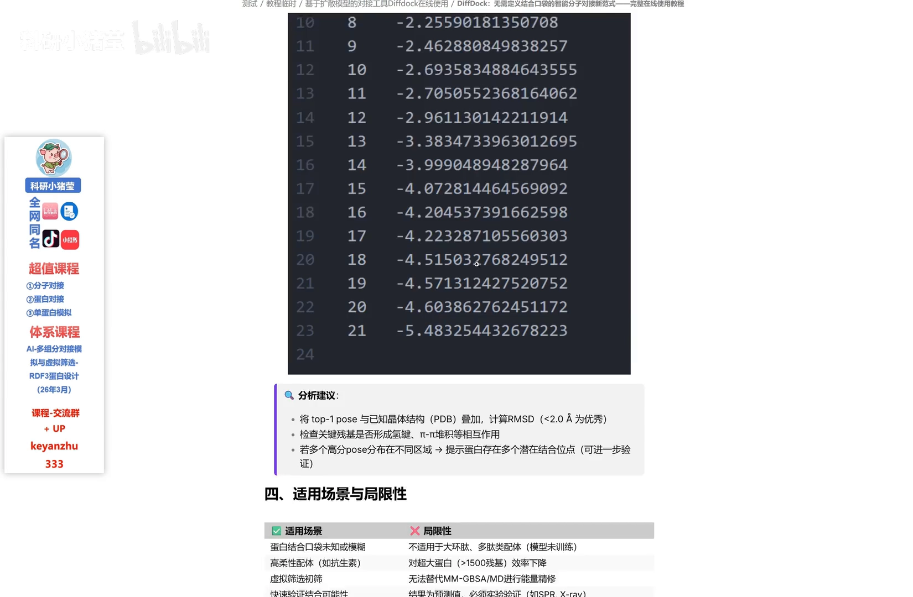

## 六、适用边界与建议工作流

- **适用场景**：一些蛋白质**口袋位置未知**的情形（盲对接）（[【跳转到 04:35】](https://www.bilibili.com/video/BV1hDPzzxEUr/?t=275)）；
- **不适用**：大环肽、超大氨基酸这类特殊配体情形；
- **建议工作流**：用 DiffDock 完成**快速初筛** → 用其他对接优化工具做**局部优化** → **MD 验证稳定性** → 最后**实验验证**（[【跳转到 04:40】](https://www.bilibili.com/video/BV1hDPzzxEUr/?t=280)）。

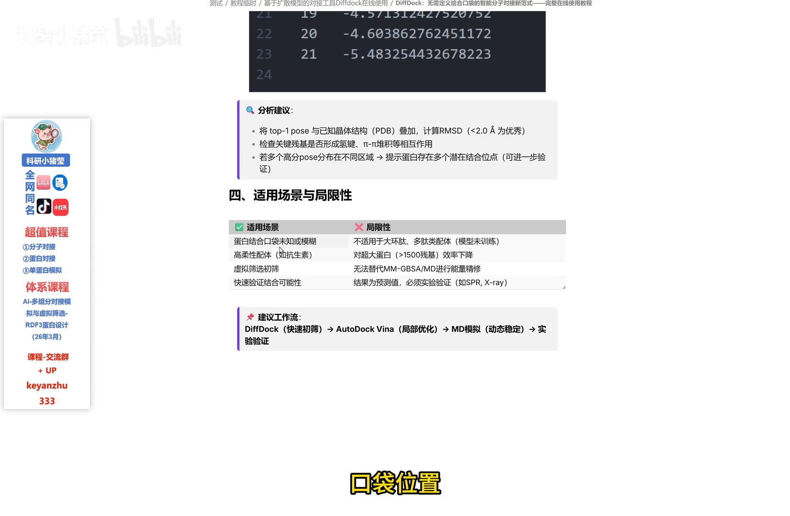

这一工作流正好对应管线 C 的后半段：DiffDock 负责出候选姿态（本条目），局部优化与 MD 稳定性验证见 6.3.5 与 5.6.1 条目。

## 小结

- 传统对接要**指定口袋 + 经验打分**；DiffDock **无需口袋**、端到端生成结合构象，核心是"从无序到结合"的逆向扩散。
- 输入两个文件：小分子（SDF/mol2，PyMOL 可转换）+ 蛋白；小分子**别带氢**、蛋白**尽量单链**。
- 三个关键参数：**生成 pose 数**（要多少候选）、**迭代次数**（精度 vs 算力，演示设 15）、**扩散时间**（默认即可）。
- 运行 30 秒~5 分钟出结果；结果包里的**置信度文件**给出逐姿态分数，**分数越高越可信**。
- 结果**按置信度排序**：1~20 依次变差，rank1 即首选；top1 可与已知晶体**叠加核对**。
- 定位是**快速初筛**：后续局部优化 → MD 验证 → 实验验证。

## 关键术语速查

| 术语 | 一句话解释 |
| --- | --- |
| 盲对接（blind docking） | 不预先指定口袋，把整条蛋白交给模型搜索结合位置 |
| pose（姿态） | 对接得到的配体一种三维结合构象；一次对接可产出多个 pose |
| num_poses（生成 pose 数） | 一次对接生成的候选姿态数量，设 10 生成 10 个、设 20 生成 20 个 |
| 置信度（confidence） | DiffDock 给每个 pose 的打分，分数越高该构象越可信；结果按它从高到低排序 |
| 迭代次数 | 扩散去噪的步数，越高精度越高、算力开销也越大 |
| 扩散时间 | 噪音衰减的精确度参数，默认即可 |
| SDF / mol2 / CIF | 小分子与结构的常见文件格式，PyMOL 可互相转换 |
| 初筛 | 用快速工具先把候选缩小，再交给更精细的优化与实验验证 |
