# 利用分子对接结果在Gromacs上进行分子动力学模拟

> 视频来源：[B站《利用分子对接结果在Gromacs上进行分子动力学模拟》](https://www.bilibili.com/video/BV1Jh4y1G7T6)（13:22，UP 主：花榆前辈）。UP 主演示如何把**分子对接得到的蛋白-配体复合物**一步步变成 GROMACS 可以跑的分子动力学（MD）体系：Windows 原生版 GROMACS 安装、SPDBV 修复蛋白、sobTop 为小分子配体做参数化（GAFF）、手工合并拓扑文件、能量最小化、NVT/NPT 平衡、成品 MD，最后在 VMD 里看"会呼吸"的复合物。视频字幕为 B 站 AI 字幕（kedou 配额耗尽，经 cookie 降级链抓取 ai-zh 轨道），已逐窗口纠正错拼（"grow max/gmax/go max"→GROMACS、"s p d b v"→SPDBV、"subtop/saptop"→sobTop、"皮某/po"→PyMOL、"gif"→GAFF、"立场"→力场、"r99 sb"→ff99SB、"s p c"→SPC、"容器"→水、"h s d"→HSD、"h i s"→HIS、"残疾/人字"→残基、"蛋白质明"→蛋白质名、"md 01"→md_01、"vd"→VMD、"selected itunes"→Selected Atoms 等）；本文基于文稿整理，所有操作可点时间戳回看核对。

## 本讲要解决的核心问题（SCQA）

**背景**：小分子药物发现管线（本系列管线 C）里，前面的对接步（DiffDock）已经给出了排名最高的结合姿态（top1 pose）。但对接本质上是一张**静态快照**：打分函数把蛋白当成刚性受体，也没有真实的水环境。

**冲突**：打分排第一，不等于这个姿态在真实水溶液里**站得住**——蛋白会"呼吸"、配体会抖动、水分子会挤进结合界面。只看对接分数就往下走，很容易把假阳性带进后续昂贵的实验环节。

**疑问**：怎么用一套可复现的流程，把对接姿态放进一个**真实的物理环境**里检验它的结合稳定性？

**回答（中心思想）**：把对接复合物建成 GROMACS 的 MD 体系，跑一段显式溶剂动力学，用轨迹直接观察复合物"稳不稳"。本视频用 **Windows 原生 GROMACS** 完整走通：装软件 → 修蛋白 → 配体参数化 → 合并拓扑 → 加盒子/水/离子 → 能量最小化 → NVT/NPT 平衡 → 成品 MD → VMD 看轨迹（[【跳转到 00:00】](https://www.bilibili.com/video/BV1Jh4y1G7T6/?t=0)）。跑完之后的"读数"（RMSD、氢键、结合自由能）见本条目另外两篇博客。

## 一、准备一：装上 Windows 原生版 GROMACS

UP 主用的是**原生 Windows 版 GROMACS**，由 sobereva 老师编译（[【跳转到 00:05】](https://www.bilibili.com/video/BV1Jh4y1G7T6/?t=5)）——省去 WSL/双系统，初学者最省事的路线。

安装就是解压：解压后得到 `gmx` 开头的文件夹，进入其中的 `bin` 文件夹，然后把 `bin` 的**完整路径加进系统环境变量 PATH**（控制面板 → 高级系统设置 → 环境变量 → 编辑 PATH → 新建），终端才能直接调用 `gmx` 命令（[【跳转到 00:25】](https://www.bilibili.com/video/BV1Jh4y1G7T6/?t=25)）。

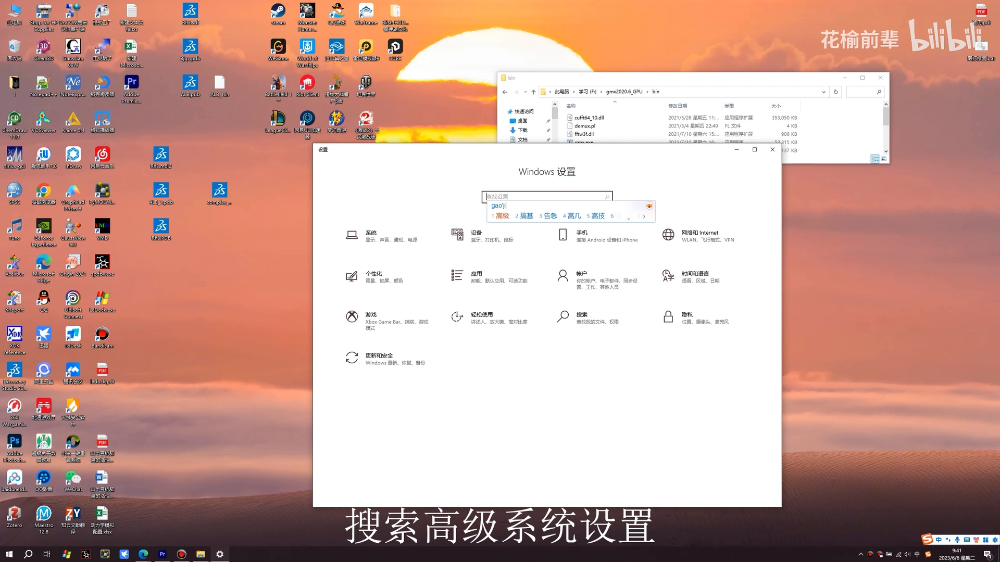

## 二、准备二：SPDBV 里修复对接用的蛋白结构

打开 **SPDBV**（Swiss-PdbViewer），把**分子对接时处理好的蛋白结构**导入，做一次修复，再另存为 PDB 格式（[【跳转到 00:50】](https://www.bilibili.com/video/BV1Jh4y1G7T6/?t=50)）。这一步解决的是"对接输出直接喂给 GROMACS 会报错"的问题：缺侧链、非标准残基等毛病先在准备阶段清掉。

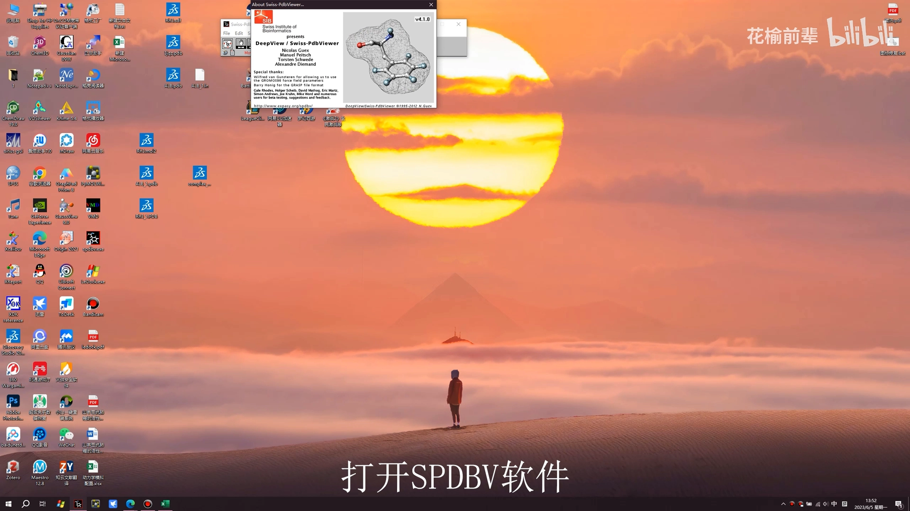

## 三、配体参数化：sobTop + GAFF 给小分子"办证"

GROMACS 的蛋白力场里**没有**你的小分子——配体必须先做参数化（生成自己的拓扑）。UP 主的路线：

1. 在 GROMACS 文件夹里新建工作文件夹，放入蛋白结构；在 **sobTop**（`sbtop`）的 examples 下新建文件夹，放入**分子对接得到的小分子配体**结构（[【跳转到 01:28】](https://www.bilibili.com/video/BV1Jh4y1G7T6/?t=88)）；
2. 配体先用 **PyMOL 重新保存为 mol2 格式**（[【跳转到 01:52】](https://www.bilibili.com/video/BV1Jh4y1G7T6/?t=112)）——sobTop 吃 mol2；
3. 运行 sobTop：输入 mol2 文件地址，按提示选择（2 → 生成 gro 到默认路径 → 1 → 用 **GAFF** 指认原子类型 → 4，一路回车取默认参数），最后在默认路径生成配体的 **top 和 gro 文件**（[【跳转到 02:12】](https://www.bilibili.com/video/BV1Jh4y1G7T6/?t=132)）。

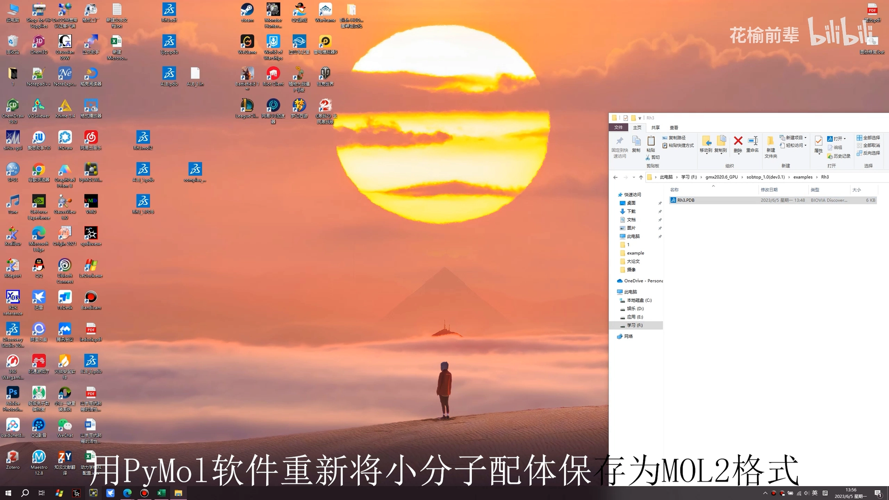

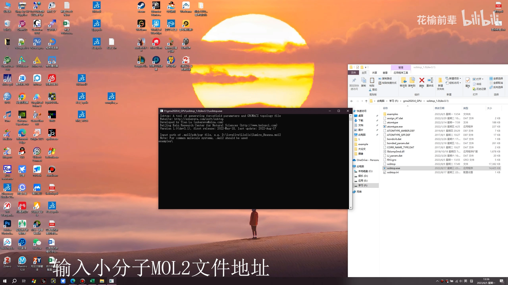

## 四、合并拓扑：蛋白 ff99SB + 配体 GAFF 拼进同一个体系

把 sobTop 生成的三个文件放进蛋白和参数所在文件夹，打开 UP 主提前写好的**命令文件**（在地址栏输入 `cmd` 回车，把第一行命令粘进窗口，并把命令中的蛋白名替换成自己的，[【跳转到 02:43】](https://www.bilibili.com/video/BV1Jh4y1G7T6/?t=163)）。

选**5 号力场 AMBER ff99SB**——它能够与 sobTop 为小分子指认的 **GAFF** 参数兼容；水模型选 GROMACS 常用的 **SPC**（[【跳转到 03:13】](https://www.bilibili.com/video/BV1Jh4y1G7T6/?t=193)）。

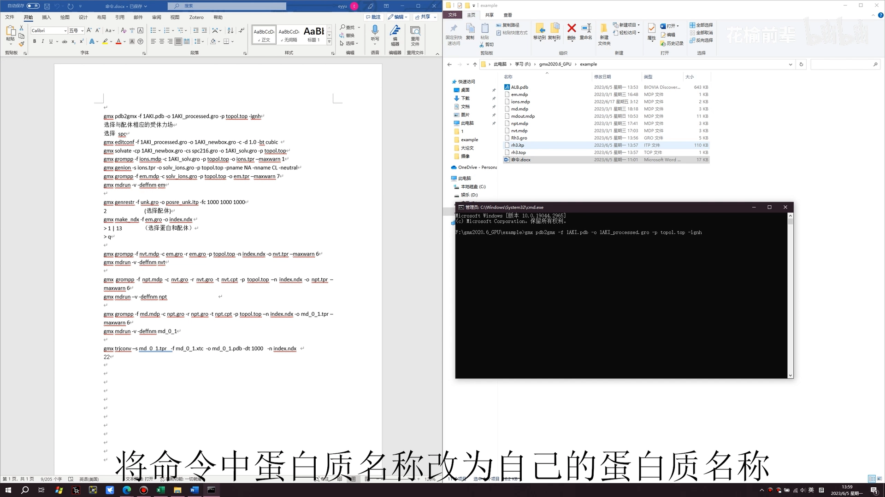

第一次运行大概率报错：**组氨酸缩写不在数据库中**——把 PDB 里的 `HSD`（以及再次出现的 `HSE`）改成通用缩写 `HIS`，删掉刚生成的 `top.top` 重跑即可（[【跳转到 03:38】](https://www.bilibili.com/video/BV1Jh4y1G7T6/?t=218)）。成功后得到蛋白拓扑文件（[【跳转到 04:42】](https://www.bilibili.com/video/BV1Jh4y1G7T6/?t=282)）。

接下来是全片最"手工"的一步——**把配体拼进蛋白体系**：

- 打开配体的 gro 文件，**复制所有原子坐标（第三行到倒数第二行）**，并记住第二行的原子总数；打开上一步生成的 `processed.gro`，把配体坐标粘到**倒数第二行之前**，并把第二行数字改成**两者之和**（[【跳转到 04:52】](https://www.bilibili.com/video/BV1Jh4y1G7T6/?t=292)）；
- 打开配体的 itp/top 文件，把分子类型（moleculetype）下的名称改成与残基名一致（视频里改为 `MOL`），从 `[ atomtype ]` 开始复制到最后，粘到 `topol.top` 的**原子类型段之上**，注意**前后各留一行空行**；再在拓扑文件**最后一行**追加与配体文件相同的分子名（[【跳转到 05:17】](https://www.bilibili.com/video/BV1Jh4y1G7T6/?t=317)）。

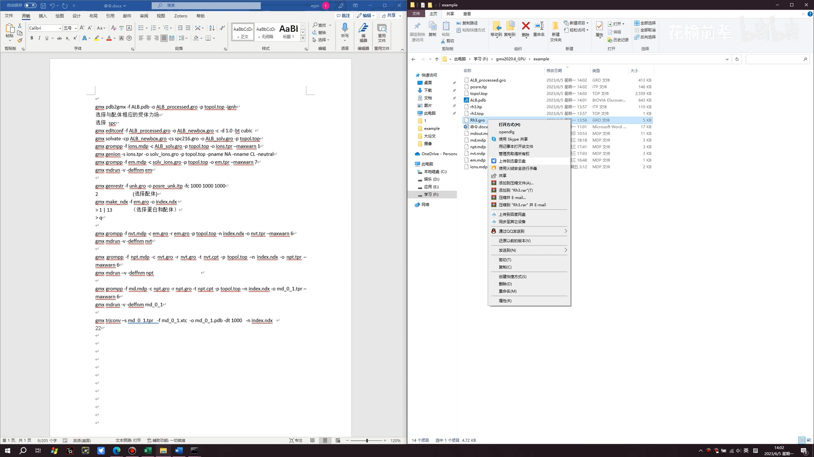

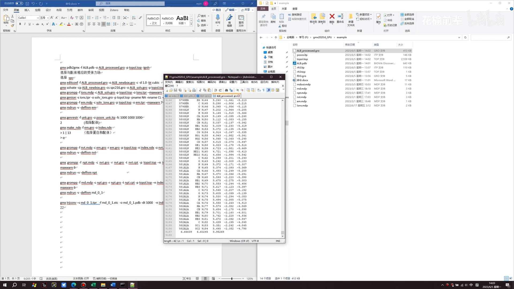

继续跑建盒子命令时可能遇到两个经典小坑：`processed.gro` 中**配体坐标段的格式没对齐**（打开文件把第一行坐标格式对齐即可，[【跳转到 06:38】](https://www.bilibili.com/video/BV1Jh4y1G7T6/?t=398)）；加溶剂时提示**水模型文件与拓扑不匹配**——在拓扑文件末尾把水（SOL）**单独另起一行**再保存（[【跳转到 07:08】](https://www.bilibili.com/video/BV1Jh4y1G7T6/?t=428)、[【跳转到 07:39】](https://www.bilibili.com/video/BV1Jh4y1G7T6/?t=459)）。

## 五、能量最小化：先"最速下降"再"共轭梯度"

平衡电荷时按提示选择 15 号组（SOL），用 Na⁺/Cl⁻ 替换部分水分子（[【跳转到 07:55】](https://www.bilibili.com/video/BV1Jh4y1G7T6/?t=475)）。随后打开 `em.mdp`，关键是第二行**能量最小化方法**：

- 等号后写 **cg**：共轭梯度法，**速度较慢但利于收敛**；
- 注释里的 **steep**：最速下降法，**速度快但不收敛**。

UP 主的习惯是**先用最速下降、再用共轭梯度，各跑 1 万步**；为演示只各跑 1000 步（改第二行为 `steep`、步长 1000，跑完再改回 `cg` 重复，[【跳转到 08:25】](https://www.bilibili.com/video/BV1Jh4y1G7T6/?t=505)）。这一步把构建体系时产生的原子重叠、坏接触"压"掉，是后续动力学能跑起来的前提。

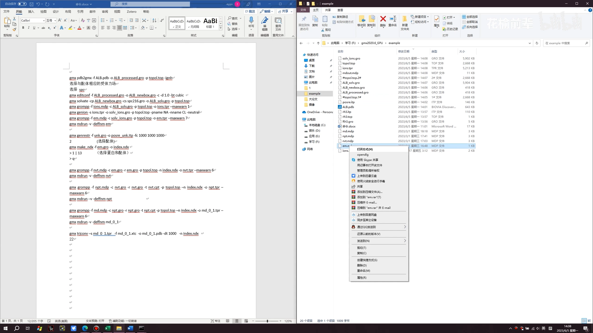

## 六、配体位置限制与索引组

接着跑**配体构象限制**（position restraint），这一步容易报错：提示 `unk.gro` 不存在——那是命令文件里上一条配体的旧文件名，把命令里的 `unk` 换成自己的配体名（视频里为 `rh3`）即可（[【跳转到 09:38】](https://www.bilibili.com/video/BV1Jh4y1G7T6/?t=578)）。之后建索引组：**选择配体输入 2**、再选**蛋白+配体（输入 13）**，退出输 `q`（[【跳转到 10:19】](https://www.bilibili.com/video/BV1Jh4y1G7T6/?t=619)）。这个"13 号组"后面分析时会反复用到。

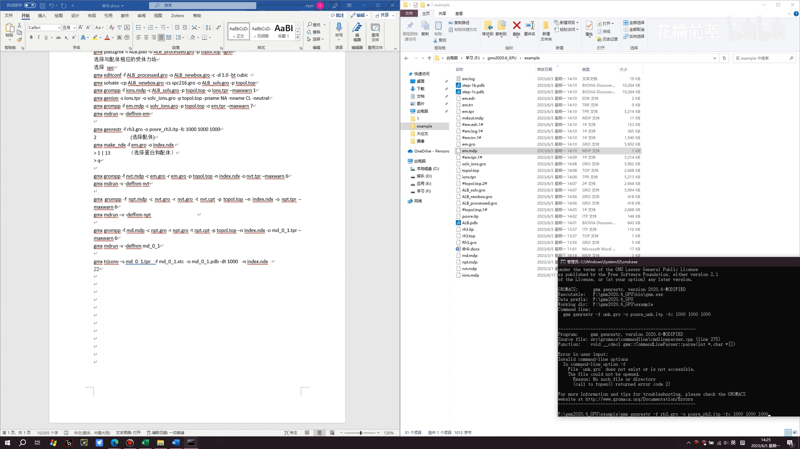

## 七、NVT/NPT 平衡与成品 MD

先做 **NVT 与 NPT 平衡**让体系稳定；UP 主提到 NPT 也可以不做（因为最后的产出本来就在 NPT 系综下运行）（[【跳转到 10:44】](https://www.bilibili.com/video/BV1Jh4y1G7T6/?t=644)）。步数换算很实用：`nvt.mdp` 里 **steps 每 5 万步 = 100 皮秒**（2 fs 步长）；UP 主一般平衡 **2000 皮秒（输入 100 万步）**，演示只跑 **200 皮秒（10 万步）**（[【跳转到 10:52】](https://www.bilibili.com/video/BV1Jh4y1G7T6/?t=652)）；`npt.mdp` 同样修改。

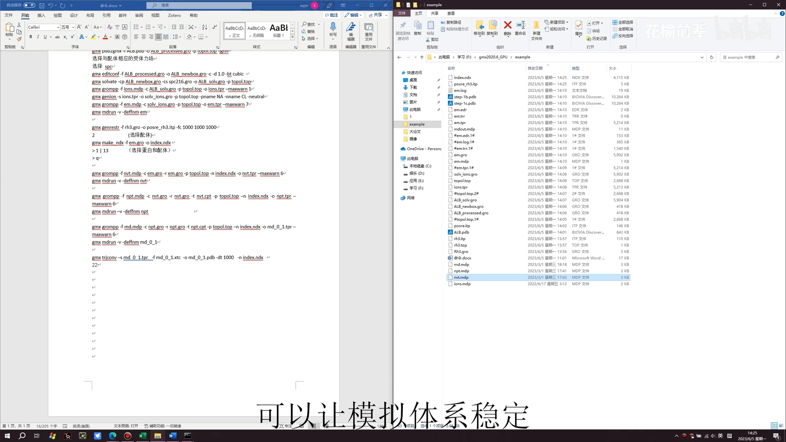

最后的**成品模拟**在 `md.mdp` 里改，同样是改步长控制时长：演示依旧 200 皮秒；**正式发表一般要跑 30~200 纳秒不等**（[【跳转到 11:44】](https://www.bilibili.com/video/BV1Jh4y1G7T6/?t=704)）。

## 八、看轨迹：VMD 里"呼吸"的复合物

跑完生成的输出文件统一叫 `md_01`（不同后缀各有用途）。把 `md_01.gro` 导入 **VMD**：能看到水盒子里的复合物体系（红色分子即水）；点击 Graphics → Representations，在 Selected Atoms 里输入 **`not water`** 删掉水盒子，得到干净的复合物结构（[【跳转到 12:24】](https://www.bilibili.com/video/BV1Jh4y1G7T6/?t=744)、[【跳转到 12:34】](https://www.bilibili.com/video/BV1Jh4y1G7T6/?t=754)）。

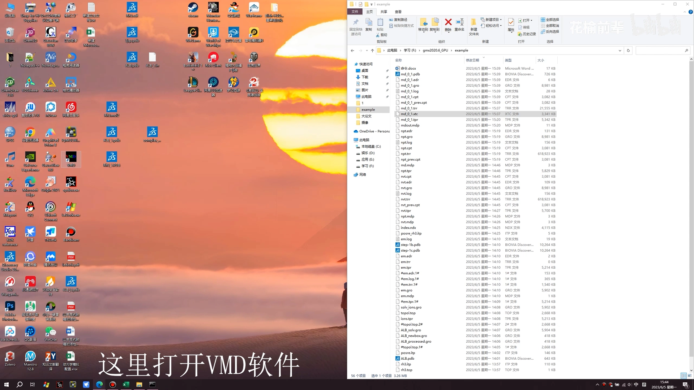

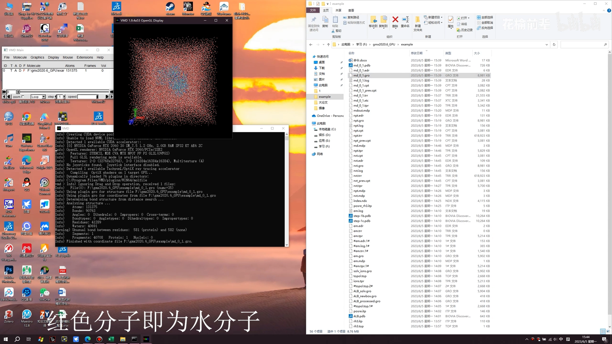

再导入 `md_01.xtc` 轨迹，点右下角箭头播放——能看到蛋白和配体在水中"呼吸"、小幅晃动，还可以把模拟过程输出成视频做演示（[【跳转到 12:43】](https://www.bilibili.com/video/BV1Jh4y1G7T6/?t=763)）。最后把 `md_01.gro` 导入 PyMOL，删掉水分子和离子，方便观察和后续分析（[【跳转到 13:00】](https://www.bilibili.com/video/BV1Jh4y1G7T6/?t=780)）。

## 小结

- **对接 pose ≠ 稳定结合**：把 DiffDock/其他工具的 top1 姿态放进显式水环境的 MD 里"烤"一段时间，是筛选假阳性的第一道物理闸门；
- 本片覆盖了从**对接结果到可用轨迹**的全部手工环节：Windows 原生 GROMACS + SPDBV 修蛋白 + sobTop/GAFF 配体参数化 + ff99SB 合并拓扑 + EM/NVT/NPT/MD；
- 轨迹到手后，"稳不稳"要看指标：RMSD/RMSF/氢键/Rg 怎么算、怎么读，见 [EP 12 复合物后评估](EP%2012%20｜%20Post%20MD%20simulation%20assessment%20of%20Protein%20Ligand%20Complex%20in%20Gromacs%20｜%20RMSD%2C%20RMSF%2C%20H-bonds%2C%20Rg.md)；"结合有多强"要定量，见 [MM-GBSA 结合自由能](分子动力学模拟%28六%29：mmGBSA结合自由能一行命令计算，能量分解以及一键蛋白质配体复合物模拟.md)。
