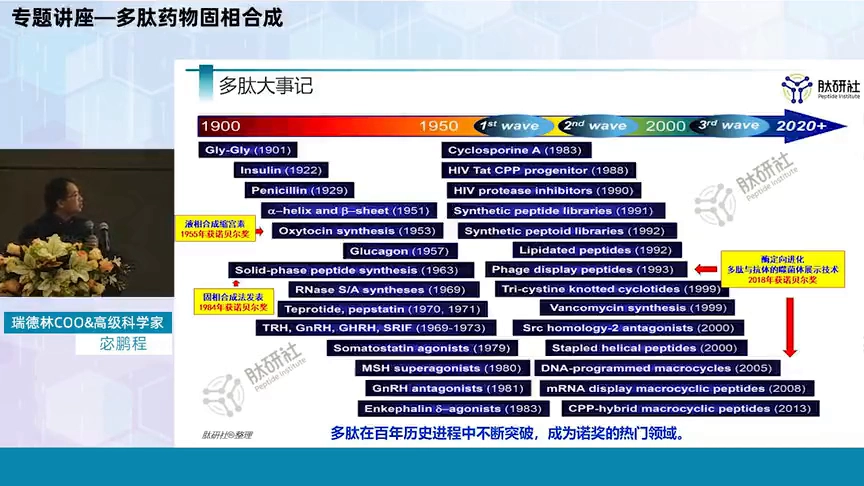
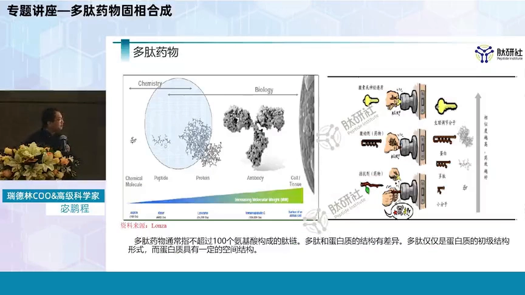
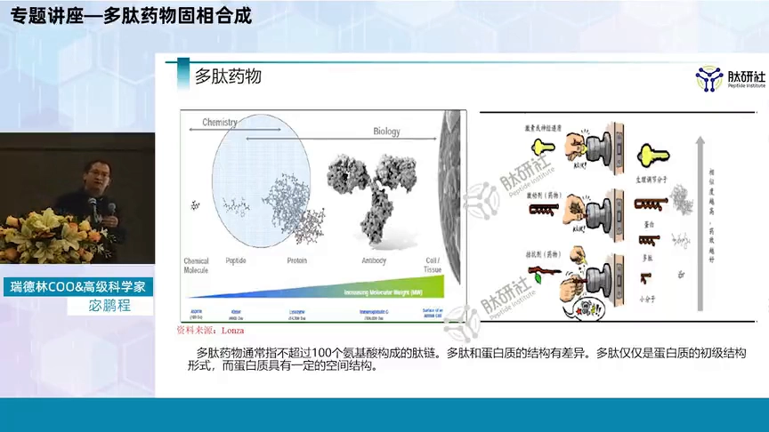
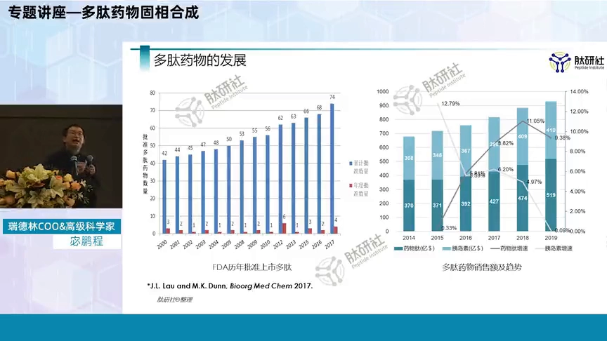
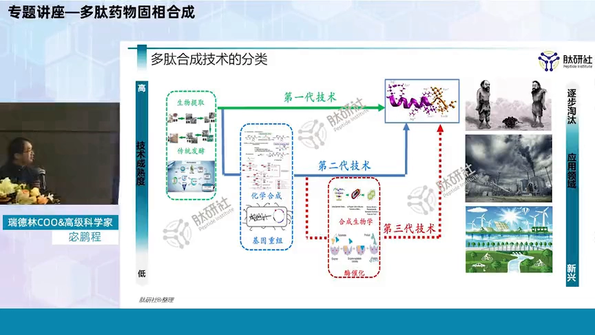
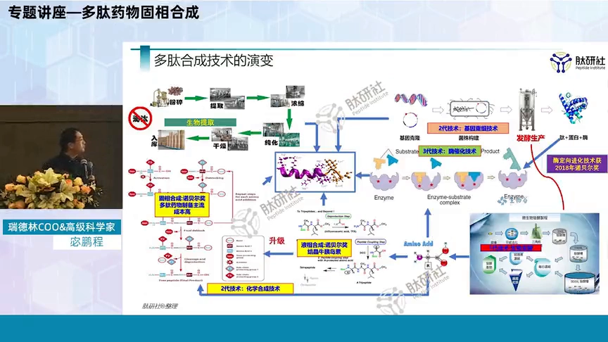
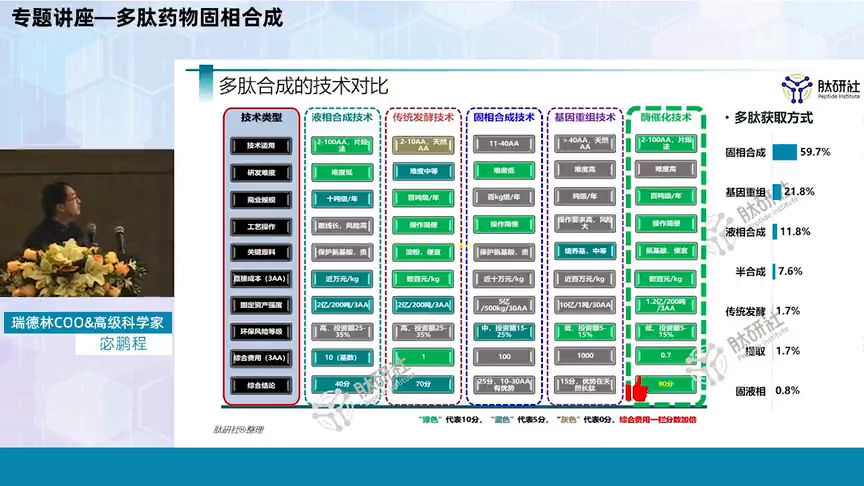
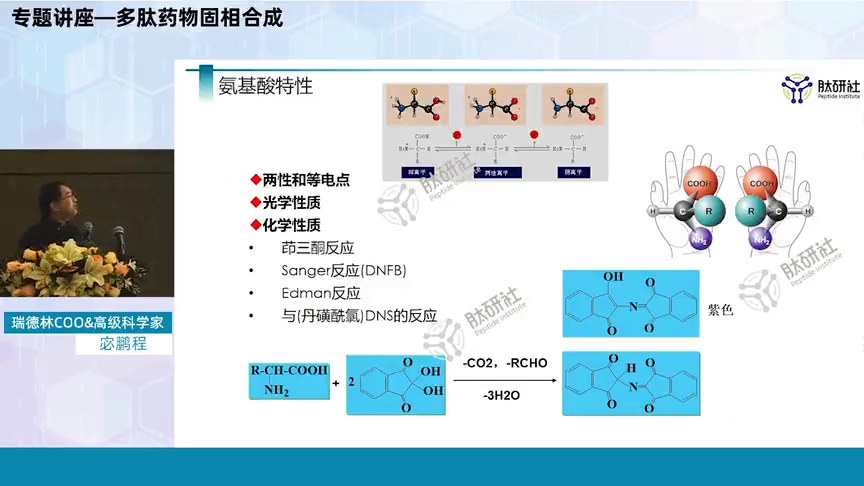
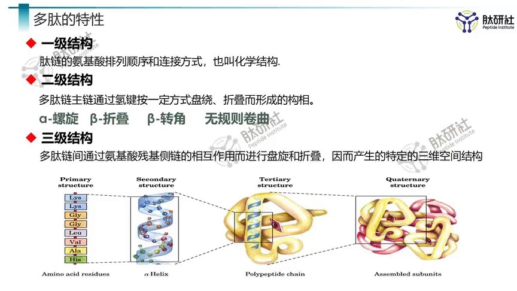

# 多肽药物固相合成：第1集-多肽药物及合成技术

> 视频来源：[Bilibili · 多肽药物固相合成：第1集-多肽药物及合成技术](https://www.bilibili.com/video/BV1We4y1m7Rt/)（30:55，瑞德林高级科学家 & COO 宓鹏程主讲，肽研社 & 瑞德林系列讲座）

## 本讲要解决的核心问题（SCQA）

**背景**：在抗菌肽、抗体药这些计算设计管线里，模型输出的只是**序列**。要让设计真正起效，必须把序列变成真实的分子——对多肽来说，这条路绕不开"合成"。

**冲突**：多肽动辄 20~40 个氨基酸，比传统小分子大得多；获得多肽的老办法各有各的天花板——提取靠天吃饭，液相合成的溶剂用量曾被形容为"一游泳池"，基因重组表达不出非天然结构。

**疑问**：多肽药物到底是什么？合成多肽有哪些技术路线？为什么偏偏是**固相合成**成了主流？

**回答（中心思想）**：固相合成凭借"合成难度相对低、可实现自动化"成为 10~40 个氨基酸药物多肽的首选路线，目前 60% 以上的多肽获取仍靠它；但它成本极高，只服务于药物这类高附加值产品。理解固相合成，要先认识多肽药物本身，再认识氨基酸这个"积木"的特性。

[【跳转到 01:30】](https://www.bilibili.com/video/BV1We4y1m7Rt/?t=90)

## 一、多肽药物：站在小分子与蛋白之间的"小型蛋白"

### 1.1 多肽的定义与谱系

通俗地讲，**多肽是 2~100 个氨基酸组成的序列**，从这个意义上说它也可以看作"小型蛋白"。它的应用早已超出药品：功能性食品、保健品、膳食补充剂、美容领域都有它的身影。

行业内习惯按长度再分层：

- **2~10 个氨基酸**：寡肽（2000 年以前上市的多肽药物大多是这一档）；
- **10~100 个氨基酸**：多肽；
- **100 个氨基酸以上**：蛋白。

目前全球总共上市了 100 多个多肽药物，在售药品主要集中在 **5~40 个氨基酸** 区间。2000 年以后，上市多肽药物的氨基酸数目逐步变长——一方面说明药物在朝更复杂的分子走，另一方面也说明合成技术在进步。

[【跳转到 02:42】](https://www.bilibili.com/video/BV1We4y1m7Rt/?t=162)

### 1.2 一百多年多肽史：三次诺贝尔奖与一次中国奇迹

"多肽"这个概念是 **1902 年**才从蛋白中正式分离出来的——在此之前（19 世纪），无论多少个氨基酸的分子都算蛋白。此后一百多年，多肽领域可以用三个诺贝尔奖节点串联：

| 年份 | 事件 | 代表的技术路线 |
| --- | --- | --- |
| 1955 | 液相合成的缩宫素获奖 | **液相合成** |
| 1984 | 固相合成方法获奖 | **固相合成** |
| 2018 | 多肽的噬菌体展示技术获奖 | **生物展示/进化** |

[【跳转到 04:28】](https://www.bilibili.com/video/BV1We4y1m7Rt/?t=268)

中国在这个领域也有突出的一笔：**1960 年代人工合成结晶牛胰岛素**。当时合成这样一个分子量 5000+ 的大分子，甚至可以说是全球最大的全合成分子，非常不容易。

[【跳转到 05:02】](https://www.bilibili.com/video/BV1We4y1m7Rt/?t=302)

### 1.3 分子量谱系：多肽处在"中间地带"

把上市药物放到分子量的坐标轴上，多肽的位置一目了然：

- 传统化学小分子：一般 **< 500**；
- **多肽药物：500~5000**；
- 蛋白大分子：**> 1 万**；
- 单克隆抗体：**> 10 万**；
- 再往上，就是细胞治疗这类另外的治疗方式了。

分子量背后代表的是结构复杂程度。

[【跳转到 05:33】](https://www.bilibili.com/video/BV1We4y1m7Rt/?t=333)

### 1.4 锁钥学说：为什么多肽的副作用介于两者之间

人体非常精密：体内的激素和神经递质——其中很多成分本身就是多肽——与药物靶点基本是**一对一**的关系，所谓"一把钥匙开一把锁"。钥匙和锁匹配程度越高，生理效果越精准。

药物按作用方式分两类：

- **激动剂**：模拟激素/神经递质的结构，产生放大的效果；
- **拮抗剂**：把"钥匙孔"堵上，截断某个生理过程。

用这个模型看副作用就很好理解：小分子相当于"自己做的一把钥匙"，和锁孔匹配得不够好——能开这把锁，也可能开隔壁那把锁，这就是副作用的来源。单克隆抗体对天然分子的模仿更完备，匹配精准，因此副作用低。**多肽药物正好处于两者之间。**

[【跳转到 06:48】](https://www.bilibili.com/video/BV1We4y1m7Rt/?t=408)

### 1.5 市场与治疗领域：小而美，且越跑越快

从整体统计来说，多肽大约上市了 **122 个新药**；FDA 口径到 2017 年为止大约批准了 **74 个新药**。从 2010 年开始，多肽药物每年获批数量明显增高——而当年整体批准的药物总数也就在 40 左右，这个比例非常高。

市场规模：如果把胰岛素计入多肽药物，2019 年全球销售规模约在 **1000 亿**量级。绝对规模不算特别大，但发展增速远高于药物整体平均水平——讲者称之为"**非常小而美的领域**"。

治疗领域上，上市多肽药物集中在**产科、泌尿、代谢、心血管、骨科、内分泌**。原因和多肽药物的来源有关：最早的多肽药物大多是**人体内已有物质**的工业化复刻——取出来、合成出来、做成产品，这些领域自然研究得多。而现在的大热领域（肿瘤、内分泌、神经系统）多肽也在跟进，特别是在**慢性病**和**孤儿病**领域前景很大。

[【跳转到 10:32】](https://www.bilibili.com/video/BV1We4y1m7Rt/?t=632)

## 二、三代多肽获取技术：从"靠天吃饭"到"按需设计"

### 2.1 第一代：生物提取——用了几千年，但"靠天吃饭"

虽然"多肽药物"是 20 世纪才有的概念，人类获得多肽的方式已经持续了几千年：酿酒、做豆腐（大豆蛋白）都是生物提取。它的优点是产物**成分明确**，不太存在合成方法的副作用顾虑；但缺陷同样明显：

1. 生物体提取的产物**很难保证稳定均一**；
2. 本质上"靠天吃饭"——自然界中没有的分子根本拿不到。讲者回忆上学时要去山上、河里采样，筛选天然菌株，有效就用、无效就放弃。想**稳定地得到一个自己设计出来的新结构**，用提取几乎不可能。

[【跳转到 11:53】](https://www.bilibili.com/video/BV1We4y1m7Rt/?t=713)

### 2.2 第二代（20 世纪 50~60 年代）：化学合成 + 基因重组

从 60 年代开始，两项技术先后出现，一定程度上解决了"获得自己设计的产品"的问题。

**化学合成**又分两条路线：

- **液相合成**（传统方法）：结晶牛胰岛素用的就是它的片段法。但对产业化来说，溶剂用量是灾难性的——据说光拿到一点产物，用的溶剂就"一游泳池"那么大。
- **固相合成**（60 年代发明）：**多肽药物行业的成熟，正是伴随着固相合成方法的兴起才真正开始的**。在此之前这个行业很难成熟，直到固相合成的出现才使产业化成为可能。

[【跳转到 16:03】](https://www.bilibili.com/video/BV1We4y1m7Rt/?t=963)

**基因重组**（80 年代开始流行）：前期研发困难，但一旦做出来生产成本低、可放大规模。它的问题是根本性的——基因重组是从 DNA 到 RNA 再表达出蛋白，**生物体有的蛋白你能表达，生物体没有的怎么也表达不出来**。它能解决的基本上就是 20 种天然氨基酸的组合；想让结构稍作变化、超出天然氨基酸范畴（比如非天然修饰），基因重组无能为力。而且前期投资非常大。

这两项技术共同的最大问题是：**都没能真正解决大规模生产**。

### 2.3 第三代（近年）：合成生物学与酶催化

标志性的第三代技术有两项：

- **合成生物学**：与其说是学科，不如说是一个体系。它非常复杂，产业化应用还需时日，但前景非常好——有一句话说，合成生物学的最高目标是"创造生命"，对产业化来说这个目标还有点高。目前已确有用它做多肽药物/产品的尝试，但都处在较早阶段。
- **酶催化**：可以认为是合成生物学的一个分支。它的价值在于把酶"绿色环保 + 高效"的特点发挥到极致，有望解决二代技术高污染、难产业化的问题。

### 2.4 多维度对比：固相为什么是主流

把几项技术放在几个维度上对比，固相合成的位置就清楚了：

| 技术 | 适用长度 | 商业规模 | 成本/特点 |
| --- | --- | --- | --- |
| 液相合成 | ≤10 个氨基酸（甚至 ≤5） | 10 吨级 | 每公斤近万、复杂要好几万；原料是天然氨基酸、操作简单；但复杂结构路线长、风险高，几乎无法产业化 |
| 固相合成 | 10~40 个氨基酸药物的首选 | **百公斤级** | 比其他方法低两个数量级的规模；只用于药物这类高附加值产品 |
| 基因重组 | 天然 20 种氨基酸组合 | 大规模 | 难度高、风险大、前期投资大 |
| 酶催化 | 拓展中 | — | 绿色高效，解决高污染 |

固相合成的合成难度相对低（但这个"低"是相对的），真正的问题在于**商业规模只有百公斤级**——比其他方法低了不止一个数量级，是两个数量级以上的下降。所以它只用于多肽药物这类高附加值产品，"用得起"的只有药。

即便如此，目前 **60% 以上的多肽获取方式仍然是固相多肽合成**——这正是它独特优势的体现。

[【跳转到 23:11】](https://www.bilibili.com/video/BV1We4y1m7Rt/?t=1391)

## 三、固相合成的化学基础：先认识氨基酸

固相多肽合成是"氨基酸的组合"，所以正式讲固相之前，先认识积木本身。

### 3.1 蛋白氨基酸、必需氨基酸与非蛋白氨基酸

人体常见的天然氨基酸有 **20 种蛋白氨基酸**（DNA 能够编码的）。其中：

- **12 种**人体可以自己合成（自给自足）；
- **8 种**几乎不能生成、或不能完全供应人体营养，必须由食物供给（必需氨基酸）。

在多肽药物中，还会对这 20 种做结构修饰，引申出**稀有氨基酸**。此外还有**非蛋白氨基酸**——RNA 没法编码的氨基酸，但它们的主结构是一样的：**肽链上都有一个氨基和一个羧基**。满足这个结构特点，才归为氨基酸。

[【跳转到 23:46】](https://www.bilibili.com/video/BV1We4y1m7Rt/?t=1426)

### 3.2 氨基酸的三个特性：每一个都影响固相合成

**① 两性与等电点**：氨基酸同时带氨基（正电性）和羧基（负电性），在酸性和碱性溶液中呈现不同的离子状态。**等电点**（pI）就是它在某个 pH 下达到特定酸碱平衡状态的点——这个特性对多肽的**纯化步骤**（尤其是离子交换和 pH 选择）非常有参考价值。

**② 光学活性**：20 种常见氨基酸中，除了**甘氨酸**，都有光学活性，分 **L 型和 D 型**。天然氨基酸都是 L 型，但化学合成中部分 L 型会"变"成 D 型——**消旋**是化学合成本质性的难度来源之一，而 D 型不是我们要的。

[【跳转到 25:43】](https://www.bilibili.com/video/BV1We4y1m7Rt/?t=1543)

**③ 化学反应**：氨基酸能与一些化学试剂产生特征反应，它们是固相合成的"仪表盘"：

- **茚三酮反应**：试剂与氨基端产生显色反应（变蓝或变黄），是固相合成过程中**中间控制、质量控制**的重要手段；
- **Edman 反应与丹磺酰氯反应**：化学物质与氨基结合后，能**把其中一个氨基酸切下来**——切一个、检一个，用来确认连上去的氨基酸是否正确，对检测多肽结构非常有帮助。

[【跳转到 26:33】](https://www.bilibili.com/video/BV1We4y1m7Rt/?t=1593)

### 3.3 从一级到四级结构：治疗特性来自复杂结构

多肽既然是"小型蛋白"，就有蛋白的四级结构层级：

- **一级结构**：氨基酸的排列顺序和连接方式（比如第 1 个残基是甘氨酸）；
- **二级结构**：主要有四种类型——**α 螺旋、β 折叠、β 转角、无规则卷曲**。α 螺旋平均 3.6 个氨基酸形成一圈、靠氢键稳定（DNA 的双螺旋大家更熟悉）；β 折叠在固相多肽合成中会带来很大的问题，是需要重点了解的结构；
- **三级结构**：一条肽链内二级结构的分区组合——不是整条链全螺旋或全折叠，而是部分区域 α 螺旋、部分区域 β 折叠、部分区域无规则卷曲；
- **四级结构**：多个（亚基的）三级结构再结合，形成特定的功能。

关键认知：**多肽的治疗特性不是直链序列给的，而是这些复杂结构带来的**——如果蛋白只是一条直链，它没有任何治疗特性。

[【跳转到 29:19】](https://www.bilibili.com/video/BV1We4y1m7Rt/?t=1759)

## 小结

- 多肽 = 2~100 个氨基酸的序列，是介于小分子（<500）与蛋白（>1 万）之间的"小型蛋白"；上市药物集中在 5~40 个氨基酸。
- 多肽史以三个诺贝尔奖为节点：1955 液相（缩宫素）、1984 固相、2018 噬菌体展示；中国 1960 年代的结晶牛胰岛素是全合成里程碑。
- 锁钥学说解释副作用：小分子钥匙不精准 → 副作用大；单抗模仿完备 → 副作用低；多肽居中。
- 获取技术分三代：生物提取（靠天吃饭）→ 化学合成 + 基因重组（液相溶剂灾难、固相开启产业化、重组表达不出非天然结构）→ 合成生物学 + 酶催化（绿色高效，产业化尚早）。
- 固相合成商业规模只有百公斤级、只服务高附加值药物，但仍是 60% 以上多肽的获取方式。
- 氨基酸三特性（两性/等电点、L/D 光学活性、特征显色反应）直接决定固相合成的质控与消旋难题。
- 治疗特性来自二级以上的复杂结构，不是直链序列本身。

## 关键术语速查

| 术语 | 一句话解释 |
| --- | --- |
| 多肽 | 2~100 个氨基酸组成的序列，可视为小型蛋白 |
| 寡肽 | 2~10 个氨基酸的短肽，2000 年前上市多肽药的主力 |
| 激动剂 / 拮抗剂 | 模拟放大靶点信号 / 堵住钥匙孔截断信号 |
| 液相合成 | 在溶液中逐段合成的传统方法，溶剂用量巨大 |
| 固相合成 | 把肽链"钉"在树脂上逐步延长的合成方法，多肽药物行业的技术基石 |
| 基因重组 | 从 DNA 到 RNA 表达蛋白的生产方式，无法引入非天然氨基酸 |
| 等电点（pI） | 氨基酸/多肽呈电中性时的 pH，纯化工艺的重要参考 |
| 消旋 | 化学合成中 L 型氨基酸变为 D 型的副反应 |
| 茚三酮反应 | 与游离氨基显色的反应，固相合成的质控手段 |
| Edman 反应 | 与 N 端氨基结合并切下单个氨基酸的测序反应 |
