# 多肽药物固相合成：第3集-多肽的纯化和冻干

> 视频来源：[Bilibili · 多肽药物固相合成：第3集-多肽的纯化和冻干](https://www.bilibili.com/video/BV1Ye4y1m7r9/)（33:18，瑞德林高级科学家 & COO 宓鹏程主讲，肽研社 & 瑞德林系列讲座）

## 本讲要解决的核心问题（SCQA）

**背景**：上一集讲了固相合成怎么把氨基酸一个个连起来。合成结束，我们拿到的是一锅**粗产品**。

**冲突**：即使每步偶联率高达 99%，0.99 的 30 次方也意味着——39 个氨基酸的多肽，你想要的目标产物可能**连 10% 都不到**；粗肽是目标分子与大量缺失片段、失败片段的混合物。

**疑问**：怎么把目标多肽从杂质海洋里"捞"出来？捞出来之后，液体状态的多肽没法保存，又怎么变成稳定的固体？

**回答（中心思想）**：靠**反相 HPLC 纯化 + 冻干**两步。反相纯化利用填料对不同结构多肽疏水变化的极高敏感度，让目标与杂质"一层一层"分层洗脱；冻干利用升华（冰直接变气）把液体变成固体、把对结构的影响降到最低。但两条路都"不经济"且各有失败模式，需要经验与参数控制兜底。

[【跳转到 00:26】](https://www.bilibili.com/video/BV1Ye4y1m7r9/?t=26)

## 一、为什么要纯化：累积效应决定了粗肽必然是混合物

### 1.1 0.99 的 30 次方：固相合成最难的一个点

理论上，如果每一步偶联都 100% 完成，想连多少个氨基酸都可以。但现实是每一步都有"困难序列"问题——不是每个氨基酸、每一步都能 100% 偶联。**固相多肽合成的难度就在于累积效应**：

- 每步 98%~99%，在液相反应里已经算不错的水平；
- 但连 30 个氨基酸后就是 0.99³⁰，连 39 个氨基酸后，**真正想要的目标产物可能连 10% 都不到**；
- 一旦碰上困难序列，某一步偶联掉到 50% 以下，几乎意味着这条肽没法再往下连了。

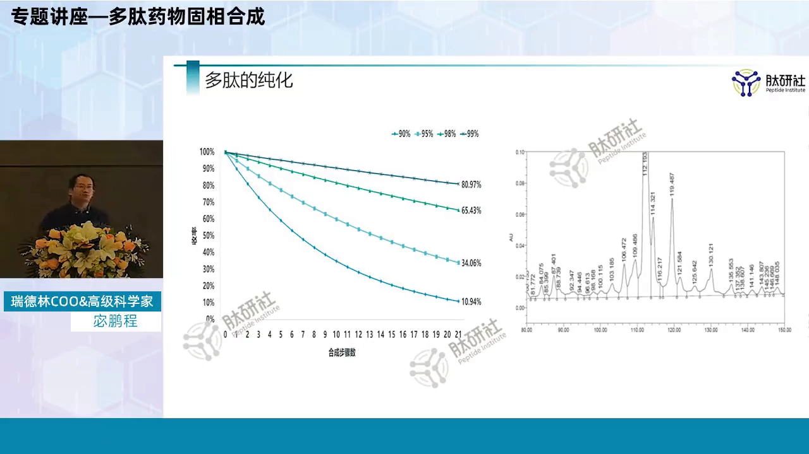

### 1.2 39 肽的真实结果：优化之后依然是"一锅粥"

讲者展示了一个 39 个氨基酸多肽的合成结果——注意，**这还是工艺优化之后的结果**：图上那个峰是我们要的东西，而周围有大量不想要的杂质峰。纯化的任务，就是把目标从这么多不想要的东西里拿出来。如果工艺不优化，杂质还会更多。

[【跳转到 01:41】](https://www.bilibili.com/video/BV1Ye4y1m7r9/?t=101)

## 二、反相纯化：产业化主流的"疏水分层"

### 2.1 为什么不用蛋白纯化的老办法

蛋白的纯化方式其实不少——文献里常见**凝胶过滤、离子交换、疏水、亲和**，按蛋白特性各取所需。但多肽产业化真正大量使用的是**反相**；离子交换只用在**前端粗纯**。原因是成本账：

- 离子交换树脂价格较低，适合粗纯、降低整体成本；
- 反相树脂平均接近 **2 万元一公斤**，而大型制备设备一填就是**几十公斤**——光填料就是几百万的投入。

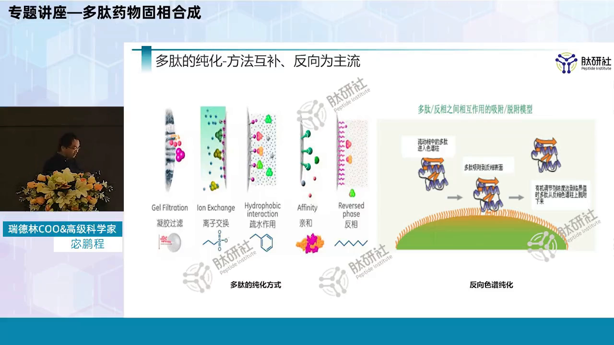

[【跳转到 02:56】](https://www.bilibili.com/video/BV1Ye4y1m7r9/?t=176)

### 2.2 反相原理：一个比喻讲清楚

把粗肽用溶剂或水溶解后，上样到反相载体（也是小球状的树脂）上：

1. 多肽分子与球体表面的**官能团临时性（非共价）结合**；
2. 全部结合后，用**不同浓度的有机溶剂**去冲洗；
3. 反相填料对不同结构多肽的（疏水性）变化**敏感度非常高**——有机溶剂浓度变化一点点，就可能洗出特定的产物；
4. 于是想要的与不想要的分子**一层一层、相对分批地**被洗下来。

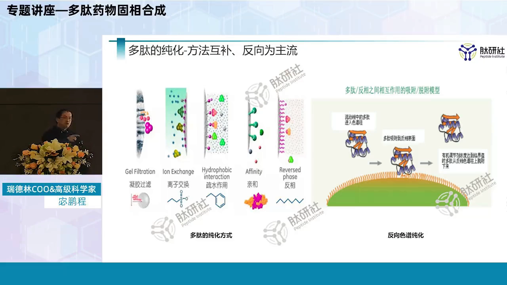

敏感度高，正是"分离成为可能"的前提：只要一点点地变化溶剂浓度，目标与杂质就能分得比较清楚。

[【跳转到 04:36】](https://www.bilibili.com/video/BV1Ye4y1m7r9/?t=276)

### 2.3 填料与色谱柱：一组要认识的参数

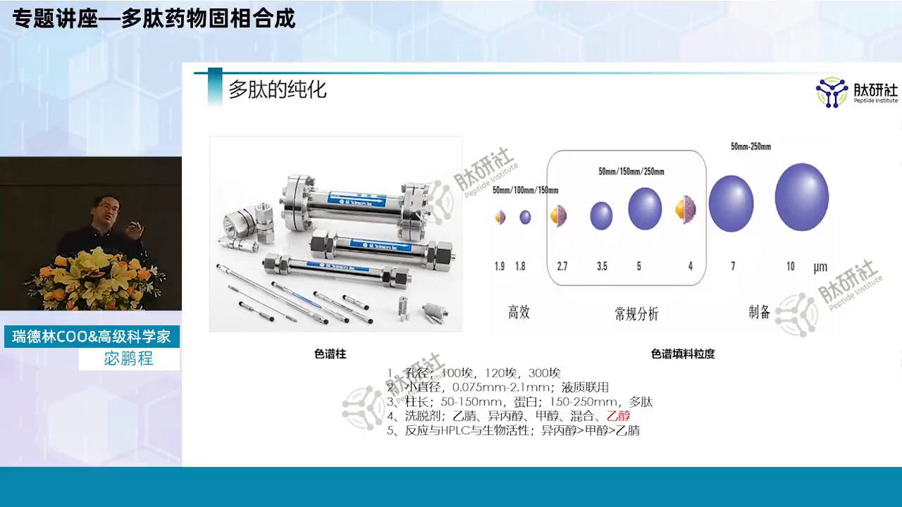

反相树脂在形态上与固相合成树脂相像，都是小微粒。参数体系如下：

- **粒径**：常见 1.7~20~30 微米，不同大小用于不同领域。**制备填料常用 8~12 微米**；30~50 微米的大粒径便宜但分离差，只做前端粗分离；2.7~5 微米的小粒径灵敏度高，是分析柱用——做制备则"不经济"，价格会离谱；
- **耐压**：球体越做越小（2.7、1.7 微米），能承受更大压力，于是从 HPLC（高效液相）走向 **UPLC（超高效液相）**，分离更灵敏、分析效果更好；
- **孔径**：普遍 80~120 Å，结构较大的多肽有用到 300 Å 的；孔径的存在是分离的前提；
- **柱内径**：分析柱标准化是 4.6 mm，且有变小趋势——用样更少、扩散效应更小、精度更高，还适合**与质谱联用**（液相出来直接进质谱）；
- **柱长**：蛋白约 5~15 公分、多肽约 15~20 公分。理论上多肽的吸附与分离主要集中在**柱子上段**（样品与树脂刚接触的部分），柱子填得再长效果也不突出，所以无论检测还是制备，大多 **≤25 cm**。

[【跳转到 06:16】](https://www.bilibili.com/video/BV1Ye4y1m7r9/?t=376)

### 2.4 洗脱剂：乙腈是主力，乙醇是备胎

常用的洗脱剂是**乙腈、异丙醇、甲醇**，或其中几种的混合；也有报道用乙醇——讲者团队对结构简单的产品试过，能用，但分离效果确实比乙腈差一点。

[【跳转到 10:01】](https://www.bilibili.com/video/BV1Ye4y1m7r9/?t=601)

## 三、反相的代价与经验壁垒

### 3.1 对多肽结构的损伤：反相不是免费的

多肽除了序列（一级结构），真正作为药物起效的是它的**复杂结构甚至三级结构**。而反相纯化——尤其是乙腈体系——**对多肽结构是很大的损伤**。所以蛋白药物的制备并不全部使用反相：像胰岛素的制备，很多步用离子交换等方式，**到最后一步才用反相**。

由此得出一条纪律：**整个产品不要和乙腈或其他有机溶剂接触太长时间，尽早尽快把它分离掉**。

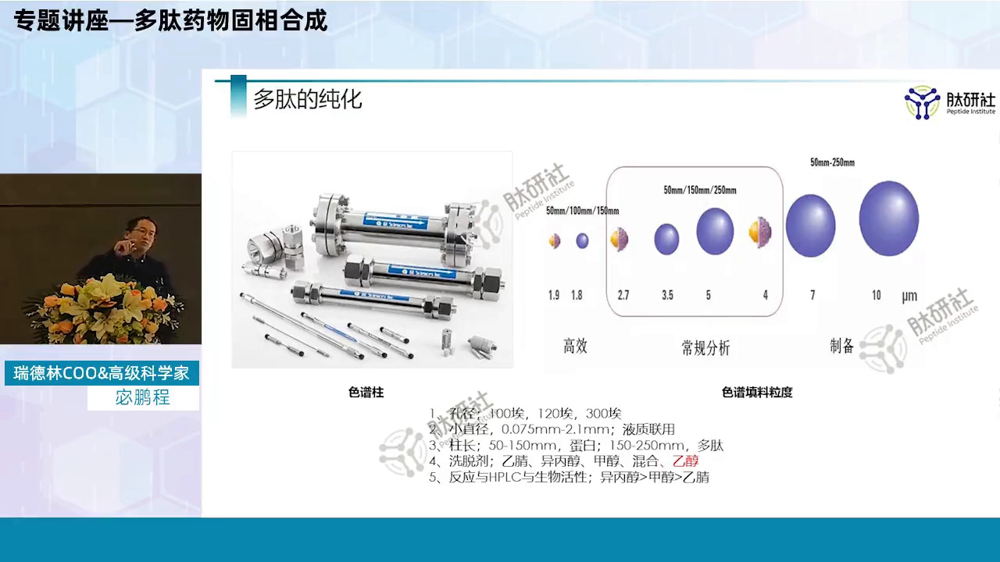

[【跳转到 11:16】](https://www.bilibili.com/video/BV1Ye4y1m7r9/?t=676)

### 3.2 溶剂对生物活性的影响排序

比较三种常用溶剂对生物活性的影响（从小到大）：

| 溶剂 | 对活性影响 |
| --- | --- |
| 异丙醇 | 最小 |
| 甲醇 | 相对小 |
| **乙腈** | **反而最大** |

但现实中大多数企业乙腈用得最多——因为它**分离效果更好**。这又是一处效果与代价的权衡。

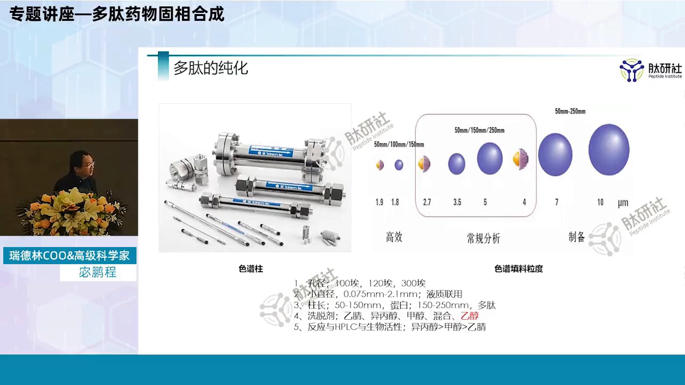

[【跳转到 12:06】](https://www.bilibili.com/video/BV1Ye4y1m7r9/?t=726)

### 3.3 制备设备的规模与风险

制备柱直径从 5、10、15、30、45、60 到 100 cm……讲者了解的目前用在多肽上的最高约 **120 cm（1.2 米直径）**。1 米、1.2 米的柱子看起来只是数字，实际上非常大——一次填料就要**几百万投入**，而且有"做砸了、工艺升级了、填料全部报废"的风险。大型制备液相，拼的是成本投入和风险控制能力。

### 3.4 检测图与制备图：一对必须理解的矛盾

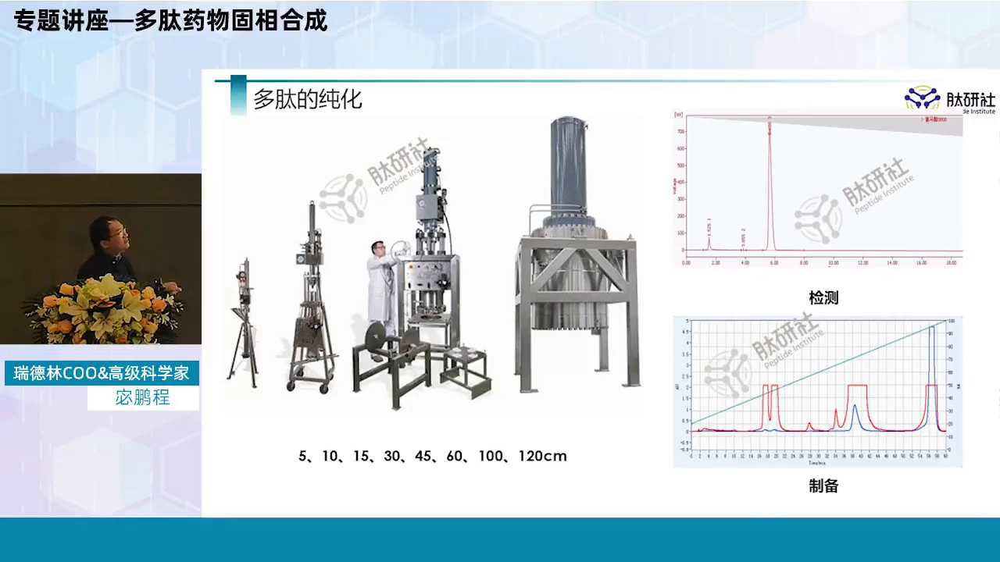

- **检测图**（分析）：理想形态是**单一、尖锐、对称**的峰——它代表单一物质；
- **制备图**：恰好相反。制备图谱上看到的往往是**平头的、过头的峰**（超出检测上限）——这才说明**树脂上样量用足了**。如果制备图也出漂亮小尖峰，说明上样量根本没到位，白白浪费柱容量。

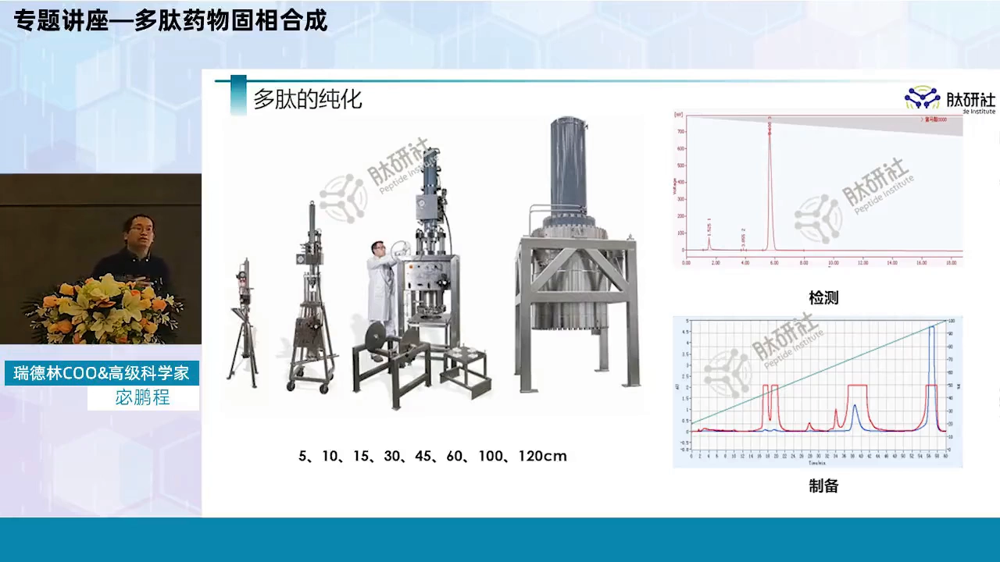

矛盾在于：上样量越高，检测"看清"的能力越低。上样 10 g 时旁边还能看到一个杂质峰；上样到 50 g，杂质就被包在主峰里**看不见了**——收集产物时你完全不知道该从哪个时间点开始收。

这就引出纯化的行业现实：**SOP 几乎不会把收集点写死**，很大程度上靠人的经验——有经验和没经验的纯化人员，收率能差 **10 倍之多**。培养一个纯化人员非常不容易：买得起设备的不多，进去一年都未必让你碰设备，真正有几年项目经验的人稀缺。

[【跳转到 14:33】](https://www.bilibili.com/video/BV1Ye4y1m7r9/?t=873)

## 四、冻干：从液体到可保存固体的"升华"

### 4.1 为什么必须冻干

纯化拿到的高纯度产物还是液体——液体没法保存，多肽结构又容易变化。怎么变成固体？给高温高压？多肽怕热、怕湿、怕各种东西，这条路走不通。广泛应用的答案是**冻干（冷冻干燥）**：

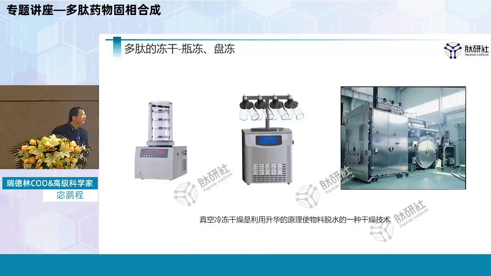

冻干本质上是一个**升华**过程：把液体冻成冰，然后在真空下让冰**直接从固态变成气态**抽走，跳过液态。这样对产品结构的影响被降到最低。

代价是**耗能**：工业化冻干机开一台，耗电量非常大，成本很高。

[【跳转到 17:52】](https://www.bilibili.com/video/BV1Ye4y1m7r9/?t=1072)

### 4.2 实验室冻干机：瓶冻与盘冻

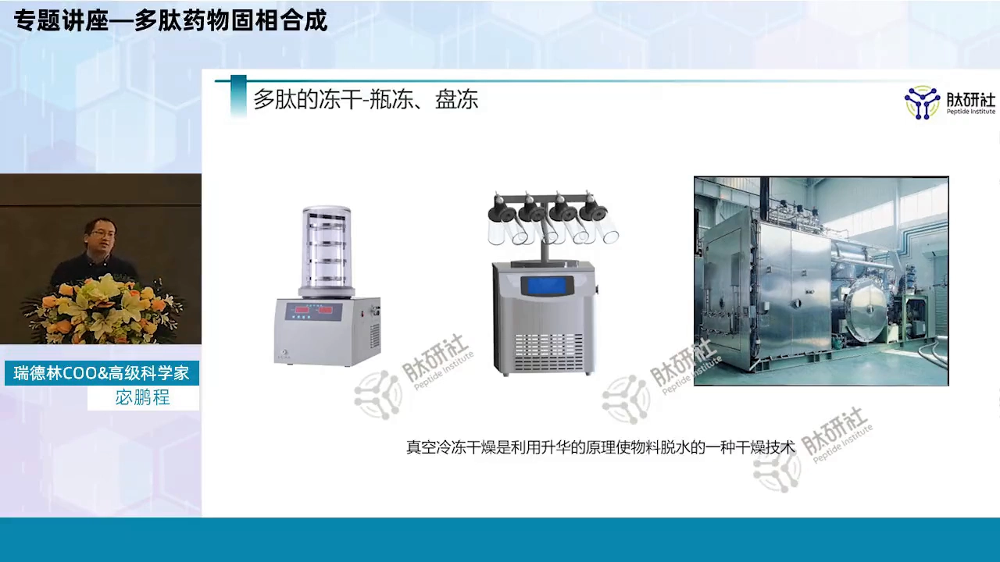

实验室冻干分两种方式：

- **瓶冻**：液体装瓶、冻成冰后升华。好处是不同产品互不干扰；缺点是瓶子容量小、体系温度不够低——冰相对容易熔化。哪怕冻到 -70℃，如果冻干要持续 24 小时以上而产品非常怕热，可能四五个小时后就熔了，熔化后冻干效果非常差；
- **盘冻**：放到盘子里冻干，主要取决于生产规模——规模化产品基本都用盘冻（实验室那么多样品，得用多少瓶子？）。

另一种实验室设备内置**冷阱**（约 -60℃），保证整个体系处于较低温度，尽量保护产品结构。

[【跳转到 18:17】](https://www.bilibili.com/video/BV1Ye4y1m7r9/?t=1097)

### 4.3 产业化冻干机：按平方算的"电老虎"

产业化冻干设备按**冻干面积（平方米）**计：两平、三平、十平……**十平已经很大**。但十平的冻干机一次一批未必能出 10 kg——比起传统烘干等方式，其实**很不经济**；而且大型冻干一般要持续**两天以上**，开冻干机前都得掂量一下电费。

[【跳转到 20:22】](https://www.bilibili.com/video/BV1Ye4y1m7r9/?t=1222)

### 4.4 好冻干 vs 坏冻干：一眼可辨

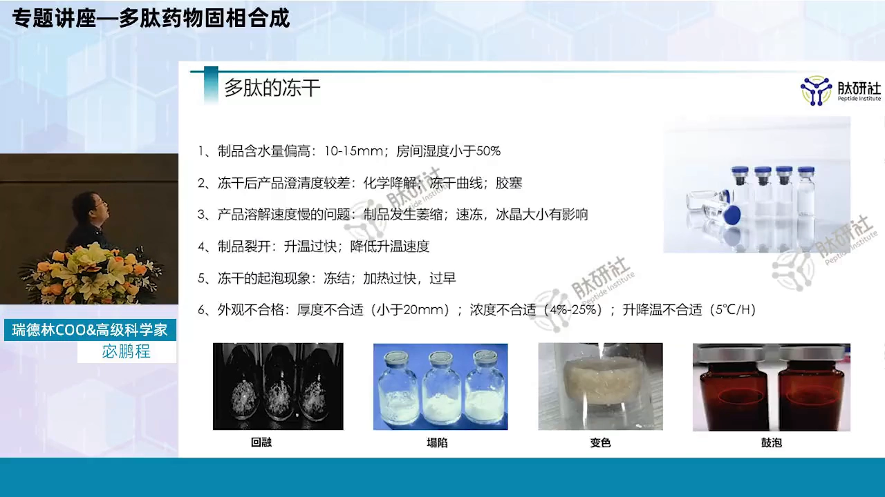

- **好的冻干结果**：冻干后的固体面与原液面几乎平齐，表面平整、不松散、不结块；
- **控制不好**：会出现"毁容"——**晶体状坍塌**；更严重的是**回熔**，可以理解为更大程度的坍塌，最厉害时几乎看不到东西；还可能**变色、鼓泡**——这些都是实际生产中真实发生过的。

[【跳转到 23:16】](https://www.bilibili.com/video/BV1Ye4y1m7r9/?t=1396)

## 五、冻干问题清单与参数控制

冻干这个环节在多肽原料药领域长期不被重视——大家拿到固体往往只关心纯度够不够、水分是否在范围内，很少研究冻干过程对结构的影响。但影响是真实存在的。讲者给出一套问题清单：

### 5.1 问题一：含水量偏高

多肽要求结构长期稳定，一般产品水分含量要求 **≤5%**，特定产品要 **≤2%**，目的就是长期保存。而多肽非常容易吸水——刚从冻干机拿出来、接触空气就可能吸潮，甚至你没感觉到它已经吸了。控制措施：

- **盘冻料层高度 10~15 cm 为宜**（最好不要超 20 cm）——料层越高冻干时间越长、坍塌风险越高；
- **取样房间湿度 <50%**——讲者所在深圳湿度经常高于 90%，从箱体拿出来就开始吸水；需要用除湿等方式控制取样与分装环境，否则产品当时没问题，**长期稳定性实验**时就会出问题。

[【跳转到 25:21】](https://www.bilibili.com/video/BV1Ye4y1m7r9/?t=1521)

### 5.2 问题二：冻干后澄清度差

冻干前液体澄清度很好，复溶后却变浑浊（甚至存放一两个月后）。两个可能原因：

1. **化学降解**：溶液与瓶体（玻璃）持续接触，玻璃中的**碱性成分、重金属成分**可能与产品结合、**络合**——情况不多，但确实碰到过玻璃碱性成分与产品结合的案例。多肽之所以是药，就因为质量控制严格，**不能接受这种微小含量的差异**；
2. **冻干曲线**：行业内普遍不重视——很多产品只有一条曲线"通吃"所有产品。但曲线制定不好，哪怕质量不变，**外观绝对受影响**。

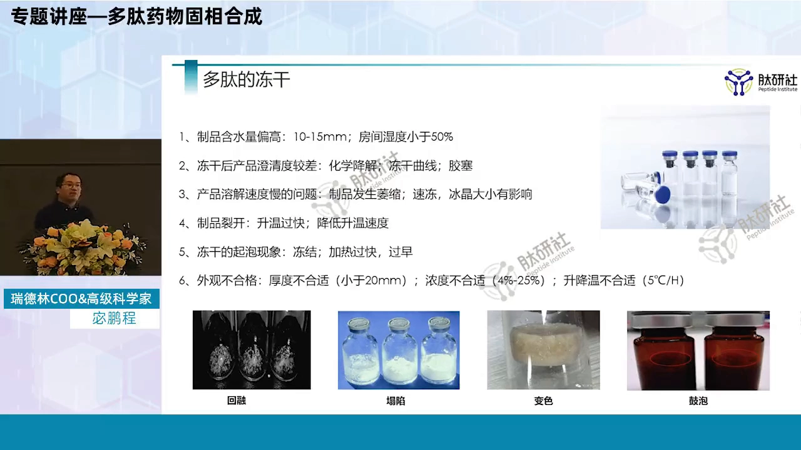

### 5.3 两段程序与胶塞陷阱

产业化冻干机分两个程序，和实验室"死命抽真空"不同：

- **一次干燥（主干燥）**：不断提高真空度，把**游离水**抽掉；
- **二次干燥**：升温，把**结合水**去掉。

冻干曲线设定不合理，可能出现起泡、熔化，最严重的出现**烧结**。

[【跳转到 27:51】](https://www.bilibili.com/video/BV1Ye4y1m7r9/?t=1671)

另一个反直觉的坑是**胶塞**：胶塞和液体不直接接触，能有什么影响？但在**高真空环境下，胶塞的成分会扩散**——时间长了可能扩散进样品。这不是危言耸听：特别是国产胶塞，只要橡胶本身成分不好，胶塞质量一定有问题，扩散成分与样品接触后容易产生你不想要的东西。

### 5.4 问题三：溶解度变慢——冰晶说了算

有的产品冻干前很好溶，冻干后溶解变慢。原因是冻干过程中**形成冰晶的大小**对后期溶解影响非常大：冰晶是维持外观形态的重要因素。如果第一次冻干中发生熔化，把盘子拿出来放冰箱冻实再二次冻干——大部分产品经过这样反复，**形态一定不好**，因为熔化与重新冻结的过程中冰晶在坍塌。

### 5.5 问题四：裂开与起泡

- **裂开**：升温速度过快——一次干燥还没到位就进入二次干燥，产品就容易分裂；
- **起泡**：加热过快、过早；或外观（料层）太厚——厚到在过程中无法保持一直冻结，外观没熔但**内部冰晶一再坍塌**；或浓度不合适。

冻干的大前提：**冻的是冰疙瘩，一定要冻得实在——从里到外都冻实**。因为升华是"固态直接变气态"，一旦熔化就变成蒸发，蒸发不仅达不到效果，还会产生气泡。

[【跳转到 30:46】](https://www.bilibili.com/video/BV1Ye4y1m7r9/?t=1846)

### 5.6 浓度与升降温速度：两个关键旋钮

- **浓度**：重量浓度在 **4%~25%**、尽量 10% 左右。太稀——冻干后量太小会"发飘"，称量时满盘飘；太浓——冻不厚、冻不实，还容易出很干的结块；
- **升降温速度**：一次、二次干燥过程中保持合适的升降温速度，一般 **5℃/小时**比较合适。二次干燥温度控制每差一度，整个干燥的耗电量可能增减约 **13%**——形态好看与电费之间，就是一个"平衡"的学问。

## 小结

- 固相合成的累积效应（0.99³⁰）决定粗肽必然是混合物：39 肽优化后目标产物占比仍可能不足 10%。
- 产业化纯化主流是反相：靠填料对多肽疏水差异的高敏感度分层洗脱；离子交换只做前端粗纯。
- 填料参数决定用途：8~12 μm 做制备，2.7~5 μm 做分析；柱长多肽 15~20 cm 即可，吸附分离集中在柱子上段。
- 反相（尤其乙腈）对多肽复杂结构有损伤——尽量缩短接触时间；溶剂活性影响排序为异丙醇 < 甲醇 < 乙腈。
- 制备图的"平头峰"才是上样量用足的标志；杂质被包进主峰后看不见，收集点靠经验——有经验与没经验收率差 10 倍。
- 冻干 = 升华：跳过液态、对结构影响最小的固液转换；实验室瓶冻易熔、产业化盘冻按平方算且极不经济。
- 冻干四大失败模式：含水量偏高、复溶澄清度差、溶解变慢、裂开/起泡——对应料层高度、湿度控制、冰晶保护、两段干燥曲线等参数。
- 胶塞在高真空下会向样品扩散成分——"不接触"不等于"没影响"。

## 关键术语速查

| 术语 | 一句话解释 |
| --- | --- |
| 累积效应 | 每步偶联率的损失随肽长指数放大，0.99³⁰ < 75% |
| 困难序列 | 某一步偶联显著变慢变差的序列，单步 <50% 几乎无法继续 |
| 反相（RP）HPLC | 以疏水差异分离多肽的色谱方法，多肽产业化纯化主力 |
| 制备填料 | 用于放大纯化的树脂，常用 8~12 μm |
| 平头峰 | 上样量超载形成的平顶峰，制备中是"上样足"的标志 |
| 冻干（冷冻干燥） | 通过升华把液体直接变固体的干燥方式 |
| 一次干燥 / 二次干燥 | 先抽游离水、再升温去结合水的两段程序 |
| 回熔 | 冻干中产品温度过高导致的熔化-坍塌失败模式 |
| 麦氏浊度（McFarland） | 细菌悬液浓度的标准参照（本系列第 4 讲的姊妹方法亦用到 0.5 麦氏） |
| 冻干曲线 | 预冻-一次干燥-二次干燥的温度/真空程序，决定外观与能耗 |
