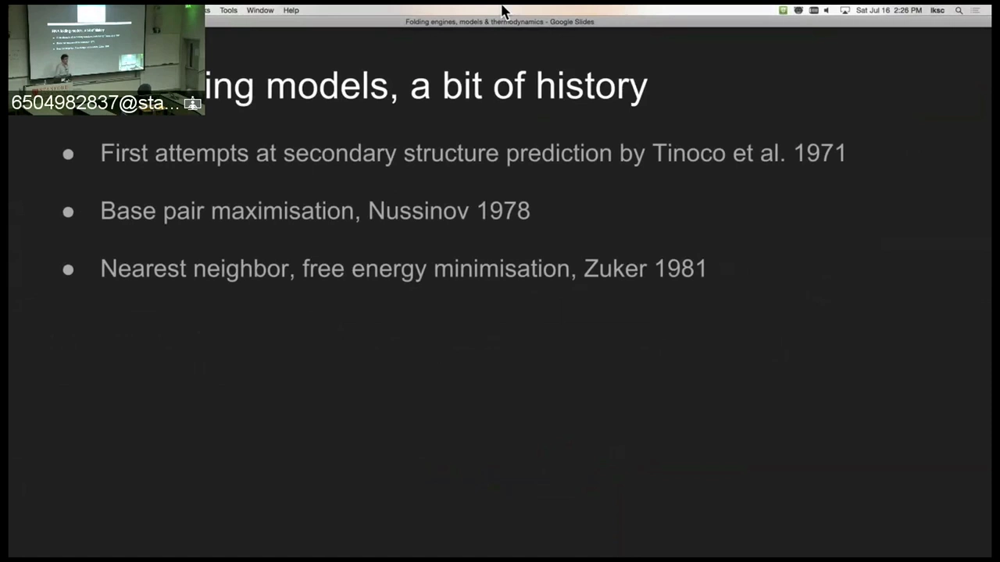
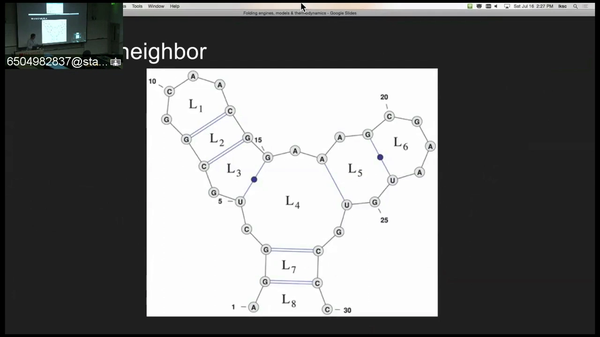
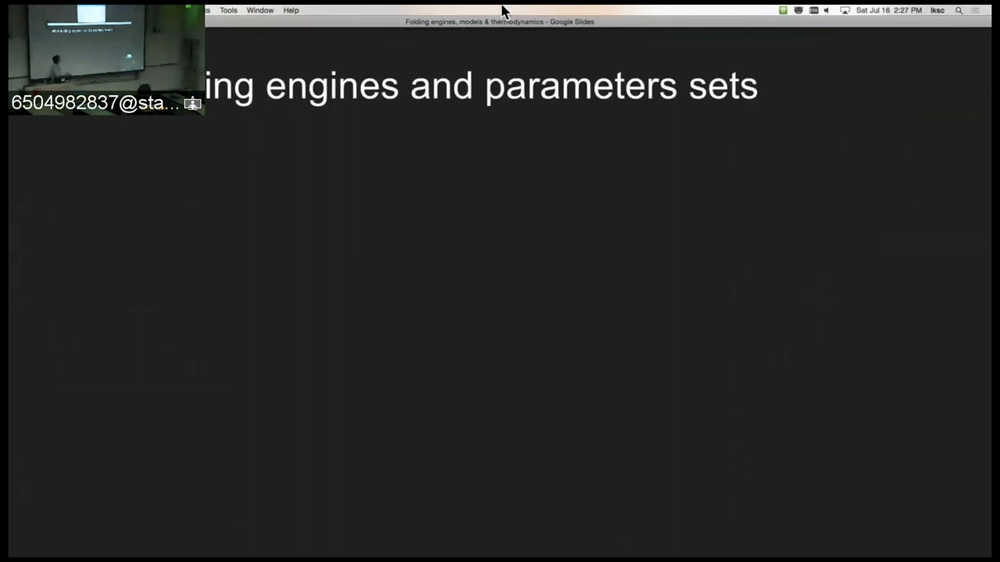
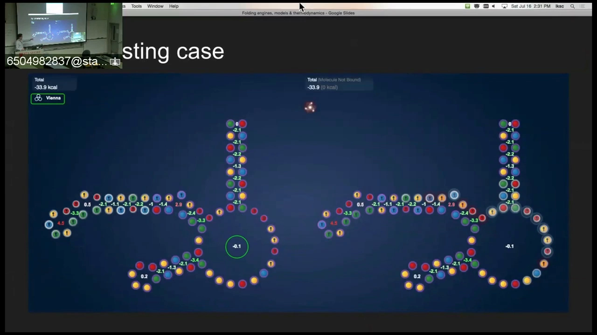
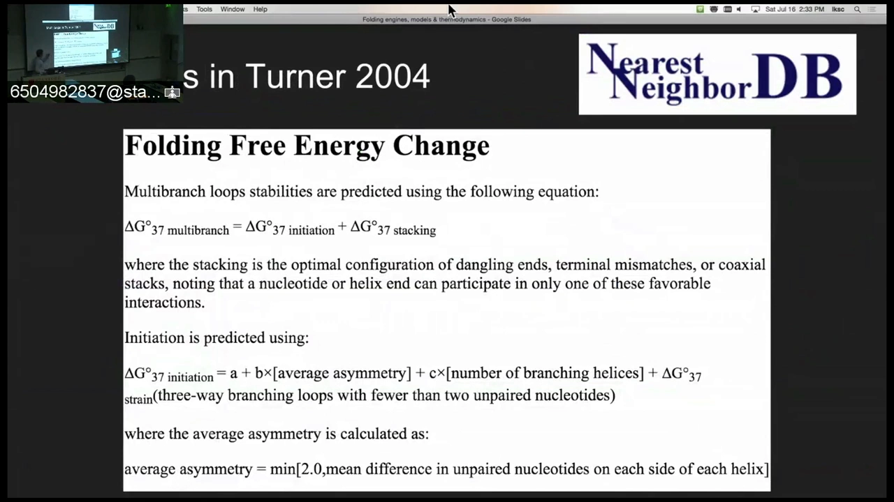
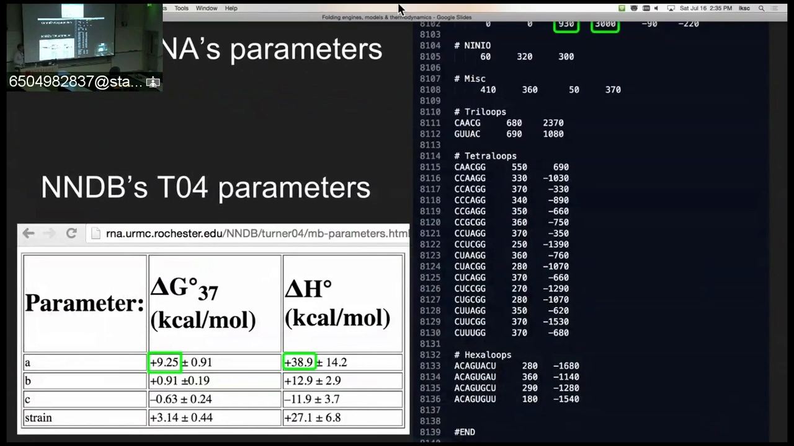
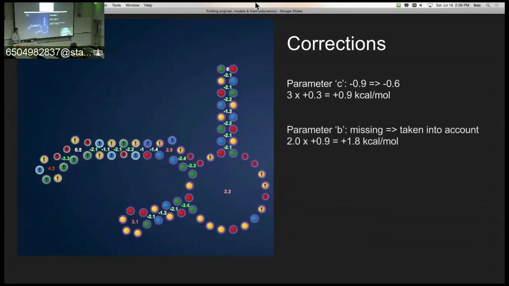
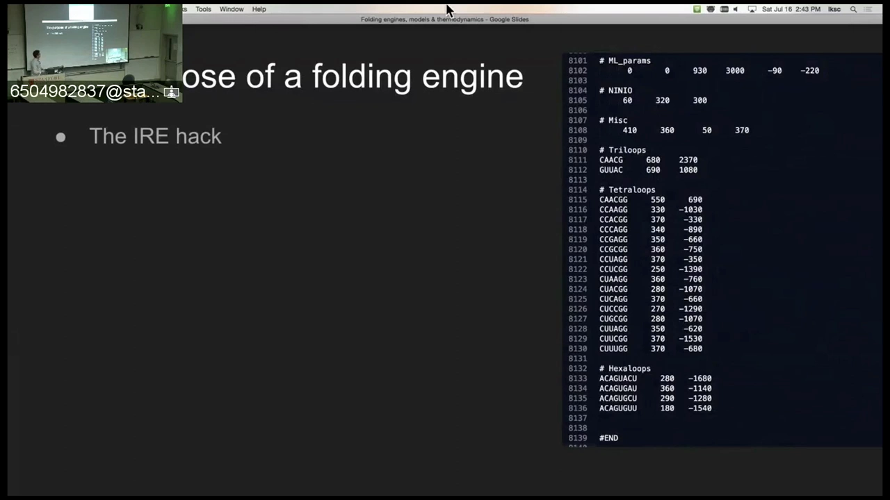
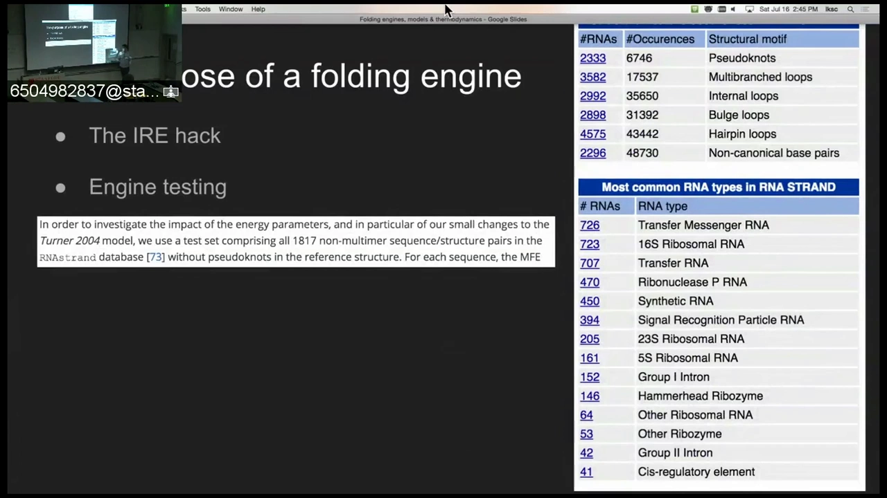
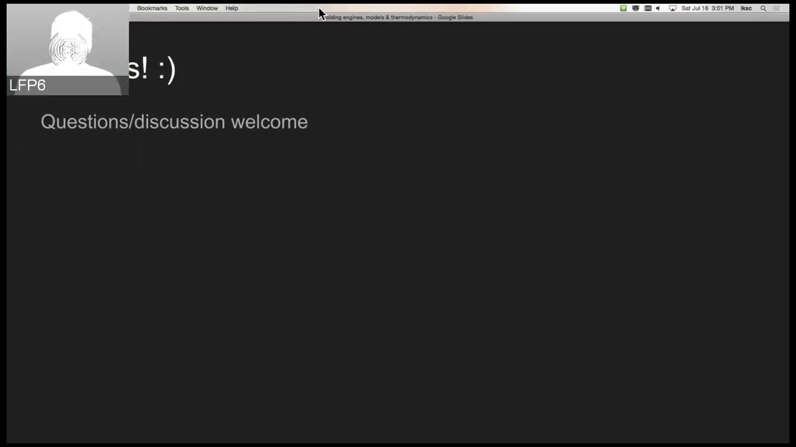

# 折叠引擎、热力学模型与"2 kcal 的陷阱"：RNA 设计玩家的引擎对账实录

> 视频来源：[YouTube《Folding engines, models & thermodynamics》](https://www.youtube.com/watch?v=mmdiGHgwYko)（约 39 分 08 秒，Eternacon 2016，Eterna 玩家/引擎贡献者 Nando 主讲）
> 本文基于视频演说图文稿撰写，观点与数据均可回看视频核对。

## 本讲要解决的核心问题（SCQA）

**背景**：在 RNA 设计游戏 Eterna 里，玩家靠游戏内置"折叠引擎"给出的 kcal 数字判断设计好坏；这些引擎不是玩具，而是真实科研软件——ViennaRNA、RNAstructure、NuPACK，以及它们背后的最近邻热力学模型。

**冲突**：同一个多分支环（multiloop），三个引擎给出 −0.1、+2.3、+5.6 kcal 三种截然不同的预测；而核糖开关（riboswitch）类设计的成败，恰恰取决于 2~3 kcal 量级的能量差。

**疑问**：谁对？分歧的根子在哪里？玩家和初学者该怎么对待引擎输出的数字？

**回答（中心思想）**：把最近邻模型的参数逐项对账（Turner 2004 文献值 vs ViennaRNA 源码值）就能找到根因——ViennaRNA 有意不实现"不对称校正"与"3 分支环附加罚分"这两项 Turner 2004 特性，把本应约 +5 kcal 的多分支环系统性低估到 +2.3 kcal。参数可以换（Eterna 已有 API 支持上传参数集），但"特性"必须改动态规划代码——这决定了"调参"和"改引擎"是两件完全不同的事。

## 一、游戏里的 kcal 从哪来：什么是折叠引擎

讲者 Nando 是 Eterna 的资深玩家、折叠引擎的贡献者（游戏内 ID ElNando88）。开场他就给了两条忠告（[00:10](https://www.youtube.com/watch?v=mmdiGHgwYko&t=10)）：一是做科学要"怀疑一切"；二是他自己不是科学家，请听众对他的内容也保持一分怀疑。这份坦诚贯穿全场：他讲的不是教科书，而是自己修引擎时"踩到的东西"。

游戏里每次修改序列时实时跳动的 kcal 数字，来自真实的 RNA 折叠预测软件；这些软件实现的是同一个理论框架——**最近邻热力学模型**。理解了这个模型的参数与特性，才能判断"引擎说的"到底能信几分。

## 二、一部简史：从"最多配对"到 Zuker 的 MFE 再到配分函数

视频用三步把 RNA 折叠预测的模型史串了起来（[01:05](https://www.youtube.com/watch?v=mmdiGHgwYko&t=65)）：

1. **70 年代·最早的尝试**：Tinoco 等人提出按碱基堆积等最近邻作用估计稳定性的思路；更简单的方案是"**最大碱基对数**"（base pair maximization）——只要数最多能配多少对（[01:30](https://www.youtube.com/watch?v=mmdiGHgwYko&t=90)）。
2. **1981 年·Zuker 的自由能最小化**：Zuker 提出基于**自由能最小化**的模型，也就是今天所说的**最近邻模型**（nearest neighbor model）；当时它只算 MFE（最小自由能）结构（[01:55](https://www.youtube.com/watch?v=mmdiGHgwYko&t=115)）。
3. **90 年代·McCaskill 的配分函数**：McCaskill 把它发展成完整的**配分函数**（partition function），给出了一个 RNA 所有结构的热力学**系综**（ensemble）图像——预测从"单一最优解"升级为"整个概率分布"（[02:20](https://www.youtube.com/watch?v=mmdiGHgwYko&t=140)）。

## 三、最近邻模型：环区是独立计价的能量单元

最近邻模型的核心思想（[02:45](https://www.youtube.com/watch?v=mmdiGHgwYko&t=165)）：考察由碱基对和骨架围出来的一个个"环区"（loop areas），把每个环区定义为**独立的能量单元**，给它赋予一个自由能贡献——游戏里显示的那些 kcal 就是它们（[02:50](https://www.youtube.com/watch?v=mmdiGHgwYko&t=170)）。每个单元各有自己的参数（发夹环、内环、多分支环、堆积……），整个结构的自由能就是各单元之和。

## 四、Eterna 的引擎阵容与参数集

Eterna 历史上先后接入过多套引擎（[03:28](https://www.youtube.com/watch?v=mmdiGHgwYko&t=208)）：

- **ViennaRNA v1**：最早的引擎，随附 **Turner 1999** 参数集；
- **RNAstructure**：后来整合的第二台引擎，默认 **Turner 2004** 参数集（[03:53](https://www.youtube.com/watch?v=mmdiGHgwYko&t=233)）；
- 备选模型：**Andronescu 2007** 等（Nando 测试过一些）；
- **NuPACK**：后期加入，能算热力学量；但它默认用一套 **1995 年**的参数（[04:18](https://www.youtube.com/watch?v=mmdiGHgwYko&t=258)）。

还有一桩"焓参数之谜"：焓（enthalpy）参数用于计算熔点、评估温度变化的影响，**Turner 1999 根本没有焓参数**，所以 NuPACK 里算不了；可 ViennaRNA 里"不知从哪来"地有一套（[04:43](https://www.youtube.com/watch?v=mmdiGHgwYko&t=283)、[05:08](https://www.youtube.com/watch?v=mmdiGHgwYko&t=308)）。连 Nando 都说不清其出处——参数集的来龙去脉，有时连重度用户都是雾里看花。

## 五、一个惊人的案例：同一多分支环，三个引擎三个答案

Nando 拿出一个**经实验室验证**的谜题设计（Eterna 玩家提交、送去实测过的设计）做案例，把各家引擎对同一序列的预测逐个过了一遍（[05:58](https://www.youtube.com/watch?v=mmdiGHgwYko&t=358)）。焦点是其中一个**多分支环**（multiloop，三条以上茎汇聚的分支点）：

| 引擎 | 对该多分支环的评估 | 直观解读 |
| --- | --- | --- |
| ViennaRNA v1 | **−0.1 kcal** | 说它"基本稳定"——做实验室的人一看就会竖起眉毛（[06:23](https://www.youtube.com/watch?v=mmdiGHgwYko&t=383)） |
| ViennaRNA v2 | **+2.3 kcal** | 说不稳定，但程度存疑（[07:13](https://www.youtube.com/watch?v=mmdiGHgwYko&t=433)） |
| NuPACK | **+5.6 kcal** | 说它非常不稳定（[07:38](https://www.youtube.com/watch?v=mmdiGHgwYko&t=458)） |

Vienna 系引擎对 junction/multiloop 的评估"有问题"其实由来已久；同一结构在 v1 里连悬摆末端（dangling ends）都被算成稳定，就更怪了（[06:48](https://www.youtube.com/watch?v=mmdiGHgwYko&t=408)）。理论上，默认 Turner 2004 的 RNAstructure 应该是对的（[08:03](https://www.youtube.com/watch?v=mmdiGHgwYko&t=483)）。

**为什么这事致命**：核糖开关设计玩的正是 2~3 kcal 的能量游戏——设计者要在"两种构象能量接近"的窄区间里做文章（[15:22](https://www.youtube.com/watch?v=mmdiGHgwYko&t=922)）。同一多分支环被评成 +2.3 还是 +5.6，开关"能不能工作"的结论会完全反过来。

## 六、拆开参数对账：Turner 2004 文献值 vs ViennaRNA 源码

要弄清谁对，Nando 去翻了公开的 **Nearest Neighbor Database**（[08:28](https://www.youtube.com/watch?v=mmdiGHgwYko&t=508)），把 Turner 2004 多分支环的起始 ΔG 公式拆开。忽略堆积、错配、共轴堆积等修正，只看起始项，共有三个关键参数（[09:07](https://www.youtube.com/watch?v=mmdiGHgwYko&t=547)）：

- **a**：常数项，多分支环的"基础不稳定性"，约 **9.25 kcal**；
- **b**：**平均不对称校正**——比较每条螺旋两侧未配对段长度的差异（例如一边 1 个、另一边 12 个，差为 11），取平均；超过 2.0 的一律按 2.0 封顶（[09:50](https://www.youtube.com/watch?v=mmdiGHgwYko&t=590)、[10:15](https://www.youtube.com/watch?v=mmdiGHgwYko&t=615)）；
- **c**：与**分支螺旋数**相关的项，通常是稳定项，每个分支约 **−0.6 ~ −0.8 kcal**（[10:35](https://www.youtube.com/watch?v=mmdiGHgwYko&t=635)）。

接着他把 Turner 2004 发表的参数与 ViennaRNA 源码里的数值**逐点对比**。注意单位换算：文献值是 kcal，ViennaRNA 源码文件里是 decacal（差 100 倍）（[11:05](https://www.youtube.com/watch?v=mmdiGHgwYko&t=665)、[11:30](https://www.youtube.com/watch?v=mmdiGHgwYko&t=690)）。对账结果：

- **a 吻合**：930 vs 9.25，在换算误差内；
- **c 有偏差**：Turner 值约 −0.6/−0.8，ViennaRNA 是 −0.90——**每个分支差 0.3 kcal**（[12:31](https://www.youtube.com/watch?v=mmdiGHgwYko&t=751)）；
- **焓差异常**：对应项 ViennaRNA 给 −2 kcal，而按 Turner 2004 应该是 −11 ~ −12，完全不在误差范围内（[12:56](https://www.youtube.com/watch?v=mmdiGHgwYko&t=776)）。

## 七、根因：被有意省略的"特性"

真正的大发现是：**不对称因子 b 在 ViennaRNA 引擎里根本不存在**（[13:21](https://www.youtube.com/watch?v=mmdiGHgwYko&t=801)）。而这并非 bug——2011 年 ViennaRNA 发布新版本的论文里写明，他们有意不实现一些"高度特化的配置"（highly specialized configurations），多分支环的平均不对称校正罚分正是其中之一（[13:51](https://www.youtube.com/watch?v=mmdiGHgwYko&t=831)、[14:04](https://www.youtube.com/watch?v=mmdiGHgwYko&t=844)）。同样缺失的还有一项：**3 分支环且只含至多 1 个未配对碱基**这种极受限构型的附加罚分——Turner 2004 规定要罚，ViennaRNA 没实现（[14:21](https://www.youtube.com/watch?v=mmdiGHgwYko&t=861)）。

把账重新算一遍：案例中的三分支环，分支数修正约 0.9 kcal，不对称校正再罚约 1.x kcal——总不稳定性应在 **+5 kcal 量级**，而不是 ViennaRNA 报的 +2.3（[14:57](https://www.youtube.com/watch?v=mmdiGHgwYko&t=897)）。对要在 2~3 kcal 区间里切换构象的核糖开关来说，这足以"完全带偏"设计判断（[15:22](https://www.youtube.com/watch?v=mmdiGHgwYko&t=922)）。

## 八、为什么基准测试发现不了：IRE 特例与天然序列偏差

### 8.1 引擎里还藏着"特例后门"

Nando 还指出了引擎里一个可疑设计：为**铁响应元件**（IRE, iron responsive element）六元环（hexaloop）单独加的特例 boost——他称之为 "IRE hack"（[17:52](https://www.youtube.com/watch?v=mmdiGHgwYko&t=1072)）。IRE 是人类和哺乳动物基因组里数千个基因非翻译区（UTR）都有的信号序列，参与铁代谢调控，能结合 IRP 蛋白（[18:17](https://www.youtube.com/watch?v=mmdiGHgwYko&t=1097)、[19:32](https://www.youtube.com/watch?v=mmdiGHgwYko&t=1172)）。他的质疑是：一个特定的生物信号，凭什么在通用折叠引擎里拥有专属的例外参数？（[18:42](https://www.youtube.com/watch?v=mmdiGHgwYko&t=1122)）

### 8.2 基准分数的"天然序列偏差"

软件评价有两条线：一是纯性能（内存、速度）；二是**特异性/敏感性**——通常在 **RNA STRAND 数据库**等目标集上测试打分（[20:18](https://www.youtube.com/watch?v=mmdiGHgwYko&t=1218)）。问题在于：数据库里全是**天然 RNA**，而 Eterna 玩家设计的序列不是天然存在的——参数在天然序列上"调到分数最好"，对人工设计未必合适（[20:43](https://www.youtube.com/watch?v=mmdiGHgwYko&t=1243)、[21:33](https://www.youtube.com/watch?v=mmdiGHgwYko&t=1293)）。

更妙的是：**多分支环恰好是天然 RNA 里样本最少的结构元件**——信息最少，就算在那里"玩错"也不怎么影响基准分数（[21:58](https://www.youtube.com/watch?v=mmdiGHgwYko&t=1318)）。这解释了为什么第七节里那类系统性偏差能长期存在。

## 九、能改什么、不能改什么：参数可以换，特性必须改代码

### 9.1 玩家层面：把引擎"调悲观"

Nando 自己的做法是把参数改保守，给设计打上 "pessimistic"（悲观）标签——对多分支环的折叠、对 FMN 配体结合都做悲观处理（[22:47](https://www.youtube.com/watch?v=mmdiGHgwYko&t=1367)）。这是普通玩家不碰源码也能落地的自我保护。

### 9.2 参数可以上传：Eterna 的 scripting API

参数层面其实有"暗门"：Eterna 的脚本接口（scripting interface）有 API 支持向指定引擎上传自定义参数集——Nando 已经在 Vienna 上试成，只待文档完善、大家知道自己在调什么（[36:07](https://www.youtube.com/watch?v=mmdiGHgwYko&t=2167)）。

### 9.3 特性必须改动态规划代码

但"特性"（比如把不对称罚分加进去）完全是另一回事：动态规划引擎分两步——**填大表 + 回溯**，极其精细；想在运行中动态增减能量特性，插件式系统几乎不可行（[34:52](https://www.youtube.com/watch?v=mmdiGHgwYko&t=2092)、[35:17](https://www.youtube.com/watch?v=mmdiGHgwYko&t=2117)）。一个现实案例是配体结合：Nando 自研了一个 hack，结果被 ViennaRNA 2.2+ 里更通用的 **soft constraints** 实现"截胡"（[24:27](https://www.youtube.com/watch?v=mmdiGHgwYko&t=1467)、[24:52](https://www.youtube.com/watch?v=mmdiGHgwYko&t=1492)）——官方以更通用的方式把同类需求做进了引擎。

### 9.4 为什么只能用动态规划：复杂度天花板

有玩家设想"自带模型"（bring your own model）：平台提供通用的能量模型接口，玩家自定义参数、甚至假设"这个多分支环少稳定一点会怎样"并即时测试（[33:37](https://www.youtube.com/watch?v=mmdiGHgwYko&t=2017)）。Nando 的回答很硬核：最近邻模型若不用动态规划，搜索复杂度是指数甚至阶乘级的；**DP 是目前唯一能把问题压到多项式时间（n³~n⁴，取决于具体算法）的路径**——这正是当年 Zuker 方案的天才之处（[37:22](https://www.youtube.com/watch?v=mmdiGHgwYko&t=2242)、[38:12](https://www.youtube.com/watch?v=mmdiGHgwYko&t=2292)）。要动"特性"，就得动 DP 的实现，工程量巨大（他自己梦想的面向对象引擎也因此迟迟难产，[23:37](https://www.youtube.com/watch?v=mmdiGHgwYko&t=1417)）。

### 9.5 引擎的工程现状

- Eterna 的三引擎都跑在 Flash 上：C 源码要经过已被废弃的 **Alchemy** 工具翻译成 Flash 字节码——三台引擎能同时工作，Nando 自称"奇迹"（[27:47](https://www.youtube.com/watch?v=mmdiGHgwYko&t=1667)）；
- ViennaRNA 正在提供**面向对象的 API**，最新版代码干净了不少，但刚发布 bug 多，他打算等几个月再深入（[28:37](https://www.youtube.com/watch?v=mmdiGHgwYko&t=1717)）；
- Eterna 积累的巨量玩家数据与实验室（如 RNAstructure 作者 David Mathews、Doug Turner 团队）存在互通机会——Mathews 甚至想做"修饰核苷酸"的能量模型；数据与渠道正在打通（[29:52](https://www.youtube.com/watch?v=mmdiGHgwYko&t=1792)、[30:17](https://www.youtube.com/watch?v=mmdiGHgwYko&t=1817)）。

## 小结

- **游戏里的每个 kcal 都来自真实科研软件**；它们共享"最近邻模型"这一框架：环区=独立计价单元。
- **模型进化三步曲**：70 年代最大配对 → 1981 Zuker MFE → 90 年代 McCaskill 配分函数（系综视角）。
- **同一多分支环，三个引擎三个答案**（−0.1 / +2.3 / +5.6 kcal）；对 2~3 kcal 区间做文章的核糖开关设计，这是生死攸关的差异。
- **对账方法可复制**：公开的 Nearest Neighbor Database + 源码逐点比对（注意 kcal vs decacal 换算）。
- **根因是"特性缺失"而非参数错误**：ViennaRNA 有意不实现不对称校正与 3 分支环罚分，把 ~5 kcal 低估成 2.3。
- **基准分发现不了**：天然 RNA 数据库 + 多分支环样本最少 → 偏差被分数掩盖；引擎里还有 IRE 这类特例 boost。
- **参数与特性是两码事**：参数可经 Eterna API 上传；特性要改 DP 代码；DP 是唯一多项式时间路径。

## 关键术语速查

| 术语 | 一句话解释 |
| --- | --- |
| 折叠引擎 | 实现 RNA 二级结构预测的软件（ViennaRNA、RNAstructure、NuPACK），Eterna 以其为游戏内核 |
| 最近邻模型 | 把结构拆成环区能量单元求和的热力学模型；1981 年由 Zuker 用于 MFE 预测 |
| MFE（最小自由能） | 热力学上最稳的单一结构；Zuker 算法的目标 |
| 配分函数 | McCaskill 提出：把所有可能结构的能量汇总成概率分布（系综） |
| 多分支环（multiloop） | 三条及以上茎汇聚的分支点；本讲分歧的核心元件 |
| Turner 1999 / 2004 | 两代标准能量参数集，以 Turner 实验室命名 |
| a / b / c 参数 | 多分支环起始 ΔG 的三项：基础不稳定性 / 平均不对称校正（上限 2.0）/ 每分支稳定项 |
| decacal | ViennaRNA 源码的能量单位，与 kcal 相差 100 倍，对账时必须换算 |
| IRE hack | 引擎为铁响应元件六元环加的特例稳定化参数 |
| RNA STRAND | 天然 RNA 二级结构数据库，常用作预测软件基准——天然序列偏差的来源 |
| soft constraints | ViennaRNA 2.2+ 引入的通用约束机制（如配体结合），"截胡"了玩家的自研 hack |
| 动态规划（DP） | 填表 + 回溯两阶段算法；把折叠预测从指数级压到多项式级（n³~n⁴）的唯一路径 |
