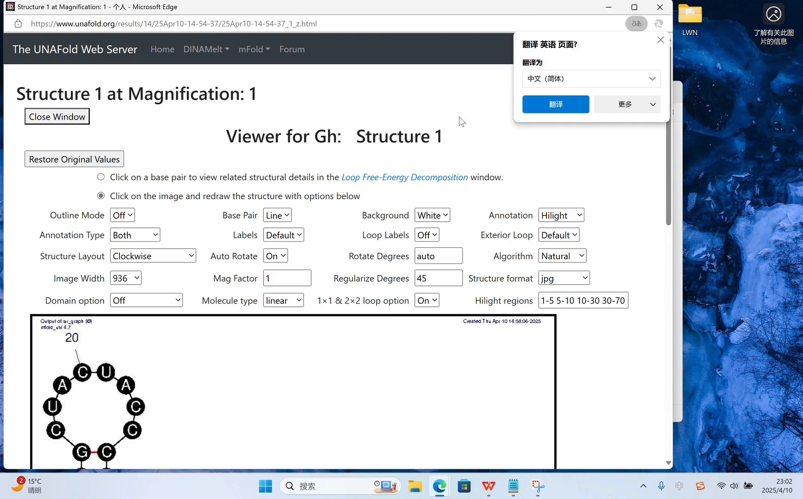
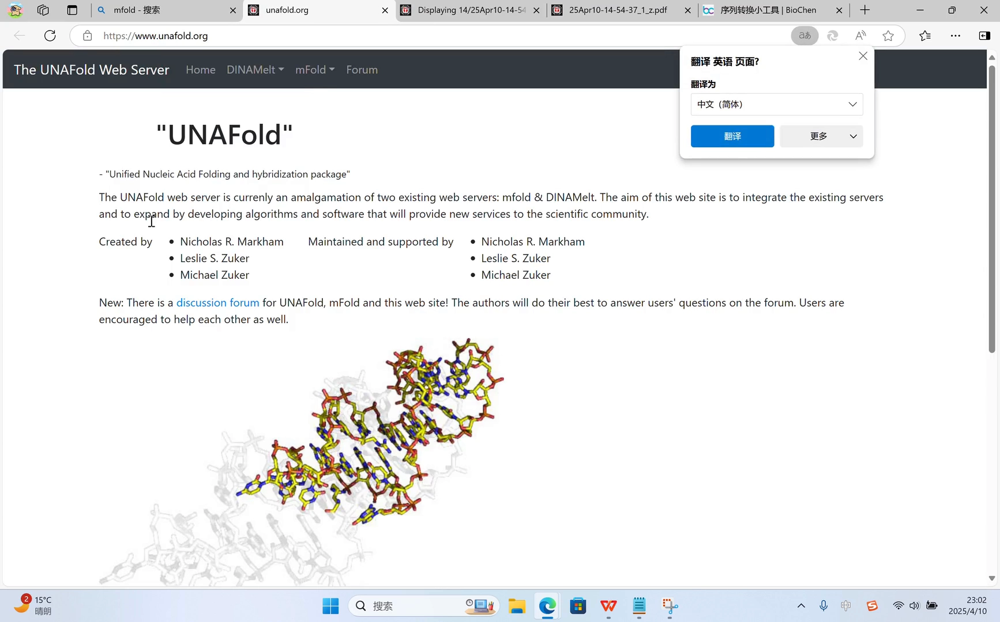
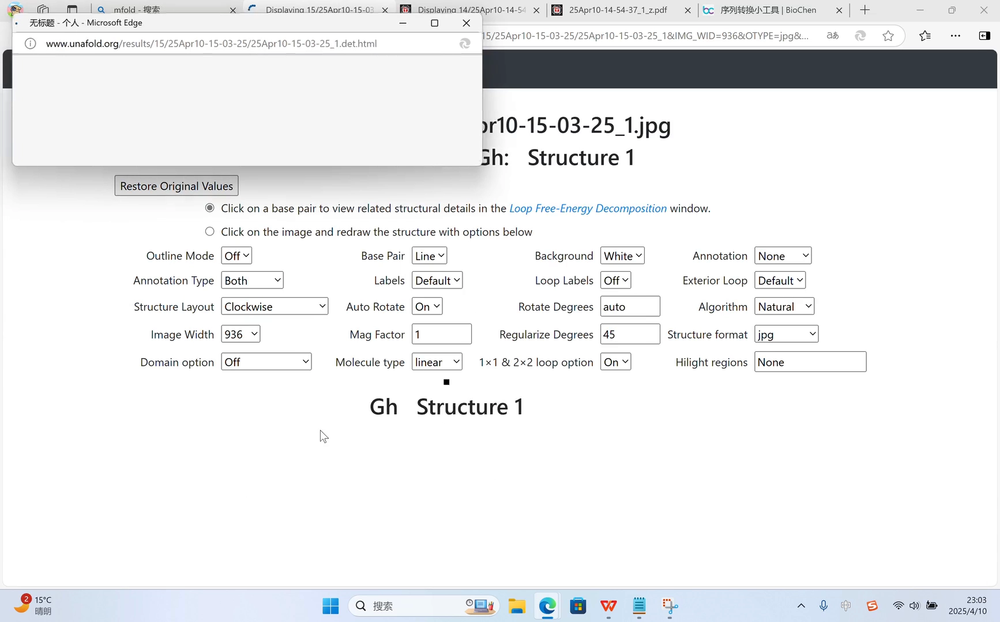
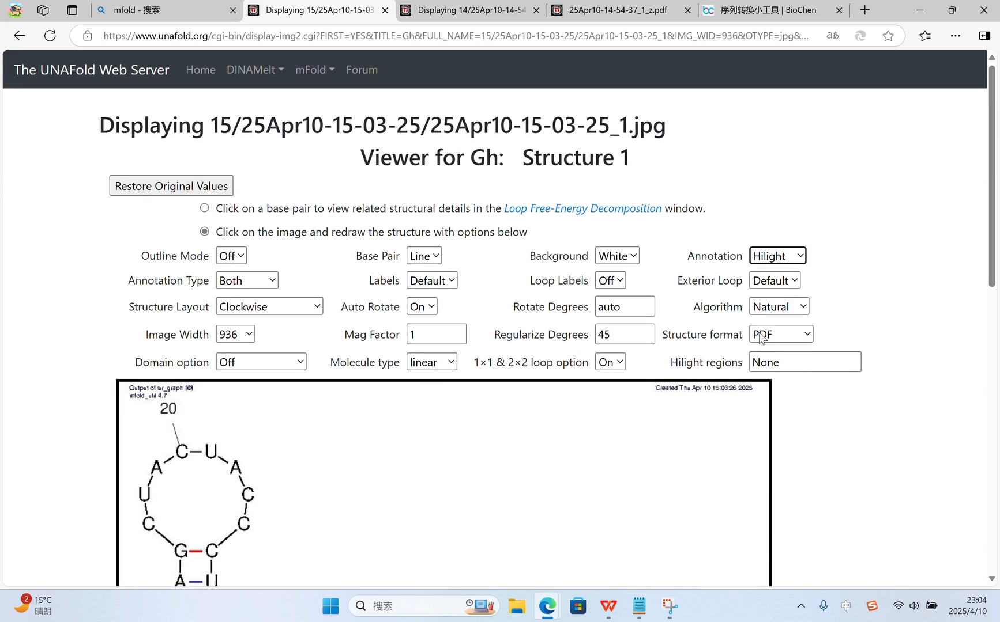
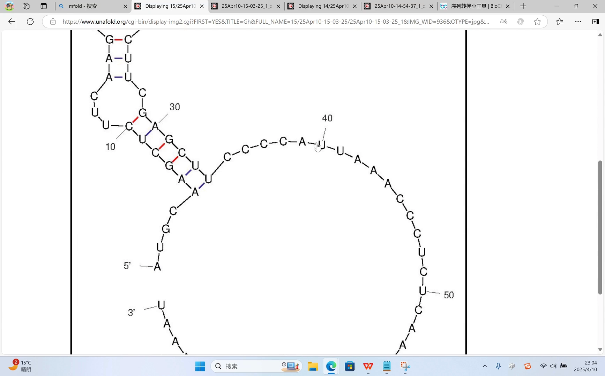
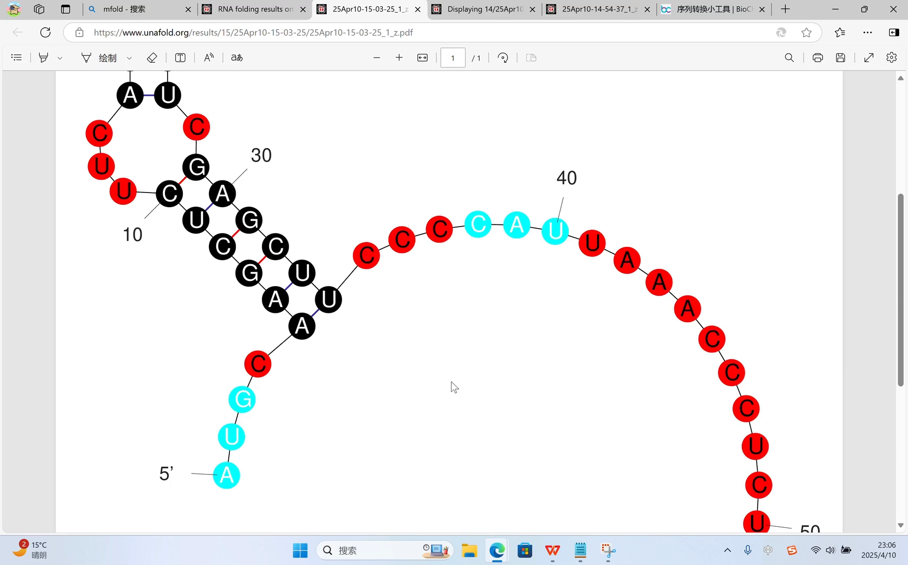

# RNA 二级结构预测与绘图：mFold 网页实操，从一段序列到一张可用的结构图

> 视频来源：[Bilibili《RNA二级结构的预测》](https://www.bilibili.com/video/BV1Tmd5YYEGB/)（约 4 分 51 秒）
> 本文基于视频演说图文稿撰写，观点与数据均可回看视频核对。

## 本讲要解决的核心问题（SCQA）

**背景**：RNA 的功能高度依赖它折叠出的二级结构——茎环、发夹、内环这些元件直接参与分子识别与调控。文献里那些漂亮的 RNA 二级结构图，其实都可以自己动手做出来。

**冲突**：手头往往只有一段序列（甚至还是 DNA 序列），不知道从哪里入手把它变成一张可用的二级结构预测图；即使找到了预测网站，结果页面上的各种图形选项也不知道该怎么用、怎么导出。

**疑问**：有没有免费、无需安装的网页工具，几分钟内就能从序列得到基于最小自由能（MFE）的预测结构，并且完成配图级的标注与导出？

**回答（中心思想）**：用 mFold 网页服务器即可走完全流程——先把 DNA 转成 RNA，贴进 mFold 的 RNA folding form，默认参数一键提交，就能得到基于最小自由能的预测结构；再借助区域高亮、环形视图、ss-count 统计图与 CT 文件导出，"预测 → 成图 → 后续编辑"一气呵成。

## 一、准备输入：先把 DNA 变成 RNA

视频演示的起点是一段 DNA 序列（[00:00](https://www.bilibili.com/video/BV1Tmd5YYEGB/?t=0)），而 mFold 预测的是 RNA 的折叠，所以第一步是序列转换：

- 找一个在线的 DNA→RNA 转换网站，把 DNA 序列粘贴进去（[00:17](https://www.bilibili.com/video/BV1Tmd5YYEGB/?t=17)）；
- 网站会把 T 全部替换成 U，输出对应的 RNA 序列（[00:27](https://www.bilibili.com/video/BV1Tmd5YYEGB/?t=27)）；
- 转换完成后，把 RNA 序列复制下来备用（[00:32](https://www.bilibili.com/video/BV1Tmd5YYEGB/?t=32)）。

> 小知识：DNA 与 RNA 的差别之一是胸腺嘧啶（T）与尿嘧啶（U），折叠预测关心的是碱基配对，所以输入统一用 A/U/C/G 表示。

## 二、提交预测：mFold 的 RNA folding form

接下来进入 mFold 官网（[00:43](https://www.bilibili.com/video/BV1Tmd5YYEGB/?t=43)）：

1. 点击 **m fold**，进入 **Applications → RNA 二级结构预测**（RNA folding form）（[00:49](https://www.bilibili.com/video/BV1Tmd5YYEGB/?t=49)）；
2. 把刚才的 RNA 序列粘贴到输入框，并给序列起一个名字（[00:49](https://www.bilibili.com/video/BV1Tmd5YYEGB/?t=49)）；
3. 点击 **format sequence**，页面下方的参数暂时全部保持默认（[01:07](https://www.bilibili.com/video/BV1Tmd5YYEGB/?t=67)）；
4. 提交后等待片刻，先看它给出的预测结果（[01:07](https://www.bilibili.com/video/BV1Tmd5YYEGB/?t=67)）。

## 三、读懂结果：基于最小自由能的候选结构

结果页会给出**不止一种**预测结构——视频里显示了两种结果，并特别说明：**这两种结果都是基于最小自由能（MFE）预测出来的可能二级结构**（[01:25](https://www.bilibili.com/video/BV1Tmd5YYEGB/?t=85)）。

- 每种结构都可以下载为 **JPG 或 PDF 格式**，PDF 会更清晰一些（[01:25](https://www.bilibili.com/video/BV1Tmd5YYEGB/?t=85)）；
- 点击后浏览器会渲染出预测的 RNA 二级结构平面图（[01:48](https://www.bilibili.com/video/BV1Tmd5YYEGB/?t=108)）。

> 为什么会有多个结果？分子实际可以折叠出多种构象，最小自由能结构只是其中"最稳"的那一个；mFold 会把若干个能量上说得通的候选一起呈现，供使用者结合实验背景判断。

## 四、把图做成"能放进论文"的样子

mFold 的图形页面本身就是个小绘图器，视频演示了两类最常用的加工：

### 4.1 区域高亮标注

想把某一段序列在图上突出显示（比如 motif、突变区），可以加高亮：

- 在图形选项里选择高亮功能，输入想标注的区段，例如 **1~10**（[01:55](https://www.bilibili.com/video/BV1Tmd5YYEGB/?t=115)、[02:17](https://www.bilibili.com/video/BV1Tmd5YYEGB/?t=137)）；
- 点击图片后它会按新参数重新生成（[02:27](https://www.bilibili.com/video/BV1Tmd5YYEGB/?t=147)），得到 1~10 号核苷酸被高亮标注的图（[02:37](https://www.bilibili.com/video/BV1Tmd5YYEGB/?t=157)）。

### 4.2 环形视图与分段高亮

除了常见的"茎环"画法，还可以切换成**环形（circular）视图**：

- 根据环形结构把图分割成若干段（[02:47](https://www.bilibili.com/video/BV1Tmd5YYEGB/?t=167)）；
- 分段也可以单独设置高亮区间，比如 1~5、10~20、10~30（[03:02](https://www.bilibili.com/video/BV1Tmd5YYEGB/?t=182)），再点一次即可按新区间重新生成。

## 五、进阶输出：ss-count、label 与 CT 文件

### 5.1 ss-count 统计图

图形选项里还有一个 **ss count** 开关（[03:29](https://www.bilibili.com/video/BV1Tmd5YYEGB/?t=209)）：选择它会生成另一类图——从统计角度展示每个位点在不同候选结构中处于单链状态的频次（[03:39](https://www.bilibili.com/video/BV1Tmd5YYEGB/?t=219)）。对判断"哪些区域在多种构象里都暴露在外"很有帮助。

### 5.2 label 刻度与"别乱动"的其他参数

- **label** 参数控制每隔多少个核苷酸标注一个序号，可以根据自己的序列长度调整数值（[03:44](https://www.bilibili.com/video/BV1Tmd5YYEGB/?t=224)）；
- 其他参数建议保持默认——默认生成的图已经"还算可以"，乱调反而容易失真（[04:04](https://www.bilibili.com/video/BV1Tmd5YYEGB/?t=244)）。

### 5.3 导出 CT 文件，交给别的软件继续改

如果想用其他软件对图做进一步修饰，可以直接下载其它格式，比如 **CT 文件**（connectivity table，记录每个碱基与谁配对的连接表）（[04:26](https://www.bilibili.com/video/BV1Tmd5YYEGB/?t=266)）。CT 是结构预测领域的通用交换格式，mFold、RNAstructure 等软件都认它（[04:31](https://www.bilibili.com/video/BV1Tmd5YYEGB/?t=271)）。

最后，视频展示了用这个网站做出来的成品图（[04:44](https://www.bilibili.com/video/BV1Tmd5YYEGB/?t=284)）——一张标注清晰、可直接用于展示的 RNA 二级结构图。

## 小结

- **流程只有四步**：DNA→RNA 转换 → mFold 提交（默认参数）→ 读 MFE 结果 → 图形加工与导出。
- **结果不只一张图**：mFold 给出多个基于最小自由能的候选结构，JPG/PDF 皆可下载，PDF 更清晰。
- **图可以继续加工**：区域高亮（如 1~10）、环形视图分段（1~5、10~20、10~30）都能在线完成。
- **进阶两件套**：ss-count 统计图看位点暴露频次；CT 文件把结构交给其他软件继续编辑。
- **参数哲学**：label 按序列长度调，其余默认别乱动。

## 关键术语速查

| 术语 | 一句话解释 |
| --- | --- |
| mFold | 经典的 RNA 二级结构网页预测服务，基于最小自由能算法 |
| MFE（最小自由能） | 热力学上最稳定的折叠状态，预测的默认目标 |
| ss-count | 统计每个位点在候选结构中处于单链状态的频次的图 |
| 环形视图（circular） | 把序列排成圆环、用弦表示配对的展示方式 |
| CT 文件 | 记录"哪个碱基与哪个碱基配对"的连接表格式，可在其它软件中继续编辑 |
| 高亮标注 | 把指定区段（如 1~10）在结构图上突出显示 |
