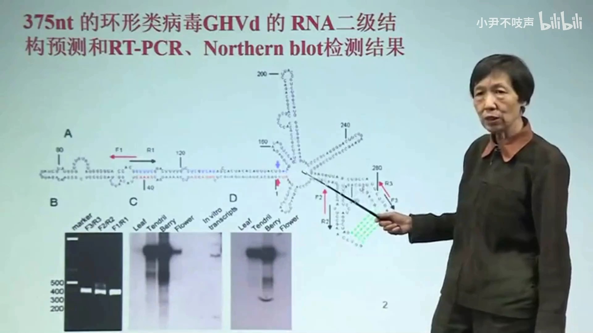
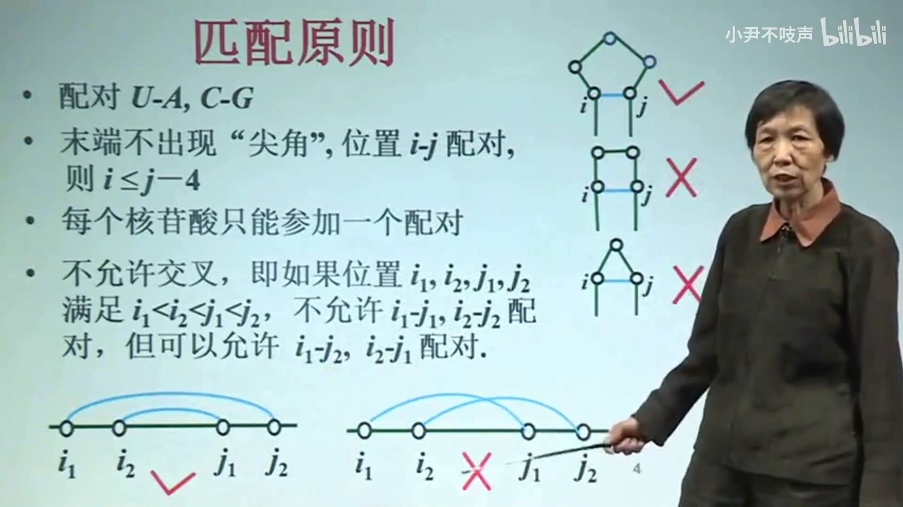
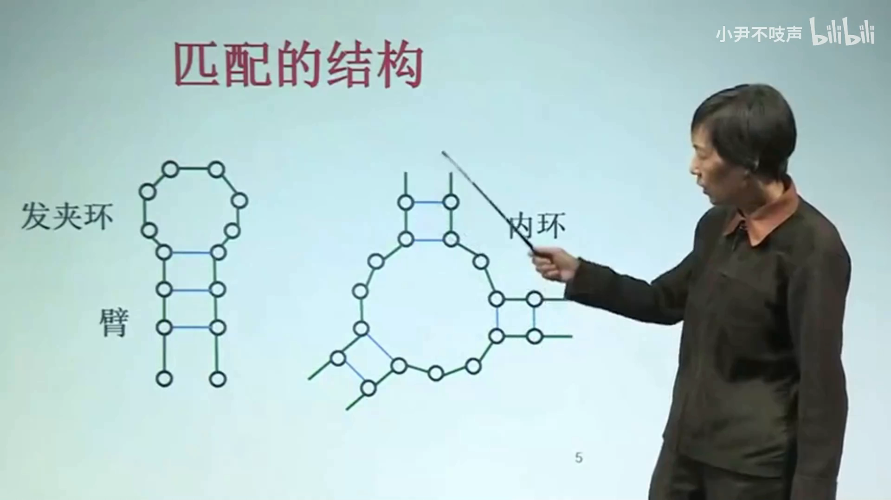
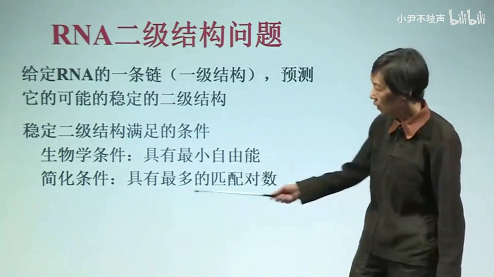
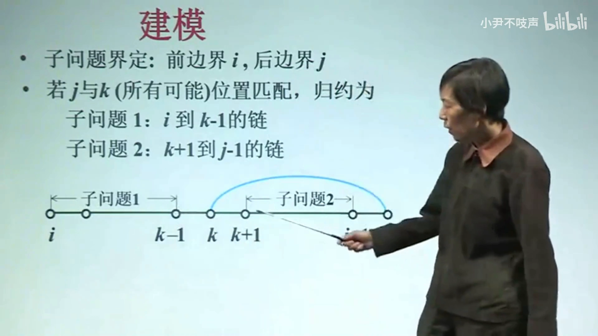
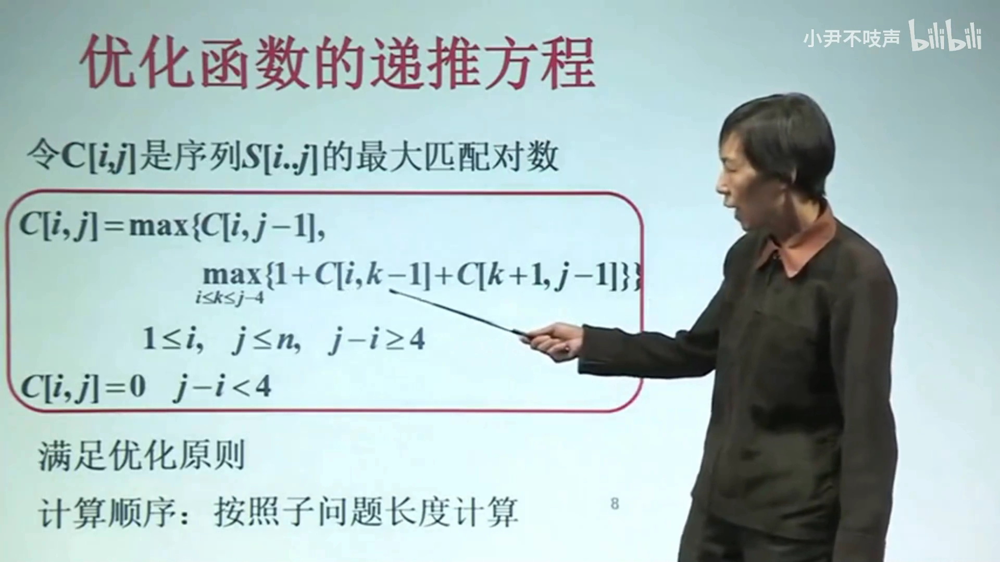
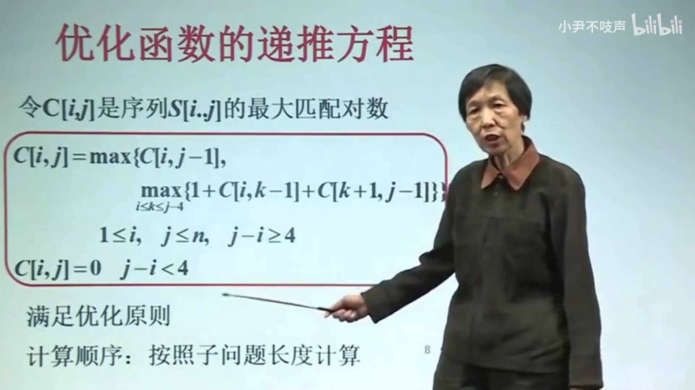
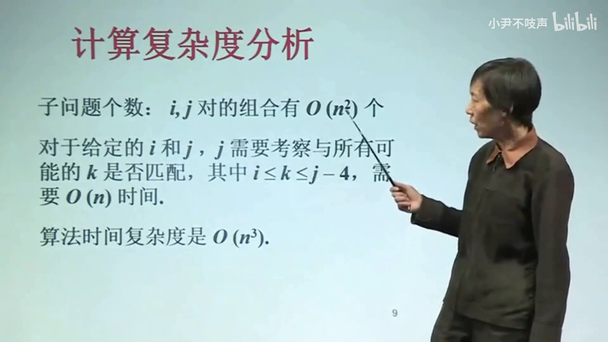

# 用动态规划预测 RNA 二级结构：从四条配对规则到 O(N³) 算法

> 视频来源：[Bilibili《【屈婉玲教授 | 算法设计与分析】06-06 RNA二级结构预测》](https://www.bilibili.com/video/BV1MKTJziEde/)（约 12 分 59 秒）
> 本文基于视频演说图文稿撰写，观点与数据均可回看视频核对。

## 本讲要解决的核心问题（SCQA）

**背景**：RNA 的一级结构是一条由 A、U、C、G 四种碱基连成的长链；它在细胞里并不"拉直"存在，而是通过碱基配对折叠成二级结构，由茎、环等元件构成（[00:34](https://www.bilibili.com/video/BV1MKTJziEde/?t=34)）。

**冲突**：序列本身只给出碱基的排列顺序，并没有给出"谁和谁配对"；而可能的配对方式随链长急剧增长，逐一枚举根本不可行（[01:18](https://www.bilibili.com/video/BV1MKTJziEde/?t=78)）。

**疑问**：能否用算法，从一级结构直接预测出稳定的二级结构？

**回答（中心思想）**：可以。把生物学的"稳定 = 自由能最小"简化成"配对对数最多"的数学模型（[05:12](https://www.bilibili.com/video/BV1MKTJziEde/?t=312)、[05:29](https://www.bilibili.com/video/BV1MKTJziEde/?t=329)）之后，这个问题具有最优子结构，可以用**动态规划**求解：以区段 (i, j) 界定子问题，按"末位碱基 j 不配对 / 与某个 k 配对"两种情形归约，写出递推方程自底向上计算，总时间复杂度 **O(N³)**；再用备忘录 + 标记函数回溯，就能还原出具体的配对方案。

## 一、问题是什么：从一级结构到二级结构

### 1.1 一级结构必须折叠

RNA 的一级结构是一条长链，由 A/U/C/G 这样的碱基按顺序连接而成（[00:14](https://www.bilibili.com/video/BV1MKTJziEde/?t=14)）。但在实际当中，这条长链"是不能存在的"——它必须折叠起来：某些位置上互相对应的碱基进行匹配，匹配后亲合到一起，形成视频里称作"壁（臂）"的结构（即通常所说的**茎**，stem）（[00:34](https://www.bilibili.com/video/BV1MKTJziEde/?t=34)、[00:53](https://www.bilibili.com/video/BV1MKTJziEde/?t=53)）。整条长链于是折叠成具有若干个茎的二级结构（[01:01](https://www.bilibili.com/video/BV1MKTJziEde/?t=61)）。

### 1.2 预测问题的输入与输出

问题由此变得明确（[01:08](https://www.bilibili.com/video/BV1MKTJziEde/?t=68)）：

- **输入**：一级结构——一条由字符构成的长序列，不同字符代表不同碱基（[01:13](https://www.bilibili.com/video/BV1MKTJziEde/?t=73)）；形式化地，用 ACGU 标记的核酸序列（[02:02](https://www.bilibili.com/video/BV1MKTJziEde/?t=122)）。
- **输出**：折叠后的平面图——在这个结构里有茎（壁），也有环状结构；关键是知道**到底谁和谁匹配**（[02:44](https://www.bilibili.com/video/BV1MKTJziEde/?t=164)、[02:49](https://www.bilibili.com/video/BV1MKTJziEde/?t=169)）。

### 1.3 预测结果可以实验验证

这不是纸上谈兵：视频展示了一个实际预测的结果，并且说明预测还可以通过生化的办法进行检测，验证 RNA 是否真的是这个结构——画面上给出了实际检测的图片（[01:40](https://www.bilibili.com/video/BV1MKTJziEde/?t=100)、[01:45](https://www.bilibili.com/video/BV1MKTJziEde/?t=105)）。

## 二、配对的四条规则与结构元件

算法要能落地，先要规定折叠（配对）遵循什么原则。视频给出四条（[03:04](https://www.bilibili.com/video/BV1MKTJziEde/?t=184)）：

### 2.1 规则一：只有 U-A、C-G 配对

按照生物学性质，配对发生在 **U-A、C-G** 之间；A-G、U-C 这类组合不能配对（[03:10](https://www.bilibili.com/video/BV1MKTJziEde/?t=190)、[03:15](https://www.bilibili.com/video/BV1MKTJziEde/?t=195)）。这是简化模型采用的配对原则。

### 2.2 规则二：环不能太小——配对碱基间至少隔 3 个核苷酸

末端不允许出现"尖角"。设 i 与 j 配对，那么 i、j 之间至少要含 3 个核苷酸：间隔 4 个、5 个都可以，但只隔 1 个或 2 个元素是不可以的——头上的环不能太小（[03:20](https://www.bilibili.com/video/BV1MKTJziEde/?t=200)、[03:30](https://www.bilibili.com/video/BV1MKTJziEde/?t=210)）。写成不等式就是 **j − 4 ≥ i**，即 j 与 i 至少相距 4（[03:55](https://www.bilibili.com/video/BV1MKTJziEde/?t=235)）。

### 2.3 规则三：每个核苷酸最多参与一个配对

一个核苷酸不能既和这个配、又和那个配（[04:05](https://www.bilibili.com/video/BV1MKTJziEde/?t=245)）。

### 2.4 规则四：不允许交叉配对

平行的配对是允许的——连续的平行配对正好体现在一条茎上（[04:14](https://www.bilibili.com/video/BV1MKTJziEde/?t=254)、[04:19](https://www.bilibili.com/video/BV1MKTJziEde/?t=259)）；但**交叉**的配对（两条配对边在图上呈交叉状）不允许（[04:24](https://www.bilibili.com/video/BV1MKTJziEde/?t=264)）。

### 2.5 由此形成的结构元件

满足以上规则后，结构里会出现这些元件（[04:31](https://www.bilibili.com/video/BV1MKTJziEde/?t=271)）：

- **茎（壁）**：连续的平行配对（[04:40](https://www.bilibili.com/video/BV1MKTJziEde/?t=280)）；
- **发夹环**：茎顶端弯回来的环状结构（[04:45](https://www.bilibili.com/video/BV1MKTJziEde/?t=285)）；
- **内环**：一条茎被打断、两侧各配一段，中间形成的环（[04:50](https://www.bilibili.com/video/BV1MKTJziEde/?t=290)）。

## 三、什么叫"好"结构：从最小自由能到最大配对数

给定一条 RNA 链（一级结构），要预测它"可能的稳定的二级结构"。**在生物学上，稳定的含义是具有最小的自由能**（[05:12](https://www.bilibili.com/video/BV1MKTJziEde/?t=312)）。

要在数学上可解，需要简化：把"稳定"建模为**匹配的对数达到最多**——配对数最多的结构就认为是稳定的（[05:23](https://www.bilibili.com/video/BV1MKTJziEde/?t=323)、[05:29](https://www.bilibili.com/video/BV1MKTJziEde/?t=329)）。于是问题变成：给定 RNA 链，求**具有最多匹配对数的二级结构**（[05:40](https://www.bilibili.com/video/BV1MKTJziEde/?t=340)、[05:45](https://www.bilibili.com/video/BV1MKTJziEde/?t=345)）。

> 这个"最大化配对数"就是经典的 Nussinov 模型；它是热力学最小自由能模型的"计数版"。屈婉玲教授在课上也强调了这一简化与真实生物条件（自由能最小）之间的关系。

## 四、动态规划建模：子问题界定与归约

### 4.1 子问题由前边界 i、后边界 j 界定

对一条链做动态规划，先要界定子问题的边界：**由一段链的首位置 i 和末位置 j 来界定**（[06:01](https://www.bilibili.com/video/BV1MKTJziEde/?t=361)、[06:06](https://www.bilibili.com/video/BV1MKTJziEde/?t=366)）。原始问题就是 i、j 取全链两端时的情况。

### 4.2 归约的关键一问：末位碱基 j 配不配对？

把大问题归约成更小的子问题，看**最后一个碱基 j**（[06:37](https://www.bilibili.com/video/BV1MKTJziEde/?t=397)）：

**情形一：j 不参与配对。** 它在整个结构中是"空"的，那么 i..j 的匹配问题就归结为 i..j−1 的匹配问题——一个长度减 1 的子问题（[07:50](https://www.bilibili.com/video/BV1MKTJziEde/?t=470)、[08:09](https://www.bilibili.com/video/BV1MKTJziEde/?t=489)）。

**情形二：j 与前面某个 k 位置的碱基配对。** 假定 k 满足配对原则（可以配对，且 k 最大到 j−4，最小到 i）（[06:45](https://www.bilibili.com/video/BV1MKTJziEde/?t=405)、[06:55](https://www.bilibili.com/video/BV1MKTJziEde/?t=415)）。这时由**不交叉原则**：k 右侧与 j 左侧之间的碱基不能再和别的区域交叉配对，只能各自"自己跟自己配"（[07:00](https://www.bilibili.com/video/BV1MKTJziEde/?t=420)、[07:08](https://www.bilibili.com/video/BV1MKTJziEde/?t=428)、[07:19](https://www.bilibili.com/video/BV1MKTJziEde/?t=439)）。于是一分为二，产生**两个子问题**（[07:29](https://www.bilibili.com/video/BV1MKTJziEde/?t=449)、[07:34](https://www.bilibili.com/video/BV1MKTJziEde/?t=454)、[07:39](https://www.bilibili.com/video/BV1MKTJziEde/?t=459)）：

- 左边：i 到 k−1 的链的结构问题；
- 右边：k+1 到 j−1 的链的结构问题。

## 五、递推方程、初值与计算顺序

### 5.1 优化函数 C(i, j) 与递推方程

记序列 S(i..j) 的**最大匹配对数**为 C(i, j)（[08:22](https://www.bilibili.com/video/BV1MKTJziEde/?t=502)、[08:27](https://www.bilibili.com/video/BV1MKTJziEde/?t=507)）。按两种情形写出递推（[08:33](https://www.bilibili.com/video/BV1MKTJziEde/?t=513)、[08:58](https://www.bilibili.com/video/BV1MKTJziEde/?t=538)、[09:03](https://www.bilibili.com/video/BV1MKTJziEde/?t=543)）：

- j 不配对：C(i, j) = C(i, j−1)；
- j 与 k 配对：C(i, j) = C(i, k−1) + C(k+1, j−1) + 1——左、右两个子问题的对数相加，再加上 j 与 k 本身这一对。

对**所有满足配对要求的 k**（从 i 到 j−4、且字符与 j 的字符满足配对要求）都试一遍，取最大值（[09:16](https://www.bilibili.com/video/BV1MKTJziEde/?t=556)、[09:23](https://www.bilibili.com/video/BV1MKTJziEde/?t=563)、[09:28](https://www.bilibili.com/video/BV1MKTJziEde/?t=568)、[09:48](https://www.bilibili.com/video/BV1MKTJziEde/?t=588)）。

### 5.2 初值：距离小于 4 就不能配对

若 j 与 i 的距离小于 4（j − i < 4），由于环不能太小的规则，它们不能匹配，此时优化函数值为 0（[09:55](https://www.bilibili.com/video/BV1MKTJziEde/?t=595)、[10:05](https://www.bilibili.com/video/BV1MKTJziEde/?t=605)）。

### 5.3 计算顺序：按子问题长度自底向上

该问题满足优化原则（最优子结构），计算顺序可以**按子问题的长度从小到大**排列，陆续迭代计算（[10:10](https://www.bilibili.com/video/BV1MKTJziEde/?t=610)、[10:15](https://www.bilibili.com/video/BV1MKTJziEde/?t=615)）。

## 六、复杂度 O(N³) 与回溯还原结构

### 6.1 复杂度分析

- 原始问题长度为 N，则 (i, j) 的组合有 **N² 种**，即 N² 个子问题（[10:27](https://www.bilibili.com/video/BV1MKTJziEde/?t=627)）；
- 每个子问题要考察 k 的所有可能位置——k 在 i 到 j−4 之间，量级是 O(N)（[10:44](https://www.bilibili.com/video/BV1MKTJziEde/?t=644)、[10:49](https://www.bilibili.com/video/BV1MKTJziEde/?t=649)、[11:01](https://www.bilibili.com/video/BV1MKTJziEde/?t=661)）；
- 所以整个工作量是 **O(N³)**（[11:06](https://www.bilibili.com/video/BV1MKTJziEde/?t=666)）。

### 6.2 备忘录 + 标记函数：把结构"记"出来

光有最优对数还不够，还要还原结构。做法是：

- 用**备忘录（表格）**记录最优匹配对数（[12:00](https://www.bilibili.com/video/BV1MKTJziEde/?t=720)）；
- 同时用**标记函数**记录"得到这个最优值时到底是怎么归约的"：j 究竟和哪个 k 配对了，还是不参与配对（[12:05](https://www.bilibili.com/video/BV1MKTJziEde/?t=725)）；
- 也就是记下最优划分的位置；若 j 不参与，就记录"j 不参与"这一分支标记（[12:30](https://www.bilibili.com/video/BV1MKTJziEde/?t=750)、[12:35](https://www.bilibili.com/video/BV1MKTJziEde/?t=755)）。

整个问题的时间复杂度为 O(N³)（[12:48](https://www.bilibili.com/video/BV1MKTJziEde/?t=768)）。

## 小结

屈婉玲教授按动态规划的固定套路完整走了一遍（[11:16](https://www.bilibili.com/video/BV1MKTJziEde/?t=676)）：

- **界定边界**：子问题由 i、j 两个位置划定；
- **归约方法**：看末位碱基 j——不配对则归约出一个子问题；与 k 配对则按不交叉原则拆成两个子问题；
- **优化函数与递推**：C(i, j) = max{ C(i, j−1), max_k [C(i, k−1) + C(k+1, j−1) + 1] }，初值 j−i < 4 时为 0；
- **计算顺序**：按子问题长度自底向上；
- **备忘录 + 标记函数**：既存最优值，也存"怎么来的"，才能回溯出具体结构；
- **复杂度**：O(N³)。

## 关键术语速查

| 术语 | 一句话解释 |
| --- | --- |
| 一级结构 | A/U/C/G 连成的碱基序列本身 |
| 二级结构 | 一级结构经碱基配对折叠出的平面结构（谁和谁配对） |
| 茎（视频称"壁/臂"） | 连续的平行配对形成的双链区段 |
| 发夹环 | 茎顶端折回形成的环 |
| 内环 | 两条茎之间夹出的环 |
| j − i ≥ 4 | 配对两端的碱基至少相距 4，环内至少 3 个核苷酸 |
| 不交叉（无假结） | 配对边在图上互不交叉；平行配对（茎）允许 |
| C(i, j) | 区段 i..j 的最大匹配对数（优化函数） |
| 备忘录 + 标记函数 | 存最优值与最优划分位置的表，用于回溯还原结构 |
| O(N³) | N² 个子问题 × 每个考察 O(N) 个 k 的总时间量级 |
