# RNA–蛋白复合物结构预测全景：从 AF3 框架到 MSA 与语言模型 embedding

> 视频来源：[Bilibili《赛道解读|RNA–蛋白复合物结构预测》](https://www.bilibili.com/video/BV17V5C6WETU/)（72 分 45 秒，主讲：杨自雄，上海科学智能研究院生命科学科学家；第四届世界科学智能大赛 RNA–蛋白复合物结构预测赛道解读）
> 本文基于视频演说图文稿撰写，观点与数据均可回看视频核对。

## 本讲要解决的核心问题（SCQA）

**背景**：本系列的"双路线互验"管线里，深度学习路线（RNA-FM 的 embedding / 接触图）最终都要喂给下游的结构预测器。蛋白质结构预测在 AlphaFold2/AF3 之后已接近成熟，RNA 结构预测今年也有突破（[33:02](https://www.bilibili.com/video/BV17V5C6WETU/?t=1982)）。

**冲突**：但 **RNA–蛋白复合物**是另一回事——它在 PDB 里只占约 5% 的数据量（[34:00](https://www.bilibili.com/video/BV17V5C6WETU/?t=2040)），即便是 SOTA 的 AF3，其复合物 DockQ 也只有 65.22 分，还剩近 35% 的进步空间（[30:53](https://www.bilibili.com/video/BV17V5C6WETU/?t=1853)）；预测时要同时做到蛋白折叠对、柔软的 RNA 折对、两者放到正确的界面上，还要考虑结合诱导的构象变化（[33:24](https://www.bilibili.com/video/BV17V5C6WETU/?t=2004)）。

**疑问**：2025 年的真实竞赛管线是怎么做 RNA–蛋白复合物结构预测的？序列信息到底该怎么编码——跑 MSA，还是直接用预训练语言模型的 embedding？

**回答（中心思想）**：本讲给出完整地图：全原子折叠模型遵循 **1D/2D/3D 框架**（MSA/模板/embedding → Pairformer → 全原子扩散生成），赛题提供两个 baseline（Protenix 全原子扩散 + SE(3) 等变路线）；解题的核心在于**输入特征**——MSA 与预训练语言模型 embedding 相辅相成（蛋白质用 ESM2/ESM3，"**RNA 一样有相对应训练好的语言模型**，像 RNA foundation model 这种是非常值得尝试的"，[41:54](https://www.bilibili.com/video/BV17V5C6WETU/?t=2514)），再加上多 seed 采样、置信度筛选、聚类去冗余与 MD 松弛的完整工作流。

---

## 一、赛道背景：一场为"最难复合物"设的竞赛

### 1.1 世界科学智能大赛

本次直播是**第四届世界科学智能大赛**（上海科学智能研究院与复旦大学联合发起）赛题解读的第二期，赛道为 **RNA–蛋白复合物结构预测**，总奖金池 20 万元、冠军 10 万（[04:50](https://www.bilibili.com/video/BV17V5C6WETU/?t=290)）。主讲人杨自雄按六个章节展开：赛题背景与科学意义、任务定义与核心挑战、数据集与评测标准、解题思路、避坑 tips、学习建议与 QA。

### 1.2 为什么 RNA–蛋白相互作用如此重要

最简单地从中心法则说起：DNA → RNA → 蛋白质，mRNA 翻译成蛋白质需要蛋白质帮忙——**核糖体**就是最重要的分子机器；tRNA 与核糖体互作，核糖体自身还含 rRNA（[08:37](https://www.bilibili.com/video/BV17V5C6WETU/?t=517)）。RNA 种类远不止这些，ncRNA 与蛋白的互作更是与癌症、神经退行性疾病、遗传病密切相关——不久前 siRNA（RNA 干扰）刚获诺贝尔奖（[09:26](https://www.bilibili.com/video/BV17V5C6WETU/?t=566)）。落到应用上，就是**靶点设计**：或设计结合 RNA 的蛋白，或反过来用 RNA 去结合蛋白（[09:48](https://www.bilibili.com/video/BV17V5C6WETU/?t=588)）。

### 1.3 复合物家族一览

RNA–蛋白复合体种类繁多（[10:00](https://www.bilibili.com/video/BV17V5C6WETU/?t=600)）：核糖体（翻译机器）、**剪切体**（RNA 转录后要经大量剪切）、**CRISPR-Cas 系统**（用 sgRNA 精准引导基因编辑，未来基因治疗的希望）、以及病毒 RNP（如新冠 N 蛋白）。要设计针对这些靶点的药物，先要拿到它们的结构。

## 二、数据从哪来：PDB 的构成与三种实验解析

### 2.1 PDB：25 万结构里的 5%

全世界最大的结构数据库是 **PDB（Protein Data Bank）**，大约 20 万笔数据（[11:10](https://www.bilibili.com/video/BV17V5C6WETU/?t=670)）：超过 60% 是纯蛋白质结构，DNA 结构约 7%，**RNA 结构只占约 3%，RNA–蛋白复合体约 5%**——加起来不到 15%。直接拿这个数据集训模型，蛋白表现会异常好，而 DNA/RNA/复合物上性能下降。**数据不平衡**是第一个大问题。

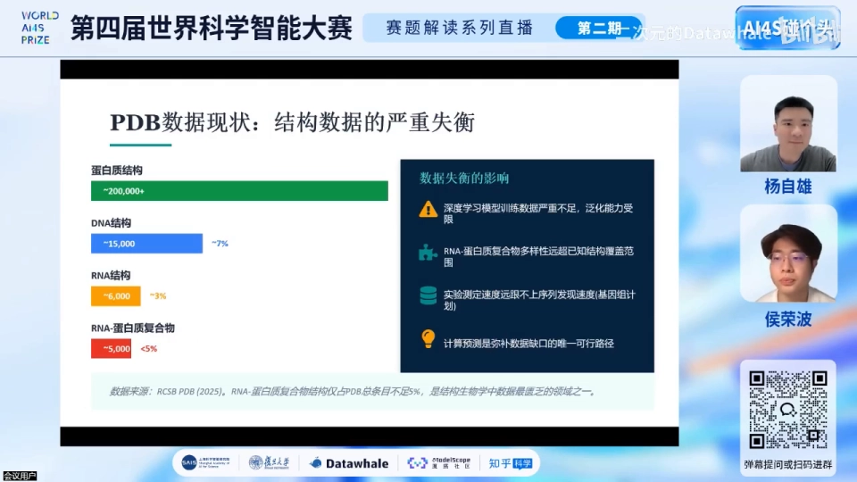

### 2.2 X-ray / cryo-EM / NMR 三兄弟

实验解析结构有三种主流方法，各有代价（[12:36](https://www.bilibili.com/video/BV17V5C6WETU/?t=756)）：

- **X 射线晶体学**：分辨率最高，但要求高质量结晶——很多 RNA–蛋白复合物**特别柔软、根本无法结晶**；结晶过程还可能丢失生理条件下的结构；柔软区域干涉 pattern 不好，导致 PDB 里常见**缺失残基**。前处理时要么把这些残基 mask 掉（loss 里不计算），要么补全——不同补全方法带来不同误差。
- **冷冻电镜（cryo-EM）**：不需要结晶，但分辨率较低；最近才有 Nature 论文做到 1–2Å，而一个碳碳单键键长约 1.5Å——分辨率不够就看不出简单化学键，照样需要补全。
- **核磁共振（NMR）**：在溶液相测定，能把 open/closed 等**多构象**还原出来，但它需要昂贵的同位素标记（C13、N15），且溶液扩散问题使其只适合小分子。

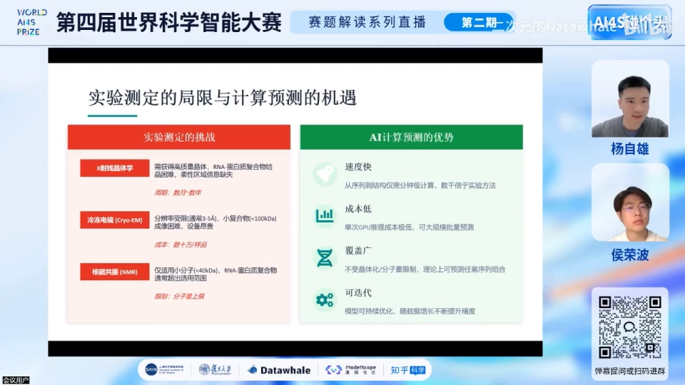

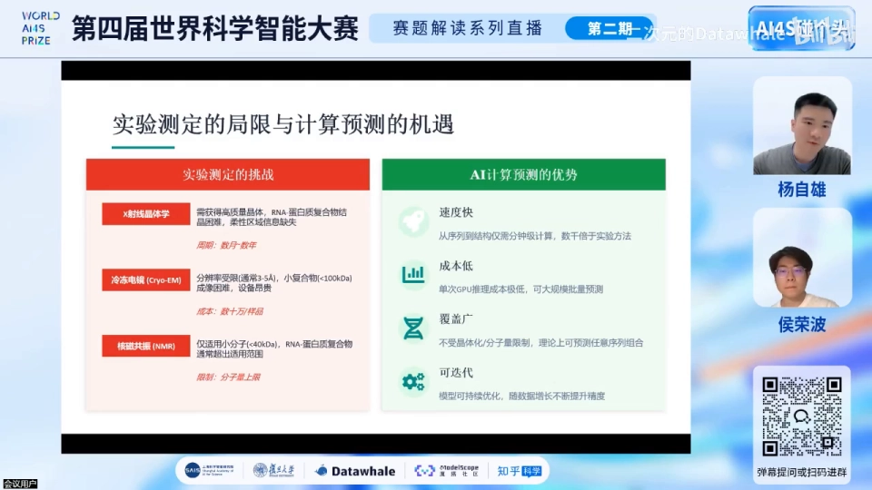

人类花了 100 多年才积累约 25 万个结构（[16:47](https://www.bilibili.com/video/BV17V5C6WETU/?t=1007)）。

### 2.3 AI 预测的四大优势

相比之下，AI 结构预测：**快**（Protenix、AF3 server 约 10 分钟一个结构）、**成本低**（GPU 时长 vs 实验几周几个月）、**覆盖范围广**、**可迭代**（[17:43](https://www.bilibili.com/video/BV17V5C6WETU/?t=1063)）。新冠期间 AlphaFold2 就扮演了重要角色——在晶体解出之前先拿到（略有误差的）结构，快速开展药物筛选。

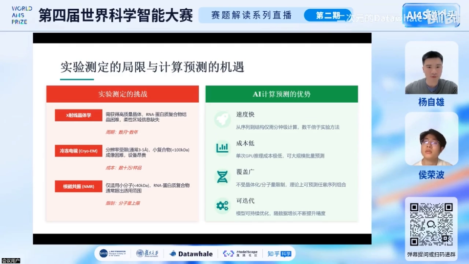

## 三、模型演进：AF2 → RoseTTAFold2NA → AF3

### 3.1 AlphaFold2 与蛋白质革命

AlphaFold2 在 2020 年 CASP14 上以远超第二名的成绩夺冠，2021 年发 Nature，开启蛋白质结构革命（[18:49](https://www.bilibili.com/video/BV17V5C6WETU/?t=1129)）。此前的主流是计算生物学力场方法慢慢折叠（需大量增强采样），2013 年诺贝尔化学奖（Karplus、Levitt、Warshel）表彰的正是这类多尺度建模。AF2 让"从序列直接生成结构"成为现实——但它**只能做蛋白质**（后来的 Multimer 扩展到蛋白多聚体）。

### 3.2 Baker 实验室：第一个核酸–蛋白复合物模型

与 Google DeepMind 同时获诺贝尔奖的 David Baker（华盛顿大学）团队推出了 RoseTTAFold 系列，其全原子版是**最早能做核酸–蛋白复合物的模型之一**（[19:36](https://www.bilibili.com/video/BV17V5C6WETU/?t=1176)）。

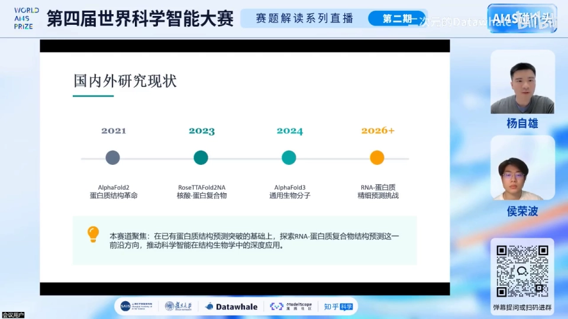

### 3.3 AlphaFold3：通用生物分子 + 全原子扩散

2024 年发 Nature 的 **AlphaFold3** 用一个模型统一处理蛋白质、RNA、DNA、小分子与**离子**（[20:00](https://www.bilibili.com/video/BV17V5C6WETU/?t=1200)）。离子并非配角：做 RNA 相关实验时，溶液里**不加镁离子常常做不出实验**（[20:29](https://www.bilibili.com/video/BV17V5C6WETU/?t=1229)）——赛题只给序列，但真实复合体存在于含 Mg²⁺、Na⁺ 的生物溶液中。

### 3.4 复现模型：Protenix 与 Boltz

AF3 最初未公布代码，社区随之出现一批复现/同源模型：**Protenix**（v0.5 / v1.0 / v2.0，赛题 baseline 基于 v0.5）、**Boltz-1**（AF3 复现）与 MIT 的 **Boltz-2**，此外 OpenFold3、RoseTTAFold2NA 也都可尝试——不止这五个（[44:53](https://www.bilibili.com/video/BV17V5C6WETU/?t=2693)）。

### 3.5 成绩单与进步空间

AF3 已支持 RNA–蛋白复合体预测，DockQ 约 65.22——**还剩近 35% 的进步空间**（[30:53](https://www.bilibili.com/video/BV17V5C6WETU/?t=1853)）。在 RNA 上这仍是前沿（edge research）；斯坦福 2025 年还专门在 Kaggle 上办了 RNA 结构预测比赛，已办到第二届（[21:43](https://www.bilibili.com/video/BV17V5C6WETU/?t=1303)）。

## 四、传统方法为何仍占一席

分子力学/分子动力学（MD）、分子对接（HDock、AutoDock 等）、同源建模仍是常用手段，但有四大局限（[23:27](https://www.bilibili.com/video/BV17V5C6WETU/?t=1407)）：**耗时**（100 纳秒 MD 模拟约半天）、**采样空间大**（结合面在 A/B/C/D 哪一面都要靠堆积采样）、**精度受限**（对接常冻结受体结构，无法排除诱导松弛导致的失真）、**通量低**（AF3 一小时 6 个结构 vs MD 一张卡半天）。也正因此，大量研究投入 AI 加速 biomolecular modeling。不过讲者提醒：**传统方法没有过时**——比赛中用 HDock 或同源建模先拿一个结构，有时反而更贴近真值（[32:09](https://www.bilibili.com/video/BV17V5C6WETU/?t=1929)）。

## 五、1D/2D/3D：全原子折叠模型的统一框架

### 5.1 1D：MSA 序列特征

全原子折叠模型通常包含三条 track（[24:40](https://www.bilibili.com/video/BV17V5C6WETU/?t=1480)）。1D 是**序列特征**：既然相似序列有相似结构，就先用 MSA search（NCBI/JackHMMER 等）从 UniProt 等数千万序列里找同源序列，作为模型输入，帮模型"学会结构该长什么样"。

### 5.2 2D：模板与接触图/distogram

2D 是**长程特征**：已知的类似序列结构可以变成 template；两两位点间的距离可以组成矩阵——类似一个 **contact map（接触图）**，再柱状化（bin）成 distogram（[25:20](https://www.bilibili.com/video/BV17V5C6WETU/?t=1520)）。

### 5.3 3D：SE(3) token 化 vs 全原子扩散

3D 是结构生成，有两条路线（[26:08](https://www.bilibili.com/video/BV17V5C6WETU/?t=1568)）：RoseTTAFold2NA 用 **SE(3) transformer**——把固定的 building block（AUGC/氨基酸）token 化，模型学"把 token 放到对的位置"，既高效降低 scaling（全原子可能一两万个原子，O(N²)/O(N³) 显存吃不消），又保证化学立体结构。而 AF3 面对小分子、离子这类**没有共用 building block** 的对象，干脆**直接在全原子上做扩散**（diffusion transformer 框架）。

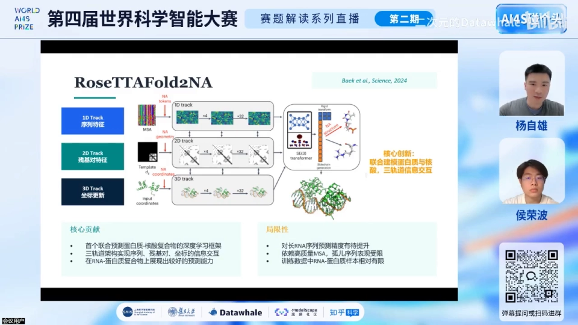

### 5.4 AF3 工作流：Pairformer + diffusion module + confidence head

AF3 的工作流可以概括为（[28:03](https://www.bilibili.com/video/BV17V5C6WETU/?t=1683)）：input embedding（MSA search 找类似序列）→ 2D contact map/distogram 输入 → **Pairformer block**（AF3 在 transformer 基础上对每个 token 周围做 attention，形式上 scaling N³）→ **diffusion module** 生成结构 → **confidence head**：训练中做多次短推理，看哪些 token/氨基酸/核苷酸上不同推理结果差异大，回推模型预测差的区间。

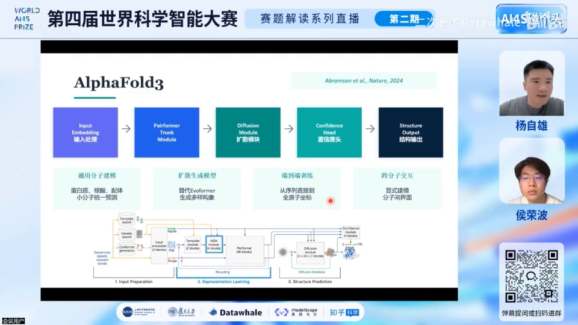

### 5.5 AF2→AF3 的范式转变

从 AF2 到 AF3 有三个关键转变（[29:48](https://www.bilibili.com/video/BV17V5C6WETU/?t=1788)）：架构上从 Evoformer+结构拼装 → Pairformer+扩散模块；坐标生成从扭转角拼装 → 直接预测原子坐标；MSA 依赖从"深度依赖" → 大幅减少。功能上 AF2 不支持 RNA–蛋白复合体，AF3 支持——但如前所述仍有 35% 空间。

## 六、任务定义与四大挑战

赛题任务：输入 RNA 序列 + 蛋白质序列，输出复合物结构；初赛直接对提交结构打分（[32:42](https://www.bilibili.com/video/BV17V5C6WETU/?t=1962)）。为什么复合物这么难？因为它同时要求四件事（[33:24](https://www.bilibili.com/video/BV17V5C6WETU/?t=2004)）：**蛋白折叠对**、**柔软的 RNA 折对**、两者放到**正确的界面**（interface）上、以及**结合诱导的构象变化**。所以单训蛋白模型、单训 RNA 模型都不够，必须训练复合体模型——而复合体数据不到 5%。

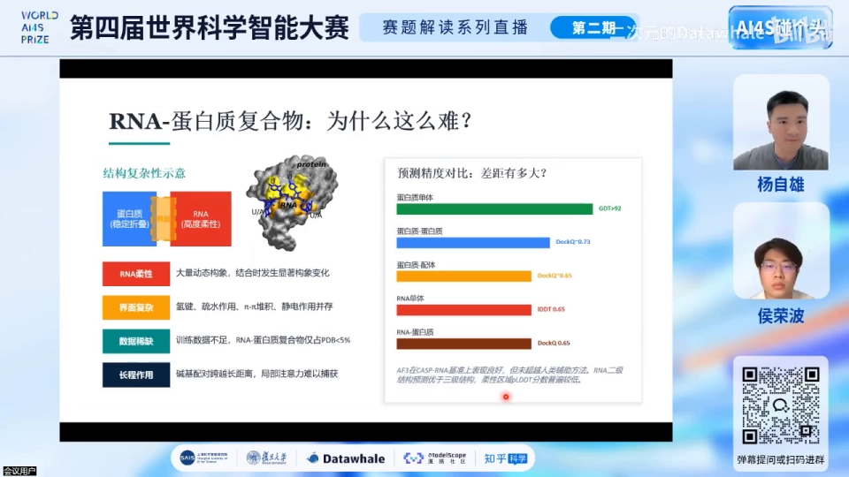

## 七、评测指标

赛题采用 RMSD、TM-score 与 lDDT 一族指标（[37:47](https://www.bilibili.com/video/BV17V5C6WETU/?t=2267)）：**RMSD** 衡量两个结构对齐后的整体偏差；**TM-score** 是归一化到 0~1 的拓扑相似性评分；**lDDT**（local distance difference test）对每个原子在逐圈扩大的邻域上算得分（四个阈值）再平均，反映局部精度；界面还有 **iRMSD**。提交格式为 mmCIF，允许多次提交、取最高分排名（[38:43](https://www.bilibili.com/video/BV17V5C6WETU/?t=2323)）。

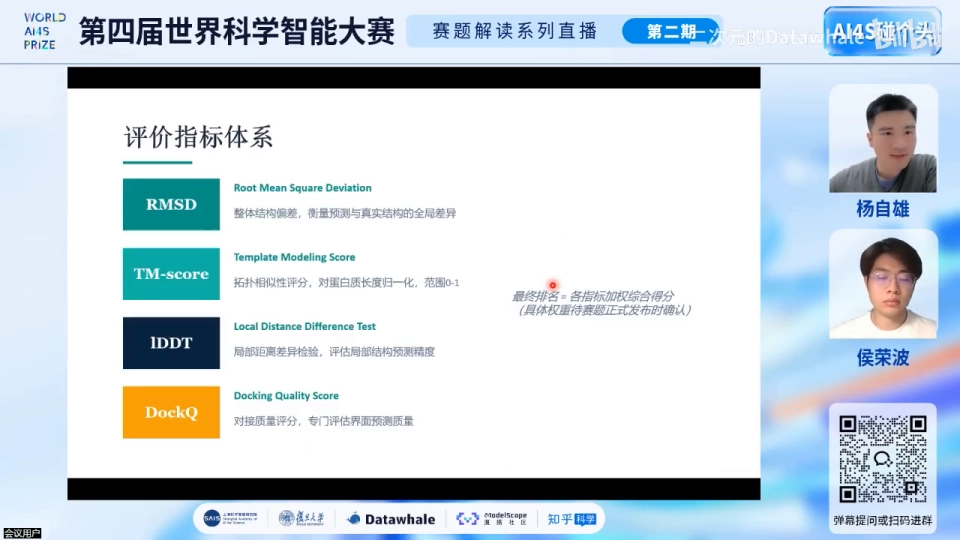

## 八、解题思路：从 baseline 到获胜方案

### 8.1 两个 baseline

赛题提供两个 baseline（[39:24](https://www.bilibili.com/video/BV17V5C6WETU/?t=2364)）：其一基于 **Protenix**（AF3 的开源复现，全原子扩散），其二基于 **SE(3) 等变**路线（RoseTTAFold2NA 一脉）。

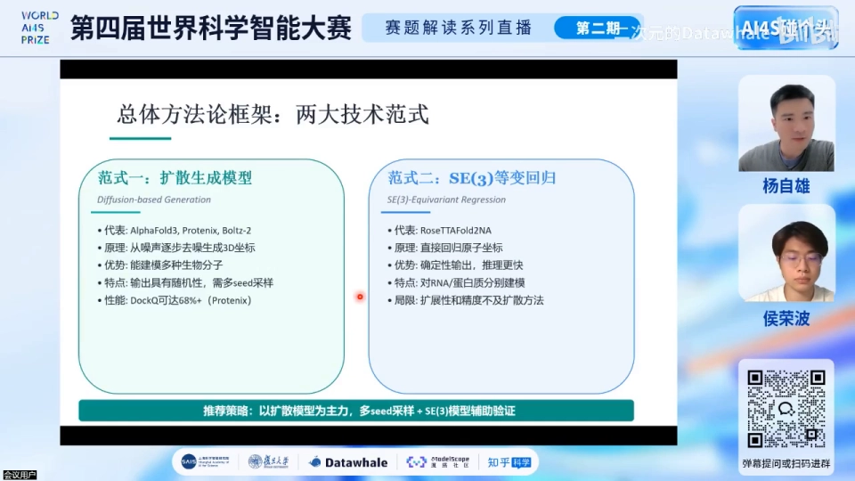

### 8.2 MSA 特征：baseline 留下的最大空白

"baseline 可能没做 MSA，或只有蛋白的 MSA"——这就是第一个提示（[40:17](https://www.bilibili.com/video/BV17V5C6WETU/?t=2417)）：**在 MSA 上下功夫**。蛋白质侧常用 MMseqs2/JackHMMER 比对；RNA 侧可用 **Infernal** 配合 **Rfam** 建 MSA（[49:38](https://www.bilibili.com/video/BV17V5C6WETU/?t=2978)）。一个关键注意事项：**RNA 的 MSA 质量通常远低于蛋白质**，所以要用 **family 分类**（Rfam family）补强——即便序列相似度低，直接把整个 family 当作 MSA 输入，可能比简单序列搜索更有帮助（[43:59](https://www.bilibili.com/video/BV17V5C6WETU/?t=2639)）。

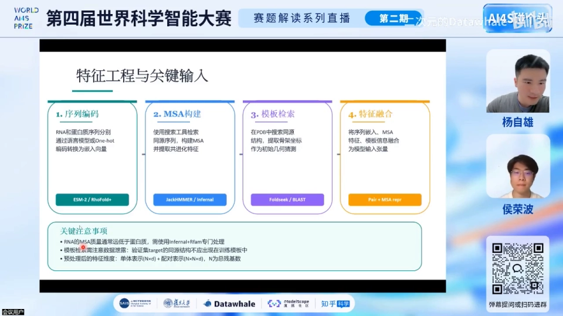

### 8.3 跳过 MSA：预训练语言模型 embedding

第二个思路更进一步：**直接跳过整个 MSA search**。别忘了 MSA 的目标就是"让一维序列有好的 embedding"——那能不能用已经训好的 embedding 模型？（[41:40](https://www.bilibili.com/video/BV17V5C6WETU/?t=2500)）蛋白质侧是 **ESM-2/ESM-3**（EvolutionaryScale 公司，从 Meta 独立出来，已在海量序列上预训练）；**"RNA 一样有相对应训练好的语言模型，像 RNA foundation model（即 RNA-FM）这种种都是非常值得尝试的"**——它们都提供丰富的序列信息。两者相辅相成：一个在大量序列上预训练，一个在不同数据库上做比对（[42:32](https://www.bilibili.com/video/BV17V5C6WETU/?t=2552)）。

关于 ESM 与 MSA 谁更好，QA 里讲者给了经验之谈：**ESM 的结果通常不会比 MSA 更好，但如果 MSA 没做好，ESM 会更好**；ESM 是轻量模型（light model），因为不用跑 MSA（[1:08:13](https://www.bilibili.com/video/BV17V5C6WETU/?t=4093)）。QA 还提到另一个 baseline 是 ESM3（本次未提供权重），几何生成模型（SE(3)、ESM3 之类的 diffusion）也非常适合尝试（[1:09:44](https://www.bilibili.com/video/BV17V5C6WETU/?t=4184)）。

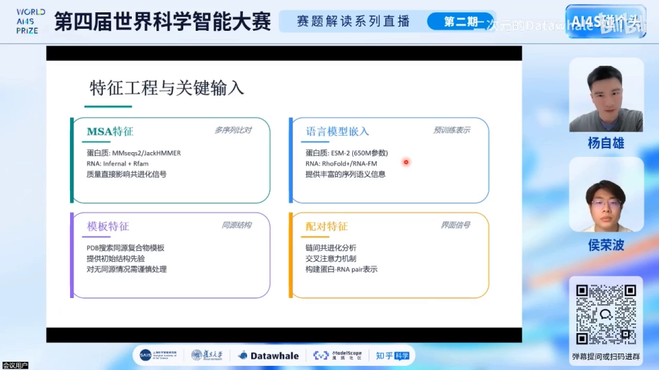

### 8.4 模板特征与微调

模板特征同样重要：用 homology 方法收集**更多高质量模板**，预测准确度就会上升（[42:47](https://www.bilibili.com/video/BV17V5C6WETU/?t=2567)）。模型层面，有了 base 权重就不必在 25 万结构甚至 4000 万序列上从头预训练：可以直接**推理**，也可以在赛题提供的 **1.9 万笔复合物**上做领域微调（[45:57](https://www.bilibili.com/video/BV17V5C6WETU/?t=2757)）。一个观察：模型在蛋白上 loss 很低、一到 RNA/复合体就升高——那就**直接用 RNA–蛋白结构做微调**。高阶玩法还有多模型 ensemble voting 与 **self-distillation**：把不同模型（如 Boltz-2）生成的结构当 2D 输入回填给 Protenix 的 structure module（[47:01](https://www.bilibili.com/video/BV17V5C6WETU/?t=2821)）。

### 8.5 多 seed 采样与置信度筛选

扩散模型自带随机性：模型置信度低时，同一模型推理 10 次结构可能差非常多——"怎么同一模型扫两次，结果差这么多"是常见困惑（[47:59](https://www.bilibili.com/video/BV17V5C6WETU/?t=2879)）。对策：**建议采 5~10 个 seed 批量生成，按 pLDDT/PAE 等置信度筛选**；若 5 个高分结构长得一样，用聚类（界面、iRMSD、DockQ）去冗余、保留一个再提交（[1:00:36](https://www.bilibili.com/video/BV17V5C6WETU/?t=3636)）。注意：**高置信度不代表结构就对**，但推理阶段这是最常见的筛选手段（[1:03:46](https://www.bilibili.com/video/BV17V5C6WETU/?t=3826)）。

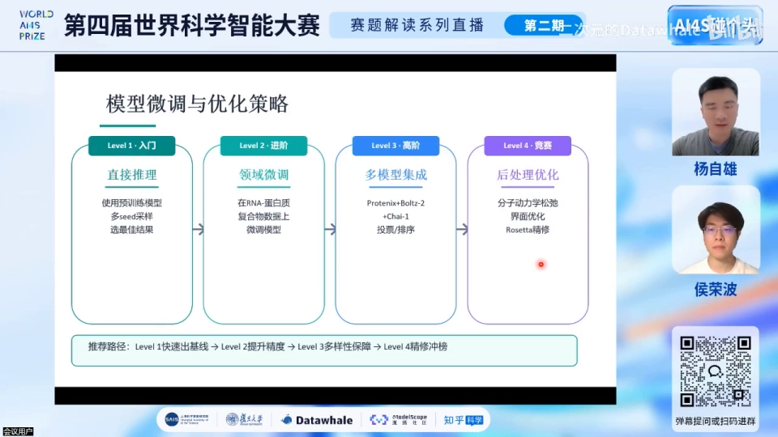

### 8.6 后处理：能量最小化与 MD 松弛

全原子 diffusion 无法保证化学立体结构——可能生成不合理的键角、二面角；**先做能量最小化**处理（[50:13](https://www.bilibili.com/video/BV17V5C6WETU/?t=3013)）。仿真工具很多：**OpenMM**（Python 直接安装）、**GROMACS**（Python 可装，源码编译更快），也有 AMBER、Schrödinger 等付费软件（[1:04:57](https://www.bilibili.com/video/BV17V5C6WETU/?t=3897)）。软件选择影响不大，**力场选择非常重要**：蛋白力场已成熟（CHARMM 系列、AMBER 系列），**RNA 的力场要额外注意选择**（[1:05:42](https://www.bilibili.com/video/BV17V5C6WETU/?t=3942)）；另外 build box 时**记得一定要放 Mg²⁺**（[1:06:03](https://www.bilibili.com/video/BV17V5C6WETU/?t=3963)）。

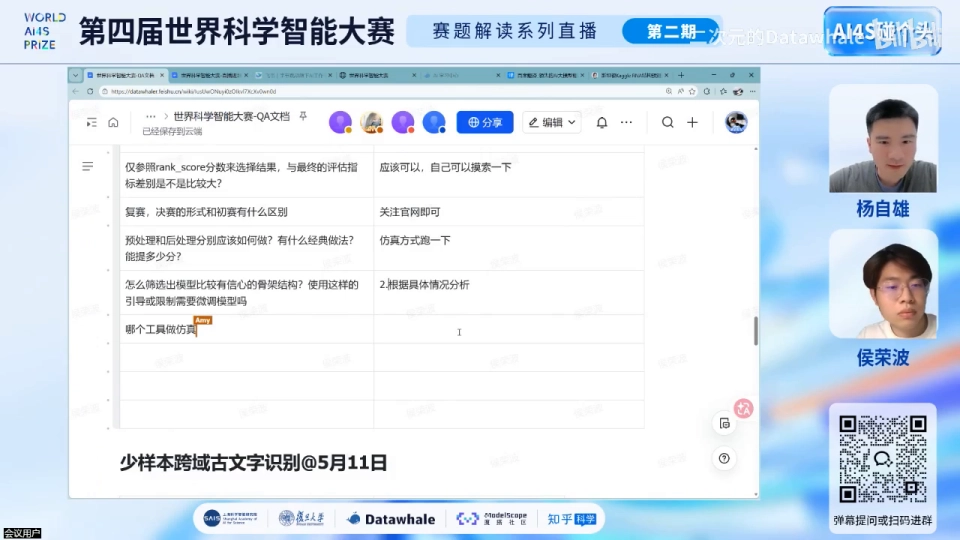

常见 workflow：搭环境装 Protenix → 批量生成 → 失败分析 → 优化提交；最低配置 A100 即可跑（[50:35](https://www.bilibili.com/video/BV17V5C6WETU/?t=3035)）。

## 九、QA 精华

- **扩散模型原理**（[52:32](https://www.bilibili.com/video/BV17V5C6WETU/?t=3152)）：前向加噪、学一个 network 去 denoise；推理时没有 ground truth，用输入引导从高斯噪声多步去噪得到结构——与图像生成同理，AF3 用 DiT（diffusion transformer）框架。
- **预训练数据组装**（[53:53](https://www.bilibili.com/video/BV17V5C6WETU/?t=3233)）：结构数据来自 PDB（蛋白/RNA/DNA/配体/离子），序列来自 UniProt/UniRef、Rfam/NCBI/ENA，宏基因组有 MGnify/BFD，化学组成看 PDB 的 CCD；未解析残基要过滤或补缺；**相似结构要 cluster 去重**——否则随机划分时同一结构同时出现在训练与验证集，模型"看过答案"，得到虚高的验证结果（[55:10](https://www.bilibili.com/video/BV17V5C6WETU/?t=3310)）。
- **Protenix 的隐藏开关**（[57:41](https://www.bilibili.com/video/BV17V5C6WETU/?t=3461)）：即便用赛题的 v0.5，代码里也有很多 options 可开——比如 **ESM embedding 默认是关掉的，可以尝试打开**；还有 **constrain module**，把已知结构的位置锁定，减少扩散随机性。
- **GPU 与精度**（[58:43](https://www.bilibili.com/video/BV17V5C6WETU/?t=3523)）：训练用 BF16（数值范围同 FP32、显存更小），推理切 FP16/FP32 对精度影响很小；**更常见的问题是 seed 随机性**——RNA–蛋白对 base model 太难，不只局部结构变化、连 binding 位置都可能错，所以不同 GPU 上结构差异大时，先怀疑 seed。**confidence head 是训练过的**；若微调了模型，记得重训 confidence head（梯度回传不能为空，因为权重变了）（[1:04:08](https://www.bilibili.com/video/BV17V5C6WETU/?t=3848)）。
- **分数预期**（[1:08:54](https://www.bilibili.com/video/BV17V5C6WETU/?t=4134)）：满分 1.0，**0.8 已经非常厉害**——当然还有提升空间。

## 小结

- RNA–蛋白复合物是结构预测的"最后高地"：PDB 占比约 5%，AF3 DockQ 65.22 仍有 35% 空间；难点是**蛋白折对 + RNA 折对 + 界面正确 + 诱导契合**四合一。
- 实验数据三种来源（X-ray/cryo-EM/NMR）各有分辨率、构象与成本的取舍；PDB 的**数据不平衡**与**缺失残基**必须在前处理时 mask 或补全。
- 全原子折叠模型遵循 **1D/2D/3D 框架**：MSA 序列特征、模板/接触图长程特征、结构生成（SE(3) token 化或全原子扩散）；AF3 的流水线是 Pairformer → diffusion module → confidence head。
- 输入特征是竞赛的主战场：**MSA 与预训练语言模型 embedding 相辅相成**——蛋白 ESM2/ESM3，**RNA 用 RNA foundation model（RNA-FM）等语言模型 embedding 非常值得尝试**；RNA MSA 质量低时用 Rfam family 分类补强。
- 工作流：baseline 推理/微调 → **5~10 seed 批量生成** → pLDDT/PAE 筛选 → 聚类去冗余 → 能量最小化/MD 松弛（RNA 力场要慎选、**别忘 Mg²⁺**）→ 提交 mmCIF。
- 训练/验证划分务必按结构 cluster 去重，否则"看过答案"的验证分数毫无意义。

## 关键术语速查

| 术语 | 一句话解释 |
| --- | --- |
| RNA–蛋白复合体 | RNA 与蛋白质结合形成的生物分子机器（核糖体、剪切体、CRISPR-Cas 等） |
| PDB | 全球最大结构数据库；RNA–蛋白复合体仅占约 5%，数据不平衡是建模难题 |
| DockQ | 复合物对接质量指标（0~1）；AF3 在该赛道约 65.22 分 |
| contact map / distogram | 两两位点是否接触/距离的分块矩阵，是模型最重要的 2D 输入 |
| Pairformer | AF3 的主干模块，在 transformer 基础上对每个 token 周围做 attention（scaling N³） |
| diffusion module | 全原子扩散生成器，从噪声逐步去噪得到结构坐标 |
| confidence head | 模型自报置信度（pLDDT/PAE）；微调后需重新训练 |
| MSA | 多序列比对；从同源序列中提取共进化信号的一维特征 |
| Infernal / Rfam | RNA 协方差模型比对工具与 RNA family 数据库，用于建 RNA MSA |
| ESM-2 / ESM-3 | EvolutionaryScale（Meta 系）蛋白质语言模型，可直接提供序列 embedding |
| RNA foundation model | 即 RNA-FM 一类 RNA 语言模型，可提供 RNA 序列 embedding（讲者点名"非常值得尝试"） |
| pLDDT / PAE | 逐残基置信度与对齐误差；批量生成后按此筛选结构 |
| self-distillation | 把其他模型生成的结构当 2D 输入回填，二次预测以融合多模型信息 |
| iRMSD | 界面（interface）RMSD，衡量复合物对接姿势的偏差 |
