# 预测 RNA 二级结构的深度学习路线：从唯一结构到逐位不配对概率

> 视频来源：[Bilibili《飞桨开发者说-基于深度学习预测RNA二级结构》](https://www.bilibili.com/video/BV1rv411Y7Z6/)（61 分 43 秒，主讲：张贺，百度美研深度学习实验室计算生物学 Tech Lead）
> 本文基于视频演说图文稿撰写，观点与数据均可回看视频核对。

## 本讲要解决的核心问题（SCQA）

**背景**：RNA 的功能由结构决定——ncRNA 靠结构调控基因表达，mRNA 疫苗的稳定性也藏在结构里（[07:40](https://www.bilibili.com/video/BV1rv411Y7Z6/?t=460)）。要拿到结构，实验方法（X 射线衍射、核磁共振、冷冻电镜）费时费力又贵（[13:52](https://www.bilibili.com/video/BV1rv411Y7Z6/?t=832)）。前一篇[热力学路线](../6.5.1_热力学路线RNAfold→RNAsubopt→RNAalifold→RNAinverse/【屈婉玲教授%20｜%20算法设计与分析】06-06%20RNA二级结构预测.md)已经讲过：经典算法用动态规划从序列推一个"最优结构"。

**冲突**：在平衡态（比如人体内）中，RNA 的结构通常**不唯一**——一条 mRNA 可能有成千上万种可及结构（[26:53](https://www.bilibili.com/video/BV1rv411Y7Z6/?t=1613)）。只预测一个"唯一结构"，就丢掉了其余结构的全部信息；而热力学方法的平均预测精度也只有六七十个百分点（[59:17](https://www.bilibili.com/video/BV1rv411Y7Z6/?t=3557)）。

**疑问**：深度学习能不能不预测"某一个结构"，而是直接从序列学出这个结构**分布的紧凑表示**？这个表示选什么作为预测目标、怎么建模、怎么改进？

**回答（中心思想）**：可以。把预测目标从"一个结构"换成"**逐位不配对概率向量**"——序列上每个位置保持不配对（单链）的概率（[36:10](https://www.bilibili.com/video/BV1rv411Y7Z6/?t=2170)）。它是物理学"配分函数"的紧凑表示，可以从碱基配对概率矩阵按行推出（[34:25](https://www.bilibili.com/video/BV1rv411Y7Z6/?t=2065)），建模上就是一个 seq2seq 问题：基线模型只需 one-hot 编码接 8 层双向 LSTM（[43:36](https://www.bilibili.com/video/BV1rv411Y7Z6/?t=2616)），后续用结构工具特征、预训练语言模型 embedding、同源序列共变、数据增广与更强的网络继续提升。

---

## 一、讲座背景：一场"不配对概率预测"竞赛与百度生物计算四件套

### 1.1 这场直播在讲什么

本次直播的主题是**螺旋桨（PaddleHelix）RNA 结构预测竞赛**，当时正在百度 AI Studio 上进行，赛题叫 **RNA Unpaired Probability Prediction（RNA 不配对概率预测）**（[00:28](https://www.bilibili.com/video/BV1rv411Y7Z6/?t=28)）。主讲人张贺来自百度美研深度学习实验室，是生物计算方向的 Tech Lead（[01:31](https://www.bilibili.com/video/BV1rv411Y7Z6/?t=91)）。他先介绍了百度在生物计算方向的一串产出，这些工具正是后面竞赛与方法的底座。

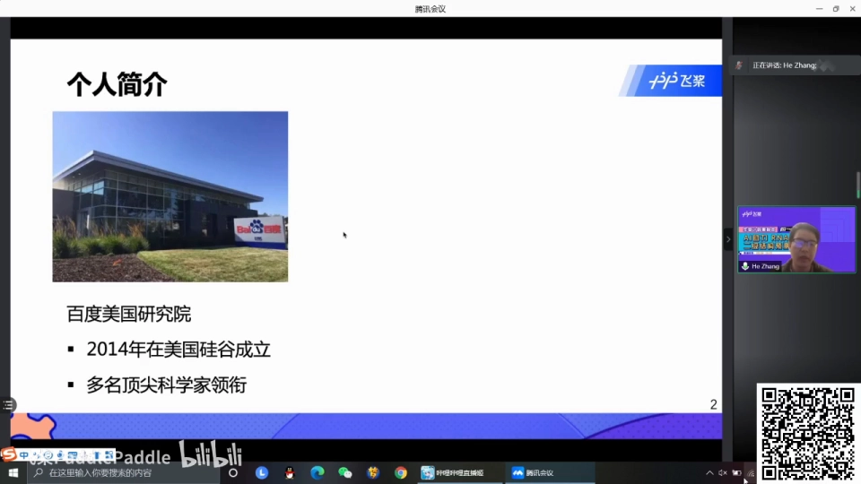

### 1.2 LinearFold / LinearPartition / LinearDesign / LinearTurboFold

四个项目恰好构成一条"结构预测 → 概率预测 → 序列设计 → 同源分析"的链条（[01:56](https://www.bilibili.com/video/BV1rv411Y7Z6/?t=116)）：

- **LinearFold / LinearPartition**：世界上最快的 RNA 二级结构预测与配分函数算法，把传统 O(N³) 动态规划降到线性时间（[57:44](https://www.bilibili.com/video/BV1rv411Y7Z6/?t=3464)）；
- **LinearDesign**：mRNA 疫苗基因序列优化，能在 **11 分钟**内完成新冠 mRNA 疫苗的序列优化，实验证明稳定性和蛋白质表达水平都大幅提升（[02:43](https://www.bilibili.com/video/BV1rv411Y7Z6/?t=163)）；
- **LinearTurboFold**：同源 RNA 结构序列分析——病毒 RNA 不断变异，药物希望对所有同源变异株都有效，它可以为新冠找到对变异保守、且与药物结合力（binding affinity）强的靶点区域（[03:05](https://www.bilibili.com/video/BV1rv411Y7Z6/?t=185)）。

## 二、五分钟 RNA 背景速览

### 2.1 以新冠病毒为例看 RNA

新冠是一种 **RNA 病毒**：最外层是糖蛋白组成的坚硬外壳，保护内部的遗传物质 RNA（[04:47](https://www.bilibili.com/video/BV1rv411Y7Z6/?t=287)）。疫情爆发后科学家做的第一件大事就是把病毒 RNA 测序测出来：基准序列（reference sequence）长 **29903 个核苷酸**（[05:24](https://www.bilibili.com/video/BV1rv411Y7Z6/?t=324)）——这也是直播互动问答的第一题答案。不同区域翻译出不同蛋白，其中**刺突蛋白（S蛋白）**就是外壳上的"红色图钉"，它与人体细胞的 **ACE2** 特异性结合、帮助病毒进入细胞，因此疫苗也是针对 S 蛋白设计的（[05:48](https://www.bilibili.com/video/BV1rv411Y7Z6/?t=348)）。人类目前尚未完全战胜的病毒（新冠、HIV、流感）基本都是 RNA 病毒（[06:47](https://www.bilibili.com/video/BV1rv411Y7Z6/?t=407)）。

### 2.2 中心法则与 mRNA 疫苗

绝大多数生物以 DNA 为遗传物质，但 DNA 在细胞核内，要翻译成蛋白质必须经过媒介——**信使 RNA（mRNA）**：DNA 先解螺旋、转录生成 mRNA，mRNA 再到细胞质翻译成蛋白质。**mRNA 是 DNA 和蛋白质之间的桥梁**（[07:37](https://www.bilibili.com/video/BV1rv411Y7Z6/?t=457)）。

mRNA 疫苗的思路正是利用这一点：传统疫苗把抗原蛋白在体外制备后注人体；mRNA 疫苗直接把 mRNA 注人体，让它在体内自我翻译生成抗原、激发免疫反应（[08:13](https://www.bilibili.com/video/BV1rv411Y7Z6/?t=493)）。好处是不用体外制备蛋白、可快速大规模生产、无感染风险；弱点是**稳定性**与**免疫原性**较差——LinearDesign 就是为解决这两个问题而生（[08:45](https://www.bilibili.com/video/BV1rv411Y7Z6/?t=525)）。

### 2.3 ncRNA 与 RNA 药物

从上世纪七八十年代起，科学家陆续发现 RNA 还承担**调控基因表达**的工作，相关研究多次获诺贝尔奖。不翻译蛋白的 RNA 统称 **non-coding RNA（ncRNA）**，比如 miRNA 参与 splicing/editing、维护 mRNA 的稳定性（[09:34](https://www.bilibili.com/video/BV1rv411Y7Z6/?t=574)）。

RNA 药物方面，2018 年 11 月 FDA 批准了首款 siRNA 药物 **patisiran**：针对一种由 TTR 蛋白产生淀粉样沉淀引起的神经性疾病，治疗思路是让 TTR 蛋白尽可能少产生——siRNA 与 TTR 的 mRNA 在 3'UTR 区域特异性结合，抑制 TTR 蛋白表达（[10:13](https://www.bilibili.com/video/BV1rv411Y7Z6/?t=613)）。此后陆续又有两三款 siRNA 药物上市。

## 三、从序列到结构：二级结构与三级结构

### 3.1 序列只是字符串

RNA 序列可以表示成一串由 **A、U、C、G** 组成的字符串，每个字母代表一种核苷酸（[11:40](https://www.bilibili.com/video/BV1rv411Y7Z6/?t=700)）。对 mRNA 来说序列承载遗传信息；但对 ncRNA 而言，**更重要的是结构**——所以测序之外，我们更想知道 RNA 折叠成什么样子（[12:17](https://www.bilibili.com/video/BV1rv411Y7Z6/?t=737)）。

### 3.2 二级结构与三级结构

视频把 RNA 结构分成两个层次（[12:26](https://www.bilibili.com/video/BV1rv411Y7Z6/?t=746)）：

- **二级结构**：2D 平面上的结构，由**碱基对**（两个位点通过氢键配对）与未配对形成的**环**组成；
- **三级结构**：二级结构在空间中进一步相互作用、扭曲折叠形成的 3D 结构（比如 tRNA 折叠成立体 L 形）。

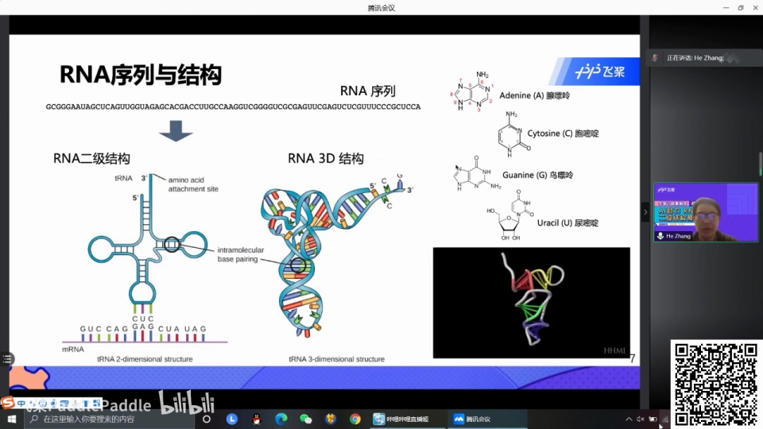

### 3.3 碱基对约束与问题定义

实验解析结构的方法（核磁共振、冷冻电镜、X 射线衍射）费时费力费钱，因此人们一直想**用计算方法预测结构**（[13:52](https://www.bilibili.com/video/BV1rv411Y7Z6/?t=832)）。数学上，RNA 二级结构预测问题是：输入一条 RNA 序列，输出一个由 base pair 与 unpaired 位点组成的集合（[14:16](https://www.bilibili.com/video/BV1rv411Y7Z6/?t=856)）。通常还加一个碱基对约束：只有能形成较强氢键的配对才算稳定——**GC、AU、GU**（连同互补方向共 6 种）（[14:35](https://www.bilibili.com/video/BV1rv411Y7Z6/?t=875)）。

## 四、经典路线：动态规划求"配对最多"

从上世纪 80 年代起就有算法研究这个问题，经典做法借鉴了 NLP 里句法解析（parsing）的 **CKY 算法**，做自底向上的动态规划（[15:08](https://www.bilibili.com/video/BV1rv411Y7Z6/?t=908)）。视频用最简单的目标演示：把"最优结构"定义为**配对数最多**的结构。以序列 `ACAGU` 为例：按 span（间隔）长度从底向上填表——长度 1 的间隔里每个位点都只能是点（不配对）；长度 2 时只有 GU 能配对，打一个括号；以此类推（[15:39](https://www.bilibili.com/video/BV1rv411Y7Z6/?t=939)）。这正是[热力学路线那篇博客](../6.5.1_热力学路线RNAfold→RNAsubopt→RNAalifold→RNAinverse/【屈婉玲教授%20｜%20算法设计与分析】06-06%20RNA二级结构预测.md)里 O(N³) 动态规划的同源思路。

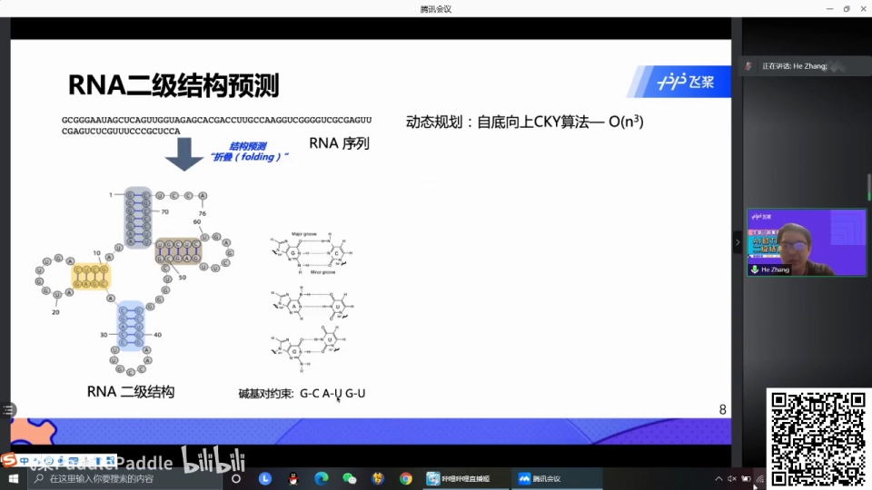

## 五、关键转折：平衡态不唯一，单一结构预测是过度简化

### 5.1 一个 RNA，多种结构

深度学习模型目前主要预测**单一结构**。这有什么问题？因为在平衡态（如人体内）中 RNA 结构通常不唯一，对 mRNA 尤甚——可能有成千上万种结构。视频举了一个实验探知的 RNA 为例：它有 **56%** 的概率折叠成 A 结构、**27%** 的概率折叠成 B 结构，还有各种小概率的其他结构。如果只预测出 A 结构，就丢掉了剩余约 44% 的可能性——这显然是过度简化（[26:53](https://www.bilibili.com/video/BV1rv411Y7Z6/?t=1613)）。

### 5.2 配分函数与采样

于是人们借用物理学 **partition function（配分函数）**的概念：横轴是各种不同结构、纵轴是每个结构对应的概率，用这条分布来模拟 RNA 在体内平衡态多结构并存的状态（[27:42](https://www.bilibili.com/video/BV1rv411Y7Z6/?t=1662)）。有了配分函数就能**采样**：按各结构所占比例抽 1 万次，大约 5600 次抽到 A 结构、2700 次抽到 B 结构。视频对马 tRNA（equine tRNA）采样 10 次，结构各不相同，但有共同点——某红色区域在 10 个结构里全部 unpaired，蓝色区域全部 paired，粉色区域只有 1 个位置 paired（[28:15](https://www.bilibili.com/video/BV1rv411Y7Z6/?t=1695)）。

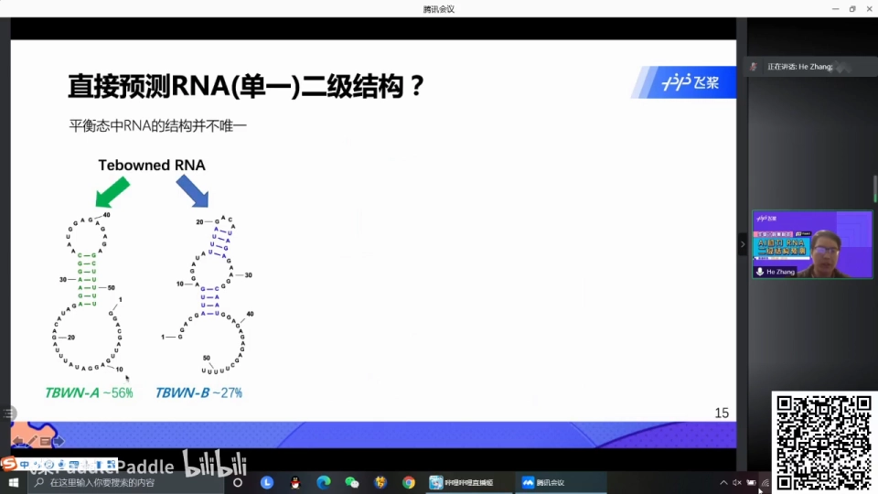

### 5.3 碱基配对概率矩阵：成千上万结构的紧凑表示

配分函数对应的结构有成千上万个，没法一一罗列，所以需要更**紧凑**的表示——这就是**碱基对配对概率**（base pair probability）：用一个 L×L 的二维矩阵，第 (i, j) 格表示位点 i 和 j 形成 base pair 的概率。它等于把所有结构中该配对出现的次数加起来、除以结构总数（[29:51](https://www.bilibili.com/video/BV1rv411Y7Z6/?t=1791)）。矩阵里深红色的区域，对应概率约 0.56、0.27——正是前面 A、B 结构的占比。

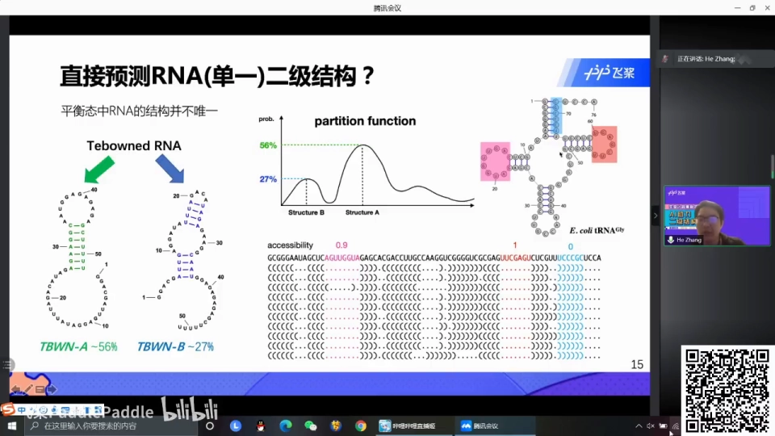

### 5.4 LinearPartition 与 PaddleHelix 实操

百度在 LinearFold 的基础上做了 **LinearPartition**：线性时间预测碱基对配对概率。论文对比了 23S rRNA 和 Group I intron 两类 RNA：蓝色表示与已知结构一致、红色表示不一致，LinearPartition 的预测中红色大幅减少，精度显著提高（[31:07](https://www.bilibili.com/video/BV1rv411Y7Z6/?t=1867)）。LinearPartition 已集成到飞桨 PaddleHelix 平台：在 Python 里给定序列和概率阈值（示例取 0.05），就能输出所有大于 0.05 的配对概率列表——例如 (2,15) 位置概率约 0.833、(3,14) 约 0.836（[32:01](https://www.bilibili.com/video/BV1rv411Y7Z6/?t=1921)）。

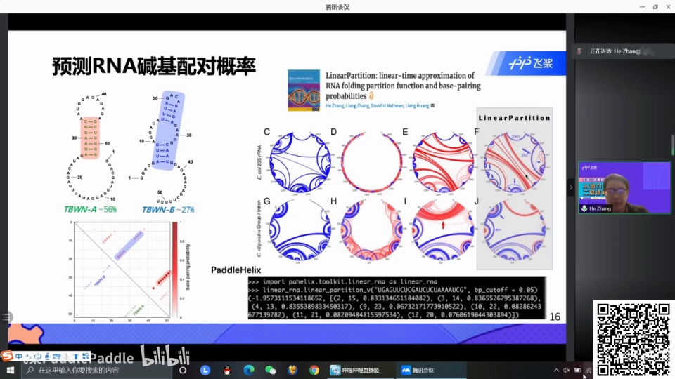

## 六、手算一遍：从配对概率到不配对概率

### 6.1 上三角矩阵

视频引用了一个大学教学网站的案例来演示配对概率怎么算、以及如何从配对概率导出不配对概率（[32:53](https://www.bilibili.com/video/BV1rv411Y7Z6/?t=1973)）。序列 `GGUCCAC`：画一个上三角矩阵，每个格子表示对应两个位点形成 base pair 的概率。G1-G1（自己和自己）当然是 0；G1-U3 是 0.046；概率最高的是 **G1 和末位 C7，为 0.417**——意味着在众多结构里，41.7% 的结构都有这一个碱基对。把概率画成实心圆圈，圆圈的颜色深浅和大小就表示概率大小（[33:43](https://www.bilibili.com/video/BV1rv411Y7Z6/?t=2023)）。

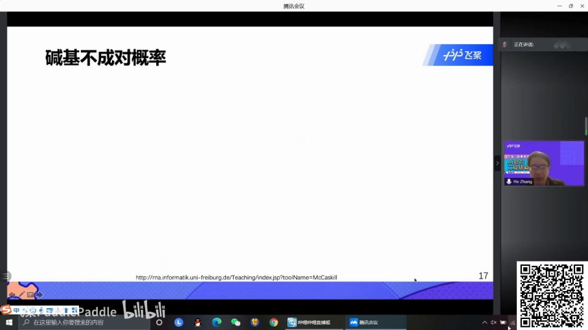

### 6.2 不配对概率 = 1 − 行和

有了配对概率，**不配对概率**（unpaired probability）用一个很简单的方法得到：对任何一个位点（比如 G1），它与其他**所有**位点都不形成碱基对的概率，就是 1 减去这一行数字的加和（[34:25](https://www.bilibili.com/video/BV1rv411Y7Z6/?t=2065)）。算出来 G1 的不配对概率是 **0.323**。表里还有另一列概念 **accessibility（可及性）**——从第一个位置到某个位置整个区间全部不配对的概率（如全长 7 的区间概率 0.017），但竞赛不涉及，可以不用关注（[34:51](https://www.bilibili.com/video/BV1rv411Y7Z6/?t=2091)）。

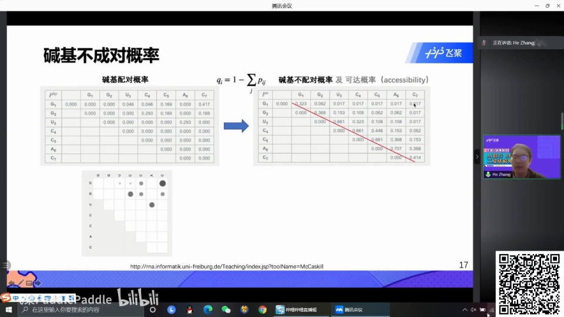

## 七、赛题定义与三大应用

### 7.1 预测 L 维不配对概率向量

由此引出赛题：用深度学习、在飞桨平台上预测 **unpaired probability**——输出一个 L 维向量（L 为序列长度），向量里每个值都在 0 到 1 之间，表示对应位点保持不配对的概率（[36:10](https://www.bilibili.com/video/BV1rv411Y7Z6/?t=2170)）。

### 7.2 应用一：mRNA 疫苗的降解风险

mRNA 最大的问题是**容易被降解**（高温、各种酶），一旦降解疫苗就失效。现实中 Moderna 疫苗要零下 20 多度保存、Pfizer/BioNTech 疫苗要零下 70 度；美国德州寒潮断电导致冰箱里的疫苗报废，归根到底是序列发生了断裂（[36:55](https://www.bilibili.com/video/BV1rv411Y7Z6/?t=2215)）。而断裂主要发生在 **unpaired region**——所以预测不配对概率，就能很好地衡量一段 mRNA 序列的降解难易程度（[38:00](https://www.bilibili.com/video/BV1rv411Y7Z6/?t=2280)）。

### 7.3 应用二：siRNA / ASO 药物设计

RNA 干扰（RNAi）和反义寡核苷酸（ASO）药物的机理，是设计一小段 siRNA 或反义 RNA 序列，与靶点 RNA 的特定区域通过**碱基互补的氢键**结合。能结合的区域通常是**单链区域**——本身没配对的位置才腾得出手来与药物配对（[38:28](https://www.bilibili.com/video/BV1rv411Y7Z6/?t=2308)）。这也是我们关注 unpaired region 的原因。

### 7.4 为什么 label 便宜：SHAPE reactivity

不配对概率在实验上可以用 **SHAPE reactivity** 探测：通过化学修饰测出每个位点保持不配对的概率，而且**比较便宜**——这正好支持竞赛 label 的获取（[39:30](https://www.bilibili.com/video/BV1rv411Y7Z6/?t=2370)）。相比之下，解析完整结构的 NMR/X 射线又贵又只能看到一种结构。

### 7.5 为什么是向量而不是矩阵

从机器学习视角看，这是一个很好的 **seq2seq** 问题：输入 RNA 序列，输出等长的向量，每个位置是一个不配对概率（[40:49](https://www.bilibili.com/video/BV1rv411Y7Z6/?t=2449)）。相比预测 L×L 的配对概率**矩阵**，一维向量对深度学习模型更简单——这就是赛题选择不配对概率的原因（[41:21](https://www.bilibili.com/video/BV1rv411Y7Z6/?t=2481)）。

## 八、数据与基线模型

### 8.1 四个数据集

竞赛放出三个数据集：**训练集 4000 多条、验证集 200 多条、测试集 A 444 条**；另有测试集 B 110 条留作 B 榜（当时还在实验中，未公布）（[41:47](https://www.bilibili.com/video/BV1rv411Y7Z6/?t=2507)）。每个数据点由四部分组成：序列 id、RNA 序列、用 LinearFold 预测的结构、以及每个位点的不配对概率标签（即输出）（[42:31](https://www.bilibili.com/video/BV1rv411Y7Z6/?t=2551)）。测试集只提供前三部分。

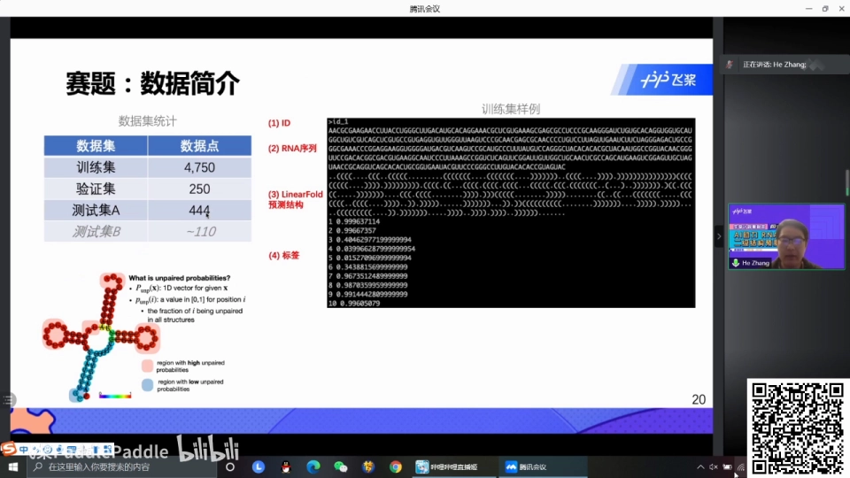

### 8.2 基线：one-hot + 8 层双向 LSTM

为方便上手，官方提供了一个**非常简单**的基线模型（[43:09](https://www.bilibili.com/video/BV1rv411Y7Z6/?t=2589)）：

1. **输入层**：序列做 4 维 one-hot 编码，LinearFold 预测的结构也做同维 one-hot，两者拼接（concatenate）；
2. **中间层**：8 层双向 LSTM（BiLSTM）；
3. **输出层**：softmax 输出 L 维向量。

模型简单意味着改进空间大——很容易就能超过基线（[43:33](https://www.bilibili.com/video/BV1rv411Y7Z6/?t=2613)）。

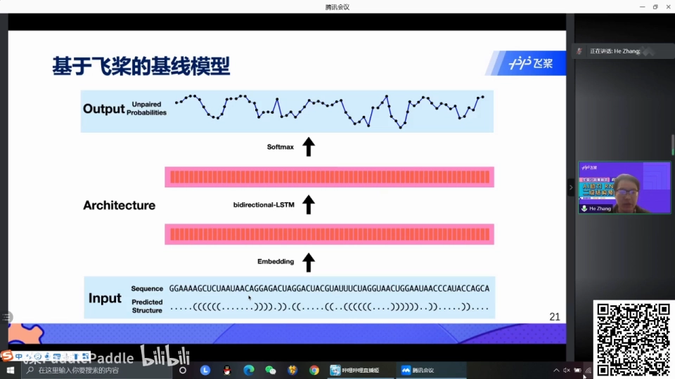

## 九、五大改进方向与网络改进

### 9.1 更多结构特征输入

基线只用了 LinearFold 的一种结构。可以把**更多开源工具**预测的结构作为输入：ContraFold、mxfold、SPOT-RNA、RNAfold、RNAstructure 等，视频罗列了它们的下载地址（[44:22](https://www.bilibili.com/video/BV1rv411Y7Z6/?t=2662)）；也可以直接用 LinearPartition 预测的 base pair / unpaired probability 作为输入特征（[45:03](https://www.bilibili.com/video/BV1rv411Y7Z6/?t=2703)）。

### 9.2 预测结构类型

每个位点都属于一种**结构类型**：hairpin loop（发夹环）、internal loop（内环）、stacking（堆叠）等。把每个位点的结构类型预测出来（或从预测结构中 parse 出来）作为附加特征（[45:13](https://www.bilibili.com/video/BV1rv411Y7Z6/?t=2713)）。

### 9.3 预训练语言模型——深度学习路线的"embedding"之路

NLP 里常用的**预训练模型**（BERT、ELMo 等）同样适用于 RNA：2019 年 ICLR 有一篇做蛋白质结构分析的论文用 ELMo 做预训练，效果不错，代码已在 GitHub 开源，只有大概二三百行 Python，非常容易上手（[45:53](https://www.bilibili.com/video/BV1rv411Y7Z6/?t=2753)）。预训练数据也容易获得：只需要 RNA 序列——测序很便宜，像 **RNAcentral** 这样最大的 RNA 序列库可以下载百万级序列做预训练（[46:40](https://www.bilibili.com/video/BV1rv411Y7Z6/?t=2800)）。

这正是"序列语言模型 + 结构预测"路线的起点：先在大量无标注序列上自监督预训练学出 embedding，再把 embedding 喂给下游结构预测模型。本系列 4.2.4 的 RNA-FM（640 维嵌入）与 5.5.2 的 RNA-FM 接触图应用，正是这条路线的后续演进。

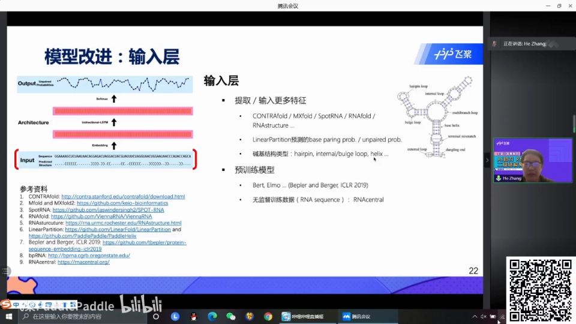

### 9.4 同源序列共变

**同源序列**在某些点位上会发生变异，但二级结构往往保留：比如 GC 配对突变成 UA，序列变了、碱基对还在——因为 **RNA 的二级结构比序列（一级结构）更保守**、更不容易突变（[47:04](https://www.bilibili.com/video/BV1rv411Y7Z6/?t=2824)）。所以能拿到同源序列的信息（共变分析），就能提高模型能力。

### 9.5 数据增广

一个简单的增广技巧：把序列里的片段互换位置（如 UGGG 与 GCCC 交换），碱基对保持不变，但多了一个数据点（[47:58](https://www.bilibili.com/video/BV1rv411Y7Z6/?t=2878)）。

### 9.6 网络结构改进

网络层面可以引入**注意力机制**、把 LSTM 换成 Transformer、尝试 CNN 或 GNN（图神经网络）；输出层目前是直接 softmax，但考虑到相邻位点的依赖（位点 i 倾向不配对，i+1 通常也更倾向不配对，是连续变化的过程），用**自回归**模型把前面已预测的信息喂给后续预测，可能有帮助（[48:26](https://www.bilibili.com/video/BV1rv411Y7Z6/?t=2906)）。

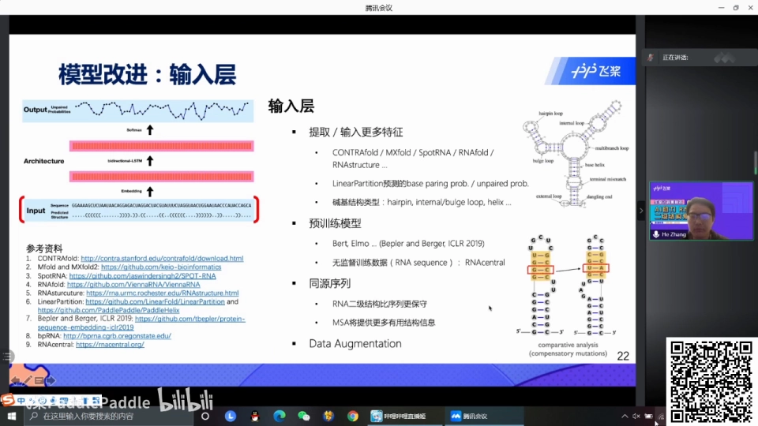

## 十、赛制、指标与领域现状

### 10.1 提交与评测

针对 444 个 A 榜测试点，每个提交一个 TXT 文件，内容为一列数据，每行表示对应位置的碱基不成对概率（[52:39](https://www.bilibili.com/video/BV1rv411Y7Z6/?t=3159)）。评价指标选了生物计算里常用的 **RMSD**（视频口播口径：预测值与 ground truth 逐位点比较后取平均偏差）（[53:11](https://www.bilibili.com/video/BV1rv411Y7Z6/?t=3191)）。

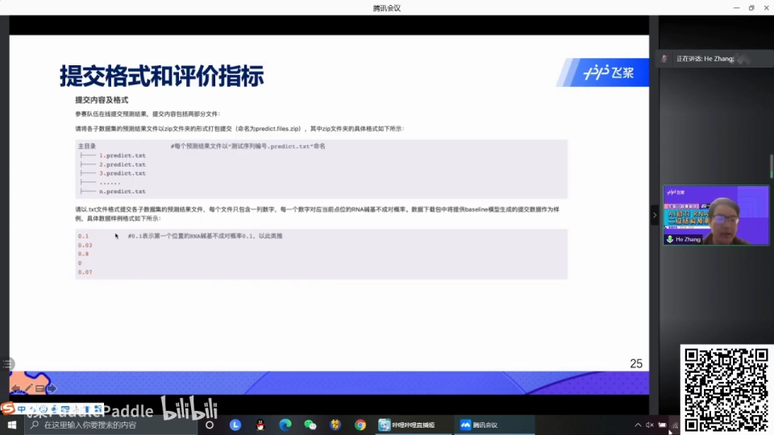

### 10.2 A/B 榜设计：公平来自"还没测出来的 label"

为保证公平公正，竞赛设计了 A 榜与 B 榜：B 榜的 110 条序列正交由合作方**北京大学**做 SHAPE reactivity 实验（刘军教授实验室），连讲者自己都不知道 label——所以不可能作弊（[53:34](https://www.bilibili.com/video/BV1rv411Y7Z6/?t=3214)）。A 榜当时已有约 30 人提交，领先选手 RMSD 0.213，已超过基线。A 榜结束后，所有在 A 榜有成绩的选手进入 B 榜，最终按 B 榜评奖。竞赛还邀请了两重量级技术指导：罗彻斯特大学的 **David Mathews** 教授（引用近 3 万的领域大牛）与北大的刘军教授（实验验证指导）（[55:05](https://www.bilibili.com/video/BV1rv411Y7Z6/?t=3305)）。时间节点上，4 月 14 日 A 榜关闭并截止报名，4 月 20 日左右开放 B 榜，5 月公布获奖——总奖金 10 万元，为百度大脑竞赛最高档，评出 12 支获奖队伍（[55:51](https://www.bilibili.com/video/BV1rv411Y7Z6/?t=3351)）。

### 10.3 领域现状：六七成精度，仍在活跃演进

Q&A 中张贺梳理了领域进展（[57:21](https://www.bilibili.com/video/BV1rv411Y7Z6/?t=3441)）：80 年代起是传统动态规划（CKY 一脉），此后算法层面大创新不多，都是围绕 O(N³) 做小改；直到 LinearFold 把时间降到**线性**才算大创新。近年越来越多机器学习方法（ContraFold、mxfold）与深度学习方法（SPOT-RNA 等）发表在不错的期刊上，领域仍然活跃。但**目前平均预测精度大概在六七十个百分点**，离 90% 甚至 100% 还有距离——这正是继续优化的空间，也是深度学习路线的机会所在。

## 小结

- RNA 二级结构由**碱基对与环**组成；约束为 GC/AU/GU 三类（含互补方向共 6 种）强氢键配对。
- 平衡态中 RNA 结构**不唯一**：一条 mRNA 可有成千上万种结构，只预测单一结构是过度简化。
- **配分函数**描述"结构 × 概率"分布；它的紧凑表示是 **L×L 碱基配对概率矩阵**（LinearPartition 可线性时间预测）。
- 对配对概率矩阵**按行取 1−行和**，即得逐位**不配对概率**——竞赛的预测目标是一个 L 维向量。
- 应用直接落地：mRNA 断裂发生在 unpaired region（疫苗保存失效问题）、siRNA/ASO 只能结合单链区、SHAPE reactivity 能便宜地测出 label。
- 基线模型 = one-hot（序列+结构）+ 8 层 BiLSTM + softmax；改进方向：多工具结构特征、结构类型、**预训练语言模型 embedding（RNAcentral 百万序列）**、同源序列共变、数据增广、注意力/Transformer/自回归输出。
- 竞赛用"还没测出来的 B 榜"保证公平；领域平均精度六七成，深度学习路线仍有很大空间。

## 关键术语速查

| 术语 | 一句话解释 |
| --- | --- |
| 二级结构 | RNA 链在 2D 平面上由碱基对与环构成的结构 |
| 碱基对（base pair） | 两个位点通过氢键配对；稳定配对限于 GC/AU/GU（含互补方向共 6 种） |
| 配分函数（partition function） | 描述平衡态中"各种结构 × 各自概率"分布的物理量 |
| 碱基配对概率 | L×L 矩阵第 (i,j) 格 = 位点 i、j 在整个结构系综中配对的概率 |
| 不配对概率（unpaired probability） | 某位点与所有其他位点都不配对的概率 = 1 − 该行配对概率之和 |
| accessibility | 序列上一段区间内全部位点都不配对的概率（本赛题不涉及） |
| SHAPE reactivity | 用化学修饰实验探测逐位点不配对概率的便宜方法，竞赛 label 的来源 |
| LinearFold / LinearPartition | 百度的线性时间 RNA 二级结构 / 配对概率预测算法 |
| PaddleHelix | 百度飞桨的生物计算平台，可直接 Python 调用上述工具 |
| BiLSTM | 双向长短时记忆网络；基线模型的中层结构 |
| 共变（covariation） | 同源序列中配对位点协同突变（GC→UA）但碱基对保留的现象 |
