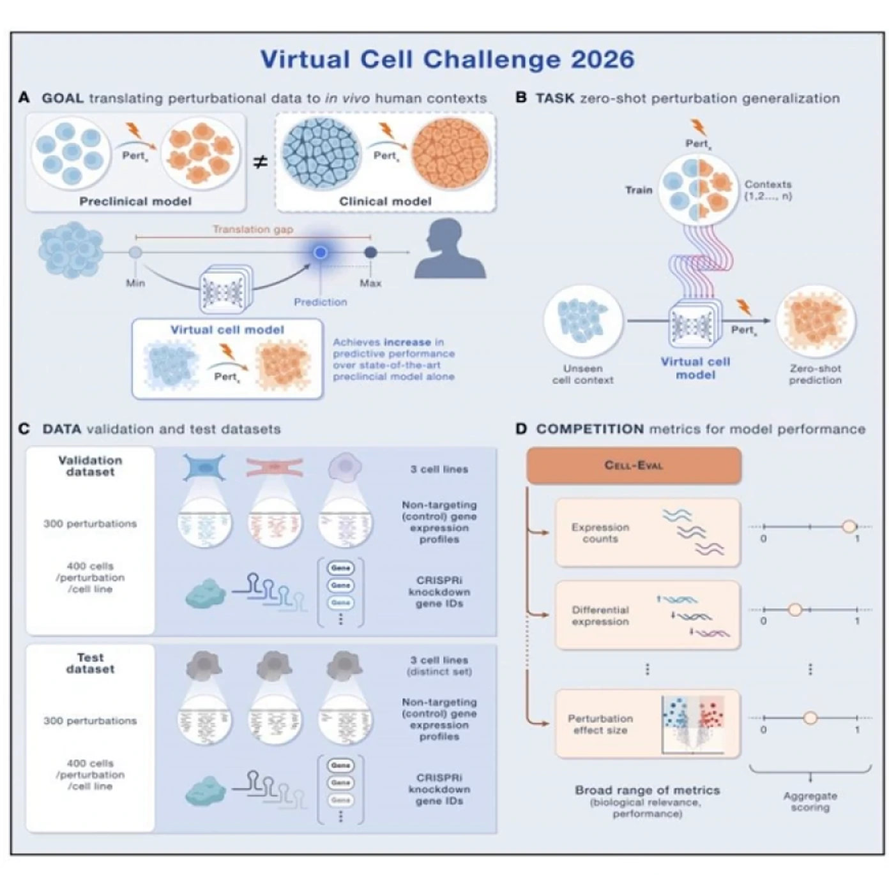
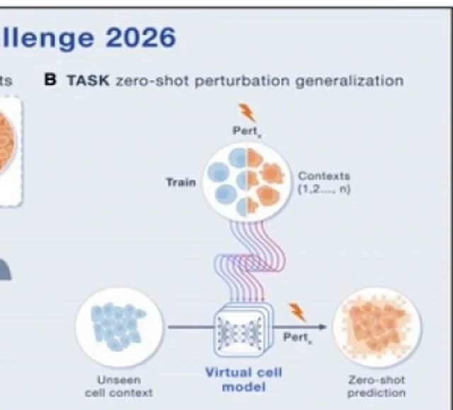
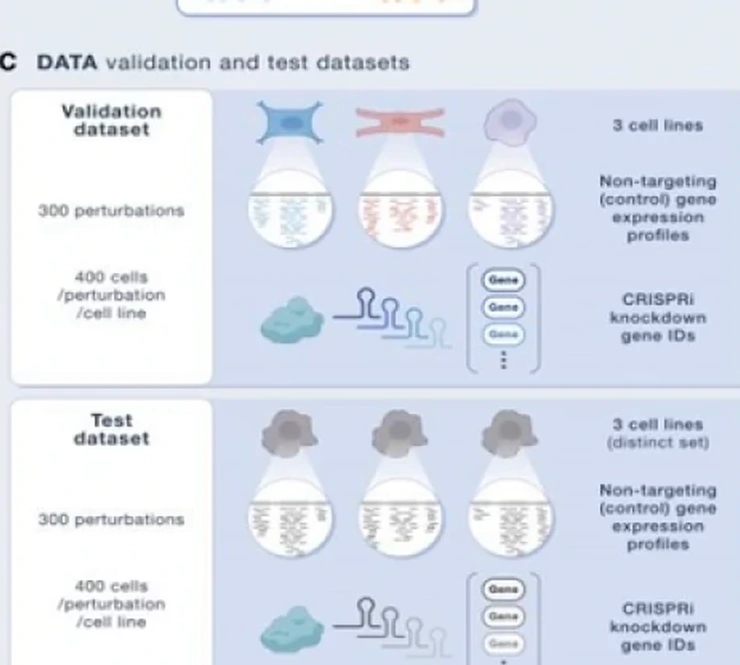
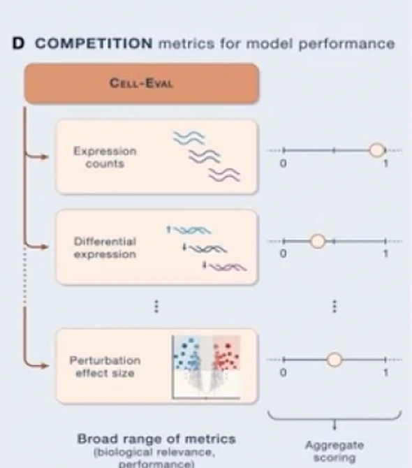

# 1661-Virtual Cell Challenge 2026

> **视频**：[1661-Virtual Cell Challenge 2026](https://www.youtube.com/watch?v=Jm4oNbfqYoE)（YouTube，25:33）
>
> 本文只基于该视频文稿整理。视频解读 Cell 评论文章《Virtual Cell Challenge 2026: benchmarking zero-shot generalization across cellular contexts》，赛事规模与设计按视频表述“视频称/报告称”。

## 开篇：为什么“治愈小鼠”的故事，最后常常没有下文？

**背景（S）**：我们常看到某种化合物在培养皿里消灭癌细胞，或在小鼠身上治好疾病，读者自然期待它在人体里复制同样效果。

**冲突（C）**：绝大多数候选药物进入人体临床试验后最终失败。制药业称这个现象为**转化鸿沟（translational gap）**：在培养皿或小鼠里有效，不等于在人体里有效（[【跳转到 00:50】](https://www.youtube.com/watch?v=Jm4oNbfqYoE&t=50)）。原因是细胞离开人体后，组织环境、邻居细胞和化学梯度都没了。

**疑问（Q）**：能否在计算机里造一个**虚拟细胞（virtual cell）**提前预测？如果要检验这种能力，比赛该怎么设计，才能避免参赛者“刷榜”？

**回答（中心思想）**：2025 年首届 Virtual Cell Challenge（VCC）证明，全球 AI 社区很擅长在单一细胞系上识别扰动，却不擅长迁移到新细胞背景；2026 年因此改成**零样本（zero-shot）泛化**——六个癌细胞系、三个完全隐藏的细胞系、CRISPRi 与单细胞 RNA 测序，再用 Cell-Eval 的六项指标聚合评分。目标不是背下数据，而是学会“扰动如何跨细胞背景迁移”。

## 一、虚拟细胞不是 3D 动画，而是能在计算机里预测扰动的模型

虚拟细胞不是屏幕上可旋转的 3D 细胞图，也不是单纯的 VR 演示。它是一种 **in silico（在计算机中）的预测模型**：用数学方式表示细胞状态及其动态响应，预测真实人类细胞在特定干预下会怎么变，而不必先在湿实验里做一遍（[【跳转到 01:40】](https://www.youtube.com/watch?v=Jm4oNbfqYoE&t=100)）。

为什么不能继续在培养皿里研究真实细胞？视频给出三个原因（[【跳转到 02:30】](https://www.youtube.com/watch?v=Jm4oNbfqYoE&t=150)）：与疾病相关的细胞类型可能非常稀有、高度特化；原代细胞离开宿主后往往不再生长分裂；患病细胞被放到实验室塑料平板上后，常会丢失疾病特征。更关键的是，细胞在体内不是孤立的，它周围有血管、免疫细胞、结构蛋白和化学梯度。

把细胞拿出来，就像想理解一座城市的经济，却从城里抓一个市民放进无菌白房间，再观察他会做什么（[【跳转到 02:55】](https://www.youtube.com/watch?v=Jm4oNbfqYoE&t=175)）。他的行为当然会变，因为城市没了。而唯一能在原生环境中真正扰动人类细胞的场景，是临床试验本身；但那是药物开发最晚、最贵、风险最高的阶段（[【跳转到 03:45】](https://www.youtube.com/watch?v=Jm4oNbfqYoE&t=225)）。

## 二、扰动图谱是标准方法，但它把细胞搬出了原生环境

在虚拟细胞之前，科学家怎么知道一个基因或药物做什么？靠**扰动图谱（perturbation profiling）**，它被描述为过去二十多年细胞生物学的基石（[【跳转到 04:10】](https://www.youtube.com/watch?v=Jm4oNbfqYoE&t=250)）。

流程可以记成 **BBA：Baseline（基线）— Break it（破坏它）— Analyze（分析）**（[【跳转到 05:00】](https://www.youtube.com/watch?v=Jm4oNbfqYoE&t=300)）：先记录正常细胞的静息状态；再用 RNA 干扰或基因敲除破坏某个基因；最后用 RNA 测序读取整个转录组的变化。

为什么用 RNA 测序？DNA 是锁在细胞核里的总蓝图，基因活跃时会生成信使 RNA（mRNA），相当于发到工厂车间的说明书副本。测序 mRNA，就是读细胞的“实时预算”：哪些基因在加班，哪些停工了（[【跳转到 05:25】](https://www.youtube.com/watch?v=Jm4oNbfqYoE&t=325)）。敲掉一个基因后，你看到的是整条连锁反应。

问题是，这些 BBA 实验仍发生在“空房间”里，缺少真实人体背景（[【跳转到 05:50】](https://www.youtube.com/watch?v=Jm4oNbfqYoE&t=350)）。而把所有基因、细胞类型、条件下的组合都做一遍，排列数量“比宇宙里的星星还多”（[【跳转到 06:15】](https://www.youtube.com/watch?v=Jm4oNbfqYoE&t=375)）。所以虚拟细胞要把整个流程搬进机器学习环境。

## 三、VCC 2025 的教训：模型学会了识别扰动，也学会了刷榜

2025 年首届 VCC 只给一个细胞系——**H1 人胚胎干细胞**——要求预测单基因扰动后转录组的变化（[【跳转到 07:30】](https://www.youtube.com/watch?v=Jm4oNbfqYoE&t=450)）。规模很大：视频称 5000 多人注册、来自 114 个国家、组成 1200 多支队伍、提交 300 多份方案（[【跳转到 08:20】](https://www.youtube.com/watch?v=Jm4oNbfqYoE&t=500)）。

最强模型在两项能力上有进步：**扰动判别**，能从生物噪声里区分“被扰动过的细胞”和“没被扰动过的细胞”；以及**差异表达基因识别**，能指出哪些基因因为目标基因被破坏而显著变化（[【跳转到 09:10】](https://www.youtube.com/watch?v=Jm4oNbfqYoE&t=550)）。但它们预测不好变化幅度，还不能在所有必需指标上稳定替代实验测量（[【跳转到 09:35】](https://www.youtube.com/watch?v=Jm4oNbfqYoE&t=575)）。

更麻烦的是**过拟合（overfitting）**：模型只针对排行榜分数优化，把 H1 在特定实验室条件下的怪癖记了下来（[【跳转到 10:00】](https://www.youtube.com/watch?v=Jm4oNbfqYoE&t=600)）。换成肺细胞或肝细胞就会崩。视频用“空白石板”比喻干细胞：不能只在这种相对空白的细胞上训练，就指望模型理解成年神经元的复杂行为（[【跳转到 10:25】](https://www.youtube.com/watch?v=Jm4oNbfqYoE&t=625)）。

## 四、VCC 2026 把零样本变成考题：换细胞系，但不给该细胞系的扰动答案

2026 年考**多背景泛化（multi-context generalization）**，形式是**零样本预测**（[【跳转到 11:40】](https://www.youtube.com/watch?v=Jm4oNbfqYoE&t=700)）。定义很具体：模型要在从未见过该细胞系任何配对扰动训练样本的情况下，预测它对某个扰动的反应（[【跳转到 12:30】](https://www.youtube.com/watch?v=Jm4oNbfqYoE&t=750)）。注意，它不是“什么数据都没有”：你仍有该细胞系的对照表达、目标基因身份，以及其他细胞系上的扰动数据。

视频用厨师做类比：2025 年像给 AI 100 份巧克力蛋糕食谱，练习后烤一个蛋糕；2026 年像把奶酪舒芙蕾的原料直接交给它，既没食谱，也没见过成品，却要求第一次就成功（[【跳转到 12:55】](https://www.youtube.com/watch?v=Jm4oNbfqYoE&t=775)）。

计算上，这依赖把生物学映射到**潜在空间（latent space）**。可以把它想成一张多维几何地图：相似的生物状态放得比较近；敲低某个基因，对应地图上的特定移动，也就是一个**向量**（[【跳转到 13:45】](https://www.youtube.com/watch?v=Jm4oNbfqYoE&t=825)）。知道新细胞系的起点，模型就试着应用这个扰动向量，推测终点——即使它从没见过终点。

## 五、六个癌细胞系 + CRISPRi + 单细胞测序：2026 的实验设计

**第一，细胞不再是“空白石板”。** 2026 年用六个来自不同人体组织的癌症细胞系；三个用于验证，另外三个严格锁起来，只用于最终测试（[【跳转到 15:00】](https://www.youtube.com/watch?v=Jm4oNbfqYoE&t=900)）。图中标注约 300 个扰动、每个扰动在每个细胞系约 400 个细胞。

**第二，扰动工具换成 CRISPRi。** 传统 CRISPR 用有活性的 Cas9 切开 DNA，会永久改变基因组，还可能引发混乱修复；CRISPRi 里的“i”是 interference（干扰），用的是失活 Cas9（dCas9）。它仍靠向导 RNA 找到目标基因，但切割能力被破坏，只停在 DNA 上像路障一样挡住转录（[【跳转到 15:25】](https://www.youtube.com/watch?v=Jm4oNbfqYoE&t=925)）。视频把它比作调光开关：只把基因活性调低，不永久破坏 DNA，信号更干净。

**第三，读出方式换成 10x Flex 单细胞 RNA 测序。** bulk 测序像把组织扔进搅拌机，读一杯 smoothie 的平均值，稀有细胞的微弱信号会被淹没；单细胞测序像检查一碗水果，每颗葡萄、草莓、香蕉都能单独看，因此能看到细胞异质性（[【跳转到 16:40】](https://www.youtube.com/watch?v=Jm4oNbfqYoE&t=1000)）。

参赛者拿到的是非靶向对照的单细胞表达谱（“扰动前”）和将被 CRISPRi 靶向的基因 ID；任务是预测扰动后的单细胞表达谱（[【跳转到 17:30】](https://www.youtube.com/watch?v=Jm4oNbfqYoE&t=1050)）。视频用喷气发动机打比方：给你一台从没见过的发动机蓝图，再告诉你拆掉某一颗螺栓，你能预测整机的压力与温度连锁变化吗（[【跳转到 18:45】](https://www.youtube.com/watch?v=Jm4oNbfqYoE&t=1125)）？

## 六、Cell-Eval 六项指标 + 三系盲测：用多角度评分堵住刷榜

2025 年的最大教训是：不能只靠一个排行榜指标，因为 AI 总会找到让那个数字最大化的数学捷径（[【跳转到 20:00】](https://www.youtube.com/watch?v=Jm4oNbfqYoE&t=1200)）。所以 2026 年使用 **Cell-Eval**：最终分数不是单一数字，而是把六项指标**参考归一化**后聚合（[【跳转到 20:25】](https://www.youtube.com/watch?v=Jm4oNbfqYoE&t=1225)）。

它从多个角度考察：能否找回真正的差异表达基因；能否把有意义的生物扰动效应与随机背景噪声区分开；能否在整个单细胞分布上逼近真实表达谱，而不只预测平均值。聚合之后，想靠“只优化一个技巧”作弊就很难（[【跳转到 20:50】](https://www.youtube.com/watch?v=Jm4oNbfqYoE&t=1250)）。最终排名只看三个隐藏细胞系，参赛者最后一周盲交预测，不会收到反馈（[【跳转到 21:15】](https://www.youtube.com/watch?v=Jm4oNbfqYoE&t=1275)）。

若模型能在未见数据上通过六项测试，将是细胞建模的 **AlphaFold 时刻**（[【跳转到 21:40】](https://www.youtube.com/watch?v=Jm4oNbfqYoE&t=1300)）。但它马上补了清醒剂：虚拟细胞的目标不是让湿实验消失，而是引导实验。它像科学家的 **GPS**，告诉研究者哪些昂贵、稀疏的单细胞扰动实验最值得做，像照进无尽黑暗房间的一束聚焦手电筒（[【跳转到 22:30】](https://www.youtube.com/watch?v=Jm4oNbfqYoE&t=1350)）。

如果 2026 年成功，药物研发的第一阶段可能更多在潜在空间里完成，发现疗法的速度和成本都可能被改写（[【跳转到 24:35】](https://www.youtube.com/watch?v=Jm4oNbfqYoE&t=1475)）。但这是一个**如果**：挑战本身还在检验这条路，而不是已经宣布胜利。

## 小结

- **转化鸿沟**是虚拟细胞要解决的核心问题：培养皿和小鼠里的成功，经常无法复制到人体。
- **虚拟细胞**不是 3D 动画，而是预测细胞对扰动响应的 in silico 模型，用来补上湿实验丢失的组织背景。
- **扰动图谱**用 BBA 和 RNA 测序读取基因功能，但穷举所有组合在数学上不可行。
- **VCC 2025** 只考 H1 一个细胞系；模型学会了扰动判别和差异基因识别，却没学会变化幅度，还出现了针对排行榜的过拟合。
- **VCC 2026** 改为零样本：六个癌细胞系、三个验证、三个隐藏；CRISPRi 做可控敲低，单细胞 RNA 测序保留异质性。
- **Cell-Eval** 用六项指标聚合评分，最后只看三个隐藏细胞系、最后一轮不给反馈，专门防止单指标刷榜。
- **定位要清醒**：虚拟细胞是引导实验的 GPS 和手电筒，不是湿实验的替代品；AlphaFold 时刻是目标，不是已发生的事实。

## 关键术语速查

| 术语 | 一句话解释 |
| --- | --- |
| 转化鸿沟（translational gap） | 实验室或动物模型有效，但人体临床试验失败的系统性差距 |
| 虚拟细胞（virtual cell） | 在计算机中表示并预测细胞状态与扰动响应的数学模型 |
| 扰动图谱（perturbation profiling） | 破坏基因或施加药物后，测量细胞转录组变化的实验流程 |
| BBA | Baseline—Break it—Analyze：先测基线，再破坏，再分析结果 |
| 零样本（zero-shot） | 目标细胞系没有任何配对扰动训练数据时仍能做预测 |
| 潜在空间（latent space） | 把生物状态映射成的多维数学空间，相似状态距离更近 |
| CRISPRi | 用失活 Cas9 挡住转录、调低基因活性，而不切断 DNA |
| Cell-Eval | VCC 2026 使用的多指标评估框架，六项指标归一化后聚合 |
| AlphaFold 时刻 | 用 AI 解决长期基础难题、并改变整个领域的转折点 |
