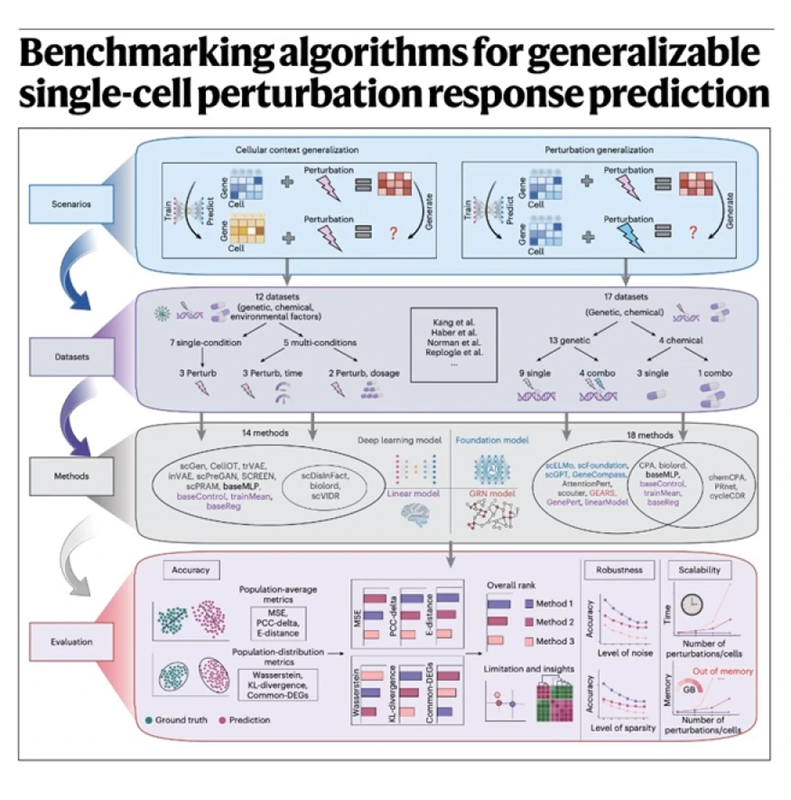
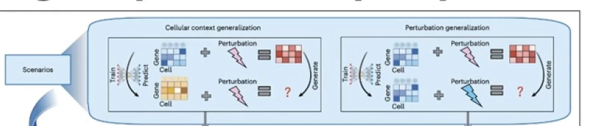
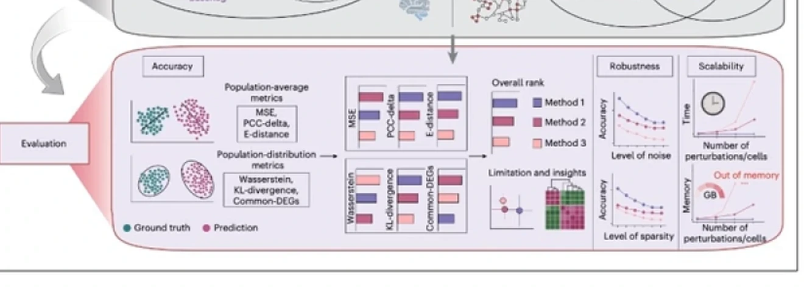

# 502-Benchmarking Single-Cell Perturbation Response Models

> **视频**：[502-Benchmarking Single-Cell Perturbation Response Models](https://www.youtube.com/watch?v=EjgmO8VV_EU)（YouTube，15:54）
>
> 本文只基于该视频文稿整理。视频解读的是 Nature Methods 论文《Benchmarking algorithms for generalizable single-cell perturbation response prediction》，文中的排名和数字均按视频表述写作“报告称”。

## 开篇：27 个模型、29 个数据集，为什么还是没有“最强模型”？

**背景（S）**：单细胞测序能逐个细胞读出基因表达；对细胞做扰动（perturbation，如敲除基因、加入药物）后再读一次，就能看到细胞内部的连锁反应。

**冲突（C）**：把所有基因、药物、细胞类型和组合都做一遍，实验量会组合爆炸，任何实验室都做不完（[【跳转到 00:00】](https://www.youtube.com/watch?v=EjgmO8VV_EU&t=0)）。于是大量模型声称能模拟扰动，却没人知道哪一个在没见过的场景里可靠。

**疑问（Q）**：这些模型谁更强？换细胞背景、换基因、换药物组合，排名还一样吗？

**回答（中心思想）**：报告把 27 种方法放到 29 个数据集上，结论不是一张总排行榜，而是**场景匹配**：换背景看状态迁移模型，小数据看文本先验，大数据才轮到基础模型，组合扰动常是简单线性模型最稳；只看 MSE 还会被“预测平均细胞”的模型骗过（[【跳转到 01:15】](https://www.youtube.com/watch?v=EjgmO8VV_EU&t=75)）。

## 一、先在计算机里做“无限实验”，再用两类泛化定义擂台

视频用思想实验开场：要彻底理解人类生物学，就得对 2 万个基因逐一敲除、做两两组合，再加入药物 X、药物 Y 及其组合，并在心脏、大脑等每种细胞上重复。这是资源瓶颈，不是技术细节（[【跳转到 00:25】](https://www.youtube.com/watch?v=EjgmO8VV_EU&t=25)）。

**单细胞扰动技术**的意义就在这里。bulk 测序像给体育场拍卫星照，只看到平均颜色；单细胞技术像给每张脸装高清摄像头，还能走过去戳一个人，再记录他表情的变化（[【跳转到 02:05】](https://www.youtube.com/watch?v=EjgmO8VV_EU&t=125)）。“戳一下”就是扰动；我们看的是其他基因如何跟着开关，从而拼出细胞的线路图（[【跳转到 02:30】](https://www.youtube.com/watch?v=EjgmO8VV_EU&t=150)）。

论文让 27 种方法在 29 个数据集上比赛（[【跳转到 01:15】](https://www.youtube.com/watch?v=EjgmO8VV_EU&t=75)）。选手分三类（[【跳转到 02:55】](https://www.youtube.com/watch?v=EjgmO8VV_EU&t=175)）：

- **基础模型**：scGPT、scFoundation，先在海量细胞上预训练，像“生物版 ChatGPT”。
- **专用深度模型**：如 CPA（组合扰动自编码器），专门为扰动预测设计。
- **基线**：线性模型只做加性数学；train mean 直接猜训练集平均响应。

擂台也分两类：**细胞背景泛化**是同一扰动换细胞类型，比如皮肤训练、预测肺（[【跳转到 04:10】](https://www.youtube.com/watch?v=EjgmO8VV_EU&t=250)）；**扰动泛化**是细胞不变，预测没敲过的基因（[【跳转到 07:30】](https://www.youtube.com/watch?v=EjgmO8VV_EU&t=450)）。视频用 IID/OOD 解释：晴天旧金山训练、再晴天测试是 IID；训练完丢进挪威暴风雪是 OOD（[【跳转到 04:35】](https://www.youtube.com/watch?v=EjgmO8VV_EU&t=275)）。生物学想要的几乎总是后者。

## 二、换细胞背景时，专用状态迁移模型领先；背景差太远则全军覆没

第一场没有神模型。报告称 trVAE、CellOT 这类做状态迁移或分布对齐的专用模型排在前列（[【跳转到 05:00】](https://www.youtube.com/watch?v=EjgmO8VV_EU&t=300)）。CellOT 用**最优传输（optimal transport）**：健康细胞像金字塔沙堆，疾病细胞像立方体，它计算如何用最小代价把每一粒沙搬过去（[【跳转到 05:25】](https://www.youtube.com/watch?v=EjgmO8VV_EU&t=325)）。因此它面对背景变化比较稳。

但边界很清楚：新细胞与训练数据差太远时，所有模型都会退化，甚至不如猜平均（[【跳转到 06:15】](https://www.youtube.com/watch?v=EjgmO8VV_EU&t=375)）。AI 不能凭空搭一座不存在的桥，极端 OOD 下会“幻觉”。如果手里有剂量、时间等元数据，scVIDR 这类会利用条件的模型更强（[【跳转到 07:05】](https://www.youtube.com/watch?v=EjgmO8VV_EU&t=425)）。

## 三、换基因扰动时，小数据靠“读教科书”，大数据才轮到基础模型

第二场爆冷：见过数百万细胞的 scGPT，输给了小模型 GenePert。它只用线性回归，但用大语言模型（LLM）生成基因嵌入（embedding）（[【跳转到 07:30】](https://www.youtube.com/watch?v=EjgmO8VV_EU&t=450)）。

传统模型看数字表格，从原始表达找模式；GenePert 把基因名（如 TP53）交给 LLM，得到“TP53 是参与细胞周期调控的抑癌基因”这类描述，再把文字变成嵌入（[【跳转到 08:20】](https://www.youtube.com/watch?v=EjgmO8VV_EU&t=500)）。**嵌入**像“意义的 GPS”：语义相近的词坐标相近，king 靠近 queen，apple 靠近 orange（[【跳转到 08:45】](https://www.youtube.com/watch?v=EjgmO8VV_EU&t=525)）。于是它看的是基因功能，而不只是原始数字。

在小到中等数据上，GenePert 和同样借助文本先验的方法击败基础模型（[【跳转到 09:10】](https://www.youtube.com/watch?v=EjgmO8VV_EU&t=550)）：数据少时，外部知识比从少量数字硬学更值钱。但到 Replogle 全基因组扰动数据的规模，CPA、scGPT 追了上来（[【跳转到 10:00】](https://www.youtube.com/watch?v=EjgmO8VV_EU&t=600)）。所以更准确的说法是：**小数据靠先验，大数据靠规模**。

## 四、组合扰动反而奖励简单加性模型，单药才轮到 chemCPA

第三场是组合扰动：同时敲两个基因，模型从没见过它们一起出现（[【跳转到 10:25】](https://www.youtube.com/watch?v=EjgmO8VV_EU&t=625)）。赢家是最简单的线性模型：A 的效应加 B 的效应，假设效应可加。复杂模型容易过拟合不存在的互作，而很多生物组合本来就近似可加（[【跳转到 10:50】](https://www.youtube.com/watch?v=EjgmO8VV_EU&t=650)）。

药物组合也是同样故事：AI 表现不佳，简单线性基线更稳；但单药任务里 chemCPA 是赢家（[【跳转到 11:15】](https://www.youtube.com/watch?v=EjgmO8VV_EU&t=675)），因为它预训练过化学结构和 bulk 药物数据，“先懂化学，再看细胞”。

| 场景 | 报告称的领先者 | 关键条件 |
| --- | --- | --- |
| 换细胞背景 | trVAE、CellOT 等状态迁移模型 | 新背景不能离训练数据太远；有元数据时 scVIDR 更强 |
| 换基因扰动、小数据 | GenePert 等使用 LLM 文本嵌入的方法 | 数据少，基因功能先验更值钱 |
| 换基因扰动、大数据 | CPA、scGPT 等深度/基础模型 | 数据足够多，能从原始表达学到新模式 |
| 组合扰动 | 简单线性/加性模型 | 复杂模型容易过拟合不存在的互作 |
| 单药 | chemCPA | 预训练过化学结构与 bulk 药物数据 |

## 五、真正的陷阱在指标：MSE 会奖励“平均细胞”

后半段转向评价。**MSE（均方误差）**问的是“平均基因表达对不对”，但生物学要的是一个分布：有的细胞反应强、有的不反应，云团形状本身有信息（[【跳转到 11:40】](https://www.youtube.com/watch?v=EjgmO8VV_EU&t=700)）。视频用天气预报打比方：预报平均降雨 1 英寸，实际一城洪水、一城滴雨未下，平均值对了，预报仍然无用（[【跳转到 12:30】](https://www.youtube.com/watch?v=EjgmO8VV_EU&t=750)）。

论文测试了分布指标，结果不理想。最刺眼的数字是：即使最好的模型，在真实 Top 100 差异表达基因（DE genes，扰动后显著上调或下调的基因）里，也常只能找回不到 10%（[【跳转到 12:30】](https://www.youtube.com/watch?v=EjgmO8VV_EU&t=750)）。药物研发者想找最该关注的 100 个基因，模型会漏掉 90 个。因为模型会求稳、**回归均值**：预测平均细胞 MSE 最低；它害怕极端洪水，就给所有人预报毛毛雨（[【跳转到 12:55】](https://www.youtube.com/watch?v=EjgmO8VV_EU&t=775)）。

改进方向是给模型**细胞背景嵌入**：细胞历史、基线表达、组织来源甚至文本描述，相当于预测前先给一份“病历 + 教科书”（[【跳转到 13:20】](https://www.youtube.com/watch?v=EjgmO8VV_EU&t=800)）。初步测试显示，这能缓解背景异质性带来的退化（[【跳转到 13:45】](https://www.youtube.com/watch?v=EjgmO8VV_EU&t=825)）。

## 六、把论文变成一张选型清单

论文 Figure 5G 给了一张 flowchart，视频把它压缩成速查表（[【跳转到 14:10】](https://www.youtube.com/watch?v=EjgmO8VV_EU&t=850)）：新病人、新背景看 trVAE、CellOT；小规模基因筛选用 GenePert；大规模数据用 scGPT；药物组合用简单线性/加性基线。

关键不是背四个模型名，而是选型顺序：**先定任务和划分，再问数据规模，最后才问模型结构**。同一个模型在“换背景”和“换扰动”两张考卷上，可能完全不是一个名次。

视频结尾留了一个更大的问题：当简单数学和“让 ChatGPT 读教科书”在很多地方击败复杂生物模型，我们是不是在过度工程化？我们在造越来越精致的地图，却没捕捉风暴、离群点和异质性，就只是在模拟平均（[【跳转到 15:00】](https://www.youtube.com/watch?v=EjgmO8VV_EU&t=900)）。而平均细胞，并不存在。

## 小结

- **没有全能冠军**：27 种方法、29 个数据集得到的是场景匹配，不是总排行榜。
- **换背景**：trVAE、CellOT 等状态迁移模型领先；背景差太远时全部退化；有剂量、时间等元数据时 scVIDR 更强。
- **换基因扰动**：小数据靠 GenePert 的 LLM 文本嵌入，大数据才轮到 CPA、scGPT。
- **组合扰动**：简单加性线性模型最稳；单药才看预训练过化学结构的 chemCPA。
- **指标陷阱**：MSE 奖励“平均细胞”；报告称最好的模型在 Top 100 差异表达基因上也常只能找回不到 10%。
- **改进方向**：把细胞背景做成嵌入，给模型“病历 + 教科书”，而不是只给一个细胞类型标签。

## 关键术语速查

| 术语 | 一句话解释 |
| --- | --- |
| 扰动（perturbation） | 对细胞施加的外部改变，如敲除基因、加入药物 |
| 单细胞扰动测序 | 逐个细胞读取扰动前后的表达，观察连锁反应 |
| 细胞背景泛化 | 扰动不变，换一种细胞类型做预测 |
| 扰动泛化 | 细胞类型不变，预测没见过的基因或药物扰动 |
| IID / OOD | 同分布测试 / 分布外测试；后者才是真实应用场景 |
| CellOT | 用最优传输把细胞从一个状态“搬运”到另一个状态 |
| GenePert | 用 LLM 生成基因文本嵌入，再用线性回归预测扰动 |
| MSE | 均方误差，衡量预测值与真实值的平均平方差 |
| 差异表达基因（DE） | 扰动后表达显著上调或下调的基因 |
| 加性基线 | 假设两个扰动的组合效应等于各自效应相加 |
