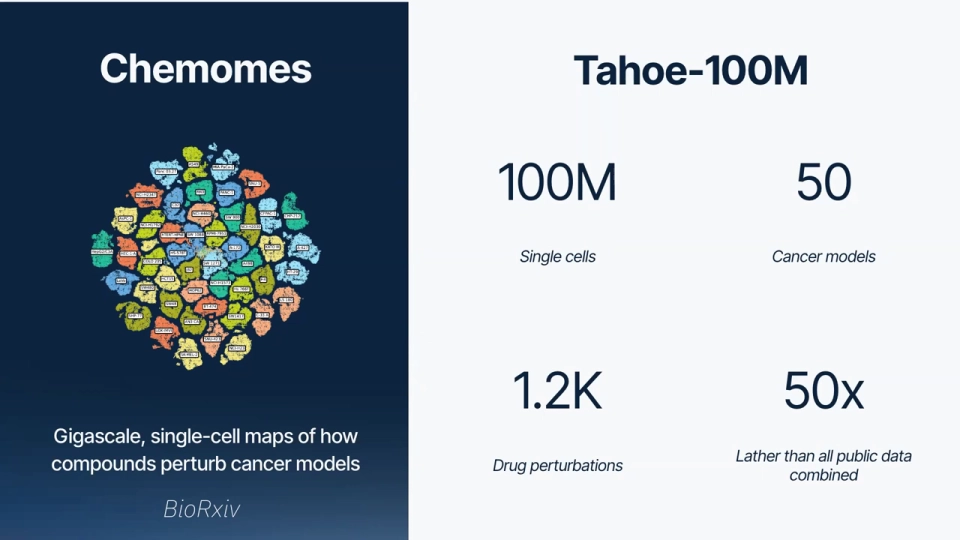
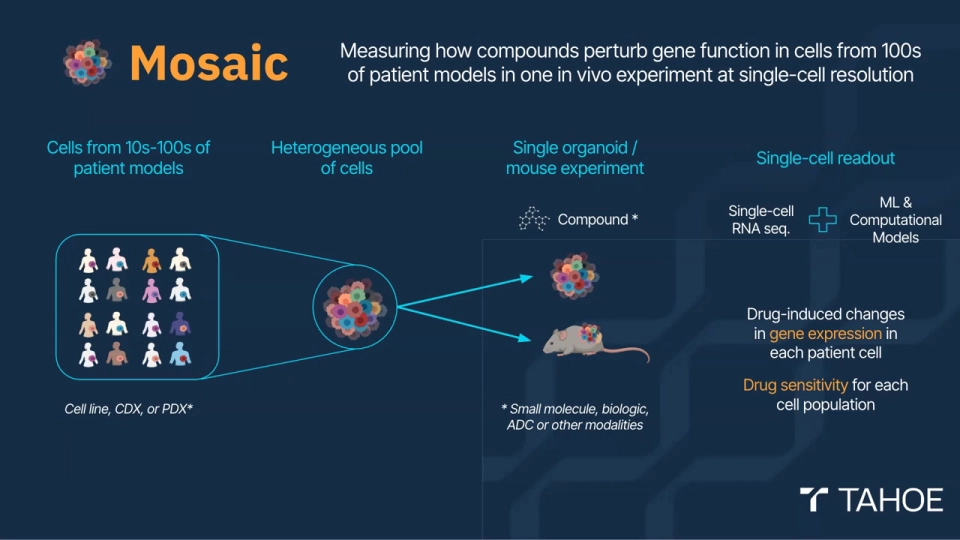
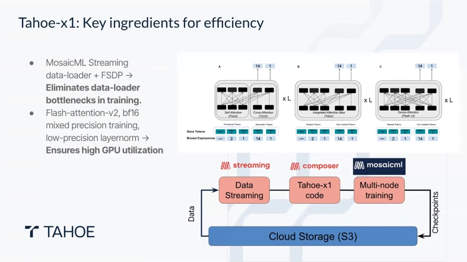
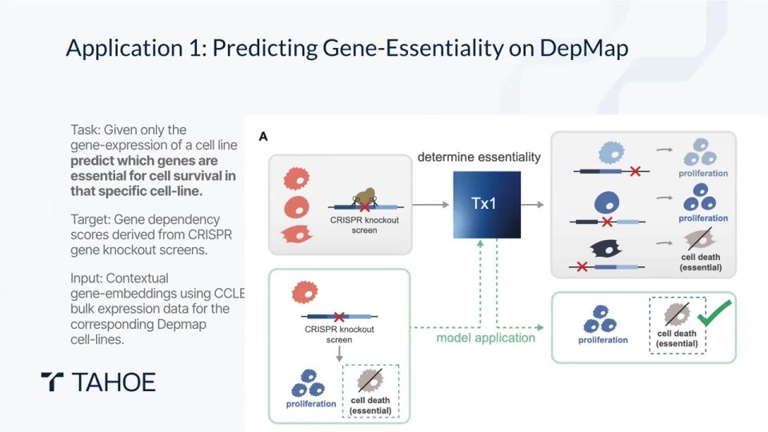
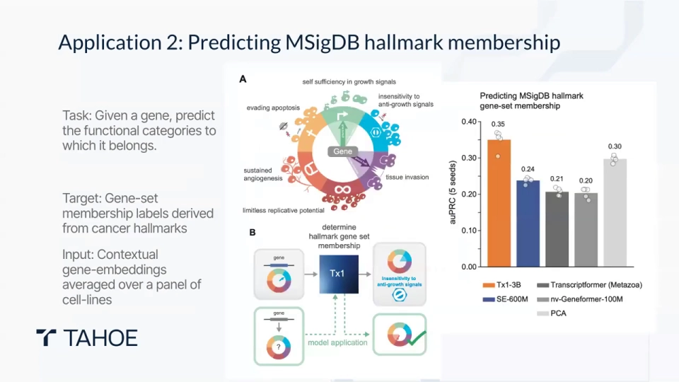
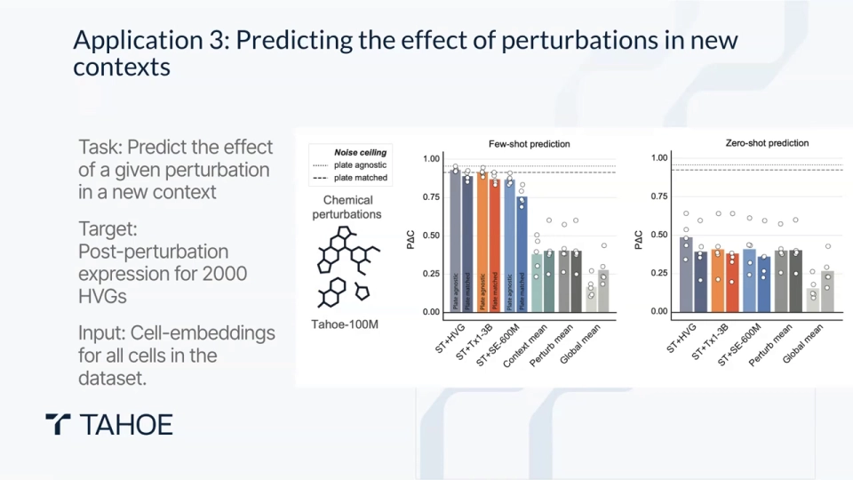
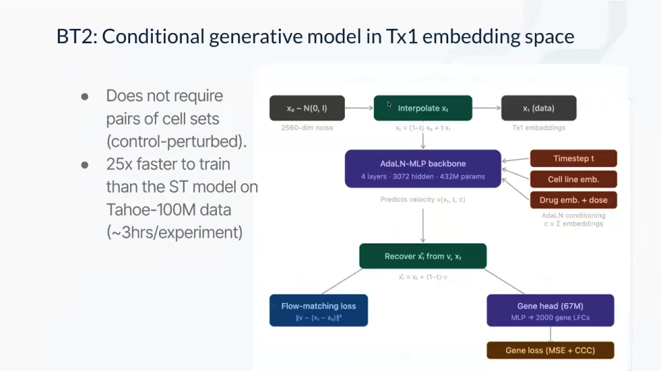

# BioML Seminar 4.4 - Shreshth Gandhi on Scaling Perturbation-Trained Single-Cell Foundation Models

> **视频**：[BioML Seminar 4.4 - Shreshth Gandhi on Scaling Perturbation-Trained Single-Cell Foundation Models](https://www.youtube.com/watch?v=Nky3tlQ7phA)
> **时长**：约 61 分钟（含问答）
> **说明**：这是 Tahoe Therapeutics 的 Shreshth Gandhi 关于 Tahoe-100M 数据与 Tahoe-x1 基础模型的报告。文中时间戳均指向该视频；数字尽量按讲者口径标注，论文口径另作说明。

## 本讲要解决的核心问题（SCQA）

**背景（S）**：单细胞测序让研究者能逐个细胞读取转录组，公开图谱的规模已经从几千个细胞涨到上亿个。但大多数图谱是**观测数据**：只告诉你“细胞现在长什么样”，不告诉你“把细胞推一下会发生什么”。

**冲突（C）**：药物研发最需要的恰恰是后者。扰动实验贵、通量低，公开的带药数据加起来也远小于观测图谱；而要把基础模型做大，又需要海量数据和昂贵算力。已有单细胞基础模型多从观测数据学习，缺少“干预”这一层因果信号（[03:32](https://www.youtube.com/watch?v=Nky3tlQ7phA&t=212)）。

**疑问（Q）**：如果把药物扰动数据做到 1 亿细胞量级，能不能训出一个通用的细胞/基因表示模型？它能不能同时服务基因功能、细胞类型和扰动响应预测？

**回答（A）**：Tahoe-x1 先用 **Tahoe-100M**（约 1 亿细胞、50 条癌细胞系、约 1,200 个药物—剂量条件）打底，再混入公开图谱（讲者口径约 1.5 亿细胞），做自监督预训练，得到 70M / 1B / 3B 三个规模。它输出**细胞嵌入**和**基因嵌入**，下游再接轻量模型。关键定位是：**它主要提供表征，不是端到端扰动预测器**。

## 一、Tahoe-100M：把扰动实验做成“ImageNet 级”数据

Tahoe-100M 的核心不是“测得多”，而是“一次实验里同时测很多细胞系”。他们把来自不同癌细胞系的细胞混在一起，做成 3D 球状体，一起加药、一起测序；随后用基因型信息做**遗传解复用（genetic demultiplexing）**，把每个细胞认回它原来的细胞系（[00:00](https://www.youtube.com/watch?v=Nky3tlQ7phA&t=0)、[00:05](https://www.youtube.com/watch?v=Nky3tlQ7phA&t=5)）。

这套“混池 + 解复用”让同样成本换来约 **50 倍**的数据量。最终数据包含约 1 亿个单细胞、50 个癌症模型、约 **1,200 个药物—剂量条件**（[00:30](https://www.youtube.com/watch?v=Nky3tlQ7phA&t=30)）。注意口径：**1,200 是视频里的药物—剂量条件数，不是 1,200 种药物**；按论文更严格的过滤，实际是 **379 种药物、1,135 个药物—剂量组合**。

数据的方差结构也很关键：t-SNE 上最大的分群是**细胞系**，药物只是细胞系内部的次级结构（[01:16](https://www.youtube.com/watch?v=Nky3tlQ7phA&t=76)、[01:41](https://www.youtube.com/watch?v=Nky3tlQ7phA&t=101)）。模型必须先学会“这是哪种细胞”，才谈得上判断“这个药在做什么”；随机划分细胞评估时，模型也可能靠细胞系记忆“作弊”。

## 二、架构：把细胞写成“基因词 + 表达词 + 药物词”

Tahoe-x1 的骨架是一个类 BERT 的 Transformer：输入离散 token，随机遮挡，再在输出端重建（[04:47](https://www.youtube.com/watch?v=Nky3tlQ7phA&t=287)）。

**基因 token。** 每个基因对应固定词表里的一个 ID，词表约 6.5 万个，覆盖数据集中检测到的所有基因，而不只限蛋白编码基因。每个细胞只保留有表达的基因，补齐到约 2,000 个位置；训练时随机遮住其中 **50%** 的表达值（[05:37](https://www.youtube.com/watch?v=Nky3tlQ7phA&t=337)、[11:02](https://www.youtube.com/watch?v=Nky3tlQ7phA&t=662)）。

**表达分箱。** 原始 count 跨度极大，直接回归很难学。模型对 count 做单调变换后离散成约 **50 个箱**，再映射为 1–50 的整数（[07:42](https://www.youtube.com/watch?v=Nky3tlQ7phA&t=462)）。这样保留了表达量的顺序：10 条 reads 离 12 条很近，离 1,000 条很远。分箱细节会改变损失数值，但只要变换单调，下游嵌入质量变化不大（[09:22](https://www.youtube.com/watch?v=Nky3tlQ7phA&t=562)）。

**药物 token。** 药物不按名字查表，而是用 **Morgan 指纹**——一种把分子结构编码成定长位串的经典化学信息学表示。指纹先过一个化学编码器变成 token，再和基因 token 一起送进 Transformer；这个编码层用离散指纹初始化，但允许训练中更新（[07:17](https://www.youtube.com/watch?v=Nky3tlQ7phA&t=437)）。它被所有基因 token 关注，类似 cross-attention（交叉注意力），药物信息逐层汇入细胞表示（[08:57](https://www.youtube.com/watch?v=Nky3tlQ7phA&t=537)）。

**CLS 与双解码器。** 序列开头放一个特殊的 **CLS token**，最后一层 CLS 的向量就是整个细胞的嵌入（[06:02](https://www.youtube.com/watch?v=Nky3tlQ7phA&t=362)）。模型有两个解码头：一个**基因头**用每个被遮基因自身的上下文重建表达；一个**细胞头**只允许用 CLS 去重建所有被遮基因。后者是关键——它强迫 CLS 真的总结整个细胞，否则损失会惩罚它。作者刻意把前代模型的多重损失砍到这两个真正驱动嵌入质量的目标（[06:52](https://www.youtube.com/watch?v=Nky3tlQ7phA&t=412)、[07:17](https://www.youtube.com/watch?v=Nky3tlQ7phA&t=437)）。

## 三、规模与工程：70M 负责试错，3B 负责上限

预训练语料不止 Tahoe-100M。作者在问答里给出的粗略比例是“约 1 亿来自 Tahoe，约 1.5 亿来自其他来源”（[59:32](https://www.youtube.com/watch?v=Nky3tlQ7phA&t=3572)），另外两部分是 Arc Institute 汇总的 **SCBaseCount** 和 **CellxGene** 图谱（[03:32](https://www.youtube.com/watch?v=Nky3tlQ7phA&t=212)）。

模型有三个规模：**70M、1B、3B**。70M 是实验台——训练快，作者用它大量消融架构和目标函数；1B 和 3B 才是主力（[12:42](https://www.youtube.com/watch?v=Nky3tlQ7phA&t=762)）。

工程上最值得学的是注意力实现。早期单细胞模型显式规定“可见基因只能看可见基因、被遮基因不能互看”，这种掩码无法直接调用高度优化的 FlashAttention。团队先写 Triton kernel 用 $-\infty$ 偏置模拟掩码；后来发现**干脆允许全稠密注意力、只在输入侧遮住表达值**，性能几乎不降，却能直接用 FlashAttention（[13:43](https://www.youtube.com/watch?v=Nky3tlQ7phA&t=823)、[14:58](https://www.youtube.com/watch?v=Nky3tlQ7phA&t=898)）。

再叠加数据流式加载（streaming data loader）和 FSDP（把模型参数分片到多张卡上训练），3B 模型在 **128 张 GPU** 上训练，按 H100 市场价约 **4.5 万美元**（[12:17](https://www.youtube.com/watch?v=Nky3tlQ7phA&t=737)、[15:48](https://www.youtube.com/watch?v=Nky3tlQ7phA&t=948)）。

规模是否有效？从 70M 到 1B 再到 3B，验证损失和多个下游指标都单调改善（[36:59](https://www.youtube.com/watch?v=Nky3tlQ7phA&t=2219)）。但有些任务提升很小，例如 DepMap 上下文 AUROC（曲线下面积）只从约 0.63 到 0.64（[37:49](https://www.youtube.com/watch?v=Nky3tlQ7phA&t=2269)）。**70M 在不少任务上已有竞争力，3B 的优势稳定但幅度不一定大**。

## 四、表征评估：嵌入里有没有真生物学

评估分两层：嵌入本身（验证损失、线性探测）与下游模型（随机森林或 MLP）。三类任务最能说明问题（[17:01](https://www.youtube.com/watch?v=Nky3tlQ7phA&t=1021)）。

**第一，DepMap 基因必需性。** DepMap 用 CRISPR 敲除每个基因，测量癌细胞还活不活，得到“细胞系 × 基因”的必需性矩阵。Tahoe-x1 用 CCLE 的 bulk 表达作为细胞系上下文，取出每个基因在最后一层的上下文嵌入，再训随机森林预测必需性。无论预测细胞系特异还是通用必需性，它的嵌入都优于 SE、Transcriptformer、PCA 等对比（[21:24](https://www.youtube.com/watch?v=Nky3tlQ7phA&t=1284)、[23:13](https://www.youtube.com/watch?v=Nky3tlQ7phA&t=1393)）。

**第二，MSigDB 通路归属。** 给一个基因，预测它属于哪些癌症 hallmark 基因集。作者用基因嵌入训多标签 MLP，在留出基因上报告 AUPRC（精确率—召回率曲线下面积）；3B 模型约 **0.35**，高于 SE-600M 的 0.24、Transcriptformer 的 0.21、nv-Geneformer-100M 的 0.20 和 PCA 的 0.30（[25:58](https://www.youtube.com/watch?v=Nky3tlQ7phA&t=1558)）。这说明模型在没有显式通路监督时，也学出了有功能意义的结构。

**第三，细胞类型注释。** 在 Tabula Sapiens 上做线性探测，各模型准确率都接近饱和，3B 的优势主要体现在稀有细胞类型（[34:11](https://www.youtube.com/watch?v=Nky3tlQ7phA&t=2051)、[35:01](https://www.youtube.com/watch?v=Nky3tlQ7phA&t=2101)）。作者也坦承这个基准有点“循环”：标签本身常由聚类得到，而聚类又用了表达特征。

## 五、扰动预测：少样本接近上限，零样本仍是短板

做法是把 Tahoe-x1 的细胞嵌入接到 **State Transport** 上，在“细胞系 × 药物”矩阵里留出组合，预测 2,000 个高变基因的扰动后表达。指标是 **PDCorr（Pearson delta correlation）**：先算每个基因相对对照的倍数变化，再看预测的倍数变化与真实倍数变化有多相关（[30:13](https://www.youtube.com/watch?v=Nky3tlQ7phA&t=1813)）。

设定分两种：**少样本**是见过该细胞系的其他药物，只是没见过的“药物 × 细胞系”组合；**零样本**是完全没见过的细胞系，训练中一个药物都没见过（[31:03](https://www.youtube.com/watch?v=Nky3tlQ7phA&t=1863)）。

结果很清楚：少样本时 PDCorr 可以到 **0.8–0.9**，接近重复实验的噪声上限；零样本只有 **0.4–0.5**，和 Mean、Global 等简单基线相差不大（[38:51](https://www.youtube.com/watch?v=Nky3tlQ7phA&t=2331)、[39:16](https://www.youtube.com/watch?v=Nky3tlQ7phA&t=2356)）。关键缺口在于：**见过一点数据时嵌入很有用，完全没见过时仍接近猜**。

后续的 **BT2** 想在嵌入空间里补上这块。它不做“对照 → 扰动”的配对搬运，而是用**流匹配（flow matching）**直接从噪声生成扰动后的细胞嵌入，再联合基因头解码回表达；因为不需要二次方配对，训练快 **25 倍**（约 3 小时对 3–4 天）（[41:09](https://www.youtube.com/watch?v=Nky3tlQ7phA&t=2469)、[41:34](https://www.youtube.com/watch?v=Nky3tlQ7phA&t=2494)）。BT2 把零样本推到更接近重复实验的上限，但仍没到“任意新细胞系都能准确预测”的程度。作者还说，其中一个很强的零样本模型是 AutoResearch 智能体在沙盒里跑一夜搜出来的（[45:28](https://www.youtube.com/watch?v=Nky3tlQ7phA&t=2728)、[46:40](https://www.youtube.com/watch?v=Nky3tlQ7phA&t=2800)）。

## 六、它到底是什么：表征底座，不是虚拟细胞的全部

**第一，定位。** Tahoe-x1 预训练只做“掩码—重建”，不直接预测扰动响应；下游任务才在嵌入上接随机森林、MLP 或 State Transport（[17:01](https://www.youtube.com/watch?v=Nky3tlQ7phA&t=1021)）。它更像通用特征提取器，端到端能力取决于下游模型。

**第二，数据只覆盖体外癌细胞系。** 真实肿瘤有免疫细胞、基质、血管和空间结构，这些信息不在 Tahoe-100M 里；从细胞系外推到病人仍有很大鸿沟（[49:20](https://www.youtube.com/watch?v=Nky3tlQ7phA&t=2960)）。

**第三，零样本仍是短板。** 新细胞系完全没有数据时，模型明显退化；作者的经验是至少给 5–10 个药物的小样本，才能接近“见过一百多个药物”的水平（[56:37](https://www.youtube.com/watch?v=Nky3tlQ7phA&t=3397)、[57:02](https://www.youtube.com/watch?v=Nky3tlQ7phA&t=3422)）。这也是为什么他们把“跨数据集、跨药物集合的泛化”列为下一步（[49:45](https://www.youtube.com/watch?v=Nky3tlQ7phA&t=2985)）。

**第四，算力与评测。** 3B 训练要 128 张 GPU、数万美元；流匹配推理还要几十步积分，复现门槛不低。多数评测又在同一数据集内划分，共享方差可能让结果偏乐观。作者接下来想做滚动新数据集、原代细胞与 iPSC（诱导多能干细胞）和带推理链的可解释预测（[50:35](https://www.youtube.com/watch?v=Nky3tlQ7phA&t=3035)、[51:00](https://www.youtube.com/watch?v=Nky3tlQ7phA&t=3060)）。

## 小结

- Tahoe-100M 用“混池 + 遗传解复用”把扰动数据做到约 1 亿细胞、50 条癌细胞系、约 1,200 个药物—剂量条件，成本换取约 50 倍通量；论文过滤后是 379 种药物、1,135 个组合。
- Tahoe-x1 把细胞写成“基因 token + 表达分箱 + Morgan 指纹药物 token”，用 CLS 表示整个细胞，用两个解码头逼出全局表示。
- 预训练语料约 2.5 亿细胞（1 亿 Tahoe + 1.5 亿公开图谱），模型有 70M / 1B / 3B 三个规模；3B 在 128 张 GPU 上训练，工程优化把成本压到约 4.5 万美元。
- 评估覆盖 DepMap 必需性、MSigDB 通路、细胞类型和扰动预测；规模越大越好，但部分任务提升有限。
- **少样本扰动预测接近噪声上限，零样本仍接近基线**；BT2 用流匹配把零样本推高，但没有改变“需要数据支持”这个前提。
- 定位：Tahoe-x1 提供的是**细胞与基因的表征**，不是端到端的虚拟细胞；它的价值取决于下游模型，也受限于体外癌细胞系与算力。

## 关键术语速查

| 术语 | 一句话解释 |
| --- | --- |
| 单细胞基础模型 | 在大量单细胞数据上自监督预训练、输出通用细胞/基因表示的模型 |
| CLS token | 序列开头的特殊标记，最后一层的 CLS 向量用来概括整个细胞 |
| Morgan 指纹 | 把分子结构编码成定长位串的经典化学信息学表示 |
| 掩码重建 | 遮住一部分输入，让模型从上下文预测被遮住的值 |
| DepMap | 用 CRISPR 敲除测基因必需性的公共数据库 |
| MSigDB hallmark | 一组按癌症相关功能整理的基因集 |

## 相关阅读

- [GEARS：预测未见多基因组合的转录结果](<Graph Neural Networks User Group Meetup 9／29／2022.md>)
- [chemCPA：从化学结构预测未见药物](<Predicting Single-Cell Perturbation Responses For Unseen Drugs ｜ Leon Hetzel and Simon Böhm.md>)
- [Deep-learning-based Gene Perturbation Effect Prediction Does Not Yet Outperform Linear Baselines](Deep-learning-based Gene Perturbation Effect Prediction Does Not Yet Outperform Linear Baselines.md)
- [PerturBench: Benchmarking Machine Learning Models for Cellular Perturbation Analysis](<PerturBench：Benchmarking Machine Learning Models for Cellular Perturbation Analysis.md>)
