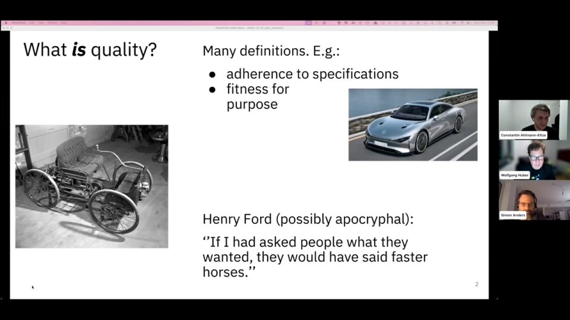
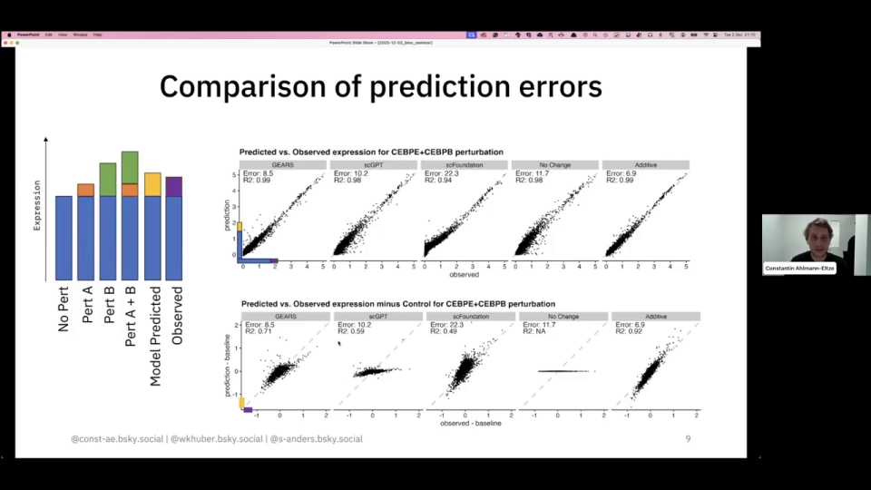
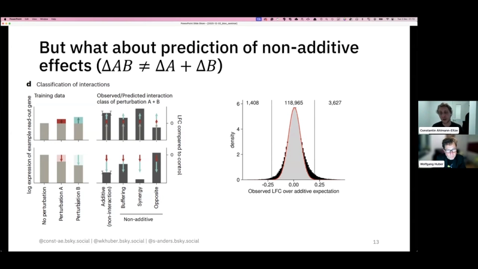
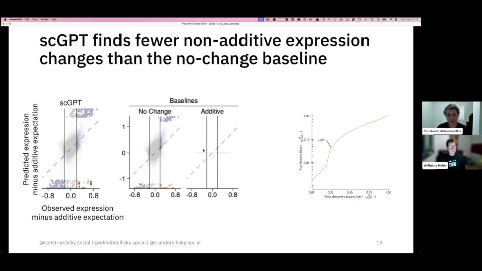
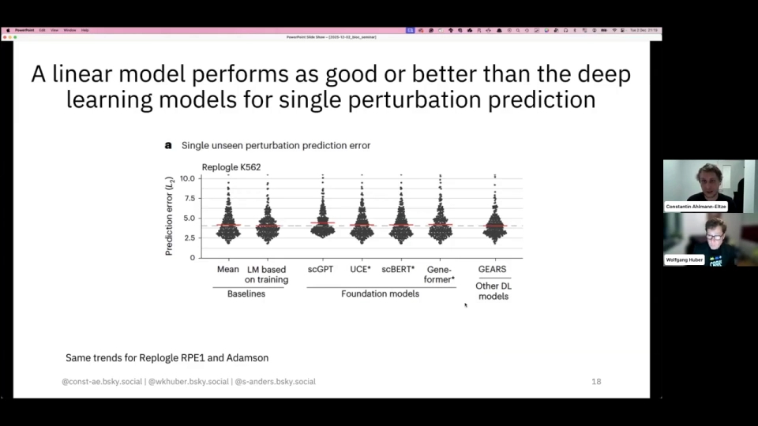

# Deep-learning-based Gene Perturbation Effect Prediction Does Not Yet Outperform Linear Baselines

- 视频标题：Deep-learning-based Gene Perturbation Effect Prediction Does Not Yet Outperform Linear Baselines
- 视频链接：https://www.youtube.com/watch?v=ldYJ703CPBA
- 时长：约 58 分钟（58:22）

## 视频主线

这是一场 Bioconductor 研讨会：Constantine Ahlmann-Eltze 与 Wolfgang Huber 把几类宣称能预测扰动效应的深度/基础模型放进同一套数据、切分和指标，与几条几乎不用学习的线性基线正面比较。结果是：在未见双扰动和未见单扰动上，可加、no-change、mean 基线不输甚至更好，换指标也救不了复杂模型。讨论随后转向更根本的问题——该用什么数据预训练、模型究竟要回答什么生物学问题，以及怎样把已有的生物学知识喂给 AI。

## 一、开场先定义“质量”：指标一旦成为目标，就会被钻空子

Wolfgang Huber 先泼了一盆冷水：**比较模型之前，必须先说清“质量”指什么**。一种定义是“符合规格”（adherence to specifications），比如零件的角度、表面光洁度、装配精度是否达标；另一种是“适合用途”（fitness for purpose），即能否解决你的问题。前者可量化，后者高度依赖场景——独自横跨大陆自驾，和接送四个孩子去训练，需要的车完全不同；而“符合规格”也未必与“适合用途”相关。[【跳转到 01:23】](https://www.youtube.com/watch?v=ldYJ703CPBA&t=83) [【跳转到 02:27】](https://www.youtube.com/watch?v=ldYJ703CPBA&t=147)

他还引了一句可能是杜撰的亨利·福特名言：“如果我问人们想要什么，他们会说要更快的马。”也就是说，人们往往并不知道自己真正需要什么，这让质量评估更难。[【跳转到 03:17】](https://www.youtube.com/watch?v=ldYJ703CPBA&t=197)

更难的是古德哈特定律（Goodhart's law）：**当一个度量变成目标，它就不再是一个好度量**。讲者举了“如何在不改进教学的情况下提高教学评价”的例子：指标通常与真正想衡量的事物相关，但相关性有好有坏；一旦人们发现指标可以被“优化”，就会在不改进实质的情况下刷高指标。[【跳转到 03:41】](https://www.youtube.com/watch?v=ldYJ703CPBA&t=221) [【跳转到 04:06】](https://www.youtube.com/watch?v=ldYJ703CPBA&t=246)

所以基准研究本身就很难：有些领域甚至没有标准答案，比如细胞类型注释，在基础模型里也仍有争议；“所有模型都是错的，但有些有用”听上去像陈词滥调，难点正是**如何定义“有用”**。扰动预测原则上存在“标准答案”，但选哪些基因、用什么距离、拿什么当对照，都会改变结论。[【跳转到 04:39】](https://www.youtube.com/watch?v=ldYJ703CPBA&t=279)

## 二、要预测的是“没做过的扰动”，读出先限定在转录组

Constantine 接着说明这项工作的由来：他们注意到几篇发在影响力很高、曝光度很大的期刊上的论文，声称已经能做扰动预测。那“预测未见扰动的效应”到底指什么？能测的东西很多——细胞形态、是否存活、代谢组等等；但这项工作**把读出限定在转录组**，因为它最容易大规模获取，又能反映细胞状态。[【跳转到 05:04】](https://www.youtube.com/watch?v=ldYJ703CPBA&t=304) [【跳转到 05:16】](https://www.youtube.com/watch?v=ldYJ703CPBA&t=316)

“未见扰动”也有多种设定。报告主要聚焦**未见双扰动**，也在一定程度上涉及**未见单扰动**。[【跳转到 05:39】](https://www.youtube.com/watch?v=ldYJ703CPBA&t=339)

## 三、双扰动的设定与 Norman 2019：全部单扰动加一半双扰动

双扰动的设定很直观：训练集见过扰动 A 与 B 各自造成的细胞状态（图中绿色和橙色），测试时把 A、B 同时施加，问模型预测出的状态长什么样。它会是两种状态某种程度的混合，关键不在“混合”，而在**模型能否学到具体的混合方式**并给出好预测。[【跳转到 05:39】](https://www.youtube.com/watch?v=ldYJ703CPBA&t=339) [【跳转到 06:04】](https://www.youtube.com/watch?v=ldYJ703CPBA&t=364) [【跳转到 06:29】](https://www.youtube.com/watch?v=ldYJ703CPBA&t=389)

基准使用 Norman 2019 数据：当时（乃至现在）这几乎是唯一公开可用的组合扰动数据。它来自一个使用 CRISPR 激活（CRISPRa）系统的细胞系，所以严格说不是敲低，而是用向导 RNA **过表达**目标基因。[【跳转到 06:29】](https://www.youtube.com/watch?v=ldYJ703CPBA&t=389) [【跳转到 06:42】](https://www.youtube.com/watch?v=ldYJ703CPBA&t=402)

数据包含 101 个单扰动、62 个双扰动，细胞系为 K562。实验设置是：训练时用**全部单扰动 + 一半双扰动**，在另一半双扰动上评测；后面还重复了五个随机切分。[【跳转到 06:42】](https://www.youtube.com/watch?v=ldYJ703CPBA&t=402) [【跳转到 09:12】](https://www.youtube.com/watch?v=ldYJ703CPBA&t=552)

## 四、参赛模型与“笨”基线：additive 先把门槛立起来

参战模型分几类：宣称能做扰动预测的 scGPT、scFoundation、GEARS；另一个流行的自编码器基线 CPA；以及三个本身没有声称能做扰动预测的基础模型 UCE、scBERT、Geneformer——作者好奇它们学到的表示是否好用，于是加了一个线性解码器来测试。[【跳转到 07:07】](https://www.youtube.com/watch?v=ldYJ703CPBA&t=427) [【跳转到 07:32】](https://www.youtube.com/watch?v=ldYJ703CPBA&t=452)

对照组是几乎不用学习的基线。最先登场的是 **additive**：对扰动 A，取其相对未扰动基线的变化；对扰动 B 也取变化；双扰动的预测就是把两个变化直接相加。作者称之为 double perturbation 或 additive model。[【跳转到 07:57】](https://www.youtube.com/watch?v=ldYJ703CPBA&t=477)

后面还会引入两条更低的下限：预测完全不变化的 **no-change**，以及预测已见扰动平均效果的 **mean**。它们会在各自对应的实验里出现。

## 五、先看预测误差：不减基线，R² 几乎都是 1

作者用预测误差比较方法：对每个基因，把模型预测值与观测值画在一起。以 GEARS 为例，高表达基因的预测值仍然偏高，整体上“高表达的依旧高表达”；把全部基因的差异加起来，就得到预测误差，也可以算 R²。[【跳转到 08:22】](https://www.youtube.com/watch?v=ldYJ703CPBA&t=502)

这里有个容易踩的坑：如果直接在完整表达量上逐基因算 R²，几乎所有方法的 R² 都接近 1——因为基因之间的表达量差异远大于扰动效应，模型只要把高表达基因预测得高，就能拿好分数。**只有先减去基线（只看箭头相对蓝线的长度），扰动效应才会显露出来**；此时总误差不变（左右减去同一个量），R² 却会剧烈变化。[【跳转到 08:22】](https://www.youtube.com/watch?v=ldYJ703CPBA&t=502) [【跳转到 08:47】](https://www.youtube.com/watch?v=ldYJ703CPBA&t=527)

下图上半部分是原始表达，各方法看起来都很准；下半部分减去基线后，差异才显现。这里展示的是一个双扰动、约 1000 个读出基因的情形。[【跳转到 08:47】](https://www.youtube.com/watch?v=ldYJ703CPBA&t=527) [【跳转到 09:12】](https://www.youtube.com/watch?v=ldYJ703CPBA&t=552)

## 六、主结果：additive 在未见双扰动上明显最好，换指标换基因子集都稳

把测试集里所有双扰动、五个随机切分汇总后，最醒目的结果是：**以预测误差为指标，additive 基线比所有深度模型都好得多**，明显优于 GEARS、scGPT、scFoundation。[【跳转到 09:12】](https://www.youtube.com/watch?v=ldYJ703CPBA&t=552) [【跳转到 09:37】](https://www.youtube.com/watch?v=ldYJ703CPBA&t=577)

为了确认这不是指标造成的假象，作者又算了 Pearson delta：先减去基线再算相关系数。结论几乎不变，additive 仍然明显领先。[【跳转到 09:37】](https://www.youtube.com/watch?v=ldYJ703CPBA&t=577)

“该用多少基因”也做了检查：只看前 100 个高表达基因、看前 1000 个、或看全部基因，结果在整个范围内都相当稳定；按差异表达基因分开看，也是同样的模式。[【跳转到 10:02】](https://www.youtube.com/watch?v=ldYJ703CPBA&t=602) [【跳转到 10:27】](https://www.youtube.com/watch?v=ldYJ703CPBA&t=627)

作者自己也吃了一惊，没想到差距这么强，于是联系原论文作者，问是不是自己把对方模型“调坏了”——搭基准时很容易犯用户错误，比如调用方式不对、超参不是最优、漏掉某个细节。回应之一是：也许重点不该是整体预测，而是“能否找出非可加基因”。于是有了第二轮检验。[【跳转到 10:52】](https://www.youtube.com/watch?v=ldYJ703CPBA&t=652) [【跳转到 11:17】](https://www.youtube.com/watch?v=ldYJ703CPBA&t=677)

## 七、换个问法：能不能找出非可加基因？

非可加效应指双扰动的效果不能由两个单扰动相加解释：$\Delta_{AB} \neq \Delta_A + \Delta_B$。若实际效果落在“不扰动”和“可加预测”之间，称为**缓冲（buffering）**；超过可加预测则称为**协同（synergy）**。[【跳转到 11:42】](https://www.youtube.com/watch?v=ldYJ703CPBA&t=702)

作者把这个概念操作化：先算可加预测，再在它周围划出一个误差带；落在基线与可加预测之间的是缓冲，超出可加预测的是协同。误差带该多宽？他们统计所有读出基因上“观测值减可加预期”的分布：主体呈钟形，用正态零分布（红色）拟合；两侧黑色肩部更宽；画两条黑线，把“有 95% 以上把握不来自零分布”的基因分出来。这样从 12 万个读出基因中筛出约 5000 个真正非可加的基因（统计覆盖所有双扰动与五个训练/测试切分）。[【跳转到 12:07】](https://www.youtube.com/watch?v=ldYJ703CPBA&t=727) [【跳转到 12:32】](https://www.youtube.com/watch?v=ldYJ703CPBA&t=752) [【跳转到 12:57】](https://www.youtube.com/watch?v=ldYJ703CPBA&t=777)

## 八、非可加结果：no-change 比 scGPT 更能召回真正的非可加基因

接下来按模型预测偏离可加预期的程度给基因排序。以 scGPT 为例：横轴与前面的直方图相同（观测值减可加预期），纵轴是模型预测值减可加预期；理想情况下所有点都落在对角线上。中间窄带被视为真正可加，带外被视为真正非可加。[【跳转到 13:22】](https://www.youtube.com/watch?v=ldYJ703CPBA&t=802) [【跳转到 13:47】](https://www.youtube.com/watch?v=ldYJ703CPBA&t=827)

然后从 scGPT 预测偏离最大的基因开始往下数：每选一个就判断它是真阳性还是假阳性，并计算错误发现比例（FDP）。固定 FDP 后，就能量化 scGPT 召回了多少真正非可加基因（TPR），得到一条曲线。[【跳转到 14:12】](https://www.youtube.com/watch?v=ldYJ703CPBA&t=852)

问题是要有基线才能判断这条曲线好不好。additive 在这里没用：从可加预测里减去 additive，结果处处为零，根本无法给基因排序。于是作者改用 **no-change**——直接预测未扰动细胞里各基因的表达，再画同样的图、做同样的排序。[【跳转到 14:37】](https://www.youtube.com/watch?v=ldYJ703CPBA&t=877) [【跳转到 15:02】](https://www.youtube.com/watch?v=ldYJ703CPBA&t=902)

结果出人意料：在相同 FDP 下，no-change 的真阳性率高于 scGPT。换句话说，**直接预测“扰动不改变表达”，反而比 scGPT 更能找出真正的非可加基因**。把这一流程跑遍所有基础模型，模式不变：no-change 都是最好的。[【跳转到 15:02】](https://www.youtube.com/watch?v=ldYJ703CPBA&t=902) [【跳转到 15:27】](https://www.youtube.com/watch?v=ldYJ703CPBA&t=927)

限制也要说清：no-change 只会预测缓冲，永远不预测协同；但论文细节里看，这些模型本身也很少预测协同，预测对了就更少。所以 no-change 并不完美，只是其他模型连这个下限都没稳定超过。[【跳转到 15:52】](https://www.youtube.com/watch?v=ldYJ703CPBA&t=952)

## 九、第三轮：未见单扰动，mean 基线不输；唯一提升来自跨细胞系迁移

模型广告里另一项常见能力是预测**未见基因扰动**：给定一个训练中从未出现的新扰动（图中黑色），预测细胞状态。最简单的做法是直接预测所有已见扰动的平均状态，这就是 **mean** 基线。另一种思路是利用基因表达上的相似性：如果黑色基因的表达特征更像绿色基因、离橙色和蓝色较远，就推测黑色扰动后的状态也更像绿色扰动后的状态。[【跳转到 16:17】](https://www.youtube.com/watch?v=ldYJ703CPBA&t=977) [【跳转到 16:42】](https://www.youtube.com/watch?v=ldYJ703CPBA&t=1002) [【跳转到 17:07】](https://www.youtube.com/watch?v=ldYJ703CPBA&t=1027)

作者在三个数据集上重复了同样的流程。以 Replogle K562 为例：**mean 基线的预测误差与任何基础模型、深度学习模型相当**。这再次说明，模型没有表现出学到了额外、生物学上相关的基因调控网络。RPE1 与 Adamson 数据集的结论基本一致。[【跳转到 17:07】](https://www.youtube.com/watch?v=ldYJ703CPBA&t=1027) [【跳转到 17:32】](https://www.youtube.com/watch?v=ldYJ703CPBA&t=1052) [【跳转到 17:57】](https://www.youtube.com/watch?v=ldYJ703CPBA&t=1077)

唯一真正带来提升的做法，是在一个已测细胞系上训练前面那种线性模型，再迁移到另一个细胞系做预测。这是唯一明显超过 mean 基线的做法，提示**用更相关的扰动数据训练，可能比在庞大但嘈杂的观测图谱上预训练更有效**。[【跳转到 18:22】](https://www.youtube.com/watch?v=ldYJ703CPBA&t=1102) [【跳转到 18:47】](https://www.youtube.com/watch?v=ldYJ703CPBA&t=1127)

## 十、这不是孤例：论文挂出后一周，多篇工作得到同样结论

作者说自己这次有点幸运：论文一年多一点前挂上 arXiv，不到一周，就有一批工作陆续出现，基本都得到相同结论，说明这不是他们偶然发现的假象，而是相互印证。论文也在当年早些时候正式发表。[【跳转到 18:47】](https://www.youtube.com/watch?v=ldYJ703CPBA&t=1127) [【跳转到 19:08】](https://www.youtube.com/watch?v=ldYJ703CPBA&t=1148) [【跳转到 19:31】](https://www.youtube.com/watch?v=ldYJ703CPBA&t=1171)

## 十一、两篇“指标不对”的论文：质心准确率与以扰动均值为参照的 Pearson delta

论文发表后，这个方向又涌出很多工作。讲者挑了两篇特别有意思的：它们都在说，也许大家仍在用错误的指标衡量扰动预测。一篇是 Systema 等，另一篇是 Miller 等。[【跳转到 19:31】](https://www.youtube.com/watch?v=ldYJ703CPBA&t=1171) [【跳转到 19:38】](https://www.youtube.com/watch?v=ldYJ703CPBA&t=1178)

Systema 等的想法是：数据里可能存在某些系统性效应，应该先校正。他们提出**质心准确率（centroid accuracy）**——假设要预测紫色细胞状态（虚线），就把预测结果与所有已见扰动的真实状态逐一比距离，数一数有多少个“别的扰动”比“真正要预测的扰动”离预测更近。这个指标可以反映预测是否真的对准了目标扰动。[【跳转到 20:03】](https://www.youtube.com/watch?v=ldYJ703CPBA&t=1203) [【跳转到 20:28】](https://www.youtube.com/watch?v=ldYJ703CPBA&t=1228)

他们还提出另一种 **Pearson delta**：常规做法是先减去对照细胞的均值再算相关；他们建议改成减去**观测扰动细胞的均值**，以避免对照细胞落在扰动细胞分布之外，从而得到“更有意义”的分数。[【跳转到 20:53】](https://www.youtube.com/watch?v=ldYJ703CPBA&t=1253) [【跳转到 21:03】](https://www.youtube.com/watch?v=ldYJ703CPBA&t=1263) [【跳转到 21:28】](https://www.youtube.com/watch?v=ldYJ703CPBA&t=1288)

## 十二、作者对指标的取舍：以扰动均值为参照，会把 additive 强制归零

Miller 等的思路更有建设性：不只看负对照，还构造**正对照**。只盯着平均表达，无法判断底层分布是低方差（差异可靠）还是高方差（差异未必有意义）。他们的做法是把观测细胞随机分成两半，用一半预测另一半；如果某个指标在“负对照基线”和“正对照”之间拉不开差距，它就不是好指标；差距大的才叫“校准过”。用这套方法筛下来，他们认为按差异表达加权的均方误差（MSE）校准得比较好。[【跳转到 21:28】](https://www.youtube.com/watch?v=ldYJ703CPBA&t=1288) [【跳转到 21:42】](https://www.youtube.com/watch?v=ldYJ703CPBA&t=1302) [【跳转到 22:07】](https://www.youtube.com/watch?v=ldYJ703CPBA&t=1327) [【跳转到 22:32】](https://www.youtube.com/watch?v=ldYJ703CPBA&t=1352)

此时可选的组合已经很多：MSE、几种 Pearson delta、质心准确率；基因子集可以是全部基因、高表达基因或差异表达基因。讲者认为每种选择都有优缺点，并特别评论了两篇论文提出的指标。[【跳转到 22:57】](https://www.youtube.com/watch?v=ldYJ703CPBA&t=1377)

对“以扰动均值为参照的 Pearson delta”，他承认优点是对系统性变化稳健，但**不能据此说 additive 不优**：在“未见扰动”任务里，基线本来就是所有扰动的均值；如果预测和观测都减去这个均值，additive 会被强制变成 0，根本没机会表现好。要想比较，必须重新设计对照基线。[【跳转到 23:20】](https://www.youtube.com/watch?v=ldYJ703CPBA&t=1400) [【跳转到 23:45】](https://www.youtube.com/watch?v=ldYJ703CPBA&t=1425)

对“只看差异表达基因”这一流行做法，他的批评是**缺少负例**：模型如果在所有基因上都预测“有变化”，在这个指标下仍可能显得不错，因为根本没考虑那些没有变化的基因。[【跳转到 24:10】](https://www.youtube.com/watch?v=ldYJ703CPBA&t=1450) [【跳转到 24:35】](https://www.youtube.com/watch?v=ldYJ703CPBA&t=1475)

如果非选一个，作者会选 **MSE，且只在最高表达的一批基因上算**：单细胞计数在高表达基因上更可靠，差异推断更可信。[【跳转到 24:35】](https://www.youtube.com/watch?v=ldYJ703CPBA&t=1475) [【跳转到 25:00】](https://www.youtube.com/watch?v=ldYJ703CPBA&t=1500)

## 十三、讲者收尾：真正关心的是表型，最终要走向时空数据

讲者提醒，只争论“哪个指标最适合深度学习模型”仍是在盒子里思考。盒子外，我们真正想理解的是增殖、T 细胞耗竭、细胞收缩力这类**表型**；最终还要从简单细胞系上的扰动数据，走向复杂的时空数据。构建基准时应始终记住这个更广的目标。[【跳转到 25:00】](https://www.youtube.com/watch?v=ldYJ703CPBA&t=1500) [【跳转到 25:18】](https://www.youtube.com/watch?v=ldYJ703CPBA&t=1518) [【跳转到 25:43】](https://www.youtube.com/watch?v=ldYJ703CPBA&t=1543)

## 十四、讨论人 David：基础模型在别的单细胞任务上也常没赢

讨论人 David 开场先让 AI（NotebookLM）把论文总结成一张“lessons for AI”的幻灯片，并认为总结得不错：**好的基准测试、与简单基线对比，是确认复杂模型到底有多少增量价值的关键；简单模型还能揭示问题真正的难度；更好的数据和更大的模型并不总是更好**。[【跳转到 26:43】](https://www.youtube.com/watch?v=ldYJ703CPBA&t=1603) [【跳转到 27:03】](https://www.youtube.com/watch?v=ldYJ703CPBA&t=1623) [【跳转到 27:24】](https://www.youtube.com/watch?v=ldYJ703CPBA&t=1644) [【跳转到 27:49】](https://www.youtube.com/watch?v=ldYJ703CPBA&t=1669)

他承认 AI 在自然语言、蛋白质结构（AlphaFold 系列）乃至医学影像上都很成功，也很想看到有人像评测语言模型那样去系统评测影像基础模型，看简单模型能否达到类似效果。但单细胞转录组上“AI 到底表现如何”仍是一个及时而有趣的问题。[【跳转到 28:14】](https://www.youtube.com/watch?v=ldYJ703CPBA&t=1694) [【跳转到 28:39】](https://www.youtube.com/watch?v=ldYJ703CPBA&t=1719) [【跳转到 29:04】](https://www.youtube.com/watch?v=ldYJ703CPBA&t=1744) [【跳转到 29:29】](https://www.youtube.com/watch?v=ldYJ703CPBA&t=1769)

他指出，这篇论文之后已有其他工作确认：非常简单的基线模型可以达到与基础模型相似甚至更好的预测性能。[【跳转到 29:29】](https://www.youtube.com/watch?v=ldYJ703CPBA&t=1769) [【跳转到 29:53】](https://www.youtube.com/watch?v=ldYJ703CPBA&t=1793)

更一般地，单细胞里不只有扰动预测。基础模型论文通常还宣称擅长批次校正、细胞类型注释、基因网络分析、插补等任务。David 引用一篇综述性工作：在这些任务上，基础模型**常常没有超过专门设计、往往更简单的工具**。[【跳转到 30:18】](https://www.youtube.com/watch?v=ldYJ703CPBA&t=1818) [【跳转到 30:34】](https://www.youtube.com/watch?v=ldYJ703CPBA&t=1834) [【跳转到 30:59】](https://www.youtube.com/watch?v=ldYJ703CPBA&t=1859) [【跳转到 31:24】](https://www.youtube.com/watch?v=ldYJ703CPBA&t=1884)

于是他开始追问“为什么”，第一个想到的就是这些模型的**预训练**：在什么数据上、怎么训的？[【跳转到 31:39】](https://www.youtube.com/watch?v=ldYJ703CPBA&t=1899)

## 十五、预训练数据：五千万细胞不等于一万亿有效 token，规模之外还有质量

翻看四个基础模型的论文会发现，它们用的数据集差别很大：有的只用规模较小但精心整理的数据，有的把公开可得的单细胞资源几乎全收进来；还必须做不少不平凡的选择——只用正常/非疾病样本，还是把肿瘤和其他疾病也纳入训练？[【跳转到 32:04】](https://www.youtube.com/watch?v=ldYJ703CPBA&t=1924) [【跳转到 32:09】](https://www.youtube.com/watch?v=ldYJ703CPBA&t=1929) [【跳转到 32:34】](https://www.youtube.com/watch?v=ldYJ703CPBA&t=1954)

最大的模型用了约 5000 万个人类单细胞。论文说，按约 2 万个基因、5000 万个细胞折算，大约是一万亿 token，听起来与训练语言模型的数据量同量级。但 David 追问：**有效样本量**真有这么大吗？很多细胞来自同一批生物样本、同一个体；基因在细胞内相关，细胞在样本内也相关。这一万亿 token 是否是合适的计数单位，至少在他看来并不清楚。[【跳转到 32:34】](https://www.youtube.com/watch?v=ldYJ703CPBA&t=1954) [【跳转到 32:59】](https://www.youtube.com/watch?v=ldYJ703CPBA&t=1979) [【跳转到 33:11】](https://www.youtube.com/watch?v=ldYJ703CPBA&t=1991) [【跳转到 33:36】](https://www.youtube.com/watch?v=ldYJ703CPBA&t=2016)

他还特别引用被讨论论文中的一句话：结果显示，**用单细胞图谱数据预训练，相对随机嵌入只有很小收益；而用扰动数据预训练能提升预测性能**。所以除了“多少细胞”，更该问“用什么数据预训练”。最近挂出的 Tahoe-100M 是一个超大规模单细胞扰动图谱，可能是很合适的训练资源。[【跳转到 33:36】](https://www.youtube.com/watch?v=ldYJ703CPBA&t=2016) [【跳转到 33:57】](https://www.youtube.com/watch?v=ldYJ703CPBA&t=2037) [【跳转到 34:22】](https://www.youtube.com/watch?v=ldYJ703CPBA&t=2062)

但“更大”也不总是更好。已有一些论文显示，增加数据规模乃至多样性并不一定提升性能，可能存在**学习饱和**。更严重的是数据质量：单细胞数据里有大量伪影和偏倚。David 举了一个例子：有些细胞 intron fraction 很低，重分析的人认为它们其实是细胞碎片背景 RNA，不是真正的单细胞；但在原始注释、并被一些模型用于预训练的数据里，它们被标成了不同的细胞状态。这会怎样影响大模型训练？[【跳转到 34:47】](https://www.youtube.com/watch?v=ldYJ703CPBA&t=2087) [【跳转到 34:53】](https://www.youtube.com/watch?v=ldYJ703CPBA&t=2093) [【跳转到 34:58】](https://www.youtube.com/watch?v=ldYJ703CPBA&t=2098) [【跳转到 35:23】](https://www.youtube.com/watch?v=ldYJ703CPBA&t=2123) [【跳转到 35:48】](https://www.youtube.com/watch?v=ldYJ703CPBA&t=2148)

因此，一个高质量、非冗余的训练数据集本身可能就是重要里程碑。另有工作显示，训练目标/损失函数与生物学问题对齐能提升性能——这与“大模型能从数据里学会一切”的想法有些相反。何况约 2 万维的表达向量本身已经是很强的嵌入（把细胞想成“一袋 RNA”），是否还需要在其上再学一层嵌入？再加上预训练、微调与推理的计算成本，都值得权衡。[【跳转到 36:13】](https://www.youtube.com/watch?v=ldYJ703CPBA&t=2173) [【跳转到 36:30】](https://www.youtube.com/watch?v=ldYJ703CPBA&t=2190) [【跳转到 36:55】](https://www.youtube.com/watch?v=ldYJ703CPBA&t=2215) [【跳转到 37:20】](https://www.youtube.com/watch?v=ldYJ703CPBA&t=2240)

## 十六、David 的三个讨论点与作者回应：基准很难，但值得做

David 提出三个讨论点。第一，他很欣赏作者“打开黑箱”的努力：在线性解码器上接 LLM 嵌入，可能帮助理解这些嵌入到底表示了什么；而用一个线性模型做预训练，能显示预训练相对模型架构到底带来了多少增量。第二，预训练 + 微调对单细胞组学是不是正确范式？如果是，对 Bioconductor 这类代码仓库意味着什么——是否要从代码仓库转向模型权重仓库（如 Hugging Face）？第三，在 AI 浪潮中，我们的角色是什么？他认为基准就是“我们仍被需要”的好例子，另一个是**不确定性估计**：如何知道 AI 给出的答案到底靠不靠谱。[【跳转到 37:20】](https://www.youtube.com/watch?v=ldYJ703CPBA&t=2240) [【跳转到 37:37】](https://www.youtube.com/watch?v=ldYJ703CPBA&t=2257) [【跳转到 38:02】](https://www.youtube.com/watch?v=ldYJ703CPBA&t=2282) [【跳转到 38:27】](https://www.youtube.com/watch?v=ldYJ703CPBA&t=2307) [【跳转到 38:52】](https://www.youtube.com/watch?v=ldYJ703CPBA&t=2332)

作者回应时先笑说，自己也曾纠结生物信息学家在 AI 世界里该去做模型开发者，还是做批判性评估者。但他认为**做基准同样能学到模型如何工作**，还能提出更简单的想法，再借助 AI 思路把它扩展、加数据、加参数。他不想把两者对立成“只批评别人做的模型”。[【跳转到 39:17】](https://www.youtube.com/watch?v=ldYJ703CPBA&t=2357) [【跳转到 39:42】](https://www.youtube.com/watch?v=ldYJ703CPBA&t=2382) [【跳转到 40:07】](https://www.youtube.com/watch?v=ldYJ703CPBA&t=2407) [【跳转到 40:32】](https://www.youtube.com/watch?v=ldYJ703CPBA&t=2432)

但他强调，**基准真的很难**：连“要测什么、用什么指标”都是概念上困难的任务。他希望给这项工作更多可见度和荣誉——某种意义上，做基准比找新架构、写代码更难，后者更机械、甚至更容易外包给机器。[【跳转到 40:32】](https://www.youtube.com/watch?v=ldYJ703CPBA&t=2432) [【跳转到 40:57】](https://www.youtube.com/watch?v=ldYJ703CPBA&t=2457) [【跳转到 41:22】](https://www.youtube.com/watch?v=ldYJ703CPBA&t=2482)

他还半开玩笑地说，自己甚至觉得这项工作“没真正做多少基准”：不过是立了一条线性基线，就发现那些先进 AI 模型连它都达不到。往好里说，是给炒作放掉一些气；但炒作底下总有些实质，需要培养。关键还是先弄清我们到底想用模型做什么，才知道怎么评。他最近读到一篇（可惜忘了出处）AI 观点文章：其他 AI 领域进步快，恰恰是因为有明确定义的参考数据集，大家都能在上面快速检验某个想法是不是进步。基准因此是**测试床**，让小的改进也能被看见。[【跳转到 41:47】](https://www.youtube.com/watch?v=ldYJ703CPBA&t=2507) [【跳转到 42:12】](https://www.youtube.com/watch?v=ldYJ703CPBA&t=2532) [【跳转到 42:37】](https://www.youtube.com/watch?v=ldYJ703CPBA&t=2557) [【跳转到 43:02】](https://www.youtube.com/watch?v=ldYJ703CPBA&t=2582) [【跳转到 43:27】](https://www.youtube.com/watch?v=ldYJ703CPBA&t=2607)

在这项工作里，他的感觉是：问题也许不只是“用观测表达数据还是扰动数据”，而还包括**如何组织训练数据**。现在是把一个细胞接一个细胞喂给模型，甚至不告诉它一个数据集何时结束、下一个实验何时开始，所有东西混在一起。所以测试床不仅是基准和指标，还包括好的示例数据集、好的数据喂法——这些对生物信息学家都是实打实的工作。他开玩笑说，这让他对自己不会很快失业感到高兴。[【跳转到 43:27】](https://www.youtube.com/watch?v=ldYJ703CPBA&t=2607) [【跳转到 43:52】](https://www.youtube.com/watch?v=ldYJ703CPBA&t=2632) [【跳转到 44:17】](https://www.youtube.com/watch?v=ldYJ703CPBA&t=2657)

## 十七、主席补三点：细胞系不像人，正负对照应选“该影响转录”的基因

主持人接过话头，先提醒大家会后把 Q&A 里未答的问题整理发布，然后补充三点。[【跳转到 44:17】](https://www.youtube.com/watch?v=ldYJ703CPBA&t=2657) [【跳转到 44:42】](https://www.youtube.com/watch?v=ldYJ703CPBA&t=2682)

第一，绝大多数研究用细胞系，因为好操作，但它们**不像人**。这些细胞系往往只是因为极易转染、耐折腾才被选中，甚至不能代表细胞系整体，更不用说代表人体；而且没有遗传多样性。生物信息学里有一大摊关于 eQTL 的工作，可如果没有这种多样性，又谈何预测转录？所以“我们到底有没有目标系统的数据”本身就是一个问题。[【跳转到 45:07】](https://www.youtube.com/watch?v=ldYJ703CPBA&t=2707) [【跳转到 45:32】](https://www.youtube.com/watch?v=ldYJ703CPBA&t=2732) [【跳转到 45:57】](https://www.youtube.com/watch?v=ldYJ703CPBA&t=2757)

第二，他有些意外：我们明明知道有些基因**应该**影响转录，比如转录因子。那就可以设计另一种基线——如果连这些“理应影响转录”的扰动都看不到表达变化，结果应该算更差。除转录因子外，磷酸酶、酪氨酸激酶等已知影响很大的基因，可以作为真阳性集合；另一些基因则作为真阴性。这样聚焦在“预期会看到效应”的特定基因上，也许是基准的一条出路。[【跳转到 46:22】](https://www.youtube.com/watch?v=ldYJ703CPBA&t=2782) [【跳转到 46:47】](https://www.youtube.com/watch?v=ldYJ703CPBA&t=2807)

第三，大家常把大语言模型想成黑箱，但它们本质上只是在估计条件概率。ChatGPT 的惊人之处在于，“预测下一个词”的条件概率估计居然如此有用；而且相对小的模型就捕捉了大部分人类语言。这里我们想估计的条件期望到底是什么，并不总是清楚；如果能更明确地说出来，也许能帮助理解模型如何工作、还该引入哪些特征。另一个问题是随机性：ChatGPT 因随机性而生动，但我们是在做科学，不一定需要那么多随机性，甚至可能希望少得多。[【跳转到 47:12】](https://www.youtube.com/watch?v=ldYJ703CPBA&t=2832) [【跳转到 47:37】](https://www.youtube.com/watch?v=ldYJ703CPBA&t=2857) [【跳转到 48:02】](https://www.youtube.com/watch?v=ldYJ703CPBA&t=2882)

## 十八、问答：从线性基线学残差，把已有生物学教给 AI

第一个被挑中的问题是：能不能用线性可加模型学习残差，再在残差上搭东西？作者认为这是个好主意，并指出已有工作正是这个思路——Thomas Guri 的 **salt-and-pepper**，既然知道了一个好基线，就只学相对基线的差异；他答应会后补链接。[【跳转到 48:27】](https://www.youtube.com/watch?v=ldYJ703CPBA&t=2907) [【跳转到 48:52】](https://www.youtube.com/watch?v=ldYJ703CPBA&t=2932) [【跳转到 49:17】](https://www.youtube.com/watch?v=ldYJ703CPBA&t=2957)

他补充，这项工作的目的并不是宣布线性模型就是 state-of-the-art，线性基线“够用就行”；大家都希望基础模型能走得更远。他还想到，GO 分类、基因 signature 数据库、甚至 STRING 这类基因网络数据库，早就在做“未见基因的功能预测、表型预测”之类的事，这些用例其实已经以某种雏形存在于先前的基因网络方法里。基础模型的机会，是**把全部生物学优雅而尽可能全面地学进一个模型**，让它知道什么是转录因子、什么是磷酸酶、每个基因在做什么。[【跳转到 49:42】](https://www.youtube.com/watch?v=ldYJ703CPBA&t=2982) [【跳转到 50:07】](https://www.youtube.com/watch?v=ldYJ703CPBA&t=3007) [【跳转到 50:32】](https://www.youtube.com/watch?v=ldYJ703CPBA&t=3032)

另一位讲者接过这个点：大语言模型之所以成功，是因为它们**不是从零开始**，而是建立在我们人类几个世纪积累、并被它们读过的全部文本之上。单细胞这边却基本是让模型从零开始：给一堆观测或扰动数据，不给做实验的机会，甚至不给“发生了什么扰动”的元数据，只有没有任何上下文的表达值——等于把几十年的生物学工作扔掉。如果这也能成功，反而会让人沮丧，因为那说明以前的积累都没用。所以他有点高兴：想用好 AI，还是得把我们已经搞清楚的生物学教给它。[【跳转到 50:57】](https://www.youtube.com/watch?v=ldYJ703CPBA&t=3057) [【跳转到 51:22】](https://www.youtube.com/watch?v=ldYJ703CPBA&t=3082) [【跳转到 51:47】](https://www.youtube.com/watch?v=ldYJ703CPBA&t=3107)

得票最高的问题问：怎样才能改进预测——更好的数据、更少噪声、不同数据类型，还是更好的算法？作者认为很可能是混合的。论文里有证据表明，**用扰动数据训练**比只用观测数据有帮助，也就是要有更“对症”的数据。至于把细胞当句子、基因当词这种 Transformer 架构，他个人觉得有点怪：模型只看约 3000 个表达基因，还用了排序，虽然可以辩称排序丢的信息不多，但这更像把自然语言处理的做法直接搬过来，不算优雅。针对单细胞专门设计的架构也许会有大差别，但更难做基准；唯一真正的证明，是有人把它做出来，并用消融实验显示确实有效。[【跳转到 52:12】](https://www.youtube.com/watch?v=ldYJ703CPBA&t=3132) [【跳转到 52:37】](https://www.youtube.com/watch?v=ldYJ703CPBA&t=3157) [【跳转到 53:02】](https://www.youtube.com/watch?v=ldYJ703CPBA&t=3182) [【跳转到 53:27】](https://www.youtube.com/watch?v=ldYJ703CPBA&t=3207)

“更少噪声”当然是好事，但他坦言很难判断现有数据里噪声是不是主要瓶颈：他们总是在看均值——每个扰动有几百个细胞，先取平均再算指标，这已经去掉不少噪声；真正的问题是某些扰动细胞太少，或看的是极低表达基因，那时噪声才会变成大问题。他对“现有数据的主要问题是噪声”没有特别强的意见。[【跳转到 53:27】](https://www.youtube.com/watch?v=ldYJ703CPBA&t=3207) [【跳转到 53:52】](https://www.youtube.com/watch?v=ldYJ703CPBA&t=3232) [【跳转到 54:17】](https://www.youtube.com/watch?v=ldYJ703CPBA&t=3257)

Wolfgang 补充了一段历史：现在谈基础模型的人常提“虚拟细胞”，但这个词有很长的历史，20 年前就有虚拟细胞项目，只不过当时不是 AI，而是大规模常微分方程组；再往前也可以想象含空间的偏微分方程组。如今钟摆摆到了大 Transformer，也许真正的出路在中间，甚至在某些结合物理思想与信息论方法的第三种东西。[【跳转到 54:17】](https://www.youtube.com/watch?v=ldYJ703CPBA&t=3257) [【跳转到 54:42】](https://www.youtube.com/watch?v=ldYJ703CPBA&t=3282)

最后一个问题：既然指标和任务都立好了，现在能不能设计一个更好的机器学习模型？作者笑说不知道自己行不行，但很好奇想试试，心里也有些想法。他们已经看到，双扰动预测特别难，连更新的模型也难有实质进展；也许是因为很难找到好的表示来描述两个扰动如何相互作用。他感觉还有一些“低垂的果实”，尤其是区分缓冲与非可加、以及预测**协同**效应——两个扰动叠加后下游基因表达被推得更高，这看起来非常难，他也不知道有什么显然的办法，甚至不确定直接丢给梯度下降能不能带来多大进展。[【跳转到 55:07】](https://www.youtube.com/watch?v=ldYJ703CPBA&t=3307) [【跳转到 55:32】](https://www.youtube.com/watch?v=ldYJ703CPBA&t=3332) [【跳转到 55:57】](https://www.youtube.com/watch?v=ldYJ703CPBA&t=3357) [【跳转到 56:22】](https://www.youtube.com/watch?v=ldYJ703CPBA&t=3382) [【跳转到 56:47】](https://www.youtube.com/watch?v=ldYJ703CPBA&t=3407)

## 小结

- 在统一基准下，双扰动预测的赢家是**可加基线**；换 Pearson delta、换基因子集，结论依然稳定。
- 在“找非可加基因”和“预测未见单扰动”上，模型也没有超过 no-change 或 mean 这类下限，说明它们没有展现出额外的调控网络知识。
- 唯一真正带来提升的是在相关扰动数据上训练、再跨细胞系迁移，而不是在庞大但嘈杂的观测图谱上预训练。
- 指标确实有坑：以扰动均值为参照的 Pearson delta 会把 additive 强制归零；只用差异表达基因则缺少负例。作者推荐 MSE + 高表达基因，但承认没有完美指标。
- 比指标更根本的是先明确“模型要服务什么生物学问题”；比架构更值得投资的是数据质量、数据组织方式与已有生物学知识。
- 基准研究本身很难，也很难被看见；但正是它让“复杂模型是否真有增量”变成可以检验的问题。

## 关键术语速查

| 术语 | 一句话解释 |
| --- | --- |
| 扰动（perturbation） | 用 CRISPR、药物等手段改变细胞中某个基因或通路的状态。 |
| 双扰动 / 组合扰动 | 同时改变两个基因，检验两个单扰动是简单相加还是产生新效应。 |
| additive 基线 | 把两个单扰动相对对照组的变化直接相加，作为双扰动预测。 |
| no-change / mean 基线 | 分别预测“扰动不改变表达”和“所有已见扰动的平均状态”，是最低门槛。 |
| Pearson delta | 先减去对照（或扰动）均值再计算相关系数，用来聚焦扰动带来的变化。 |
| 质心准确率 | 看预测状态是否比任何其他扰动状态都更接近真实状态。 |
| buffering / synergy | 双扰动效果弱于/强于两个单扰动之和，分别对应缓冲与协同。 |
| FDP / TPR | 错误发现比例 / 真阳性率；固定 FDP 比较召回，是评估“找非可加基因”的方式。 |
