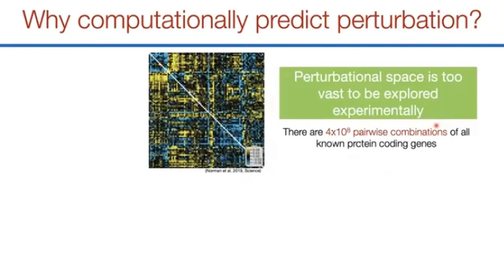
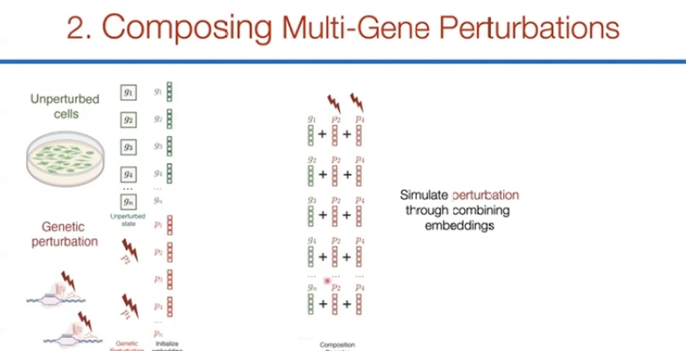
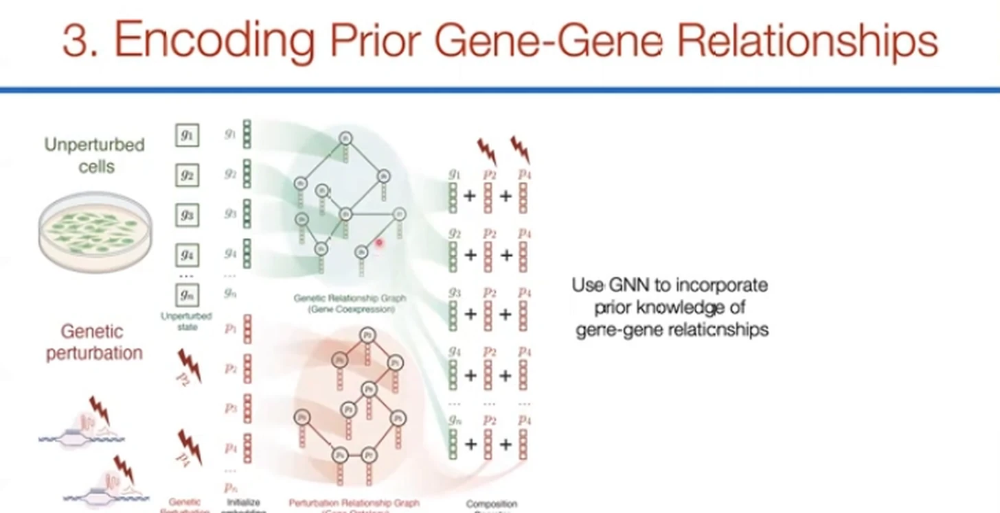
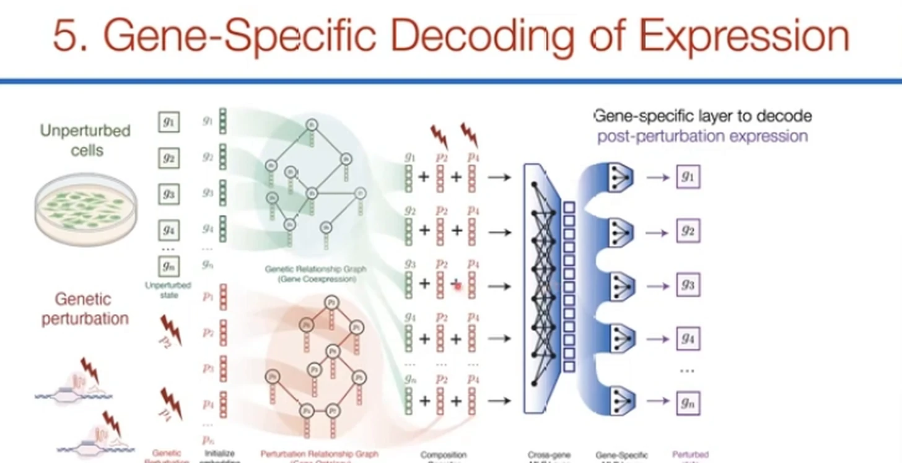
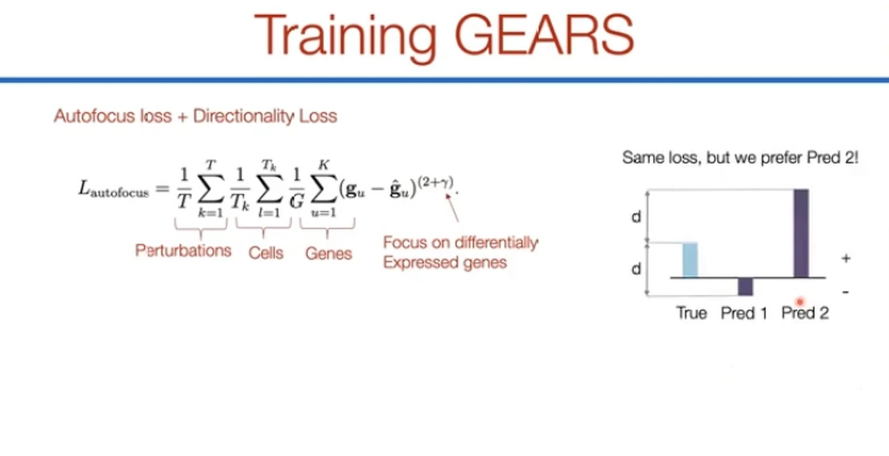
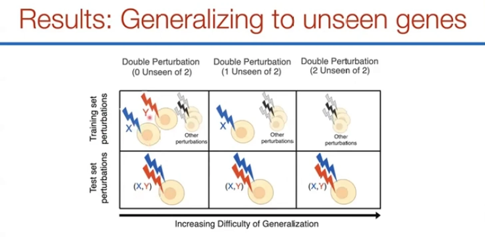
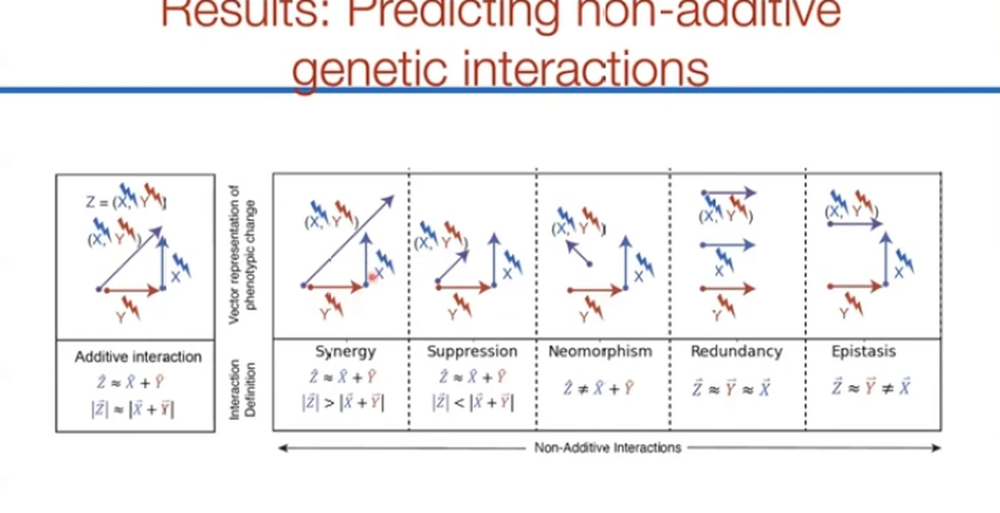
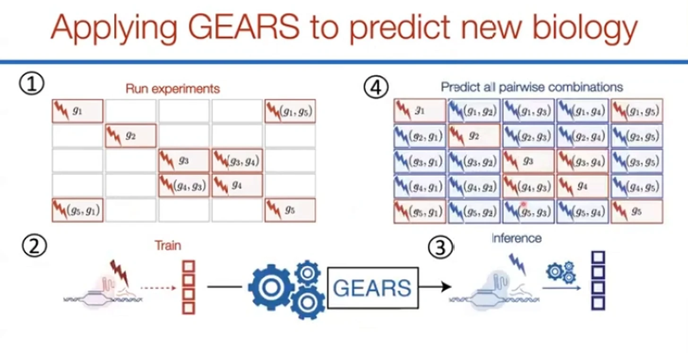

# Graph Neural Networks User Group Meetup 9/29/2022

> **视频**：[Graph Neural Networks User Group Meetup 9/29/2022](https://www.youtube.com/watch?v=maUpBKEBXmw)
> **时长**：约 31 分钟
> **说明**：本视频是 GEARS 作者 Yusuf Roohani（Stanford 博士生）在 GNN User Group 的讲解。标题是 meetup 名称，内容就是 GEARS 这项工作的作者报告。

## 本讲要解决的核心问题（SCQA）

**背景（S）**：生物学有一条“中心法则”：DNA 上的基因转录成 RNA，RNA 再翻译成蛋白质。研究者把细胞里所有 RNA 转录本的数量测出来，就得到这个细胞的**基因表达向量**——可以理解成一张“这个细胞现在在做什么”的高维快照（[02:35](https://www.youtube.com/watch?v=maUpBKEBXmw&t=155)、[03:25](https://www.youtube.com/watch?v=maUpBKEBXmw&t=205)）。

**冲突（C）**：想知道“扰动某个基因后，细胞会变成什么样”，最可靠的办法是做实验；但组合空间大到实验做不完。人类约有 2 万个蛋白编码基因，两两组合在视频口径下就有约 $4\times10^8$ 种，三基因、四基因组合还会再高几个数量级，而一次实验通常只能覆盖几千个扰动（[09:42](https://www.youtube.com/watch?v=maUpBKEBXmw&t=582)、[09:55](https://www.youtube.com/watch?v=maUpBKEBXmw&t=595)）。

**疑问（Q）**：如果某个基因从来没有被实验扰动过，能不能仍然预测它单独扰动、以及它与其他基因组合扰动后的转录结果？

**回答（A）**：GEARS（Graph-Enhanced Gene Activation and Repression Simulator，图增强的基因激活/抑制模拟器）用**两套嵌入**表示“基因是谁”和“基因被扰动后会产生什么影响”，再用**两张基因关系图**把生物学先验注入嵌入；这样即使某个扰动没在训练集出现，也能借功能邻居获得坐标。作者报告，它在三档“没见过多少基因”的泛化设定上，平均比两个基线好约 45%。

## 一、组合空间远大于实验通量，计算外推不是锦上添花

GEARS 的出发点不是“深度学习一定更强”，而是**实验通量有硬上限**。两两组合已经是亿级，高阶组合更不可能穷举；但药物发现、合成致死（两个基因单独敲都不致命，同时敲却让细胞死亡）和细胞重编程，偏偏都需要在组合空间里找答案（[08:02](https://www.youtube.com/watch?v=maUpBKEBXmw&t=482)、[08:27](https://www.youtube.com/watch?v=maUpBKEBXmw&t=507)）。

过去主要有两条路线，各有短板（[10:45](https://www.youtube.com/watch?v=maUpBKEBXmw&t=645)、[12:00](https://www.youtube.com/watch?v=maUpBKEBXmw&t=720)）：

- **先推断基因调控网络，再模拟扰动。** 问题是在“约 2 万个变量、几千到几万个观测”的单细胞数据上，网络很难学准，现有算法常常直接失败，也不容易捕捉非线性关系。
- **跳过网络，用自编码器或潜变量模型直接从输入映射到输出。** 这类方法常把扰动存成 one-hot 编码——每个基因一个独立位置。one-hot 依赖训练数据，训练集里没出现过的基因就没有对应坐标，遇到新扰动无法表示。

GEARS 想同时拿到两边的好处：保留深度学习的非线性拟合能力，又把“基因之间如何相互影响”做成图先验。模型遇到新基因时不是从零开始，而是回到知识图谱里找功能邻居（[12:25](https://www.youtube.com/watch?v=maUpBKEBXmw&t=745)、[12:50](https://www.youtube.com/watch?v=maUpBKEBXmw&t=770)）。

## 二、两套嵌入让“扰动”变成潜空间里的加法

GEARS 的输入有两部分：未扰动细胞的表达向量 $x$，以及一个二值扰动向量 $p$，标出哪些基因被上调或下调（[06:39](https://www.youtube.com/watch?v=maUpBKEBXmw&t=399)）。模型没有给每个基因只配一个标量，而是准备了两套多维向量（[13:40](https://www.youtube.com/watch?v=maUpBKEBXmw&t=820)）：

- **gene embedding（基因嵌入）**：描述“这个基因本身是谁”；
- **perturbation embedding（扰动嵌入）**：描述“这个基因被扰动后会产生什么影响”。

为什么要两套、还要多维？作者在真实扰动数据里看到，不同基因对扰动的响应差异很大，变异系数跨度很宽，一维标量装不下这种异质性；拆成两套向量，模型就能分别表达“基因身份”和“扰动效应”（[14:05](https://www.youtube.com/watch?v=maUpBKEBXmw&t=845)、[14:30](https://www.youtube.com/watch?v=maUpBKEBXmw&t=870)）。

真正让组合可计算的，是**在潜空间里做加法**。作者借用了 NLP 里 `king - man + woman ≈ queen` 的类比：把扰动嵌入加到每个基因的基因嵌入上，就相当于模拟“这个扰动作用在所有基因上”。同时扰动基因 2 和基因 4，就把 $p_2$、$p_4$ 都加进去（[14:55](https://www.youtube.com/watch?v=maUpBKEBXmw&t=895)、[15:20](https://www.youtube.com/watch?v=maUpBKEBXmw&t=920)）。

不过，“能相加”不等于“加得有意义”。随机初始化的向量没有生物学含义，没见过的基因也拿不到靠谱坐标。这正是两张图要解决的问题。

## 三、两张图给嵌入注入生物学先验，没见过的基因才有坐标

GEARS 用了两张节点都是基因、节点特征都是嵌入向量的图，各跑一个图卷积网络（GCN，Graph Convolutional Network；让每个节点聚合邻居信息）（[15:20](https://www.youtube.com/watch?v=maUpBKEBXmw&t=920)、[15:45](https://www.youtube.com/watch?v=maUpBKEBXmw&t=945)）：

1. **基因共表达图（gene co-expression graph）**：约束 **gene embedding**。经常一起变化的基因，表示也靠近；表达模式相似，面对扰动时也可能有相似响应。
2. **基因本体图（GO graph，Gene Ontology）**：约束 **perturbation embedding**。功能相近、属于同一 GO 条目的基因，其“被扰动后的影响”也应该相似。

图卷积的作用是让相连的邻居交换信息、表示趋于相似（[16:10](https://www.youtube.com/watch?v=maUpBKEBXmw&t=970)）。效果是：如果某个扰动从没做过，模型可以顺着 GO 图找到功能相近的邻居，借它们的表示来“猜”新扰动；如果一个基因本身没出现过，共表达图也能把它放到相似基因旁边（[16:35](https://www.youtube.com/watch?v=maUpBKEBXmw&t=995)）。

作者还展示了支持这个设计的现象：真实扰动数据里，很多扰动会产生相似的表达响应，形成**共功能模块（co-functional modules）**；很多基因也会对不同扰动做出相似响应，形成**共调控程序（co-regulated programs）**（[17:00](https://www.youtube.com/watch?v=maUpBKEBXmw&t=1020)）。

## 四、跨基因层、基因特异解码器与两项损失

到上一步，每个基因还是“各算各的”。但扰动常有**次级效应**：扰动基因 4 可能间接影响基因 9，而基因 9 并不在扰动列表里。GEARS 因此加了**跨基因 MLP 层（cross-gene MLP）**：把所有基因扰动后的嵌入汇总成全局状态，再让每个基因参考它更新自己（[17:50](https://www.youtube.com/watch?v=maUpBKEBXmw&t=1070)、[18:15](https://www.youtube.com/watch?v=maUpBKEBXmw&t=1095)）。

这里有个容易误解的细节：GEARS **不是自编码器**。每个基因的输出都直接连到最终解码器，同时又接受全局状态调制，而不是被迫先从全局状态重建所有嵌入（[18:40](https://www.youtube.com/watch?v=maUpBKEBXmw&t=1120)）。最后是**基因特异解码器（gene-specific decoder）**：每个基因有自己的解码参数，把最终嵌入映射回表达值，保留不同基因响应幅度和模式的差异（[19:05](https://www.youtube.com/watch?v=maUpBKEBXmw&t=1145)）。

训练数据是“未扰动细胞 + 真实扰动 + 扰动后表达”，最直接的损失是均方误差（MSE，预测值与真实值差的平方的平均）。但直接用它有两个偏差，GEARS 各加了一项修正（[19:30](https://www.youtube.com/watch?v=maUpBKEBXmw&t=1170)）：

- **autofocus loss**：扰动后绝大多数基因并不变化，真正有明显响应的往往只有几百个。如果对所有基因一视同仁，损失会被大量“零”稀释。GEARS 把误差的指数从 2 提到 $2+\gamma$，给差异表达基因更高权重（[19:55](https://www.youtube.com/watch?v=maUpBKEBXmw&t=1195)、[20:20](https://www.youtube.com/watch?v=maUpBKEBXmw&t=1220)）。
- **方向性损失（directionality loss）**：两个预测可以有相同的 MSE，但一个把基因上调、另一个下调；对生物学家来说，方向对了的预测更有用。GEARS 额外约束预测的变化方向与真实方向一致（[21:10](https://www.youtube.com/watch?v=maUpBKEBXmw&t=1270)、[21:35](https://www.youtube.com/watch?v=maUpBKEBXmw&t=1295)）。

## 五、结果：能外推，但难度随“没见过的基因数”上升

先看一个具体例子。以 FOSB + CEBPB 的组合为例：CEBPB 在训练时没被单独扰动过，GEARS 仍跟上了真实表达的上调、下调趋势。one-hot 模型在这里没有坐标，做不到（[23:15](https://www.youtube.com/watch?v=maUpBKEBXmw&t=1395)、[23:40](https://www.youtube.com/watch?v=maUpBKEBXmw&t=1420)）。

作者把双基因组合的泛化难度分成三档（[24:05](https://www.youtube.com/watch?v=maUpBKEBXmw&t=1445)、[24:30](https://www.youtube.com/watch?v=maUpBKEBXmw&t=1470)）：

- **0 unseen of 2**：两个基因都分别被扰动过，只是没做过这个组合；
- **1 unseen of 2**：其中一个基因从未被扰动过，另一个见过；
- **2 unseen of 2**：两个基因都没被单独扰动过，却要预测它们的组合。这是最难的一档。

在这三档上，GEARS 相对一个线性模型和一个不使用先验知识的 CPA（自编码器类模型），**平均提升约 45%**（[25:20](https://www.youtube.com/watch?v=maUpBKEBXmw&t=1520)）。更关键的是**非加性交互**：若两个单基因效应是 $X$、$Y$，最偷懒的预测是 $X+Y$；真实细胞里却有协同（大于相加）、抑制（小于相加），以及新形态、冗余、上位等类型。GEARS 能捕捉这些非线性效应（[25:45](https://www.youtube.com/watch?v=maUpBKEBXmw&t=1545)、[26:10](https://www.youtube.com/watch?v=maUpBKEBXmw&t=1570)）。

在“找出最强交互”的排序任务上，作者用 **precision@10**（预测的前 10 个组合里有多少真属于该类交互）衡量，GEARS 比基线**约提升 50%**（[28:15](https://www.youtube.com/watch?v=maUpBKEBXmw&t=1695)）。最后是一个更实用的外推实验：只用 **236 个已知扰动**训练，再预测 **5000 个没做过的扰动**，并从中找到此前没观察到的表型（[28:40](https://www.youtube.com/watch?v=maUpBKEBXmw&t=1720)）。

边界也要说清楚。第一，45% 是三档设定的平均值，不代表最难的 2 unseen of 2 也有同样幅度；讲者把难度设计成从左到右递增（[24:55](https://www.youtube.com/watch?v=maUpBKEBXmw&t=1495)）。第二，外推能力依赖图先验：GO 邻居少、注释不完整的基因，模型能借到的信息就少。第三，GEARS 输出的是基因表达层面的预测，价值在于帮生物学家**缩小实验范围**，而不是替代湿实验。作者自己的定位也是“先做一部分实验，再用模型填满组合空间”（[28:40](https://www.youtube.com/watch?v=maUpBKEBXmw&t=1720)）。

## 小结

- **问题**：组合扰动空间远大于实验通量，模型必须在“没做过某个扰动”时仍给出可检验的预测。
- **表示**：**gene embedding** 描述基因本身，**perturbation embedding** 描述“这个基因被扰动”，两者相加即可组合多个扰动。
- **先验**：**基因共表达图**约束 gene embedding，**GO 图**约束 perturbation embedding，再用 GCN 聚合邻居，让没见过的基因借功能邻居获得坐标。
- **结构**：**跨基因层**负责次级效应，**基因特异解码器**保留异质性；**autofocus loss** 对抗大量“没变化”的基因，**方向性损失**保证方向正确。
- **结果**：三档泛化设定上平均优于线性与 CPA 基线约 45%，能预测非加性交互，并展示了“236 个扰动训练 → 5000 个扰动外推”。它的价值是**扩展实验空间**，不是替代实验。

## 关键术语速查

| 术语 | 一句话解释 |
| --- | --- |
| 基因表达向量 | 一个细胞里各基因转录本数量组成的高维向量，描述细胞当前状态 |
| Perturb-seq | 把 CRISPR 扰动与单细胞 RNA 测序结合，读出扰动后的表达变化 |
| gene embedding | 描述“基因本身是谁”的可学习多维向量 |
| perturbation embedding | 描述“这个基因被扰动后产生什么影响”的可学习多维向量 |
| 共表达图 | 表达模式相似的基因连边的图，用来约束 gene embedding |
| GO 图 | 按基因功能注释建边的图，用来约束 perturbation embedding |
| 非加性交互 | 组合扰动效果不等于两个单扰动效果之和，如协同、抑制 |
| precision@10 | 排序任务里，预测的前 10 个结果中正确项所占比例 |

## 相关阅读

- [chemCPA：从化学结构预测未见药物](<Predicting Single-Cell Perturbation Responses For Unseen Drugs ｜ Leon Hetzel and Simon Böhm.md>)
- [Tahoe-x1：规模化扰动训练的单细胞基础模型](BioML Seminar 4.4 - Shreshth Gandhi on Scaling Perturbation-Trained Single-Cell Foundation Models.md)
- [Deep-learning-based Gene Perturbation Effect Prediction Does Not Yet Outperform Linear Baselines](Deep-learning-based Gene Perturbation Effect Prediction Does Not Yet Outperform Linear Baselines.md)
- [PerturBench: Benchmarking Machine Learning Models for Cellular Perturbation Analysis](<PerturBench：Benchmarking Machine Learning Models for Cellular Perturbation Analysis.md>)
