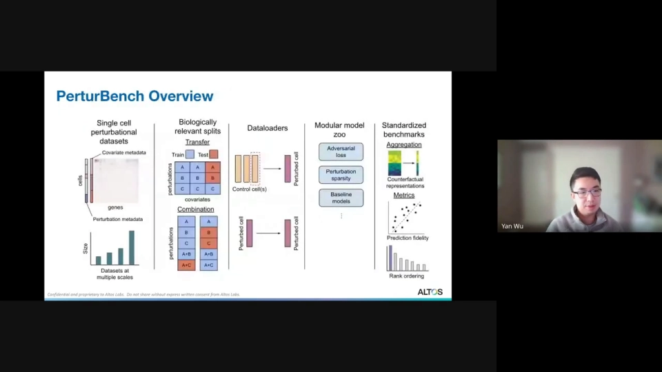
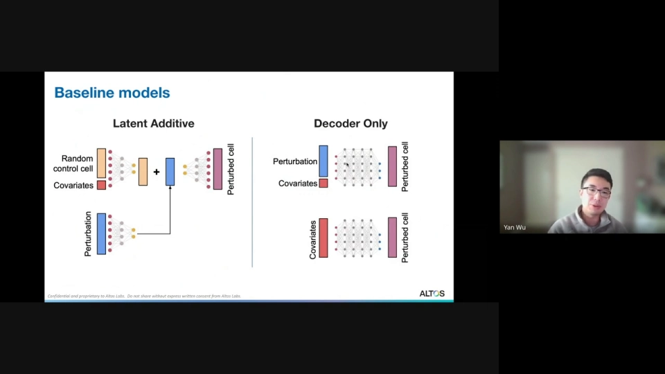
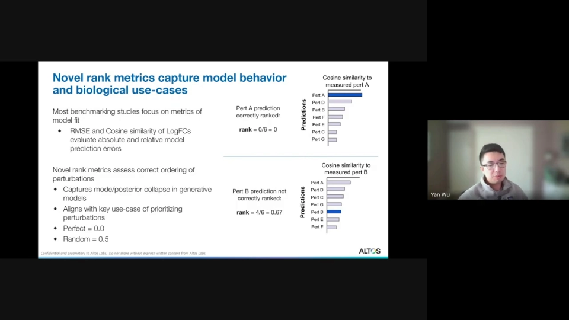
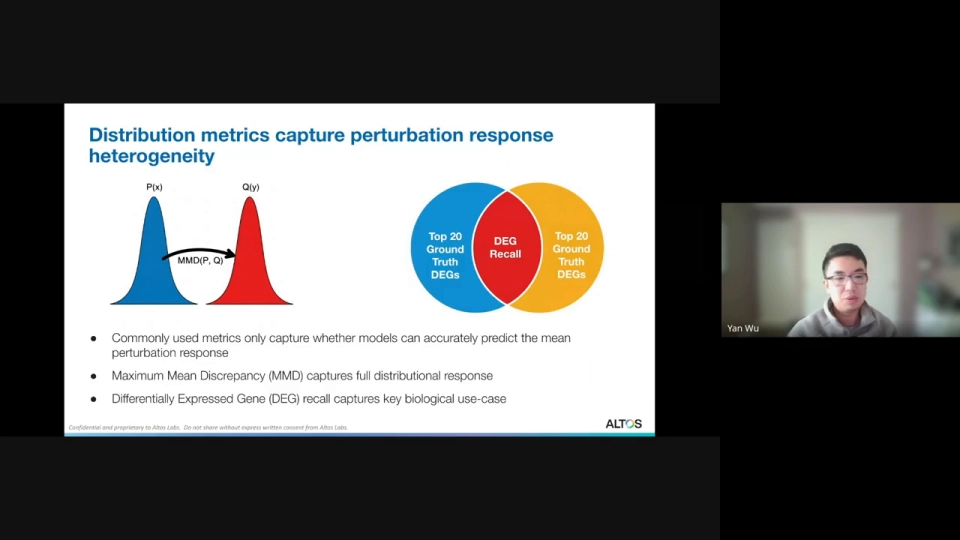
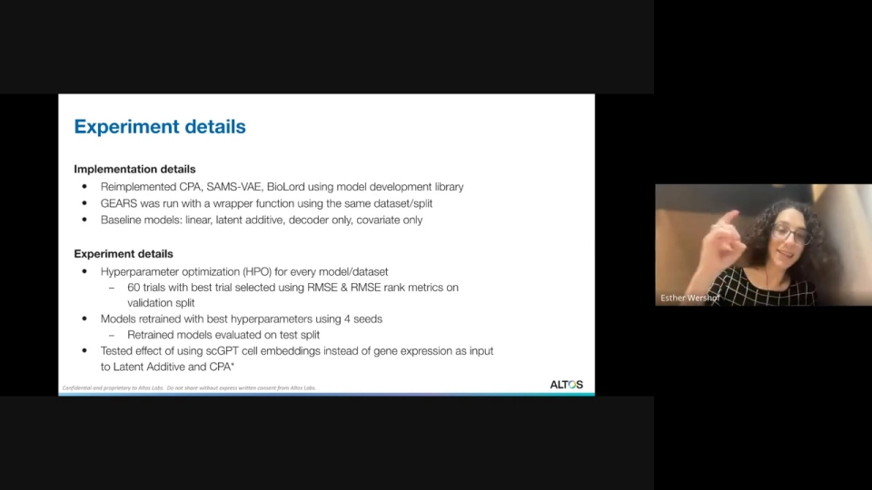
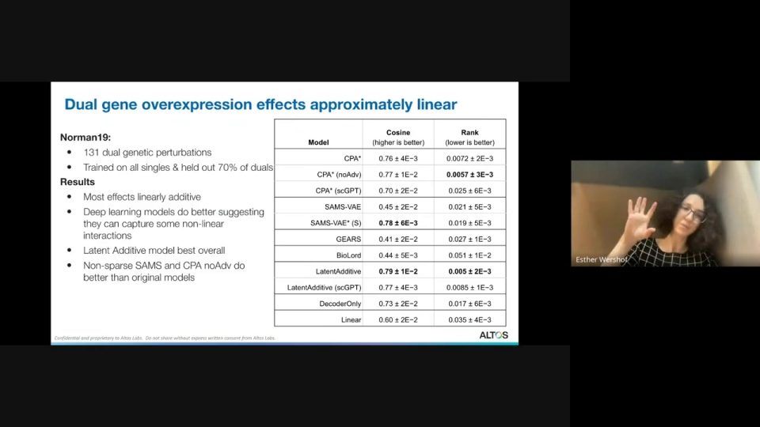
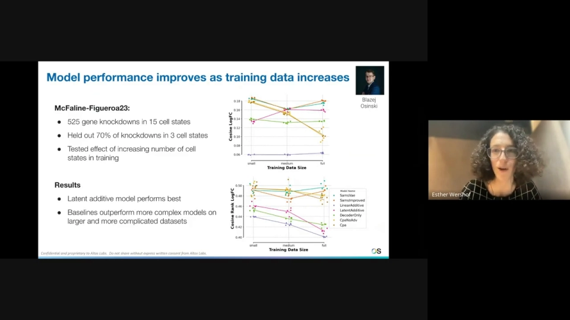
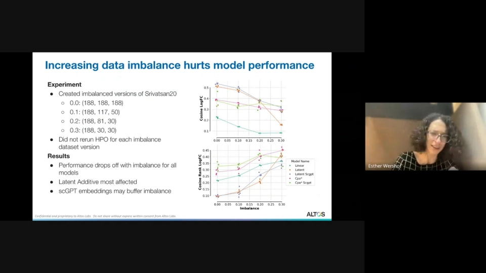

# PerturBench: Benchmarking Machine Learning Models for Cellular Perturbation Analysis

- 视频标题：PerturBench: Benchmarking Machine Learning Models for Cellular Perturbation Analysis
- 视频链接：https://www.youtube.com/watch?v=5M0HWIjmEhQ
- 时长：约 55 分钟（55:52）

## 本讲要解决的核心问题（SCQA）

**背景**：高通量筛选加上单细胞 RNA 测序，让实验者可以一次测量成千上万个基因或药物扰动后的细胞状态。但人体有大量细胞类型与状态，把每种扰动在所有细胞里都做一遍成本极高；两个基因的组合更是几乎不可能穷举。

**冲突**：虚拟细胞模型声称能预测没做过的扰动，可现有评测大多只问“预测的平均表达像不像”，很少检查模型是否真的分得清不同扰动、是否能复现细胞间的异质性；同时，多数代码库围绕某一种模型搭建，想做公平消融很困难。

**疑问**：怎样在同一套数据、切分和指标下比较这些模型？哪些设计真正贡献了性能，哪些只是“看起来有用”？简单模型会不会已经够用？

**回答（中心思想）**：PerturBench 用统一的数据、切分、加载器、模型库与指标回答了这些问题。结论是：简单模型在部分指标和场景下胜出，复杂自编码器只在分布层面占优；新的排序（rank）指标能揭穿“所有扰动都预测成同一个平均态”的塌缩；逐项消融显示模型的招牌创新未必是性能来源；数据规模、不平衡与组合扰动仍是开放问题。

## 一、为什么需要基准：不可穷举的扰动空间与反事实预测

这类测量是**破坏性**的：测序会裂解细胞，无法测量“同一个细胞扰动前和扰动后”的状态。我们能得到的只是两群细胞——一群没有受扰动的对照细胞，和分别接受不同扰动的细胞群。模型真正要生成的是**反事实预测**：假如这团对照细胞接受了某个扰动，它会变成什么样。[【跳转到 04:20】](https://www.youtube.com/watch?v=5M0HWIjmEhQ&t=260)

报告聚焦两类任务。第一类是**组合扰动预测**：已经见过扰动 A 和 B 单独作用，预测 A+B 同时施加的效果。第二类是**细胞状态迁移**：在细胞类型 1、2 中见过某扰动，预测它在细胞类型 3 中的效果。[【跳转到 05:10】](https://www.youtube.com/watch?v=5M0HWIjmEhQ&t=310)

作者认为现有工作留下三个缺口：缺少能评价“扰动排序”和“细胞级异质性”的生物学相关指标；缺少统一的软件框架来系统做模型与数据消融；以及很少有平台同时支持“开发模型”和“评测模型”。[【跳转到 06:25】](https://www.youtube.com/watch?v=5M0HWIjmEhQ&t=385)

## 二、平台设计：把数据、切分、加载器、模型和指标拆成积木

PerturBench 收录 6 个单细胞扰动数据集，覆盖化学小分子与遗传扰动、单扰动与双扰动，规模从约 9 万到 160 万个细胞，跨越多种细胞类型与状态。数据切分按生物学问题组织：组合任务留出部分双扰动，迁移任务留出部分细胞状态。[【跳转到 07:15】](https://www.youtube.com/watch?v=5M0HWIjmEhQ&t=435) [【跳转到 14:45】](https://www.youtube.com/watch?v=5M0HWIjmEhQ&t=885)

训练策略主要有两派。第一派做**对照匹配**：为每个扰动细胞随机抽一个对照细胞，并限制二者来自同一细胞类型、同一批次；GEARS 最早采用这种加载器，更新的 CellFlow 还会用最优传输找“最可能”的对照。[【跳转到 08:30】](https://www.youtube.com/watch?v=5M0HWIjmEhQ&t=510) 第二派做**表示解耦**：用自编码器重建扰动细胞，同时把潜在空间拆成“未扰动表示”和“扰动表示”，推理时把新扰动加到对照表示上；CPA、SAM-VAE、BioLord 属于这一类。[【跳转到 09:45】](https://www.youtube.com/watch?v=5M0HWIjmEhQ&t=585)

模型库既包含上述已发表模型，也包含几条强基线：在潜在空间做加法的 **latent additive**、完全不看对照表达的 **decoder-only**、只看协变量不看扰动的 **covariate-only**，以及线性模型。作者重实现了 CPA、SAM-VAE、BioLord，并用 scGPT 嵌入替代基因表达来训练 GEARS。[【跳转到 11:00】](https://www.youtube.com/watch?v=5M0HWIjmEhQ&t=660) 每个数据集做 60 组超参数搜索，再用 4 个随机种子重训。[【跳转到 20:27】](https://www.youtube.com/watch?v=5M0HWIjmEhQ&t=1227)

## 三、指标：从“平均像不像”到“排序对不对、分布像不像”

传统指标是 RMSE 与 log fold change 的余弦相似度，衡量绝对与相对预测误差。但它们只看平均效应，模型可以把所有扰动都预测成同一个“平均细胞”而仍然得分不错。[【跳转到 15:35】](https://www.youtube.com/watch?v=5M0HWIjmEhQ&t=935)

为此作者设计了**排序指标（rank metric）**：拿真实扰动 A 的表达谱，与模型对 A、B、C……所有扰动的预测逐一算余弦相似度并排序。若模型学得好，预测的 A 应该与真实 A 最相似、排第一。完美排序记为 0，随机排序为 0.5，因此越低越好。他们不用常见的 k-recall，是因为不同数据集只有 100 到 3000 个扰动，k-recall 难以跨数据集比较。[【跳转到 16:00】](https://www.youtube.com/watch?v=5M0HWIjmEhQ&t=960) [【跳转到 17:15】](https://www.youtube.com/watch?v=5M0HWIjmEhQ&t=1035)

另两个是**分布指标**。最大均值差异（MMD）比较预测分布与真实分布的整体形状，而不只是均值；差异表达基因召回（DEG recall）看模型能否找回真实发生变化的基因，对应“哪些基因在动”这一核心生物学问题。[【跳转到 17:40】](https://www.youtube.com/watch?v=5M0HWIjmEhQ&t=1060) [【跳转到 18:30】](https://www.youtube.com/watch?v=5M0HWIjmEhQ&t=1110)

## 四、结果一：简单模型不输，rank 指标揭穿“塌缩”

作者先用小型化学扰动数据 Srivatsan20 试水：188 个药物扰动、3 个细胞系，每个细胞系留出 30% 药物做测试。它规模小、完全平衡，且药物效应通常比遗传扰动更强，适合快速迭代。[【跳转到 20:52】](https://www.youtube.com/watch?v=5M0HWIjmEhQ&t=1252)

有三点值得注意。第一，SAM-VAE 去掉稀疏正则后取得最好的余弦相似度（0.53），CPA 去掉对抗解耦后取得最好的 rank（0.09）——也就是说，这两篇论文的**核心创新并不是性能来源**。第二，加入 scGPT 细胞嵌入后性能几乎不变，说明其价值尚未被真正“解锁”。[【跳转到 22:32】](https://www.youtube.com/watch?v=5M0HWIjmEhQ&t=1352) [【跳转到 22:57】](https://www.youtube.com/watch?v=5M0HWIjmEhQ&t=1377)

第三点最能说明新指标的意义：covariate-only 完全不知道扰动是什么，余弦相似度却有 0.30，看似“还行”；但 rank 是 0.47，几乎等于随机。这正是模型塌缩——只会预测与具体扰动无关的平均响应。[【跳转到 23:22】](https://www.youtube.com/watch?v=5M0HWIjmEhQ&t=1402) 该指标后来被 ARC 虚拟细胞竞赛采纳为“扰动判别分数”的变体。[【跳转到 23:47】](https://www.youtube.com/watch?v=5M0HWIjmEhQ&t=1427)

在分布指标上，自编码器模型优于基线，说明复杂模型确实捕捉到一部分分布层面的结构；但**所有模型的 DEG recall 都很差**，可能反映当前模型还不够精细，存在能力上限。[【跳转到 25:02】](https://www.youtube.com/watch?v=5M0HWIjmEhQ&t=1502) 在 OP3 数据上，自编码器与基线的 MMD 差距更大，作者推测是因为该数据在细胞类型内部异质性更强，平均细胞不足以代表整个分布，提示需要先刻画数据特征，再设计模型。[【跳转到 25:52】](https://www.youtube.com/watch?v=5M0HWIjmEhQ&t=1552)

## 五、结果二：组合扰动近似可加，消融揭示“扰动表示”更关键

组合任务使用 Norman19：131 个双基因扰动，训练见过全部单扰动、留出 70% 的双扰动。多数双扰动效应近似线性可加，线性模型表现尚可；但深度学习模型更好，说明它们已能捕捉部分非线性相互作用——这正是计算模型相对实验的价值所在：搜索空间太大时，用模型缩小候选组合。[【跳转到 26:42】](https://www.youtube.com/watch?v=5M0HWIjmEhQ&t=1602) [【跳转到 27:07】](https://www.youtube.com/watch?v=5M0HWIjmEhQ&t=1627)

在这个任务上，latent additive 总体最好；非稀疏 SAM-VAE 与非对抗 CPA 再次优于原版，进一步说明“逐项测试”的必要。[【跳转到 27:57】](https://www.youtube.com/watch?v=5M0HWIjmEhQ&t=1677) 更值得注意的是 decoder-only 模型：它完全不看对照细胞的基因表达，只凭扰动与协变量就能预测得不错。这暗示当前**扰动表示比基因表达信息更有价值**，也可能说明基因表达中的噪声盖过了信号。[【跳转到 30:52】](https://www.youtube.com/watch?v=5M0HWIjmEhQ&t=1852)

讨论认为，去掉稀疏或对抗约束反而更好，可能是归纳偏置与数据不匹配，也可能是生物噪声难以解耦；作者尚无定论。[【跳转到 28:47】](https://www.youtube.com/watch?v=5M0HWIjmEhQ&t=1727)

## 六、数据实验与开放问题：更多数据不一定更好

作者进一步做了两组数据实验。第一组用 McFaline-Figueroa23（525 个基因敲低、15 种细胞状态），比较小、中、大训练集。直觉上数据越多越好，但 CPA、SAM-VAE 等复杂模型在更大、更复杂的数据上 rank 反而变差；latent additive 最稳，基线在大数据上甚至超过复杂模型。[【跳转到 31:42】](https://www.youtube.com/watch?v=5M0HWIjmEhQ&t=1902) [【跳转到 32:07】](https://www.youtube.com/watch?v=5M0HWIjmEhQ&t=1927)

第二组人为制造数据不平衡：原本每个细胞系都有全部扰动，现在只让某些细胞系见到部分扰动。所有模型性能都下降，latent additive 受影响最大；初步迹象是 scGPT 嵌入可能提供一定缓冲。但这一组没有为每种不平衡程度重新做超参数搜索，只能算初步结果。[【跳转到 32:57】](https://www.youtube.com/watch?v=5M0HWIjmEhQ&t=1977) [【跳转到 33:47】](https://www.youtube.com/watch?v=5M0HWIjmEhQ&t=2027)

局限也很清楚：部分模型是自行重实现的，可能漏掉原实现细节；超参数搜索可能卡在局部最优；CellFlow、STATE 等新模型尚未纳入，但代码库可扩展。[【跳转到 38:22】](https://www.youtube.com/watch?v=5M0HWIjmEhQ&t=2302) 讨论还触及“生物噪声地板”：在巨大的表达向量上算 MSE 本身很吵，给效应更强的扰动更高权重可能更有效；而“虚拟细胞”这个词暗示能水晶球式预测，实际上转录组层面的预测精度有天花板。[【跳转到 37:57】](https://www.youtube.com/watch?v=5M0HWIjmEhQ&t=2277) 未来方向包括多模态（如 Cell Painting 图像）、更大规模的数据集（如 Tahoe-100M），以及比 Norman19 大两个数量级的组合扰动数据。[【跳转到 51:17】](https://www.youtube.com/watch?v=5M0HWIjmEhQ&t=3077)

## 小结

- 统一基准后，**简单模型在若干指标与场景下不输复杂模型**；复杂自编码器只在分布层面占优。
- **rank 指标**是本次最重要的工具：它能让“所有扰动都预测成同一个平均态”的模型原形毕露，已被 ARC 竞赛采用。
- **消融必须逐项做**：SAM-VAE 的稀疏约束、CPA 的对抗解耦都不是性能来源，去掉反而更好。
- **扰动表示比基因表达更关键**：decoder-only 模型表现很好，说明当前模型还没充分利用对照细胞的表达信息。
- **数据不是越多越好**：规模与复杂度上升可能伤害复杂模型；数据不平衡会伤害所有模型。
- 基准本身很难，但正是它把“模型是否真的有用”变成可复现、可比较的问题。

## 关键术语速查

| 术语 | 一句话解释 |
| --- | --- |
| 组合扰动 | 同时施加两个扰动，检验效应能否由两个单扰动相加得到。 |
| 对照匹配 | 为每个扰动细胞匹配一个同类型、同批次的对照细胞，作为“扰动前”的近似。 |
| 表示解耦 | 把潜在空间拆成未扰动与扰动两部分，以便组合出新扰动。 |
| rank 指标 | 按预测与真实扰动的相似度排序；完美为 0，随机为 0.5。 |
| MMD | 最大均值差异，比较两个分布整体形状，而不只是均值。 |
| DEG recall | 差异表达基因召回，衡量模型找回真实变化基因的能力。 |
