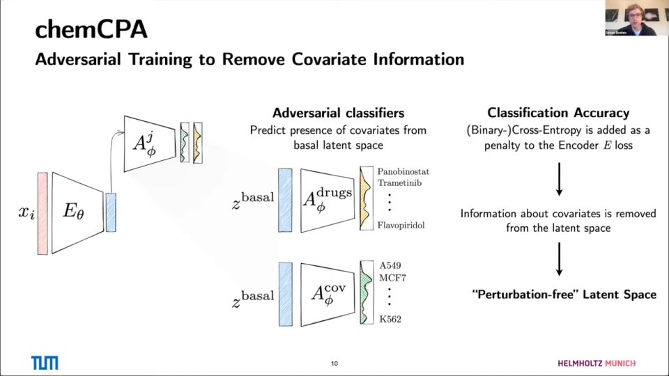
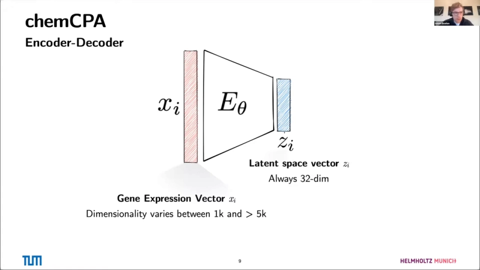
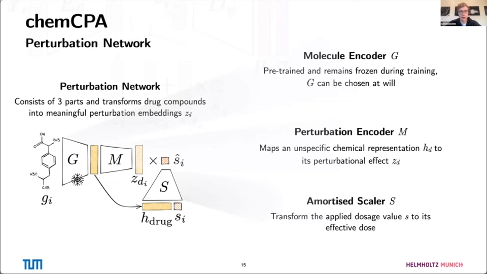
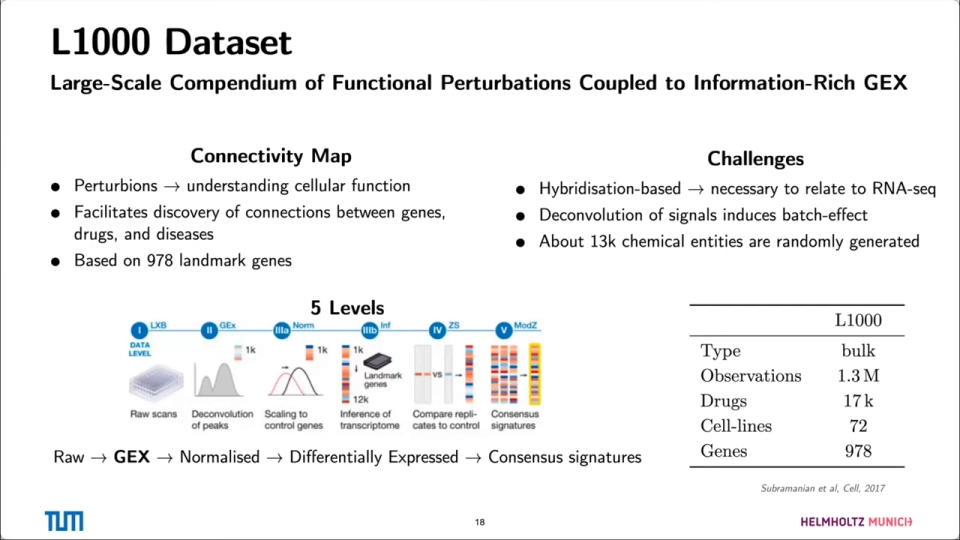
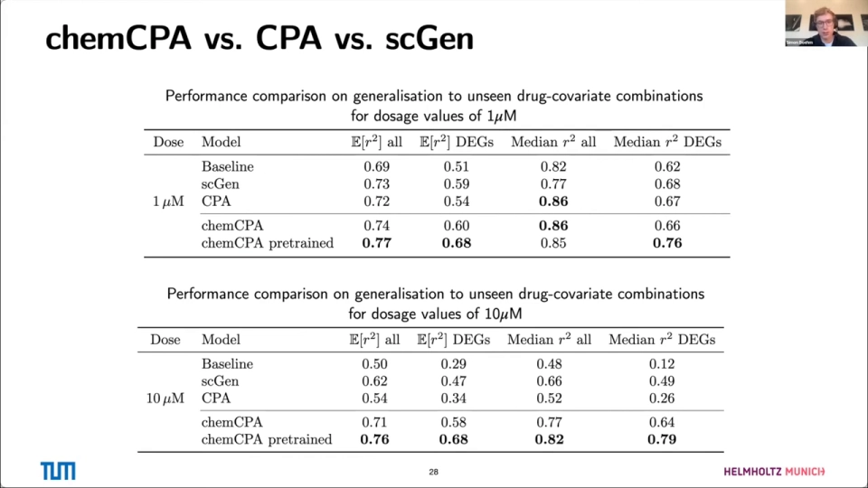
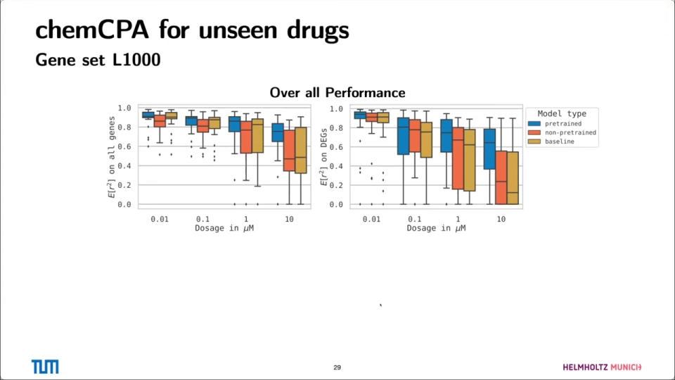

# Predicting Single-Cell Perturbation Responses For Unseen Drugs | Leon Hetzel and Simon Böhm

> **视频**：[Predicting Single-Cell Perturbation Responses For Unseen Drugs | Leon Hetzel and Simon Böhm](https://www.youtube.com/watch?v=nsL_NOwYf1c)
> **时长**：约 58 分钟（含问答）
> **说明**：这是 chemCPA 作者 Leon Hetzel 与 Simon Böhm 的报告。Leon 有物理与数学背景，Simon 是 ETH 计算机系硕士；这项工作也是 Simon 在 TUM 的硕士论文。文中时间戳均指向该视频。

## 视频主线

Leon 先铺开单细胞扰动建模的问题和数据难点，Simon 接着回顾 CPA 的编码—解耦—相加框架，再讲 chemCPA 如何用分子结构编码器和剂量缩放器替换药物查找表。随后两人按“L1000 预训练 → architecture surgery → sci-Plex3 微调 → 未见药物评估”的顺序展示结果，最后把局限收在数据覆盖和潜空间算术上。

## 一、单细胞扰动建模：给定旧状态和条件，能不能预测新状态

Leon 先给单细胞基因组学做背景。他们实验室关心健康和疾病下的细胞动态：同一个细胞在不同条件下可能存活、分化、增殖/分裂，也可能死亡（[02:40](https://www.youtube.com/watch?v=nsL_NOwYf1c&t=160)、[03:05](https://www.youtube.com/watch?v=nsL_NOwYf1c&t=185)）。

用数学语言说，如果已知细胞当前状态 $x_{\text{old}}$ 和某个条件 $p$，能不能找到一个函数 $f$，预测新的状态 $x_{\text{new}}$？测量手段通常是单细胞观测，最常见的是单细胞 RNA 测序；但组学层面还可以看基因组、表观基因组、蛋白质组、代谢组，往上看还有组织、器官和不断出现的图谱（[03:30](https://www.youtube.com/watch?v=nsL_NOwYf1c&t=210)、[03:55](https://www.youtube.com/watch?v=nsL_NOwYf1c&t=235)、[04:20](https://www.youtube.com/watch?v=nsL_NOwYf1c&t=260)）。

第三个轴是**扰动**。扰动可以来自药物（这场报告主要讲药物）、基因敲除、发育过程（时间也是一种扰动）、疾病等。单细胞的价值在于保留异质性：讲者用马、犀牛、鸭子的图举例——在单细胞层面能区分不同实体，而 bulk 测量把一切取平均，虽然也给信息，但可能误导，看不到单细胞数据里的全部变异（[04:45](https://www.youtube.com/watch?v=nsL_NOwYf1c&t=285)、[05:09](https://www.youtube.com/watch?v=nsL_NOwYf1c&t=309)）。

技术路径上，基于液滴的方法把单个细胞诱导进液滴，再用油把液滴分开，从而得到单细胞测量。这个领域从 2013 年单细胞方法被评为年度方法开始，2019 年是多模态，2020 年是空间转录组（不仅知道 RNA，还知道位置）；数据量按对数增长，如今已有超过一两百万细胞的数据集，例如人肺细胞图谱（[05:34](https://www.youtube.com/watch?v=nsL_NOwYf1c&t=334)、[05:44](https://www.youtube.com/watch?v=nsL_NOwYf1c&t=344)、[06:09](https://www.youtube.com/watch?v=nsL_NOwYf1c&t=369)、[06:34](https://www.youtube.com/watch?v=nsL_NOwYf1c&t=394)）。

方法数量也在涨：到 2021 年相关方法已超过一千个，有同事分析了所有 GitHub 仓库的关键词，发现 **perturbation** 是出现频率异常高的关键词之一。数据变多带来机器学习社区的兴趣，而扰动数据正是其中一个增长点（[06:59](https://www.youtube.com/watch?v=nsL_NOwYf1c&t=419)、[07:14](https://www.youtube.com/watch?v=nsL_NOwYf1c&t=434)、[07:39](https://www.youtube.com/watch?v=nsL_NOwYf1c&t=459)）。

## 二、扰动建模有五类目标，chemCPA 只处理“响应预测”和“未见化合物”

Leon 借用一篇扰动建模综述，把目标分成几类（[08:04](https://www.youtube.com/watch?v=nsL_NOwYf1c&t=484)、[08:29](https://www.youtube.com/watch?v=nsL_NOwYf1c&t=509)）：

1. **扰动响应建模**：从 RNA 等组学测量出发，常在自编码器框架里把扰动放到潜空间里理解，再重建并评估性能。这是 chemCPA 的主线。
2. **标量读出（scalar readout）**：例如 IC50，衡量药物对某个细胞系的影响。数据很丰富，也可以建模，但不是这篇工作的重点。
3. **靶点与机制识别**：每个点是一种药，颜色表示不同靶点、机制或作用方式；来了一个新化合物，想知道它属于哪种作用机制。这对癌症治疗很重要。
4. **药物组合**：每个轴一种药，问两种药在效力上是协同还是拮抗。讲者展示了协同（最低点比单药更低）和拮抗（总效力被削弱）的例子。这是很有野心的问题，chemCPA 当时还没有处理组合，但更新的代码版本会支持，讲者正在测试（[09:19](https://www.youtube.com/watch?v=nsL_NOwYf1c&t=559)、[09:44](https://www.youtube.com/watch?v=nsL_NOwYf1c&t=584)、[10:09](https://www.youtube.com/watch?v=nsL_NOwYf1c&t=609)、[11:24](https://www.youtube.com/watch?v=nsL_NOwYf1c&t=684)）。
5. **反方向**：不只从化合物预测组学影响，而是从组学测量反推需要什么化学性质才能造成这种扰动。讲者说这很困难，但很酷。

所以 chemCPA 明确处理的是第一类“扰动响应建模”，以及第二部分的“刻画未见化合物”；它通过化学结构把“结构 → 组学扰动”连起来，算是在往第五类反方向上迈了一步（[11:24](https://www.youtube.com/watch?v=nsL_NOwYf1c&t=684)、[11:49](https://www.youtube.com/watch?v=nsL_NOwYf1c&t=709)）。

## 三、CPA 的底子：编码到 32 维、对抗解耦、再把属性加回去

Simon 接着讲模型。最基本的设定是化学扰动，也就是药物引起的扰动，而且模型要能回答**反事实问题**：眼前这个细胞已经被药物 1 处理过，如果当时改用药物 2，它的基因表达会是什么样？（[12:14](https://www.youtube.com/watch?v=nsL_NOwYf1c&t=734)、[12:39](https://www.youtube.com/watch?v=nsL_NOwYf1c&t=759)）

**第一步是编码。** 输入是细胞的基因表达向量 $x_i$，维度随测序 panel 在约一千到五千个基因之间变化；编码器 $E_\theta$ 把它压成一个固定的 **32 维**潜向量 $z_i$（[13:04](https://www.youtube.com/watch?v=nsL_NOwYf1c&t=784)）。

**第二步是对抗解耦。** 如果放任编码器，它会把“这是什么药”“这是什么细胞系”全塞进潜空间，后面再手动加属性就没有意义。CPA 因此接了两个对抗分类器：一个从潜向量预测药物，一个预测细胞类型；两者用交叉熵训练，并把分类损失作为惩罚加回编码器。训练下来，编码器会尽量删掉药物和协变量信息，得到的 $z_{\text{basal}}$ 就是**基底状态（basal state）**（[13:54](https://www.youtube.com/watch?v=nsL_NOwYf1c&t=834)、[14:19](https://www.youtube.com/watch?v=nsL_NOwYf1c&t=859)、[14:44](https://www.youtube.com/watch?v=nsL_NOwYf1c&t=884)、[15:09](https://www.youtube.com/watch?v=nsL_NOwYf1c&t=909)）。

**第三步是加回属性。** 把基底状态、细胞系嵌入、药物嵌入相加：

$$z'_i = z_{\text{basal}} + z_{\text{cell line}} + s_d \cdot z_{\text{drug}}$$

其中 $s_d$ 是剂量强度。这样做有两个直接好处（[15:34](https://www.youtube.com/watch?v=nsL_NOwYf1c&t=934)、[15:59](https://www.youtube.com/watch?v=nsL_NOwYf1c&t=959)）：

- **没有组合爆炸**：药物不是用 one-hot 位向量编码，而是潜空间里的一个嵌入方向；药物多起来也不会让输入维度跟着爆炸。
- **可以做反事实推断**：把扰动后的细胞编码回基底状态，换一个药物嵌入，再解码，就得到“如果当时用另一种药会怎样”（[16:24](https://www.youtube.com/watch?v=nsL_NOwYf1c&t=984)）。

训练时，自编码器主要优化重建损失（解码器输出均值和方差），再加上前面那套对抗惩罚（[16:49](https://www.youtube.com/watch?v=nsL_NOwYf1c&t=1009)）。细胞系嵌入比较简单：当时能拿到的数据集里细胞系很少，所以直接从零训练一张查找表（[17:14](https://www.youtube.com/watch?v=nsL_NOwYf1c&t=1034)）。真正有意思、也是 chemCPA 改动的部分，是药物这一侧。

## 四、chemCPA 的改动：G/M/S 三件套把药物查表换成化学结构

chemCPA 把药物查找表换成一个**扰动网络（perturbation network）**，由三部分组成（[17:14](https://www.youtube.com/watch?v=nsL_NOwYf1c&t=1034)、[17:39](https://www.youtube.com/watch?v=nsL_NOwYf1c&t=1059)）。

1. **分子编码器 $G$**：输入药物分子（SMILES 字符串，一种用文本表示分子结构的写法），输出定长的分子嵌入。$G$ 可以选很多种，通常经过大规模预训练，然后在 chemCPA 训练中**冻结**；这样每个分子只需前向一次、把结果存成表，也能借用 GROVER 这类很难自己训练的大 Transformer（[18:04](https://www.youtube.com/watch?v=nsL_NOwYf1c&t=1084)、[18:29](https://www.youtube.com/watch?v=nsL_NOwYf1c&t=1109)）。
2. **扰动编码器 $M$**：把不同来源、不同维度的化学表示统一映射到 32 维潜空间，得到药物嵌入。$M$ 存在的主要目的，是让 $G$ 可以随时替换——有的 $G$ 输出三千维，有的小得多，$M$ 负责把它们都塞进固定维度的潜空间（[18:29](https://www.youtube.com/watch?v=nsL_NOwYf1c&t=1109)、[20:09](https://www.youtube.com/watch?v=nsL_NOwYf1c&t=1209)、[20:22](https://www.youtube.com/watch?v=nsL_NOwYf1c&t=1222)）。
3. **剂量缩放器 $S$**：输入实验浓度，输出“有效剂量”$\hat s$，再与药物嵌入相乘。它是一个可学习的小网络，因此能表达非线性的剂量响应；如果某个药在该条件下确实无效，$S$ 可以把有效剂量压到接近零——这是直接乘原始浓度做不到的（[20:47](https://www.youtube.com/watch?v=nsL_NOwYf1c&t=1247)、[21:12](https://www.youtube.com/watch?v=nsL_NOwYf1c&t=1272)）。

问答里有人追问 $M$ 和 $S$ 的分工，Simon 的回答很坦率：$S$ 是否必要，他们也没有百分之百确定，没有做很多消融；最初的动机是更好地建模非线性，并处理不同剂量下的混杂效应。$S$ 还有一个附带好处：可以画出药物学到的“有效剂量—响应”曲线（[20:47](https://www.youtube.com/watch?v=nsL_NOwYf1c&t=1247)、[21:37](https://www.youtube.com/watch?v=nsL_NOwYf1c&t=1297)、[22:02](https://www.youtube.com/watch?v=nsL_NOwYf1c&t=1322)）。

把整个架构再串一遍：基因表达向量进编码器，变成去掉了药物和协变量信息的基底状态；然后通过细胞系查找表和药物扰动网络把属性加回来；两个对抗分类器分别盯着药物和协变量（[19:19](https://www.youtube.com/watch?v=nsL_NOwYf1c&t=1159)、[19:44](https://www.youtube.com/watch?v=nsL_NOwYf1c&t=1184)）。

## 五、数据是第一道难点：L1000 给规模，sci-Plex3 给单细胞真实感

Leon 强调，这个项目一半是数据科学、一半是机器学习；做扰动建模，必须先搞清楚数据怎么来的（[22:02](https://www.youtube.com/watch?v=nsL_NOwYf1c&t=1322)、[22:27](https://www.youtube.com/watch?v=nsL_NOwYf1c&t=1347)）。

**源域是 L1000。** Broad Institute 想建一个大规模连接图谱，把药物扰动、基因扰动和细胞功能连起来，帮助发现基因、药物、疾病之间的联系。当时做几千个扰动必须考虑时间和成本，所以只选了 **978 个 landmark 基因**：一是这些基因彼此尽量正交，可以从子集映射到更大的基因空间；二是 L1000 基于杂交荧光信号，需要反卷积，选基因时也要照顾这一点（[22:27](https://www.youtube.com/watch?v=nsL_NOwYf1c&t=1347)、[22:52](https://www.youtube.com/watch?v=nsL_NOwYf1c&t=1372)、[23:17](https://www.youtube.com/watch?v=nsL_NOwYf1c&t=1397)、[23:42](https://www.youtube.com/watch?v=nsL_NOwYf1c&t=1422)）。

L1000 有五个数据层级，作者用的是第二层：原始荧光数据已经映射成基因表达值，虽然不是测序协议，但至少可以当作表达值来解读。按论文/幻灯片口径，它覆盖约 **1.7 万种化合物、72 条细胞系、130 万条观测**。它的局限也很清楚：基于杂交，需要和 RNA 测序对齐；同一颜色、同一板里可能混着两个基因，需要反卷积；化合物里很多是随机生成，可能根本没有扰动效应，或者效应没有被很好理解（[24:07](https://www.youtube.com/watch?v=nsL_NOwYf1c&t=1447)、[24:32](https://www.youtube.com/watch?v=nsL_NOwYf1c&t=1472)、[24:57](https://www.youtube.com/watch?v=nsL_NOwYf1c&t=1497)）。

**目标域是单细胞药物扰动。** 从 bulk 走向单细胞，Leon 提到 **scPerturb** 这个工作：它收集并统一分析单细胞扰动数据集（不只是药物，还有基因敲除），并提出 **e-distance** 检验扰动是否显著。这个图很有信息量：下方是很多但较弱的扰动，上方是少数但信号很强的扰动；他们用的 **sci-Plex3** 属于“药物很多、但效应偏弱”的一侧（[25:22](https://www.youtube.com/watch?v=nsL_NOwYf1c&t=1522)、[25:33](https://www.youtube.com/watch?v=nsL_NOwYf1c&t=1533)、[25:58](https://www.youtube.com/watch?v=nsL_NOwYf1c&t=1558)、[26:23](https://www.youtube.com/watch?v=nsL_NOwYf1c&t=1583)）。

sci-Plex3 有三条细胞系，处理方式相同，但因为细胞周期长度不同，不同细胞系的丰度会不一样；真实数据里有很多这种必须考虑、甚至要校正的因素（[26:48](https://www.youtube.com/watch?v=nsL_NOwYf1c&t=1608)、[27:13](https://www.youtube.com/watch?v=nsL_NOwYf1c&t=1633)）。在细胞邻域图上，数据看起来比较“团块状”；按通路着色后，表观遗传调控相关的药物会和其余药物分得比较开，chemCPA 在这类药物上也表现得不错，而很多其他通路的位置并不清楚。讲者提醒，扰动本身很细微，这只是一个全局视角，不能据此下太强结论（[27:38](https://www.youtube.com/watch?v=nsL_NOwYf1c&t=1658)、[27:43](https://www.youtube.com/watch?v=nsL_NOwYf1c&t=1663)、[28:08](https://www.youtube.com/watch?v=nsL_NOwYf1c&t=1688)）。

sci-Plex3 的规模是：约 **65 万个观测、188 种药物、3 条细胞系（A549 肺癌、K562 白血病、MCF7 乳腺癌）、约 7500 个基因**（[28:33](https://www.youtube.com/watch?v=nsL_NOwYf1c&t=1713)）。

## 六、未见药物不能随机挑：9 个 OOD 药要“有信号”且覆盖通路

既然 chemCPA 的新意是把化学结构和扰动效应连起来，测试集里的药物就必须认真挑：既要有足够强的扰动，又要能检验泛化。随机划分测试集在这里行不通，因为真实数据里相当多药物、细胞系组合根本没有强效应（[28:58](https://www.youtube.com/watch?v=nsL_NOwYf1c&t=1738)、[29:23](https://www.youtube.com/watch?v=nsL_NOwYf1c&t=1763)）。

Leon 回到原始论文，看每个聚类里各类扰动的丰度是否显著高于对照（Fisher 检验），再据此决定 OOD（分布外）药物。最终选了 **9 个药物**：相当一部分来自组蛋白乙酰化通路，同时也覆盖酪氨酸激酶信号、细胞周期、蛋白折叠等通路，尽量让测试集既有强扰动、又跨机制（[29:48](https://www.youtube.com/watch?v=nsL_NOwYf1c&t=1788)、[30:13](https://www.youtube.com/watch?v=nsL_NOwYf1c&t=1813)、[30:38](https://www.youtube.com/watch?v=nsL_NOwYf1c&t=1838)）。

## 七、迁移：977 个共同基因先验证，再用 architecture surgery 扩到扩展基因集

L1000 和 sci-Plex3 的基因集不一样。作者先用基因注释取交集，得到 **977 个共同 landmark 基因**，把源域和目标域都限制在这 977 个基因上，先验证“迁移本身能不能工作”（[30:38](https://www.youtube.com/watch?v=nsL_NOwYf1c&t=1838)、[31:03](https://www.youtube.com/watch?v=nsL_NOwYf1c&t=1863)）。

具体做法是：拿一个预训练好的模型，在编码器和解码器上各加一层（不是简单加一个线性层），再在单细胞数据上训练 chemCPA。之后再做更难的**扩展基因集**：977 个 landmark 基因，加上一千多个高变基因。新增基因在 L1000 预训练时从未出现，所以迁移只能以有限的方式进行，而单细胞数据又比 bulk 稀疏得多，必须处理其中的方差（[31:28](https://www.youtube.com/watch?v=nsL_NOwYf1c&t=1888)、[31:53](https://www.youtube.com/watch?v=nsL_NOwYf1c&t=1913)）。

关键是**加层而不是重训**：主体权重保留 bulk 学到的药物效应，新层只负责对齐新的基因维度。相同基因集用来验证迁移是否成立；扩展基因集更接近真实使用，也更难。

## 八、评估：只编码对照细胞，指标看全部基因和 DEG，还要检查解耦

评估协议值得先讲清楚。作者只把**对照细胞**送进编码器，得到基底状态，再手动加上目标细胞系和药物属性，解码后与真实测量比较（[32:18](https://www.youtube.com/watch?v=nsL_NOwYf1c&t=1938)、[32:43](https://www.youtube.com/watch?v=nsL_NOwYf1c&t=1963)）。

基线完全丢弃药物信息：比如明明是对 A549 细胞系加了药，却假装它没被扰动。这样任何超过基线的部分，才能归因于药物知识（[33:08](https://www.youtube.com/watch?v=nsL_NOwYf1c&t=1988)、[33:33](https://www.youtube.com/watch?v=nsL_NOwYf1c&t=2013)）。

指标是 $R^2$（拟合优度，越接近 1 越好），但作者看两个焦点：全部基因，以及**差异表达基因（DEG，differentially expressed genes）**。DEG 的计算方式是：对每个“药物 × 细胞系”条件，取相对对照差异表达最强的 50 个基因。它们和具体药物、细胞系绑定，不能当成一套通用基因列表；如果面对的是完全未知的化合物，事先并不知道 DEG 是哪 50 个，所以全部基因和 DEG 两个指标都要看（[33:33](https://www.youtube.com/watch?v=nsL_NOwYf1c&t=2013)、[33:58](https://www.youtube.com/watch?v=nsL_NOwYf1c&t=2038)、[34:23](https://www.youtube.com/watch?v=nsL_NOwYf1c&t=2063)、[34:48](https://www.youtube.com/watch?v=nsL_NOwYf1c&t=2088)）。

还有一个**解耦准则（disentanglement criterion）**：chemCPA 训练完后，再训一个非线性分类器，看基底状态里还残留多少细胞系和药物信息。他们的观察是，模型（尤其是细胞类型信息）通常解耦得并不完美。细胞系分类准确率的“最优值”约等于数据里最多数类的比例，例如 A549 约占一半；药物则低得多，只有约 2–3%。他们把可接受上限放到约 0.7，目标是尽量严格、又不至于五个模型里丢掉四个（[35:13](https://www.youtube.com/watch?v=nsL_NOwYf1c&t=2113)、[35:38](https://www.youtube.com/watch?v=nsL_NOwYf1c&t=2138)、[36:03](https://www.youtube.com/watch?v=nsL_NOwYf1c&t=2163)、[36:28](https://www.youtube.com/watch?v=nsL_NOwYf1c&t=2188)、[36:53](https://www.youtube.com/watch?v=nsL_NOwYf1c&t=2213)、[37:18](https://www.youtube.com/watch?v=nsL_NOwYf1c&t=2238)）。

## 九、分子编码器实验：预训练普遍有用，最简单的 RDKit 反而最稳

Simon 接着讲实验。因为 $G$ 只需要“从 SMILES 变成定长嵌入”，可选空间很大。他们试了多类编码器（[38:13](https://www.youtube.com/watch?v=nsL_NOwYf1c&t=2293)、[38:18](https://www.youtube.com/watch?v=nsL_NOwYf1c&t=2298)）：

- **JT-VAE（junction tree VAE）**：基于分子片段组合的编码器—解码器。
- **GROVER**：在大量分子预测任务上预训练的大 Transformer。
- **RDKit**：最朴素的基线，用人工规则计算分子属性，再拼成定长向量；完全是机制性变换，不需要训练。
- **CPA 的查找表**：jointly trained 的药物嵌入，完全不知道药物结构。

有些模型是他们自己训练的，有些（如 GROVER）直接用作者预训练的权重。$G$ 预训练后冻结，训练 chemCPA 时只做一次前向、把分子嵌入存成表；$M$、$S$ 则从零训练，并在预训练和微调阶段都更新。把原代码跑到 L1000 上本身也很费劲：约 1.7 万种药、超过一百万条观测，要让它足够稳健、足够快，才能满足前面说的解耦要求（[38:43](https://www.youtube.com/watch?v=nsL_NOwYf1c&t=2323)、[39:08](https://www.youtube.com/watch?v=nsL_NOwYf1c&t=2348)、[39:33](https://www.youtube.com/watch?v=nsL_NOwYf1c&t=2373)、[39:58](https://www.youtube.com/watch?v=nsL_NOwYf1c&t=2398)、[40:23](https://www.youtube.com/watch?v=nsL_NOwYf1c&t=2423)）。

结果有点反直觉：先在 L1000 上预训练、再在 sci-Plex3 上微调，**预训练对各类分子编码器都有帮助**，尤其是在 DEG 上；但**最简单的 RDKit 反而整体最好**，所以后续大多数实验都用了 RDKit（[40:48](https://www.youtube.com/watch?v=nsL_NOwYf1c&t=2448)、[41:01](https://www.youtube.com/watch?v=nsL_NOwYf1c&t=2461)、[41:26](https://www.youtube.com/watch?v=nsL_NOwYf1c&t=2486)、[41:51](https://www.youtube.com/watch?v=nsL_NOwYf1c&t=2511)）。

他们在较高剂量下评估，因为低剂量下多数药物几乎没效应。表里同时给“全部基因的平均 $R^2$”和“DEG 的平均 $R^2$”；DEG 更难预测，所以分数更低，但它们才是真正关心的基因（[41:01](https://www.youtube.com/watch?v=nsL_NOwYf1c&t=2461)、[41:26](https://www.youtube.com/watch?v=nsL_NOwYf1c&t=2486)）。

## 十、先比“未见组合”，再比真正未见药物：chemCPA 都更好

接下来是比较不同结构的模型。chemCPA 用预训练分子嵌入建模扰动；中间的 CPA 用查找表，从零训练，因此没有任何分子的先验信息，也无法处理分布外药物；**scGen** 是基于自编码器的模型，用潜空间算术建模扰动（[42:16](https://www.youtube.com/watch?v=nsL_NOwYf1c&t=2536)、[42:41](https://www.youtube.com/watch?v=nsL_NOwYf1c&t=2561)、[43:06](https://www.youtube.com/watch?v=nsL_NOwYf1c&t=2586)）。

这些模型不好直接比：scGen 不显式建模剂量；CPA 有查找表，无法处理未见药物；chemCPA 显式建模剂量，理论上能吃任意 SMILES。为了公平，作者固定一个剂量，只留出一个“药物 × 细胞系”组合——药物见过、细胞系也见过，只是这个组合没做过。这样 CPA 仍然可以做有效验证（[43:06](https://www.youtube.com/watch?v=nsL_NOwYf1c&t=2586)、[43:31](https://www.youtube.com/watch?v=nsL_NOwYf1c&t=2611)、[43:56](https://www.youtube.com/watch?v=nsL_NOwYf1c&t=2636)）。

10 µM 下的结果很能说明问题（[44:21](https://www.youtube.com/watch?v=nsL_NOwYf1c&t=2661)）：

| 模型（10 µM） | 全部基因 $E[R^2]$ | DEG $E[R^2]$ |
| --- | ---: | ---: |
| 无药物基线 | 0.50 | 0.29 |
| scGen | 0.62 | 0.47 |
| CPA | 0.54 | 0.34 |
| chemCPA（不预训练） | 0.71 | 0.58 |
| **chemCPA（L1000 预训练）** | **0.76** | **0.68** |

即使不预训练，chemCPA 也已经优于 CPA 和其他现有模型，说明分子嵌入确实带来了药物结构信息；预训练进一步拉开差距，尤其在 DEG 上。1 µM 时差距缩小（基线 0.69、预训练 0.77），因为低剂量下多数药效应弱，更容易“猜对”（[43:56](https://www.youtube.com/watch?v=nsL_NOwYf1c&t=2636)、[44:21](https://www.youtube.com/watch?v=nsL_NOwYf1c&t=2661)）。

但上面的“未见组合”其实还见过药物本身。真正的外推测试，是前面选出的 **9 个 OOD 药物**：训练和模型选择阶段完全不接触。Leon 展示了跨不同剂量的汇总结果：预训练 chemCPA 基本全程优于只在单细胞数据上训练的版本，收敛更好，解耦分数也更高，整体更稳（[44:46](https://www.youtube.com/watch?v=nsL_NOwYf1c&t=2686)、[45:11](https://www.youtube.com/watch?v=nsL_NOwYf1c&t=2711)、[45:36](https://www.youtube.com/watch?v=nsL_NOwYf1c&t=2736)）。

逐个药物看，并非每个都同样成功：两种 HDAC（组蛋白去乙酰化）抑制剂表现不错；中间那个也还可以，预训练版本略好，但差距不大。这组是 977 个共同基因的结果，至少说明迁移是成立的（[46:01](https://www.youtube.com/watch?v=nsL_NOwYf1c&t=2761)、[46:26](https://www.youtube.com/watch?v=nsL_NOwYf1c&t=2786)）。

## 十一、潜空间能按机制聚类，但要知道哪里不可信

药物嵌入空间可以“查询”：把药物嵌入降维可视化，会发现组蛋白乙酰化药物聚得比较好，这和原始论文观察一致；有些落在潜空间的不同位置，因为原论文里它们本来也不都有强而相似的效应。另有部分药物靠向细胞周期，酪氨酸激酶方向则比较分散（[46:51](https://www.youtube.com/watch?v=nsL_NOwYf1c&t=2811)、[47:16](https://www.youtube.com/watch?v=nsL_NOwYf1c&t=2836)）。

Leon 在这里特意收了收：sci-Plex3 虽然可能是当时最好的单药单细胞实验，但仍然很有限，这些聚类只能说明模型能展示一些东西，不宜下强结论（[47:16](https://www.youtube.com/watch?v=nsL_NOwYf1c&t=2836)、[47:41](https://www.youtube.com/watch?v=nsL_NOwYf1c&t=2861)）。

更重要的是**不确定性**。如果只看左边的图，很容易得出错误结论，所以作者用最近邻及其通路信息，加上距离加权，构造了一个启发式的**不确定性分数**，在药物扰动空间上画出梯度：哪些区域 chemCPA 比较有信心，哪些区域要打问号（[47:41](https://www.youtube.com/watch?v=nsL_NOwYf1c&t=2861)、[48:06](https://www.youtube.com/watch?v=nsL_NOwYf1c&t=2886)、[48:31](https://www.youtube.com/watch?v=nsL_NOwYf1c&t=2911)）。

## 十二、扩展基因集暴露边界：能迁移，但不是每个药都成功

最后一个实验是**扩展基因集**。整体 $R^2$ 如预期下降，因为基因集变大了；新增的高变基因很可能不在 L1000 的 977 个 landmark 里，甚至预训练时从没见过。结论仍然一致：chemCPA 和它的预训练版本表现最好，但这时很难对单个药物下强结论（[48:56](https://www.youtube.com/watch?v=nsL_NOwYf1c&t=2936)、[49:21](https://www.youtube.com/watch?v=nsL_NOwYf1c&t=2961)）。

更重要的还是 DEG：这些差异表达基因很可能不属于 L1000 基因集，而是来自预训练时没见过的部分。看同样三种药，两种 HDAC 通路药物的 DEG 表现仍然不错，另一种只能算可以；讲者没有画出来，但也存在 chemCPA 明显失败的药物。这是意料之中的（[49:21](https://www.youtube.com/watch?v=nsL_NOwYf1c&t=2961)、[49:46](https://www.youtube.com/watch?v=nsL_NOwYf1c&t=2986)、[50:11](https://www.youtube.com/watch?v=nsL_NOwYf1c&t=3011)）。

## 十三、讲者的结论与未解问题：数据是瓶颈，潜空间加法可能太简单

Leon 最后总结了这场报告想传达的几条（[50:36](https://www.youtube.com/watch?v=nsL_NOwYf1c&t=3036)、[50:45](https://www.youtube.com/watch?v=nsL_NOwYf1c&t=3045)）：

- chemCPA 有效利用了化学先验；**分子指纹虽然容易计算，但性能有竞争力**，复杂模型不一定更好。
- 信息迁移很容易：在一个数据集上训练，可以自动迁移到另一个数据集。
- 预训练模型即便面对未见药物，只要数据里有支持，也一致优于不预训练版本；L1000 与单细胞之间的技术差异并没有抹掉这种收益。

未解问题也很明确（[51:35](https://www.youtube.com/watch?v=nsL_NOwYf1c&t=3095)、[52:00](https://www.youtube.com/watch?v=nsL_NOwYf1c&t=3120)、[52:25](https://www.youtube.com/watch?v=nsL_NOwYf1c&t=3145)、[52:50](https://www.youtube.com/watch?v=nsL_NOwYf1c&t=3170)）：

- **潜空间里的简单相加未必最优**，最优传输等方法可能是下一步。
- 反向问题（从组学推化合物）可以借助 JT-VAE 或分子生成模型。
- scPerturb 式的一致性分析值得做：不同数据集、不同预处理下，扰动结论是否一致。
- 药物组合是更新版代码要支持的；遗传扰动则不能直接套用，因为 CRISPR 没有 SMILES，和药物扰动很不一样。

问答里，有人问 JT-VAE 是否能带来更好泛化。Leon 的判断是：JT-VAE 的化学嵌入可能更丰富，但当前瓶颈不在模型，而在数据支持；映射到扰动潜空间的表现取决于训练数据，这也可能是 RDKit 这种简单表示反而够用的原因（[53:46](https://www.youtube.com/watch?v=nsL_NOwYf1c&t=3226)、[54:11](https://www.youtube.com/watch?v=nsL_NOwYf1c&t=3251)、[54:36](https://www.youtube.com/watch?v=nsL_NOwYf1c&t=3276)）。关于可解释性，他认为 chemCPA 还不错：如果解耦正常，可以把性能归因到不同嵌入；扰动潜空间和不确定性分数都值得研究（[55:01](https://www.youtube.com/watch?v=nsL_NOwYf1c&t=3301)、[55:26](https://www.youtube.com/watch?v=nsL_NOwYf1c&t=3326)、[55:51](https://www.youtube.com/watch?v=nsL_NOwYf1c&t=3351)）。至于 GROVER 预训练中的分子性质任务，Simon 说它们没有在单细胞数据上训练过；分子性质信息理论上可能是优势，但新药如果不在 GROVER 预训练分布里，仍会遇到泛化问题；归根结底，限制因素还是数据集（[56:16](https://www.youtube.com/watch?v=nsL_NOwYf1c&t=3376)、[56:41](https://www.youtube.com/watch?v=nsL_NOwYf1c&t=3401)、[57:06](https://www.youtube.com/watch?v=nsL_NOwYf1c&t=3426)、[57:31](https://www.youtube.com/watch?v=nsL_NOwYf1c&t=3451)）。

## 小结

- 单细胞扰动建模要学的是 $f(x_{\text{old}},p)=x_{\text{new}}$；药物扰动数据既有 bulk 的 L1000，也有单细胞的 sci-Plex3，两者各有测量偏差和覆盖局限。
- CPA 的核心是“编码器—解码器 + 对抗解耦 + 潜空间相加”：把细胞状态、细胞系、药物拆成可组合的向量，基底状态负责承载细胞自身的信息。
- CPA 的硬伤是药物查表，无法外推新药；chemCPA 用**分子编码器 $G$** 把结构变成嵌入，用 **$M$** 统一到 32 维，再用**剂量缩放器 $S$** 学习非线性有效剂量。
- 迁移的关键是 **977 个共同 landmark 基因 + architecture surgery**：保留 L1000 预训练权重，加层扩展基因维度，再用 sci-Plex3 微调。
- 未见“药物 × 细胞系”组合上，10 µM 全部基因 $R^2$：chemCPA 0.71、预训练 0.76，高于 scGen 0.62、CPA 0.54、基线 0.50；DEG 差距更大。
- 真正未见药物的预测“能奏效，但不是每个都奏效”；最简单的 RDKit 指纹反而最强，说明瓶颈在数据覆盖，而不在编码器有多复杂。
- 3 条细胞系、188 种药、977 个基因、bulk 与单细胞的测量差异，以及潜空间加法本身，共同决定了当前上限。

## 关键术语速查

| 术语 | 一句话解释 |
| --- | --- |
| CPA | 组合扰动自编码器，用潜空间向量相加表示“细胞系 + 药物” |
| 基底状态 | 对抗训练后被尽量去掉药物和细胞系信息的细胞潜向量 |
| chemCPA | 在 CPA 上加入分子结构编码器与剂量缩放器的版本 |
| SMILES | 用文本字符串表示分子结构的标准写法 |
| L1000 | Broad Institute 的 bulk 扰动图谱，测 978 个 landmark 基因 |
| landmark 基因 | 一组精选的、能代表更大基因表达空间的基因 |
| sci-Plex3 | 单细胞药物扰动数据集，3 条细胞系、188 种药 |
| 解耦 | 让潜空间只保留细胞自身状态，把药物、细胞系等信息剥离出去 |

## 相关阅读

- [GEARS：预测未见多基因组合的转录结果](<Graph Neural Networks User Group Meetup 9／29／2022.md>)
- [Tahoe-x1：规模化扰动训练的单细胞基础模型](BioML Seminar 4.4 - Shreshth Gandhi on Scaling Perturbation-Trained Single-Cell Foundation Models.md)
- [Deep-learning-based Gene Perturbation Effect Prediction Does Not Yet Outperform Linear Baselines](Deep-learning-based Gene Perturbation Effect Prediction Does Not Yet Outperform Linear Baselines.md)
- [PerturBench: Benchmarking Machine Learning Models for Cellular Perturbation Analysis](<PerturBench：Benchmarking Machine Learning Models for Cellular Perturbation Analysis.md>)
