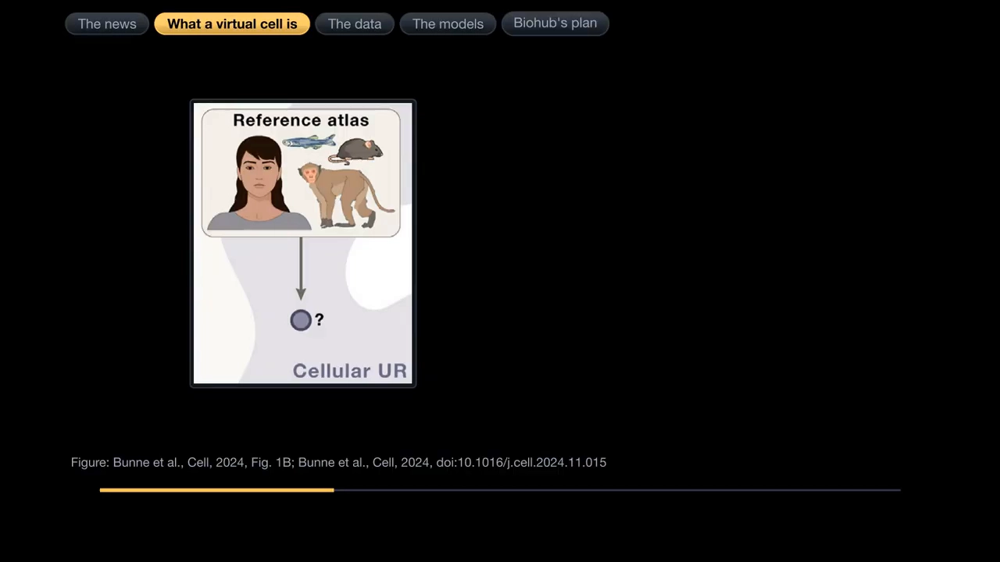
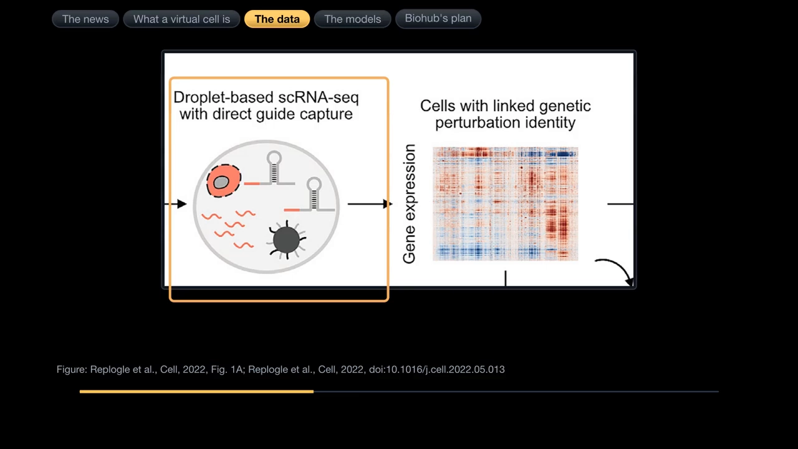
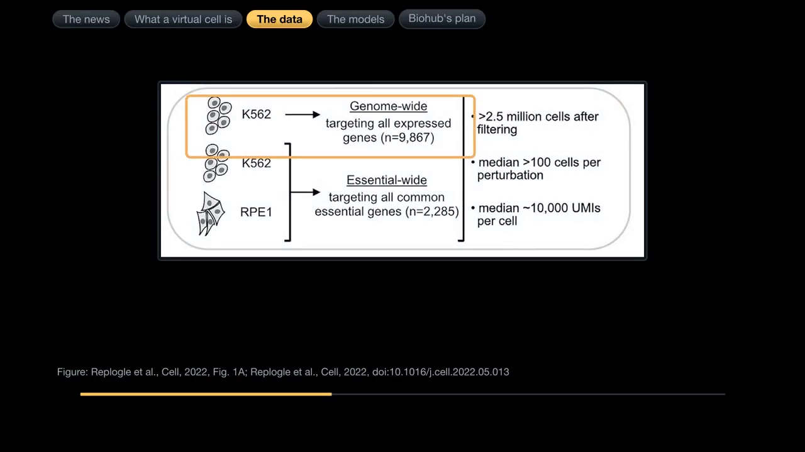
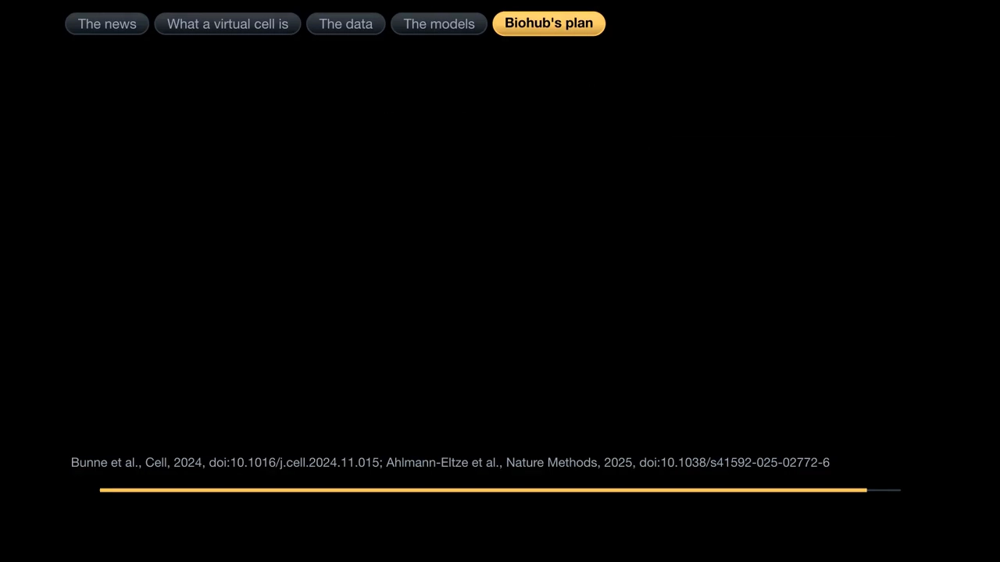
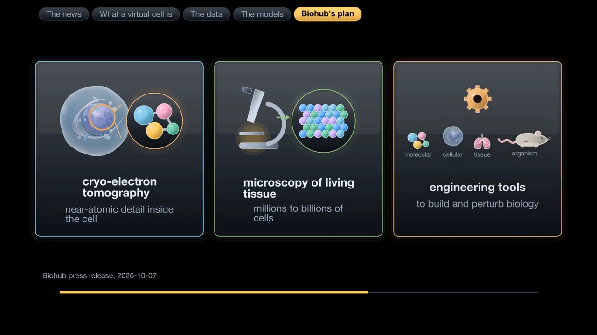
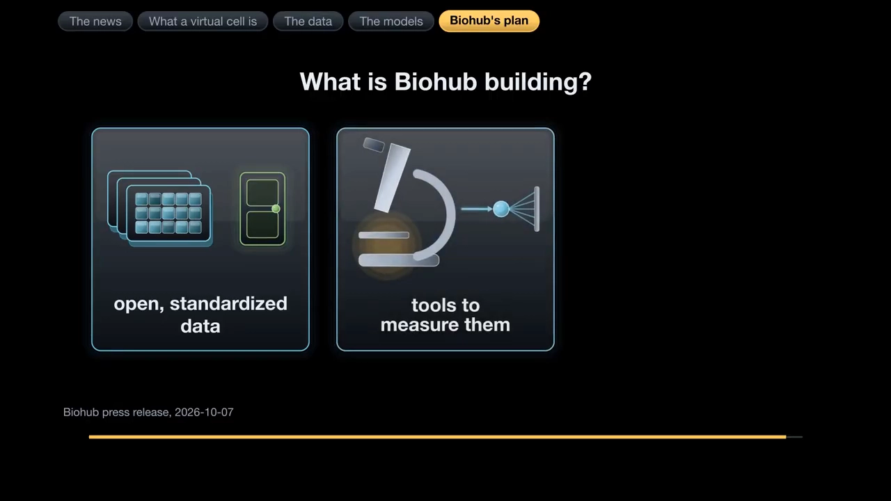
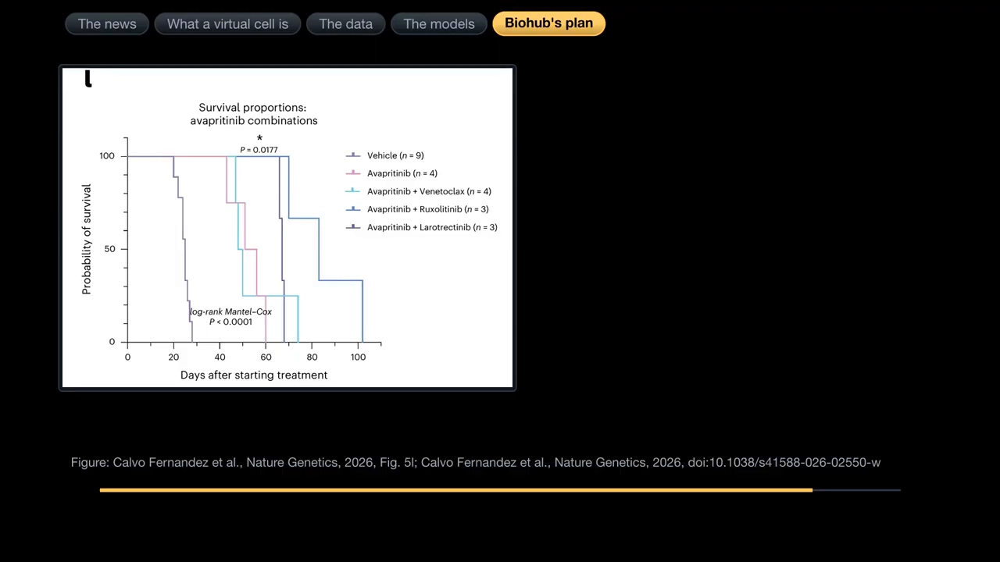

# What is a virtual cell? Biohub's $1.8 billion data push, and the AI models it is for

## 所用视频

- 标题：**What is a virtual cell? Biohub's $1.8 billion data push, and the AI models it is for**
- 平台与视频 ID：YouTube `2-Ou1BLkpQQ`
- 时长：20:47
- 字幕：中文自动字幕
- [视频链接](https://www.youtube.com/watch?v=2-Ou1BLkpQQ)

## 本讲要解决的核心问题（SCQA）

**背景**：AlphaFold 证明，生物实验的一部分可以搬到电脑上：输入蛋白序列，模型直接预测结构。

**冲突**：“虚拟细胞”随之成了热词，常被等同于更大的单细胞基础模型、更细的聚类和注释。但 2025 年的一项基准测试发现，五个基础模型加两个深度学习模型，预测扰动效果时并未稳定胜过“不改变”“把两个单扰动效果相加”这类简单基线。[【跳转到 09:32】](https://www.youtube.com/watch?v=2-Ou1BLkpQQ&t=572)

**疑问**：虚拟细胞到底是什么？它需要什么？Biohub 投入 18 亿美元，究竟在建造什么？

**回答（中心思想）**：虚拟细胞是一个**学出来的细胞模拟器**：以“未扰动状态 + 扰动”为输入，输出“扰动后状态”，用来表示状态、预测反应、在电脑上做实验。它可以使用基础模型，但本身不等于基础模型；真正的底座是带“扰动—响应”信息的数据，以及能跟上模型进展的评测。Biohub 正在建造的，正是这类开放、标准化的数据和测量工具。

## 一、定义：它是学习出来的细胞模拟器

Bunne 和同事把虚拟细胞定义成一种**模拟细胞生物功能与相互作用的计算模型**。[【跳转到 02:11】](https://www.youtube.com/watch?v=2-Ou1BLkpQQ&t=131) 细胞不是静态照片，而是会适应环境的动态系统：有些性质很稳健，基因被删掉甚至换成别的物种版本仍能运转；另一些又很敏感，一个点突变就可能把细胞推向疾病。[【跳转到 01:46】](https://www.youtube.com/watch?v=2-Ou1BLkpQQ&t=106)

过去的模型多**基于规则**：研究者把机制假设写成微分方程、随机模拟或代理人基模型，再用数据拟合参数。[【跳转到 02:32】](https://www.youtube.com/watch?v=2-Ou1BLkpQQ&t=152) 但细胞在空间上从原子延伸到组织，在时间上从毫秒信号传到几天后的命运决定；内部又有大量彼此交互的组分，过程大多非线性，输入的一点小变化可能造成复杂输出。[【跳转到 02:56】](https://www.youtube.com/watch?v=2-Ou1BLkpQQ&t=176)

2012 年出现了第一个全细胞模型，覆盖一种细菌已知的全部 482 个基因与分子功能；此后也有大肠杆菌等模型，但仍无法掌握细菌的许多面向，更不用说人类细胞。[【跳转到 03:18】](https://www.youtube.com/watch?v=2-Ou1BLkpQQ&t=198) 转机来自两场革命：**组学**能以越来越大的规模测量细胞，**人工智能**能直接从数据中学习规律。[【跳转到 04:08】](https://www.youtube.com/watch?v=2-Ou1BLkpQQ&t=248)

## 二、输入是四类测量，输出是三层表示加“虚拟仪器”

输入不是单一模态。框架把它分成四类：基因组序列、单细胞 RNA、分子在细胞内的位置、细胞在组织中的位置，全部送进同一个基础模型。[【跳转到 04:36】](https://www.youtube.com/watch?v=2-Ou1BLkpQQ&t=276) 它们覆盖分子、细胞、多细胞三个尺度：DNA/RNA/蛋白序列，分子数量与位置，以及细胞间通讯与组织构型。[【跳转到 05:08】](https://www.youtube.com/watch?v=2-Ou1BLkpQQ&t=308)

第一层输出是**表示**，也就是嵌入（embedding）：把高维、稀疏、带噪声的测量压成一串数字，同时保留对下游任务有用的关系。框架要求模型同时给出分子、细胞、多细胞三个尺度的通用表示，每个尺度都建立在下一层之上。[【跳转到 04:47】](https://www.youtube.com/watch?v=2-Ou1BLkpQQ&t=287)

第二层是“虚拟仪器”，这是虚拟细胞和普通表征学习的分水岭：**解码器**把表示翻译成人能看懂的东西，如细胞类型标签、合成显微图像；**操纵器**把一种表示转成另一种，如从未扰动状态转到扰动后状态。[【跳转到 05:33】](https://www.youtube.com/watch?v=2-Ou1BLkpQQ&t=333) 只有表示、没有操纵器，模型能很好分群，却回答不了“敲掉这个基因会怎样”；只有操纵器、没有好表示，预测又容易退化成记住训练集的平均效应。

## 三、三类用途：表示状态、预测扰动、在电脑上做实验

作者把“虚拟细胞至少应做到什么”列成三条。[【跳转到 06:03】](https://www.youtube.com/watch?v=2-Ou1BLkpQQ&t=363)

**第一，表示不同物种、不同条件下的生物状态。** 这听起来像聚类，但目标不同：聚类把已测到的细胞分成若干群；虚拟细胞的表示要能在物种、供体、实验条件之间对齐，为比较和预测提供共同坐标。

**第二，预测细胞行为与反应，包括实验室没做过的扰动。** 这是最核心、也最容易被高估的一条：它要求模型不仅拟合已见扰动，还要在未见扰动、细胞系、供体上泛化。

**第三，进行电脑内的模拟实验，指导下一步收集什么数据。** 这类实验在真实实验室里往往太贵、太慢或做不到。虚拟细胞先筛出最有希望的假设，再让湿实验验证，从而缩小搜索范围。[【跳转到 06:21】](https://www.youtube.com/watch?v=2-Ou1BLkpQQ&t=381) 模拟不必完全准确，它的价值在排序和缩小假设空间，而不是替代实验。[【跳转到 06:28】](https://www.youtube.com/watch?v=2-Ou1BLkpQQ&t=388)

## 四、燃料：Perturb-seq 把“扰动”与“读数”对上

要预测扰动，模型必须先看过被改变过的细胞。**Perturb-seq** 把 CRISPR 扰动与单细胞 RNA 测序接起来：细胞带上 CRISPR 干扰工具和向导 RNA 库，每个细胞有一个基因被调低；随后细胞被送进微滴做单细胞测序，方法也能捕捉向导 RNA，于是每个细胞的表达谱都能对应到被调低的基因。[【跳转到 07:23】](https://www.youtube.com/watch?v=2-Ou1BLkpQQ&t=443) Replogle 和同事在 2022 年报告了第一批全基因组规模的筛选。[【跳转到 06:53】](https://www.youtube.com/watch?v=2-Ou1BLkpQQ&t=413)

规模方面，一组筛选在 K562 白血病细胞中针对所有有表达的基因，另一组针对常见必需基因；过滤后保留超过 **250 万个细胞**，每个扰动的细胞数中位数超过 **100 个**。[【跳转到 08:09】](https://www.youtube.com/watch?v=2-Ou1BLkpQQ&t=489) 为什么要做到全基因组规模？因为成本随扰动数目**线性**增加，但两两比较的数目随扰动数目的**平方**增加——扰动越多，能组合出的基因关系越多，大型筛选在按功能归类基因时才真正有用。[【跳转到 08:31】](https://www.youtube.com/watch?v=2-Ou1BLkpQQ&t=511)

## 五、冷水：基础模型没有稳定胜过简单基线

2025 年发表于《自然方法》的工作，把五个基础模型和两个深度学习模型，拿去和刻意做得很简单的基线比较。[【跳转到 09:32】](https://www.youtube.com/watch?v=2-Ou1BLkpQQ&t=572) 两个关键基线是“不改变”（永远预测和对照组一样）和“相加”（把两个单扰动效果直接相加作为组合预测）。[【跳转到 09:45】](https://www.youtube.com/watch?v=2-Ou1BLkpQQ&t=585)

第一项测试在 K562 中同时打开成对基因，模型看过全部 100 个单扰动和一半的成对扰动，再用另一半测试；结果所有模型的误差都明显高于“相加”基线。[【跳转到 10:08】](https://www.youtube.com/watch?v=2-Ou1BLkpQQ&t=608) 让模型预测基因交互作用时，没有任何模型比“不改变”更好。[【跳转到 10:26】](https://www.youtube.com/watch?v=2-Ou1BLkpQQ&t=626) 第二项测试用没看过的单扰动，没有任何深度学习模型能稳定胜过简单平均或线性模型；唯一稳定胜出的，是用 Replogle 扰动数据预训练表示、再用一个细胞系预测另一个细胞系的线性模型。[【跳转到 10:51】](https://www.youtube.com/watch?v=2-Ou1BLkpQQ&t=651)

作者的结论很尖锐：用单细胞图谱预训练只比随机嵌入好一点，用扰动数据预训练才有帮助。[【跳转到 11:02】](https://www.youtube.com/watch?v=2-Ou1BLkpQQ&t=662) 当然，这项基准只用了四组数据；他们也预期更严谨的评测会推动领域成功。[【跳转到 11:32】](https://www.youtube.com/watch?v=2-Ou1BLkpQQ&t=692) Bunne 等人则强调：基准必须和模型一起进步，数据既要有物种与模态的**广度**，也要有分辨信号与噪声的**深度**。[【跳转到 12:04】](https://www.youtube.com/watch?v=2-Ou1BLkpQQ&t=724)

这也解释了为什么“相加”有时反而是很强的基线：数据不足时，线性近似更稳。虚拟细胞的核心难题，未必是模型不够大，而是数据里有没有足够的“扰动—响应”因果信息，以及评测有没有真正模拟湿实验。

## 六、18 亿美元在建什么：开放数据、工具与一个验证案例

Biohub 宣布大幅扩大一项国际合作，目标是产生并开放预测式 AI 生物模型所需的资料。合作方包括美国能源部、国家卫生研究院，以及 Google DeepMind、Isomorphic Labs 和 Meta；合计投入 **18 亿美元**，用于经费、数据、运算和新的测量技术。[【跳转到 00:25】](https://www.youtube.com/watch?v=2-Ou1BLkpQQ&t=25) 其中能源部五年投入超过 5 亿美元；Biohub 自己的最初承诺是 5 亿美元——4 亿美元支持新技术，1 亿美元资助外部研究。[【跳转到 12:52】](https://www.youtube.com/watch?v=2-Ou1BLkpQQ&t=772)

新闻稿点出三类技术：**低温电子断层摄影术**，解析细胞内近原子级细节；**显微术**，对活组织中数百万到数十亿个细胞成像；**工程工具**，在分子、细胞、组织和生物体层次建造并扰动系统。[【跳转到 13:17】](https://www.youtube.com/watch?v=2-Ou1BLkpQQ&t=797) 能源部还带来百亿亿次超级计算机、X 光与中子散射、自动化实验室；国家卫生研究院带来生物医学数据库和正在发展的数据标准。[【跳转到 13:40】](https://www.youtube.com/watch?v=2-Ou1BLkpQQ&t=820) Biohub 要建的是一个让所有数据集统一运作的层：共通标准、共通识别码和单一存取入口，并围绕资源建立科学社群。[【跳转到 14:53】](https://www.youtube.com/watch?v=2-Ou1BLkpQQ&t=893)

一个相关案例能说明“预测再验证”的闭环有多实际。Biohub 和哥伦比亚大学的研究者（包括 Andrea Califano）在 2026 年发表了两篇《自然遗传学》论文；两篇都没谈虚拟细胞，但都用运算预测细胞行为，再在肿瘤里测试。[【跳转到 16:00】](https://www.youtube.com/watch?v=2-Ou1BLkpQQ&t=960)

他们的出发点是：肿瘤里细胞以数种分子特性各异的**状态**并存，不同状态的药物敏感性可能互不重叠，因而造成抗药性。团队用 ARACNe 和 VIPER 估计每个细胞中超过 1,800 个调节蛋白的活性，主导某个状态的蛋白称为**主调节因子**。[【跳转到 16:25】](https://www.youtube.com/watch?v=2-Ou1BLkpQQ&t=985) 在胰腺癌中，他们描述了三种发育谱系状态、每种两个亚状态，共六种；在弥漫性中线神经胶质瘤中，4 月的论文找到七种并存状态。用条码追踪谱系的实验显示，胰腺癌细胞可以在状态之间转换，而表现某个状态的主调节因子能把细胞重新编程成那个状态。[【跳转到 17:17】](https://www.youtube.com/watch?v=2-Ou1BLkpQQ&t=1037)

接着，团队用 **372 种**经 FDA 核准或处于后期的肿瘤药物处理两种神经胶质瘤细胞株，24 小时后定序 RNA，再用 VIPER 估计药物如何改变主调节因子活性；OncoTreat 与 OncoTarget 预测哪些药物能逆转每种状态的主调节因子活性。[【跳转到 17:39】](https://www.youtube.com/watch?v=2-Ou1BLkpQQ&t=1059) 其中 **9 种**预测药物在小鼠模型中测试，针对特定状态的敏感性有 **8 种**获得验证，包括 avapritinib、ruxolitinib 和 larotrectinib。把针对互补状态的药物配成组合后，**6 组中有 4 组**显著延长存活时间；avapritinib 加 ruxolitinib 让中位存活时间比载体对照组延长近三倍，比单用 avapritinib 延长 1.5 倍。[【跳转到 18:34】](https://www.youtube.com/watch?v=2-Ou1BLkpQQ&t=1114) 两种药都已获 FDA 核准用于其他病症，但此前没用于这种肿瘤；团队正筹备临床试验。[【跳转到 18:57】](https://www.youtube.com/watch?v=2-Ou1BLkpQQ&t=1137)

## 小结

- 虚拟细胞是**以未扰动状态和扰动为输入、以扰动后状态为输出**的学习型模拟器，不是细胞图谱，也不是“更花的聚类”。
- 输入是多尺度、多模态测量；输出先是三层**表示**，再由解码器和操纵器变成可读结果与扰动预测。
- 三类用途是**表示状态、预测未见扰动、在电脑上做实验**；第三类不追求完全准确，而是排序假设、缩小搜索空间。
- 数据燃料是 Perturb-seq 这类“扰动—响应”数据；规模重要，但对照、覆盖和评测拆分同样重要。
- 2025 年的基准提醒我们：**基础模型不等于虚拟细胞**，单细胞图谱预训练帮助有限，扰动数据预训练才有明显收益。
- Biohub 的 18 亿美元主要投向开放数据和测量工具；哥伦比亚大学的肿瘤案例展示了“计算预测—湿实验验证—临床准备”的闭环。

## 关键术语速查

| 术语 | 一句话解释 |
| --- | --- |
| 虚拟细胞 | 以细胞状态和扰动为输入、预测扰动后状态的计算模型或平台 |
| 嵌入（embedding） | 模型学出的低维数字表示，保留对下游任务有用的关系 |
| 解码器 / 操纵器 | 前者把表示变成可读输出，后者把一种状态表示变成另一种 |
| Perturb-seq | 把 CRISPR 扰动与单细胞 RNA 测序结合，读出每个扰动的表达响应 |
| 主调节因子 | 在某种细胞状态中起主导调控作用的蛋白 |
| 反事实预测 | 对训练时没做过、但可以真实执行的扰动给出可检验的预测 |

## 相关阅读

- [Yusuf Roohani at ARDD2025: Building a Virtual Cell](<Yusuf Roohani at ARDD2025：Building a Virtual Cell：an AI platform for engineering cell state.md>)
- [MPG Primer: Introduction to Perturb-seq analysis](<MPG Primer：Introduction to Perturb-seq analysis (2021).md>)
- [Tahoe-100M：千兆级单细胞扰动图谱](<Tahoe-100M：千兆级单细胞扰动图谱 ｜｜ Dr. Johnny Yu.md>)
- [Deep-learning-based Gene Perturbation Effect Prediction Does Not Yet Outperform Linear Baselines](Deep-learning-based Gene Perturbation Effect Prediction Does Not Yet Outperform Linear Baselines.md)
- [PerturBench: Benchmarking Machine Learning Models for Cellular Perturbation Analysis](<PerturBench：Benchmarking Machine Learning Models for Cellular Perturbation Analysis.md>)
