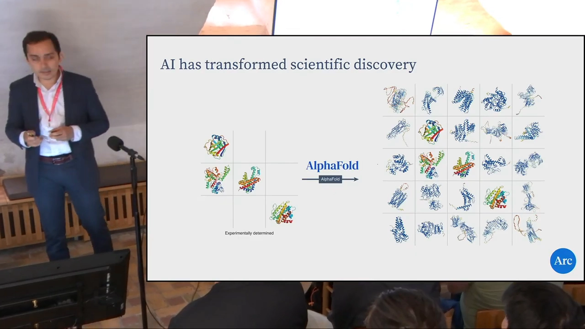
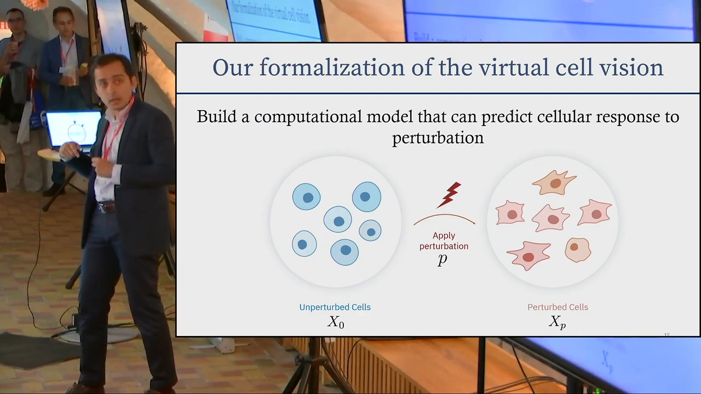
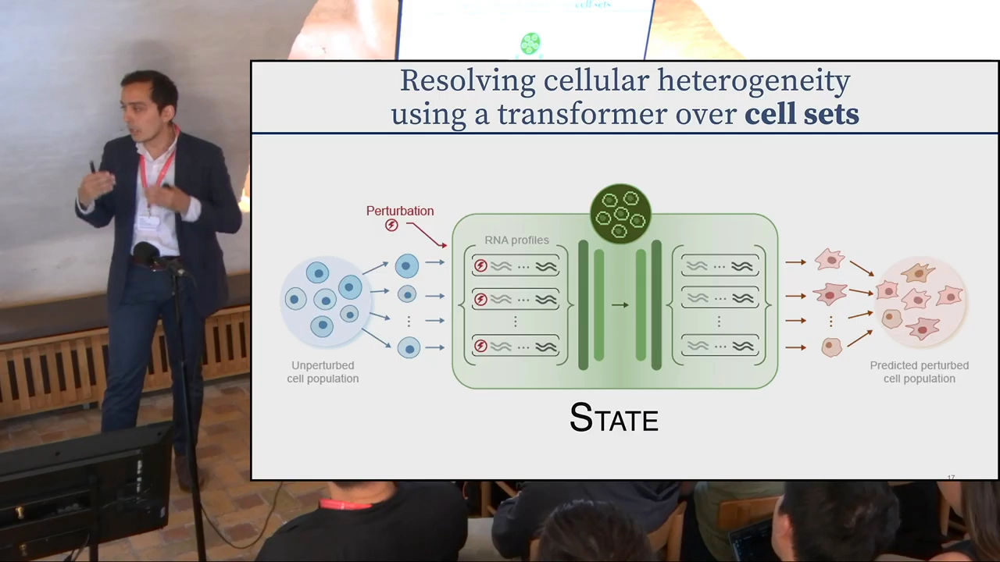
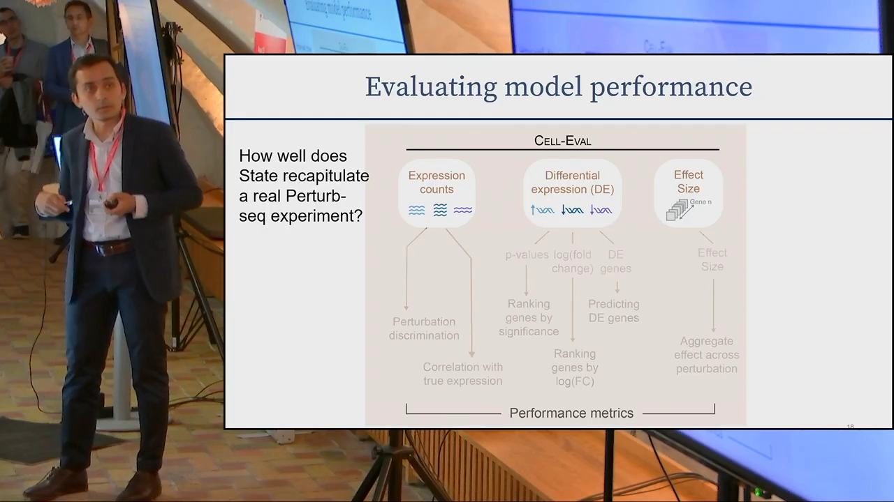
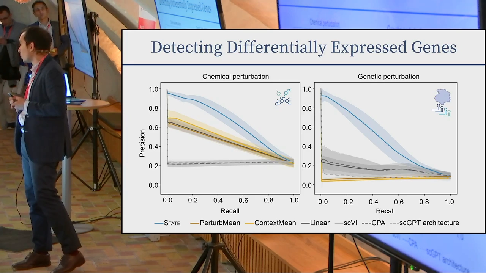
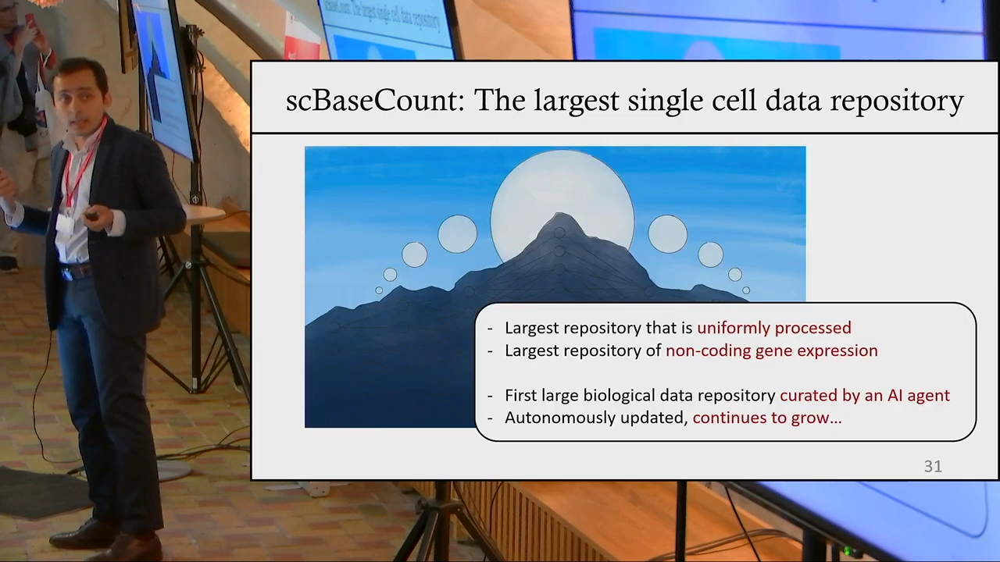
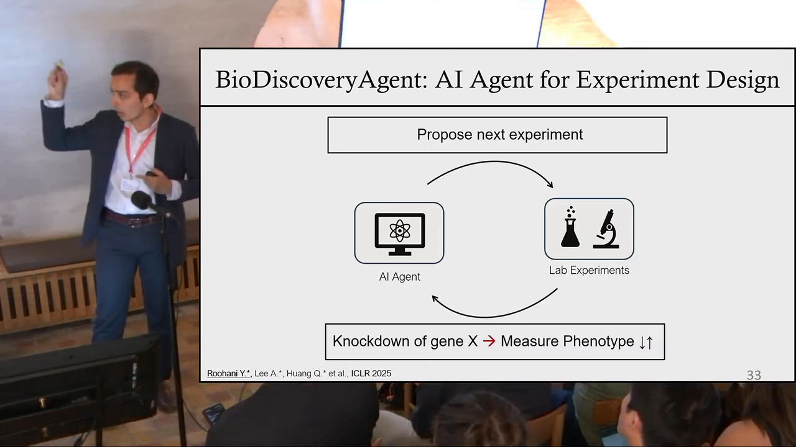
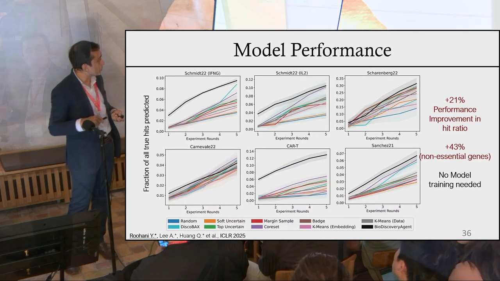

# Yusuf Roohani at ARDD2025: Building a Virtual Cell: an AI platform for engineering cell state

## 所用视频

- 标题：**Yusuf Roohani at ARDD2025: Building a Virtual Cell: an AI platform for engineering cell state**
- 平台与视频 ID：YouTube `k2VCADF3TwI`
- 时长：22:15（演讲约 19 分钟 + 问答）
- 字幕：英文自动字幕
- [视频链接](https://www.youtube.com/watch?v=k2VCADF3TwI)

## 本讲要解决的核心问题（SCQA）

**背景**：AlphaFold 证明，科学实验的一部分可以搬到电脑上：输入蛋白序列，模型预测结构，相当于在硅基环境里做了一次“结构推断实验”。

**冲突**：但 AlphaFold 只工作在蛋白质层面。细胞复杂得多：同一群细胞里存在异质性，不同供体之间也有差异；而且“虚拟细胞”在不同研究者口中含义并不相同。

**疑问**：怎样把“在电脑上做实验”推进到细胞层面？一个真正有用的平台需要哪些部件？

**回答（中心思想）**：Arc Institute 的 Yusuf Roohani 把虚拟细胞看成一个**闭环平台**：把任务形式化为“未扰动状态 + 扰动 → 扰动后状态”；用 State 模型在细胞集合上学习并泛化到新供体；用统一评测和 Virtual Cell Challenge 检验模型；再用 AI 智能体整理公共数据、指导下一批实验。模型、评测、数据整理和数据生成，缺一不可。

## 一、从 AlphaFold 到细胞：把实验搬进电脑，还要形成闭环

Roohani 用 AlphaFold 开场：它输入蛋白质序列、输出结构；训练时看过一批实验解析的结构，学到序列与结构的关系，再把这个关系用到没见过的序列上。[【跳转到 00:44】](https://www.youtube.com/watch?v=k2VCADF3TwI&t=44) 这相当于在电脑上预演一次湿实验：如果真去做结构解析，结果大概会是什么。[【跳转到 01:18】](https://www.youtube.com/watch?v=k2VCADF3TwI&t=78)

这个视角把科学发现看成一个**搜索问题**：在大量假设中寻找最能回答某个问题的那一个，而 AI 让搜索更快、更省。[【跳转到 01:50】](https://www.youtube.com/watch?v=k2VCADF3TwI&t=110) 但 AlphaFold 的局限也很清楚：它只处理蛋白质。团队想再往上走一层，从序列表示走到**细胞层面**的表示，去回答“怎样把正在退化或衰老的神经元推回功能正常的状态”。[【跳转到 02:22】](https://www.youtube.com/watch?v=k2VCADF3TwI&t=142)

这里有一个关键判断：**虚拟细胞不能孤立存在**。它的真正效果来自与实验平台一起构建——既包括数据生成和数据整理，也包括模型训练与优化。Roohani 把这条闭环写进了发表在《Cell》上的观点文章：提出假设、在实验室验证、再把结果和分析回灌模型，如此循环。[【跳转到 03:12】](https://www.youtube.com/watch?v=k2VCADF3TwI&t=192) 在这个愿景下，团队的工作分成四个方向：模型开发、模型评测、数据整理、指导数据生成。[【跳转到 04:16】](https://www.youtube.com/watch?v=k2VCADF3TwI&t=256)

## 二、把虚拟细胞写成一个可训练的任务

Roohani 把任务收窄成一个精确的式子：

> 输入未扰动的细胞状态 X0 和扰动 p，输出扰动后的状态 Xp，即 Xp = f(X0, p)。

这就是他们理解的“预测细胞对扰动的响应”。[【跳转到 08:14】](https://www.youtube.com/watch?v=k2VCADF3TwI&t=494)

“细胞状态”可以有很多种读法：DNA 甲基化、表观遗传状态、细胞年龄等。他们最终选择**转录组**作为读数，原因是转录组表达能力强，能反映大量细胞过程，而且团队已经在“把转录组测量规模化”上投入很多。[【跳转到 08:25】](https://www.youtube.com/watch?v=k2VCADF3TwI&t=505)

数据规模支撑了这个选择：他们用 AI 智能体扩大数据量，现在有超过 **6 亿个细胞**用于训练，覆盖不同组织；扰动方式聚焦 CRISPR，并用 Perturb-seq 数据训练大模型，涉及超过 **1 亿个细胞**和 **5,000 多个不同扰动**。[【跳转到 08:59】](https://www.youtube.com/watch?v=k2VCADF3TwI&t=539)

任务的定义也有讲究。他们最关心**跨生物上下文泛化**：假设模型已经见过若干供体及这些供体上的一组扰动，现在来了一个新供体，能不能预测扰动在新供体上的效果？[【跳转到 09:33】](https://www.youtube.com/watch?v=k2VCADF3TwI&t=573) 这对应现实中的新患者：你想知道某种药对他是否有效，或他携带某个突变后对药物是否敏感。[【跳转到 09:38】](https://www.youtube.com/watch?v=k2VCADF3TwI&t=578)

## 三、State 的关键选择：对“细胞集合”建模

已有的扰动预测方法，通常从群体里随机取一个未扰动细胞、再取一个扰动后细胞，训练 Transformer 学“这个输入到那个输出”的映射。[【跳转到 10:07】](https://www.youtube.com/watch?v=k2VCADF3TwI&t=607) 问题在于：这样做会把**整个分布里的信息**丢掉，而细胞异质性本身就是生物学信号。

State 的做法是：**不工作在单个细胞上，而是工作在一组细胞上**。它用 Transformer 的自注意力机制，让模型自己学习分布内部的细微结构，而不是由人硬编码细胞应该如何行为。[【跳转到 10:37】](https://www.youtube.com/watch?v=k2VCADF3TwI&t=637) 这样既利用了 Transformer 的可扩展性，又保留了细胞异质性，从而对“整个群体如何响应某个扰动”做出更好的推断。

## 四、评测要复现真实 Perturb-seq，并把它变成社区标尺

模型变强不等于预测有用。Roohani 团队的评测套件围绕一个目标设计：**多大程度上复现一次真实的 Perturb-seq 实验**。[【跳转到 11:03】](https://www.youtube.com/watch?v=k2VCADF3TwI&t=663) 他们重点看表达计数、细胞聚类与组成、不同扰动能否被区分、差异表达基因能否被识别，以及预测的效应量是否合理。

在差异表达基因检测上，蓝色曲线是 State，其他颜色是均值、线性、深度学习和基础模型基线；结果显示，**对细胞集合建模带来了显著提升**，而这类任务上最强的对手往往是均值基线。[【跳转到 11:15】](https://www.youtube.com/watch?v=k2VCADF3TwI&t=675)

他们还看了一个更贴近生理的场景：用针对 BRAF 突变黑色素瘤的药物处理 BRAF 突变细胞系，这个细胞系在训练中部分留出。State 能比当时最好的基线（实际上也是均值基线）更有效地捕捉受扰动影响的真实显著基因。[【跳转到 12:05】](https://www.youtube.com/watch?v=k2VCADF3TwI&t=725) 模型对细胞存活的预测也与实验观察相当吻合。[【跳转到 12:42】](https://www.youtube.com/watch?v=k2VCADF3TwI&t=762)

这也给出一个判断标准：虚拟细胞要复现的不只是表达矩阵的数值，还包括细胞组成、扰动区分度、效应量和未见供体上的表现。只看一个误差指标，很容易把“记住训练集平均值”误当成“学会了生物学”。

### 4.1 Virtual Cell Challenge：把评测变成社区共同的标尺

模型建好后，团队想让社区一起定义“什么才是对的评测框架、任务和数据集”，于是发起了 **Virtual Cell Challenge**。[【跳转到 12:52】](https://www.youtube.com/watch?v=k2VCADF3TwI&t=772) 逻辑很直接：Arc 给出一个“虚拟细胞至少应该能做到”的任务，社区提交模型，同时反馈还缺哪些任务、指标和数据集。[【跳转到 13:02】](https://www.youtube.com/watch?v=k2VCADF3TwI&t=782)

启动约两个月，已有约 **3,000 名注册者、450 多支队伍**。Roohani 特别提到，最有意思的是设计**可重复的实验**，让测量真正捕捉生物信号；他们也希望衰老研究社区提出值得预测的衰老表型，纳入下一届。比赛由 Arc 内部出人出钱主办，不是 consortium，计划每年举办。[【跳转到 13:37】](https://www.youtube.com/watch?v=k2VCADF3TwI&t=817)

## 五、数据瓶颈用智能体解决：从 SRA 到 scBaseCount

单细胞 RNA 测序数据最常用的仓库是 Cell by Gene，约 1 亿个细胞；但 NIH 的 Sequence Read Archive（SRA）保存所有原始测序数据，规模大好几个数量级，而且增长很快。[【跳转到 14:23】](https://www.youtube.com/watch?v=k2VCADF3TwI&t=863) 不直接挖 SRA 的原因是元数据整理极其痛苦：要逐项解析、判断正确的术语、测定类型和物种，再送进另一条流水线处理单细胞数据。[【跳转到 14:31】](https://www.youtube.com/watch?v=k2VCADF3TwI&t=871)

他们用**智能体**做这件事：让 Agentic AI 动态浏览数据库，找出相关元数据，再自动送入下游处理。整个系统是一个智能体网络：一半负责注释和识别元数据，另一半负责处理数据集，最后通过读段比对完成定量。[【跳转到 15:14】](https://www.youtube.com/watch?v=k2VCADF3TwI&t=914)

结果是一个名为 **scBaseCount** 的数据集：比当时最大的单细胞仓库大 **5 倍**，覆盖 **25 个物种**（Cell by Gene 只有 5 个）。[【跳转到 15:31】](https://www.youtube.com/watch?v=k2VCADF3TwI&t=931) 它还是最大的非编码基因表达仓库——已测序的 5 亿个细胞都有非编码表达，而且全部统一处理、批次效应很小。更重要的是，这是第一个由 AI 智能体整理、并**自主持续更新**的大型生物数据仓库。[【跳转到 16:16】](https://www.youtube.com/watch?v=k2VCADF3TwI&t=976)

这一步的意义不只是“数据更多”。它说明 AI 不只在模型开发里有用，也能处理模型开发周围那些“无聊但关键”的工作：清洗数据、准备元数据、扩大覆盖。

## 六、智能体也能设计实验：从整理数据到“虚拟生物学家”

最后一个项目把智能体从“整理已有数据”推进到“指导新数据生成”。他们设计了一个智能体，让它提出下一批基因扰动实验；实验通过模拟执行（因为所需数据已经存在），结果再喂回智能体，让它决定下一步，如此迭代，去优化某个特定表型。[【跳转到 17:04】](https://www.youtube.com/watch?v=k2VCADF3TwI&t=1024)

每一轮提出 **128 个基因**的扰动，每轮结束后计算命中率，模型会随轮次逐渐抓到更多命中。与更简单的基线相比，它在几乎所有情况下都不差于最好的基线，很多时候还明显更好。[【跳转到 17:16】](https://www.youtube.com/watch?v=k2VCADF3TwI&t=1036) 平均性能提升 **21%**；对更难发现的非必需基因，提升约 **42%**（幻灯片标注为 +43%）。[【跳转到 18:08】](https://www.youtube.com/watch?v=k2VCADF3TwI&t=1088)

这个闭环把虚拟细胞从“预测器”推向“实验合作者”：模型提出假设，实验（或模拟）给出反馈，反馈再改进下一轮假设。Roohani 用 Dario Amodei 的一句话收尾：AI 在这个领域不应只被看作数据分析工具，而应被看作**虚拟生物学家**。[【跳转到 18:18】](https://www.youtube.com/watch?v=k2VCADF3TwI&t=1098)

问答部分补充了两个边界。第一，和 Chan Zuckerberg Initiative 的区别：CZI 更偏计算侧、资助外部机构生成数据；Arc 坚持**所有环节都在内部做**，让做 AI 的人和做实验的人坐在同一张桌子上，从数据生成时就在场，团队更小、更专注于扰动预测。[【跳转到 21:09】](https://www.youtube.com/watch?v=k2VCADF3TwI&t=1269) 第二，数据里可能有错：他们在 scBaseCount 中发现很多数据集富集了 T 细胞，即使没被标注为某种疾病，样本很可能本身就来自病人；人类注释常漏掉这些信息。智能体不带人类偏见是优点，但智能体自己也可能出错。[【跳转到 19:42】](https://www.youtube.com/watch?v=k2VCADF3TwI&t=1182)

## 小结

- 虚拟细胞在 Arc 的语境里是一个**闭环平台**：模型、评测、数据整理、数据生成四件事必须一起做。
- 任务被形式化为 **Xp = f(X0, p)**；他们选择转录组作为读数，并聚焦 CRISPR 扰动。
- State 的关键不是“更大的 Transformer”，而是**对细胞集合建模**：用自注意力保留群体异质性，并专门评测对新供体的上下文泛化。
- 评测要复现真实 Perturb-seq 的多个侧面；Virtual Cell Challenge 把这个评测变成社区共同迭代的标尺。
- 数据瓶颈用**智能体**解决：scBaseCount 比当时最大仓库大 5 倍、覆盖 25 个物种，且由 AI 整理并持续更新。
- 智能体还能**指导实验**：每轮 128 个基因，平均命中率提升 21%，非必需基因约 42%；但注释偏差和智能体自身的错误仍需警惕。

## 关键术语速查

| 术语 | 一句话解释 |
| --- | --- |
| 细胞状态 | 用某个可测模态（如转录组）刻画的细胞当前状况 |
| 扰动 | 对细胞施加的改变，如 CRISPR 敲低、药物处理 |
| 上下文泛化 | 在见过的供体/条件上训练，预测新供体或新条件下的响应 |
| Perturb-seq | 将 CRISPR 扰动与单细胞 RNA 测序结合，读出每个扰动的表达响应 |
| scBaseCount | 由 AI 智能体整理、统一处理并持续更新的大型单细胞数据仓库 |
| 虚拟生物学家 | 用 AI 智能体承担提出假设、设计实验、分析结果等科研工作 |

## 相关阅读

- [What is a virtual cell? Biohub 的 18 亿美元数据计划](<What is a virtual cell？Biohub's $1.8 billion data push, and the AI models it is for.md>)
- [BioML Seminar 4.4 - Tahoe-x1 作者报告](BioML Seminar 4.4 - Shreshth Gandhi on Scaling Perturbation-Trained Single-Cell Foundation Models.md)
