# 基因编辑从零开始（二）：十分钟搞定 sgRNA 设计

> **来源**：Bilibili《基因编辑从零开始（二）：核心竟是它！十分钟搞定 sgRNA 设计》 · UP 主 舒桐科技 · 时长 18:10 · [`BV1xh1zBeEdM`](https://www.bilibili.com/video/BV1xh1zBeEdM/)
> **系列**：`content/虚拟细胞` · 实验基础（补 Perturb-seq / 单细胞扰动数据在湿实验里怎么产生的前置知识）
> 原片含厂商官网与推文推介，本文只整理技术内容。

## 本讲要解决的核心问题

**背景**：上一讲走完 CRISPR 的发现史——细菌的免疫记忆被改造成可编程核酸酶，你手上有了"一个能剪 DNA 的蛋白 + 一段能换靶点的 RNA"。

**冲突**：但 Cas9 只认 sgRNA 给的约 20 nt 向导序列和 3–6 nt 的 PAM。一次实验的成败大头，就落在这看似十分钟的设计动作上；新手卡的通常不是原理，是打开哪几个网站、按什么顺序点、看到分数怎么判断。

**疑问**：Cas9 怎么定位并切割？PAM 为何绕不开？以 PCSK9 为例如何从 NCBI 走到 BLAST？切完细胞怎么修、工具怎么送进去、又怎么证明它真切了？

**回答（中心思想）**：把设计压成一条固定路线——**先懂三步切割机制，再认 PAM 这个门禁，然后"NCBI 取序列 → 靶点取 CDS 内靠近 N 端的外显子 → CRISPOR/CHOPCHOP 打分 → BLAST 验特异性"四步走完，最后用 Sanger、T7E1、扩增子深度测序三层证明编辑真的发生**。

---

## 一、Cas9 的三步：结合激活、配对定位、两个结构域各切一条链

讲原理最容易糊涂的，是把"识别"和"切割"混成一件事；视频拆成**三个阶段**（[【跳转到 00:10】](https://www.bilibili.com/video/BV1xh1zBeEdM/?t=10)）。

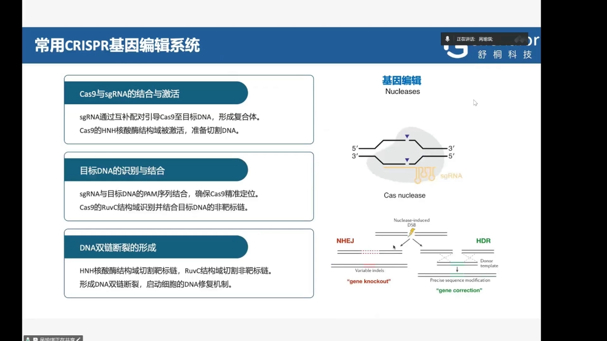

**① 结合与激活**：Cas9 与 sgRNA 结合并激活，sgRNA 通过互补配对把 Cas9 引导到靶 DNA 形成三元复合体，被激活的 Cas9 才有切割能力。关键推论：**Cas9 没有靶点特异性，特异性完全由 sgRNA 提供**——"换一条 sgRNA 就换一个靶点"。

**② 靠 PAM 精准定位**：sgRNA 与 PAM 结合确保定位，同时 RuvC 结构域识别并结合**非靶标链**（[【跳转到 00:35】](https://www.bilibili.com/video/BV1xh1zBeEdM/?t=35)）。顺序是**先认 PAM、再谈互补配对**。

**③ 双链断裂**：Cas9 产生 DSB，**HNH 核酸酶结构域切靶标链，RuvC 结构域切非靶标链**。记住这一对很实用：切口酶、碱基编辑器等变体改的都是这两个结构域之一。断裂后修复启动，走向 NHEJ 或 HDR（见第五节）。

---

## 二、PAM 是整套系统的门禁：3–6 个碱基，四条鉴定路线

视频称 PAM 是"CRISPR/Cas9 识别位点中最重要的一个序列"，长度一般只有 **3 到 6 个碱基**（[【跳转到 01:05】](https://www.bilibili.com/video/BV1xh1zBeEdM/?t=65)）。

**为什么这么短反而最重要？** Cas9 并不逐碱基比对：它先扫 PAM，**只有紧邻靶点的那几个碱基符合要求，才停下来做后续配对**。门禁不开，向导再匹配也进不去；门禁开了，才轮到 20 nt 决定"是不是我要剪的那个"。两个实践含义：**PAM 决定"能在哪剪"**（换 PAM 偏好的 Cas9 变体，等于换一张可剪位点地图）；**PAM 也是脱靶的过滤网**。

PAM 偏好不是猜的，靠四条路线鉴定出来（[【跳转到 01:30】](https://www.bilibili.com/video/BV1xh1zBeEdM/?t=90)）：

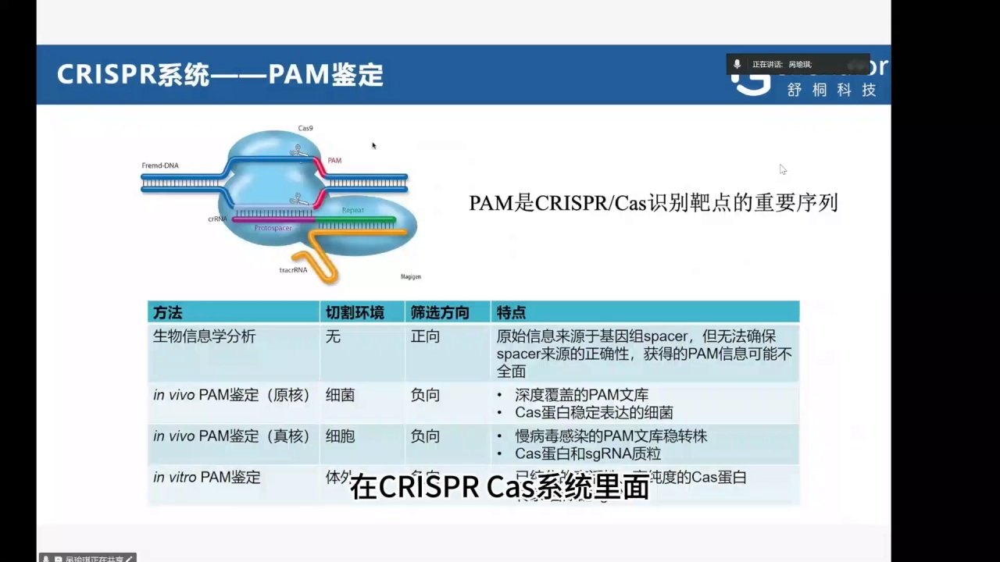

1. **生物信息学分析**：从基因组已有的 spacer 反推 PAM；不做实验，但 spacer 来源无法确保，信息**可能不全面**。
2. **原核体内（细菌）**：建深度覆盖的 PAM 文库 + 稳定表达 Cas 的菌株，负向筛选"被切掉因此消失"的 PAM。
3. **真核体内（细胞）**：慢病毒建 PAM 文库稳转株，再引入 Cas 与 sgRNA 质粒，同样负向筛选。
4. **体外鉴定**：**高纯度 Cas9 蛋白**加转录出来的 DNA 底物做切割反应。

取舍上是"可控性 vs 生理相关性"的滑尺：体外最干净但离真实细胞最远，细菌/细胞筛选更接近生理、代价是要先建文库。这也解释了网站里的 PAM 选项从哪来——SpCas9 的 NGG 就这么定出来的。

---

## 三、sgRNA 设计的三条黄金法则

PAM 确认后才轮到筛 sgRNA，原则归成三条硬约束（[【跳转到 01:52】](https://www.bilibili.com/video/BV1xh1zBeEdM/?t=112)、[【跳转到 02:17】](https://www.bilibili.com/video/BV1xh1zBeEdM/?t=137)）。

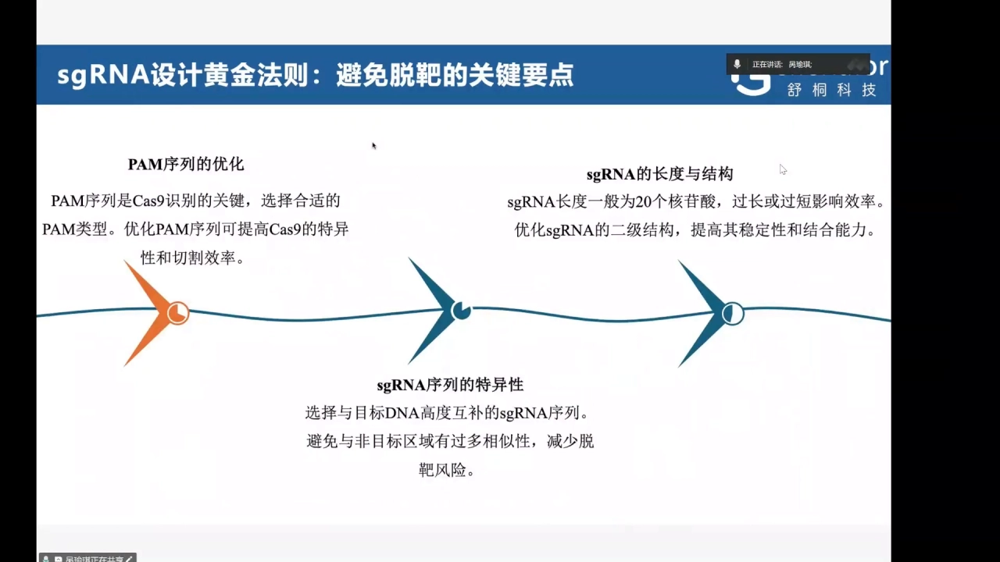

**① 特异性：要像目标，也要不像别处。** 选与目标 DNA 高度互补的序列，同时**避免与非目标区域有过多的相似**以减少脱靶。这是设计里唯一需要工具介入的判断：**目标匹配度是看出来的（打分网站），非目标相似度是算出来的（BLAST）**；只做前者是最常见的漏步。

**② 长度：20 nt 左右，太长太短都掉效率。** 短了特异性不够、撞车位点变多；长了异源双链难以稳定形成，也超出 Cas9 装载向导的构型。这也是后面 BLAST 判读"20 × 2 = 40 分 ≈ 完全匹配"的由来。

**③ 二级结构：能被优化的稳定性。** sgRNA 会在溶液里自己折叠，向导区若自缠成发卡，就没法再跟靶 DNA 配对——门禁开了，钥匙却插不进去。打分分数里通常已含这一项。

除这三条，幻灯片还并列了**PAM 序列的优化**：选合适的 PAM 类型可提高特异性和切割效率——"用哪种 Cas9 / 哪种 PAM"也是可调的一维。

---

## 四、十分钟实操：把 PCSK9 的一条高特异性 sgRNA 设计出来

整条片子最实用的部分，目标基因用人源 **PCSK9**（[【跳转到 03:14】](https://www.bilibili.com/video/BV1xh1zBeEdM/?t=194)）。

### 4.1 在 NCBI 拿到序列，下成 FASTA

在 NCBI 搜 `PCSK9` 得到结果页 → **先确认物种是人**，点进去 → 打开 GenBank 记录 → 把基因组序列下载成 **FASTA** → 用 **SnapGene** 打开（[【跳转到 03:19】](https://www.bilibili.com/video/BV1xh1zBeEdM/?t=199)、[【跳转到 03:50】](https://www.bilibili.com/video/BV1xh1zBeEdM/?t=230)）。"确认物种"看着琐碎，但后面 CRISPOR 的基因组版本、BLAST 的数据库都必须与此一致。

### 4.2 在 SnapGene 上定靶点范围：外显子、共同区域、靠近 N 端

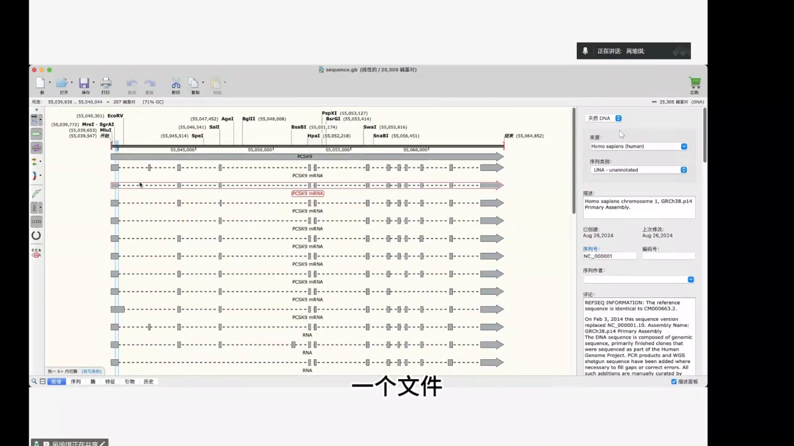

**虚线是内含子，实心红色方块是外显子**。接下来三个判断是这一步的核心（[【跳转到 04:07】](https://www.bilibili.com/video/BV1xh1zBeEdM/?t=247)、[【跳转到 04:32】](https://www.bilibili.com/video/BV1xh1zBeEdM/?t=272)）：

- **必须选外显子**：内含子本来就会被剪掉，剪了未必改变蛋白；剪在编码区才可能造成移码或提前终止。
- **要盯"共同区域"**：基因常有多个转录本亚型，为把所有亚型的蛋白都敲掉，必须选**各亚型共有的序列**。视频标注的就是**外显子一、且属共同区域**的一段。
- **要靠近蛋白 N 端**：越靠 5′ 端剪，移码后越早出现终止密码子，截短蛋白越可能彻底失活；剪在靠 C 端可能只砍掉尾巴。

选定后从起始密码子 **ATG** 开始复制一整段，**大约 207 个 bp**（[【跳转到 04:55】](https://www.bilibili.com/video/BV1xh1zBeEdM/?t=295)）；SnapGene 的状态栏会同时给出所选片段的长度与 GC 含量（图中为 207 bp、71% GC）。网站要求单条序列不超过约 2300 bp，典型输入就是"一段外显子"，几百 bp 刚好。

### 4.3 CRISPOR 与 CHOPCHOP 打分，两边互相印证

推荐的两个网站是 **CRISPOR 和 CHOPCHOP**（[【跳转到 05:15】](https://www.bilibili.com/video/BV1xh1zBeEdM/?t=315)）。

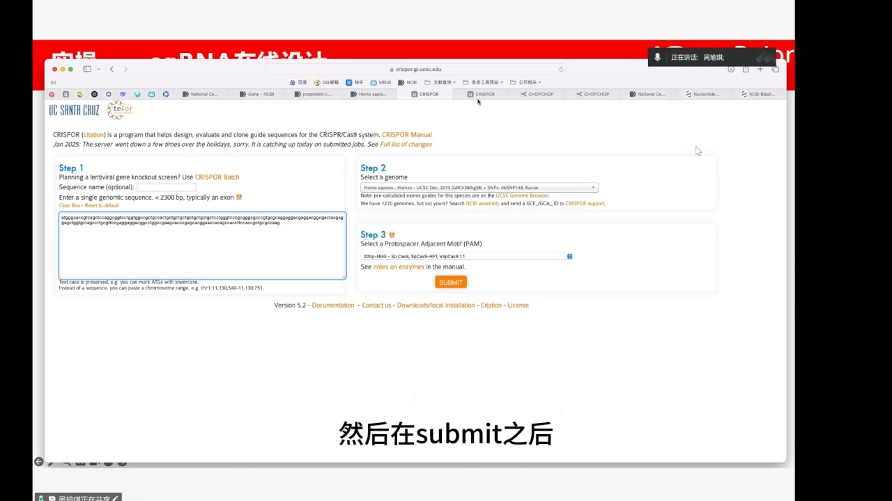

**CRISPOR**：Step 1 选 `Homo sapiens - Human - UCSC Dec. 2013 (GRCh38/hg38)`（可附 dbSNP）；Step 2 粘贴 207 bp，序列名可留空；Step 3 选 PAM `20bp-NGG - Sp Cas9`（用 SpCas9-HF1、eSpCas9 1.1 时选对应项）；提交后得到评分表。**看 MIT 评分**，最高的一条是 **97 分**（[【跳转到 05:45】](https://www.bilibili.com/video/BV1xh1zBeEdM/?t=345)）——这是业内最常用的活性预测指标，越接近 100 越可能切得动。

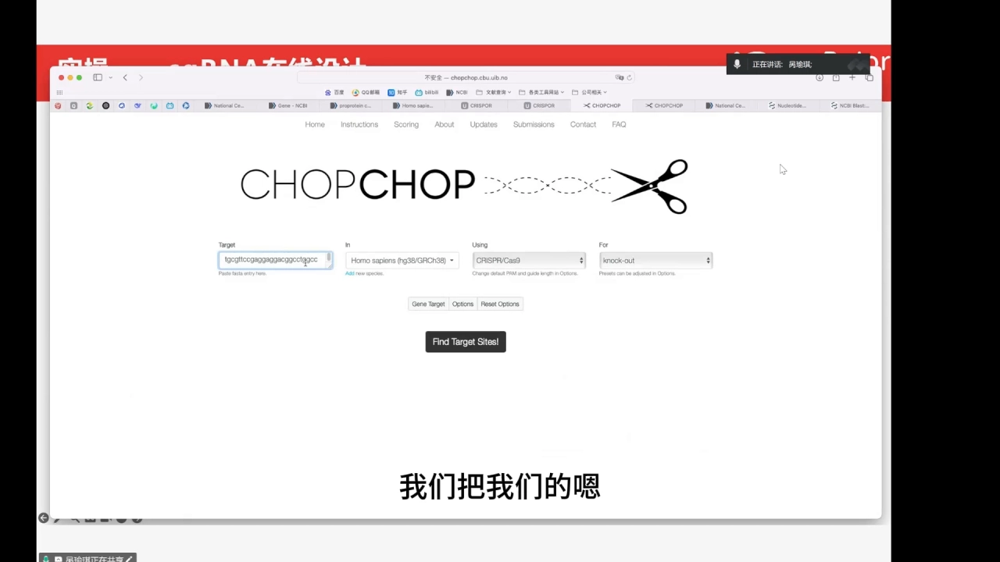

**CHOPCHOP**：同样粘序列、选人（hg38/GRCh38）、选 CRISPR/Cas9，点 `Find Target Sites`。视频的经验是 **CHOPCHOP 评分不如 CRISPOR 高**，所以**有疑惑时两站同时参考，选两边都比较高的那一两条**（[【跳转到 06:35】](https://www.bilibili.com/video/BV1xh1zBeEdM/?t=395)）——两站用的是不同打分模型，**模型间的共识比任何单一模型的绝对分更可靠**。

### 4.4 BLAST 验特异性：唯一能排除脱靶的一步

打分高只说明"预测切得动"，不说明"只切这一个地方"。所以最后必须回 NCBI：把 sgRNA 序列粘进 BLAST，**在人的基因组范围内做 blastn**（[【跳转到 06:52】](https://www.bilibili.com/video/BV1xh1zBeEdM/?t=412)）。

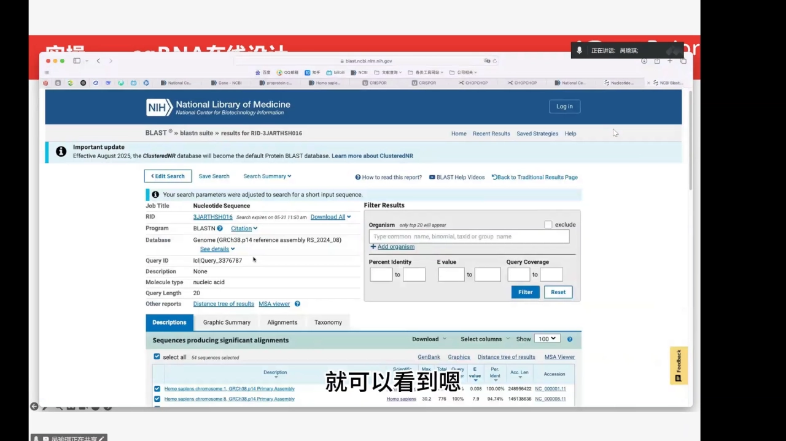

**主要看 max score**（[【跳转到 07:31】](https://www.bilibili.com/video/BV1xh1zBeEdM/?t=451)、[【跳转到 07:36】](https://www.bilibili.com/video/BV1xh1zBeEdM/?t=456)）：目标位点这条是 **40.1**，而 sgRNA 有 20 个碱基、**20 × 2 = 40 分正好对应完全匹配**，所以 40.1 就是"和目标一模一样"；排在后面的命中是 **30.2**，换算大约**只有 15 个碱基能配上**，即 5 个错配。结论：基因组里没有第二个位点能近乎完全匹配，**特异性非常高，这条可以用**（[【跳转到 08:01】](https://www.bilibili.com/video/BV1xh1zBeEdM/?t=481)）。

判据一句话：**第一名应该就是你要的位点，第二名掉得越多越安全**。若第二名也在 38、39 分附近，说明有近亲位点、脱靶风险高，该换一条重来。

### 4.5 整条流程压成五步清单

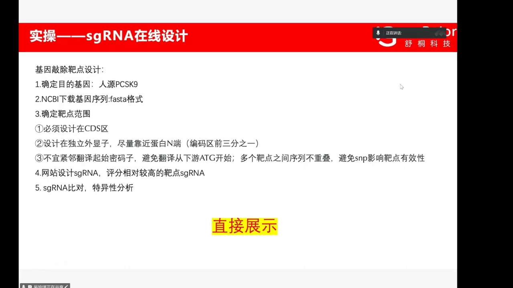

1. **确定目的基因**：本例人源 PCSK9。
2. **NCBI 下载基因序列**：FASTA 格式。
3. **确定靶点范围**：① 必须设计在 **CDS 区**；② 设计在**独立外显子**、尽量**靠近蛋白 N 端**（编码区前三分之一）；③ **不宜紧邻翻译起始密码子**（避免翻译从下游 ATG 重新起始），且**多个靶点之间序列不重叠**（避免 SNP 影响有效性）。
4. **网站设计 sgRNA**：挑评分相对较高的靶点。
5. **sgRNA 比对**：做特异性分析。

第 3 步的 ③ 是语音没细讲、幻灯片写明的一条：**贴着 ATG 剪未必最好**。若移码后翻译从下游某个 ATG 重新起始，蛋白可能只丢掉一小段头部却仍有功能——看着"敲掉了"，其实是假敲除。

---

## 五、切完之后：NHEJ 还是 HDR，由实验目的定

Cas9 剪断 DNA 只是把问题交给细胞：断裂后细胞自我修复，主要走两条路——**非同源末端连接（NHEJ）**与**同源重组修复（HDR）**（[【跳转到 09:37】](https://www.bilibili.com/video/BV1xh1zBeEdM/?t=577)）。

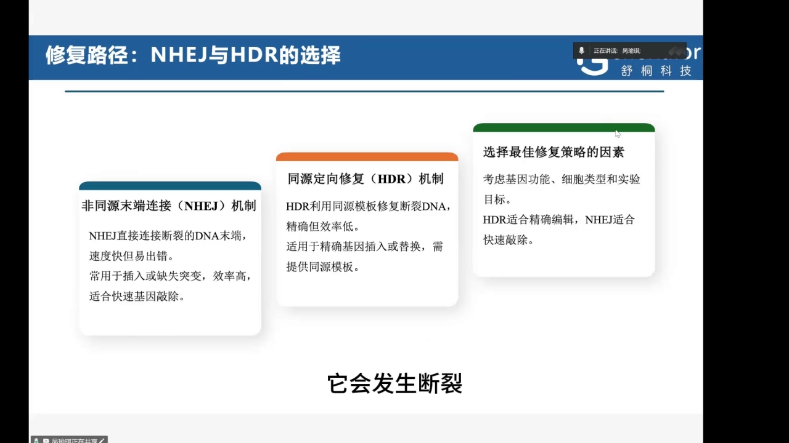

两条路性格相反：**NHEJ 直接把断端接起来**，快但易错、产生 indel，适合快速敲除；**HDR 依赖同源模板**，精确但效率低，适用于精确插入或替换，必须额外提供模板。怎么选看**基因功能、细胞类型、实验目标**。

决策语言：**只想让基因失活**就走 NHEJ，让细胞自己乱接、接出移码即达目的，不必递模板；**想改具体碱基、插入序列或做基因修正**必须走 HDR 并同时递同源模板，代价是多数细胞里 HDR 效率偏低；**细胞类型**决定 HDR 的天花板。对 Perturb-seq 文库还有一层：敲除文库走 NHEJ，每个细胞的 indel 是随机产物，必须靠深度测序定量编辑模式。

---

## 六、递送：工具再好，进不去细胞就等于没做

所有 CRISPR/Cas9 系统共有一个大前提：怎么把工具递送到细胞或组织里（[【跳转到 10:02】](https://www.bilibili.com/video/BV1xh1zBeEdM/?t=602)）。难在**两个纯物理原因**：**Cas9 是一个非常大的蛋白分子**，穿膜本身就难；**sgRNA 带强负电荷**，而细胞膜同样带负电，**同性相斥**（[【跳转到 10:27】](https://www.bilibili.com/video/BV1xh1zBeEdM/?t=627)）。

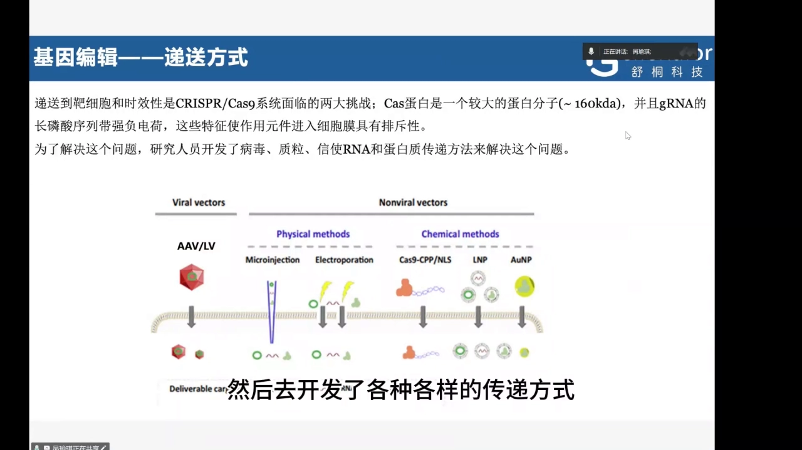

- **病毒载体**：AAV、慢病毒，借感染能力送入遗传物质，效率高，但涉及包装与生物安全。
- **物理方法**：**显微注射**（单细胞最确定但通量最低）、**电穿孔**（瞬时打孔，通量高但细胞要承受电击）——共同特点是"不管电荷、硬送进去"。
- **化学方法**：LNP、AuNP、Cas9-CPP/NLS，用载体把带负电的核酸包起来或中和。
- **非病毒载体**：质粒 DNA 等，便宜易制备，但入胞与表达效率有限。

还有一条直接路线：**用 RNP 方式递送**，把纯化的 Cas9 蛋白与 sgRNA 在体外预组装好再送进细胞（[【跳转到 10:52】](https://www.bilibili.com/video/BV1xh1zBeEdM/?t=652)）。RNP 是**送已经装好的剪刀**——进来就干活，干完很快降解。

---

## 七、验证三层：从"有没有切"到"切成了什么样、占多少比例"

编辑做完怎么确认类型和效率？三种检测方式不是替代品，而是**精度逐级上升的三层**（[【跳转到 11:17】](https://www.bilibili.com/video/BV1xh1zBeEdM/?t=677)）。

**① PCR + Sanger 测序：最常用，看套峰。** 转染或感染细胞 → 48–72 h 收细胞提 DNA → 在**靶位点上下游几百 bp** 处设计引物做 PCR → 一代测序（[【跳转到 11:42】](https://www.bilibili.com/video/BV1xh1zBeEdM/?t=702)）。

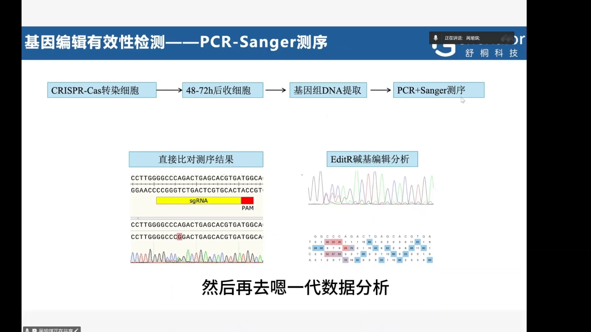

判读：**没切**时峰图单一、清晰；**切了**就从编辑位点开始出现**套峰**。原因是 PCR 产物是混合物：野生型与各种缺失、错位的修复结果混在一起，同一位置叠成多峰（[【跳转到 12:32】](https://www.bilibili.com/video/BV1xh1zBeEdM/?t=752)）。**优点是简便、成本低；局限是难以精确解析复杂编辑文库**——套峰只说"这里出事了"，无法确认编辑模式（[【跳转到 12:57】](https://www.bilibili.com/video/BV1xh1zBeEdM/?t=777)）。

**② T7E1 酶切：最快的"切没切"初筛。** T7E1 酶**特异性识别并切割双链中的碱基错配与小环状凸起**，即异源双链区（[【跳转到 13:27】](https://www.bilibili.com/video/BV1xh1zBeEdM/?t=807)）。流程：靶位点 PCR → **变性复性**（单链随机杂交，得到完全配对的**同源双链**与野生型配突变型的**异源双链**）→ 与 T7E1 孵育，只切错配处 → 凝胶电泳（[【跳转到 14:17】](https://www.bilibili.com/video/BV1xh1zBeEdM/?t=857)）。

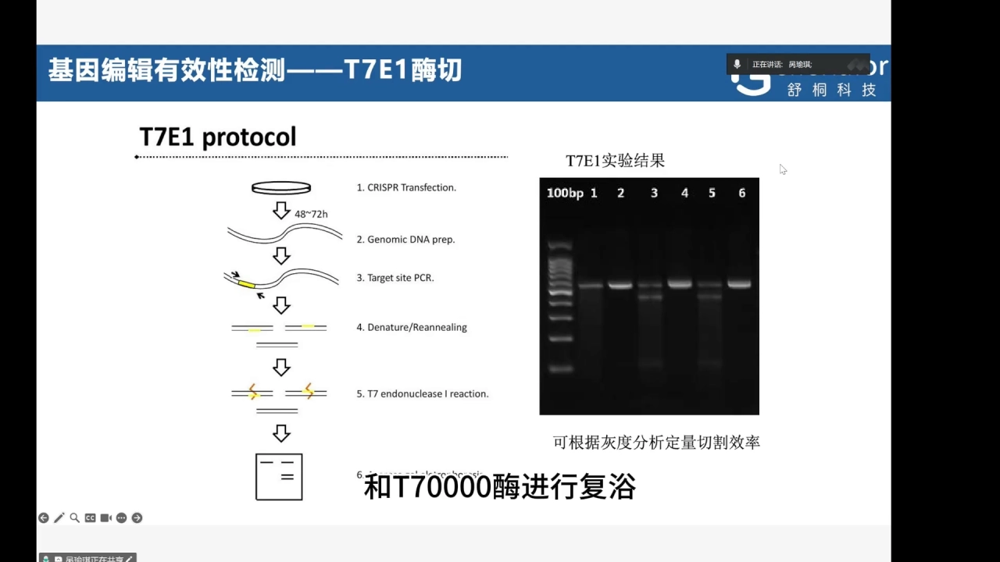

判读：**只有主带** → 系统没起作用；**主带之外出现两条清晰小片段** → 系统发挥了作用（[【跳转到 15:07】](https://www.bilibili.com/video/BV1xh1zBeEdM/?t=907)）。优势是操作简单、适合初筛，可据灰度半定量；局限同样是看不到"产生了怎样的编辑"（[【跳转到 15:57】](https://www.bilibili.com/video/BV1xh1zBeEdM/?t=957)）。

**③ 扩增子深度测序：最全面、最定量。** 它是**目前检测 CRISPR/Cas9 等位基因最全面、定量最强的方法**，适合解析复杂编辑文库（[【跳转到 16:12】](https://www.bilibili.com/video/BV1xh1zBeEdM/?t=972)）。流程：高特异性引物在编辑位点附近 PCR 生成扩增子（幻灯片标为两轮 PCR 建库）→ 深度测序 → 生物信息分析（CRISPResso2 一类工具）把每条 read 归类算比例（[【跳转到 16:37】](https://www.bilibili.com/video/BV1xh1zBeEdM/?t=997)）。

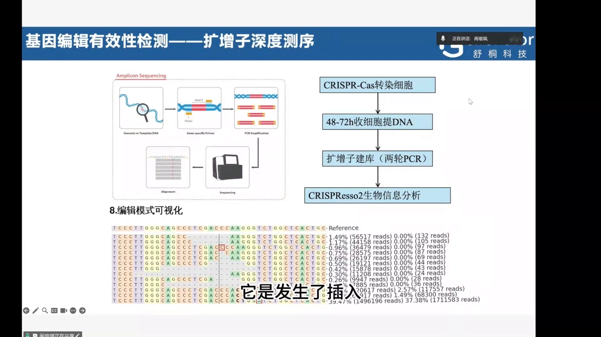

输出是"编辑事件清单"：前两条都是"缺几个碱基"但**类型不同**，再往下是单碱基缺失，还有碱基替换（[【跳转到 17:02】](https://www.bilibili.com/video/BV1xh1zBeEdM/?t=1022)）。核心优势是**灵敏度显著高于 Sanger 和 T7E1，且能全面定性与定量编辑效率**（[【跳转到 17:27】](https://www.bilibili.com/video/BV1xh1zBeEdM/?t=1047)）。

三种方案都可选，取决于后续实验目标（[【跳转到 17:52】](https://www.bilibili.com/video/BV1xh1zBeEdM/?t=1072)）。

| 层级 | 方法 | 定量性 |
| --- | --- | --- |
| 初筛 | T7E1 酶切 | 定性（可灰度半定量） |
| 常用 | PCR + Sanger | 定性 |
| 精细 | 扩增子深度测序 | **定量** |

---

## 小结

- **机制三步**：结合激活 → 靠 PAM 定位 → **HNH 切靶标链、RuvC 切非靶标链**产生 DSB；Cas9 无靶点特异性，特异性全由 sgRNA 提供。
- **PAM 是门禁**：只有 3–6 nt，却决定"能在哪剪"与脱靶概率；其偏好靠生信、原核体内、真核体内、体外四条路线鉴定。
- **设计是固定五步**：定基因 → NCBI 下 FASTA → 靶点取 CDS 内独立外显子、各亚型共同区、靠 N 端且不紧邻 ATG、多靶点不重叠 → 两站打分取共识 → BLAST 看 max score。PCSK9：MIT 最高 97，BLAST 首位 40.1（20 nt 全匹配）、次位 30.2（约 15 nt 匹配）。
- **修复由目的决定**：快速敲除走 NHEJ（快、易错、免模板），精确改序列走 HDR（准、效率低、必给模板）。
- **递送难点是物理的**：Cas9 蛋白大、sgRNA 强负电荷，与细胞膜互斥；于是有病毒、物理、化学、非病毒与 RNP 多条路线。
- **验证是三层梯度**：T7E1 最快但只能定性，Sanger 看套峰也看不到编辑模式，扩增子测序最灵敏且能定量到每种 indel 的比例。

---

## 关键术语速查

| 术语 | 一句话解释 |
| --- | --- |
| **sgRNA** | 向导 RNA，约 20 nt 的 spacer 决定靶点特异性；Cas9 本身无靶点特异性 |
| **PAM** | 紧邻靶点的 3–6 nt 序列，Cas9 必须先识别它才继续配对；SpCas9 用 NGG |
| **HNH / RuvC** | Cas9 的两个核酸酶结构域：HNH 切靶标链，RuvC 切非靶标链 |
| **NHEJ / HDR** | 直接接断端（快、易错、产生 indel）／用同源模板精确修复（准、效率低、需 donor） |
| **MIT 评分** | 设计网站给出的 sgRNA 活性预测分，越高越可能切得动 |
| **T7E1** | T7 核酸内切酶 I，识别并切割错配/凸起的异源双链，用于快速判断是否编辑 |
| **扩增子深度测序** | 对靶位点 PCR 产物做高通量测序，逐 read 解析编辑模式与比例 |
