# 第8讲：CRISPR/Cas9 基因编辑——gRNA 的选择与引物设计

> **来源**：[第8讲 Crispr/cas9基因编辑gRNA的选择及引物设计](https://www.bilibili.com/video/BV1928xeaEhs/)，UP 主 **染色的染坊**，时长 36:07，BV 号 `BV1928xeaEhs`。
> **所属系列**：`content/虚拟细胞` 的「实验基础」。虚拟细胞 / Perturb-seq 一类工作吃的是「大规模敲基因 + 测转录组」的数据，本系列补的正是这些数据在湿实验里怎么产生。这是系列课**第 8 讲**，直接承接第 7 讲的 CRISPR/Cas9 技术基础。
> 本文基于该视频 AI 字幕逐窗口校正后整理，软件操作、序列与结论均以原片为准。原片为纯课堂讲解，无产品推广段落。

## 本讲要解决的核心问题

**背景**：第 7 讲把 CRISPR/Cas9 拆成了很朴素的两件事——这个系统只需要两个零件：负责切 DNA 的 **Cas9 蛋白**（"剪刀"）和负责把它带到指定位置的 **sgRNA**（single guide RNA，向导 RNA）。双链被切断之后怎么修，是活细胞自己就能自发完成的，不必再外加任何酶 [【跳转到 00:38】](https://www.bilibili.com/video/BV1928xeaEhs/?t=38)。

**冲突**：也正因修复完全交给细胞，它修得并不"干净"：连接断口时会引入**移码突变**、碱基的**缺失**与**插入**，最终让基因表达下降甚至彻底沉默 [【跳转到 01:03】](https://www.bilibili.com/video/BV1928xeaEhs/?t=63)。切割之后的连锁反应不用操心，真正需要人动手设计的只剩 sgRNA 上那一小段约 20 个碱基——**选哪 20 个碱基，几乎决定这个基因能不能被打掉**。

**疑问**：这 20 个碱基该在基因组的什么位置挑？挑出来之后，又怎么变成一对能直接下单合成的引物？

**回答（中心思想）**：gRNA 设计是一条可以照抄的流水线——**先把基因结构搞清楚（外显子边界、可变剪接、保守结构域），再按原则锁定靶位点，然后在正反两条链上搜 NGG、取出它上游 20 nt 作为 spacer，最后按自己载体的启动子与酶切位点把它写成一对带黏性末端的 oligo 引物；一个基因至少备 2–3 对**，因为单点的切割效率事前无法预判。

实战全部围绕原片里以 **Cs** 开头命名的 **PDS** 基因（phytoene desaturase，八氢番茄红素脱氢酶）展开，顺序是"准备 → 选点 → 找序列 → 写引物 → 在线验证"。

## 一、"要设计的只有 spacer 那一段"：把技术基础那张图看细

第 7 讲那张示意图（A、B 两幅）画的就是因果链：Cas9 抱住一段 RNA，RNA 认到 DNA 上，Cas9 在识别位点上游切一刀，双链断开，细胞修补时补出插入缺失（indel）——移码、缺失、表达下调一路走到沉默，起点都是"RNA 认到了哪段 DNA"。所以本讲反复强调：**我们能设计的东西非常有限，就是那段负责识别的约 20 个碱基**。

天然系统里，向导由两段 RNA 分工：**crRNA**（含识别序列）与 **tracrRNA**（负责与 Cas9 结合）；工程化时用一个 **linker loop** 把它们缝成一条 RNA，即 **sgRNA**。缝好之后，只有最靠 5′ 端的一段是变量，它就是 **spacer**（也叫 protospacer）；后面"环 + 双链茎"的那段叫 **scaffold**，序列基本固定 [【跳转到 01:59】](https://www.bilibili.com/video/BV1928xeaEhs/?t=119)。

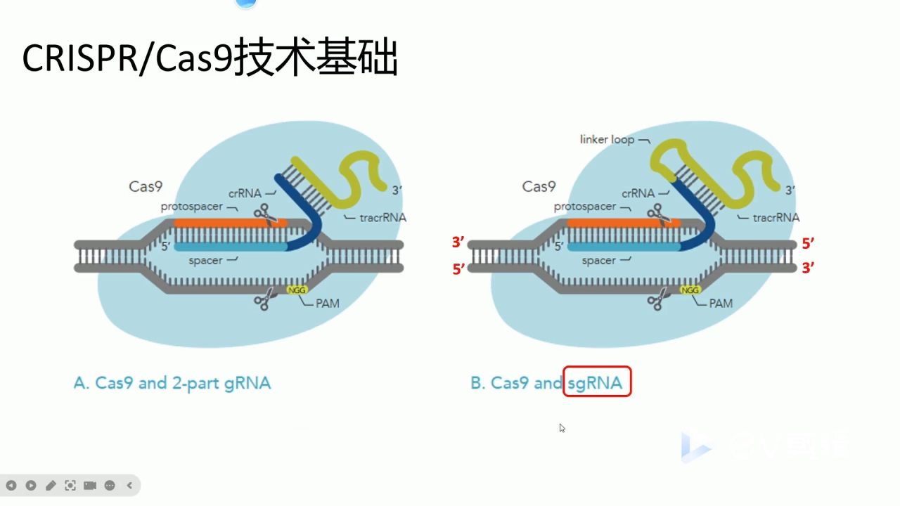

初学者最容易乱的是"切哪条链、往哪个方向数"。原片给的口径很实用：示意图里 spacer 按 5′→3′ 排，它互补的那条 DNA 链是 3′→5′；**NGG 落在 spacer 的 3′ 端一侧**，真正装着识别信息的是 NGG **上游**约 20 个碱基 [【跳转到 02:49】](https://www.bilibili.com/video/BV1928xeaEhs/?t=169)。

打个比方：**NGG 是门牌上的邮编**，Cas9 只认这一小块、先在这里落脚（专业说法叫 **PAM**，protospacer adjacent motif，原型间隔序列邻近基序）；**上游 20 nt 才是钥匙的齿形**。所以后面所有操作都遵守同一句话：**找到 NGG，取它上游 20 nt，NGG 本身不进引物** [【跳转到 20:27】](https://www.bilibili.com/video/BV1928xeaEhs/?t=1227)。

## 二、动手前必须准备好的三样东西

原片列了三项，其中只有前两项是硬性必需 [【跳转到 03:44】](https://www.bilibili.com/video/BV1928xeaEhs/?t=224)：**①目的基因的基因组 DNA 序列与 CDS 序列**（最好自己 PCR 扩增后测序过；前者定位外显子边界、挑靶点，后者拿来比对）；**②载体序列与图谱**（启动子是 U6 还是 T7、用哪个限制性内切酶——引物两端的"接头"完全由它决定）；**③该物种的基因组信息**（用于评估脱靶，锦上添花）。

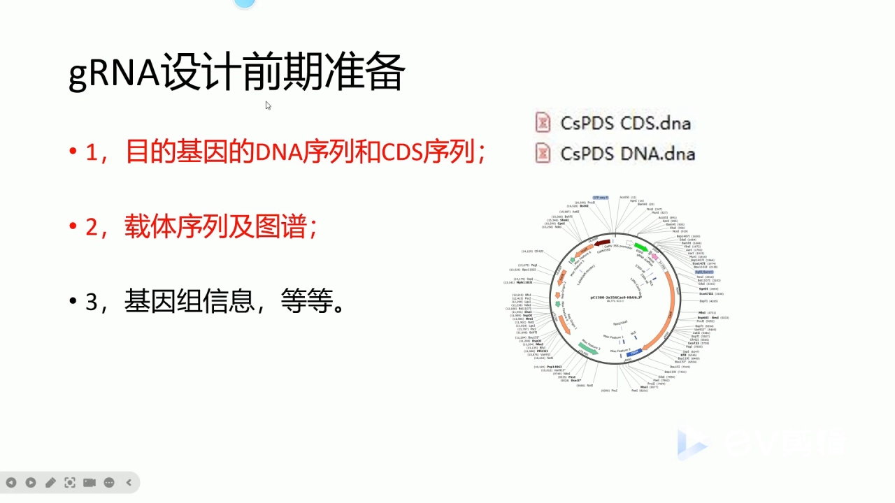

原片演示时这些文件都已备好，命名很直白：`CsPDS CDS.dna`（编码区）、`CsPDS DNA.dna`（基因组片段）、后续拼出的 `CsPDS Exon I + II.dna` [【跳转到 24:23】](https://www.bilibili.com/video/BV1928xeaEhs/?t=1463)。照这个习惯命名，过两周回来还能对上号。

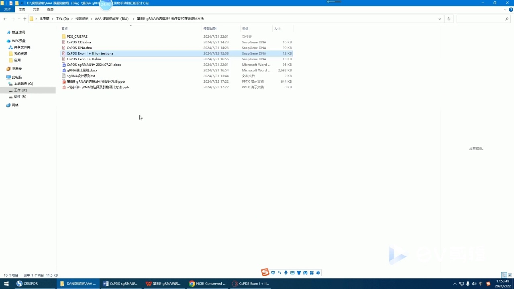

## 三、靶位点选择：先看基因，再看序列

原片把要考察的基因层面信息压成一张四条目清单：**是否为基因家族成员、内含子外显子的准确位置、可变剪接情况、同源蛋白的结构与关键氨基酸位点** [【跳转到 05:24】](https://www.bilibili.com/video/BV1928xeaEhs/?t=324)——它们其实是同一问题的四个侧面：**保证"只打这一个基因、只打这一个转录本、打在真正会破坏功能的地方"**。

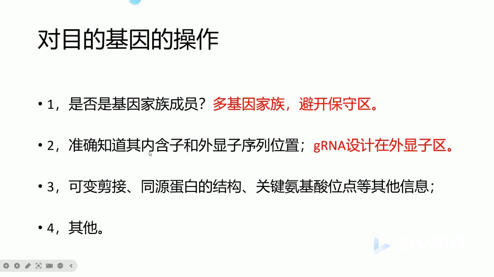

**① 是不是基因家族成员——是，就避开保守区。** 若目标属于**多基因家族**（若干旁系同源基因序列高度相似）而你只想沉默其中**一个**，靶点必须避开家族保守区：保守区在这几个基因间几乎一模一样，在这里设计会把它们一起打掉，得到的不是单基因敲除、而是一组基因同时沉默，表型无法归因 [【跳转到 04:59】](https://www.bilibili.com/video/BV1928xeaEhs/?t=299)。反之若是**单拷贝**（原片的 CsPDS 就是"基因组里只有一个 PDS"），这个顾虑可以放下——不管在哪一段设计，理论上都只靶向它自己 [【跳转到 09:14】](https://www.bilibili.com/video/BV1928xeaEhs/?t=554)。

**② 内含子/外显子边界——落在外显子，最好落在第 1、2 个外显子。** sgRNA 靶向的是基因组 DNA，但决定蛋白长什么样的信息在外显子里；打在内含子里，剪接时这段本就会被切掉，即使打出 indel，成熟 mRNA 与蛋白也可能毫发无伤。更进一步，经验上更优的是**第 1、2 个外显子**：越靠前，越容易在翻译刚开始时就移码或提前终止 [【跳转到 05:49】](https://www.bilibili.com/video/BV1928xeaEhs/?t=349)。

**③ 可变剪接——先决定"打全部"还是"打某一个"。** 想全敲，靶点就落在**所有转录本共有的外显子**上（通常是靠前的组成型外显子）；只想敲某个亚型，就落在该转录本**独有的外显子或特异剪接接头**上。所以要先拿到可变剪接信息，再挑"共有的"还是"特异的" [【跳转到 06:14】](https://www.bilibili.com/video/BV1928xeaEhs/?t=374)。**顺序不能反**：先定科学问题，再定序列位置。

**④ 保守结构域——用 NCBI CDD 查。** 原片用的工具是 NCBI 的 **Conserved Domains Database（CDD）**检索页，把基因的 **CDS 序列或蛋白序列**粘进去提交即可 [【跳转到 07:25】](https://www.bilibili.com/video/BV1928xeaEhs/?t=445)。

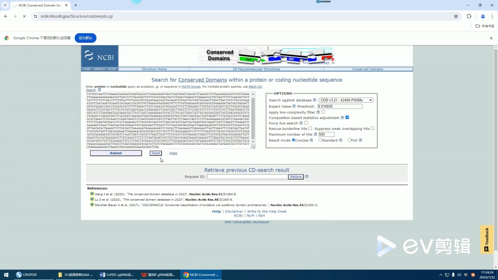

提交后很快给出图形化结果：哪里是已知保守结构域、跨度多长、属于哪个 superfamily（超家族）[【跳转到 08:29】](https://www.bilibili.com/video/BV1928xeaEhs/?t=509)。以 PDS 为例，结果里查到 `PLN02612`（phytoene desaturase），覆盖区间几乎占满整条蛋白，只有最前面不到 50 个氨基酸是非保守的——"可选的非保守区非常狭窄" [【跳转到 08:49】](https://www.bilibili.com/video/BV1928xeaEhs/?t=529)。

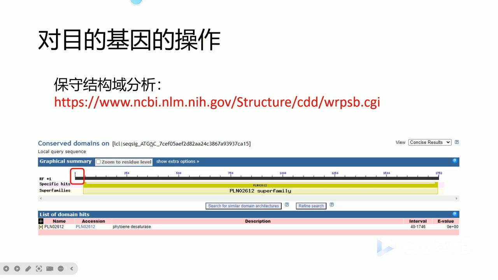

对我们的意义：若目标是**多基因家族里的单个基因**，靶点就尽量放进非保守结构域，以免误伤同家族成员；若像原片这样打单拷贝基因、只想"打坏它"，保守区完全可以打，甚至更保险（打到功能域更容易彻底失活）。

**⑤ 还有一层：同源区要避开，SNP 这层本讲没展开。** 原片还提到要考察**同源蛋白的结构与关键氨基酸位点**：某段序列若在近缘蛋白里也高度相似，以它为靶的 sgRNA 就更可能"顺手"打到别的基因 [【跳转到 06:39】](https://www.bilibili.com/video/BV1928xeaEhs/?t=399)——这就是"避开同源区"，本质是脱靶问题。需说明的是，**本讲没有专门讨论 SNP（单核苷酸多态性）层面的影响**，只强调"要有基因组信息才能评估脱靶"；若材料遗传背景复杂，靶点落在 SNP 上的风险需自己另查。

## 四、SnapGene 实操（上）：把外显子边界精确到"第几个碱基"

有些工具能直接画出"内含子—外显子"分布图：黄色块是外显子、黑色线段是内含子，一眼看出有几个外显子、大致等长 [【跳转到 09:54】](https://www.bilibili.com/video/BV1928xeaEhs/?t=594)。但这种图**不给坐标**——不说第一个外显子从第几号碱基开始、到第几号结束，而我们选 20 nt 恰恰需要精确编号。

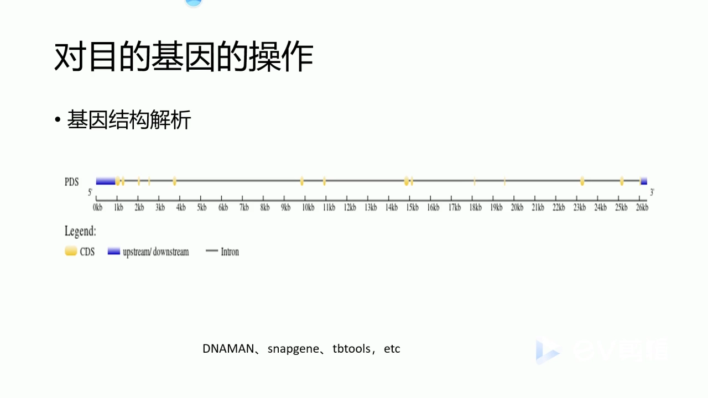

拿到精确边界最朴素的办法是做一次**序列比对**：把 CDS 序列（只有外显子、首尾相连）去比对基因组 DNA 序列（外显子 + 内含子），凡是"对得上"的片段就是外显子，"对不上"的就是内含子 [【跳转到 10:44】](https://www.bilibili.com/video/BV1928xeaEhs/?t=644)。这也解释了准备工作的第一条为什么同时要 DNA 序列和 CDS 序列：**两者不是重复，而是"带内含子的版本"与"纯编码版本"互为参照**。

在 SnapGene 里走 **菜单「工具」→「比对序列」→「比对两个 DNA 序列」**，把 CDS 与基因组 DNA 分别贴进去（或从文件里选），点「配对」[【跳转到 12:03】](https://www.bilibili.com/video/BV1928xeaEhs/?t=723)。原片也演了两次手忙脚乱：贴错框、删掉重贴——所以**先认清哪个框放 CDS、哪个框放 DNA**。

比对结果只看两件事：

1. **起始密码子的落点。** CDS 第一位必然是 `ATG`，找到它对应 DNA 序列的哪个位置。原片例子里 ATG 落在 DNA 的**第 922 位**，于是可判定 **1–921 bp 是 5′UTR（非翻译区）**，第一个外显子的起点就是 922 位的 `ATG` [【跳转到 14:10】](https://www.bilibili.com/video/BV1928xeaEhs/?t=850)。
2. **从哪里开始"对不上"。** 连续对上的区域突然错位、后面整段没有对应，那里就是外显子/内含子交界。原片例子里第一段对上的是 ATG 到 `CTA`（对应 CDS 的 1–219 位）；选中、右键「复制碱基」粘到 Word，第一个外显子就到手了。

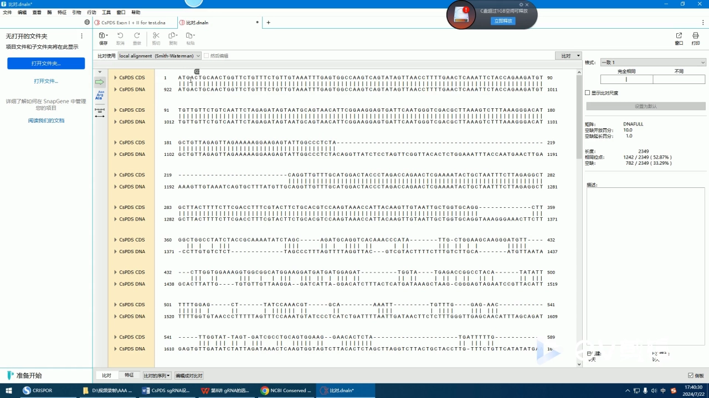

第二个外显子同一套路：在 CDS 里继续往下找第一段连续对上的区域，复制、紧接在外显子一后面。真正卡住的是**第三个外显子**——软件没比对出来，不是操作错，而是**软件本身的局限**：序列一长，一次比对不一定能识别出所有外显子 [【跳转到 15:52】](https://www.bilibili.com/video/BV1928xeaEhs/?t=952)。补救思路：**把 CDS 里已确认的前两个外显子删掉，存成新文件，再拿"剩余 CDS"去比对**，软件就会识别出后面某段较长的外显子；代价是它**不一定正好是第三个**，还得回头核对。好在靶点本就该放在第 1、2 个外显子上，识别出前两个就够用了 [【跳转到 16:17】](https://www.bilibili.com/video/BV1928xeaEhs/?t=977)。

把两段外显子序列拷出来，在 SnapGene 里**新建**一个序列（双链、线性或环状都行），就得到只含外显子一、二的短序列（例子里 354 bp，存成 `CsPDS Exon I + II for test.dna`）[【跳转到 17:19】](https://www.bilibili.com/video/BV1928xeaEhs/?t=1039)。原片在这里做了一个关键小动作：**把第二个外显子标成红色**——不是为了好看，而是把"**接头位置**"可视化，红黑分界点就是两段外显子的连接处 [【跳转到 17:44】](https://www.bilibili.com/video/BV1928xeaEhs/?t=1064)。下一节搜 NGG 时，**跨在接头上的候选位点不能选**，用颜色标出接头就等于立了一块"施工禁区"的牌子。

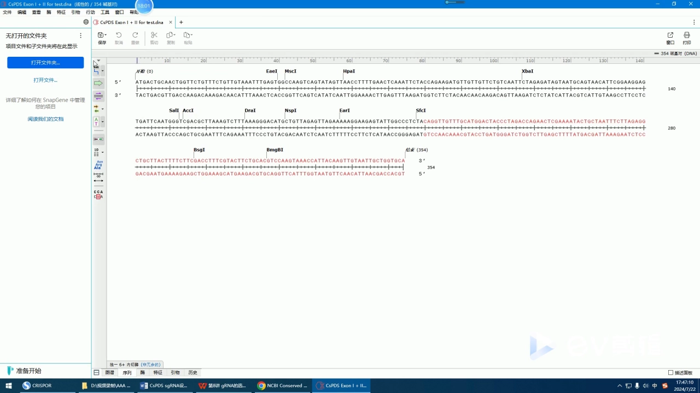

## 五、SnapGene 实操（下）：在两条链上搜 NGG，取出它上游 20 nt

Cas9 识别的 PAM 是 **NGG**，`N` 可以是 A/T/C/G 任意一个，所以 **TGG、AGG、CGG、GGG 都算 PAM**。只搜 `TGG` 会漏掉一大半可用位点，正确做法是**搜 `GG`，再看它前面那个碱基是什么**。原片的操作是 `Ctrl + F` 输入 `GG`，不断点「下一个」，SnapGene 会逐个高亮 [【跳转到 19:36】](https://www.bilibili.com/video/BV1928xeaEhs/?t=1176)；另外，**Cas9 不介意靶点落在正义链还是反义链**，两条链上的 `GG` 都要看 [【跳转到 18:29】](https://www.bilibili.com/video/BV1928xeaEhs/?t=1109)。

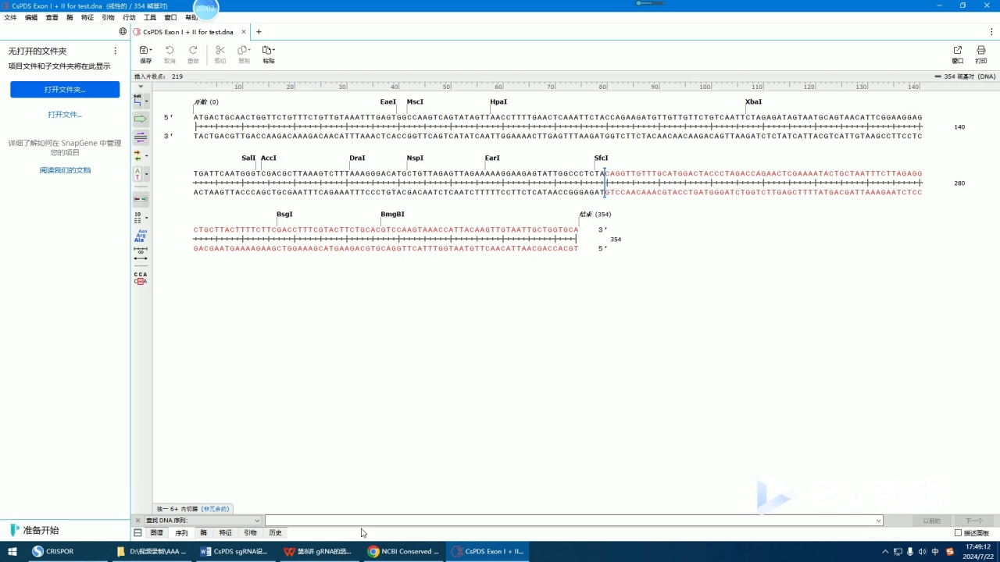

**正义链：** 找到一处 `TGG`，**从 TGG 的 G 往前（5′ 方向）数 20 个碱基**框选，再「复制顶部链」（copy top strand），得到的 5′→3′ 序列就是候选 spacer [【跳转到 19:41】](https://www.bilibili.com/video/BV1928xeaEhs/?t=1181)。**铁律：那 20 nt 里不包含 NGG**，框选到 NGG 前面一个碱基为止。多框两个碱基，等于把 PAM 写进了 spacer，做出来的载体一定不工作。

**反义链：** 方向感最容易绕晕，原片专门停下讲了一遍 [【跳转到 21:11】](https://www.bilibili.com/video/BV1928xeaEhs/?t=1271)。设你在底部链上看到一个 `AGG`，因为它是反义链，它的 5′ 端在示意图的另一侧，所以要往"反方向"拉 20 个碱基（原片口述"从 TCCAT 这样去选"）；框好后**复制底部链**，SnapGene 会按 5′→3′ 给出可用序列。一句话概括：**框选的永远是 PAM 上游 20 nt，而且复制同一条链。**

一条 354 bp 的片段里 `GG` 少说几十处，每处都是理论候选。筛选口径是：**GC 含量**——把**整条引物**（不只是 20 nt，而是拼好接头的完整 oligo）拿去分析，一般要求 **40%–60%**；以及 **Tm 值**合适、两条引物间不要差太多 [【跳转到 20:32】](https://www.bilibili.com/video/BV1928xeaEhs/?t=1232)。

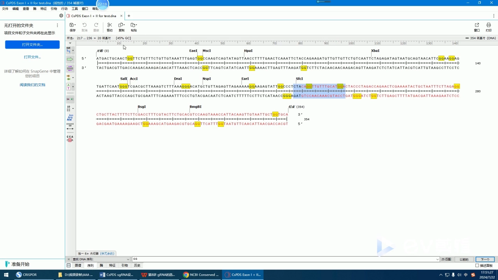

**候选 ≠ 可用。** 原片划出两类绝对不要选的位点 [【跳转到 21:36】](https://www.bilibili.com/video/BV1928xeaEhs/?t=1296)：

1. **跨外显子接头的位点。** 这正是第四节把第二个外显子标红的意义：若候选的 20 nt 或紧邻的 PAM 正好骑在"外显子一/二"的接缝上，那么**基因组里这一段中间还夹着内含子**，该靶点在真实基因组中根本不存在、或序列已变，引物设计得再漂亮也没用。
2. **含连续 T（poly-T）的位点。** 出现 4、5 甚至 6 个连续 T 时不要选，尤其 5–6 个 T。因为这类载体用的 RNA 聚合酶启动子（U6 等）会把连续 T 当成**转录终止信号**，一转到这里就停，sgRNA 被截断，等于没做 [【跳转到 22:01】](https://www.bilibili.com/video/BV1928xeaEhs/?t=1321)。

避开这两个坑，其他因素相对"都可以考虑"。原片也交代了边界：**这一步没有考虑脱靶**，也没评估引物特异性、引物二聚体——那些交给后面的在线工具或额外比对 [【跳转到 22:26】](https://www.bilibili.com/video/BV1928xeaEhs/?t=1346)。演示时原片从正义链、反义链**各选了一条**、都走完完整流程 [【跳转到 23:09】](https://www.bilibili.com/video/BV1928xeaEhs/?t=1389)——本身就在示范"多个位点要分布在不同链上"。

## 六、把 20 nt 写成一对引物：U6 + AarI 载体的完整推导

选好 spacer 只是"知道要打哪里"，还没到"能下单合成"。这一步必须充分了解自己载体的信息，通用引物不能照抄 [【跳转到 23:17】](https://www.bilibili.com/video/BV1928xeaEhs/?t=1397)。要确认两件事：**启动子类型**（最常用 **U6** 用于真核细胞、**T7** 用于体外转录）与**插入位点的限制性内切酶**（常见 **AarI**、**BpiI** 这类切割位点在识别序列之外的 IIS 型酶）。

原片演示的是 **U6 载体**：图谱上 35S 启动子驱动 **Cas9** 表达，反方向是 **U6 启动子**，U6 下游紧接一段 **sgRNA scaffold**；此外还有改造过的 35S–EGFP 标签、潮霉素筛选标记、卡那霉素抗性标记等 [【跳转到 23:59】](https://www.bilibili.com/video/BV1928xeaEhs/?t=1439)。

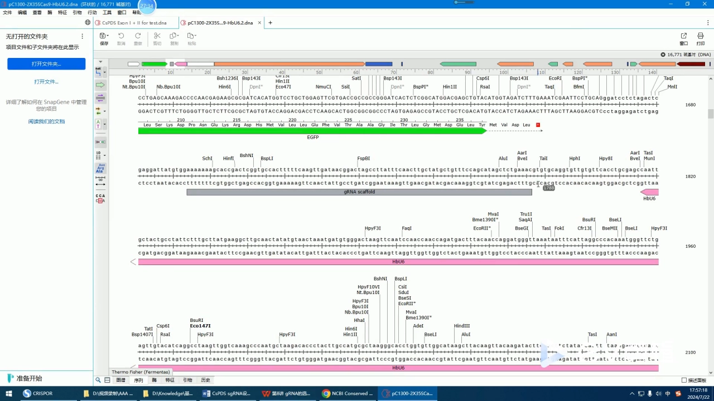

**scaffold 为什么预先装在载体里？** 因为 linker loop + 与 Cas9 结合的固定结构每个 sgRNA 都一样，不必每次合成。载体上已装好 U6 启动子和整套 scaffold，只留一个"缺口"——**要插进去的只有 spacer 那 20 nt** [【跳转到 25:38】](https://www.bilibili.com/video/BV1928xeaEhs/?t=1538)，这也是引物只有 25 nt 左右的原因。

**U6 的三个"脾气"，直接决定引物怎么写** [【跳转到 26:02】](https://www.bilibili.com/video/BV1928xeaEhs/?t=1562)：①启动子结束后**立刻**起始转录，下游第一个碱基就是转录起点，没有 UTR 缓冲——spacer 第一位就是 sgRNA 第一位，不能多塞碱基；②起点是 **G** 时效率更高——spacer 以 G 开头最好，不是 G 就**人为补一个 G**；③连续 **5 个以上 T** 会终止转录——选点阶段已筛掉 poly-T。

**AarI 切开后两端各差 4 个碱基** [【跳转到 27:05】](https://www.bilibili.com/video/BV1928xeaEhs/?t=1625)：上游端（U6 一侧）与启动子相连的那条链**少了 4 个碱基 `ATTG`**，即 U6 的最后 4 个碱基被酶切带走；下游端（scaffold 一侧）底部链多出 4 个碱基 `TTTG` 的突出。引物的任务就变成**把这两处的 4 个碱基补在 oligo 的 5′ 端**——换一个酶、换一个载体，这 4 个碱基就全变了。

设 spacer 为 `S`（20 nt，5′→3′），一对引物是：

```
F（正向引物，与 U6 同向）: 5′- ATTG + [G] + S -3′
R（反向引物，底部链）    : 5′- AAAC + ( S 的反向互补 ) -3′
        （S 以 G 开头时 [G] 不加；不是 G 就人为补 G，并在记录里标下划线）
```

逐步对照原片的推导：

1. **F 的 5′ 加 `ATTG`**：补全被 AarI 切掉的 U6 启动子最后 4 个碱基，spacer 就紧接转录起点 [【跳转到 28:07】](https://www.bilibili.com/video/BV1928xeaEhs/?t=1687)。
2. **spacer 不以 G 开头就人为补 G**：原话是"人为加一个 G，写的时候标一个下划线"——下划线是为了记住这是加的、不是基因组里本来就有的；补了 G 会多一个碱基，因此 R 那端也相应多一个 C [【跳转到 30:12】](https://www.bilibili.com/video/BV1928xeaEhs/?t=1812)。
3. **R 的 5′ 加 `AAAC`**：载体下游端底部链突出 `TTTG`，R 作为底部链方向的 oligo，5′ 端补上与之互补的 `AAAC`（原片口述时简称"加 AAC"）[【跳转到 28:45】](https://www.bilibili.com/video/BV1928xeaEhs/?t=1725)。
4. **R 的主体是 spacer 的反向互补**：在序列里定位 spacer，**复制底部链（5′→3′）**即可；贴过去能当场验算——R 第一个碱基 `C` 与 F 的 `G` 互补、`T` 与 `A` 互补，双链就此闭合 [【跳转到 29:53】](https://www.bilibili.com/video/BV1928xeaEhs/?t=1793)。

把四条规则落到具体序列上，原片最后给出的成品如下（示例序列来自 CsPDS 前两个外显子片段，仅供理解格式，**不要直接拿去用**）：

| 位点 | spacer（NGG 上游 20 nt） | F 引物 | R 引物 |
| --- | --- | --- | --- |
| 正义链 | `GTTTCTGTTGTAAATTTGAG` | `attg` + `GTTTCTGTTGTAAATTTGAG` | `aaac` + `CTCAAATTTACAACAGAAAC` |
| 反义链 | `TGGACGTGCAGAAGTACGAA`（不以 G 开头，需人为补 G） | `attg` + （下划线标注的人为 `G`）+ `TGGACGTGCAGAAGTACGAA` | `aaac` + `TTCGTACTTCTGCACGTCCAC` |

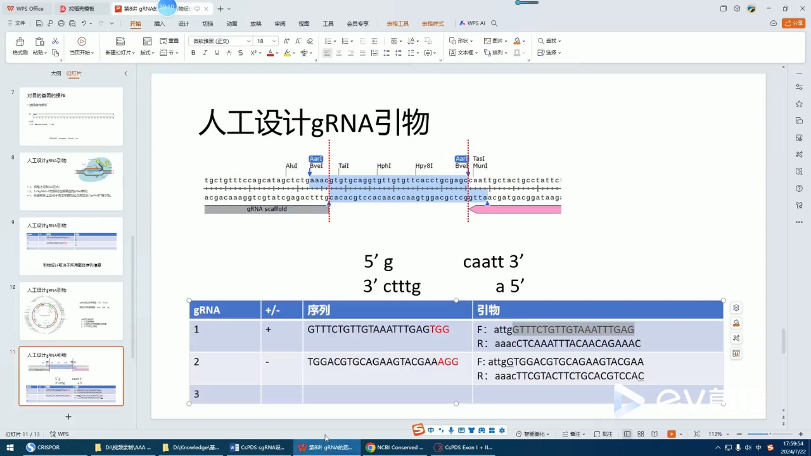

这张表值得逐格核对：第一个 spacer 在片段里是第 19–38 位，后面第 39–41 位正好是 `TGG`，它本身以 `G` 开头，F 端**不需要**再补 G；第二个来自反义链（底部链上找到 `TGG` 后往 5′ 方向拉的 20 nt），F 里把补上的 `G` 标了下划线，R 的 3′ 末端也相应多了一个 `C`（`…CCAC`）。

原片提醒：这套操作"**会者不难，难者不会**"，规则就四条，但第一次做往往卡在"哪条链、往哪边数、补几个碱基"上 [【跳转到 31:05】](https://www.bilibili.com/video/BV1928xeaEhs/?t=1865)。建议在文档里并排写下 spacer、PAM、F、R 四行，逐碱基对一遍再提交合成。

## 七、在线工具：用网站选位点、看打分，但引物仍要自己按载体写

手工设计每一步都知道为什么，但很难评估**脱靶**与**切割效率**——那需要把候选位点放回整个基因组去比。原片说这类网站"非常多"，他用下来觉得好用的是 **CRISPOR**；也推荐常去 **Addgene** 逛 [【跳转到 31:45】](https://www.bilibili.com/video/BV1928xeaEhs/?t=1905)——**它的价值不只是找质粒**，核实载体启动子、酶切位点、scaffold 序列时，载体页面往往就是最权威的出处。

操作很轻 [【跳转到 32:21】](https://www.bilibili.com/video/BV1928xeaEhs/?t=1941)：**贴入目标序列**（原片贴的就是第四节拼好的"外显子一 + 二"片段，不是整条基因）；**选物种**（自己做的物种不一定在列表里，原片的处理是"没关系，就选默认的人"——它影响脱靶预测所用的基因组）；**选 Cas9**（默认即可），Submit。

返回页信息量很大：每个候选 guide 都有**打分**（on-target 活性预测）与**特异性**（脱靶风险）等指标，不认识的指标可点旁边的感叹号/问号看说明。对每条 guide，网站还会给出一整套**现成引物**，并按常见载体分门别类（T7 版、U6 版……），接头与人为补的 G 都已加好 [【跳转到 33:20】](https://www.bilibili.com/video/BV1928xeaEhs/?t=2000)。

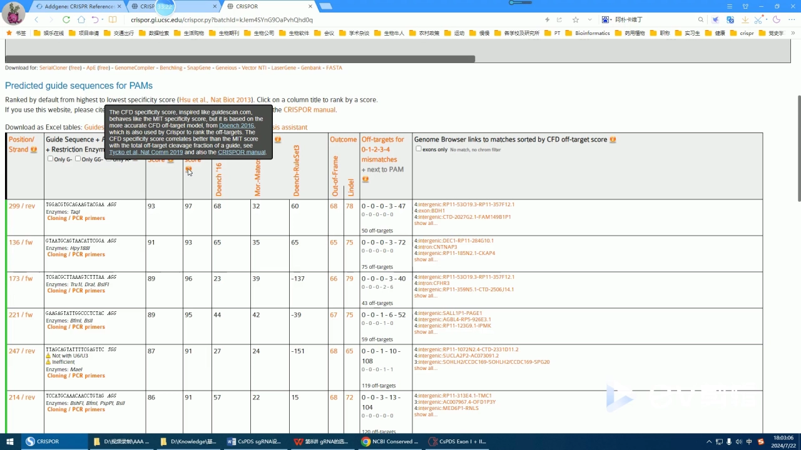

看上去很省事，但原片给了一句关键判断：**网站给的引物不能直接用，除非你用的载体跟它假设的一模一样。** 原因还是第六节那条——引物两端的 4 个碱基由**你的**启动子和酶切位点决定，而网站假设的是它内置的那批常见载体；你只要换过一个接头、换过一个酶，引物就得重写 [【跳转到 34:10】](https://www.bilibili.com/video/BV1928xeaEhs/?t=2050)。

于是分工很清楚：**网站负责**在几十个候选里按打分与特异性排序筛选，挑出 2–3 个 spacer（顺带拿到脱靶评估）；**自己负责**按自己载体重写 F/R。原片还演示了一个交叉验证：CRISPOR 排在前面的一条 guide，序列跟**他手工找到的第二条完全一致**，推导出的引物也一致 [【跳转到 34:40】](https://www.bilibili.com/video/BV1928xeaEhs/?t=2080)——两边互相印证最让人放心；若差得离谱，通常说明序列贴错、或链的方向搞反了。

## 八、为什么一个基因至少要备 2–3 对 sgRNA

原片说：**一个基因至少选两对，两对到三对比较保险**；只做一对"也可能是有风险的" [【跳转到 30:56】](https://www.bilibili.com/video/BV1928xeaEhs/?t=1856)。展开有三层：①**切割效率不可预判**——同样满足 NGG 上游 20 nt、GC 40%–60%，不同位点的实际效率可能差出一大截，打分只是预测，最终要靠实验（酶切、测序或表型）才知道哪个真能用；②**位点本身仍有残余风险**——跨接头、poly-T 排掉了，但脱靶、引物二聚体、局部二级结构没有完全排除；③**不同位点打出的等位基因型不一样**——移码位置不同，敲除的彻底程度也不同，多备几对才有可能拿到"功能全失"的那一个。

更稳的做法：**2–3 对尽量分布在不同外显子、不同链上**，这样某一条因局部序列问题失效时，其他几条不会一起失效。

## 小结

1. **能设计的只有 spacer。** Cas9 与 sgRNA 之外，断裂后的修复由细胞自发完成并引入移码、缺失、插入；我们唯一能决定的是 spacer 那约 20 个碱基。
2. **先摸清基因结构，再谈位点。** 查是否基因家族成员（是则避开保守区）、准确定位内含子/外显子边界、确认可变剪接（打全部还是打亚型）、用 NCBI CDD 看保守结构域与关键氨基酸；打单基因时落在非保守功能区，同时避开高度同源的区段。
3. **靶点优先放第 1、2 个外显子**，越靠前越容易一上来就移码或提前终止 [【跳转到 34:46】](https://www.bilibili.com/video/BV1928xeaEhs/?t=2086)。
4. **找位点就是"搜 GG、取上游 20 nt"。** PAM 是 NGG、N 任意，所以搜 `GG` 而不是 `TGG`；两条链都要搜，正义链复制顶部链、反义链复制底部链；NGG 本身绝不进 spacer。
5. **筛选看 GC 40%–60% 与 Tm，并排掉两个硬伤**：跨外显子接头的位点、含 ≥5 个连续 T 的位点。
6. **引物必须按自己的载体写。** U6 载体：F 的 5′ 加 `ATTG` 补全启动子；spacer 不以 G 开头就人为补 G（下划线标注）；R 的 5′ 加 `AAAC` 与另一端 `TTTG` 互补，主体取 spacer 的反向互补。T7 载体则是 F 的 5′ 加**两个** G；网站只用来选点、看打分，不能抄引物。
7. **一个基因备 2–3 对，最好跨外显子、跨链分布。**

**两条边界**：原片没有覆盖 **SNP** 层面的考虑，材料遗传背景复杂时靶点落在多态位点上的风险要自己另查；同时**没有基因组信息时脱靶无法评估**，只能靠额外的实验手段（换更靠前的位点，或多位点互相印证）降低风险 [【跳转到 35:36】](https://www.bilibili.com/video/BV1928xeaEhs/?t=2136)。

## 关键术语速查

| 术语 | 一句话解释 |
| --- | --- |
| **CRISPR/Cas9** | 由 sgRNA 引导 Cas9 在特定位点切断 DNA 双链的系统；Cas9 是执行切割的核酸内切酶 |
| **sgRNA / crRNA / tracrRNA** | 把天然 crRNA（含识别序列）与 tracrRNA（结合 Cas9）用 linker loop 缝成一条向导 RNA，即 sgRNA |
| **spacer（protospacer）** | sgRNA 5′ 端约 20 nt 的识别序列，**唯一需要人工设计**的部分，不含 PAM |
| **scaffold** | sgRNA 中除 spacer 外的固定结构（linker loop + 与 Cas9 结合的茎环），载体上已预装 |
| **PAM** | protospacer adjacent motif，Cas9 的"落脚点"；SpCas9 为 NGG，位于 spacer 的 3′ 一侧 |
| **可变剪接** | 一个基因经不同剪接产生多个转录本；选共有区打全部、选特异区打亚型 |
| **保守结构域 / CDD** | 蛋白中序列保守、承担特定功能的区段；用 NCBI CDD 检索（可提交 CDS 或蛋白序列） |
| **U6 / T7 启动子** | U6 由 RNA 聚合酶 III 驱动，起点即下游第一个碱基、首位 G 效率更高、≥5 个 T 终止；T7 为噬菌体启动子，F 端加两个 G |
| **AarI / BpiI** | IIS 型限制性内切酶，切割位点在识别序列之外，切开后留 4 nt 黏性末端 |
| **脱靶（off-target）** | sgRNA 在非目标位点造成的切割；评估需要该物种的基因组信息 |
| **CRISPOR / Addgene** | 前者是在线 sgRNA 设计与打分网站，后者是质粒/载体资源库（用于核实载体信息） |
