# CRISPR/Cas9 基因敲除全过程：从一条 sgRNA 到一株 KO 单克隆

> **来源**：Bilibili《CRISPR_Cas9基因敲除全过程，带你一起摆平KO单克隆》，UP 主 **小恒学术（汉恒生物）**，时长 **59:38**，[原视频 BV1oD421K7X4](https://www.bilibili.com/video/BV1oD421K7X4/)。
> 本篇属于 `content/虚拟细胞` 的「实验基础」系列——讲虚拟细胞、Perturb-seq 之前，先把这些扰动数据在湿实验里是怎么做出来的补齐。
> **说明**：原片是厂商技术讲座，开头与结尾含产品推介与促销活动，本文不复述；正文里的时间戳链接指向原片对应位置，便于核对。

---

## 本讲要解决的核心问题

**背景**：CRISPR/Cas9 已是基因敲除的默认工具，设计网站免费、oligo 便宜，两周内谁都能做出「有编辑」的细胞池。

**冲突**：但「有编辑」和「有敲除细胞株」是两件完全不同的事。混合细胞池里每个细胞的命运都不一样，抗性/荧光只能告诉你载体进去了，不能告诉你基因坏了；更麻烦的是，细胞池阶段看起来敲低的效果，会随着培养时间慢慢「回复」。真正做出**表型稳定、不回复**的 KO 单克隆，靠的是一整套判读流程。

**疑问**：一次完整的 KO 单克隆构建，究竟要做哪些判断？每一步的判断标准是什么、坑在哪？

**回答（中心思想）**：KO 单克隆 = **选对切割策略**（切哪个外显子、覆盖哪些转录本）+ **一条真能在你的细胞里切动的 sgRNA** + **合适的递送与初筛** + **三层终验**（测序判型、PCR 判缺失、WB 判蛋白）；而在动手前，先用两个「劝退测试」排除掉敲除致死和克隆长不起来这两种注定白干的情况。

原片按四段展开：不同敲除方法 → 为什么选 CRISPR/Cas9 → 工具与载体选择 → KO 单克隆的完整流程。[【跳转到 02:10】](https://www.bilibili.com/video/BV1oD421K7X4/?t=130)

---

## 一、「敲低」和「敲除」不是同一件事，先选对武器

**结论先行**：敲低动的是 RNA，是暂时的、可逆的；敲除动的是 DNA，是永久的、不可逆的。选错方向会让后续所有工作白做。

### 1.1 敲低：在 RNA 层面把信息「拦下来」

原片先讲三种敲低手段，差别在「递送方式」与「加工路径」。[【跳转到 02:42】](https://www.bilibili.com/video/BV1oD421K7X4/?t=162)

**RNA 干扰（RNAi）** 是最经典的两条路：

- **shRNA**（short hairpin RNA）：要把序列**构建到质粒或病毒载体**里。做法是把正义链、反义链放在一个**茎环（loop）**上形成「发卡」，插入载体后转染或包装病毒感染细胞。进入细胞后还要加工：**Drosha** 剪切 → **Dicer** 切成双链小 RNA → 解链成单链 → 由 **RISC 复合物**带去结合目标 mRNA，这条路径和细胞内源 miRNA 的生成几乎一样。
- **siRNA**（small interfering RNA）：**人工合成双链 RNA**，用脂质体等转染试剂送进细胞；不需要 Drosha/Dicer 加工，解链后直接进 RISC 降解 mRNA。

一句话记住区别：**shRNA 是「基因」形式送进去，要在细胞里加工；siRNA 是「成品」直接送进去。** 这也决定了两者的时效——siRNA 是短时脉冲，shRNA 可以靠稳转株长期压制。

第三种是 **morpholino（吗啉代寡核苷酸）**，现在已经很少见了，主要在斑马鱼等模式动物上用。它是人工合成的 DNA 类似物：用吗啉环取代核苷酸上的核糖环，磷酸基团也被改造，分子整体**不带电荷**，因此**不被任何核酸酶识别**，非常稳定。它的用法不是降解 RNA，而是「挡路」——靶向到**起始密码子上游**，挡住翻译起始，蛋白就做不出来；或者靶向**剪接位点**，让剪接出错、产生无功能的蛋白。[【跳转到 04:27】](https://www.bilibili.com/video/BV1oD421K7X4/?t=267)

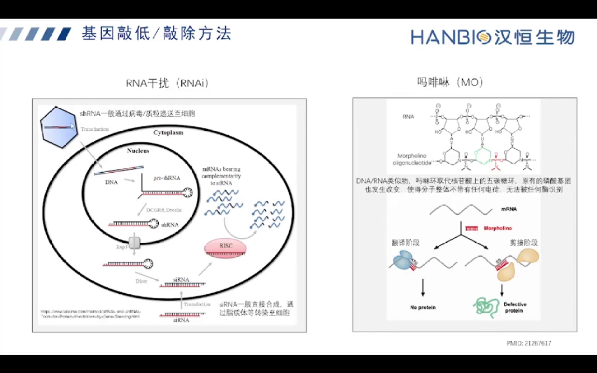

### 1.2 敲除：在 DNA 层面把序列改坏

CRISPR/Cas9 之前，主流是两把「蛋白剪刀」，原理高度相似——都是「**可编程的 DNA 结合结构域** + **FokI 核酸酶**」的组合：[【跳转到 05:17】](https://www.bilibili.com/video/BV1oD421K7X4/?t=317)

- **锌指核酸酶（ZFN）**：用**锌指结构域**识别特定碱基，把不同的锌指组合起来就能靶向不同序列。
- **TALEN**：用 **TALE 重复单元**识别碱基，每个重复单元里只有两个核心氨基酸决定它识别 A/G/C/T 中的哪一个——改这两个氨基酸，就改了靶向。

两者有个共同的硬约束：**FokI 必须形成二聚体才能切 DNA**，所以必须设计**一对**分别靶向切点两侧的分子。这也是它们「构建复杂、利用率低」的根本原因。

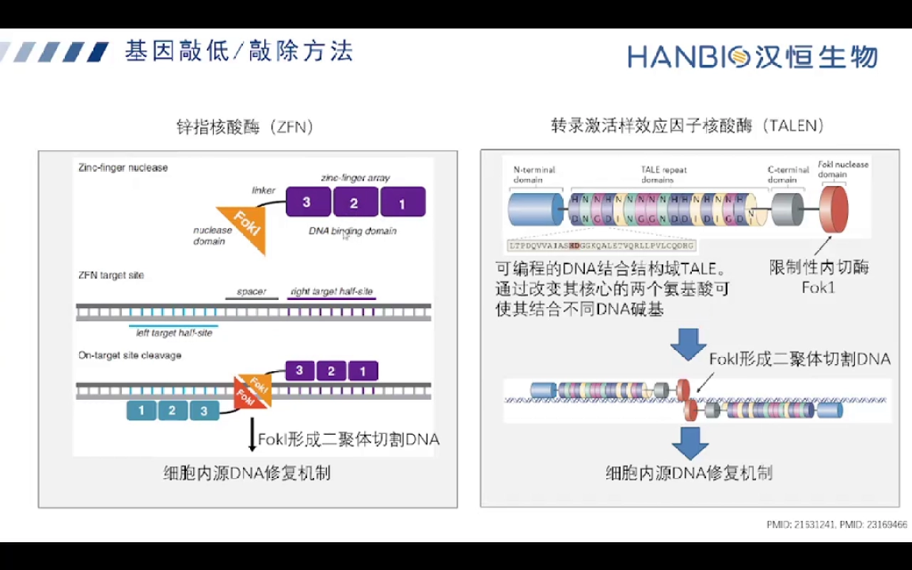

### 1.3 什么时候该退回去做敲低

原片给了一个很实用的判断：如果目标基因**敲除致死**，或者它和同一基因座上的其它编码基因重叠（敲掉会连带影响邻居），或者你只是要个功能验证、不追求永久修饰，那就别硬做敲除——**敲低更快、工作量小得多**。[【跳转到 15:55】](https://www.bilibili.com/video/BV1oD421K7X4/?t=955)

---

## 二、机理：一套细菌的免疫记忆，被改造成 RNA 引导的剪刀

**结论先行**：Cas9 只负责「切」，敲除效果其实取决于**切完之后细胞怎么修**。所以理解 CRISPR 要先理解两件事——RNA 怎么把 Cas9 带到靶点，以及细胞的两种修复路径分别产出什么。

### 2.1 从细菌免疫到 sgRNA

CRISPR/Cas9 是原核生物天然的免疫系统。[【跳转到 07:07】](https://www.bilibili.com/video/BV1oD421K7X4/?t=427)

1. 噬菌体（或质粒）把 DNA 注入细菌；
2. 细菌把外源基因组的一小段**插进自己的 CRISPR array**——「重复序列 + 间隔序列」交替排列，间隔区相当于不同病毒的身份 ID；
3. 同样的病毒再来时，细菌转录出 **pre-crRNA**（含这些身份 ID）和 **tracrRNA**，两者在重复序列区配对，同时表达 **Cas9 蛋白**；
4. 经 **RNase III** 切割加工，变成单个 crRNA + tracrRNA，与 Cas9 组成复合体，去识别并切割外源 DNA，实现免疫防御。

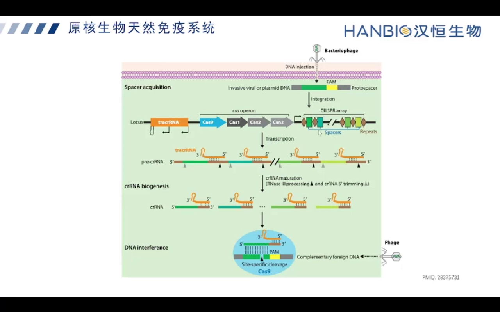

人类改造的关键一步，就是**把 crRNA 和 tracrRNA 融合成一条 RNA**，即 **guide RNA（gRNA / sgRNA，single guide RNA）**，与 Cas9 组成最简单的二元编辑系统。原片提醒一个常见混淆：平时「设计 sgRNA」多指前面约 20 nt 的**间隔序列**（crRNA 部分），后面 **scaffold**（tracrRNA 段）在载体上自带。[【跳转到 08:54】](https://www.bilibili.com/video/BV1oD421K7X4/?t=534)

### 2.2 切割：HNH 与 RuvC 各切一条链

Cas9 有两个核酸酶结构域：**HNH 切与 sgRNA 互补的那条链，RuvC 切另一条链**，两者共同作用产生**双链断裂（DSB）**。切割位点在 PAM（NGG）上游约 3 bp 处。[【跳转到 09:49】](https://www.bilibili.com/video/BV1oD421K7X4/?t=589)

### 2.3 修复才决定命运：NHEJ 与 HDR

双链断裂之后，细胞用两套机制修复，产出的结果完全不同：

| 修复方式 | 是否需要模板 | 产物 | 用途 |
| --- | --- | --- | --- |
| **NHEJ**（非同源末端连接） | 不需要 | 错误倾向修复，产生小片段插入/缺失（indel）、碱基替换 | **敲除**：靠移码破坏读框 |
| **HDR**（同源重组修复） | 需要外源修复模板（ssODN 或质粒） | 精确写入指定序列 | **敲入**：点突变、加标签、插入荧光/抗性基因 |

关键一句：**做敲除单克隆时，我们通常故意不引入修复模板**，就让细胞走 NHEJ，随机产生 indel 把基因弄坏。因为 HDR 效率本来就低，带模板的做法本质是「敲入」而不是「敲除」。[【跳转到 11:04】](https://www.bilibili.com/video/BV1oD421K7X4/?t=664)

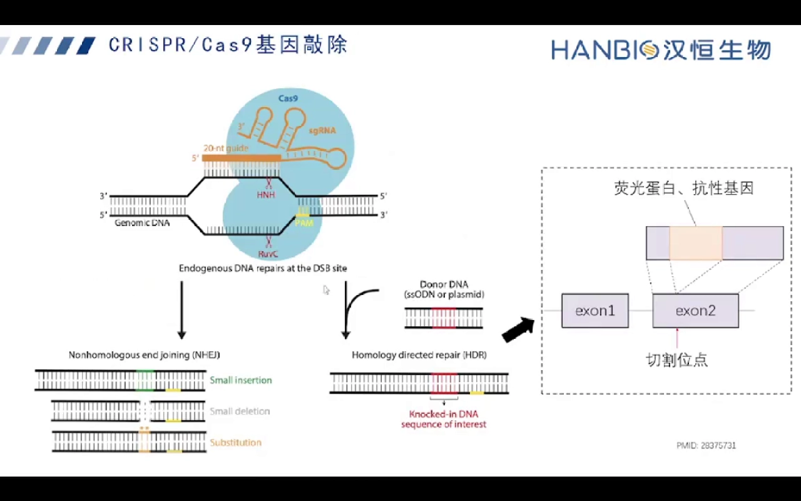

---

## 三、四把工具横向比较：为什么现在几乎都选 CRISPR/Cas9

**结论先行**：CRISPR/Cas9 胜在**构建简单、特异性高、一次编辑永久有效**；RNAi 胜在**快、可逆、能对付敲除致死的基因**；ZFN/TALEN 已被边缘化。

原片先看文献数量：近十年 CRISPR 文章逐年陡增，RNAi 平稳但基数仍大，ZFN/TALEN 利用率很低。[【跳转到 11:59】](https://www.bilibili.com/video/BV1oD421K7X4/?t=719)

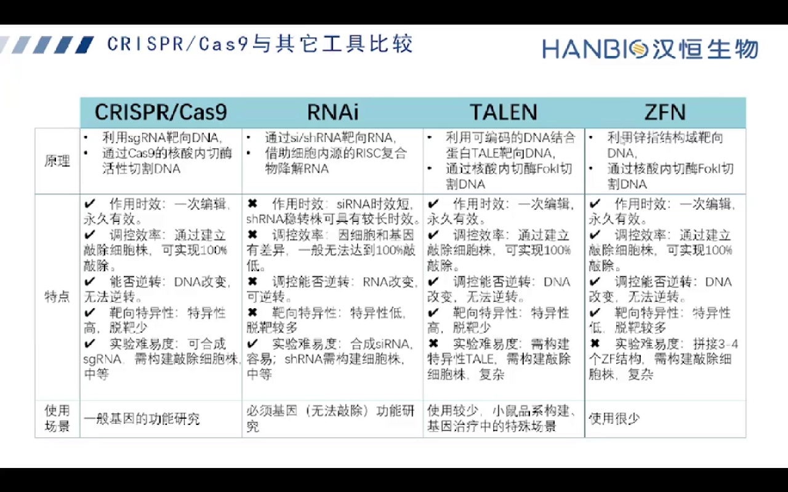

这张对比表值得逐行读，它解释了后面所有方法学选择：[【跳转到 12:35】](https://www.bilibili.com/video/BV1oD421K7X4/?t=755)

- **原理**：CRISPR/TALEN/ZFN 都靶向 DNA 并切割；RNAi 靶向 RNA，由 RISC 降解。
- **作用时效**：CRISPR、TALEN、ZFN 都是基因组编辑，**一次编辑永久有效**；siRNA 时效短，shRNA 稳转株可维持较长时效。
- **能否逆转**：DNA 改变无法逆转；RNA 改变可逆转——这正是「细胞池效果会回复」的根源。
- **特异性**：CRISPR 特异性高（配合网站的打靶/脱靶评分）；TALEN 也高；**锌指特异性偏低**（锌指结构域识别的碱基长度有限）；RNAi 特异性也不算高，需要靠评分筛靶点。
- **实验难度**：CRISPR 只需换 sgRNA 序列，最省事；TALEN/ZFN 要设计并合成两个蛋白分子，复杂；siRNA 合成即可，最简单。
- **使用场景**：CRISPR 覆盖一般基因功能研究，也延伸到转录激活/抑制、单碱基编辑等；RNAi 常用于**敲除致死的必需基因**；ZFN 用得更少。

由此得到一条实用结论：**敲除首选 CRISPR/Cas9，敲低首选 RNAi，两者互补而非替代。**

---

## 四、递送与初筛：载体选择决定了你后来的「标记预算」

**结论先行**：载体决定的是**表达时长**和**你手里还剩哪些筛选标记**，而这两件事会一路影响到拿到单克隆之后还能不能做别的实验。

### 4.1 瞬时还是稳定

原片的载体选择表很简洁：[【跳转到 17:40】](https://www.bilibili.com/video/BV1oD421K7X4/?t=1060)

| 表达方式 | 载体 | 适用细胞 |
| --- | --- | --- |
| **瞬时表达** | 质粒 | 常规细胞系（易转染） |
| **瞬时表达** | 腺病毒 | 原代细胞、悬浮细胞、血液类等**难转染**的细胞 |
| **稳定表达** | 慢病毒 | 需要抗性/荧光标记筛选稳转株的场景 |

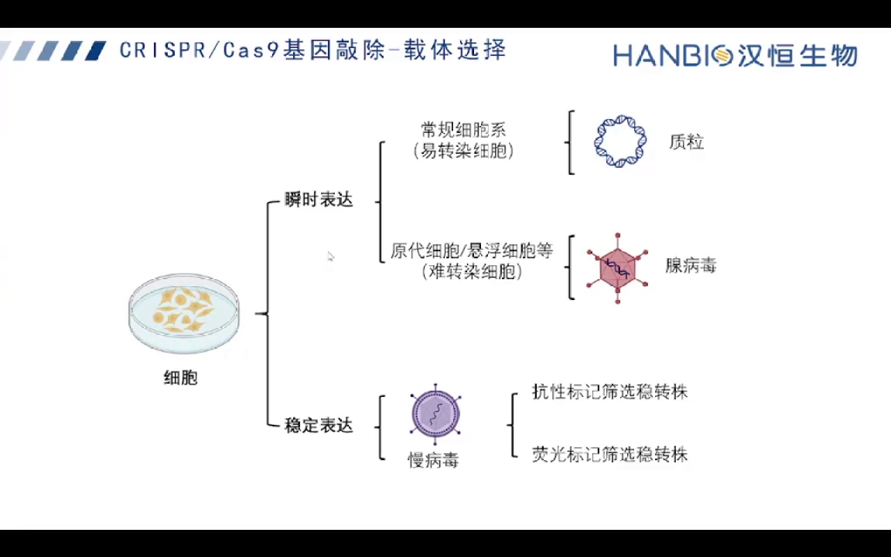

### 4.2 一个容易忽略的取舍：慢病毒会「花掉」一个标记

慢病毒整合进基因组，通常带抗性或荧光标记用于筛稳转株。问题是：**这个标记会一直留在你最终拿到的敲除单克隆里**。如果后续实验还要用同一个抗性或荧光做别的标记，你就少了一个选项。所以要先想清楚后续实验需求，再决定要不要用慢病毒。[【跳转到 18:55】](https://www.bilibili.com/video/BV1oD421K7X4/?t=1135)

质粒/腺病毒是瞬转的，标记只在表达时效内存在；但**敲除发生在基因组上，最终单克隆依然是敲除的**——瞬时表达不等于瞬时敲除。

### 4.3 单载体还是双载体

- **单载体**（Cas9 + sgRNA 在同一个质粒/病毒上）：一步转染，效率高、方便，适合**单个基因**的敲除筛选。也可以在一个载体上放两个启动子驱动两条 sgRNA，但**两条以上重复序列太多**，测序和合成都变麻烦，实际一般就装 1–2 条。[【跳转到 20:10】](https://www.bilibili.com/video/BV1oD421K7X4/?t=1210)
- **双载体**（Cas9 与 sgRNA 分开）：典型用法是**先做 Cas9 稳转株**（慢病毒载体里不放 sgRNA，只表达 Cas9），筛出稳定表达 Cas9 的细胞，之后再用高转染效率的方式转入不同的 sgRNA 载体——想敲哪个基因就换哪条 sgRNA，适合**一次做多个基因**。[【跳转到 21:00】](https://www.bilibili.com/video/BV1oD421K7X4/?t=1260)
- 双载体的**硬性要求**：两者必须带**不同的**筛选标记（例如 Cas9 带嘌呤霉素抗性、sgRNA 带绿色荧光），这样才能筛出「同时转入两者」的细胞——只进 sgRNA 而没有 Cas9 的细胞是切不动的。[【跳转到 23:48】](https://www.bilibili.com/video/BV1oD421K7X4/?t=1428)

### 4.4 混合克隆是「一群不同命运的细胞」，不是「敲除成功」

转染之后、Cas9 与 sgRNA 成功表达，你拿到的是一个**混合细胞池（cell pool）**，里面至少有四种细胞：[【跳转到 29:51】](https://www.bilibili.com/video/BV1oD421K7X4/?t=1791)

1. **转染阴性**：载体根本没进去；
2. **转进去了但没被编辑**：Cas9 没切到有效位点；
3. **被编辑但没敲除成功**：比如只删/插了 3 个碱基，读框不变，蛋白照做；
4. **成功敲除**。

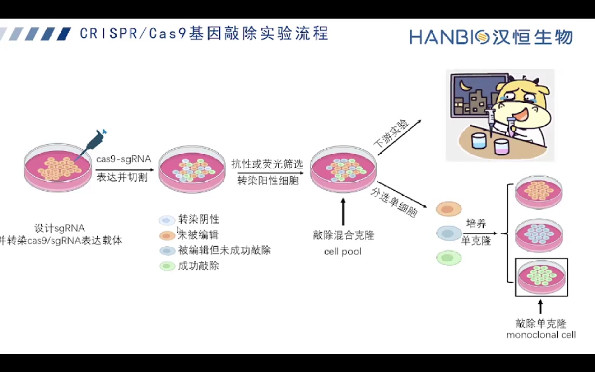

因此**抗性/荧光筛选只能筛「转染阳性」，筛不出「敲除阳性」**。此外原片还提醒：用瞬转系统时，细胞池培养时间长了编辑效果会逐渐减弱、慢慢恢复正常——载体被稀释掉了，未被编辑的细胞在混池里重新占据优势（详见 7.1）。[【跳转到 32:20】](https://www.bilibili.com/video/BV1oD421K7X4/?t=1940)

实用提示：细胞池阶段如果 WB 已经明显敲低，而你不一定非要单克隆，可以直接用池子做下游实验，省掉后面最费时的单克隆环节。[【跳转到 30:41】](https://www.bilibili.com/video/BV1oD421K7X4/?t=1841)

---

## 五、切哪里、切哪些转录本：编码基因敲除的两个硬约束

**结论先行**：敲编码基因不是「随便找段外显子切一刀」。位置要**靠 N 端**，且必须落在**所有转录本共有的外显子**上，否则你得到的只是「部分转录本被破坏」的细胞，还在表达有功能的蛋白。

### 5.1 靠前切：前 5%–65% 的编码区

外显子编码氨基酸，所以 sgRNA 设计在外显子上。原片给的经验区间是**编码区的前 5%–65%**，越接近起始密码子越好；**太靠后**的风险是：即使造成 indel，也可能只影响蛋白的 C 端，剩下的部分依然能折叠成一个有功能的（或部分功能的）蛋白。[【跳转到 24:34】](https://www.bilibili.com/video/BV1oD421K7X4/?t=1474)

### 5.2 共有外显子：一个基因可能有多条转录本

同一个基因往往有多条转录本，它们**既有共用的外显子，也有各自独有的外显子**。如果 sgRNA 落在某条转录本独有的外显子上，其它转录本照样转录、照样翻译，你可能测到「编辑成功」，却依然有蛋白表达。所以正确做法是：**在多个转录本共有的编码区上设计 sgRNA**，让所有转录本一起被破坏。[【跳转到 24:59】](https://www.bilibili.com/video/BV1oD421K7X4/?t=1499)

### 5.3 为什么切一刀就能敲除：移码、提前终止与 NMD

切点在编码区靠前时，NHEJ 产生的 indel 通常不是 3 的倍数，于是**移码、产生提前终止密码子**；这种 mRNA 会被**无义突变介导的降解（NMD）**清除，蛋白就做不出来。[【跳转到 25:24】](https://www.bilibili.com/video/BV1oD421K7X4/?t=1524)

这里有两个必须知道的例外：

- 如果 indel 恰好是 **3 的倍数**，读框不变，只是少/多几个氨基酸，蛋白可能仍然有功能；
- 如果发生**外显子跳跃**（被切的外显子连同突变一起被剪接掉），剩下的序列仍可能翻译出残缺但仍有功能的蛋白。

所以后面才需要「三层终验」，而不能只凭测序结果宣布敲除成功。

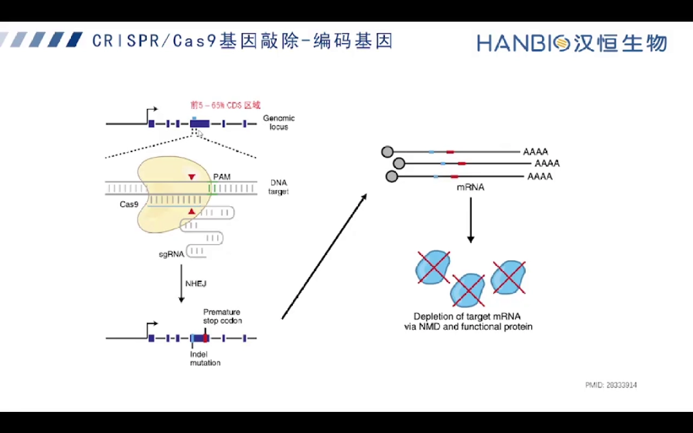

---

## 六、非编码 RNA 怎么敲：没有读框可破坏，只能拆元件

**结论先行**：lncRNA 和 miRNA 不编码蛋白，没有「移码」这一招。敲除它们要靠**破坏转录起点、剪接或加工所需的元件**。原片给了 lncRNA 三条路线、miRNA 两条路线，每条都有明确的失效风险。

### 6.1 lncRNA 的三条路线

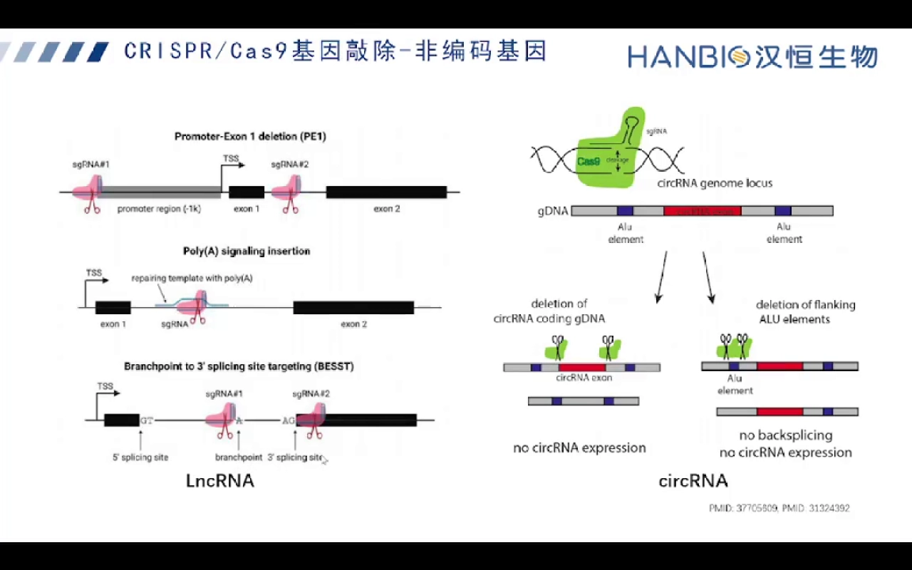

**路线一：启动子 + 第一外显子双切（PE1，Promoter-Exon 1 deletion）**
在转录起始位点（TSS）**上游约 1 kb** 设计一条 sgRNA，再在**第一外显子**上设计一条，两条 sgRNA 同时切，把「启动子 + 第一外显子」这段一起删掉。[【跳转到 26:39】](https://www.bilibili.com/video/BV1oD421K7X4/?t=1599)
**风险**：若该位点与某个编码基因重叠，这段删除会**连带影响邻居的表达**——观察到的表型可能不是 lncRNA 的功劳。

**路线二：TSS 下游插 polyA 终止**
在转录起始位点下游切一刀，同时提供带 **poly(A) 信号**的修复模板，让转录提前终止。[【跳转到 27:04】](https://www.bilibili.com/video/BV1oD421K7X4/?t=1624)
**风险**：若该基因座下游还有别的**起始位点**，仍可能从这里起始转录，产生较短的转录本——等于没敲干净。这条路要引入修复模板，属 HDR，效率低于纯 NHEJ。

**路线三：针对最后一个内含子的剪接位点（BESST 类新方法）**
这是原片提到 2023 年新发表的做法：在 lncRNA **最后一个内含子的分支点/3′ 剪接位点两侧**设计 sgRNA，让正常剪接无法进行，**最后一个内含子被保留**，这样的转录本最终会被降解。[【跳转到 27:29】](https://www.bilibili.com/video/BV1oD421K7X4/?t=1649)
**局限**：对**只有一个外显子**的 lncRNA 完全无效（没有内含子可破坏）。

结论：没有一条路线通吃，要**按基因本身的结构**（有多少外显子、和谁重叠、有没有下游起始位点）来选。同页还画了 circRNA 成环元件的敲除，逻辑一致。

### 6.2 miRNA 的两条路线

先理解 miRNA 的生成：基因组转录出 **pri-miRNA** → **Drosha**（在细胞核内，与 DGCR8 一起）剪成 **pre-miRNA** → 出核 → **Dicer** 剪成成熟 miRNA → 进入 Ago/RISC。[【跳转到 28:28】](https://www.bilibili.com/video/BV1oD421K7X4/?t=1708)

于是有两条敲除思路：[【跳转到 28:53】](https://www.bilibili.com/video/BV1oD421K7X4/?t=1733)

- **单 sgRNA：破坏 Drosha 或 Dicer 的切割位点**。加工位点被破坏，成熟 miRNA 就产不出来。改动小、风险小，但可能残留部分加工产物。
- **双 sgRNA：直接删除整个 miRNA 表达单元**（前体或成熟体所在的外显子及其两侧）。删得干净彻底，但**如果该基因座还有别的基因，会影响到邻居**。[【跳转到 29:18】](https://www.bilibili.com/video/BV1oD421K7X4/?t=1758)

此外也可以敲除 miRNA 两侧内含子区的**调控元件**（可单侧、可双侧），属于更精细的调控操作。

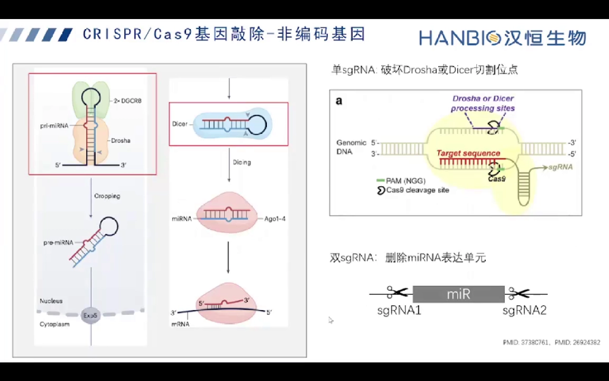

---

## 七、动手前先做两个「劝退测试」

**结论先行**：KO 单克隆工作量很大，真正的效率提升来自**在开始前就把注定失败的实验排除掉**。原片给了两个必做的预实验。

### 7.1 这个基因敲除会致死吗？

如果基因是**敲除致死**的，理论上你永远拿不到纯合敲除克隆，做下去只是浪费几个月。原片把它拆成三个阶段判断：[【跳转到 31:55】](https://www.bilibili.com/video/BV1oD421K7X4/?t=1915)

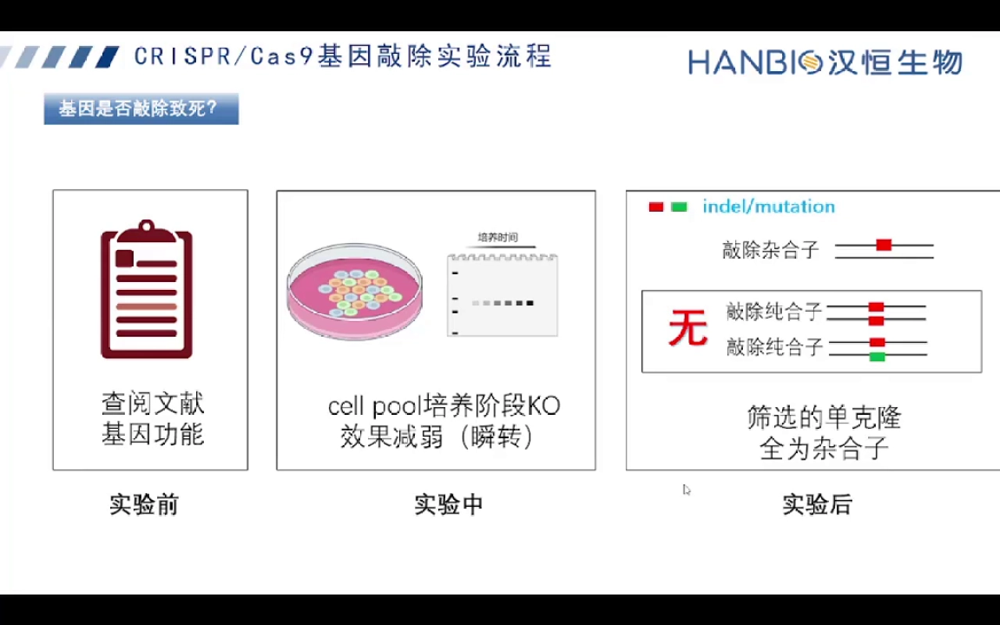

1. **实验前**：查文献 + 结合基因功能判断（是否为必需基因、管家基因等）；
2. **实验中**：如果用**瞬转**系统，细胞池培养时间越长，编辑/敲低效果如果**逐渐减弱、慢慢恢复**，提示可能存在敲除致死——存活的都是没被敲掉的细胞，它们在混池里越长越多；
3. **实验后**：筛到的克隆**永远是杂合子**（二倍体两个 copy 只有一个被编辑，另一个保持野生型），说明两个等位同时被敲掉就活不了。

补充一句：如果是**稳转**的 Cas9/sgRNA 系统，它一直持续切割，不适合用「效果随时间减弱」这条来判断。[【跳转到 32:20】](https://www.bilibili.com/video/BV1oD421K7X4/?t=1940)

### 7.2 你的细胞能长出单克隆吗？

单克隆的本质是「一个细胞长成一团」。有些细胞**克隆形成能力很差**，铺到 96 孔板里大部分孔什么都不长，后面所有流程就无从谈起。原片的做法是先做**单克隆生长能力测试**：[【跳转到 34:00】](https://www.bilibili.com/video/BV1oD421K7X4/?t=2040)

1. **贴壁细胞**：胰酶消化 → 离心收集 → 吹打成单细胞悬液；**悬浮细胞**直接收集；
2. **梯度稀释**：设几个不同的每孔细胞数梯度铺板，原片举的是 **0.5 / 1 / 3 / 5 个细胞/孔**（稀释浓度从 1×10⁵/mL 一路稀释到 1×10²/mL 量级）；
3. 观察哪种铺板数下克隆长得最好，确定**最适铺板数**，之后再按这个参数正式铺单克隆板。

另一种方式是**流式分选**：直接把单个细胞分选进 96 孔板或 384 孔板，每孔一个细胞，更精确、也更省细胞。[【跳转到 34:36】](https://www.bilibili.com/video/BV1oD421K7X4/?t=2076)

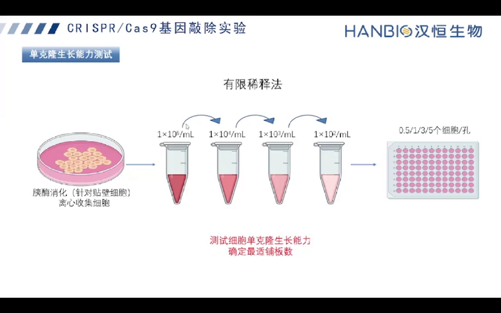

> **一个量化的门槛**（非原片内容，行业经验）：项目里常把「每孔铺 1 个细胞时能长成克隆的孔占比」当作克隆形成率，若**低于约 10%**，96 孔板里绝大多数孔是空的，拿克隆的成本高到不可接受，通常应退回敲低或改用流式分选。原片口径是定性的：生长能力不过关或基因敲除致死，就别做单克隆。

---

## 八、sgRNA 设计与载体构建：决定成败的细节

**结论先行**：sgRNA 的效果差异极大，设计阶段要挑**评分高、无警告、在你细胞里序列完全匹配**的那条；构建阶段则要照顾 **U6 启动子对首位碱基的偏好**。

### 8.1 用网站设计，但要看懂「叹号」

设计网站很多（原片列了综述里的清单，涵盖可用物种、Cas 蛋白种类、打靶/脱靶评分、批量设计等）。演示以 **CRISPOR** 为例：选物种基因组 → 粘贴目标序列（通常是某个外显子，约 2300 bp 以内）→ 选 PAM → 得到候选靶点。[【跳转到 35:48】](https://www.bilibili.com/video/BV1oD421K7X4/?t=2148)

结果页会给出各条 sgRNA 在基因上的位置、**打靶评分/效率评分**，并对有风险的靶点标**叹号警告**。必须点开看警告是什么，常见几类：[【跳转到 36:38】](https://www.bilibili.com/video/BV1oD421K7X4/?t=2198)

- **GC 含量过高**：可能影响切割效率；
- **连续 4 个 T**：会造成转录**提前终止**——因为 sgRNA 通常用 **U6 启动子**（U3 也有，但少见），U6 遇到连续的 T 会当作终止信号；
- **低效 motif**：有文献报道 sgRNA 末尾是 **TTC/TTT**，或后四位以 T/C 为主，可能影响 sgRNA 的表达与编辑效率；
- **首位碱基偏好**：U6 启动子要求转录起始位点最好是 **G**，U3 则偏好 **A**。如果设计出的 sgRNA 首位不是 G，就要**人为在前面补一个 G**，帮助 U6 起始转录。[【跳转到 37:28】](https://www.bilibili.com/video/BV1oD421K7X4/?t=2248)

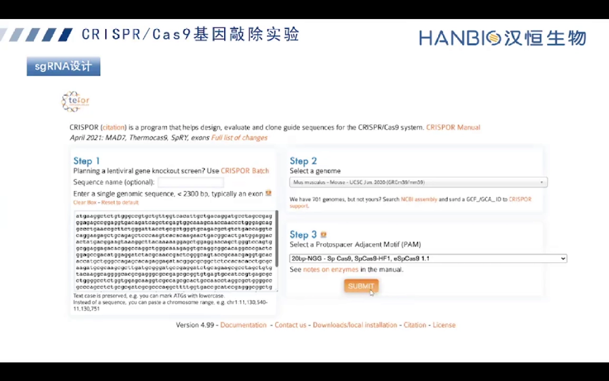

### 8.2 先在「你的细胞」里验证序列完全匹配

这一步最容易被跳过，但代价最高：细胞系常有 **SNP**，如果 sgRNA 靶序列在你的目的细胞里和参考基因组不一致，Cas9 就切不动。做法是在 sgRNA 两侧设计上下游引物，扩增这段基因组并测序，确认与设计所用序列**完全匹配**后再往下走。[【跳转到 37:53】](https://www.bilibili.com/video/BV1oD421K7X4/?t=2273)

### 8.3 克隆进载体

以 lentiCRISPR v2 为例：合成 sgRNA 的两条 oligo，**退火**成双链（两端带酶切位点对应的黏端），连接到载体 **U6 启动子下游**。如果 sgRNA 5′ 端没有 G，要在 U6 后面补一个 G 再连接。构建好后大量扩增，用于直接转染或包装病毒。[【跳转到 38:48】](https://www.bilibili.com/video/BV1oD421K7X4/?t=2328)

---

## 九、初验：T7E1 与 Sanger 只能证明「切到了」

**结论先行**：细胞池阶段的验证只有一个目的——确认这套 sgRNA/Cas9 **在你的细胞里真的切动了**，从而值得投入后面昂贵的单克隆流程。它**不能**证明你已经拿到敲除细胞。

两种常用手段：[【跳转到 40:03】](https://www.bilibili.com/video/BV1oD421K7X4/?t=2403)

1. **Sanger 测序（PCR 产物直接测）**：在 sgRNA 两侧设计引物、扩增靶区域测序。如果测序出现**杂峰**（同一位点多种碱基信号叠加），说明细胞池里存在多种不同的 indel——编辑发生了。
2. **T7E1 酶切**：T7E1 识别并切割**错配的双链 DNA**。PCR 产物变性再退火后，野生型与突变型单链会随机配对形成错配双链，T7E1 把这些错配切出两段小片段；跑胶看到**切开的短条带**，说明存在编辑。

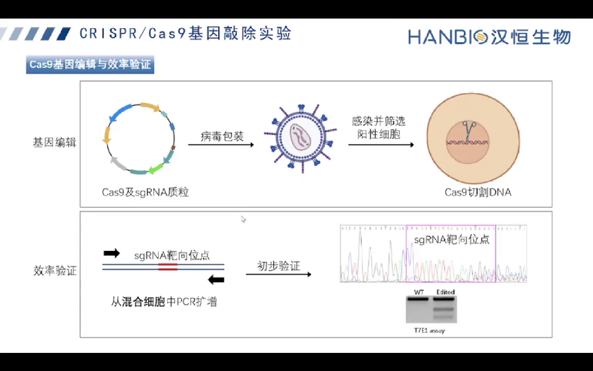

两者的共同局限：面对**混合细胞群体**，只能定性回答「有没有编辑」，无法回答「哪个克隆是纯合敲除」。

---

## 十、把单细胞拿到手：稀释到「一孔一细胞」

**结论先行**：单克隆的起点是**物理上把单个细胞分开**（有限稀释或流式分选）；这一步决定你后面要筛多少个克隆。

- **有限稀释法**：按 7.2 测出的最适铺板数（例如 0.5 个细胞/孔）铺 96 孔板，理论上每孔平均不到 1 个细胞；实际上有的孔是单克隆、有的空着、少量是多克隆，需要镜下确认哪些孔确实只有一团细胞。
- **流式分选**：把单个细胞直接分选进 96 孔或 384 孔板，一孔一个细胞，确定性更好，尤其适合难转染、克隆形成慢的细胞。

长成可见克隆后，再提取基因组鉴定。

（补充，非原片内容）还有两种挑克隆的老办法：**克隆环/毛细吸管挑取**——镜下用克隆环套住克隆，或用毛细吸管吸取消化后的细胞转到新孔扩增，适合克隆稀疏、要「眼挑」的板子；**软琼脂克隆形成**——细胞在半固体培养基里成克隆，便于计数。[【跳转到 40:53】](https://www.bilibili.com/video/BV1oD421K7X4/?t=2453)

---

## 十一、终验三层：测序判型、PCR 判缺失、WB 判蛋白

**结论先行**：拿到克隆 ≠ 敲除成功。判定要三层递进：**测序告诉你基因型**，**PCR 告诉你有没有大片段缺失**，**WB 告诉你有蛋白没有**。三层都过，才算一株可用的 KO 单克隆。

### 11.1 第一层：测序判纯合 / 杂合

从单克隆提取基因组，在 sgRNA 两侧设计引物 PCR 扩增、直接 Sanger 测序，看峰图：[【跳转到 41:18】](https://www.bilibili.com/video/BV1oD421K7X4/?t=2478)

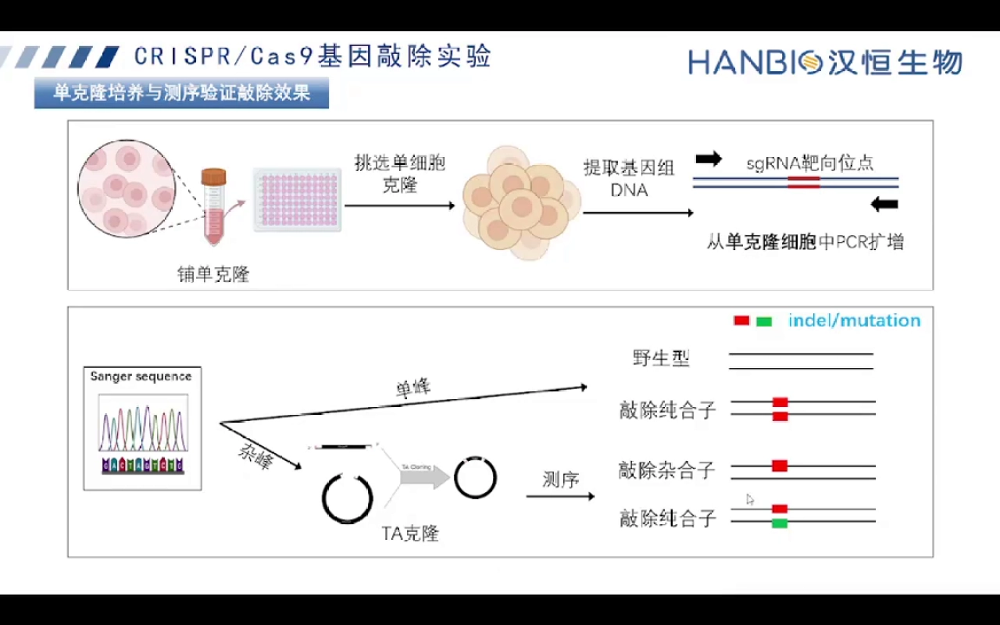

- **单峰**且与细胞基因组序列**完全一致** → **野生型克隆**（没敲成）；
- **单峰**但与基因组有差异（几个碱基缺失/插入）→ **敲除纯合子**，而且说明**两个等位发生了完全相同的编辑**（原片举例：都是 7 bp 缺失）；
- **杂峰** → 克隆里存在两种以上序列，需要做 **TA 克隆**，挑 **8–10 个**单菌落测序，弄清每个等位的编辑情况。[【跳转到 42:08】](https://www.bilibili.com/video/BV1oD421K7X4/?t=2528)

杂峰拆分后常见两类结果：**一）两个等位编辑不同但都被破坏** → 仍是敲除纯合子（原片举例：一个等位缺 10 bp、另一个缺 2 bp，都算纯合敲除）；**二）只有一个等位被编辑、另一个野生** → **敲除杂合子**，对大片段缺失（两条引物跨切点）来说，杂合子跑胶会同时看到野生型大条带与缺失型小条带，而纯合缺失往往只剩短条带——这也是后续 PCR 判读的基础。[【跳转到 42:58】](https://www.bilibili.com/video/BV1oD421K7X4/?t=2578)

### 11.2 第二层：PCR 判大片段缺失

NHEJ 并不总是只产生几个碱基的 indel——两条 sgRNA 同用、或单点切割后两端以远端序列连接时，会产生**数百 bp 甚至更大的片段缺失**，这类编辑在 Sanger 峰图里可能只表现为「杂峰」。所以要在切点**两侧各设计一条引物**扩增跨切点的片段：

- 野生型 → 一条较大条带（预期长度）；
- 大片段缺失纯合 → **明显变短的单一条带**；
- 杂合 → **两条带同时出现**。

换言之，测序说敲掉多少 bp，PCR 产物长度就该对得上——这是给测序结果做的「物理长度校验」。[【跳转到 41:18】](https://www.bilibili.com/video/BV1oD421K7X4/?t=2478)

### 11.3 第三层：WB 判「真的没有蛋白了」

**这是最关键的一层**，因为 mRNA 层面和蛋白层面常常对不上。原片用客户案例说明：某基因在 HepG2 中敲除后，RNA 定量显示 mRNA 基本消失，蛋白也完全检测不到；但**并不是所有敲除单克隆的 mRNA 都会完全消失**——[【跳转到 44:18】](https://www.bilibili.com/video/BV1oD421K7X4/?t=2658)

- 提前终止密码子引发的 **NMD 效率有限**，且与该终止密码子在编码区的位置有关；
- 若移码后**外显子被跳过**、剩余序列还能正常翻译，就可能**仍产生部分蛋白**（甚至是有功能的截短蛋白）。

所以原片的建议是：**多鉴定几个克隆，挑最合适实验的那个**，不要拿到第一个测序「纯合」的克隆就用。[【跳转到 45:08】](https://www.bilibili.com/video/BV1oD421K7X4/?t=2708)

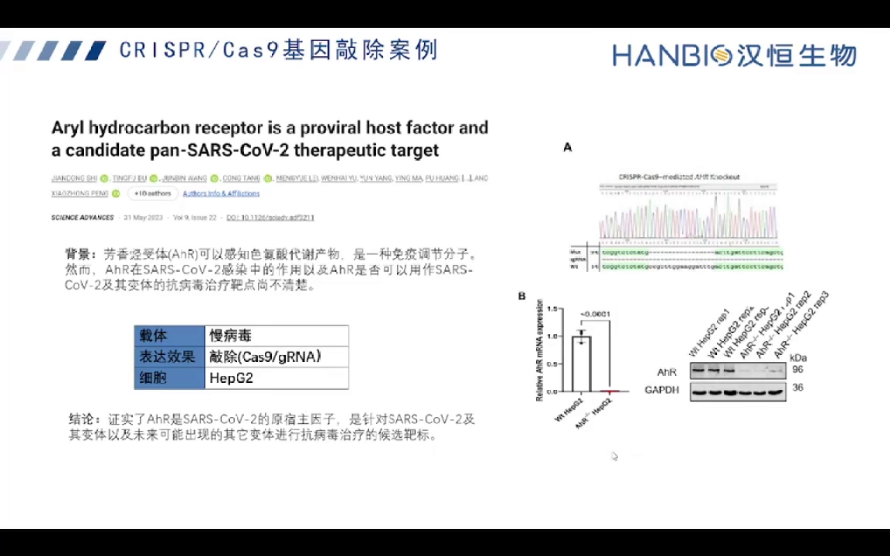

---

## 十二、案例与「三保一」：为什么一次要多做几条 sgRNA

**结论先行**：sgRNA 的有效性无法从评分完全预测，所以工程上的稳妥做法是**一次多测几条，用结果挑最好的一条**。

- **胃癌细胞系 NSUN2 敲除案例**：在胃癌细胞系敲除 **NSUN2**，再做**外源过表达回复实验**——回补野生型或突变体，看细胞功能表型是否恢复；回补野生型能救回、回补突变体不能，就说明表型确由该基因缺失造成。[【跳转到 45:22】](https://www.bilibili.com/video/BV1oD421K7X4/?t=2722)
- **三保一 sgRNA 的思路**：不是每条 sgRNA 都有效，所以同时构建 **3 条 sgRNA** 的质粒，小规模比较打靶效率后选最好的那条做单克隆——三条里通常至少有一条能切动。[【跳转到 45:46】](https://www.bilibili.com/video/BV1oD421K7X4/?t=2746)

（此后原片进入产品与活动推介，本文略。）

---

## 十三、问答里的高频困惑：六个值得记住的回答

原片后半段是直播答疑（价格与服务咨询类问题已略去）：

1. **巨噬细胞、CD4⁺ T 细胞好不好做敲除？** 看三件事：**好不好转染**、**单克隆生长能力**、**基因是否敲除致死**。这两类细胞转染效率都不高，原片判断「不太好做」，可优先考虑敲低。[【跳转到 47:32】](https://www.bilibili.com/video/BV1oD421K7X4/?t=2852)
2. **稳转的敲除效果是不是优于瞬转？** 不是。稳转/瞬转只影响**Cas9 与 sgRNA 怎么被表达**；一旦在基因组上完成编辑，编辑是永久的。真正决定成功率的是**转染效率**——哪种载体在你的细胞里转得进去，就选哪种。[【跳转到 50:13】](https://www.bilibili.com/video/BV1oD421K7X4/?t=3013)
3. **双质粒系统感染 Cas9-GFP，293T 包装时有荧光，目的细胞却看不到绿色荧光怎么办？** 两种可能：目的细胞**转染/感染效率低**；或者 **Cas9 蛋白与质粒都很大**，融合 GFP 后荧光偏弱、不好判读。解决办法是**单细胞分选**，或用**抗性筛选**来确定阳性细胞。[【跳转到 50:38】](https://www.bilibili.com/video/BV1oD421K7X4/?t=3038)
4. **只转 sgRNA 能不能实现稳定敲除？** 必须有 Cas9 同时存在；只要发生过基因组编辑，编辑就永久存在。[【跳转到 51:28】](https://www.bilibili.com/video/BV1oD421K7X4/?t=3088)
5. **在过表达稳转细胞上做敲除回复实验，sgRNA 要针对优化后的序列设计吗？** 要针对**你转进去的那段序列**设计。如果内源基因已不在、只表达外源（且做了密码子优化）的拷贝，sgRNA 就必须匹配载体上的序列，否则切不到。[【跳转到 52:43】](https://www.bilibili.com/video/BV1oD421K7X4/?t=3163)
6. **能不能直接转 Cas9 蛋白？** 可以，典型场景是**做基因敲除小鼠**：在受精卵/生殖细胞阶段转入 Cas9 蛋白与体外转录 sgRNA 组成的 **RNP 复合物**。常规细胞系一般还是用载体表达更省事。[【跳转到 54:48】](https://www.bilibili.com/video/BV1oD421K7X4/?t=3288)

---

## 小结

1. **敲低与敲除是两条线**：RNAi 动 RNA（可逆、可快速做），CRISPR 动 DNA（永久、不可逆）。敲除致死、与非编码基因重叠、只想做功能验证时，优先敲低。
2. **Cas9 只负责切，修复决定结果**：不引模板 → NHEJ → indel → 移码/提前终止 → NMD，这是敲除的默认路线；加模板走 HDR 是敲入，不是敲除。
3. **设计有两个硬约束**：切在编码区**前 5%–65%**，并落在**所有转录本共有**的外显子上。
4. **非编码 RNA 要按结构选路线**：lncRNA 有 PE1 双切、polyA 终止、最后内含子（BESST）三条路；miRNA 可破坏 Drosha/Dicer 位点或整体删除表达单元。每条都要评估「是否影响重叠基因」「是否还有下游起始位点」。
5. **抗性/荧光只筛转染，不筛敲除**：混合克隆里有四种命运的细胞，且瞬转系统的效果会随时间回复。
6. **先做两个劝退测试**：基因是否敲除致死（文献/功能/池效果回复/只拿到杂合子），细胞是否有单克隆生长能力（梯度稀释或流式分选）。
7. **初验只证明「切到了」**（T7E1、Sanger 杂峰），**终验才判「敲掉了」**：测序判纯合/杂合（杂峰走 TA 克隆挑 8–10 个）、PCR 判大片段缺失、WB 判无蛋白。
8. **一条 sgRNA 赌不起**：三保一多测几条；克隆也要多鉴定几个，挑最合适的用。

## 关键术语速查

| 术语 | 一句话解释 |
| --- | --- |
| shRNA / siRNA | 敲低工具；shRNA 构建进载体在细胞内加工，siRNA 是合成的双链直接转染 |
| morpholino | 不带电的 DNA 类似物，靠「挡路」抑制翻译起始或干扰剪接，斑马鱼上常用 |
| ZFN / TALEN | CRISPR 之前的蛋白剪刀：可编程 DNA 结合结构域 + FokI（需二聚体）切割 |
| sgRNA / gRNA | 由 crRNA 与 tracrRNA 融合成的向导 RNA；平时「设计 sgRNA」多指其中约 20 nt 的靶向序列 |
| PAM | Cas9 识别的邻近基序（常用 SpCas9 为 NGG），没有 PAM 就切不了 |
| NHEJ | 非同源末端连接，错误倾向修复，产生 indel，是敲除的主力 |
| HDR | 同源重组修复，需要供体模板，用于精确敲入（点突变、标签） |
| NMD | 无义突变介导的降解，清除带提前终止密码子的 mRNA |
| 混合克隆 / cell pool | 编辑后未单克隆化的细胞群体，每株细胞基因型都不同 |
| 单克隆（monoclonal） | 单个细胞扩增成的细胞株，基因型均一，才判得出纯合/杂合 |
| T7E1 | 识别并切割错配双链的酶，快速判断「有没有编辑」 |
| TA 克隆 | PCR 产物克隆后挑单菌落测序，用于拆解杂峰里的多种等位 |
| 三保一 | 同时构建 3 条 sgRNA，先比较效率，选最好的一条往下做 |
| RNP | Cas9 蛋白与 sgRNA 体外预组装的核糖核蛋白复合物，可直接导入受精卵 |
