# 从细菌免疫到一株敲除细胞系：一场 60 分钟的新生基因编辑培训

> **来源**：Bilibili《如何进行基因编辑 新生培训-王新栋@ZhangLab_XMU》，UP 主 ZhangLab_XMU（王新栋），时长 60:14，[BV1wW4y177ss](https://www.bilibili.com/video/BV1wW4y177ss/)。
> 本文属于 `content/虚拟细胞` 系列的「实验基础」部分：虚拟细胞要预测的是「扰动 → 表达谱」，而在湿实验里制造扰动的手段就是文库构建、载体构建、sgRNA 设计与基因敲除。这一篇是四类里最贴近 “把细胞真的改掉” 的一环。
> 讲者来自高校实验室，这是**给新生做的组内培训**，讲的是自己实验室做过的敲入/敲除案例，不是厂商的产品宣讲，所以技术判断（哪里容易翻车、哪些结论有反直觉）可信度较高。原片出现的试剂与仪器品牌名词，本文不复述。

## 本讲要解决的核心问题（SCQA）

**背景**：CRISPR/Cas9 已经是分子生物学最普通的工具，但新手走进细胞房时面对的是一连串没有标准答案的选择——用质粒还是 RNP？sgRNA 该设计在哪个外显子？T7E1 的胶为什么糊成一片？

**冲突**：这条流程里“能切”和“能拿到细胞株”是两件不同的事。切割只在几小时内发生，而拿到一株敲除或敲入的单克隆细胞要一两个月；中间任何一个环节（转染效率、筛选、引物设计）出错，看上去都像是“sgRNA 不行”，于是新手很容易在第一步就误判、反复换 sgRNA，把时间全部浪费掉。

**疑问**：一个新入组的学生，用什么顺序、盯住哪几个关键数字，才能把基因编辑从“原理图”变成“手里的一管细胞”？

**回答（中心思想）**：把基因编辑当成一条**五段流水线**而不是一次魔法——① 按实验目的选 sgRNA 与修复策略，② 选递送形式并验证它真的进了细胞，③ 用 T7E1 证明切割真的发生（且**先富集再鉴定**），④ 分离单克隆、用 PCR + 测序 + Western 三轮确认，⑤ 判断“能不能用”看的是脱靶与效率，而不是网站评分的绝对值。讲者反复强调的一句话是本文的主线：**大部分设计出来的 sgRNA 其实都是有用的，实验做不出来通常是前期条件没优化好。**（[【跳转到 59:00】](https://www.bilibili.com/video/BV1wW4y177ss/?t=3540)）

---

## 一、这条技术线的来路：从细菌的免疫系统到 2020 年的诺贝尔化学奖

**结论先行**：CRISPR 不是被“发明”出来的编辑工具，而是细菌用了几亿年的免疫系统，被人类搬进哺乳动物细胞后，才在十年内长成了一个产业。

**发现的三步**（[【跳转到 00:27】](https://www.bilibili.com/video/BV1wW4y177ss/?t=27)）：

1. **细菌里先被发现**。两位女性科学家（法国的埃马纽埃尔·卡彭蒂耶与美国的詹妮弗·杜德纳）最早在细菌内发现它能识别并剪切病毒 DNA。
2. **搬进哺乳动物细胞**。张锋把它正式应用于哺乳动物细胞并做了大量推广——正是这一步让 CRISPR 从微生物学课题变成全世界的实验室工具；他也因此率先获得 CRISPR/Cas9 编辑哺乳动物细胞的美国专利。
3. **认可与产业化**。2020 年，两位女科学家获得诺贝尔化学奖；而产业侧，从 2013 年到 2021 年，仅张锋一人就参与创立了差不多七家基因编辑公司。

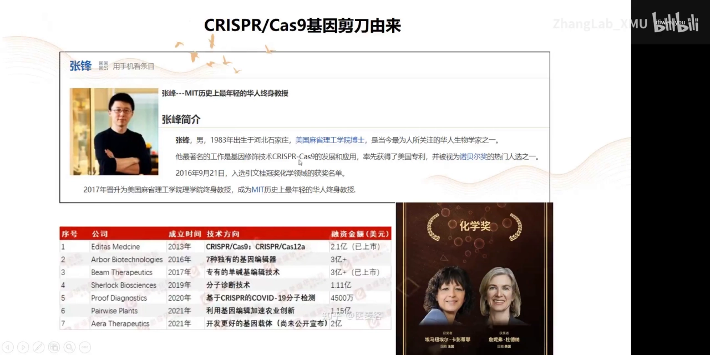

**这七家公司各对应一类技术方向**：基因编辑工具、单碱基编辑、分子诊断、农业育种、递送载体——也就是说，“编辑”本身已经不是瓶颈，**递送**与**场景**才是产业在抢的位置（第四节会再看到这一点）。

**这套免疫系统长什么样**（[【跳转到 01:39】](https://www.bilibili.com/video/BV1wW4y177ss/?t=99)）：已测序物种里约 40% 的细菌、90% 以上的古细菌都能找到 CRISPR 基因座，一个细菌里还可能有多个。机制是“存档—调档—剪切”：

- 外来的病毒或质粒 DNA 被 Cas 核酸酶切下一小段，作为**间隔序列（spacer）**插进 CRISPR 位点（由保守的**重复序列**隔开）——相当于给自己建了一个病毒特征库；
- 这个位点转录出 **crRNA**，负责识别新进来的同款 DNA；
- 后来发现还有一条起支架作用的 **tracrRNA**，它与 crRNA 配对、同时结合 Cas 蛋白，两者共同组成“引导 RNA”，把 Cas9 带到靶点并实施双链切割。

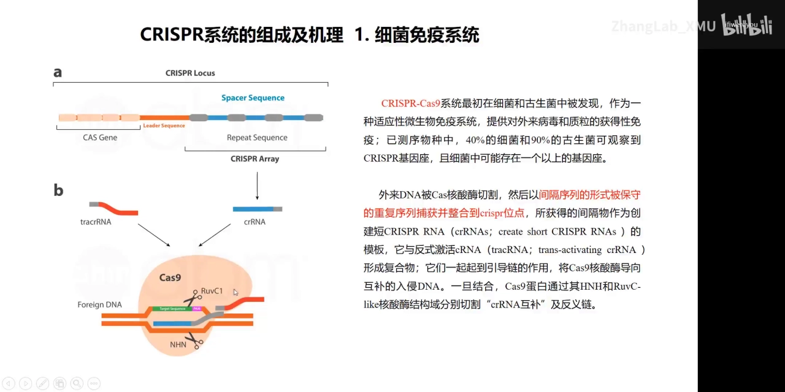

这套天然系统有三个部件：**Cas9 蛋白**、**crRNA**、**tracrRNA**。工程化的关键一步，是把后两者缝成一条分子——这就是下一节的 sgRNA。

## 二、一次切割由三件事决定：两个核酸酶结构域、一条 20 nt 的引导序列、一个 PAM

**结论先行**：Cas9 本身没有“找靶点”的能力，它靠 sgRNA 的 20 个碱基做 RNA–DNA 配对来定位，靠 RuvC 和 HNH 两个结构域各切一条链，而“能不能切”的入场券是靶点旁边的 PAM 序列。

**结构**（[【跳转到 02:54】](https://www.bilibili.com/video/BV1wW4y177ss/?t=174)）：Cas9 有两个核酸酶切割结构域——**RuvC** 与 **HNH**，分别切非靶标链和靶标链，各断一次才形成双链断裂（DSB）。这一点在讲 dCas9 时会很重要：给这两个结构域各突变一个氨基酸，Cas9 就“只结合不切割”。

**从两条 RNA 到一条 sgRNA**（[【跳转到 03:19】](https://www.bilibili.com/video/BV1wW4y177ss/?t=199)）：把 tracrRNA 的支架功能和 crRNA 的识别功能合并，得到一条约 100 nt 的**单链引导 RNA（sgRNA）**。它的 5' 端最后 20 个碱基是“归位装置”，通过碱基配对把 Cas9/sgRNA 复合物拉到靶位点；剩下的骨架负责把 Cas9 抱住。今天的实验只需要合成这一条 RNA，或者一段编码它的 DNA。

**PAM 是硬约束**（[【跳转到 03:44】](https://www.bilibili.com/video/BV1wW4y177ss/?t=224)）：Cas9 不会结合任意序列，它需要靶点旁边有一个 **PAM（protospacer adjacent motif）**。本实验室主要用 **SpCas9**（化脓性链球菌来源），识别 **5'-NGG**，也就是“任意 20 nt + NGG”就能被切开，所以它的可用位点非常密；不同菌株、不同 Cas 蛋白的 PAM 各不相同（例如金黄色葡萄球菌来源的 SaCas9 就不同），这直接决定了某个位点是否“有 sgRNA 可选”。

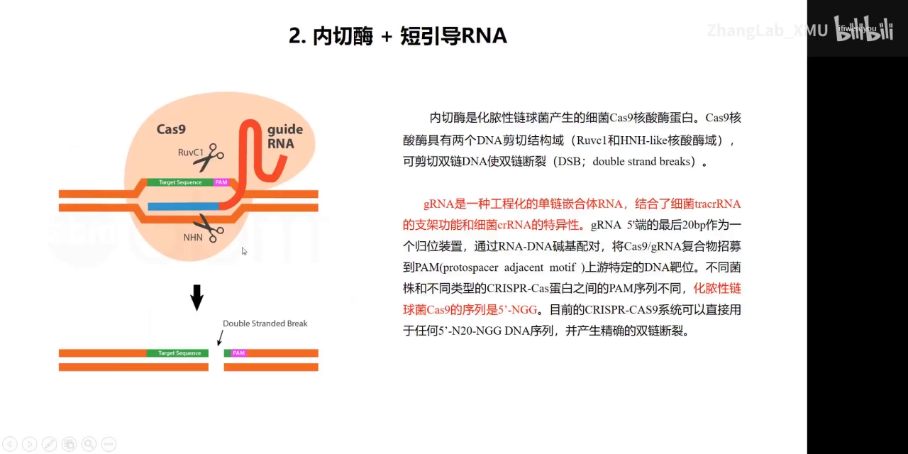

**给初学者的三个数字**：引导序列 20 nt、PAM 为 NGG、SpCas9 全长为 1368 个氨基酸（[【跳转到 23:21】](https://www.bilibili.com/video/BV1wW4y177ss/?t=1401)）——它们分别决定了位点怎么挑、能不能切、蛋白好不好纯化。

## 三、切完之后由细胞决定命运：NHEJ 造敲除，HDR 造敲入

**结论先行**：Cas9 只负责“剪断”，剪断之后走哪条修复通路不是你能选的、但**可以被偏向**：走非同源末端连接（NHEJ）就得到随机的插入缺失，走同源定向修复（HDR）就得到精准替换或插入。你的实验目的，其实是在选修复通路。

**NHEJ：不精准，但随时可做**（[【跳转到 04:34】](https://www.bilibili.com/video/BV1wW4y177ss/?t=274)）

- Ku70–Ku80（KU）先结合到平末端或近似平末端上启动修复，这种结合会**主动阻止**同源重组相关的酶靠近（这就是 NHEJ 活跃时 HDR 效率低的原因）；
- KU 招募 DNA-PKcs 促进两端联会，再招募末端处理与连接相关蛋白；
- 最后由 **XRCC4–DNA ligase IV–XLF** 完成连接，过程中碱基被聚合酶和核酸酶随机加一点、去一点，于是相对原始序列有了少量插入或缺失（indel）。

正因为它“随机”，在编码区制造移码突变就足以毁掉一个基因的功能——这就是**敲除（knockout）**的分子基础；也正因为它随机，它不能用来做精确插入。

**HDR：精准，但挑时间**（[【跳转到 05:24】](https://www.bilibili.com/video/BV1wW4y177ss/?t=324)）：HDR 主要发生在细胞周期的 **S/G2 期**，需要同源模板，过程是：

1. **MRN（MRE11–RAD50–NBS1）**复合物先结合断点，驱动末端做 5'→3' 切除；
2. 核酸外切酶 **EXO1** 与 ATP 依赖的解旋酶/核酸酶 **DNA2/BLM** 在远端继续切除，露出 3' 单链尾巴；
3. **RPA** 结合单链形成核蛋白丝，核蛋白丝负责搜索同源模板并完成单链侵入；
4. 形成 **D-loop（置换环）**——就是分子生物学课本上的 Holliday 交叉结构；最后由分解酶处理交叉，把模板上的序列精准地写进断点。

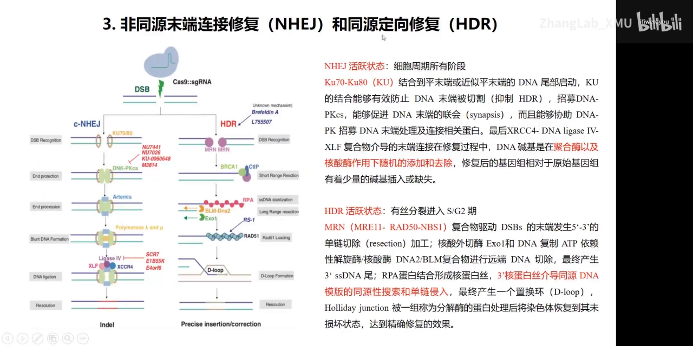

**这张图还给了一条实用信息**：图里沿两条通路标出了一串小分子——有抑制 NHEJ 关键激酶的，也有增强 HDR 的。这正是下一节“怎么把敲入效率提上去”的抓手。

**为什么要费力提升 HDR 效率**：因为敲入（knock-in）只能靠 HDR，而它的效率天然低于 NHEJ。讲者给出四类优化思路（[【跳转到 12:24】](https://www.bilibili.com/video/BV1wW4y177ss/?t=744)）：

1. **药物偏置**：抑制 NHEJ 相关因子，或加入增强 HDR 活性的药物；
2. **细胞周期同步**：调整断裂发生的时间窗，让它落在 HDR 最活跃的 S/G2 期；
3. **把三个部件“捆”成一个整体**：给 sgRNA 做链霉亲和素修饰、给修复模板做生物素化修饰，让 Cas9–sgRNA–模板先在体外抱成一团；或把 Cas9 与特定蛋白融合、再修饰 sgRNA/模板，使它们在空间上靠近。这类改造能显著提效，但**成本高、实验室里用得有限**；
4. **模板本身的设计变量**：单链还是双链、同源臂多长、线性还是环形——每个都会影响效率，取哪个看实验需求（[【跳转到 14:54】](https://www.bilibili.com/video/BV1wW4y177ss/?t=894)）。

最后还有一条最朴素的办法：对容易转染的细胞，用抗生素筛选或荧光标记分选把“已经编辑过的细胞”富集出来，用富集去弥补 HDR 的低效率（[【跳转到 15:19】](https://www.bilibili.com/video/BV1wW4y177ss/?t=919)）。这条思路在第八节被讲者发展成了一套完整流程。

## 四、递送决定成败：三种形式、四类载体

**结论先行**：CRISPR 的“编辑效率”在大多数时候不是化学问题而是物流问题——复合物再完美，进不了细胞核就等于零。选递送方式时要同时盯四件事：效率、细胞伤害、起效快慢、以及**是否会把外源 DNA 整合进基因组**。

**先分清“递送手段”和“递送形式”**。手段分三大类（[【跳转到 10:19】](https://www.bilibili.com/video/BV1wW4y177ss/?t=619)）：

- **物理方法**：电穿孔、显微注射。公司和临床应用上为了追求高效率常用这类办法，直接把核酸蛋白复合物送进细胞甚至细胞核；
- **化学方法**：用工程化改造的纳米颗粒或脂质纳米颗粒（LNP）包裹复合物，借脂质体的性质穿过细胞膜进入细胞；
- **生物学方法**：腺病毒、腺相关病毒（AAV）、逆转录病毒、慢病毒，甚至外泌体/细胞外囊泡（[【跳转到 11:09】](https://www.bilibili.com/video/BV1wW4y177ss/?t=669)）。

形式则只有三种（[【跳转到 11:34】](https://www.bilibili.com/video/BV1wW4y177ss/?t=694)）：**质粒 DNA**（递送编码 Cas9 的 DNA）、**mRNA**（递送编码 Cas9 的 RNA）、**RNP**（把纯化好的 Cas9 蛋白与 sgRNA 在体外先组装成复合物直接递送）。三种形式的关键差别可以压成一张表：

| 维度 | 质粒 DNA | Cas9 mRNA | RNP（蛋白 + sgRNA） |
| --- | --- | --- | --- |
| 需要细胞内转录 | 是 | 否 | 否 |
| 需要细胞内翻译 | 是 | 是 | 否 |
| 起始时间 | > 8 h | 4–6 h | 立即（3 h 内即可检测到编辑） |
| 持续时间 | 7–10 天 | 3–5 天 | 24 h 达平台，48 h 大部分降解 |
| 基因组整合风险 | 有 | 无 | 无 |
| 脱靶风险 | 高 | 低 | 低 |

（表中定量部分来自幻灯片，RNP 的时间线来自讲者的口述：[【跳转到 21:01】](https://www.bilibili.com/video/BV1wW4y177ss/?t=1261)。）

**物理递送内部的取舍**很直观：电穿孔效率高但细胞伤害也大，适合干细胞、T 细胞这类难转染细胞；显微注射对胚胎细胞几乎无化学干扰，但通量极低、技术要求最高。

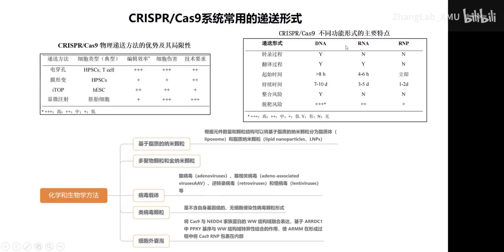

**一句话记住结论**：**要“只编辑一次、不留痕”用 RNP；要“省事、能长期筛选”用质粒**。质粒的整合风险在实验室里通常被认为影响不大——它会随细胞代谢传代被稀释掉（[【跳转到 56:55】](https://www.bilibili.com/video/BV1wW4y177ss/?t=3415)）；但治疗级或要求极低脱靶的场景，RNP 是更干净的答案。

## 五、sgRNA 设计：工具怎么用，以及一个新手最容易犯的坐标错误

**结论先行**：设计 sgRNA 只需三步（选序列 → 选位点 → 选载体），工具也只需一个够用的网站；真正的坑不在评分，而在**你喂给网站的那段序列对不对**。

**第一步：先想清楚实验目的**。实验室里常见的应用是敲入、敲除、插入突变、敲低、过表达（[【跳转到 16:09】](https://www.bilibili.com/video/BV1wW4y177ss/?t=969)）。目的不同，sgRNA 该落在基因的哪个位置就不同——敲除要落在靠前的外显子，敲入要落在插入位点附近（第九节展开）。

**第二步：选工具**。综述统计目前可用的 sgRNA 设计网站超过 30 个，讲者只推荐两个：

- **CHOPCHOP**：直接输入目标基因名、选择应用类型，网站自动评分并给出多个候选 sgRNA（[【跳转到 16:59】](https://www.bilibili.com/video/BV1wW4y177ss/?t=1019)）。
- **IDT**：讲者更常用。好处是**不需要基因名**，粘一段 DNA 序列进去就行——路径是 Tools → Custom Cas9 crRNA design → 选物种 → 粘贴序列 → Design（[【跳转到 17:49】](https://www.bilibili.com/video/BV1wW4y177ss/?t=1069)）。

**第三步：读懂评分图**。IDT 返回若干候选 sgRNA 和一张二维散点图，两轴分别是**脱靶潜力**与**靶向潜力**：越靠白色区域（靶向高、脱靶低）越该优先选，红色区域则“可能不工作”或“可能脱靶”（[【跳转到 19:12】](https://www.bilibili.com/video/BV1wW4y177ss/?t=1152)）。

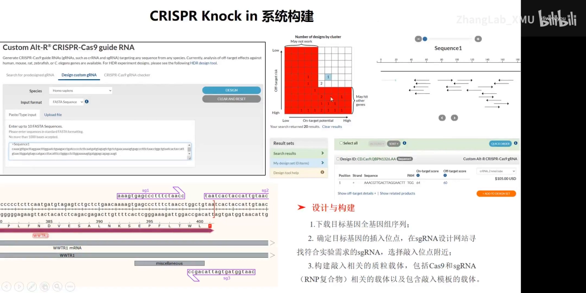

**最容易犯的错误：拿外显子序列去设计**。讲者把这条单独拎出来强调（[【跳转到 19:37】](https://www.bilibili.com/video/BV1wW4y177ss/?t=1177)、[【跳转到 20:02】](https://www.bilibili.com/video/BV1wW4y177ss/?t=1202)）：

> 做敲入或任何编辑操作，**一定要下载目标基因的全基因组序列，绝对不能只下载外显子区域**。

原因很朴素：真核基因由外显子和内含子交替组成，转录后内含子会被剪掉，所以基因组上的真实坐标与 mRNA 上的坐标不是一回事。你如果用外显子/mRNA 序列去设计 sgRNA，得到的位置在基因组上是错的，PAM 也可能根本不存在。另外，如果要在蛋白的 N 端或 C 端做敲入（比如加标签），必须**在终止密码子或起始密码子周围**挑 sgRNA，而不是随便挑评分最高的那条。

**一个反直觉的结论，先说在这里**：不同网站的评分经常互相矛盾，某个位点评分很低，你纠结半天以为“这条路走不通”。讲者的经验是——**经过大量实验验证，sgRNA 几乎都是能用的**，评分差异主要体现为脱靶概率和效率高低；如果实验必须落在那一个位点，不要因为评分低就放弃（[【跳转到 57:45】](https://www.bilibili.com/video/BV1wW4y177ss/?t=3465)）。这条结论为什么成立，见第七节关于 T7E1 的那个坑。

## 六、RNP 路线走一遍：体外转录、蛋白纯化、体外切割、电转验证

**结论先行**：RNP 是“最干净但最重”的一条路线，它把四件事都压到你自己手上——做 sgRNA、纯化蛋白、验证蛋白活性、摸索电转条件。四步任何一步松松垮垮，最后都会被误读成“sgRNA 没用”。

**6.1 sgRNA 从哪来：公司合成，或者自己体外转录**（[【跳转到 21:51】](https://www.bilibili.com/video/BV1wW4y177ss/?t=1311)）

自己做的流程是“酶切—连接—扩增—转录—纯化”五步：用 IIS 型限制酶切开 sgRNA 表达载体（实验室用带 T7 启动子的 pUC57-sgRNA 一类载体），接进设计的 sgRNA 双链，PCR 扩出“T7 启动子 + sgRNA”这一段，用 T7 RNA 聚合酶体外转录，再做常规 RNA 纯化。T7 的好处是快：0.5 µg 模板可产出 150–200 µg RNA，还能在底物里掺修饰核苷酸（例如做生物素标记，用于第三节的“捆成一团”策略）。

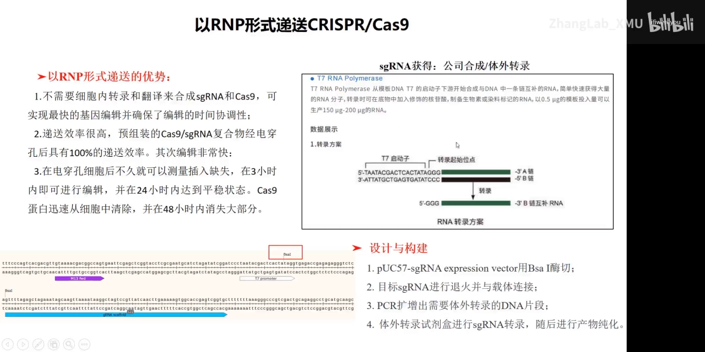

**6.2 Cas9 蛋白要自己纯化时，注意两件事**（[【跳转到 23:46】](https://www.bilibili.com/video/BV1wW4y177ss/?t=1426)）

- 这个蛋白最终要进细胞，所以**必须去掉它原本结合的细菌核酸和内毒素**，至少要过两根以上的纯化柱；
- 纯化完不要直接上细胞，**先做体外活性检测**。

**6.3 体外切割：一个够用的数字**（[【跳转到 24:36】](https://www.bilibili.com/video/BV1wW4y177ss/?t=1476)）：体外没有细胞里的干扰，蛋白和 sgRNA 不必多加，经验值是 **1 µM Cas9 切 200 ng 底物 DNA 完全够**。判断标准不是“切得干净”，而是**看到清晰的目的切割带**——切不完全很正常，有带就说明蛋白有活性、sgRNA 能靶向。

**6.4 电转条件必须先验证**（[【跳转到 31:48】](https://www.bilibili.com/video/BV1wW4y177ss/?t=1908)）：换一种细胞就要重新摸电转条件。讲者给的办法很实用：**先用 GFP 蛋白（不是质粒）做电转**，24–48 小时后消化、重铺到空板再看——背景荧光消失而细胞内部仍有明显绿色，就证明这组电压/电转液条件真能把外源蛋白送进细胞。这一步通了，才有资格谈 RNP 递送。

**6.5 上细胞的剂量与判读**（[【跳转到 33:03】](https://www.bilibili.com/video/BV1wW4y177ss/?t=1983)）：20 万个细胞配 **8–10 µM 的 Cas9/sgRNA 复合物**，足以让绝大多数细胞被编辑。验证时做浓度梯度（幻灯片里给的是 8 µM/10 µM、10 µM/12 µM、12 µM/14 µM 三组 Cas9/sgRNA），48 小时后提基因组、PCR、T7E1 酶切：只要切割发生，断裂就只能走 NHEJ，必然留下错配，于是 T7E1 会切出清晰的条带——**看到条带就说明系统通了**。

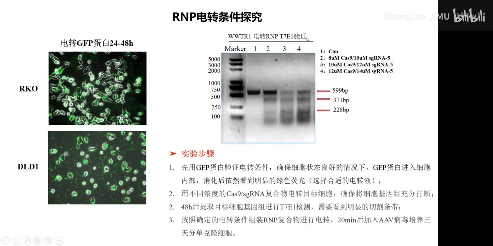

顺带把 RNP 的代价说清楚：速度是它的优势（3 小时内开始编辑、24 小时到平台、48 小时蛋白大部分降解，因此不会在基因组上留下额外插入），但它对基本实验技能要求最高——纯化蛋白、体外转录、摸电转条件，环环相扣，缺一环就卡住（[【跳转到 56:05】](https://www.bilibili.com/video/BV1wW4y177ss/?t=3365)）。

## 七、T7E1 鉴定的真实坑：条带不清 ≠ sgRNA 无效

**结论先行**：这是整场培训里最值钱的一条经验——**直接转染后马上提基因组做 T7E1，条带常常糊到无法判读，于是你会误判“这个 sgRNA 没用”；正确做法是先用嘌呤霉素做短程筛选，把没转进质粒的细胞淘汰掉，再提基因组鉴定。**

**7.1 T7E1 为什么能检测编辑**（[【跳转到 25:59】](https://www.bilibili.com/video/BV1wW4y177ss/?t=1559)）：T7 核酸内切酶 I 识别的是**不完全配对**的 DNA——错配、十字形结构、Holliday 结构、DNA 分叉点、异源双链都能切，切割位点在错配 5' 端的第一、第二或第三个磷酸二酯键。所以只要细胞里发生了 NHEJ 造成的 indel，你把 PCR 产物变性再退火，就会得到“野生型/突变型”的异源双链，酶就能把它切开。完全匹配的同源双链不被切——这正是这个检测的阴阳性来源。

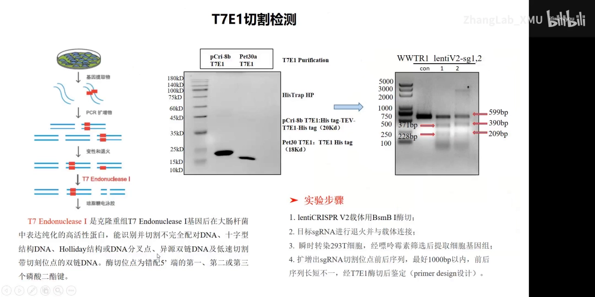

**7.2 标准流程**（幻灯片步骤，[【跳转到 26:49】](https://www.bilibili.com/video/BV1wW4y177ss/?t=1609)）：

1. 用 BsmBI 酶切 lentiCRISPRv2 载体；
2. 把目标 sgRNA 退火连接到载体上；
3. **瞬时转染 293T 细胞，经嘌呤霉素筛选后提取细胞基因组**；
4. 用 Primer-BLAST 在切割位点前后 **1000 bp 以内**设计引物并扩增（[【跳转到 28:29】](https://www.bilibili.com/video/BV1wW4y177ss/?t=1709)）；
5. PCR 产物变性、退火，与 T7E1 孵育，跑琼脂糖胶判读。

**7.3 讲者明确说“我不是特别建议”的那一步**：如果你为了省时间，转染 48 小时后**直接**提基因组做 T7E1，会看到条带不一定清晰（[【跳转到 27:39】](https://www.bilibili.com/video/BV1wW4y177ss/?t=1659)、[【跳转到 28:04】](https://www.bilibili.com/video/BV1wW4y177ss/?t=1684)）。原因有两个，都跟“编辑”本身无关：

- 转染效率不可能 100%，池子里混着大量**根本没拿到质粒**的细胞，它们的基因组是野生型，把信号稀释掉；
- 步骤多、变量多（质粒质量、转染试剂、细胞状态），你没法确认每一步都没出问题。

于是糊胶被读成“sgRNA 无效”，你就去换 sgRNA、重设计、再等一轮——这是最典型的时间黑洞。**解法**：lentiCRISPRv2 自带嘌呤霉素抗性，先做**短程**嘌呤霉素筛选，筛掉没转进质粒的细胞，再提基因组做 T7E1，条带会清晰得多。这也解释了第五节那个反直觉结论：**大部分 sgRNA 其实都有用**，是检测端的分辨率不够，让人误判了工具端。

**7.4 判读的具体例子**：目标片段 599 bp，酶切后出现 371 bp 与 228 bp 两条带（371 + 228 = 599），即发生切割。

## 八、敲入全流程：AAV 模板、单克隆分离与双荧光分选

**结论先行**：敲入的难点不在“切”，而在“**找到那一个被精准修好的细胞**”。所以整条流程的设计逻辑是：先把切割做实（RNP 电转 + T7E1 验证），再用合适的模板提高修复准确性（AAV2 单链模板），最后用最强的富集手段（双荧光分选）把阳性细胞的比例抬到你“分得出来”的水平。

**8.1 案例目标**：给 WWTR1 基因的 C 端加一个 Flag 标签（[【跳转到 29:01】](https://www.bilibili.com/video/BV1wW4y177ss/?t=1741)）。这个基因有 6 个外显子，敲入位点定在第 6 号外显子的终止密码子附近，也就是蛋白的 C 端。

**8.2 为什么修复模板用 AAV**（[【跳转到 30:16】](https://www.bilibili.com/video/BV1wW4y177ss/?t=1816)）：AAV 是单链 DNA 病毒，单链模板在基因组里只能走**同源重组**，因此错误率更低、精准修复效率更好。做法是把“上游同源臂 + 待插入序列（Flag）+ 下游同源臂”拼起来装进 AAV 载体再包装病毒。两个细节：哺乳动物细胞常用 **AAV2 型**；为保证包装效率与滴度，**建议同时做一个带荧光蛋白的对照病毒**，否则无法区分“没敲入”和“病毒根本没包装出来”（[【跳转到 31:06】](https://www.bilibili.com/video/BV1wW4y177ss/?t=1866)）。

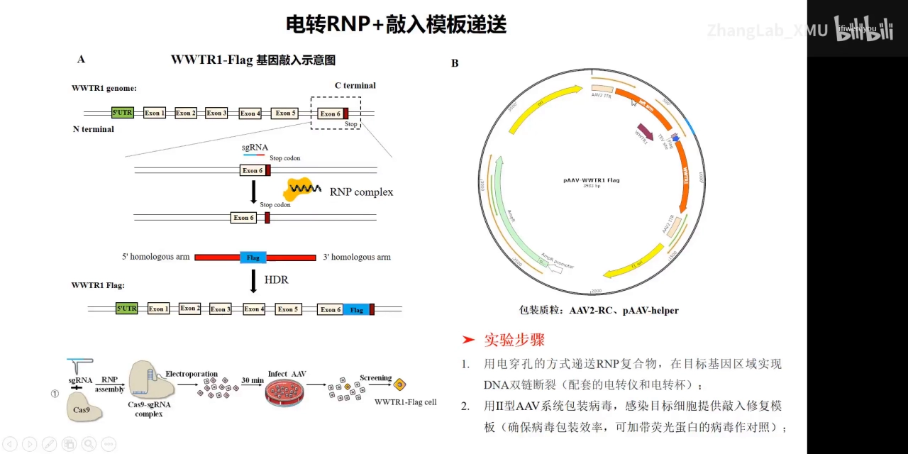

**8.3 完整时间线**（[【跳转到 34:34】](https://www.bilibili.com/video/BV1wW4y177ss/?t=2074)）：RNP 电转造成断裂（条件由第六节的梯度实验确定）→ 立刻加入提供模板的 AAV 病毒 → 约 3 天后铺 96 孔板做**单克隆分离** → 约 2 周后克隆长起，开始第一轮 PCR 鉴定。

**8.4 单克隆鉴定的三轮筛选**（[【跳转到 35:24】](https://www.bilibili.com/video/BV1wW4y177ss/?t=2124)）：

- **第一轮 PCR**（最关键的设计）：**上游引物落在同源臂上游（基因组侧），下游引物落在插入序列内部**——没敲入的细胞根本扩不出条带。讲者强调**要多设计几对引物**，让阳性条带明显、阴性彻底无带，避免污染或误差被读成阳性。
- **第二轮 测序**：把第一轮阳性的克隆扩增培养后，PCR 产物送测序，比对插入序列是否与设计完全一致。
- **第三轮 蛋白水平**：如果插的是标签序列，还要用抗标签抗体（本例为 anti-Flag）做 Western，确认蛋白真的表达出来了。

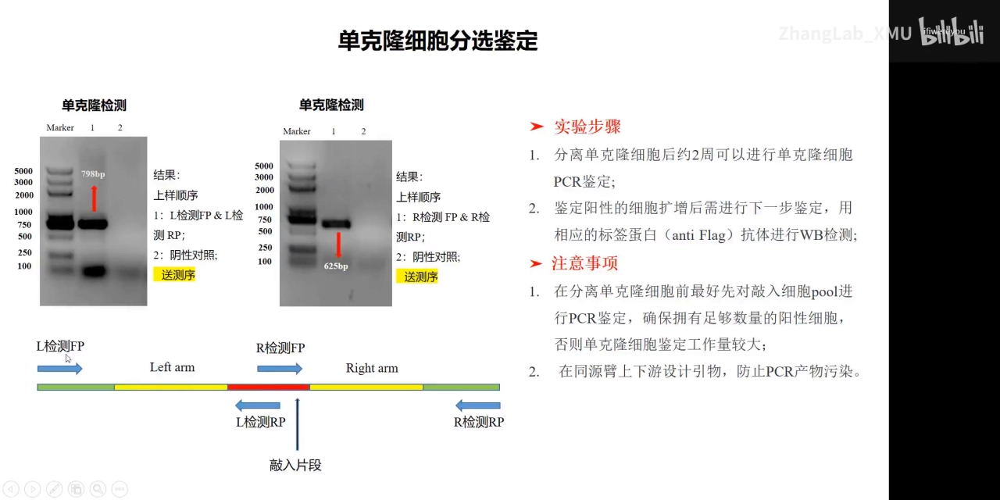

**8.5 两个“省一个月”的提醒**

- **分单克隆之前，先对细胞 pool 做一次 PCR 鉴定**（[【跳转到 37:29】](https://www.bilibili.com/video/BV1wW4y177ss/?t=2249)）。若库里阳性比例极低、甚至完全检不到，还硬分单克隆，这一个月大概率白做。挑克隆还有**运气成分**；运气不可控，就把可控项做扎实。
- **鉴定引物一定要跨在同源臂上下游**（[【跳转到 38:44】](https://www.bilibili.com/video/BV1wW4y177ss/?t=2324)）。敲入模板是质粒扩增出来的，引物若都落在模板内部，残留质粒会污染 PCR 给出假阳性。另外别只看 PCR：还要确认克隆的形态与状态正常，避免污染影响后续实验。

**8.6 讲者更推荐的替代方案：双荧光分选敲入系统**（[【跳转到 38:50】](https://www.bilibili.com/video/BV1wW4y177ss/?t=2330)）

思路是**让“编辑成功”变得肉眼可见**：

- **绿色报告切割**：让 Cas9 融合 EGFP（如 PX458 这类 Cas9–P2A–EGFP 载体）、sgRNA 与之同质粒表达——看到绿色就说明复合物确实进了细胞；
- **红色报告模板**：在修复模板前端加红色荧光蛋白（mCherry），报告模板的转染效率；
- **取双阳性**：用流式把 GFP⁺/mCherry⁺ 细胞分选出来，这一群里敲入比例显著提高。

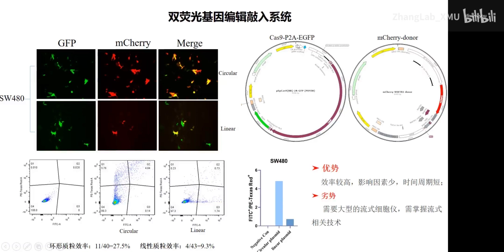

**模板用环形还是线性？讲者做过对比**（[【跳转到 40:55】](https://www.bilibili.com/video/BV1wW4y177ss/?t=2455)）：结果是**环形质粒 11/40 = 27.5%，线性质粒 4/43 = 9.3%**。线性模板理论上更“像”重组底物，但线性化质粒转染效率低、细胞存活受影响，综合下来环形反而更好。

**流式的代价与变通**（[【跳转到 41:20】](https://www.bilibili.com/video/BV1wW4y177ss/?t=2480)）：分选会伤细胞状态，效率低时有些细胞分选完就长不起来。变通办法是先把**大量双阳性细胞一起分到一个孔**，恢复后自行单克隆化；也可以直接分到 96 孔板，那样最快——**约一个月拿到阳性单克隆**。代价是需要大型流式分选仪与流式技术基础（[【跳转到 43:00】](https://www.bilibili.com/video/BV1wW4y177ss/?t=2580)）。

## 九、同一套工具的另外三种用法：敲除、敲入突变、转录调控

**结论先行**：Cas9 剪刀只有一把，但“切哪里、切完给不给模板、给不给核酸酶活性”这三个开关，能组合出四类用途。这一节把实验室里最常用的三类一次讲完。

**9.1 敲除（knockout）：把 sgRNA 放在最靠前的两个外显子上**

目标是让基因发生**移码突变、功能完全缺失**。设计原则很直接（[【跳转到 43:55】](https://www.bilibili.com/video/BV1wW4y177ss/?t=2635)）：

- sgRNA 尽量选在**靠前的外显子**；外显子多的话优先第 1、2 号外显子，以确保最大程度破坏基因；
- 要确认这个移码不会产生“还保留部分功能”的截短产物。

操作上比敲入简单得多：把 sgRNA 连进 lentiCRISPRv2、包装慢病毒感染目标细胞，**用嘌呤霉素筛选**——存活的基本都是整合了质粒的细胞，敲除效率因此大幅提高；随后单克隆分选，逐株鉴定出“确实移码而非原样”的细胞（[【跳转到 44:45】](https://www.bilibili.com/video/BV1wW4y177ss/?t=2685)）。

**9.2 敲入突变（knock-in mutation）：先让修复模板“躲开”自己的 sgRNA**

本质和 8.x 的敲入一样——切开、给模板、靠同源重组写进去——但要处理一个自相矛盾的问题：**sgRNA 会同时识别原始基因组和你提供的修复模板**，模板一进去就被切，修复失败（[【跳转到 46:50】](https://www.bilibili.com/video/BV1wW4y177ss/?t=2810)）。两个解法：

- **突变在外显子区**：对模板上 sgRNA 识别区做**同义突变**——改碱基但不改氨基酸，蛋白序列不受影响，而 sgRNA 已经认不出模板；
- **突变靠近内含子**：干脆把 sgRNA 设计在内含子区；如果还想进一步保护模板，可以**直接突变内含子区的 PAM 或 sgRNA 结合序列**，因为内含子不编码，随机改几个碱基不影响表达。讲者说这招他们试过，是可行的。

**9.3 不切割的 Cas9（dCas9）：一次双氨基酸突变，把剪刀变成路障**

如果我们不想改 DNA 序列，只想“调表达”，就要先废掉 Cas9 的核酸酶活性。做法是在 RuvC 和 HNH 两个结构域上各引入一个突变——**D10A** 和 **H840A**——得到的蛋白失去切割能力但仍保留结合 DNA 的能力，即 **dCas9（Dead Cas9）**（[【跳转到 48:55】](https://www.bilibili.com/video/BV1wW4y177ss/?t=2935)）。

**9.4 抑制：从单纯的空间位阻，到主动招募 KRAB**

第一代思路很朴素：sgRNA 把 dCas9 带到启动子/转录起始位点，复合物本身有体积，**空间上挡住转录因子**即可抑制（[【跳转到 48:30】](https://www.bilibili.com/video/BV1wW4y177ss/?t=2910)）。但效果并不特别好——只是“挡着”，不够主动。

于是有了 **dCas9-KRAB（CRISPRi）**：把 KRAB 融上去，由它**招募一批转录抑制因子**，在基因水平上直接压制转录（[【跳转到 50:10】](https://www.bilibili.com/video/BV1wW4y177ss/?t=3010)）。它相对传统 RNAi 的差别值得记住：

| | RNAi（敲低） | dCas9-KRAB（CRISPRi） |
| --- | --- | --- |
| 作用层面 | 细胞质，降解 mRNA | 细胞核，转录前抑制 DNA |
| 能否抑制非编码 RNA / miRNA / 反义转录本 / 核内 RNA | 难 | 可以，特异性高 |

**9.5 激活：从融合 VP64 到 SAM，再到直接融合**

既然能压，就能抬。激活系统迭代了三代（[【跳转到 51:25】](https://www.bilibili.com/video/BV1wW4y177ss/?t=3085)）：

1. **第一代 dCas9-VP64**：直接把激活因子 VP64 融上去，能激活但只有 **2–5 倍**；
2. **第二代 dCas9-SAM**：在 sgRNA 上装一段能结合 MS2 的 RNA 环（aptamer），MS2 又与 P65、HSF1 融合——一个位点可同时招募**一大批（幻灯片写作十余个）激活分子**，激活倍数升到**几千倍**，真正能做过表达；
3. **第三代 dCas9-VPR**：把 VP64、p65、RTA 等激活域直接融到 dCas9 上，效果与二代相当，但**只需一个质粒**。

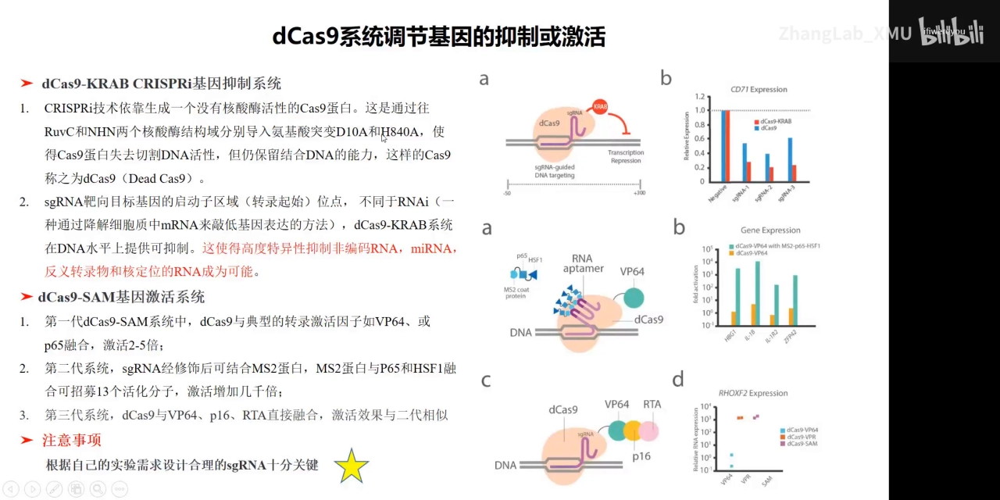

四类用途共享同一套“sgRNA 引导定位”的底座，区别只在于**切不切、给不给模板、带什么效应蛋白**（[【跳转到 48:05】](https://www.bilibili.com/video/BV1wW4y177ss/?t=2885)）。

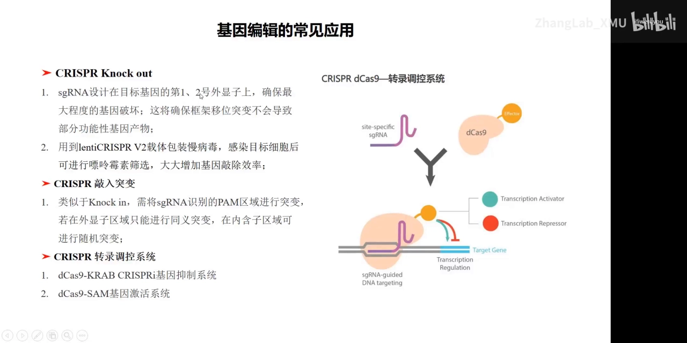

## 十、新生三问：要多久、门槛在哪、评分低还能不能用

**结论先行**：三个问题的答案都不是“看情况”，而是有明确经验值的：**1–2 个月**、**RNP 门槛高于流式路线**、**评分低基本都能用**。

**问题一：为什么非要用这套又麻烦、周期又长的策略？**（[【跳转到 53:35】](https://www.bilibili.com/video/BV1wW4y177ss/?t=3215)）

因为 CRISPR 是在基因组上做**精准切割或定点插入**，能最大程度保持细胞原本的状态，不会额外激活免疫系统或其他通路、把表型搅浑。TALEN 与 ZFN 早在 30 年前就出现了，但 CRISPR 凭低门槛、可编程把基因编辑推到了顶点。另一个常被低估的用途是**插标签**：很多目标蛋白没有好抗体、常规检测做不下去，插入标签后一大批实验立刻变得可行。

**问题二：拿到一株编辑过的肿瘤细胞要多久？**（[【跳转到 55:15】](https://www.bilibili.com/video/BV1wW4y177ss/?t=3315)）

以实验室现有条件、走荧光分选系统，**保守估计 1–2 个月**。两个变量会显著拉长周期：**细胞类型与生长速度**（单克隆从 1 个细胞长到可用的量本身就要时间，长得慢的细胞会拖死进度），以及验证的轮数（PCR → 测序 → Western）。两条路线的门槛也不同：

- **RNP 电转路线**：对基本实验技能要求高——纯化蛋白、体外转录 RNA、摸索电转条件，每个环节都必不可少且环环相扣；
- **流式荧光分选路线**：前期操作（转染、质粒构建与设计）经过一段时间培训后相对容易，但需要大型流式仪器、成本不低，还要掌握流式相关技术；它仍是传统质粒编辑，存在一定整合风险（影响通常不大，因为质粒会随细胞代谢、传代被稀释掉）。

**问题三：网站评分特别低，这个位点还能不能用？**（[【跳转到 57:20】](https://www.bilibili.com/video/BV1wW4y177ss/?t=3440)）

能。讲者说他自己曾为一个低评分位点纠结很久、以为做不下去，但**大量实验验证下来，sgRNA 几乎都是能用的**；不同网站的评分差异主要反映**脱靶概率**。真实情况是：设计 10 条 sgRNA，可能 9 条能打到想要的位点，也可能只有 2 条——所以**优先选高分**没错，但如果你不得不在那个位点做敲入，别因为评分而放弃。**前期条件优化好，一定做得出来，这通常不是 sgRNA 有没有作用的问题。**

回到最实际的一句总结（[【跳转到 59:25】](https://www.bilibili.com/video/BV1wW4y177ss/?t=3565)）：常规构建基因功能缺失的细胞，**CRISPR knockout 相对常规、容易**——保证质粒和病毒转染效率，再做好单克隆分选，基本都能拿到；**基因敲入稍复杂**，因为它依赖同源重组、效率偏低，但只要有耐心、分离的单克隆足够多，同样能拿到想要的结果。

## 小结

- **来路决定边界**：CRISPR 是细菌的适应性免疫系统（2020 年诺贝尔化学奖给的是发现者），把它搬进哺乳动物细胞才是通用工具的起点，而产业竞争已从“剪刀”转向“递送”与“场景”。
- **一次切割 = 蛋白 + 引导 RNA + PAM**：RuvC/HNH 各切一条链，sgRNA 5' 端 20 nt 负责配对定位，NGG 这类 PAM 是入场券。
- **修复通路决定你能做什么**：NHEJ 随机、随时可用 → 敲除；HDR 精准、只在 S/G2 活跃 → 敲入；提效抓手是药物偏置、周期同步、把三部件捆成一团与模板形式。
- **递送按四维度选**（效率、伤害、起效速度、整合风险）：“只编辑一次不留痕”用 RNP，“省事能长期筛”用质粒。
- **T7E1 的坑单独记一条**：直接转染后立刻提基因组，条带常糊到误判；先做短程嘌呤霉素筛选再提基因组，这是分辨率的差别，不是 sgRNA 的差别。同理，真正要担心的是**坐标**（必须用全基因组序列），而不是评分。
- **敲入靠富集、鉴定靠三轮**：AAV2 单链模板提高精准修复比例，双荧光系统（Cas9-EGFP 报切割、mCherry 报模板）把阳性细胞分选出来；单克隆按 PCR → 测序 → Western 三轮确认，第一轮引物必须跨在同源臂上下游，且分单克隆前先对 pool 做 PCR。
- **四类用途共享一个底座**：敲除、敲入突变、CRISPRi（dCas9-KRAB）、CRISPRa（VP64 → SAM → VPR），区别只在切不切、给不给模板、带什么效应蛋白。

## 关键术语速查

| 术语 | 一句话解释 |
| --- | --- |
| CRISPR 基因座 | 细菌基因组里“重复序列—间隔序列”交替排列的区域，相当于病毒特征库 |
| crRNA / tracrRNA | 前者负责识别靶 DNA，后者负责支架并结合 Cas 蛋白；工程化后合并为一条 |
| sgRNA | 单链引导 RNA，约 100 nt，5' 端 20 nt 决定靶向，其余骨架结合 Cas9 |
| PAM | 靶点旁边的短序列（SpCas9 为 5'-NGG），Cas9 结合与切割的硬性前提 |
| RuvC / HNH | Cas9 的两个核酸酶结构域，各切一条 DNA 链，共同造成双链断裂；SpCas9 与 SaCas9 的区别就在 PAM 与蛋白大小 |
| NHEJ | 非同源末端连接，全细胞周期活跃，修复时随机增删碱基 → 产生 indel → 造成敲除 |
| HDR | 同源定向修复，主要在 S/G2 期活跃，借助同源模板精准写入 → 造成敲入 |
| indel | 插入/缺失突变；落在编码区靠前位置时会造成移码，使蛋白功能彻底丧失 |
| RNP | Cas9 蛋白与 sgRNA 在体外预组装成的核酸蛋白复合物，递送快、无整合风险 |
| AAV | 腺相关病毒，单链 DNA 病毒；作修复模板时只能通过同源重组整合，错误率低 |
| T7E1 | T7 核酸内切酶 I，识别并切割错配/异源双链，用于检测编辑是否发生 |
| dCas9 | 带 D10A + H840A 双突变的 Cas9，只结合不切割，用于转录调控 |
| CRISPRi / CRISPRa | 基于 dCas9-KRAB 的转录抑制 / 基于 VP64、SAM、VPR 的转录激活 |
| 单克隆分选 | 把单细胞铺进 96 孔板长成克隆，再逐株鉴定是否为目标编辑，是拿稳定细胞株的必经步 |
