# CRISPR 文库筛选全流程：一次把两万个基因全部问一遍

> **来源**：Bilibili《【零基础入门】CRISPR 文库筛选全流程拆解：避雷指南 + 高效方案大公开》 · UP 主 艾迪基因（主讲 张旭 博士） · 时长 65:09 · [`BV16fLvz9Ezg`](https://www.bilibili.com/video/BV16fLvz9Ezg/)
> **系列**：`content/虚拟细胞` · 实验基础（补 Perturb-seq / 单细胞扰动数据在湿实验里怎么产生的前置知识）
> 原片是厂商直播课，开头有约 5 分钟公司介绍，中段与片尾有抽奖、代金券和课程预告，本文只整理技术内容，不复述这些段落。

## 本讲要解决的核心问题

**背景**：CRISPR/Cas9 之后，"敲掉一个基因、看它带来什么表型"已经是常规操作；基因组注释也早就做好了——哪段是外显子、哪段是内含子、启动子在哪，点几下鼠标就查得到。

**冲突**：人和小鼠大约有两万个蛋白编码基因，而一个研究生只有三年、一个课题组只够认真做几个基因。更头疼的是两条传统路线各有硬伤——**反向遗传学**（先选基因、再敲除、再看表型）在做完之前不知道这个基因有没有表型，猜错的成本是一整年；**正向遗传学**（随机突变、筛表型、再定位基因）靠运气，而且只抓得到"肉眼看得见"的显性表型。

**疑问**：能不能不猜？一次把两万个基因全部敲一遍，让细胞自己告诉我们，哪个基因和我们要的那个表型有关？

**回答（中心思想）**：CRISPR 文库筛选做的正是这件事——**把"一个细胞只装一条 sgRNA"做成混合细胞池，施加一次筛选压力，再用 NGS 读各条 sgRNA 丰度的涨落**，一次实验就把两万个基因与某个表型的关系全部测一遍；它同时拿到正向遗传学的"无偏"和反向遗传学的"精确"。它的门槛不在原理，而在四个卡点：**Cas9 稳转株的切割活性要 ≥80%、每个基因要设计 4–6 条 sgRNA、感染 MOI 必须压到 0.2–0.3、覆盖度/均一性和三个生物学重复要提前算明白**。这四件事里任何一件打折扣，后面半年的实验和测序钱都可能是白花。

---

## 一、为什么要做文库筛选：基因有两万个，时间只有三年

### 1.1 主线只有一个"基因—表型"，验证靠一正一反

不管教科书还是文献，生物学研究最后都落到同一个问题上：**基因功能和表型**（[【跳转到 04:45】](https://www.bilibili.com/video/BV16fLvz9Ezg/?t=285)）。做研究的标准动作是两头验证：先把基因去掉（缺失或敲除），看目标细胞、小鼠、植物出现什么异常表型；再把缺失的基因补回去，看表型能不能恢复（[【跳转到 05:40】](https://www.bilibili.com/video/BV16fLvz9Ezg/?t=340)）。一正一反两条证据凑齐，基因和表型的关联才算立住。

### 1.2 正向遗传学：先有表型，再回头追基因

二三十年前的标准做法是反过来的：用化学诱变剂或 X 射线处理样本，在全基因组里随机引入突变，然后去观察细胞、小鼠或植物出现了哪些和野生型不一样的表现，看到感兴趣的表型之后再回头定位是哪个基因坏了（[【跳转到 06:21】](https://www.bilibili.com/video/BV16fLvz9Ezg/?t=381)）。

这条路的好处是**无偏**，而且抓到的往往是重要发现——比如毛色变了、后代发育不起来了，这种一眼能看见的表型背后常常是关键基因（[【跳转到 08:26】](https://www.bilibili.com/video/BV16fLvz9Ezg/?t=506)）。坏处有两层：一是**只有"看得见"的表型才抓得到**，那些不那么显眼但同样有功能的基因就被漏掉了；二是**定位突变基因本身极难**——突变是随机落下的，早期基因组信息又不清楚，你并不知道它掉在哪个基因上（[【跳转到 06:46】](https://www.bilibili.com/video/BV16fLvz9Ezg/?t=406)）。

### 1.3 反向遗传学解决了定位，却把风险推给了"选错基因"

测序技术把基因组注释做全之后，操作方式可以调转过来：**基因序列我都清楚，直接定点敲掉它，再看表型**——这就是反向遗传学（[【跳转到 09:41】](https://www.bilibili.com/video/BV16fLvz9Ezg/?t=581)）。操作直观、定位不再是问题。

但代价换了位置：**动手之前你不知道这个基因有没有功能**。模型构建完了，很可能什么表型都没有。视频举的例子很扎心：凋亡调控的基因已经被研究了很多年，图上密密麻麻一大片（[【跳转到 10:27】](https://www.bilibili.com/video/BV16fLvz9Ezg/?t=627)）。今天的困境不再是"没有基因可研究"，而是进了实验室之后发现——基因序列都有，**到底该研究哪一个？** 靠文献报道去推断某个基因可能参与某个过程，说到底还是推断。

而试错的成本是按年计的：研究生一共三年，花三个月到半年构建一个细胞系，或者花一年做一个动物模型，做完发现没有表型、或者没有你关心的那个表型（比如想敲一个基因看凋亡，结果什么都没看到），时间已经过去一小半甚至一大半（[【跳转到 11:17】](https://www.bilibili.com/video/BV16fLvz9Ezg/?t=677)）。

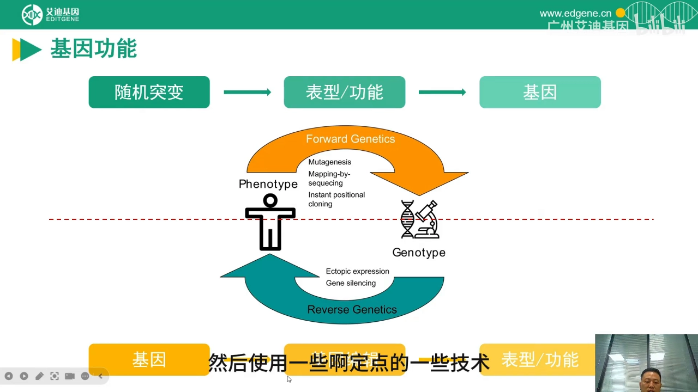

### 1.4 所以出路不是"更努力地猜"，而是"并行地测"

两条路线的短板恰好互补：正向缺"定位"，反向缺"筛选"。只要能**同时在成千上万个细胞里各敲一个不同的基因**，再一次性读出谁生谁死，就能把"逐个试"换成"并行测"。2012 年基因编辑技术被发明出来之后，这件事第一次变得可行（[【跳转到 11:42】](https://www.bilibili.com/video/BV16fLvz9Ezg/?t=702)）。

---

## 二、技术起源：Cas9 加上万个 sgRNA，每个细胞只装一条

### 2.1 三行推导：为什么"文库"能把两万个基因一次问完

2012 年底发明的 CRISPR/Cas9 只依赖两个元件：**Cas9 核酸酶**和 **sgRNA**（[【跳转到 01:31】](https://www.bilibili.com/video/BV16fLvz9Ezg/?t=91)）。sgRNA 分两段——前段是**可自由设计的 20 bp**，靠碱基互补配对靶向基因组；后段是**固定的 RNA 二级结构**，负责和 Cas9 结合成稳定复合体（[【跳转到 02:01】](https://www.bilibili.com/video/BV16fLvz9Ezg/?t=121)）。所以"换 20 bp 就等于换靶点"，比锌指、TALEN 都简单。切完之后细胞必须修好这道双链断裂：**非同源末端连接（NHEJ）**在切口引入短的插入/缺失，落在外显子编码区就造成移码、把基因敲掉；**同源重组（HDR）**在有同源模板时能精确修复，用来做定点插入（[【跳转到 03:07】](https://www.bilibili.com/video/BV16fLvz9Ezg/?t=187)）。关键在比例：肿瘤细胞、永生化细胞系这类常用宿主里 **99% 的切割都走 NHEJ**（[【跳转到 04:22】](https://www.bilibili.com/video/BV16fLvz9Ezg/?t=262)）——这既是"敲除容易"的原因，也是精确改碱基得另找工具的原因。

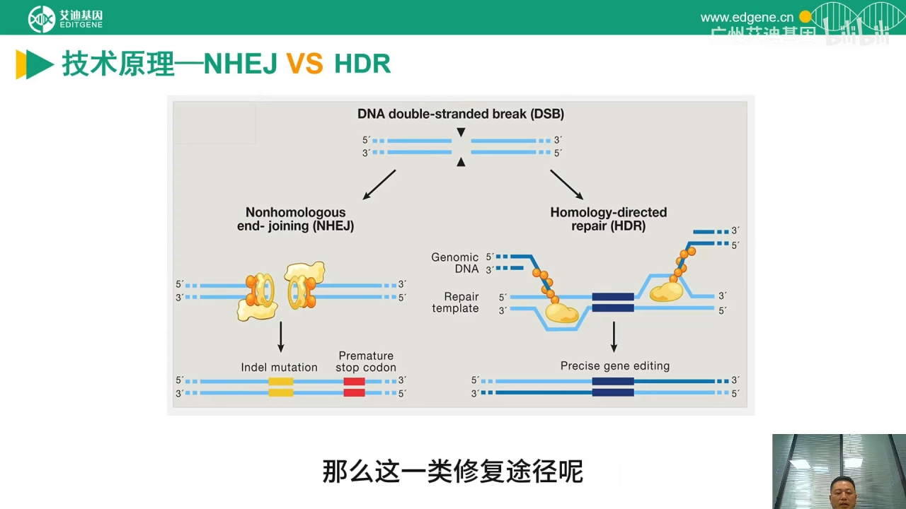

有了这一层，文库的逻辑就是三句话（[【跳转到 12:32】](https://www.bilibili.com/video/BV16fLvz9Ezg/?t=752)）：

1. **Cas9 + 1 条 sgRNA + 1 个细胞** = 针对一个基因做编辑；
2. **Cas9 + 上万个 sgRNA**，并且**让每个细胞只整合一条 sgRNA**；
3. 于是**在同一个细胞池里，上万个细胞各自被敲掉了一个不同的基因**——而人和小鼠总共也就两万个上下的基因（[【跳转到 12:57】](https://www.bilibili.com/video/BV16fLvz9Ezg/?t=777)）。

第 2 条里"每个细胞只整合一条"是整个技术的地基，也是后面 MOI 要压到 0.2–0.3 的唯一原因。这一点后文会单独讲。

### 2.2 它同时补上了正向与反向的短板

把这个池子建起来之后，只要你能**锚定自己的生物学问题**——比如"哪些基因是肿瘤细胞的必需基因""哪些基因突变后细胞会耐药"——就等于把"一个问题"和"两万个基因"做了一次完整对应（[【跳转到 13:57】](https://www.bilibili.com/video/BV16fLvz9Ezg/?t=837)）。正向遗传学"看不见的表型抓不到"的问题没有了（筛选压力是你自己设的），反向遗传学"猜错基因"的问题也没有了（不需要猜，全测）。

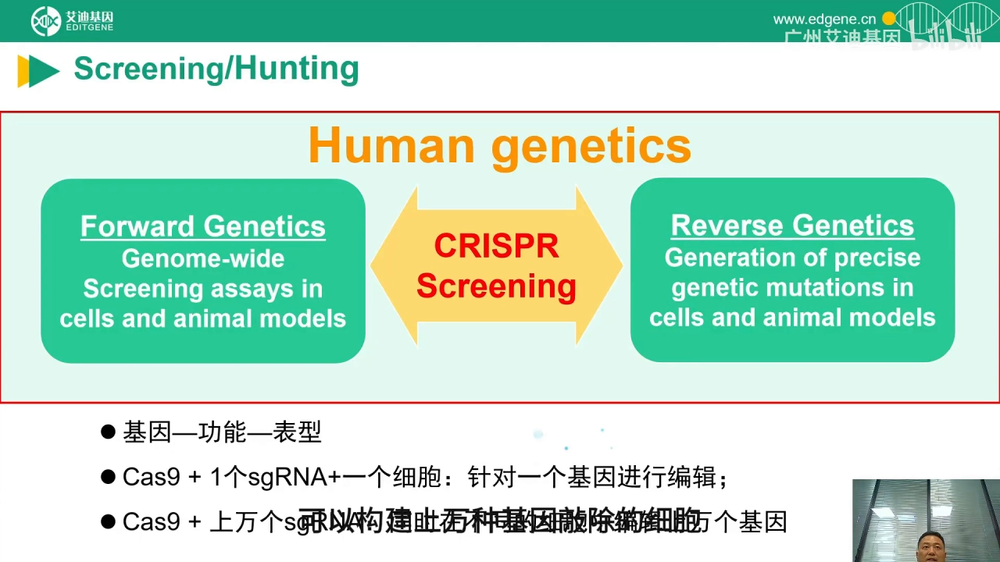

这项技术的源头通常被追到 2014–2015 年：华人科学家张锋与 Philip Sharp 等人在基因编辑技术之上做了关键拓展——既然想建立"基因—功能—表型"的规模化关联，能不能在**更大规模**上做？他们把这些尝试做成了论文（[【跳转到 12:07】](https://www.bilibili.com/video/BV16fLvz9Ezg/?t=727)），其中 2015 年发表在 *Cell* 上的那篇全基因组筛选（小鼠肿瘤生长与转移模型）是常被引用的起点。从这个节点起，CRISPR 文库筛选成为一种独立的技术门类。

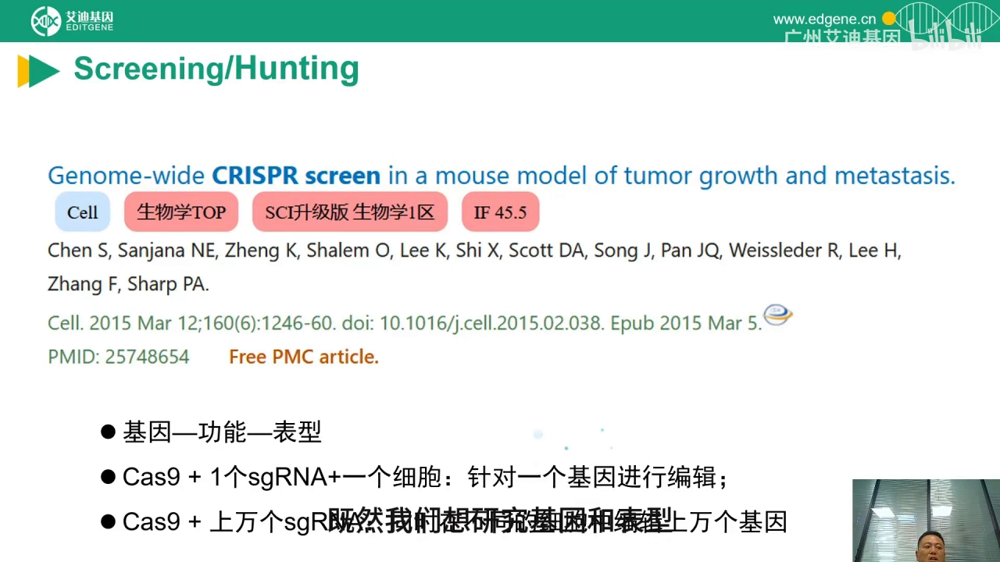

### 2.3 十年过去，它仍然是顶刊生产线

技术的外溢范围已经很宽：分子与细胞生物学、肿瘤研究、微生物学、医学遗传学、免疫学都在用（[【跳转到 14:39】](https://www.bilibili.com/video/BV16fLvz9Ezg/?t=879)）。主讲现场在 PubMed 上检索 "CRISPR screen"、剔除书籍章节与综述评论后，得到 **751 篇研究论文**，而且逐年递增（[【跳转到 15:01】](https://www.bilibili.com/video/BV16fLvz9Ezg/?t=901)）。

更值得看的是"落在哪"：他单把 **2025 年见刊的 65 篇**打开看，绝大多数仍是生物学与医学的顶刊、一区（[【跳转到 16:30】](https://www.bilibili.com/video/BV16fLvz9Ezg/?t=990)）。顶刊对创新性的要求高，这说明**这项技术出来十年，潜力仍然没被挖完**。

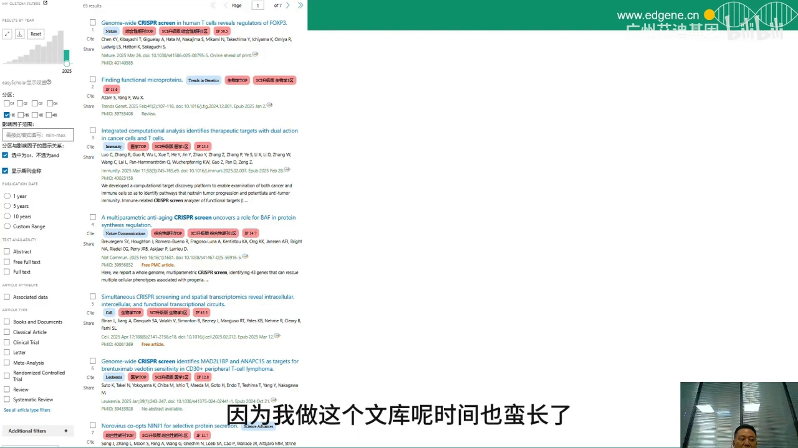

---

## 三、动手之前先定四件事：模型、扰动、压力、读出

### 3.1 课题设计的四个变量，以及 Pooled 与 Arrayed 两条路线

在开实验之前，需要把四个变量定下来（[【跳转到 17:48】](https://www.bilibili.com/video/BV16fLvz9Ezg/?t=1068)）：

| 变量 | 要决定什么 | 常见选项 |
| --- | --- | --- |
| **Model（模型）** | 用什么细胞承载文库 | 肿瘤细胞系、原代细胞、类器官、动物模型 |
| **Perturbation（扰动）** | 怎么改基因 | 敲除（KO）、干扰（CRISPRi）、激活（CRISPRa）、碱基编辑、先导编辑 |
| **Challenge（压力）** | 施加什么选择条件 | 加药、病毒感染/攻毒、代谢压力 |
| **Read-out（读出）** | 怎么把表型变成可测的数字 | 存活/增殖、流式分选、单细胞测序 |

同一组变量还能走两条工程路线：**Pooled（混合池）**把 sgRNA 混在一起转进一群细胞，靠筛选压力和测序读出；**Arrayed（阵列）**把每条 sgRNA 分到单独孔里逐孔测表型（[【跳转到 18:02】](https://www.bilibili.com/video/BV16fLvz9Ezg/?t=1082)）。前者通量高、成本低；后者表型读得更细，但受孔板限制。本文讲的是 Pooled。

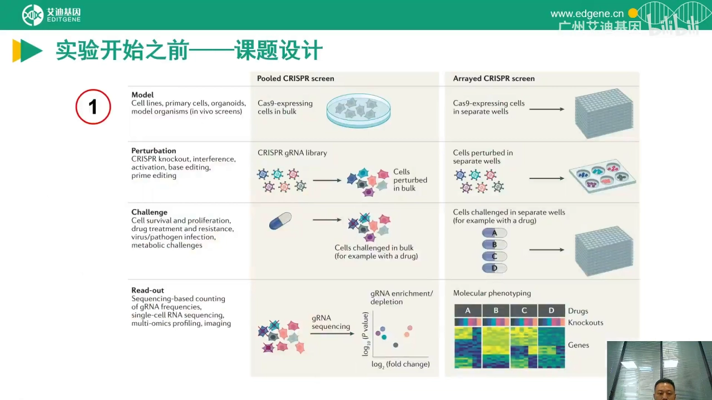

### 3.2 读出方式决定实验长什么样：增殖、流式，还是单细胞

**Read-out 最容易想浅。** 如果表型是"细胞活不活"——加药后敏感细胞死掉、耐药细胞继续增殖——读出就是最省事的**增殖与凋亡**（[【跳转到 20:26】](https://www.bilibili.com/video/BV16fLvz9Ezg/?t=1226)）。

如果表型是**细胞表面 marker 或分泌物的表达水平**，就上**流式分选**：把 marker 升高/降低的一群和不变的一群分开，各做下游分析（[【跳转到 21:16】](https://www.bilibili.com/video/BV16fLvz9Ezg/?t=1276)）。

但还有一类问题，眼睛看不出来、流式也分不出来——比如"哪些基因突变会改变某条代谢通路的表达谱""哪些基因通过什么途径调控髓系白细胞分化"（[【跳转到 21:41】](https://www.bilibili.com/video/BV16fLvz9Ezg/?t=1301)）。这类问题要换仪器：**单细胞测序**，它能同时读出每个细胞里一大批基因的表达，再按表达谱分组（[【跳转到 22:22】](https://www.bilibili.com/video/BV16fLvz9Ezg/?t=1342)）。这也是这套湿实验流程与 `content/虚拟细胞` 里那些 Perturb-seq 数据直接对接的地方——**Perturb-seq 本质就是"文库筛选 + 单细胞读出"**。

### 3.3 文库怎么选：全基因组还是亚文库，现货优先，敲除优先

定完 read-out，还要定文库本身（[【跳转到 22:41】](https://www.bilibili.com/video/BV16fLvz9Ezg/?t=1361)）。讲者的三条经验可以直接照抄：

1. **范围上，能用亚文库就不用全基因组。** 全基因组文库覆盖全部基因；亚文库只覆盖一部分，比如只做代谢基因、只做膜蛋白、只做转录调控因子（[【跳转到 23:06】](https://www.bilibili.com/video/BV16fLvz9Ezg/?t=1386)）。文库越小，同样细胞量下的覆盖度越高、每个基因的代表性越好。
2. **来源上，优先现货。** 现货文库经过验证、质控数据齐全，比从零设计省几个月。
3. **机制上，优先敲除（KO），其次干扰（CRISPRi），功能获得才用激活（CRISPRa）。** 因为敲除是对基因组序列的确定性改变，效率高；CRISPRi 作用在 mRNA 水平，思路类似过去的 RNAi 文库，筛选压力相对低一些（[【跳转到 23:31】](https://www.bilibili.com/video/BV16fLvz9Ezg/?t=1411)）。例外是**必需基因**和**非编码区元件**——敲掉必需基因细胞直接死，做不了筛选，这时反而要用 CRISPRi 做"调低而不归零"。至于功能获得类筛选，就要用 CRISPR 激活文库（[【跳转到 23:56】](https://www.bilibili.com/video/BV16fLvz9Ezg/?t=1436)）。

### 3.4 阳性筛选与阴性筛选：你关心的是活下来的，还是死掉的

这两个词在文献里出现频率极高，但定义必须拧清楚（[【跳转到 24:21】](https://www.bilibili.com/video/BV16fLvz9Ezg/?t=1461)）：

- **阳性筛选（positive selection / enrichment）**：施加压力，让**少数具有目的表型的细胞活下来**，然后看哪些 sgRNA 被**富集**——它们靶向的基因就是让细胞获得该表型（例如耐药）的关键基因。
- **阴性筛选（negative selection / depletion）**：关注的是**死掉的那一批**。哪些基因被敲掉之后细胞对药物更敏感、在增殖竞争中消失，这些 sgRNA 在测序结果里就会**丢失或丰度下降**（[【跳转到 24:46】](https://www.bilibili.com/video/BV16fLvz9Ezg/?t=1486)）。

一句话记法：**阳性看"谁变多了"，阴性看"谁不见了"。** 这两种筛选对覆盖度的要求差别很大，片尾 Q&A 会专门讲（见第九节）。

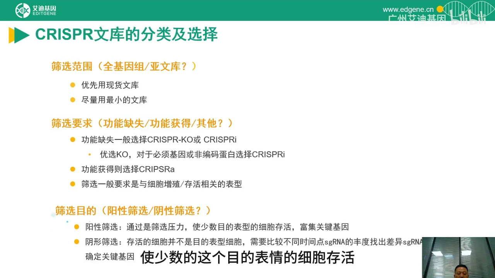

### 3.5 时间预算：这不是一个"两三个月能出结果"的实验

讲者给的整体周期判断是**大约 6 个月**，有的项目更长，前提还是"保质保量"（[【跳转到 25:18】](https://www.bilibili.com/video/BV16fLvz9Ezg/?t=1518)）。原因是流程环节多、质控点多：建 Cas9 株、扩增文库、包毒滴定、感染建池、加压筛选、测序分析，每一步都有等待期。所以课题开始前就要把这个周期放进计划里，别把它当成一个"顺手做的验证"。

---

## 四、第一步：Cas9 稳转株——活性不到 80%，后面全是白做

### 4.1 全流程只有六步，但每一步都有质控点

把流程摊开看其实很朴素（[【跳转到 26:34】](https://www.bilibili.com/video/BV16fLvz9Ezg/?t=1594)）：

1. **建 Cas9 稳转细胞株**（这是成败关键）；
2. **包装 sgRNA 文库慢病毒并感染细胞**，sgRNA 整合进基因组，各自敲掉对应基因；
3. **得到一个混合细胞池**——细胞 A 的 A 基因坏了，细胞 B 的 B 基因坏了，理论上每个细胞都不一样（[【跳转到 26:39】](https://www.bilibili.com/video/BV16fLvz9Ezg/?t=1599)）；
4. **施加 challenge**：加药、攻毒，或按设计做其他刺激（[【跳转到 27:04】](https://www.bilibili.com/video/BV16fLvz9Ezg/?t=1624)）；
5. **等表型出现**：细胞死掉、形态变化、某条通路表达谱改变（[【跳转到 27:29】](https://www.bilibili.com/video/BV16fLvz9Ezg/?t=1649)）；
6. **NGS 测序 + 生信分析**，用 sgRNA 丰度反推它靶向的基因（[【跳转到 27:54】](https://www.bilibili.com/video/BV16fLvz9Ezg/?t=1674)）。

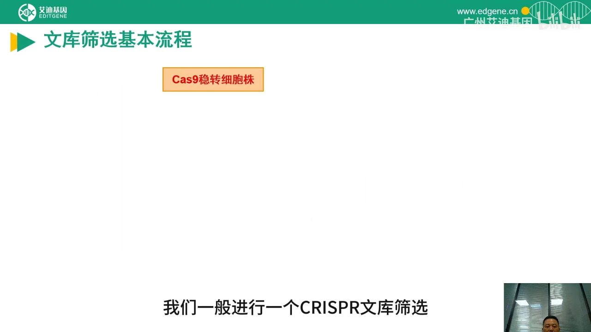

第 6 步里的"间接"两个字很重要：你测的**不是基因、不是蛋白，而是 sgRNA 这条条形码的 read 数**。整条流程的所有设计，本质上都是为了保住"条形码丰度"和"细胞命运"之间的对应关系不被污染——一旦某个细胞里装了两条 sgRNA，或者某条 sgRNA 在文库扩增时丢了大半，这个对应关系就断了。

### 4.2 为什么用双质粒系统，以及 Cas9 株怎么建

实验室常用的是**双质粒系统**：Cas9 和 sgRNA 分别在两个载体上，而不是塞进同一个载体（[【跳转到 28:19】](https://www.bilibili.com/video/BV16fLvz9Ezg/?t=1704)）。好处很实际——Cas9 一次建好可以长期复用，换筛选项目时只换 sgRNA 文库；代价是多了一步"先建 Cas9 株"。

建株流程是标准的四步：**Cas9 慢病毒包装 → 用不同 MOI 的病毒量感染靶细胞 → 药物筛选拿到 Cas9 阳性细胞 → 评估切割活性**（[【跳转到 28:24】](https://www.bilibili.com/video/BV16fLvz9Ezg/?t=1729)）。

### 4.3 活性评估：不要看表达量，要看"切得动不动"

这是全片最实用的一条经验：**不要用 qPCR 或 Western blot 去判断 Cas9 株行不行**。因为 Cas9 蛋白的表达水平和它的切割活性之间，经常没有直接对应关系（[【跳转到 28:49】](https://www.bilibili.com/video/BV16fLvz9Ezg/?t=1729)）。表达量高但活性低的株，做筛选会得到一堆假阴性。

正确的做法是拿几条**常用 sgRNA**（例如靶向 B2M 的 sgRNA）直接感染候选 Cas9 株，然后测这几条 sgRNA 的实际切割效率（[【跳转到 29:14】](https://www.bilibili.com/video/BV16fLvz9Ezg/?t=1754)）。图上左下角是测序原始峰图、右边是分析出的 indel 比例（[【跳转到 29:39】](https://www.bilibili.com/video/BV16fLvz9Ezg/?t=1779)）。

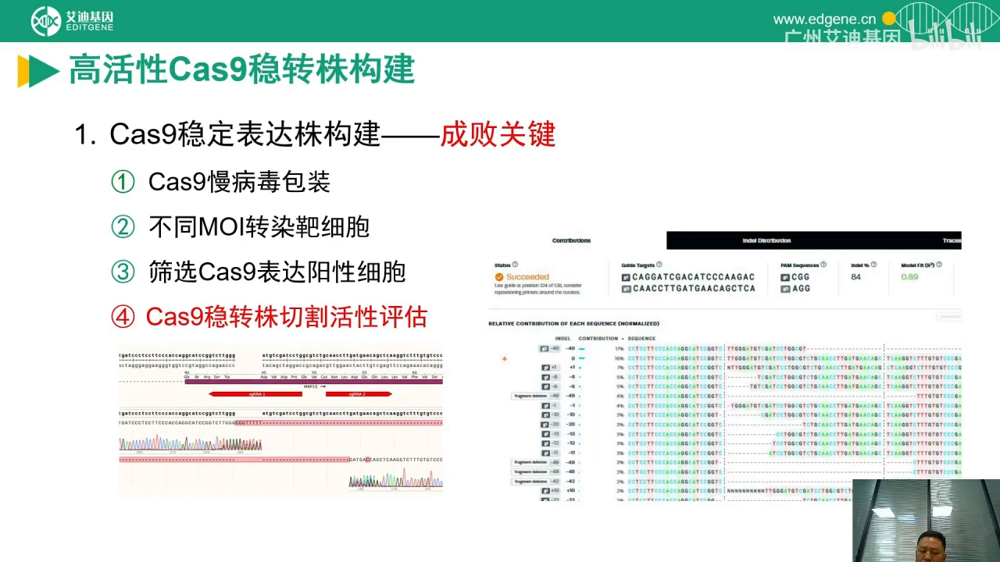

**门槛是 80%**：讲者的做法是让 Cas9 株的切割活性、敲除效率做到 80% 以上，才进入下游实验（[【跳转到 30:04】](https://www.bilibili.com/video/BV16fLvz9Ezg/?t=1804)）。理由不难推：文库筛选的信号是"某个基因被敲掉后细胞活/死"，如果敲除效率只有一半，等于给每个基因的效应打了五折，弱效应直接沉到噪音里。

### 4.4 达不到 80% 怎么办：能救，但要加严

现实里有些细胞就是上不去——不管怎么调 MOI，活性都很难到 80%，这可能和该细胞自身的 DNA 修复通路特性有关（[【跳转到 30:29】](https://www.bilibili.com/video/BV16fLvz9Ezg/?t=1829)）。这种情况并非不能用，但后面每一步要**控制得更严格**（重复数、覆盖度、筛选压力都要加码）。有得选的时候，还是优先活性 ≥80% 的 Cas9 稳转细胞。

---

## 五、第二步：sgRNA 文库从哪来——现货、Addgene，还是自己设计

### 5.1 三条来源，和"每基因 4–6 条"这条硬规矩

在准备 Cas9 株的同时就可以并行准备 sgRNA 文库（[【跳转到 31:06】](https://www.bilibili.com/video/BV16fLvz9Ezg/?t=1866)）。来源无非三种：**厂商现货**（如艾迪）、**Addgene 质粒共享平台**、以及**买不到就自己设计**。自己设计的标准动作是：

1. 针对每个基因设计 **4–6 条 sgRNA**；
2. 用**高通量芯片合成**把这些序列做成 **oligo pool**；
3. 通过 **Golden Gate 克隆**装进骨架载体（lentiviral backbone），得到文库质粒。

这里的"4–6 条"不是拍脑袋的行业惯例，而是有数据支撑的：图上横轴是"每个基因配几条 sgRNA"，纵轴是通过过滤的基因数（[【跳转到 31:31】](https://www.bilibili.com/video/BV16fLvz9Ezg/?t=1891)）。**sgRNA 数量少时筛选效力明显打折**；4 条比 3 条有显著提升，6 条则已经接近 7、8、9、10 条的平台水平（[【跳转到 31:56】](https://www.bilibili.com/video/BV16fLvz9Ezg/?t=1916)）。所以 4–6 条是"性价比拐点"，6 条更稳。

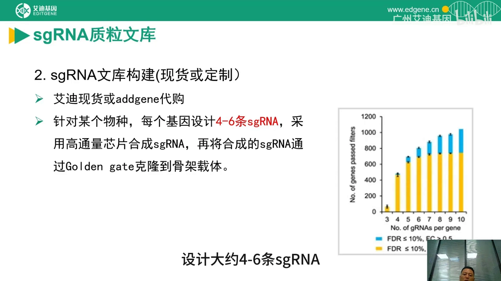

为什么必须多条？因为**单条 sgRNA 的效率差异极大**——有的切得干净，有的几乎不切。同一个基因配 4–6 条，只要其中一两条有效，这个基因的效应就能显出来；只配一条，一旦这条不灵，这个基因就被判了"无表型"，而它其实可能很关键。这是一个人为制造的假阴性来源。

### 5.2 文库扩增是最容易翻车的一步：靠电转 + 涂板，不靠摇瓶

文库筛选用量极大——sgRNA 质粒常要**几十到几百微克**，买来的现货常常只有 10–100 μg，不够用（[【跳转到 32:34】](https://www.bilibili.com/video/BV16fLvz9Ezg/?t=1954)）。而**文库扩增和普通质粒扩增完全是两件事**，坑很多（[【跳转到 32:59】](https://www.bilibili.com/video/BV16fLvz9Ezg/?t=1979)）。

做法是：**电转 → 恢复 → 涂板（而不是液体摇菌）**，涂板时同步**数克隆**，用来估算这一步的覆盖度；培养后提质粒，再用 NGS 确认覆盖度和均一性（[【跳转到 33:24】](https://www.bilibili.com/video/BV16fLvz9Ezg/?t=2004)）。业内有更快更便宜的做法（化学转化/液体扩增），他们不用，因为**会伤到覆盖度和均匀性**（[【跳转到 33:49】](https://www.bilibili.com/video/BV16fLvz9Ezg/?t=2029)）。

道理不难想：文库是**十几万条不同质粒组成的混合群体**。液体摇菌时，长得快的克隆被放大、稀有克隆被稀释甚至丢掉——测序一看，某些 sgRNA 直接归零。扩增要保的不是产量，而是"每条 sgRNA 都还在、数量差不多"。

### 5.3 判断文库好坏的两个数：覆盖度 ≥99%，均匀性 <0.1

文库质量只看两个维度（[【跳转到 34:39】](https://www.bilibili.com/video/BV16fLvz9Ezg/?t=2079)）：

- **Coverage（覆盖度）**：文库声称有 N 条 sgRNA，扩增/测序之后还剩下多少条。全基因组文库可能有十几万条，丢失的比例必须很小。他们内部扩增的文库覆盖率基本在 **99% 以上，多数 99.5% 以上**（[【跳转到 34:44】](https://www.bilibili.com/video/BV16fLvz9Ezg/?t=2084)）。
- **Uniformity（均匀性）**：各条 sgRNA 的丰度是否接近。技术要求通常是 **<0.1**，他们自己扩增的多数在 **0.06 以下**（[【跳转到 35:09】](https://www.bilibili.com/video/BV16fLvz9Ezg/?t=2109)）。

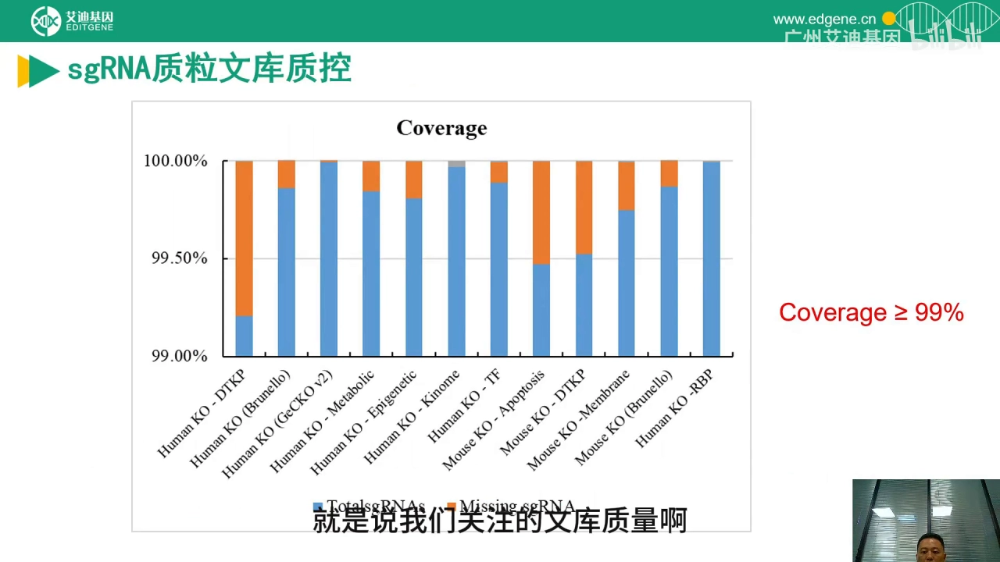

均匀性为什么不能含糊？因为**筛选的读数是相对丰度变化**。如果某条 sgRNA 在起点就只有别人的十分之一，它后面"消失"到底是基因致死还是本来就少，你分不清。**覆盖度丢的是"能不能问到"，均匀性丢的是"问得准不准"。**

---

## 六、第三步：病毒包装与 MOI——"一个细胞只装一条 sgRNA"是硬约束

### 6.1 病毒要包多少：一个连乘公式

文库质粒到手后要包装成慢病毒。常规是**转染后 48 小时和 72 小时分别收毒**，分装存 −80 °C；**尽量不要混用不同批次的病毒**（[【跳转到 35:32】](https://www.bilibili.com/video/BV16fLvz9Ezg/?t=2132)）。有些细胞不好感染，MOI 需求高，可能还要做病毒浓缩。

病毒总量要按一个连乘来算（[【跳转到 36:22】](https://www.bilibili.com/video/BV16fLvz9Ezg/?t=2182)）：

**所需病毒量 ≈ sgRNA 条数 × 期望覆盖度 × MOI × 组数 × 生物学重复数**

视频里给的例子：一个 2 万多条 sgRNA 的文库、A549 细胞 MOI = 5、希望每个基因敲除的细胞有 500 个代表性、实验分两组、每组三个重复，算下来需要约 **3.7×10⁸** 个病毒（[【跳转到 37:12】](https://www.bilibili.com/video/BV16fLvz9Ezg/?t=2232)）。这就是为什么文库实验的病毒包装量、细胞用量都以"亿"为单位——不是浪费，是覆盖度的必然结果。

### 6.2 MOI 要压到 0.2–0.3：这是一个统计学问题

矛盾来了：我们要的是"一个细胞只整合一条 sgRNA"，可病毒是混合液，凭什么保证？答案是**用 MOI 来控制多重感染的概率**（[【跳转到 37:31】](https://www.bilibili.com/video/BV16fLvz9Ezg/?t=2251)）。

操作上分三步：

1. **滴定**：用 **HT-1080** 细胞测文库病毒的**生物滴度**；不建议用 qPCR 或 ELISA，因为和生物滴度差距很大（[【跳转到 37:56】](https://www.bilibili.com/video/BV16fLvz9Ezg/?t=2276)）。
2. **摸感染条件**：把文库病毒按不同量（1:10、1:25、1:50…）感染固定数量的靶细胞，48–72 小时后消化、数阳性细胞，算出 **TU/mL（transduction unit，转导单位）**（[【跳转到 38:21】](https://www.bilibili.com/video/BV16fLvz9Ezg/?t=2301)）。
3. **取 MOI ≈ 0.2–0.3 的病毒用量**（[【跳转到 38:46】](https://www.bilibili.com/video/BV16fLvz9Ezg/?t=2326)）。

为什么是 0.2–0.3？因为病毒感染细胞近似**泊松分布**：当平均每个细胞的感染事件数 λ = 0.2–0.3 时，**绝大多数细胞要么没被感染、要么只整合一条**，整合两条以上的比例很低。代价是效率——如果感染 100 万~200 万个细胞，最终阳性细胞只有二三十万，另外六七十万是"白转"的（[【跳转到 39:36】](https://www.bilibili.com/video/BV16fLvz9Ezg/?t=2376)）。

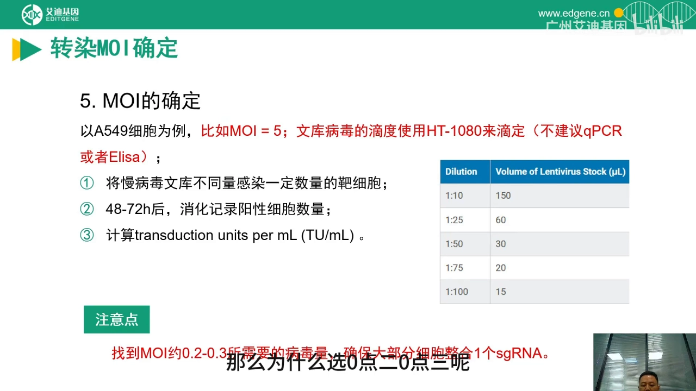

**千万不要为了省细胞提高 MOI。** 讲者的措辞是"强烈不建议"：MOI 高了，一个细胞里会有多条 sgRNA，等于同时敲掉多个基因，后续分析会变成一场灾难——你没法把表型归因到某一个基因，关注的候选基因根本找不出来（[【跳转到 40:01】](https://www.bilibili.com/video/BV16fLvz9Ezg/?t=2401)）。

感染前的细胞用量也有现成公式（[【跳转到 40:51】](https://www.bilibili.com/video/BV16fLvz9Ezg/?t=2451)）：

**感染前细胞数 ≈ 期望覆盖度 × sgRNA 条数 ÷ 0.3**

除以 0.3 就是上面那个 MOI 带来的效率损失。感染后加**嘌呤霉素筛选约 6 天**，就得到"单基因突变细胞池"（[【跳转到 40:26】](https://www.bilibili.com/video/BV16fLvz9Ezg/?t=2426)）。

### 6.3 三对三：为什么一个平行都不做等于白做

这是容易被省钱省掉的一步：**推荐 3 个对照 + 3 个实验组的"三对三"设计**（[【跳转到 41:16】](https://www.bilibili.com/video/BV16fLvz9Ezg/?t=2476)）。依据来自早期方法学论文的评估（[【跳转到 41:41】](https://www.bilibili.com/video/BV16fLvz9Ezg/?t=2501)）：横轴是每基因 sgRNA 条数、不同颜色代表平行数，结果显示——

- 每基因只有 **3 条** sgRNA 时，筛选效率非常低，几乎拿不到有用信息；
- 到 **4 条**有显著提升，到 **6 条**接近 7–10 条的极限水平；
- 再看平行数：**同样是 6 条 sgRNA，1 个平行和 2–3 个平行差距很大**（[【跳转到 42:06】](https://www.bilibili.com/video/BV16fLvz9Ezg/?t=2526)）。

有个细节值得记住：那张图上"2 个平行和 3 个平行差别不大"，是因为该研究用的是**细胞致死性/关键基因**这种极严苛的筛选压力（[【跳转到 42:31】](https://www.bilibili.com/video/BV16fLvz9Ezg/?t=2551)）。而我们自己的课题，筛选条件通常没这么狠，**2 个和 3 个平行就会拉开显著差别**（[【跳转到 42:56】](https://www.bilibili.com/video/BV16fLvz9Ezg/?t=2576)）。所以底线是三个平行；实在不行两个，**绝不要只做一个**（[【跳转到 43:21】](https://www.bilibili.com/video/BV16fLvz9Ezg/?t=2601)）。

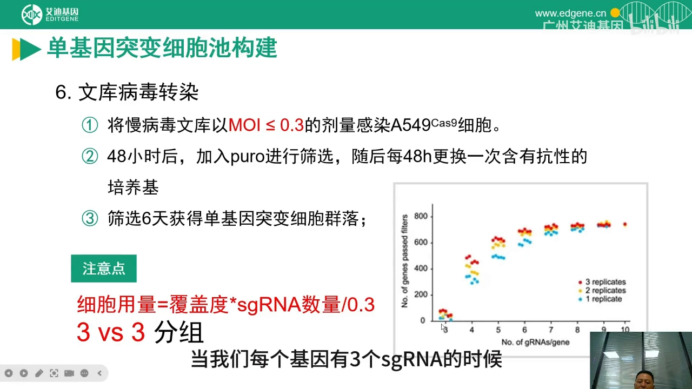

---

## 七、第四到第六步：加压、测序、分析，再回到单基因验证

### 7.1 Challenge 没有模板，它由你的科学问题决定

加药、攻毒、换培养基、改氧浓度——challenge 怎么做取决于你要问什么，讲者刻意不给统一模板（[【跳转到 43:46】](https://www.bilibili.com/video/BV16fLvz9Ezg/?t=2626)）。共通原则只有一条：**让携带不同 sgRNA 的细胞在增殖速度或表达状态上拉开差距**（[【跳转到 43:51】](https://www.bilibili.com/video/BV16fLvz9Ezg/?t=2631)）。具体到药物浓度和处理天数怎么定，见第九节的"药物预实验"（[【跳转到 56:22】](https://www.bilibili.com/video/BV16fLvz9Ezg/?t=3382)）。

### 7.2 NGS 分析的固定流水线：先质控，再排序

测序回来分析的是 **sgRNA 的丰度**（read 数）。有一个容易被忽略的准备工作：**必须留一份参照样本（reference control）**。因为所有信号都是「相对于起点」的丰度变化，你要把处理前（或对照组）的细胞池一起送测，才能算出哪条 sgRNA 富集、哪条丢失（第 6.2 节拿到的「单基因突变细胞池」就是这份基线的样子）。这也解释了为什么 6.3 节强调三对三——**对照组本身就是比较的基准**。

分析流程是标准五步（[【跳转到 44:41】](https://www.bilibili.com/video/BV16fLvz9Ezg/?t=2681)）：

1. **Read mapping**：把 reads 比对回文库的 sgRNA 序列，生成 count 矩阵；
2. **质控**：看平行样本是否聚在一起、**mapping ratio 能否达到 65% 以上**——聚得好、比得上，才说明数据可用（[【跳转到 45:06】](https://www.bilibili.com/video/BV16fLvz9Ezg/?t=2706)）；
3. **基因水平排序**：用发表的模型（MAGeCK 一类）算每个基因的效应，把同一个基因的多条 sgRNA 汇总（[【跳转到 45:31】](https://www.bilibili.com/video/BV16fLvz9Ezg/?t=2731)）；
4. **Hit calling**：按 P 值、FDR 等阈值取候选基因列表，数量从几十到上百不等，取决于筛选目的（[【跳转到 45:56】](https://www.bilibili.com/video/BV16fLvz9Ezg/?t=2756)）；
5. **下游解读**：gene set / GO 富集分析、作图（[【跳转到 46:21】](https://www.bilibili.com/video/BV16fLvz9Ezg/?t=2781)）。

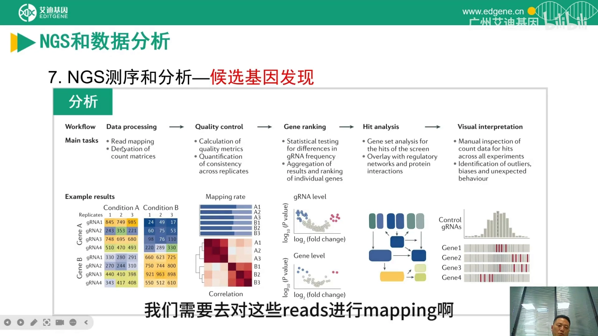

### 7.3 候选基因只是假设，故事要靠单基因实验收尾

拿到几十个候选基因只是"筛出假设"。下一步回到传统基因功能研究：挑单个候选基因做**敲除、过表达、回补**，验证**必要性（没有它表型不出现）与充分性（有它就足以出现表型）**，再配更细的功能实验，把因果链钉死（[【跳转到 46:51】](https://www.bilibili.com/video/BV16fLvz9Ezg/?t=2811)）。有时还要补临床数据，故事才算完整。

---

## 八、案例：AML 分化阻滞——流式读出 → 小库 + 单细胞 → 一个治疗靶点

文库筛选的典型用法被总结成几类：找耐药相关基因、研究耐药机制、优化治疗方案；筛病毒感染的宿主因子；找合成致死靶点；识别肿瘤必需基因（[【跳转到 47:46】](https://www.bilibili.com/video/BV16fLvz9Ezg/?t=2866)）。最后那个完整案例，正好演示了"读出方式怎么决定实验设计"。

**科学问题**：急性髓性白血病（AML）是髓系血液恶性肿瘤，特点是细胞**不能终末分化**成功能成熟的髓细胞。课题组要问的是：为什么不能正常分化，背后的分子机制是什么（[【跳转到 48:22】](https://www.bilibili.com/video/BV16fLvz9Ezg/?t=2902)）。

**读出设计**：分化和不分化，细胞表面抗原的表达水平不同——他们选了 **CD14、CD11b** 这类分化标志。文库筛选之后，用**流式细胞术**把 CD14/CD11b 表达异常（即不能正常分化）的细胞分选出来（[【跳转到 48:47】](https://www.bilibili.com/video/BV16fLvz9Ezg/?t=2927)）。这就是第 3.2 节说的"用流式把表型变成可分的两群"。

**第一轮结果**：对分选出的细胞做 sgRNA 丰度分析，找到约 **12 个**相关基因——其中既有已知的（如 **MYB**），也有新鉴定的（[【跳转到 49:31】](https://www.bilibili.com/video/BV16fLvz9Ezg/?t=2971)）。

**第二轮机制**：作者没有停在这 12 个基因上，而是针对它们做了一个**小型文库**，结合**单细胞测序**看敲掉某个基因后细胞内的表达谱怎么变（[【跳转到 49:56】](https://www.bilibili.com/video/BV16fLvz9Ezg/?t=2996)）。

**结论**：**ZFP36L2** 是一个 RNA 结合蛋白，抑制 AML blast 的分化，也是潜在治疗靶点；工作发表在 *Cell Stem Cell*（[【跳转到 50:29】](https://www.bilibili.com/video/BV16fLvz9Ezg/?t=3029)）。

这个案例的结构值得抄下来：**全基因组初筛（宽）→ 小库 + 单细胞（深）→ 单基因机制（准）**。第一步负责不漏，第二步负责讲清机制。

---

## 九、片尾 Q&A：新手最容易踩的坑，现场都问到了

讲完流程，主讲和同事回答了现场提问。这些问题几乎都是新手会踩的坑，按"能不能做、要多少、怎么控"三类整理。

### 9.1 "我要筛耐药基因"——先把"耐药基因"这词掰开

**问**：手上有一个耐药细胞，想筛出是哪个基因导致的耐药，用什么方法？

**答**：走**阴性筛选**。建全基因组的单基因敲除细胞池，然后加药：**如果某个"耐药基因"被敲掉了，细胞就会重新变敏感、死掉**；测序时这条 sgRNA 的丰度就会显著低于对照，据此反推是哪个基因在起作用（[【跳转到 52:12】](https://www.bilibili.com/video/BV16fLvz9Ezg/?t=3132)）。

但紧接着是全片最重要的一个概念提醒（主讲说自己也曾混淆）：**"耐药基因"到底指的是"这个基因本身让细胞耐受药物"，还是"这个基因突变之后细胞才耐受药物"？**（[【跳转到 53:02】](https://www.bilibili.com/video/BV16fLvz9Ezg/?t=3182)）

这两件事在实验设计里指向完全不同的操作：

- 如果是**基因本身赋予耐药**（比如药物外排泵高表达、药物靶点表达量低），那么**敲掉它 → 细胞变敏感**，用上面的阴性筛选，信号是 sgRNA 丢失。
- 如果是**基因突变导致耐药**（比如靶点蛋白发生突变，药物结合不上），那么**敲掉这个野生型基因并不会让细胞变敏感**；你要找的是"哪个突变让细胞耐药"，常规 KO 文库问不出这个问题，需要换策略（过表达/突变体文库、碱基编辑、激活文库等）。

动手之前先用一句话钉住自己的问题：**我是要看"敲掉后变敏感"（阴性筛选，信号是 sgRNA 丢失），还是"敲掉后变耐药"（阳性筛选，信号是 sgRNA 富集）？** 这两类信号看的是测序结果的相反两侧，设计一旦搞反，后面全部作废。

### 9.2 覆盖度和细胞量：100× 到底够不够

**问**：想用 100× 的覆盖度做文库筛选，能行吗？全基因组量太大了。

**答**：可以谈，但有两个前提（[【跳转到 53:27】](https://www.bilibili.com/video/BV16fLvz9Ezg/?t=3207)）。第一，**文库质量要好、均一性要好**——如果均一性差，号称 100× 实际是"有的 100、有的只有 10"，差距太大就没意义。第二，**要看筛选方向**：

| 场景 | 100× 能不能用 | 讲者建议 |
| --- | --- | --- |
| **阳性筛选**（压力极大、只有极少数细胞能活） | 勉强可以凑合 | 做到 **250–300×** 更稳妥 |
| **阴性筛选**（要看哪些 sgRNA 丢失） | **完全不推荐** | 需要更高覆盖度 |

原因是对称的：阳性筛选中细胞被强压力筛到只剩极少数，起点低一点还能接受；而阴性筛选要可靠地检出"丢失"，起点覆盖度低就分不清"丢了"和"本来就没测到"（[【跳转到 53:52】](https://www.bilibili.com/video/BV16fLvz9Ezg/?t=3232)）。

### 9.3 难做的模型：类器官、原代细胞、非病毒递送

- **类器官消化成单细胞能做文库筛选吗？** 能做，但**取决于类器官种类**：如果它容易从单细胞重新长成类器官、生长条件成熟，成功率就不错，已有报道；有些类器官不能消化得太狠，就受限（[【跳转到 54:17】](https://www.bilibili.com/video/BV16fLvz9Ezg/?t=3257)）。
- **原代细胞传代次数有限怎么办？** 一个思路是用**已经稳转 Cas9 的动物**取原代细胞——Cas9 已经自带，只需再转 sgRNA 文库；但前提是这株细胞在体外能活够筛选所需的时间。**瞬时转染**也有人试过，但效果通常不太好（[【跳转到 54:42】](https://www.bilibili.com/video/BV16fLvz9Ezg/?t=3282)）。
- **能用 LNP 递送 sgRNA 文库吗？** 技术上可以，但有个结构性障碍：慢病毒方案之所以成立，是因为能靠 MOI 控制"一个细胞一条 sgRNA"；而 LNP 在包裹时，**同一个颗粒里就可能装进不止一条 sgRNA**，进细胞后等于同时敲多个基因，后续分析会很麻烦、甚至失败（[【跳转到 55:32】](https://www.bilibili.com/video/BV16fLvz9Ezg/?t=3332)）。

### 9.4 药物预实验：定浓度，也定天数

药物预实验只看两件事：**杀伤率**和**处理时间**（[【跳转到 56:22】](https://www.bilibili.com/video/BV16fLvz9Ezg/?t=3382)）。

**杀伤率**按方向定（[【跳转到 56:47】](https://www.bilibili.com/video/BV16fLvz9Ezg/?t=3407)）：

- **阳性筛选**：希望药物把绝大多数不相关的细胞杀掉，剩得越少越好——剩下 20%、10% 都行。
- **阴性筛选**：**压力不能太大**。因为你要找的是"某些基因被敲掉后细胞死得更快"，如果浓度过高把所有细胞都杀死，就分不出这个差异了。这时死亡率 **20%–40%** 就够（[【跳转到 57:12】](https://www.bilibili.com/video/BV16fLvz9Ezg/?t=3432)）。

**处理时间**为什么关键？主讲用一个算术讲清了（[【跳转到 58:02】](https://www.bilibili.com/video/BV16fLvz9Ezg/?t=3482)）：假设某条 sgRNA 的细胞起点覆盖度是 300。增殖一代后，不受药物影响的细胞从 300 变 600，而受抑制的可能只到 450——**450 : 600 只有 1.25–1.3 倍**，统计学上几乎看不出来。多传几代，600 变成 1200、2400，而慢的那一组只到 500 多，差距就放大到 2–3 倍，统计分析才显著（[【跳转到 59:17】](https://www.bilibili.com/video/BV16fLvz9Ezg/?t=3557)）。所以**处理时间的作用是把对照组与处理组的差别放大**（[【跳转到 59:42】](https://www.bilibili.com/video/BV16fLvz9Ezg/?t=3582)）。加压时间同样按增殖速度定，**至少三代，5–7 代更好**（[【跳转到 63:02】](https://www.bilibili.com/video/BV16fLvz9Ezg/?t=3782)）。

### 9.5 其余几条快问快答

- **覆盖度/均匀性怎么评估？** 提质粒（或提基因组）→ 对 sgRNA 区域做 PCR 扩增 → 送测序 → 统计各条 sgRNA 的 read 数与丰度分布，看"该有的 N 条是不是都测到了"（[【跳转到 60:07】](https://www.bilibili.com/video/BV16fLvz9Ezg/?t=3607)）。
- **电转还是慢病毒？** **文库质粒用电转**（细菌层面扩增），**慢病毒用来转细胞**（[【跳转到 62:12】](https://www.bilibili.com/video/BV16fLvz9Ezg/?t=3732)）。
- **自己建库要合成多少 oligo？** 每基因 5–6 条 × 几万个基因 = **几万到十几万条**（[【跳转到 61:47】](https://www.bilibili.com/video/BV16fLvz9Ezg/?t=3707)）。
- **还要看比对率吗？** 要。合成的 oligo 可能和设计不一致（合成错误、突变），会引入误差；阈值各家供应商（Twist 及国内厂商）不同，按供应商标准确认（[【跳转到 62:12】](https://www.bilibili.com/video/BV16fLvz9Ezg/?t=3732)）。
- **Cas9 活性上不去还能做吗？** 见 4.4：活性做不到 80% 时，靠更严格的重复数、覆盖度和筛选压力来补，但优先选高活性株（[【跳转到 30:29】](https://www.bilibili.com/video/BV16fLvz9Ezg/?t=1829)）。

---

## 小结

1. **文库筛选解决的是一次性提问**：人/鼠约两万基因、课题只够做几个，于是把"逐个敲、逐个看"换成"每个细胞敲一个、一次全测"。它同时拿到正向遗传学的无偏和反向遗传学的精确。
2. **成败在四个可量化的卡点**：Cas9 株切割活性 ≥80%（看活性不看表达量）、每基因 4–6 条 sgRNA、感染 MOI 0.2–0.3、覆盖度与均一性（≥99% / <0.1）加三个生物学重复。
3. **文库质量靠扩增环节保**：电转 + 涂板计数而不是液体摇菌；丢的是覆盖度，乱的是均匀性，最后都变成假阳性/假阴性。
4. **MOI 是整套设计的物理地基**：一个细胞只能有一条 sgRNA，否则表型无法归因；省细胞的代价是分析失效。
5. **读出方式先于文库选择**：增殖/凋亡、流式分选、单细胞测序对应完全不同的实验形态；Perturb-seq 就是"文库 + 单细胞读出"。
6. **筛选方向决定看哪一侧**：阳性看谁变多，阴性看谁不见。处理时间的作用是放大差异（1.3 倍看不见，传几代到 2–3 倍才显著）；候选基因只是假设，必须回到单基因敲除/回补的必要性、充分性验证。

## 关键术语速查

| 术语 | 一句话解释 |
| --- | --- |
| **Pooled screen** | 所有 sgRNA 混在一个细胞池里做筛选，靠测序读丰度；通量高、成本低 |
| **Arrayed screen** | 每条 sgRNA 分孔，逐孔测表型；通量低但表型读得细 |
| **sgRNA 文库** | 成千上万条 sgRNA 的混合质粒库；全基因组文库可达十几万条 |
| **亚文库** | 只覆盖部分基因（代谢、膜蛋白、激酶等）的子集文库，覆盖度更容易做高 |
| **MOI** | 平均每个细胞被感染的病毒颗粒数；文库筛选要压到 0.2–0.3，保证"一细胞一 sgRNA" |
| **TU（transduction unit）** | 生物滴度单位，实测"能真正转导进细胞"的病毒量；比 qPCR 滴度更贴近实验 |
| **Coverage（覆盖度）** | 文库声称的 sgRNA 里，实际还在/被测到的比例，要求 ≥99% |
| **Uniformity（均匀性）** | 各条 sgRNA 丰度的离散程度，数值越小越均匀，通常要求 <0.1 |
| **阳性筛选** | 加压后少数细胞存活，看哪些 sgRNA 被富集（耐药、获得性功能） |
| **阴性筛选** | 看哪些 sgRNA 丢失（敲掉后细胞变敏感或死亡，如必需基因、药物增敏） |
| **NHEJ / HDR** | 双链断裂的两条修复路径；前者产生 indel 用于敲除，后者需模板做精确编辑 |
| **CRISPRi / CRISPRa** | 用失活 Cas9 融合抑制或激活结构域，做"调低/调高"而非切断；必需基因与非编码区常用 |
| **Read-out** | 把表型转成可测量信号的环节：增殖/存活、流式 marker、单细胞表达谱 |
