# 唯赞学堂：NGS 文库制备——从一管 DNA 到能上机的文库

- 视频标题：唯赞学堂 | 浅谈 NGS 文库制备
- UP 主：诺唯赞
- 视频链接：<https://www.bilibili.com/video/BV1pG4y137wC/>
- 时长：76:29
- 字幕：Bilibili AI 字幕（已逐窗口校正错拼）
- 所属系列：`content/虚拟细胞` · 实验基础 · 文库构建

> 本片是厂商（诺唯赞）举办的线上讲座，讲者是长期在一线做测序平台管理的张清华老师。片中穿插了自家试剂盒的性能展示与致谢段落，本博客只保留方法与经验部分，不复述产品推介。

## 本讲要解决的核心问题（SCQA）

**背景**：二代测序（NGS）已是实验室常规技术。流程只有三段——建库、上机测序、数据分析——真正由实验人员掌控、也最容易出问题的，是第一段。

**冲突**：同一个流程，不同人做出来差别很大：样本混了蛋白或 RNA，超声就打不断；片段分布不对，数据产出可能少一半甚至归零；接头二聚体没清掉，产出被短片段抢走。而送样的人往往只知道「我要测序」，不知道样本质量、片段长度、磁珠比例、循环数彼此耦合。

**疑问**：文库制备到底该控制什么？哪些环节是真正的关键点，出了问题该怎么判断、怎么补救？

**回答（中心思想）**：文库制备本质上是**把基因组 DNA 剪成平台能读的长度、在两端贴上可被测序仪识别的接头、并把文库的「长度分布」和「浓度」控制在平台能接受的范围里**。真正需要盯紧的只有三个地方——**样本质量（决定能不能打断、能不能纯化）、片段长度（片段化 + 片段选择）、定量的平衡（接头用量、index 组合、PCR 循环数、环化效率）**；其余步骤都是常规分子生物学操作。

## 一、先看清全景：建库在 NGS 流程里的位置，以及两大平台的分叉点

### 1.1 二代测序只是「测序技术发展史」中的一段

讲者把测序技术从一代讲起：从最早的一代测序，到二代、三代，再到如今所谓四代甚至更高级别的技术；而本讲的内容属于**二代测序**的范畴。二代测序大约 2005 年开始兴起，2010 年以后蓬勃壮大，最近几年得到极大发展，已经成为实验室的常规技术应用。[【跳转到 00:29】](https://www.bilibili.com/video/BV1pG4y137wC/?t=29)

两大主流平台是 **Illumina** 和国产的**华大制造（MGI）**，技术路线不同：[【跳转到 01:19】](https://www.bilibili.com/video/BV1pG4y137wC/?t=79)

- **Illumina：边合成边测序（SBS）**。聚合酶逐个掺入带荧光标记的碱基，每掺一个读一次颜色——「合成」与「读取」是同一个动作。
- **华大制造（MGI）：联合探针锚定聚合，核心是 DNA 纳米球（DNB）**。先把文库做成环状、滚环扩增成纳米球，再固定到芯片上锚定、聚合读取。[【跳转到 01:26】](https://www.bilibili.com/video/BV1pG4y137wC/?t=86)

这两条技术路线决定了建库流程后半段的分叉：Illumina 的文库是**线性**双端接头分子，可以直接上芯片；MGI 的文库还要多做一步**单链环化**、再做成 DNB。

### 1.2 整个 NGS 只有三段，而建库这一段才是实验人员的主场

讲者给的全景很清楚：NGS 流程就是**文库构建 → 上机测序 → 数据分析**。测序与分析有仪器和流程兜底，建库才是实验台上一步步做出来的部分。[【跳转到 02:03】](https://www.bilibili.com/video/BV1pG4y137wC/?t=123)

### 1.3 标准 WGS 建库流程：前六步两大平台共享，后面的分叉在接头方向与环化

讲者用一张「标准 WGS 文库构建流程」图把两条路线叠在一起看：**片段化 → 末端修复 → 加 A → 加接头 → 片段选择 → PCR 扩增 → 纯化**是虚线之前的部分，两平台共有；虚线之后 Illumina 直接上机，MGI 要走**单链环化（ssCir formation）→ 制备 DNB**。[【跳转到 02:25】](https://www.bilibili.com/video/BV1pG4y137wC/?t=145) [【跳转到 02:50】](https://www.bilibili.com/video/BV1pG4y137wC/?t=170)

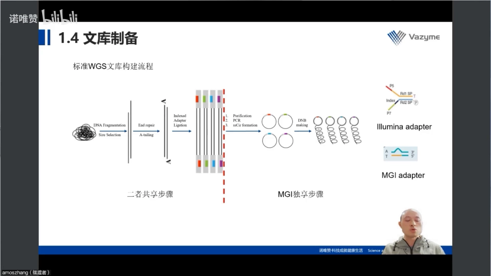

讲者特别提醒：两条路线前半段虽然基本一致，但**接头的方向与结构有差异**。因为 Illumina 成名更早、技术路线细节更公开，所以他后面主要用 Illumina 平台做讲解。[【跳转到 03:15】](https://www.bilibili.com/video/BV1pG4y137wC/?t=195)

### 1.4 建库的六个环节里，每个环节只盯 1–2 个变量

讲者把流程拆成六段，逐段给出「该盯什么」：样本看 buffer、完整性、纯度、浓度；片段化要选方法；片段选择看预期片段、时机、手段；接头看效率与用量；PCR 只看循环数；质控看片段分布与浓度。[【跳转到 07:00】](https://www.bilibili.com/video/BV1pG4y137wC/?t=420)

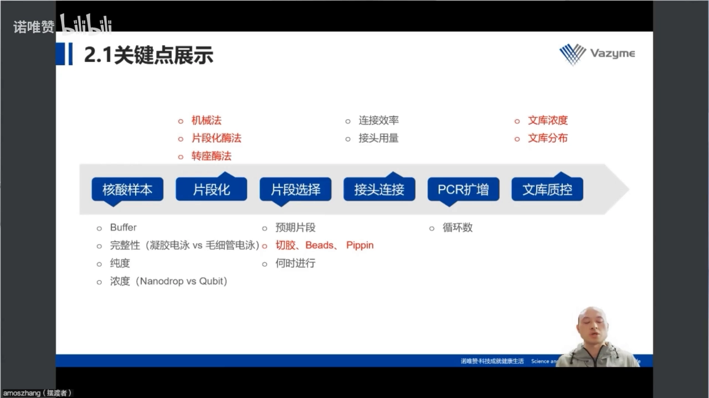

## 二、文库长什么样：一个插入片段 + 三段接头，index 是「数据的身份证」

### 2.1 为什么必须先片段化：二代测序读不了几万 bp 的完整 DNA

提出的 DNA 通常有几十 kb，而二代测序读长有限：双端测序有 PE50、PE100、PE150 等规格，主流是 **PE150**（两端各读 150 bp）。所以插入片段只能是**几百 bp 级**，通常落在 200–800 bp——太长读不完，太短会在后续被优先扩增、抢走数据。[【跳转到 03:40】](https://www.bilibili.com/video/BV1pG4y137wC/?t=220) [【跳转到 04:05】](https://www.bilibili.com/video/BV1pG4y137wC/?t=245)

### 2.2 从打断到接头：末端修复 + 加 A 是「给断口装一个标准插口」

打断之后，DNA 两端是杂乱的粘性末端，不能直接接接头。标准做法是三步：

1. **末端修复**：把粘性末端补平/削平，让两端「规格统一」（同时做 5′ 磷酸化等处理）。
2. **加 A**：在每个 3′ 端加一个腺嘌呤，形成突出的 A 尾。
3. **接头连接**：接头带突出的 T，与 A 尾做 **T-A 连接**。[【跳转到 04:30】](https://www.bilibili.com/video/BV1pG4y137wC/?t=270) [【跳转到 04:55】](https://www.bilibili.com/video/BV1pG4y137wC/?t=295)

讲者把加接头比作「贴标签」：这一步不是为了让样本变得可测，而是为了让文库分子带上**测序仪认识的那套通用序列**。观众提问里也有人问「A 和 T 在测序中起什么作用」，讲者的回答很直接：**T 和 A 只在接头连接这一步有意义，测序过程中不起作用**。[【跳转到 74:08】](https://www.bilibili.com/video/BV1pG4y137wC/?t=4448)

### 2.3 接头由三段组成：贴芯片的、当身份证的、给引物站的

文库最终长这样：中间灰色是待测的 **DNA 插入片段**，两端是接头。[【跳转到 05:20】](https://www.bilibili.com/video/BV1pG4y137wC/?t=320)

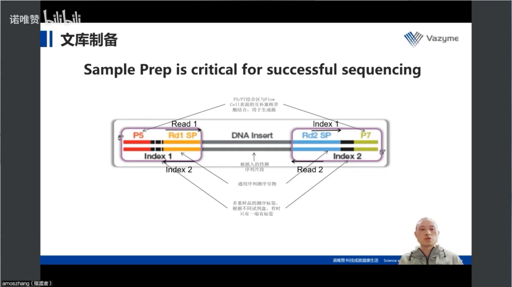

接头可拆成三段功能不同的序列：[【跳转到 05:45】](https://www.bilibili.com/video/BV1pG4y137wC/?t=345) [【跳转到 06:10】](https://www.bilibili.com/video/BV1pG4y137wC/?t=370)

| 接头区段 | 作用 | 通俗理解 |
| --- | --- | --- |
| **P5 / P7** | 与 Flow Cell 表面的互补寡核苷酸结合，用于生成簇、开始 Read 1 / Read 2 | 把文库「钉」在芯片上的挂钩 |
| **Index（标签）** | 多重样本的测序标签，用于把数据拆分回各自的样本 | 每个样本的身份证号 |
| **Rd1 SP / Rd2 SP** | 测序引物的匹配位点，测序从这里起始 | 给测序引物站的站位 |

所以一个文库分子要同时满足三件事：能被芯片抓住（P5/P7）、能被读出来（Rd1/Rd2 SP）、能被认出来是谁（index）。这也是 index 组合要考虑「碱基平衡」的原因——序列太相似，读取时容易混淆，数据拆分就出错。[【跳转到 06:10】](https://www.bilibili.com/video/BV1pG4y137wC/?t=370)

### 2.4 长接头还是短接头：交叉污染的风险被安排在流程的哪一步

问答环节里有一个很实用的问题：长接头和短接头各有什么优劣？讲者的回答是从「风险放在哪一步」的角度切入的：[【跳转到 74:08】](https://www.bilibili.com/video/BV1pG4y137wC/?t=4448)

- **长接头**：index 在接头里，接头连接这一步就完成了样本标记。哪怕后面操作稍微粗放一点，样本之间也不会互相污染——因为每个样本从连接这一步起就「自带身份证」。
- **短接头**：index 要到 PCR 扩增时通过引物引入，所以**从接头连接一直到 PCR 之前的所有步骤都必须小心操作**，避免样本间的交叉污染。

两者对建库人的总工作量其实差不多：**总要有一步是「一个样本一个样本单独加」的**——长接头在连接那一步，短接头在 PCR 那一步。

## 三、样本质量是建库的「先天条件」：降解、蛋白与 RNA 污染会同时毁掉打断和纯化

### 3.1 一张电泳图能读出四种不合格

讲者把 10 个 DNA 样本的电泳图摆在一起，请观众自己先判断哪些能建库：[【跳转到 09:21】](https://www.bilibili.com/video/BV1pG4y137wC/?t=561)

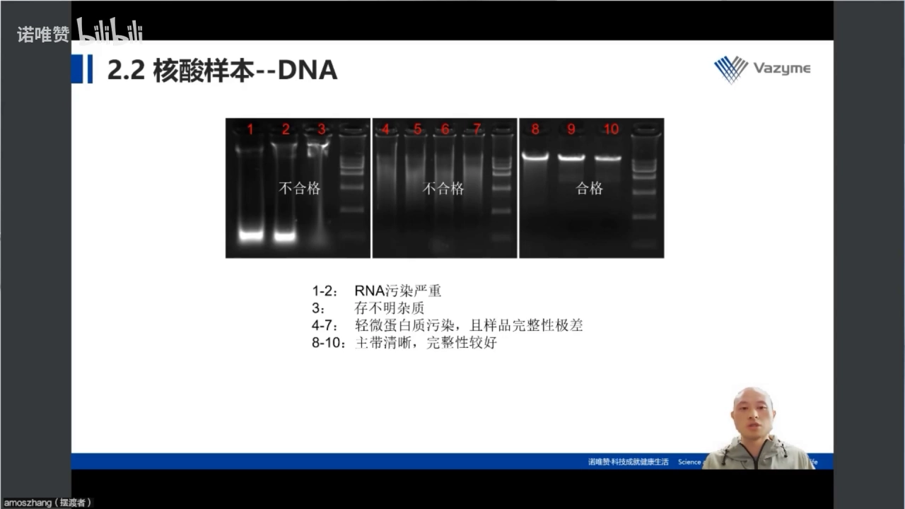

- **1、2 号**：DNA 条带在，但最下方有两条亮带——**RNA 污染严重**。
- **3 号**：RNA 有一点，但 DNA 条带已变形——杂质裹挟 DNA，改变了它在凝胶里被牵引的方式。[【跳转到 10:11】](https://www.bilibili.com/video/BV1pG4y137wC/?t=611)
- **4–7 号**：点样孔附近有比较亮的条带（**蛋白质/杂质污染**），同时主带已经看不清；按 marker 判断，主带本该在 marker 最大条带之上，现在却成了连续弥散——**已经降解，完整性极差**。
- **8–10 号**：点样孔不亮、最下方无 RNA 亮带、主带清晰，只有一点轻微拖尾——这是**可以放心建库**的样本。

他留了个包袱：客户送来的正是 1–3 号这类样本怎么办？后文自答——先判断能不能纯化、怎么做。[【跳转到 11:01】](https://www.bilibili.com/video/BV1pG4y137wC/?t=661) [【跳转到 15:30】](https://www.bilibili.com/video/BV1pG4y137wC/?t=930)

### 3.2 杂质的第一重伤害：超声打断打不断

讲者用一组对照说明后果：原始 DNA 没有 RNA 污染，但点样孔附近有大量亮条带（蛋白/杂质污染）。这种样本他倾向用**超声波打断**，因为机械法对杂质最不敏感。[【跳转到 11:36】](https://www.bilibili.com/video/BV1pG4y137wC/?t=696)

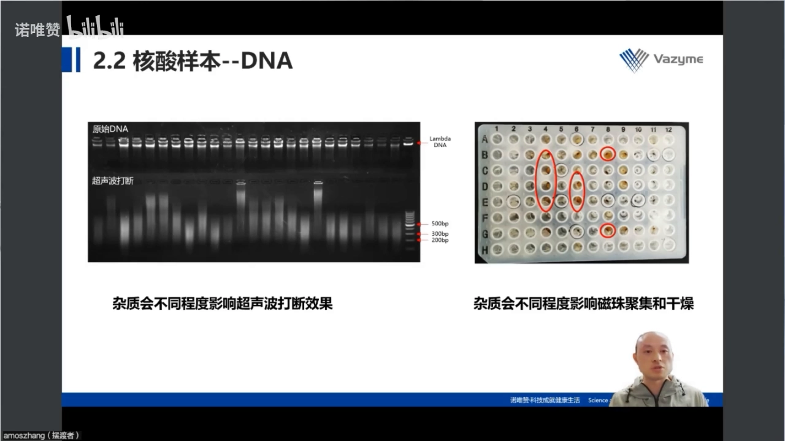

结果并不理想：均一性差，有的片段已经进入目标范围，但还有很多片段根本没被打断。讲者的判断是——**杂质影响了超声波打断这一步**。所以核酸样本准备阶段一定要尽量避免杂质残留。[【跳转到 12:01】](https://www.bilibili.com/video/BV1pG4y137wC/?t=721)

### 3.3 杂质的第二重伤害：磁珠聚不起来、干不了，得率与复杂度一起掉

更隐蔽的伤害在纯化：建库多处要用磁珠，而某些杂质会干扰**磁珠的聚集与干燥**，直接导致 DNA 损失。[【跳转到 12:26】](https://www.bilibili.com/video/BV1pG4y137wC/?t=746)

讲者给了一个可感的数字：正常投入 **1 µg** DNA、扩增 5 个循环，可拿到微克级文库；若磁珠聚集或干燥被干扰，最终可能只有几十纳克，**甚至无法上机**。损失的不只是量，还有文库复杂度，后者直接影响下游数据。[【跳转到 12:51】](https://www.bilibili.com/video/BV1pG4y137wC/?t=771)

### 3.4 特殊样本：ChIP DNA 的峰形决定要不要做片段选择

除了常规 gDNA，还有一类常见样本是 **ChIP 样本**。讲者展示了两张片段分布图：[【跳转到 13:50】](https://www.bilibili.com/video/BV1pG4y137wC/?t=830)

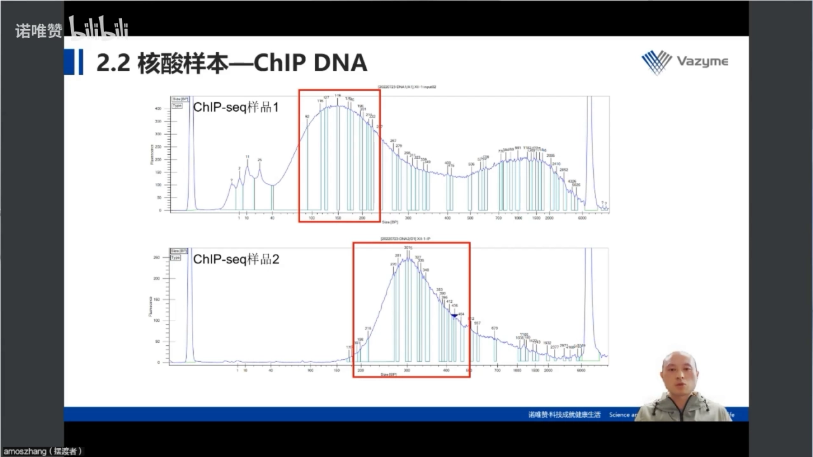

- **ChIP 样品 1**：有两个峰。150 bp 附近那个小峰其实是好的（片段化到位）；后面那个大峰是**不需要的**，它会进入文库、占据测序产量。
- **ChIP 样品 2**：只有一个主峰，而且正落在二代测序需要的范围内。

结论很实用：**片段分布不干净时（如样品 1），建库过程中必须加一步片段选择**，把目标片段回收回来；样品 2 这种已达标，但为了效率仍可做。[【跳转到 14:15】](https://www.bilibili.com/video/BV1pG4y137wC/?t=855)

### 3.5 样本 buffer 也会影响打断：EDTA 和离子残留要先问清楚

容易忽略的细节：不同试剂盒对 buffer 容忍度不同，**有的允许 EDTA、有的不允许**；提取体系残留的离子也会影响超声打断。选试剂盒时要先问「样本泡在什么 buffer 里」。[【跳转到 15:05】](https://www.bilibili.com/video/BV1pG4y137wC/?t=905)

### 3.6 RNA 样本：三条带、RIN、28S/18S 比例，最后要落到「看基线」

RNA 质检看完整性和 RIN（RNA Integrity Number）。讲者展示的一组样本 RIN 接近 9–10，凝胶电泳上 28S、18S、5S 三条带清晰——建出来的文库也相当好。[【跳转到 17:10】](https://www.bilibili.com/video/BV1pG4y137wC/?t=1030) [【跳转到 18:00】](https://www.bilibili.com/video/BV1pG4y137wC/?t=1080)

RIN 的阈值取决于建库类型（讲者的经验值）：[【跳转到 18:25】](https://www.bilibili.com/video/BV1pG4y137wC/?t=1105)

- **小 RNA 测序、lncRNA 测序**：RIN 应大于 8；
- **常规 mRNA 测序**：至少大于 7（或 6.5）才能用。

判断降解的核心判据是 **28S/18S 的比例**：正常、未降解的 RNA，28S 的峰应该是 18S 的两倍。

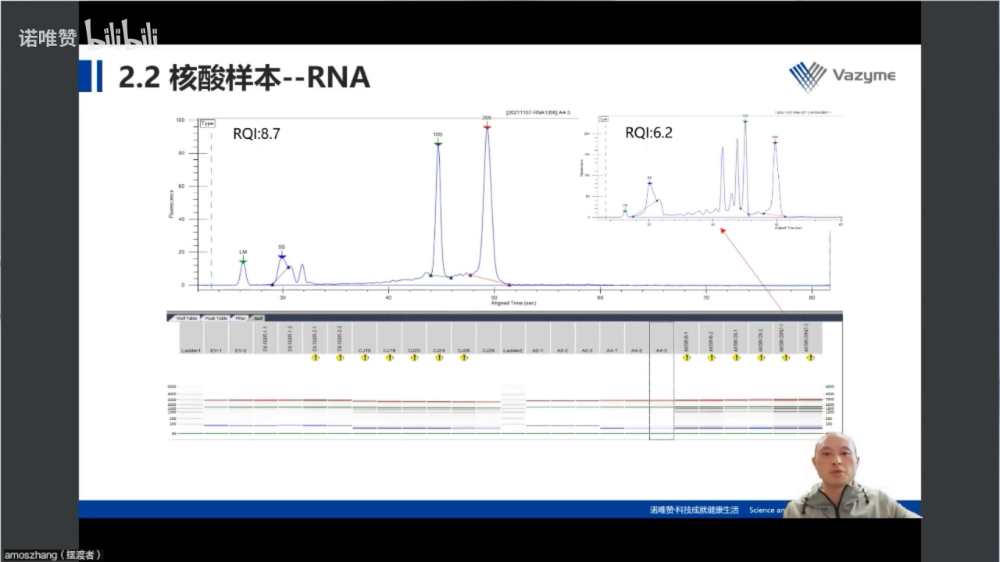

但当 18S 附近出现多条峰时，RIN 的数值会被干扰，这时候不能只看数字。讲者的办法是**看电泳图的基线**：红色基线以上的面积越大，说明小片段越多、降解越严重。他现场对比了几个样本（RQ 从低到高排序），最后那个 8.2 的样本基线以上面积很小，虽然数值不算漂亮，但样本其实是合格的。[【跳转到 20:26】](https://www.bilibili.com/video/BV1pG4y137wC/?t=1226) [【跳转到 21:16】](https://www.bilibili.com/video/BV1pG4y137wC/?t=1276)

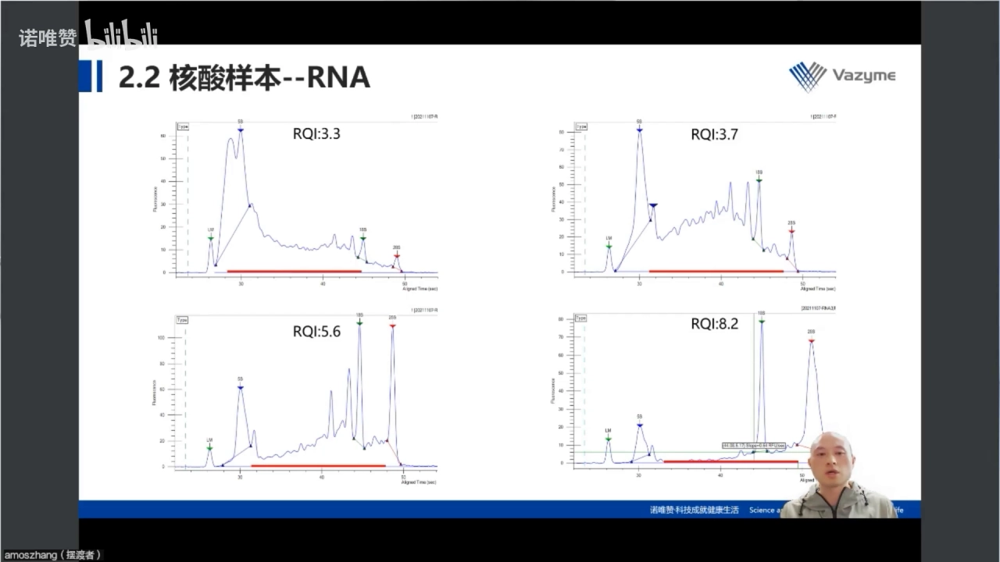

## 四、片段化：机械法、片段化酶法、转座酶法，选哪个取决于样本有多脏、有多少

### 4.1 超声打断的第一个问题是不稳定：六个样本里两个要重打

讲者的亲身经历：六个样本一起做，其中两个第一次没打好、要二次打断；更糟的是三个样本反复打——第一次一个达标两个不达标，第二次打完还有一个不达标。[【跳转到 27:03】](https://www.bilibili.com/video/BV1pG4y137wC/?t=1623) [【跳转到 27:25】](https://www.bilibili.com/video/BV1pG4y137wC/?t=1645)

代价不只是多打一次：每次打断后都要做片段检测，一上午就耗在三个样本上。讲者直言这「不是很经济」，后来陆续改用**片段化酶**或**转座酶**打断。[【跳转到 27:50】](https://www.bilibili.com/video/BV1pG4y137wC/?t=1670)

### 4.2 酶法的一致性优于超声，但机械法对脏样本更宽容

同一批样本做超声与片段化酶的对比，两者都能符合预期，但**片段化酶的一致性更好**。[【跳转到 28:15】](https://www.bilibili.com/video/BV1pG4y137wC/?t=1695)

讲者用一张表比较三种方法（杂质容忍度、投入量、便捷性、均一性）：

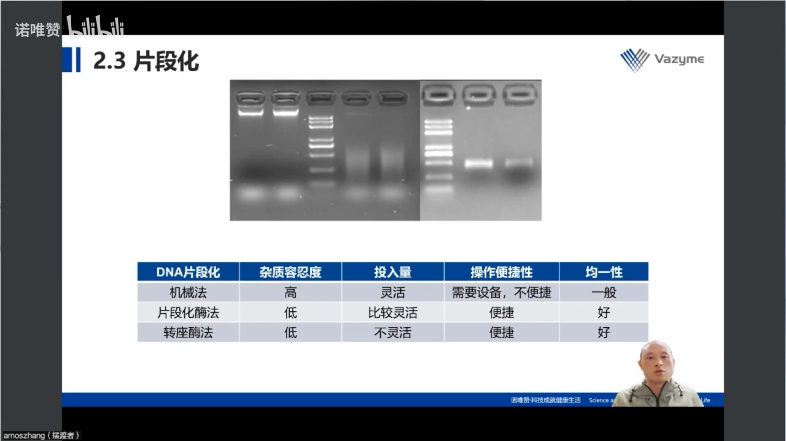

- **杂质容忍度**：机械法最高。样本里有蛋白、有 RNA 时，机械法是最稳的选择；代价是打断次数一多，效果就下来了。[【跳转到 29:05】](https://www.bilibili.com/video/BV1pG4y137wC/?t=1745)
- **投入量**：机械法最灵活，几十纳克到几微克都能打；片段化酶法也比较灵活（可到微克级）；转座酶法最不灵活，因为它受试剂盒规格限制——试剂盒有 50 ng、5 ng、1 µg 等不同版本。[【跳转到 29:20】](https://www.bilibili.com/video/BV1pG4y137wC/?t=1760)
- **规格错配会白做**：如果你只有 50 ng 规格的转座酶试剂盒，却投入 500 ng DNA，效果不会好；反过来，试剂盒是 50 ng 规格而样本不足 50 ng，同样会掉效率。[【跳转到 29:45】](https://www.bilibili.com/video/BV1pG4y137wC/?t=1785)
- **操作便捷性**：酶法胜出——不需要额外仪器设备。

一句话：**样本脏用机械法，干净、量少、想省时间用酶法**；转座酶法把片段化与连接合并，最省事，但要「投入量与规格匹配、样本可控」。

## 五、片段选择：建库流程里最容易「看起来做了、其实做错」的一步

### 5.1 打断之后是一片弥散，必须把 200–800 bp 那一段捞出来

片段化之后，DNA 呈弥散分布，跨度可能从一百多 bp 到两 kb。而建库要的是**窄的一段**：短端约 200 bp、长端约 800 bp。[【跳转到 30:35】](https://www.bilibili.com/video/BV1pG4y137wC/?t=1835) [【跳转到 30:49】](https://www.bilibili.com/video/BV1pG4y137wC/?t=1849)

手段主要有三种：**切胶**精度可以，但费时费力、得率偏低（最传统）；**片段分离系统**（如 Pippin）省时精准，一次分选 20–24 个样本，把「干一下午」压到「一小时」；**磁珠双选**精度稍差、范围偏宽，但**通量最高**——常规 96 孔板就能做。[【跳转到 31:14】](https://www.bilibili.com/video/BV1pG4y137wC/?t=1874) [【跳转到 31:39】](https://www.bilibili.com/video/BV1pG4y137wC/?t=1899) [【跳转到 32:04】](https://www.bilibili.com/video/BV1pG4y137wC/?t=1924)

### 5.2 双轮磁珠的原理：第一轮丢磁珠（去大），第二轮丢上清（去小）

磁珠优先结合大分子 DNA，所以用两轮不同比例「夹」出目标区间：**第一轮**少加磁珠，只让大片段结合，**丢弃磁珠**去大；**第二轮**多加磁珠，让含目标片段的产物都结合，**丢弃上清**去小。[【跳转到 32:24】](https://www.bilibili.com/video/BV1pG4y137wC/?t=1944)

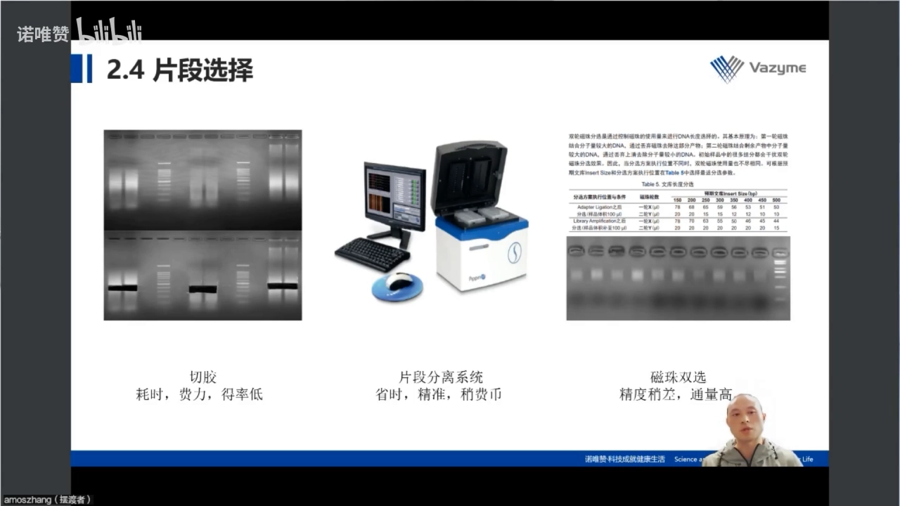

上图的表是这一节的实操核心：**执行位置不同（片段化后 / 接头连接后 / PCR 后），同一目标 insert size 对应的磁珠比例也不同**，不能凭记忆套比例。

### 5.3 磁珠比例没有「通用值」：同一套方案，不同人做出来不一样

两点提醒：[【跳转到 32:54】](https://www.bilibili.com/video/BV1pG4y137wC/?t=1974)

1. **必须自己做预实验**：不同厂家磁珠浓度不同，换品牌就要重新优化；同一套方案换个操作者，结果也会有差异。
2. **磁珠换代也会带来偏差**：长期用同一家试剂，某次「升级」后结果就偏了——很多人碰不到，碰到很难查。[【跳转到 33:28】](https://www.bilibili.com/video/BV1pG4y137wC/?t=2008)

### 5.4 时机决定比例：三个位置都能做片段选择，但代价不同

片段选择可以在三个位置做：片段化之后、接头连接之后、PCR 之后。[【跳转到 33:03】](https://www.bilibili.com/video/BV1pG4y137wC/?t=1983)

- **投入量多**（µg 级）：可在片段化后或接头连接后做，损失一点无所谓。
- **投入量少、甚至测不出浓度**：倾向放到 **PCR 之后**——前期每次纯化/分选都会损失 DNA，低投入经不起反复损失。[【跳转到 47:05】](https://www.bilibili.com/video/BV1pG4y137wC/?t=2825)

## 六、接头连接与 PCR：这里的风险都是「定量失衡」而不是「操作失败」

### 6.1 接头加太多，会变成二聚体去抢数据

接头用量按投入核酸量定。接头过量的两个后果：纯化不干净，以及形成**接头二聚体**（adapter dimer），影响定量与上机。[【跳转到 34:33】](https://www.bilibili.com/video/BV1pG4y137wC/?t=2073)

另一个易忽略点是 **index 的碱基平衡**：同一 run 内多个样本的 index 组合要避免过度相似，否则影响数据拆分；试剂盒说明书一般已给推荐组合，但「组合是否最优」要在建库前想清楚。[【跳转到 34:58】](https://www.bilibili.com/video/BV1pG4y137wC/?t=2098) [【跳转到 35:23】](https://www.bilibili.com/video/BV1pG4y137wC/?t=2123)

### 6.2 PCR 只看循环数，但循环数由「起始量 + 目标产量」共同决定

前面步骤都做得好时，PCR 唯一要决策的是**循环数**：投入量高少扩、低多扩；不够则产量不足，过多会引入偏向。[【跳转到 38:53】](https://www.bilibili.com/video/BV1pG4y137wC/?t=2333)

观众提问里专门有人问「测不出浓度时循环数怎么选」，讲者给了一个可操作的流程：[【跳转到 72:03】](https://www.bilibili.com/video/BV1pG4y137wC/?t=4323)

1. 先按试剂盒的推荐循环数做（例如 1 ng 起始，推荐 12 或 15 个循环）；
2. 做完立刻测浓度和片段质量；
3. 达标就停；不达标再补加循环，**补加幅度不要超过 5 个循环**。[【跳转到 72:28】](https://www.bilibili.com/video/BV1pG4y137wC/?t=4348)

### 6.3 一个真实事故：引物只加了一半，跑出双条带

讲者展示了一张「PCR 后出现两个条带」的胶图，并复盘了原因：那是早期做 Illumina 建库时的失误——**HiFi PCR mix 里的 PCR primer 只加了一半**，导致扩增过程中引物耗尽。引物一旦耗尽，文库两端相同的序列就会彼此退火、随机复性，形成「空泡状」的异常结构，在电泳上就表现为多出来的条带。[【跳转到 35:43】](https://www.bilibili.com/video/BV1pG4y137wC/?t=2143) [【跳转到 36:33】](https://www.bilibili.com/video/BV1pG4y137wC/?t=2193) [【跳转到 36:58】](https://www.bilibili.com/video/BV1pG4y137wC/?t=2218)

这种文库还能不能上机？讲者的判断是：**上机没有太大问题，但会影响文库定量，进而影响结果**。[【跳转到 37:23】](https://www.bilibili.com/video/BV1pG4y137wC/?t=2243)

### 6.4 实验环节总览：三个必须盯紧的位置

讲者用一张流程图小结，指出整条链真正需要盯紧的三处：**片段选择、加接头、MGI 的单链环化**。[【跳转到 46:15】](https://www.bilibili.com/video/BV1pG4y137wC/?t=2775)

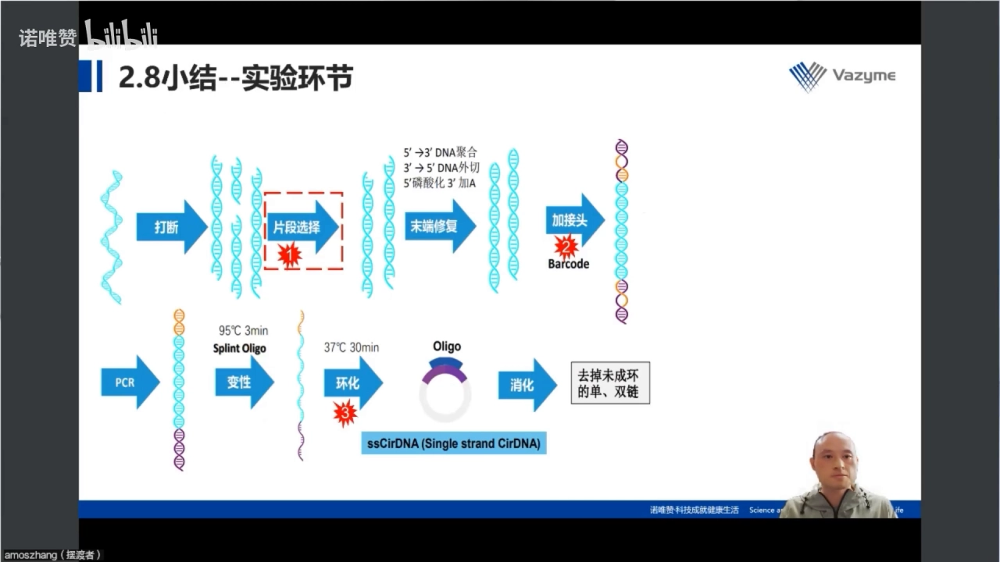

「酶活性」是常被忽略的变量：担心连接酶效率不好可延长反应时间；**单链环化本来就效率偏低**，延长反应时间也有帮助。[【跳转到 47:30】](https://www.bilibili.com/video/BV1pG4y137wC/?t=2850) [【跳转到 47:55】](https://www.bilibili.com/video/BV1pG4y137wC/?t=2875)

## 七、文库质控只有两道关：片段分布对不对、浓度够不够

### 7.1 片段分布：峰要圆滑、范围要落点、不能有杂峰

判定标准很直接：峰形是否圆滑、分布范围是否落在建库预期内、有没有杂峰。常用手段是毛细管电泳（Agilent 2100、Qsep 一类）。[【跳转到 41:11】](https://www.bilibili.com/video/BV1pG4y137wC/?t=2471) [【跳转到 41:36】](https://www.bilibili.com/video/BV1pG4y137wC/?t=2496)

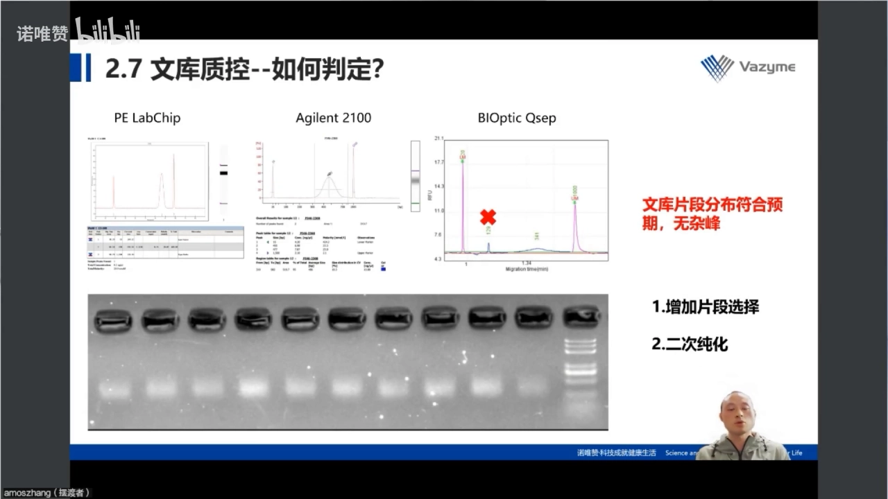

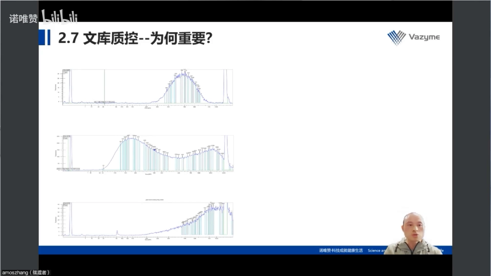

- **合格**（左图）：单峰、圆滑、落在预期区间。
- **不合格**（中图）：双峰且峰太宽（大的到 1 kb）——片段选择没做好，或样本分布特殊。
- **不合格**（右图）：整峰过宽，并有一个 **129 bp 的峰——接头二聚体**。[【跳转到 41:36】](https://www.bilibili.com/video/BV1pG4y137wC/?t=2496)

为什么必须清掉？理由是机制性的：**片段越短，在成簇和扩增时越优先**，129 bp 这个峰会严重抢占数据产出——你以为在测文库，实际测的是一堆空接头。[【跳转到 42:01】](https://www.bilibili.com/video/BV1pG4y137wC/?t=2521)

补救办法也不复杂：**再做一次片段选择或二次纯化**，把 129 bp 的短片段带走。[【跳转到 42:51】](https://www.bilibili.com/video/BV1pG4y137wC/?t=2571)

熟练后还有更快的初判：PCR 完、纯化完直接跑一次**凝胶电泳**，条带落在预计范围就基本 OK。[【跳转到 42:26】](https://www.bilibili.com/video/BV1pG4y137wC/?t=2546)

### 7.2 片段长度不只影响「好不好看」，直接决定数据产出

这是全片最重要的因果关系：三个片段分布不同的文库上机测序，第一个数据产出超预期，第二个**损失了 60%**，第三个**几乎没有数据产出**；补做片段选择后产量明显回升。[【跳转到 38:08】](https://www.bilibili.com/video/BV1pG4y137wC/?t=2288) [【跳转到 39:33】](https://www.bilibili.com/video/BV1pG4y137wC/?t=2373)

而且不同平台对片段长度的「容忍区间」不同：[【跳转到 39:58】](https://www.bilibili.com/video/BV1pG4y137wC/?t=2398) [【跳转到 40:23】](https://www.bilibili.com/video/BV1pG4y137wC/?t=2423)

- **MGI 平台**：文库长度超过 600 bp 的比例越高，产量至少减半；低于 200 bp 则不利于单链环化，产量也会下降。这与厂家给出的官方意见一致。
- **Illumina 平台**：200–800 bp 都能兼顾，但片段越短、产量占比越高。

所以文库质检不是流程洁癖：它是**上机前唯一能拦住数据损失的机会**。

### 7.3 浓度：Illumina 上机有最低要求，不够就要么加循环、要么重做

片段分布合格但浓度不够，是最常见的一类「半失败」。讲者给的参考值是 Illumina 上机对文库的最低要求大约在 **3 nM** 量级，差太远就无法上机。[【跳转到 43:21】](https://www.bilibili.com/video/BV1pG4y137wC/?t=2601)

如果样本珍贵、无法重新取样，还能抢救：**增加 PCR 循环数**。但加多少与样本的 qPCR 值相关，需要自己摸索，不能拍脑袋。[【跳转到 44:11】](https://www.bilibili.com/video/BV1pG4y137wC/?t=2651)

### 7.4 qPCR 的严格度：Cq 偏差 0.15 就要重做

讲者的操作纪律是：**Cq 误差应小于 0.15**，超过可能要重做；每次实验都加标准品，用标准曲线反推浓度，且标准品重复性必须好——他展示的三个时间点的标准品 Cq 几乎一致。[【跳转到 45:06】](https://www.bilibili.com/video/BV1pG4y137wC/?t=2706) [【跳转到 45:31】](https://www.bilibili.com/video/BV1pG4y137wC/?t=2731)

标准品其实是双保险，同时验证**标准曲线**、**试剂**与**仪器**；早期 qPCR 试剂问题多，现在按标准操作做基本不用担心。[【跳转到 45:56】](https://www.bilibili.com/video/BV1pG4y137wC/?t=2756)

## 八、把流程跑稳：整合、分挑、选参数——平台人员的三条经验

讲者日常一个人管整个平台，送样量从 1 个到 100 个都有，所以他的经验很偏工程化。他把「让客户拿到满意数据」拆成两方面的约束：**上量**（尽快出结果）与**下限**（试剂盒能不能做这么少的量）。[【跳转到 22:28】](https://www.bilibili.com/video/BV1pG4y137wC/?t=1348) [【跳转到 23:43】](https://www.bilibili.com/video/BV1pG4y137wC/?t=1423)

他甚至用帕博（Svante Pääbo）获诺贝尔奖做类比：即便拿到了尼安德特人的 DNA，如果没有合适的建库试剂盒把它做出来并测序，也拿不到结果。[【跳转到 23:43】](https://www.bilibili.com/video/BV1pG4y137wC/?t=1423)

具体是三件事：[【跳转到 24:08】](https://www.bilibili.com/video/BV1pG4y137wC/?t=1448)

1. **整合（并流程）**：把不同文库类型的共同步骤并起来。比如 lncRNA 与 mRNA 建库，某一步之后可合并操作，一天推进多种建库。[【跳转到 24:58】](https://www.bilibili.com/video/BV1pG4y137wC/?t=1498)
2. **挑（分批）**：按浓度分组同步操作。浓度差异大时（µg 级 vs 10 ng）必须调整，否则同批一定有人掉队。[【跳转到 25:23】](https://www.bilibili.com/video/BV1pG4y137wC/?t=1523)
3. **选（定参数）**：选分选方式与时机、PCR 循环数。投入量不同，分选时机不同，文库得率也不同。[【跳转到 25:48】](https://www.bilibili.com/video/BV1pG4y137wC/?t=1548)

另外三条「非技术但很要命」的提醒：

- **看原版操作说明，别只看 SOP**。SOP 统一动作，但「为什么」在原版 protocol 里。[【跳转到 49:10】](https://www.bilibili.com/video/BV1pG4y137wC/?t=2950)
- **横向对比不同品牌试剂**。讲者做了 10 年 NGS 建库、比较过十个以上品牌，现在能判断用哪套试剂、在哪一步做片段选择。[【跳转到 50:00】](https://www.bilibili.com/video/BV1pG4y137wC/?t=3000)
- **警惕试剂盒「换代」**。厂家说「性能和操作一样」，实际常有细微差异；碰到问题及时找技术支持。[【跳转到 50:25】](https://www.bilibili.com/video/BV1pG4y137wC/?t=3025)

## 九、手动还是自动化：通量逼着人做选择，但成本又把手按住了

### 9.1 三个变量同时推高了「日通量」的要求

讲者的判断很干脆：**测序成本下降、交付周期收紧、仪器通量暴涨**三者叠加，「文库制备的日吞吐量」成了产能与成本瓶颈。[【跳转到 51:15】](https://www.bilibili.com/video/BV1pG4y137wC/?t=3075) [【跳转到 51:45】](https://www.bilibili.com/video/BV1pG4y137wC/?t=3105)

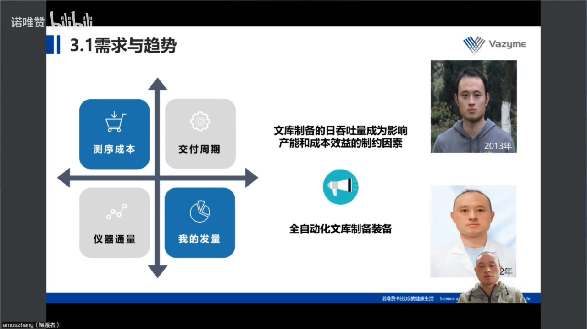

具体感受：一张芯片产出从早期零点几 G，涨到七百多 G，再到近年数个 T；华大 T7 一张芯片约 1.5 T。芯片越能装，凑样本要求越高——以前十几个样本够一张，现在可能要几百个。[【跳转到 51:45】](https://www.bilibili.com/video/BV1pG4y137wC/?t=3105) [【跳转到 52:35】](https://www.bilibili.com/video/BV1pG4y137wC/?t=3155)

所以：一天只能做 10 个样本，测 100 个就得等两周；一天能做 100 个，第三天就能出数据。**建库速度直接决定交付周期**。

### 9.2 自动化的收益很明确：96 通道 + 解放 90% 手工

平台配了华大制造的 960（MGISP-960）96 通道自动化系统。收益具体：单枪加样要吸 96 次，工作站一次解决；每天能干 96 个样本，**接近 90% 手工操作被解放**。[【跳转到 54:15】](https://www.bilibili.com/video/BV1pG4y137wC/?t=3255) [【跳转到 54:25】](https://www.bilibili.com/video/BV1pG4y137wC/?t=3265)

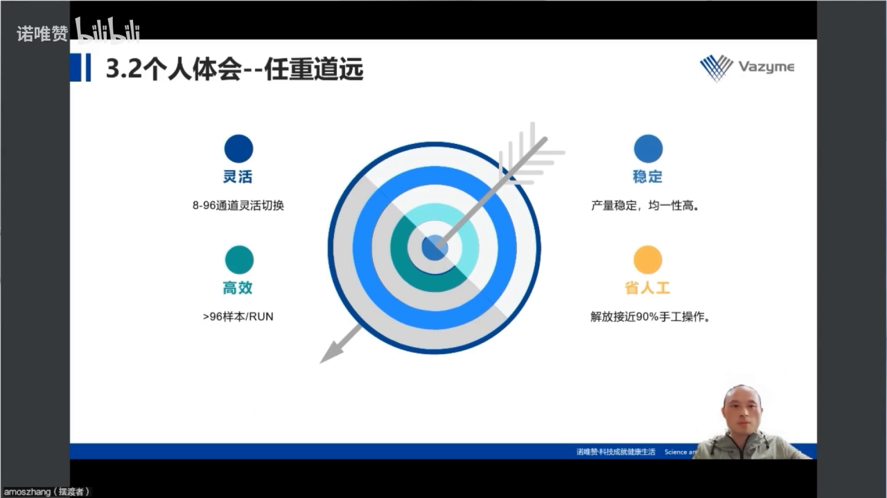

### 9.3 自动化的代价：粘稠试剂损耗 30%–50%，一个 kit 只能做一半

讲者很务实：测序成本降了，但经费也紧。自动化工作站普遍的问题是**试剂消耗偏高**——个别粘稠试剂（尤其连接酶类）损耗可达 30%–50%，一个 96 人份 kit 只能做一半项目。[【跳转到 55:40】](https://www.bilibili.com/video/BV1pG4y137wC/?t=3340)

所以他的建议带条件：**企业样本量大，工作站帮助很大；一般研究单位上工作站要谨慎**。[【跳转到 56:05】](https://www.bilibili.com/video/BV1pG4y137wC/?t=3365)

### 9.4 手动通量可以靠「SOP 优化 + 排枪 + 熟练度」拉到接近自动化

既然自动化不一定划算，讲者走了另一条路：把**手动日通量**做上去。他的经验是四件事：[【跳转到 56:51】](https://www.bilibili.com/video/BV1pG4y137wC/?t=3411) [【跳转到 57:25】](https://www.bilibili.com/video/BV1pG4y137wC/?t=3445)

- **优化 SOP**：把能并的步骤并起来，减少等待与重复；
- **升级设备**：能提高通量的小设备值得投；
- **反复打磨**：熟练度是最便宜的加速器（过程痛苦）；
- **持续升级试剂盒**：迭代本身在帮你省时间——但日通量上去，试剂消耗也跟着上去。

而真正把「手动」拉到接近工作站水平的关键动作，是**把单枪换成排枪**。[【跳转到 58:40】](https://www.bilibili.com/video/BV1pG4y137wC/?t=3520)

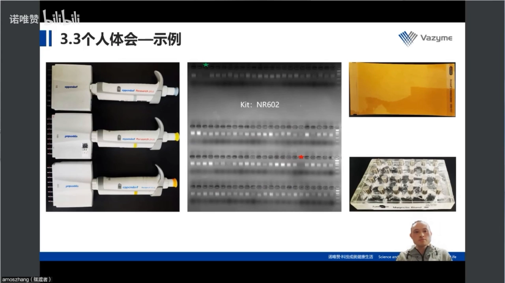

讲者展示了一张很早的作品：用同一套试剂做 96 个样本，胶图上大部分样本亮度一致，只有一个样本（星标）有缺失。他的提醒是——看这类图时先别急着怀疑流程，**亮度差异也可能是因为这块板里混进了「纯化后残留的回收板」，样本来源不同**。[【跳转到 59:11】](https://www.bilibili.com/video/BV1pG4y137wC/?t=3551) [【跳转到 60:01】](https://www.bilibili.com/video/BV1pG4y137wC/?t=3601)

### 9.5 一个人的真实产能：一周四张芯片

讲者最后给了产能画面：MGI（DNBSEQ-T7）一次跑四张芯片、合计约 6 T 数据，有时两天两张、有时一次四张，而这些文库都是他一个人一周内做完的。[【跳转到 60:31】](https://www.bilibili.com/video/BV1pG4y137wC/?t=3631) [【跳转到 60:56】](https://www.bilibili.com/video/BV1pG4y137wC/?t=3656)

这其实是前面所有经验的总答卷：**流程整合 + 参数标准化 + 排枪 + 熟练度**，能把一个人的平台推到过去小团队的量级。

## 十、常见问题排查：从现象倒推原因

讲者在问答环节回答的问题，基本覆盖了建库现场最常见的失败形态。把「现象 → 原因 → 处置」整理成一张表，可以当上机前的检查清单用：

| 现象 | 最可能的原因 | 处置 |
| --- | --- | --- |
| 片段分布偏小 | 第一轮磁珠加多（相对目标片段偏小） | 磁珠少加一点，重做预实验定比例 [【跳转到 68:18】](https://www.bilibili.com/video/BV1pG4y137wC/?t=4098) |
| 峰太宽 / 双峰 | 片段选择不到位，或样本片段化本身不均一 | 补做片段选择；能重做就从头重做 [【跳转到 72:53】](https://www.bilibili.com/video/BV1pG4y137wC/?t=4373) |
| 出现 129 bp 杂峰 | 接头二聚体 | 二次纯化或再做一次片段选择 [【跳转到 42:51】](https://www.bilibili.com/video/BV1pG4y137wC/?t=2571) |
| PCR 后出现双条带/空泡结构 | PCR 引物量不足，引物耗尽后随机复性 | 检查配液；此类文库仍可上机但定量会偏 [【跳转到 36:58】](https://www.bilibili.com/video/BV1pG4y137wC/?t=2218) |
| 浓度不够上机 | 起始量低、循环数偏少、纯化损失 | 先按推荐循环数做，再最多补 5 个循环 [【跳转到 72:28】](https://www.bilibili.com/video/BV1pG4y137wC/?t=4348) |
| 环化效率低（MGI） | 单链环化本身效率偏低、酶活或时间不足 | 适当延长反应时间 [【跳转到 47:55】](https://www.bilibili.com/video/BV1pG4y137wC/?t=2875) |
| 环化后浓度异常高 | 消化不彻底，不是「环化得好」 | 别只看浓度；200 ng 双链投入、21 µL 洗脱时浓度 1–3 较正常 [【跳转到 71:13】](https://www.bilibili.com/video/BV1pG4y137wC/?t=4273) |
| 数据产出腰斩 | 片段长度超出平台兼容区间，或短片段抢产量 | 上机前看片段分布，不合格不上机 [【跳转到 39:58】](https://www.bilibili.com/video/BV1pG4y137wC/?t=2398) |
| 96 孔板个别孔信号缺失 | 加样遗漏、排枪贴壁、样本来源不同 | 逐孔核查；排枪操作要统一贴壁位置 [【跳转到 60:01】](https://www.bilibili.com/video/BV1pG4y137wC/?t=3601) |

还有一个常被问到的换算问题：**MGI 的环化效率怎么算**？讲者的答案是——环化只作用于双链 DNA 的一条链，所以效率 = ssDNA 量 ÷（双链投入量 × 1/2）。例如投入 200 ng 双链 DNA，最理想也只有 100 ng 能被环化。[【跳转到 76:13】](https://www.bilibili.com/video/BV1pG4y137wC/?t=4573)

## 十一、起始量决定建库策略：从「风险建库」到 PCR-free（编者补充）

讲者强调试剂盒的**投入量下限**，并把低于推荐起始量的建库称为「风险建库」：他遇到过 Qubit 测不出浓度（标注小于 0.05 ng/µL）的 ChIP 样本，用贴近下限的试剂盒做扩增与片段双选，仍拿到可用数据。[【跳转到 15:55】](https://www.bilibili.com/video/BV1pG4y137wC/?t=955) [【跳转到 62:26】](https://www.bilibili.com/video/BV1pG4y137wC/?t=3746)

可推出的选型原则：**起始量越高，越有资格「少扩」甚至「不扩」**。常规建库的 PCR 是为了把文库放大到上机要求，但扩增会引入长度偏向和重复序列；样本充足、质量好（如 µg 级 gDNA）可选 **PCR-free**，跳过扩增换更均匀的覆盖；微量或降解样本（FFPE、cfDNA、ChIP）只能走扩增型建库，并把循环数当作核心变量。（此段为编者补全，原片未展开。）

## 十二、这套「文库」和 CRISPR 文库筛选是什么关系（编者补充）

本系列的另一篇讲的是 **CRISPR 文库筛选**，两条视频标题里都有「文库」，但含义完全不同，容易混淆：

- **本讲的「文库」= 测序文库（sequencing library）**：把**一个样本**的 DNA 打断、加接头，做成能被测序仪读的一批分子，目标是忠实读出这个样本的序列。
- **CRISPR 的「文库」= 混合质粒文库（pooled library）**：把几万到几十万条 sgRNA 装进一个质粒池转染细胞，目标是让每个细胞随机拿到一个扰动。

连接点在**读出**：筛选结束时判断哪些 sgRNA 变少（细胞死了）或变多（细胞富集了），做法是把筛选前后样本的 sgRNA 区域扩增、加 index、做成**测序文库**，再用 NGS 数每条 sgRNA 的 reads。所以**筛选的定量可靠性直接建立在建库质量上**：接头二聚体会抢走本该属于 sgRNA 的 reads；片段选择不当会让文库超出平台兼容区间、产量减半；index 组合不平衡会让样本间数据拆不干净；循环数过多会让丰度分布被扩增偏向扭曲——而筛选结论正是对丰度差异的判读。

## 小结

- **建库只做三件事**：剪到平台能读的长度、贴上接头与 index、把长度分布与浓度控到上机标准。
- **样本质量是先天条件**：降解、蛋白与 RNA 污染会同时破坏超声打断和磁珠纯化；电泳图看三处：点样孔（蛋白）、最下方（RNA）、主带（降解）。
- **RNA 别只看 RIN**：28S/18S 比例、18S 附近的多峰、基线以上的面积，往往比一个数字更能判断降解。
- **片段化按「脏不脏、有多少」选**：机械法耐杂质但需设备；酶法一致性好、便捷；转座酶法省事但受规格限制。
- **片段选择是被低估的关键步**：切胶、分离系统、磁珠双选在精度与通量上互补；磁珠比例随时机变化，必须做预实验。
- **失败大多来自定量失衡**：接头过量→二聚体；index 不平衡→拆不开样；循环数不当→产量或偏向；环化时间不足→产量掉。
- **质控是最后一道闸**：分布不合格、浓度不够，宁可不上机；数据腰斩的代价远大于重做文库。
- **通量靠工程化**：流程整合、按浓度分批、SOP + 排枪 + 熟练度，能把一个人的平台推到一天 96 个样本。

## 关键术语速查

| 术语 | 一句话解释 |
| --- | --- |
| NGS | 二代高通量测序，一次并行读几百万到几十亿条短序列 |
| 边合成边测序（SBS） | Illumina 的核心技术：边掺入荧光碱基边读取序列 |
| DNB / cPAS | 华大制造的核心技术：环状文库滚环扩增成 DNA 纳米球，探针锚定聚合读取 |
| WGS | 全基因组测序，本讲建的正是 WGS 的标准文库 |
| 插入片段（insert） | 文库中间那段来自样本、真正被测序的 DNA |
| 接头（adapter） | 连在插入片段两端的通用序列：P5/P7 + index + 测序引物位点 |
| index（barcode） | 样本标签，用于把混测的数据拆回各样本 |
| A 尾 / T-A 连接 | 末端修复后加 A，与接头突出的 T 配对连接 |
| 末端修复 | 把打断产生的粘性末端整理成可连接的平末端 |
| 片段选择 | 把文库长度收敛到目标区间（200–800 bp）的步骤 |
| 磁珠双选 | 用两轮不同比例磁珠「夹」出目标片段：第一轮去大、第二轮去小 |
| 接头二聚体 | 接头自连形成的 ~129 bp 短片段，会抢占测序产量 |
| PCR-free | 不经过 PCR 扩增的建库策略，适合起始量充足的样本 |
| RIN / RQ | RNA 完整性数值，越高越完整；小 RNA/lncRNA 建库宜 > 8，mRNA 宜 > 7 |
| 单链环化（ssCir） | MGI 建库独有步骤：双链文库变性后环化成单链环状 DNA |
| DNB | DNA 纳米球，MGI 上机前的文库形态 |
| Cq | qPCR 的定量循环数，用于反推文库浓度 |
