# 玩转慢病毒：从高效载体构建到稳定细胞株构建

> **来源**：Bilibili《20260917直播回放-玩转慢病毒：从高效载体构建到稳定细胞株构建》，UP 主 小恒学术（汉恒生物），时长 48:29，[BV11veg6ZEnb](https://www.bilibili.com/video/BV11veg6ZEnb/)。本文属 `content/虚拟细胞` 系列的「实验基础」部分：全基因组 CRISPR 文库要包装成慢病毒才能递送进细胞，这一篇讲的就是「包装—测滴度—感染—建稳转株」这一整条链路。
> **说明**：原片是厂商直播讲座，开头与结尾含公司介绍、产品推介与抽奖活动，本笔记只整理技术内容，不复述广告段落。

## 本讲要解决的核心问题（SCQA）

**背景**：要把一段外源序列（过表达基因、shRNA、sgRNA）**长期、稳定**地放进细胞里，慢病毒是实验室最常用的递送工具——因为它会把序列整合进基因组，跟着细胞分裂传下去。

**冲突**：慢病毒来自 HIV，用起来要同时操心三件事：包装系统够不够安全、载体构建能不能一次做对、滴度和感染条件能不能摸准。任何一环不到位，最后看到的现象都一样：没有荧光、没有稳转株，而且不知道错在哪一步。

**疑问**：一套完整的慢病毒实验由哪几个环节组成？每个环节的关键参数是什么？失败时该按什么顺序排查？

**回答（中心思想）**：整条链路可以拆成「**选/建穿梭质粒 → 与包装质粒共转染 293T 包装 → 收毒浓缩 → 荧光法测滴度 → 按 MOI 感染 → 抗生素筛出稳转株**」。慢病毒包装系统的三代演进，本质是**不断删掉毒力基因、不断把质粒拆细**（一代三质粒→二代三质粒→三代四质粒），代价是滴度递减，所以目前主流仍是二代三质粒；而实验失败的原因，绝大多数都落在几个可控参数上——**纯度、比例、浓度、细胞状态、观察时间**。

---

## 一、慢病毒是什么：一个能整合进基因组的递送工具

### 1.1 九个基因、四类功能

慢病毒来源于 HIV，属于**逆转录病毒科**，最关键的生物学特性是**可以整合到宿主基因组上**——所以它最大的用途就是构建稳转株（[跳转到 03:01](https://www.bilibili.com/video/BV11veg6ZEnb/?t=181)）。

它的基因组主要有九个基因，可以分成四类（[跳转到 03:24](https://www.bilibili.com/video/BV11veg6ZEnb/?t=204)）：

| 类别 | 基因 | 编码什么 |
| --- | --- | --- |
| 结构基因 | **gag** | MA 基质蛋白、NC 核衣壳蛋白、CA 衣壳蛋白（p24）等核心蛋白 |
| 酶基因 | **pol** | 蛋白酶 PR、逆转录酶 RT、整合酶 IN |
| 包膜基因 | **env** | 包膜糖蛋白（表面蛋白 gp120、跨膜蛋白 gp41） |
| 调节/辅助基因 | **tat、rev** + **vif、vpr、vpu、nef** | 调控表达、对抗宿主免疫 |

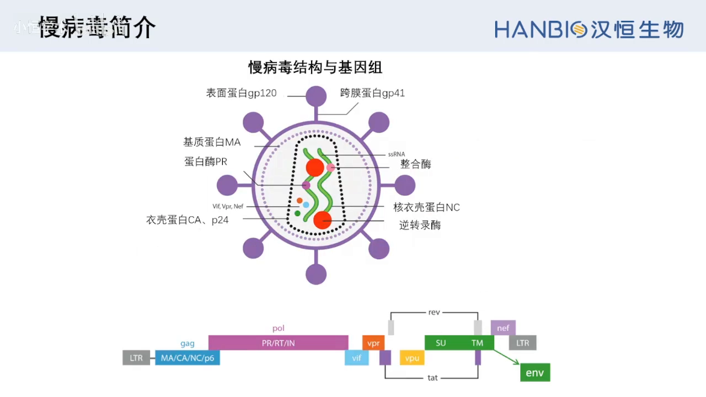

### 1.2 两端的 LTR 和中间的包装信号，决定了「载体」能做什么

把病毒基因组摊开看（[跳转到 04:39](https://www.bilibili.com/video/BV11veg6ZEnb/?t=279)）：两端各有一个 **LTR**，负责转录、逆转录与整合；两个 LTR 之间是病毒 RNA 序列；此外 5′ LTR 与 gag 之间还有一个**包装信号**，负责把病毒 RNA 装进衣壳里（[跳转到 05:04](https://www.bilibili.com/video/BV11veg6ZEnb/?t=304)）。

这条结论很重要：后面我们自己设计的「穿梭质粒」，只要保留 **5′ LTR、3′ LTR、包装信号** 这三个元件，就能被包装进病毒颗粒、并被 delivered 到靶细胞里——而病毒复制所需的蛋白，则全部由另外几个「包装质粒」提供（反式互补）。

---

## 二、包装系统的三代演进：删毒力基因、拆细质粒

理解了 HIV 感染细胞的原理，包装系统的设计逻辑就清楚了：**把 HIV 的九个基因拆到几个质粒上，用的时候一起转进 293T，凑出一个只能感染一次、不能自我复制的病毒**（[跳转到 05:22](https://www.bilibili.com/video/BV11veg6ZEnb/?t=322)）。

### 2.1 一代：三质粒 + 把 env 换成 VSV-G

第一代包装系统分成**三个质粒**，研究者把 HIV 的九个基因分别构建在这三个质粒上（[跳转到 05:47](https://www.bilibili.com/video/BV11veg6ZEnb/?t=347)）。其中最重要的改动是**换包膜**：

- 原来的包膜基因 **env** 编码 HIV 的包膜蛋白，它的受体是 **CD4**，而 CD4 只在 T 细胞和巨噬细胞中表达——不换的话，慢病毒只能感染这两类细胞，作为基因递送工具的使用范围太小；
- 因此换成 **VSV-G**（水泡性口炎病毒的外壳糖蛋白），它的受体是 **LDLR（低密度脂蛋白受体）**，在很多哺乳动物细胞上都有，于是慢病毒就能感染多种细胞类型（[跳转到 06:37](https://www.bilibili.com/video/BV11veg6ZEnb/?t=397)）。

但一代保留了全部九个基因，其中包括毒性/辅助基因，所以**安全性低**。

### 2.2 二代：删掉四个辅助基因，成为今天的主流

第二代在一代基础上删除了四个对包装没有作用的毒性因子——**vif、vpr、vpu、nef**，安全性明显提高（[跳转到 07:02](https://www.bilibili.com/video/BV11veg6ZEnb/?t=422)）。它仍然是**三质粒系统**。

### 2.3 三代：再删 tat、拆成四质粒，安全性最高但滴度略低

第三代在二代基础上又删除了 **tat** 基因，并把包装质粒再拆分为两个（其中一个单独提供 rev），形成**四质粒系统**，安全性进一步提高（[跳转到 07:27](https://www.bilibili.com/video/BV11veg6ZEnb/?t=447)）。

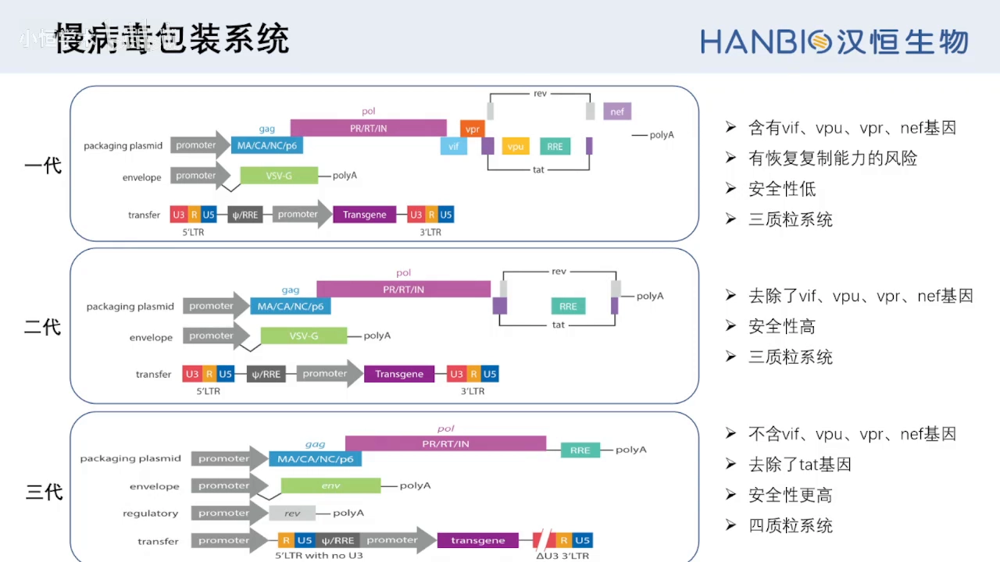

**为什么主流是二代三质粒？** 因为它兼顾了滴度与安全性：安全性已经够用，而滴度比三代更高（[跳转到 07:46](https://www.bilibili.com/video/BV11veg6ZEnb/?t=466)）。这也是「越安全不一定越好用」的典型例子——拆得越细，包装效率越低。

### 2.4 三个质粒各提供什么

| 质粒 | 提供 | 作用 |
| --- | --- | --- |
| **穿梭质粒**（transfer vector） | 目的序列 + 5′LTR/3′LTR + 包装信号 | 被包装的对象，决定「递送什么」 |
| **psPAX2** | gag、pol、rev、tat | 提供病毒组装的核心蛋白与酶，是「包装机器」（[跳转到 08:11](https://www.bilibili.com/video/BV11veg6ZEnb/?t=491)） |
| **pMD2.G** | VSV-G | 提供包膜蛋白，决定「能感染哪些细胞」 |

---

## 三、穿梭质粒：载体构建的舞台

### 3.1 必备元件与其分工

不管选哪一款穿梭质粒，它都要具备慢病毒载体的特征元件。以视频里的 pHBLV 系列为例（[跳转到 08:35](https://www.bilibili.com/video/BV11veg6ZEnb/?t=515)）：

| 元件 | 作用 |
| --- | --- |
| **5′ LTR / 3′ LTR** | 允许病毒 RNA 转录并被包装成病毒；3′ LTR 还含转录终止所需的聚腺苷酸化信号 |
| **包装信号（Ψ）** | 把病毒 RNA 装进衣壳，缺了就装不进去 |
| **RRE** | Rev 蛋白结合位点，介导依赖 Rev 的病毒 RNA 核输出 |
| **启动子（CMV/EF1α 等）** | 驱动目的基因在靶细胞里表达 |
| **WPRE** | 增强病毒在包装细胞中的稳定性、提高滴度，也提高转基因表达 |
| **ori** | 让质粒在大肠杆菌里复制扩增 |
| **SV40 poly(A)** | 让 mRNA 转录终止并加 poly(A) 尾 |

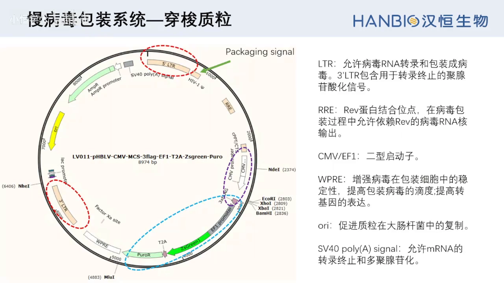

### 3.2 启动子与标记怎么选：先想清「实验目的是什么」

穿梭质粒有非常多组合，选择依据就是实验目的（[跳转到 09:25](https://www.bilibili.com/video/BV11veg6ZEnb/?t=565)）：

- **做过表达**：选 2 型（RNA 聚合酶 II）启动子，常用 **CMV、CBH、EF1α**；
- **做干扰（shRNA）或 CRISPR 的 sgRNA**：选 3 型（RNA 聚合酶 III）启动子，常用 **U6**；
- **要不要融合荧光**：做定位或分选可融合 EGFP、ZsGreen；只做 WB/IP 则用 Flag、His 等标签，也可以选非融合荧光的载体；
- **要不要抗性**：真核抗性可选 **Puro、Neo** 等——这是后面筛稳转株的抓手。

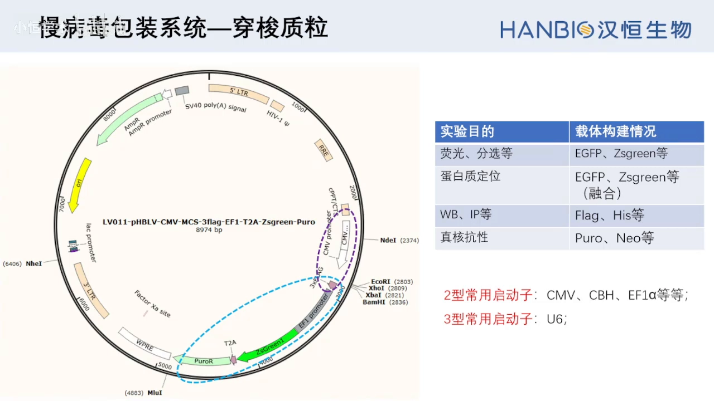

### 3.3 载体构建：两种克隆路线，按「要不要酶切位点」来选

载体构建要用**分子克隆**技术，视频把它比作「生物学界的分子剪切」，五个字概括：**分、切、接、转、筛**——分（拿到目的片段）、切（把环状质粒切开线性化）、接（片段与载体连接）、转（转化大肠杆菌扩增）、筛（挑阳性克隆）（[跳转到 12:07](https://www.bilibili.com/video/BV11veg6ZEnb/?t=727)）。

其中「接」是最关键的环节，有两条技术路线（[跳转到 12:57](https://www.bilibili.com/video/BV11veg6ZEnb/?t=777)）：

| 维度 | 传统分子克隆（酶切连接） | 无缝克隆（同源重组） |
| --- | --- | --- |
| 流程 | 繁琐，多达八步，中间需多次纯化 | 仅四步 |
| 是否受酶切位点限制 | 是（找不到位点就做不了，片段内部有该位点也不行） | 否，可在任意位置插入任意序列 |
| 载体去磷酸化 | **必须**做 | 不需要 |
| 一次插入片段数 | 一次只能插一个 | 单个或多个（视频称最多可达 10 个） |
| 操作时间 / 克隆效率 | 长 / 较低 | 短 / 单片段可达 95% 以上 |
| 接口处 | 会留下酶切位点「疤痕」 | 不留任何多余核苷酸 |

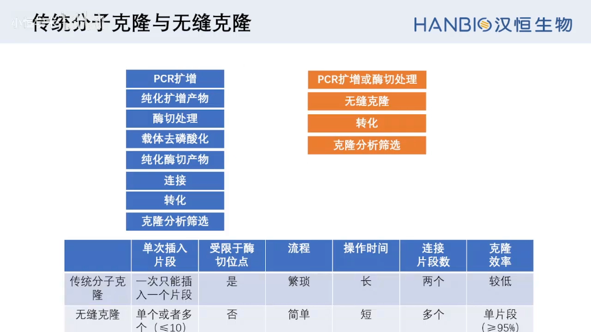

无缝克隆的关键不是酶，而是**引物上的同源臂**：片段两端各加 **15~25 bp** 与线性化载体（或相邻片段）一致的序列，50 ℃ 反应 15–20 分钟即可完成连接（[跳转到 14:44](https://www.bilibili.com/video/BV11veg6ZEnb/?t=884)）。多片段组装时，把最终环状质粒按顺序在纸上摊开，让相邻片段的 3′ 端与 5′ 端共享一段 15~25 bp 同源序列就行——视频反复强调「顺序一定要画出来」，这里设计错，后面全白做（[跳转到 15:34](https://www.bilibili.com/video/BV11veg6ZEnb/?t=934)）。

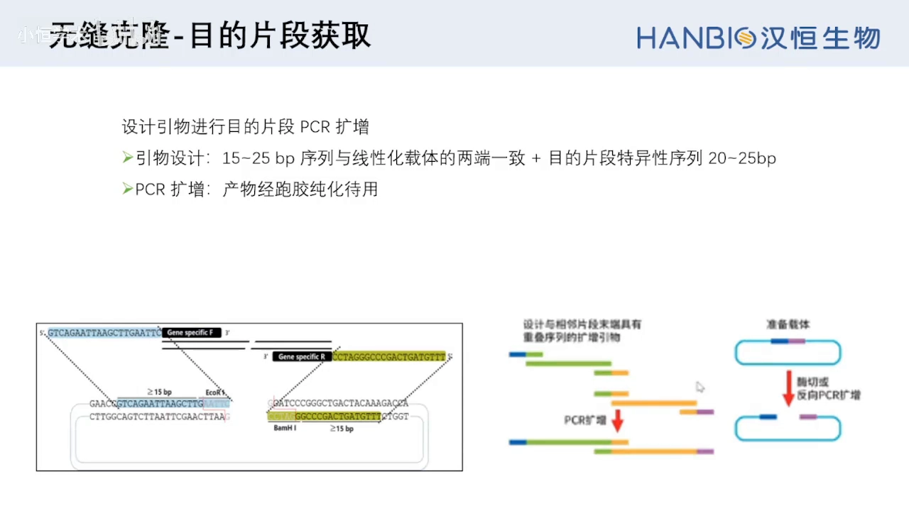

载体的线性化也有两条路：酶切（单/双酶切）或者**质粒 PCR**（在插入位点两端设计背对背引物直接扩增整个载体）。单酶切易切割不完全、易自连，假阳性高；双酶切能降低自连、提高阳性率（[跳转到 15:59](https://www.bilibili.com/video/BV11veg6ZEnb/?t=959)）。

---

## 四、包装：293T 细胞 + 三质粒共转染

### 4.1 为什么包装细胞固定是 293T

293T 是 HEK-293 细胞株插入 **SV40 大 T 抗原**之后得到的衍生株。大 T 抗原能增强穿梭质粒上 **SV40 ori** 的活性，使质粒在细胞核内大量复制，从而极大提高病毒包装所需的蛋白与病毒 RNA 的表达量，最终得到高滴度病毒（[跳转到 10:29](https://www.bilibili.com/video/BV11veg6ZEnb/?t=629)）。

对细胞状态的要求也很硬：生长旺盛、状态良好，**尽量用 10 代以内的细胞，不要超过 20 代**。细胞传代次数过多，包装滴度会明显下降。

### 4.2 转染前的质粒准备：浓度、纯度、扩增菌株

- **浓度**：质粒浓度不要低于 **1 µg/µl**；
- **纯度**：A260/A280 尽量在 **1.7–1.8**；推荐用**无内毒素大提试剂盒**制备，因为内毒素会显著降低转染效率，最终拖垮滴度（[跳转到 19:35](https://www.bilibili.com/video/BV11veg6ZEnb/?t=1175)）；
- **扩增菌株**：辅助包装质粒用普通 DH5α 扩增即可，但**穿梭质粒建议用 Stbl3**，以防止 LTR 之间发生重组、把载体「缩掉」。

### 4.3 五天的包装流程

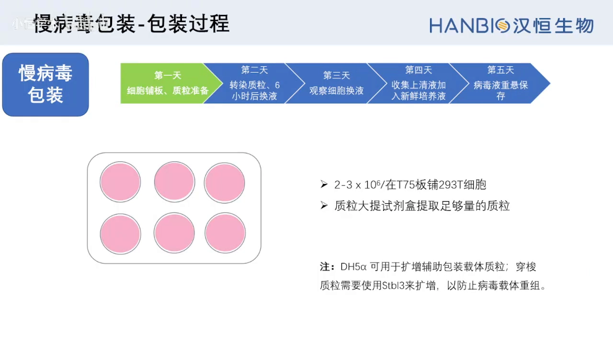

| 时间 | 做什么 | 关键参数 |
| --- | --- | --- |
| 第一天 | 铺 293T + 质粒大提 | T75 瓶，接种 2–3×10⁶ 个细胞（讲者口述常按 5×10⁶ 铺，需按细胞状态调整） |
| 第二天 | 三质粒共转染 | psPAX2 10 µg + pMD2.G 10 µg + 穿梭质粒 10 µg（见下图） |
| 第二天 +6 h | 换液 | 去掉转染混合物，降低毒性 |
| 第三天 | 观察细胞、换液 | 看细胞状态与荧光 |
| 第四天 | 第一次收毒 | 收集含病毒上清，补加新鲜培养液 |
| 第五天 | 第二次收毒 | 再次收集上清，合并或分别处理 |

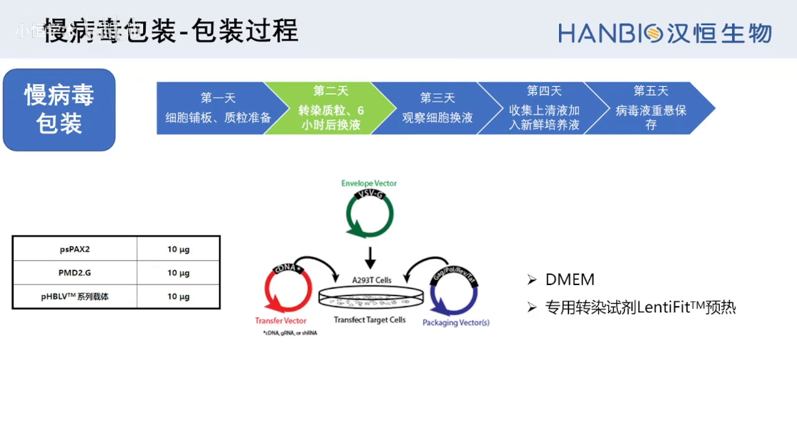

转染后 **48 小时和 72 小时分两次收毒**，是因为病毒在细胞里持续产生、上清中的病毒也在累积与衰减，两次收集能拿到更多总量（[跳转到 20:50](https://www.bilibili.com/video/BV11veg6ZEnb/?t=1250)）。

### 4.4 浓缩与保存：过滤、超速离心、分装

收好的病毒上清先过 **0.45 µm 滤器**去掉细胞碎片，然后放入 40 ml 超速离心管，**4 ℃、72000 g 离心 120 分钟**；弃上清后用 **500 µl** 新鲜培养基重悬沉淀，分装保存于 **−80 ℃ 或液氮**（[跳转到 21:15](https://www.bilibili.com/video/BV11veg6ZEnb/?t=1275)）。分装的意义是避免反复冻融——每冻融一次，滴度都会掉一截。

---

## 五、滴度测定：用荧光法算出「每毫升有多少个可感染的病毒颗粒」

慢病毒滴度有三类测法（[跳转到 21:40](https://www.bilibili.com/video/BV11veg6ZEnb/?t=1300)）：

| 类型 | 方法 | 说明 |
| --- | --- | --- |
| 物理滴度 | qPCR、ELISA | 数病毒颗粒/衣壳蛋白，不代表能感染 |
| 感染滴度 | 荧光标记法 | 载体带荧光基因时最直观，本讲采用 |
| 活性滴度 | 功能性检测 | 看是否真的能发挥作用 |

荧光法的操作节奏是「铺板 → 梯度稀释感染 → 换液观察 → 计数算滴度」（[跳转到 22:05](https://www.bilibili.com/video/BV11veg6ZEnb/?t=1325)）：

1. **第一天**：96 孔板铺 293T，每孔 100 µl、约 **1×10⁴ 个细胞**（浓度 1×10⁵/ml）；
2. **第二天**：病毒原液做 **10 倍梯度、连续 6 个稀释度**——每管 90 µl 完全培养基，加 10 µl 病毒原液混匀，再取 10 µl 到下一管，以此类推；
3. **第三天**：换液、观察荧光；
4. **第四天（48 h）**：初步观察（此时已有表达，但未到高峰）；
5. **第五天（72 h）**：正式观察计数——慢病毒感染的基因表达高峰在 72 小时。

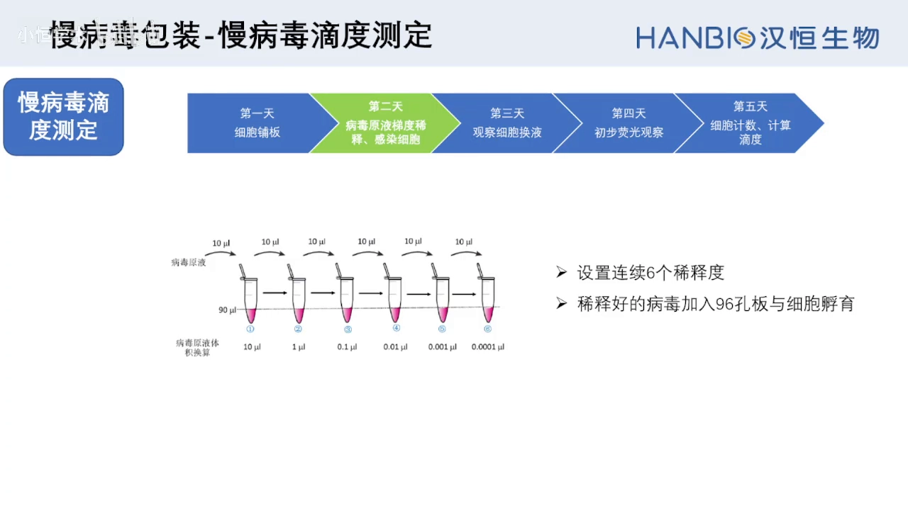

**怎么选孔、怎么算**：挑荧光比例在 **10%–30%** 之间的孔（太低统计不准，太高说明感染饱和），数该孔当时的细胞数，代入公式：

> 滴度（TU/ml）= 细胞数 × 荧光百分比 × 10³ ÷ 病毒原液体积（µl）

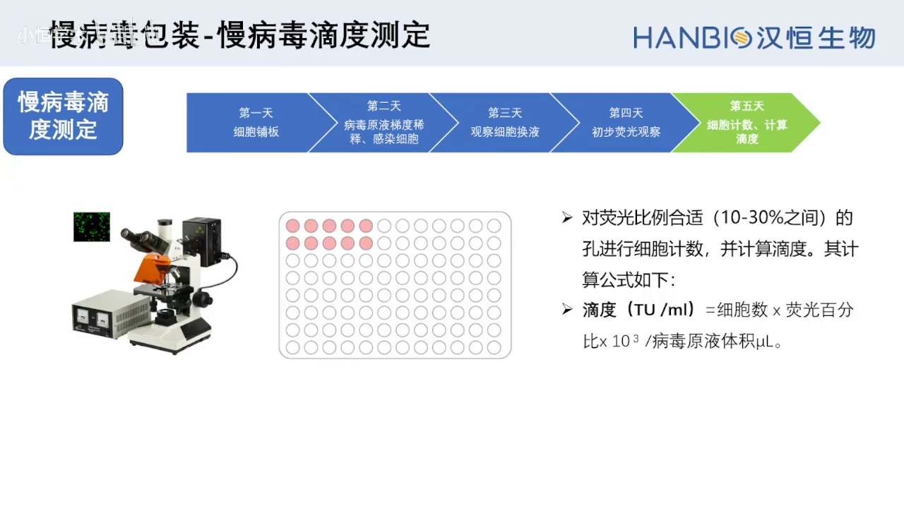

如果**只有前两个稀释度能看到荧光**，说明滴度偏低（正常情况下高稀释度也应该有零星阳性）（[跳转到 45:48](https://www.bilibili.com/video/BV11veg6ZEnb/?t=2748)）。这时不是「测法有问题」，而是包装效率不够——要回到上游优化：质粒构建、质粒扩增与制备、以及包装细胞（10 代以内）。

---

## 六、感染细胞：五个变量，一个技巧

### 6.1 影响感染效率的五个因素

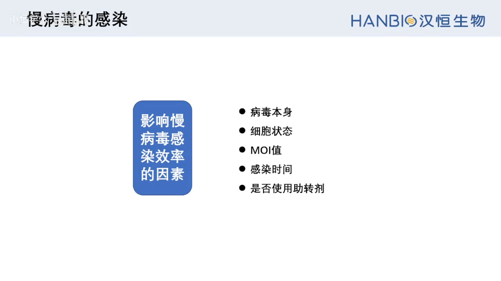

1. **病毒本身的质量**：滴度不合格就感染不上；滴度合格但保存不当（反复冻融、未 −80 ℃ 保存）也会失活，感染效果几乎为零；
2. **细胞状态**：不同细胞类型差异极大；同一种细胞状态差时效果也很差——要选形态良好、轮廓清晰、处于**对数生长期**的细胞（[跳转到 25:34](https://www.bilibili.com/video/BV11veg6ZEnb/?t=1534)）；
3. **MOI**：理论上 MOI 越大越容易感染，但过大会带来毒性；
4. **感染时间**：表达慢，**72 小时才是高峰**，看太早或太晚都不对；
5. **助转剂**（polybrene 等）：不同细胞用法不同，需要查文献或自行摸索。

### 6.2 MOI：一个比值，不是体积

**MOI（multiplicity of infection）= 病毒颗粒数 ÷ 细胞数**，实际计算用（[跳转到 25:59](https://www.bilibili.com/video/BV11veg6ZEnb/?t=1559)）：

> MOI = 病毒滴度（TU/ml）× 加入病毒体积（ml）÷ 待感染细胞数

反推加多少病毒时：

> 加入病毒体积 = 细胞数 × MOI ÷ 病毒滴度

MOI 怎么定？先查文献看有没有人做过同一种细胞，能查到就直接用或略作调整；没人做过就自己摸。视频给了一张常见细胞系的 MOI 参考范围（如 K562 20–40、THP-1 50–80、A549 10–20、H1299 1–3），并标注了该细胞能否加 polybrene（[跳转到 29:49](https://www.bilibili.com/video/BV11veg6ZEnb/?t=1789)）。

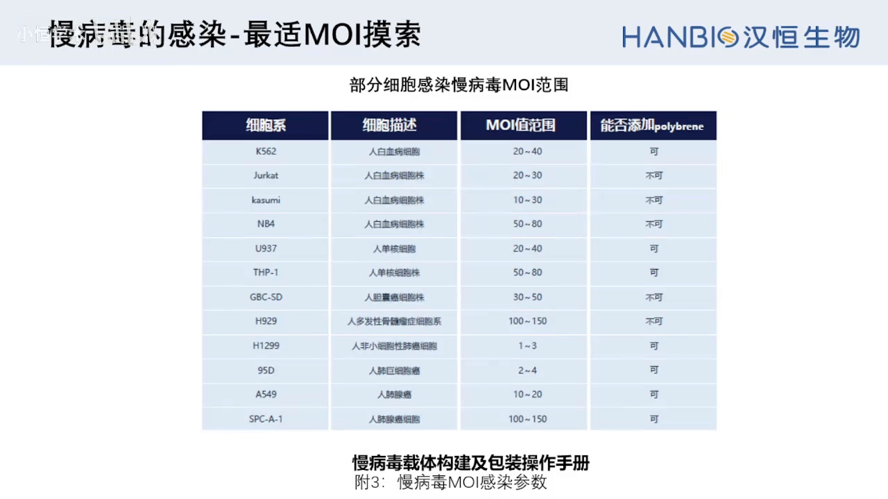

### 6.3 摸索最适 MOI 的标准流程

在 96 孔板里做（[跳转到 27:38](https://www.bilibili.com/video/BV11veg6ZEnb/?t=1658)）：第一天铺板（1×10⁵ 个/ml、100 µl/孔），第二天确认汇合率 30%–50% 时按不同 MOI 感染，第三天换液，第四、五天看荧光。判断标准是：**感染效率 80% 以上、且该孔细胞生长状态良好**，就把这组对应的感染条件与 MOI 记为后续依据（[跳转到 29:36](https://www.bilibili.com/video/BV11veg6ZEnb/?t=1776)）。

### 6.4 技巧：1/2 小体积感染法

做法是：感染时先吸掉原培养基，只加**一半体积**的新鲜培养基，加入计算好的病毒量，感染 4 小时后再补足到原体积（[跳转到 28:03](https://www.bilibili.com/video/BV11veg6ZEnb/?t=1683)）。

原理很直白（[跳转到 44:08](https://www.bilibili.com/video/BV11veg6ZEnb/?t=2648)）：六孔板正常加 2 ml，感染时只加 1 ml，**病毒浓度翻倍**——短时间内形成高浓度感染环境，提高了感染效率；4 小时后补回 2 ml，又恢复了正常培养体系，所以对细胞的毒性伤害较小。这是「既想提高 MOI、又不想加大病毒总量」的折中办法。

### 6.5 正式感染（以 24 孔板为例）

第一天消化 293T，稀释到 3×10⁵ 个/ml，每孔加 500 µl（[跳转到 30:49](https://www.bilibili.com/video/BV11veg6ZEnb/?t=1849)）。接种量不是固定值：生长快的细胞少铺一点、生长慢的多铺一点，**唯一标准是第二天汇合度约 50%**。第二天按 1/2 小体积法加入病毒，第三天换液，第四、五天观察荧光或检测表达；**72 小时为表达高峰**。

---

## 七、稳转株构建：先摸药浓，再筛，再鉴定

筛选稳转株分三块：**摸索抗生素最适浓度 → 感染 → 药筛 → 鉴定扩增**（[跳转到 32:20](https://www.bilibili.com/video/BV11veg6ZEnb/?t=1940)）。以嘌呤霉素（Puro）为例。

### 7.1 摸最适 Puro 浓度：目的是「杀死所有没感染的细胞」

定义：**用最小的药物浓度，能够尽可能杀死全部空白细胞**（[跳转到 33:04](https://www.bilibili.com/video/BV11veg6ZEnb/?t=1984)）。Puro 的工作浓度一般建议 1–10 µg/ml，视频设了六个梯度：**0.5、1、2、4、6、8 µg/ml**，处理 48 小时后观察杀伤情况，选能杀死 **90% 以上**空白细胞的浓度作为最适浓度（[跳转到 33:54](https://www.bilibili.com/video/BV11veg6ZEnb/?t=2034)）。

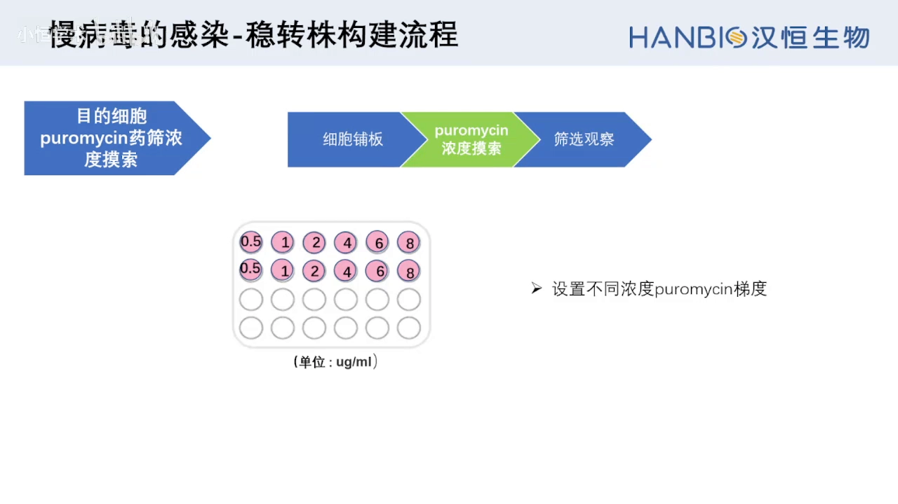

两个易错点：Puro 的**最佳作用时间是 1–4 天**，所以「最小浓度」要按 1–4 天内杀死所有细胞来判定；加药后每 2–3 天换一次新鲜的含药培养基，并每天观察存活情况（[跳转到 34:19](https://www.bilibili.com/video/BV11veg6ZEnb/?t=2059)）。

### 7.2 感染 + 药筛 + 鉴定

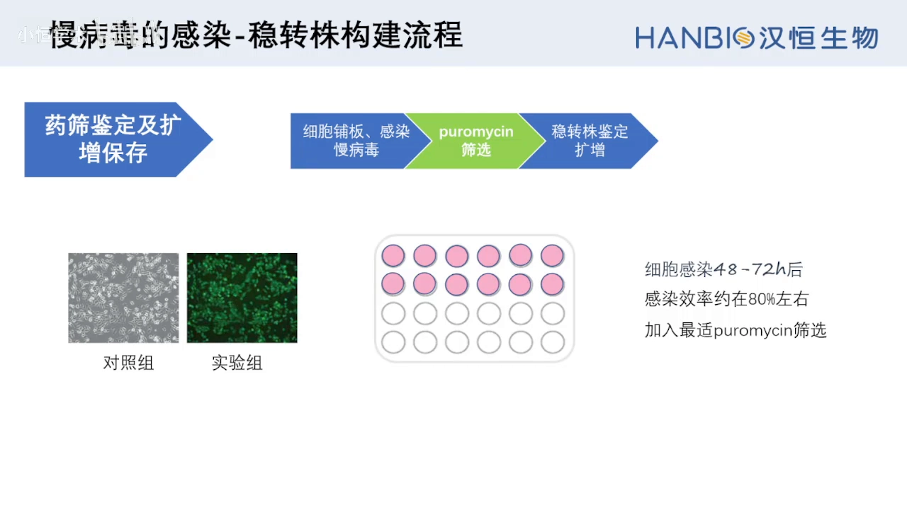

- **加药时机**：慢病毒的抗性基因也要到 **72 小时**左右才到表达高峰，所以在感染后 **48–72 小时**、确认感染效率约 80% 时开始加 Puro（[跳转到 35:09](https://www.bilibili.com/video/BV11veg6ZEnb/?t=2109)）；
- **必设空白对照**：不感染病毒、但加等量 Puro。当对照组细胞在 **48 小时**左右几乎全部死亡，说明药是有效的，这时撤掉 Puro、换新鲜培养基（[跳转到 35:59](https://www.bilibili.com/video/BV11veg6ZEnb/?t=2159)）；
- **后续**：定期用药物压制维持选择压力，扩增后做**基因鉴定**（qPCR/WB 等，确认是不是想要的细胞），鉴定正确再保存建库（[跳转到 36:24](https://www.bilibili.com/video/BV11veg6ZEnb/?t=2184)）。

---

## 八、失败时按这个顺序排查

### 8.1 转化后平板上不长克隆

这是最常见的分子克隆问题。因为片段获取、连接、转化每一步都「看不见」，只有长不长克隆和测序才能反映对错（[跳转到 36:47](https://www.bilibili.com/video/BV11veg6ZEnb/?t=2207)）。按概率排查：

1. **引物/同源臂设计错**：核对插入片段上的同源臂与载体上的同源臂是否一一对应；
2. **载体与片段比例失调**：按两者碱基数计算并调整加入量；
3. **载体或片段不纯**：线性化载体、PCR 产物都要切胶回收纯化；
4. **试剂盒失效或操作问题**：做试剂盒自带的阳性对照来排除；
5. **感受态效率低**：用转化效率 >10⁷ cfu/µg 的感受态；
6. **抗生素用错或浓度过高**：即使连接与转化都成功，抗性不对也长不出来。

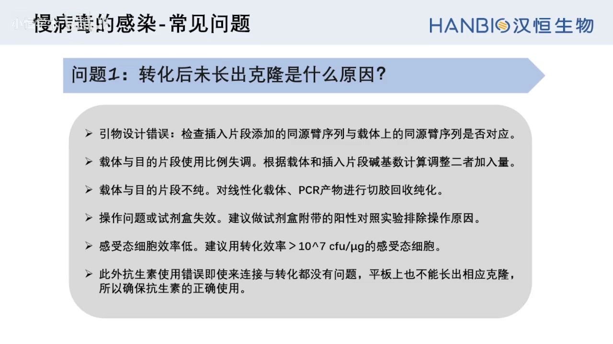

### 8.2 感染后荧光很弱

按顺序看五件事（[跳转到 39:12](https://www.bilibili.com/video/BV11veg6ZEnb/?t=2352)）：① 进入细胞的病毒太少（滴度低）；② 细胞状态差；③ 细胞类型本身难感染（孔内只有少数细胞被感染）；④ **观察时间不对**（太早或太晚，应看 72 小时）；⑤ **启动子弱或在该细胞中沉默**——这也是设计载体时必须先想清「用什么启动子」的原因。

### 8.3 细胞形态变差甚至死亡

不一定是病毒有毒性（[跳转到 40:43](https://www.bilibili.com/video/BV11veg6ZEnb/?t=2443)）。先确认病毒是否被污染，再看 **MOI 是否设得过高**（病毒量太大本身就有毒），还要考虑**目的细胞是不是对慢病毒特别敏感**。对策：降低病毒用量、增加血清含量，或换其他感染方式。

### 8.4 传代几次后表达越来越弱

两个原因（[跳转到 41:58](https://www.bilibili.com/video/BV11veg6ZEnb/?t=2518)）：① 外源片段整合进基因组后本身不够稳定，随传代丢失；② 药筛得到的是**多克隆稳转株**，其中混有未感染的阴性细胞；传代时若不加药压制，阴性细胞会长得更快，占比越来越大，整体信号就被稀释了。对策：**继续加药压制**，淘汰阴性细胞。

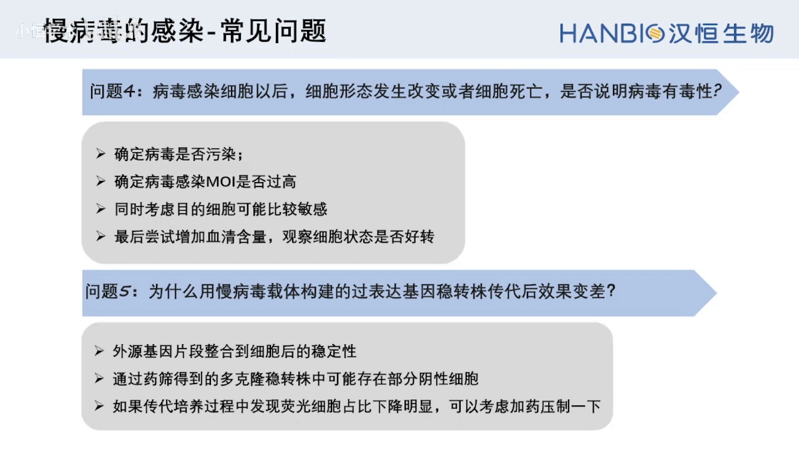

### 8.5 助转剂（polybrene）用不用、用多少

不是固定值，与 MOI 一样需要摸索：先查文献看有没有人做过同种细胞、用了什么浓度，再在小范围内验证（[跳转到 47:03](https://www.bilibili.com/video/BV11veg6ZEnb/?t=2823)）。有些细胞（如部分悬浮细胞）加 polybrene 反而毒性明显，宁可不用。

---

## 小结

- 慢病毒来自 HIV，靠**整合进基因组**实现长期表达，所以是建稳转株的首选工具；穿梭质粒只要保留 LTR + 包装信号，就能被包装并递送。
- 包装系统的三代演进 = **删毒力基因 + 拆细质粒**：一代（含 vif/vpr/vpu/nef，安全性低）→ 二代（删四因子，三质粒，主流）→ 三代（再删 tat，四质粒，最安全但滴度略低）。
- 三质粒分工：穿梭质粒决定递送什么；psPAX2 提供 gag/pol/rev/tat；pMD2.G 提供 VSV-G 包膜。
- 载体构建首选无缝克隆：不受酶切位点限制、可多片段、无疤痕，关键在 **15~25 bp 同源臂**设计。
- 包装用 10 代以内的 293T；质粒要**高浓度、无内毒素**；48 h/72 h 两次收毒，0.45 µm 过滤后 72000 g 离心浓缩。
- 滴度用荧光法：6 个 10 倍稀释度、72 h 观察、选荧光 10–30% 的孔，`滴度 = 细胞数 × 荧光% × 10³ / 病毒体积(µl)`。
- 感染效率取决于病毒质量、细胞状态、MOI、时间与助转剂；**72 小时是表达高峰**；1/2 小体积法是提高感染效率的实用技巧。
- 稳转株三步：先摸出能杀死 90% 以上空白细胞的最低药浓，再感染并在 48–72 h 加药筛选（必设空白对照），最后扩增 + 基因鉴定。
- 实验失败基本都能归因到：**纯度不够、比例失调、浓度不足、细胞状态差、观察时间不对、启动子不合适**。

## 关键术语速查

| 术语 | 一句话解释 |
| --- | --- |
| 慢病毒（lentivirus） | 逆转录病毒科的递送载体，能把外源序列整合进宿主基因组 |
| 穿梭质粒 / 转移质粒 | 携带目的序列的载体，需含 5′LTR、3′LTR、包装信号 |
| 包装信号（Ψ） | 让病毒 RNA 被装进衣壳的序列 |
| LTR | 两端的长末端重复序列，负责转录、逆转录与整合 |
| RRE / Rev | Rev 蛋白结合位点，介导病毒 RNA 从核内输出 |
| WPRE | 增强病毒稳定性与转基因表达的元件 |
| gag / pol / env | 编码结构蛋白 / 病毒酶 / 包膜蛋白的三类基因 |
| VSV-G | 水泡性口炎病毒外壳糖蛋白，替换 HIV 的 env 后受体为 LDLR，可感染多种细胞 |
| psPAX2 | 二代包装质粒，提供 gag、pol、rev、tat |
| pMD2.G | 包膜质粒，提供 VSV-G |
| 三质粒 / 四质粒系统 | 二代（三质粒）与三代（四质粒）包装系统的质粒数量 |
| 293T 细胞 | 表达 SV40 大 T 抗原的 HEK-293 衍生株，包装病毒专用，尽量用 10 代以内 |
| 滴度（TU/ml） | 每毫升中具有感染能力的病毒颗粒数，用荧光法在 72 h 计数换算 |
| MOI | 病毒颗粒数与细胞数的比值；加病毒体积 = 细胞数 × MOI ÷ 滴度 |
| 1/2 小体积感染法 | 感染时只加半量培养基，短时形成高病毒浓度，之后补回原体积 |
| 助转剂（polybrene） | 提高病毒感染效率的阳离子聚合物，浓度需按细胞摸索 |
| 稳转株 | 外源序列整合进基因组、可长期传代表达的细胞株 |
| 嘌呤霉素（Puro）最适浓度 | 1–4 天内杀死全部空白细胞的最低浓度，用于筛选稳转株 |
