# 走进 CRISPR/Cas9：一条 sgRNA 质粒是怎么构建出来的

> **来源**：Bilibili《走进CRISPR/Cas9——sgRNA质粒构建》，UP 主 小恒学术（汉恒生物），时长 27:46，[BV1ii4y177BT](https://www.bilibili.com/video/BV1ii4y177BT/)。本文属 `content/虚拟细胞` 系列的「实验基础」部分：虚拟细胞与 Perturb-seq 用的扰动文库，源头就是一条条这样的 sgRNA 载体。
> **说明**：原片为厂商技术课堂，含产品与促销推介（试剂盒、「三保一」活动等），本笔记只整理技术内容，不复述广告段落。

## 本讲要解决的核心问题（SCQA）

**背景**：用 CRISPR/Cas9 敲掉一个基因，第一步通常不是动细胞，而是先拿到一个能表达 sgRNA 的质粒——它要么直接转染进细胞，要么包装成慢病毒再感染细胞。

**冲突**：sgRNA 里真正由实验者决定的只有 20 个碱基，但要把它准确地接到一个「能被 U6 启动子转录、能包装成病毒、还能用抗生素筛」的载体上，涉及一整套分子克隆细节：克隆位点怎么选、接头怎么加、载体怎么线性化、片段怎么连、怎么判断克隆成功了。任何一步出错，最后的平板就是一片空白。

**疑问**：一个 sgRNA 质粒由哪些元件组成？克隆有哪几条技术路线？每条路线的关键动作分别是什么？

**回答（中心思想）**：sgRNA 质粒构建的本质，是在一个慢病毒载体上把 **20 nt 靶序列精确嵌进 U6 启动子与 scaffold 骨架之间**。工程上有两条路线——传统酶切连接法与无缝克隆（同源重组）法；lentiCRISPR v2 用 **BsmBI 双位点**这个巧妙设计，让酶切后的两个黏端不互补，从而免去去磷酸化、也避免自连。遇到多基因、多靶点的需求，再用单/双质粒系统与双 sgRNA 载体来应对。

---

## 一、先说结论：所谓「构建 sgRNA 载体」，建的只是那 20 个碱基

### 1.1 天然的 sgRNA 是两段 RNA 抱在一起

CRISPR/Cas9 是一个**二元编辑系统**：由 Cas9 蛋白和 sgRNA 组成。Cas9 蛋白本身不认识 DNA 序列，它是在 sgRNA 的引导下与靶基因结合，然后对靶序列进行切割（[跳转到 00:47](https://www.bilibili.com/video/BV1ii4y177BT/?t=47)）。

在天然的 Cas9 系统中，sgRNA 其实由两部分组成（[跳转到 01:12](https://www.bilibili.com/video/BV1ii4y177BT/?t=72)）：

- **crRNA**：它的 5′ 端 **20 个碱基**负责识别需要编辑的靶基因序列；
- **tracrRNA**：负责与 Cas9 蛋白结合；
- 两者通过一段**反向重复序列**相互配对，拼成一条有功能的向导 RNA。

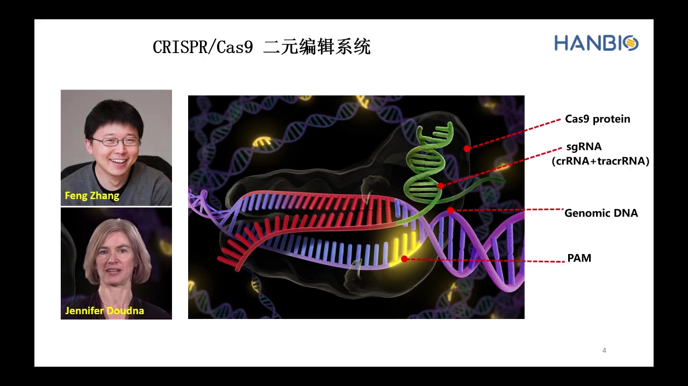

### 1.2 人工系统把它简化成一条单链：20 nt 决定打哪里，骨架决定能不能被 Cas9 抓住

为了提高效率，科学家把 crRNA 和 tracrRNA 融合成一条单链，这就是人工 CRISPR/Cas9 系统里的 **guide RNA（gRNA，即 sgRNA）**（[跳转到 01:48](https://www.bilibili.com/video/BV1ii4y177BT/?t=108)）：

- **5′ 端 20 个碱基**：来自 crRNA，负责识别并结合靶序列——这一段是可变的、由设计决定的；
- **3′ 端的 scaffold（骨架）**：负责撑起结构并与 Cas9 蛋白结合——这一段是固定的，所有 sgRNA 都一样。

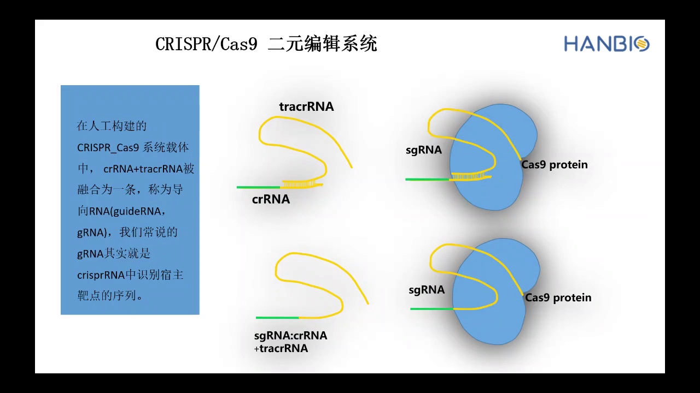

这条结论直接决定了后面所有操作：**做 sgRNA 克隆时，你只需要把 20 nt 换掉，骨架序列原样保留**。所以后续的「构建」，实际上就是把两条互补的短 oligo（各含 20 nt 靶序列）退火成双链，插进载体的固定位置（[跳转到 02:13](https://www.bilibili.com/video/BV1ii4y177BT/?t=133)）。

---

## 二、lentiCRISPR v2：把 Cas9 和 sgRNA 装进同一个慢病毒载体

### 2.1 两个表达框，各用各的启动子

目前 Cas9 系统的质粒非常多：视频里提到在 Addgene 检索 Cas9 可以得到超过 9000 条结果，分为非病毒质粒与病毒质粒，病毒质粒里又分慢病毒、腺病毒、腺相关病毒三类（[跳转到 02:48](https://www.bilibili.com/video/BV1ii4y177BT/?t=168)）。它们的核心结构大同小异，视频以张锋实验室发布的 **lentiCRISPR v2** 慢病毒载体为例讲解（[跳转到 03:38](https://www.bilibili.com/video/BV1ii4y177BT/?t=218)）：

| 表达框 | 启动子 | 产物 | 下游设计 |
| --- | --- | --- | --- |
| sgRNA 表达框 | **U6**（RNA 聚合酶 III 启动子） | 完整 sgRNA | 中间是两个 **BsmBI** 克隆位点 |
| Cas9 表达框 | **EF1α** | SpCas9 蛋白 | C 端带 **Flag 标签**、**NLS 入核信号**，再经 **P2A** 连 **嘌呤霉素（Puro）抗性基因** |

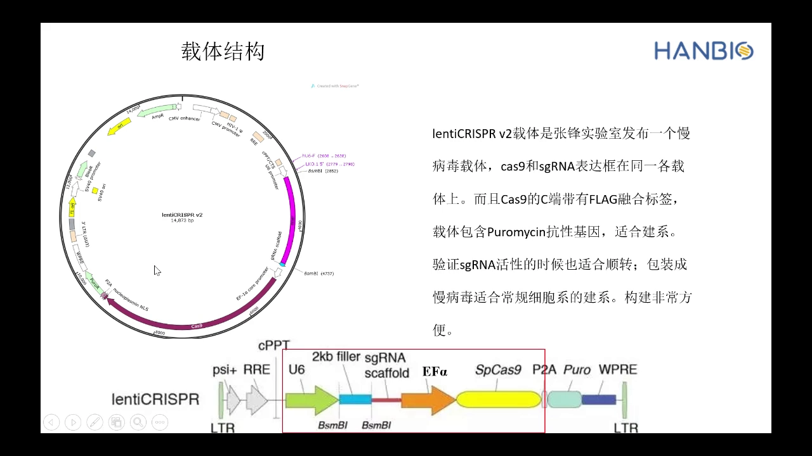

每个元件都在解决一个具体问题：

- **U6 启动子**：专门转录短小的非编码 RNA，正好适合 100 nt 左右的 sgRNA；
- **EF1α 启动子「小而强」**：启动子本身占的序列短，能给病毒载体腾出包装容量、提高病毒包装效率，同时保证 Cas9 在细胞里表达量够（[跳转到 06:08](https://www.bilibili.com/video/BV1ii4y177BT/?t=368)）；
- **Flag 标签**：可以用 Flag 抗体做 Western blot 或免疫染色，确认 Cas9 到底有没有表达；
- **NLS 入核信号**：真核细胞的基因编辑发生在细胞核内，Cas9 必须被送进核里才有用（[跳转到 06:58](https://www.bilibili.com/video/BV1ii4y177BT/?t=418)）；
- **P2A + 嘌呤霉素抗性**：P2A 是一段自剪切肽，让 Cas9 和抗性基因在同一个转录本里被切成两个独立蛋白；转染/感染成功的细胞因此获得嘌呤霉素抗性，可以用药筛富集（[跳转到 07:23](https://www.bilibili.com/video/BV1ii4y177BT/?t=443)）。

### 2.2 为什么偏偏用 BsmBI 做克隆位点：切掉 1.9 kb，还不用去磷酸化

lentiCRISPR v2 的 sgRNA 克隆位点是两个 **BsmBI** 位点，两个位点之间夹着一段约 **1.9 kb 的 filler（填充）序列**（[跳转到 04:28](https://www.bilibili.com/video/BV1ii4y177BT/?t=268)）。这个设计一举解决两个问题：

**第一，酶切是否成功，看胶就知道。** 用 BsmBI 切载体，如果切开了，电泳上会出现一条 ~1.9 kb 的小片段和一条大片段；没切开就只有质粒的超螺旋条带。切胶回收时**只回收大片段、丢掉小片段**，等于顺手做了一次纯化。

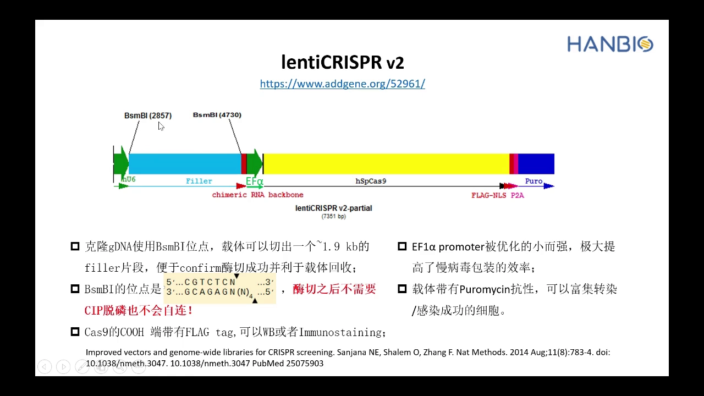

**第二，两个黏端不互补，所以既不用去磷酸化，也不会自连。** 这是本讲最值得记住的机制（[跳转到 05:33](https://www.bilibili.com/video/BV1ii4y177BT/?t=333)）：

- 常规限制性内切酶识别的是**回文序列**，切开后产生的两个黏性末端彼此**反向互补**——于是载体自己的两头能配对，发生**自连**，转进细菌后长出大量空载体假阳性；所以通常要先用碱性磷酸酶（CIP）把 5′ 磷酸基团去掉，才能防止自连。
- BsmBI 的识别位点是 `5'-CGTCTC(N1)-3'`，属于**在识别序列之外切割**的酶：它在识别位点下游切开，切口处是 4 个随机碱基。载体上两个 BsmBI 位点因此切出两段**互不相同的黏端**，无法彼此配对。

结果就是：**不需要 CIP 去磷酸化，也不会自连**。而如果你换用其他载体，就必须回到常规流程——先判断两个黏端是否互补，需要的话补一步去磷酸化（[跳转到 17:52](https://www.bilibili.com/video/BV1ii4y177BT/?t=1072)）。

---

## 三、路线一：传统酶切连接法（六步走完）

载体构建的通用逻辑只有一句话：**把目的序列克隆到目标载体上**。分解开来是六步：载体线性化 → 目的序列制备 → 连接 → 转化 → 阳性克隆筛选 → 测序验证（[跳转到 07:54](https://www.bilibili.com/video/BV1ii4y177BT/?t=474)）。

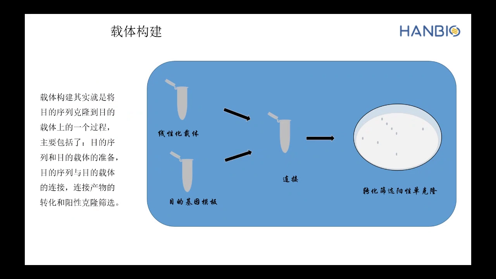

### 3.1 第一步和第二步：线性化载体、制备带酶切位点的片段

传统酶切连接法的原理是：用限制性内切酶在载体和片段上切出**相同的黏性末端**，再用 DNA 连接酶把它们接起来（[跳转到 08:33](https://www.bilibili.com/video/BV1ii4y177BT/?t=513)）。这里有两个关键决策：

**单酶切还是双酶切？** 单酶切只用一个酶，切出来的两个黏端一样，容易自连，假阳性高；双酶切用两个不同的酶，两个黏端不同，能有效避免自连、提高阳性率（[跳转到 09:23](https://www.bilibili.com/video/BV1ii4y177BT/?t=563)）。

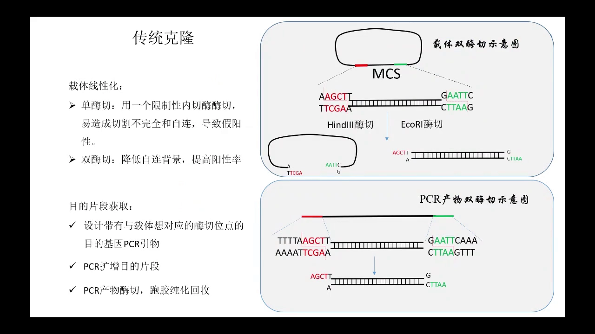

**片段的酶切位点从哪来？** 不是从基因组里「捡」出来的，而是设计在引物上的：在目的片段特异性引物的两端分别加上与载体对应的**酶切位点**和**保护碱基**（保护碱基是为了让内切酶在 DNA 末端也能切得动），PCR 扩增 → 产物双酶切 → 电泳切胶回收（[跳转到 10:38](https://www.bilibili.com/video/BV1ii4y177BT/?t=638)）。

### 3.2 第三步之后：连接、转化、挑单克隆、测序

连接用 **T4 DNA 连接酶**。它既能连黏性末端，也能连平末端，只是条件不同（[跳转到 11:52](https://www.bilibili.com/video/BV1ii4y177BT/?t=712)）：

- 黏性末端连接：16 ℃ 反应 1–5 小时；
- 平末端连接：16 ℃ 反应 1–24 小时（效率低，所以时间更长）。

一个典型的 20 µl 连接体系是：载体 DNA 50 ng + 插入片段（与载体摩尔比约 3:1）+ T4 DNA 连接酶 1 µl + 缓冲液。连接产物热击转化 **DH5α** 感受态细胞，按载体携带的抗性基因铺到含抗生素的平板上筛选；长出菌落后挑单菌落做**菌落 PCR**，阳性克隆送**测序**，序列比对正确，载体构建才算完成（[跳转到 12:17](https://www.bilibili.com/video/BV1ii4y177BT/?t=737)）。

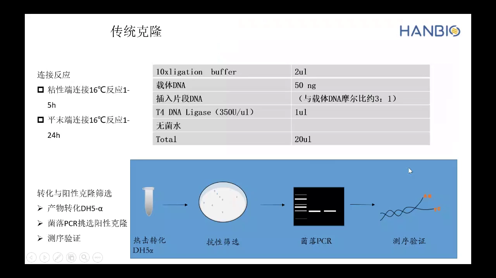

---

## 四、路线二：无缝克隆（Gibson assembly），不依赖酶切位点

### 4.1 核心思想：靠「同源臂」而不是「黏端」把片段接起来

无缝克隆用的是 Gibson assembly（吉普森组装）这类**同源重组**的定向克隆技术：可以在载体的任意位置插入单个或多个片段（[跳转到 12:47](https://www.bilibili.com/video/BV1ii4y177BT/?t=767)）。它同样需要「线性化载体 + 目的片段」，但两者的接合不再靠酶切位点，而是靠片段末端与载体末端之间一段**15–20 bp 的同源序列**。

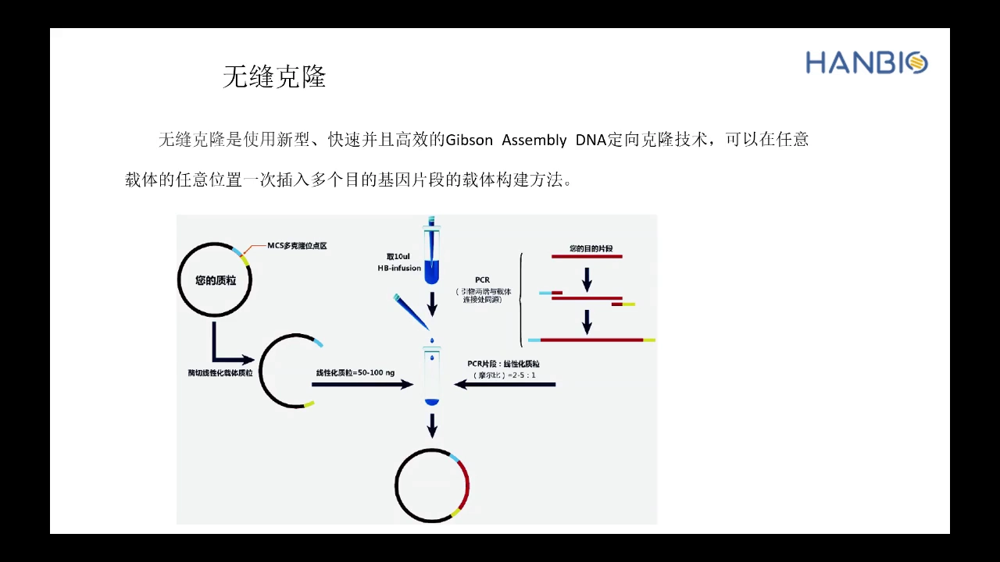

### 4.2 载体线性化有两种做法：酶切，或者「质粒 PCR」

- **酶切法**：和传统克隆一样，选合适位点单酶切或双酶切，然后纯化回收（单酶切仍有切割不完全与自连的问题，双酶切更好）；
- **质粒 PCR 法**：在插入位点两端设计一对**背对背（反向）引物**，直接 PCR 扩增整个载体，产物就是线性化载体（[跳转到 13:37](https://www.bilibili.com/video/BV1ii4y177BT/?t=817)）。

质粒 PCR 法的价值在于：**当插入位点附近没有合适的酶切位点、或者根本没有酶切位点时，仍然能做**。这也是无缝克隆相对传统克隆最实在的自由度（[跳转到 16:32](https://www.bilibili.com/video/BV1ii4y177BT/?t=992)）。

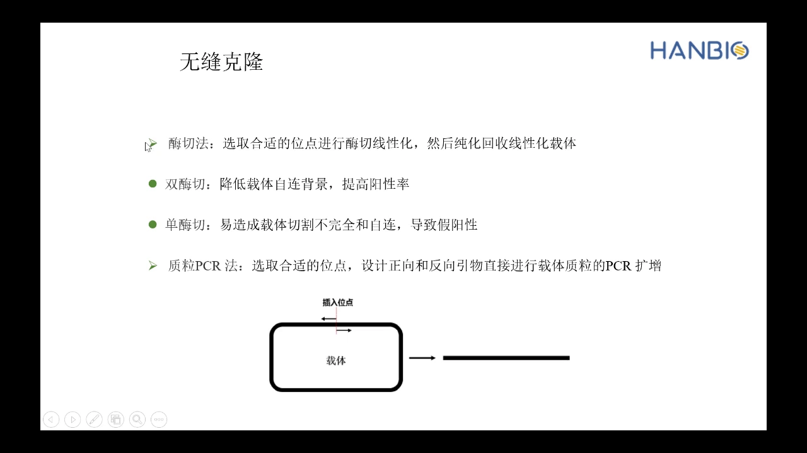

### 4.3 引物设计是多片段组装的关键：按最终环状顺序取同源臂

无缝克隆的引物由两部分拼成：**15–20 bp 的载体（或相邻片段）同源序列 + 20–25 bp 的目的片段特异性序列**（[跳转到 14:02](https://www.bilibili.com/video/BV1ii4y177BT/?t=842)）。

要一次插入多个片段（例如四个），方法是：在脑子里（或草稿纸上）把最终环状质粒按顺序摊开，**相邻两个片段的接合处取 15 个碱基作为同源臂**，然后让每个片段的正向引物带「左邻」的同源臂、反向引物带「右邻」的同源臂（[跳转到 14:52](https://www.bilibili.com/video/BV1ii4y177BT/?t=892)）。视频特别提醒：这里最容易出错，把顺序画出来再设计引物，同源臂一没错，实验基本就没问题。

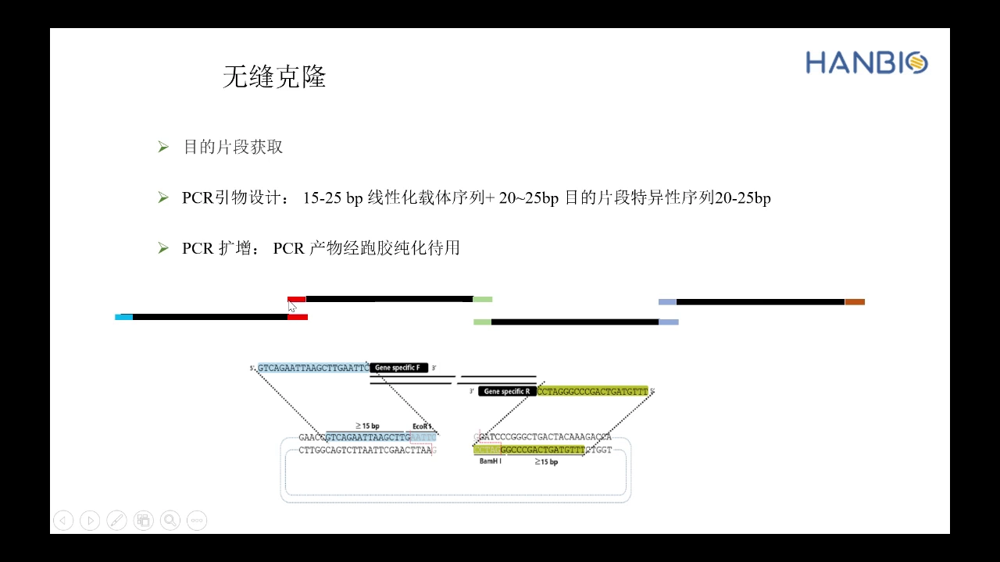

### 4.4 两条路线怎么选：一张对照表

| 维度 | 传统酶切连接 | 无缝克隆 |
| --- | --- | --- |
| 载体制备 | 依赖限制性内切酶 | 酶切 **或** 质粒 PCR |
| 引物 | 需引入酶切位点 + 保护碱基 | 需引入 15–20 bp 同源臂 |
| 插入片段数 | 一次一个 | 可一次多个 |
| 接口序列 | 留下酶切位点「疤痕」 | 无多余序列（真正无缝） |
| 耗时与成功率 | 周期长、假阳性偏高 | 周期短、阳性率高 |

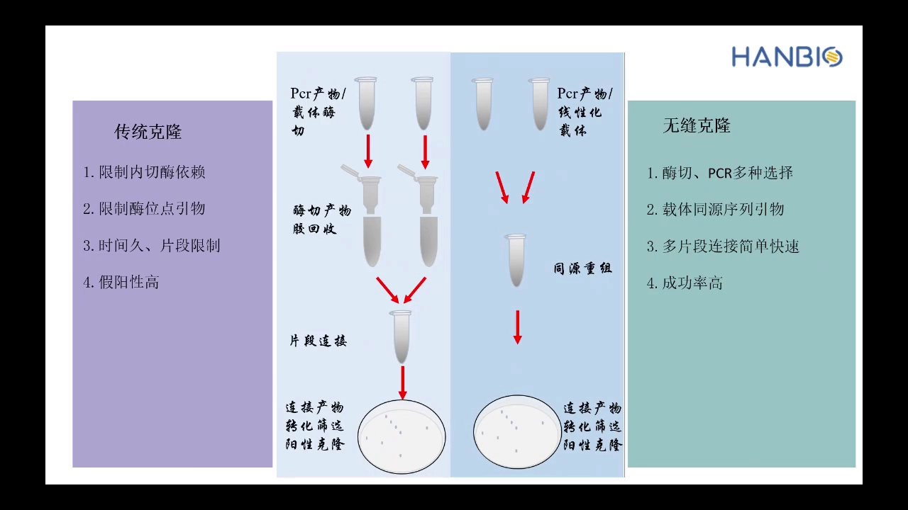

值得注意的是「**疤痕**」这一项：传统酶切连接必然在接口处留下几个碱基的酶切位点序列，做融合表达或对序列精度要求高的实验时，这些多余碱基可能干扰后续功能；同源重组法拼出来的序列则与设计完全一致（[跳转到 16:57](https://www.bilibili.com/video/BV1ii4y177BT/?t=1017)）。

---

## 五、回到 sgRNA：一条 lentiCRISPR v2-sgRNA 质粒的实际操作

前面讲的都是通用方法，具体到 sgRNA 载体，因为**插入片段只有 20 nt**，操作上有一个很省事的替代方案：不必 PCR，直接**合成两条 oligo**，退火成双链即可（[跳转到 18:42](https://www.bilibili.com/video/BV1ii4y177BT/?t=1122)）。完整流程是：

1. **载体线性化**：用 BsmBI 切 lentiCRISPR v2（或 lentiGuide-Puro 这类只带 sgRNA 表达框的载体），37 ℃ 酶切；跑 1% 琼脂糖胶，**只回收大片段**，把 ~1.9–2 kb 的 filler 留在胶里；
2. **oligo 退火**：两条 oligo（各 100 µM）混合，95 ℃ 4 分钟 → 70 ℃ 10 分钟 → 缓慢降到室温，形成双链；用 T4 PNK 补磷酸化，退火产物稀释 20–50 倍后使用；
3. **连接**：退火双链与线性化载体按摩尔比混合，用 T4 连接酶（或无缝克隆体系）连接；
4. **转化与验证**：转化 DH5α → 抗性平板筛选 → 菌落 PCR → 测序确认 20 nt 是否准确插入（[跳转到 19:32](https://www.bilibili.com/video/BV1ii4y177BT/?t=1172)）。

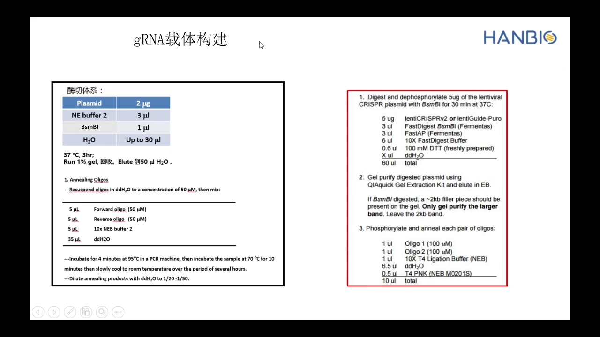

合成 oligo 时，**接头要按你选的构建路线来加**：走酶切连接，就在两端加上与载体黏端匹配的酶切位点接头；走无缝克隆，就加上 15–20 bp 与线性化载体末端同源的碱基。这也是为什么前面要先讲清「两条路线」——它们在 oligo 合成单上就分道扬镳了。

---

## 六、载体怎么选：单质粒系统 vs 双质粒系统

同样的 Cas9 和 sgRNA，可以放在一个载体上，也可以分开放（[跳转到 19:45](https://www.bilibili.com/video/BV1ii4y177BT/?t=1185)）：

- **单质粒系统**：Cas9 与 sgRNA 构建在同一载体上（如 lentiCRISPR v2）；
- **双质粒系统**：Cas9 蛋白与 sgRNA 分别构建在不同载体上（例如一个 EF1α-Cas9-Puro 载体 + 一个 U6-sgRNA 载体）。

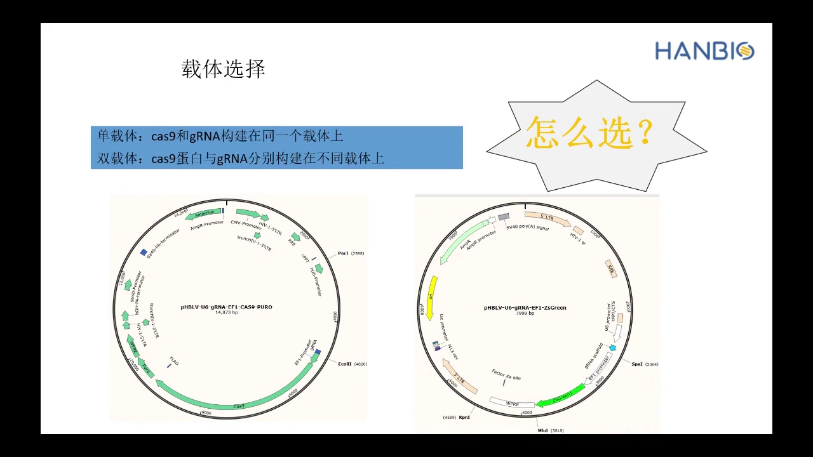

选择逻辑很实用：

- **敲单个基因** → 优先单载体系统。相比双载体，它效率更高：不管直接质粒转染还是包装病毒感染，只需要导入一个载体，细胞就能同时表达 Cas9 和 sgRNA（[跳转到 20:10](https://www.bilibili.com/video/BV1ii4y177BT/?t=1210)）。
- **要在同一个细胞里敲多个基因** → 先用 Cas9 慢病毒做一株**稳定表达 Cas9 的稳转细胞系**，之后每敲一个基因，只需再转入一条对应的 sgRNA 质粒或慢病毒。同理，已经敲掉一个基因后想再敲第二个，只要细胞系本来就稳定表达 Cas9，补一条 sgRNA 就行，不用重建（[跳转到 20:35](https://www.bilibili.com/video/BV1ii4y177BT/?t=1235)）。

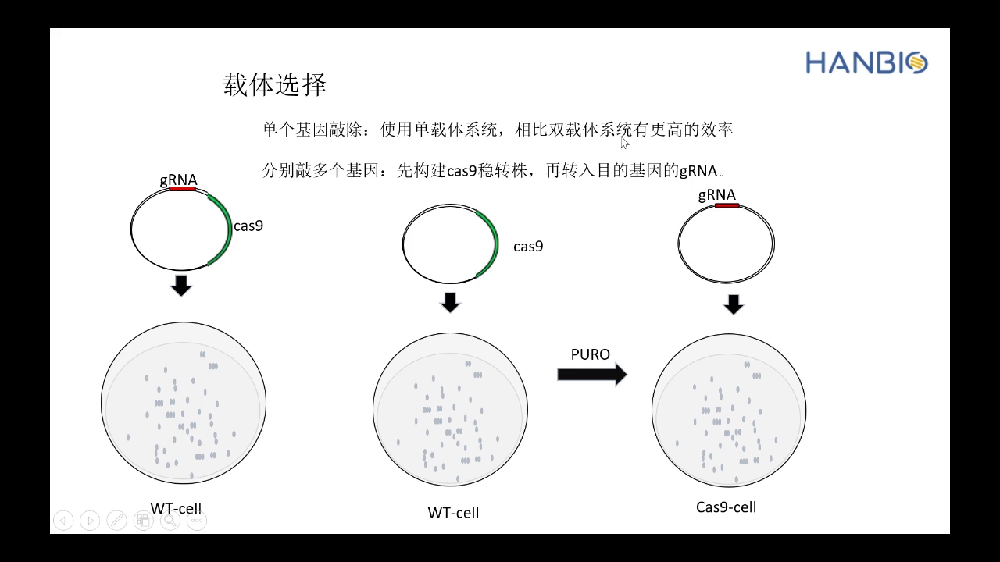

---

## 七、双 sgRNA 载体：一个载体里放两个表达框

### 7.1 三个使用场景

双 sgRNA 载体就是在同一个载体上表达两条 sgRNA（[跳转到 21:50](https://www.bilibili.com/video/BV1ii4y177BT/?t=1310)），用于三类需求：

1. **提高单基因编辑效率**：针对同一个基因设计两个靶位点，一次转染同时切两处，提高敲除效率；
2. **同时编辑两个基因**：针对两个不同靶基因各设计一条 sgRNA，一次转染同时编辑；
3. **非编码基因或结构片段的大片段删除**：lncRNA 以 RNA 形式行使功能，单点编辑很难造成功能性敲除，需要在两个位点同时切割、把中间片段整段删掉；删除某个结构域或某个外显子，也是同一套做法（[跳转到 23:05](https://www.bilibili.com/video/BV1ii4y177BT/?t=1385)）。

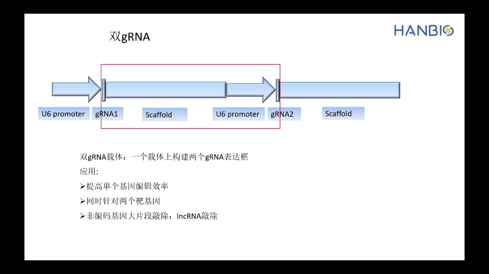

### 7.2 能不能把两条 sgRNA 直接串联？不能——每条都要有自己的启动子和骨架

这是学生最常问的问题（[跳转到 23:55](https://www.bilibili.com/video/BV1ii4y177BT/?t=1435)）。答案是**不行**：一条完整的 sgRNA 除了 20 nt 靶序列，还需要 scaffold 才能被 Cas9 结合；而 U6 启动子只转录紧邻它下游的那一段。所以正确结构是**两个完整的表达框**：`U6–sgRNA1–scaffold` 与 `U6–sgRNA2–scaffold`。构建有两条方法：

- **中间载体法**：用一个「**scaffold 在前、U6 在后**」的特殊中间载体，设计两端引物——正向引物带 sgRNA1、反向引物带 sgRNA2（反向互补），PCR 扩增出 `sgRNA1–scaffold–U6–sgRNA2` 这段序列；再把它插入常规 sgRNA 载体（该载体前面已有 U6、后面已有 scaffold），拼起来正好是两个完整表达框；
- **直接合成法**：直接把 `sgRNA1+scaffold+U6+sgRNA2` 整段设计好交给公司合成，再构建到 sgRNA 载体上。

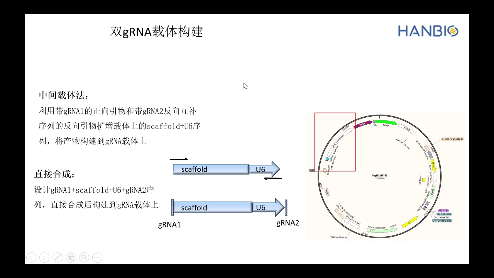

视频作者的实测建议是**优先直接合成**：中间载体法两头都要设计引物、还要加酶切位点，若改走无缝克隆则引物更长、扩增更难；而直接合成只要把序列设计对就行（[跳转到 26:00](https://www.bilibili.com/video/BV1ii4y177BT/?t=1560)）。

---

## 小结

- sgRNA 里真正需要设计的只有 **5′ 端 20 nt**，其余 scaffold 是固定骨架；因此「构建 sgRNA 载体」= 把 20 nt 精确插进 U6 与 scaffold 之间。
- lentiCRISPR v2 用 **U6 驱动 sgRNA、EF1α 驱动 Cas9**，Cas9 带 Flag、NLS，并经 P2A 连嘌呤霉素抗性基因；抗性基因是后续筛细胞的手段。
- 选 **BsmBI** 作克隆位点是一石二鸟：切掉 ~1.9 kb filler 让电泳能判断酶切是否成功；两个黏端不互补，**免去磷酸化、不自连**。
- 传统酶切连接法 = 线性化 → 带酶切位点的片段 → T4 连接（黏端 16 ℃ 1–5 h）→ 转化 DH5α → 菌落 PCR → 测序。
- 无缝克隆靠 **15–20 bp 同源臂**，载体可用酶切或质粒 PCR 线性化，能一次拼多个片段且不留疤痕。
- 单基因敲除用单质粒系统效率更高；多基因或多轮敲除，先建 **Cas9 稳转株**再换 sgRNA。
- 双 sgRNA 载体必须构建**两个完整表达框**；中间载体法或直接合成，后者更省事。

## 关键术语速查

| 术语 | 一句话解释 |
| --- | --- |
| sgRNA / gRNA | 向导 RNA，5′ 端 20 nt 决定打哪个位点，3′ 端 scaffold 负责被 Cas9 抓住 |
| crRNA / tracrRNA | 天然系统中的两段 RNA，人工系统把它们融合成一条 sgRNA |
| PAM | 靶序列旁必须存在的短基序，Cas9 识别它之后才切割 |
| lentiCRISPR v2 | 张锋实验室的慢病毒载体，Cas9 与 sgRNA 双表达框（Addgene #52961） |
| U6 启动子 | RNA 聚合酶 III 启动子，专门转录短小的 sgRNA |
| EF1α 启动子 | 短的强启动子，省载体空间又能保证 Cas9 表达 |
| NLS | 入核信号，把 Cas9 送进细胞核 |
| P2A | 自剪切肽，让 Cas9 与抗性基因从一个转录本变成两个蛋白 |
| BsmBI | 在识别序列外切割的限制酶；两位点切出的黏端不互补，可避免载体自连 |
| filler | 两个克隆位点之间的填充序列，酶切后掉落，用于判断酶切是否成功 |
| 去磷酸化（CIP/FastAP） | 去掉载体 5′ 磷酸基团以防自连，双黏端不互补时不需要 |
| 单/双酶切 | 一个酶切出的两端相同易自连；两个酶切出不同末端，背景更低 |
| 菌落 PCR | 直接以菌落为模板做 PCR，快速判断克隆里有没有插入片段 |
| 无缝克隆 / Gibson assembly | 靠末端同源臂重组的克隆方法，可多片段、无疤痕 |
| 同源臂 | 引物上附加的 15–20 bp 与载体或相邻片段一致的序列 |
| 双 sgRNA 载体 | 一个载体上两个完整 sgRNA 表达框，用于双靶点或大片段删除 |
