# VMM 设计技术：三条虚拟化路径的代价对比

> 视频来源：[Virtualization and Cloud Computing Lecture 3: VMM design techniques](https://www.youtube.com/watch?v=cVFyK1f5lDw)（YouTube · Mythili Vutukuru，IIT Bombay）｜时长约 27 分钟
> 本文覆盖这支课的第 1 讲概览部分：陷入-模拟为什么在 x86 上撞墙、半虚拟化/全虚拟化/硬件辅助三条补救路径各自付出什么代价，以及内存与 I/O 虚拟化如何复用同一套思路。VMX 模式的根/非根切换细节属于下一小节，本文只在"代价对比"的层面提到它。

## 本讲要解决的核心问题（SCQA）

**背景**：VMM（虚拟机监控器，也叫 hypervisor）要做的事，和操作系统调度进程很像——把一台物理机分给多台虚拟机轮流使用，切走时保存上下文，切回来时恢复上下文。

**冲突**：但客户操作系统不是普通进程。普通进程只做非特权操作，遇到特权操作就主动交给操作系统；客户操作系统却认为自己独占硬件、可以随意执行特权指令。更麻烦的是，x86 指令集在设计时压根没考虑虚拟化，有一批指令在低特权级下"不报错但干错事"。

**疑问**：既然不能把硬件真的交给客户操作系统，VMM 能用什么办法把它"骗"在一个受限的特权级里？每种办法要付什么代价？为什么最后是硬件辅助虚拟化成了主流？

**回答（中心思想）**：x86 虚拟化有三条路径——**半虚拟化（改源码）**、**全虚拟化（改二进制）**、**硬件辅助虚拟化（改 CPU）**，它们都是在给同一个基线方案"陷入-模拟"打补丁。三条路径的代价分别是"必须改操作系统源码"、"每次翻译多一层开销"、"依赖 CPU 特性"；硬件辅助把"什么时候该切回 VMM"这件事从软件挪进 CPU，一次性消掉了前两条的代价，所以它成了今天 KVM 这类系统的默认选择。

## 一、VMM 要解决的问题：把"内核"当成"进程"来调度

### 1.1 复用物理机的两种类比

VMM 做的事情可以用一句话概括：让多台虚拟机共享同一台底层物理机。这和操作系统让多个进程共享一颗 CPU 是同一个套路——VMM 也要做"机器切换"（machine switch）：让这台虚拟机跑一小段时间，保存它的上下文，切到另一台虚拟机再跑一段，再保存、再切走。[【跳转到 00:05】](https://www.youtube.com/watch?v=cVFyK1f5lDw&t=5)

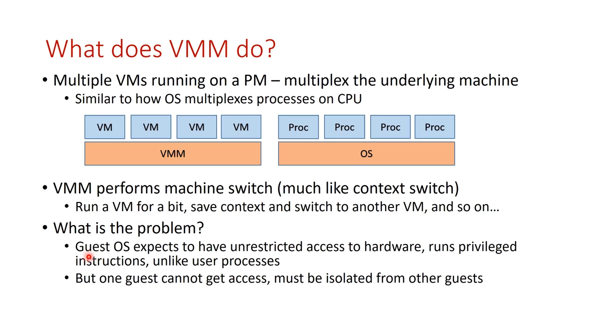

概念本身很直白，难点全在"客户操作系统"这个特殊对象上。

### 1.2 难点：客户操作系统期望不受限的硬件访问

普通进程只执行非特权操作，需要特权操作时就陷入操作系统；客户操作系统不是这样设计的——它期望不受限制地访问硬件，自己执行特权指令。同时，VMM 又不能把设备真的交给任何一个客户机，因为虚拟机之间必须隔离，而它们又要共享同一批物理资源。[【跳转到 01:20】](https://www.youtube.com/watch?v=cVFyK1f5lDw&t=80)

所以 VMM 的设计比操作系统的上下文切换要复杂一档：它要在一个"自认为是主人"的内核下面，再插一层管理者。

## 二、基线方案：陷入-模拟，把客户操作系统降到 ring 1

### 2.1 三环布局：客户应用 ring 3、客户 OS ring 1、VMM ring 0

x86 有四个特权环（ring 0 到 ring 3）。正常系统里，用户程序在 ring 3，操作系统在 ring 0，特权指令只有 ring 0 能执行。陷入-模拟（trap and emulate）的思路是把这个布局整体下移一格：客户应用仍在 ring 3，VMM 占住 ring 0，客户操作系统被放到中间的 ring 1——它的权限要高于用户程序（否则保护不了自己），但又不能和 VMM 平权（否则它就能直接碰硬件）。[【跳转到 02:15】](https://www.youtube.com/watch?v=cVFyK1f5lDw&t=135)

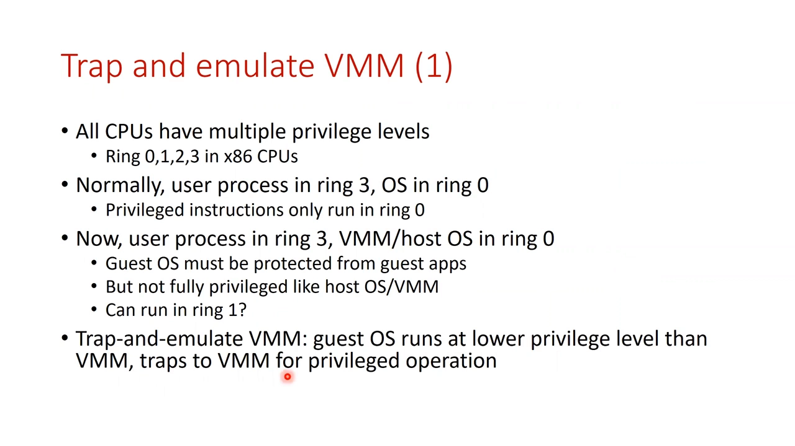

至于类型一和类型二 hypervisor 的差别，只体现在 ring 0 里有没有一个宿主操作系统：类型一没有，类型二有。无论哪种，VMM 总在 ring 0。[【跳转到 03:30】](https://www.youtube.com/watch?v=cVFyK1f5lDw&t=210)

### 2.2 一次系统调用的完整路径

这套机制跑起来是这样的：客户应用发起系统调用（比如执行 `int n` 陷入指令），这条指令在 ring 3 执行会被截获——但截获它的不是客户操作系统，而是 VMM。VMM 自己并不知道这个特定客户系统的中断该怎么处理，于是它把控制权转交给客户操作系统自己的中断处理代码，由客户操作系统正常处理。[【跳转到 04:00】](https://www.youtube.com/watch?v=cVFyK1f5lDw&t=240)

返回路径同样绕一圈：客户操作系统处理完要返回用户程序，会执行 IRET（中断返回）指令，这又是一条特权指令，同样被 VMM 截获，VMM 知道该跳回客户用户代码的哪个位置，于是跳过去。[【跳转到 05:15】](https://www.youtube.com/watch?v=cVFyK1f5lDw&t=315)

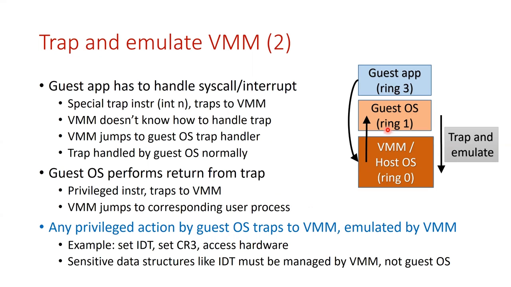

凡是客户操作系统试图执行特权操作——设置中断描述符表（IDT）、设置指向页表的 CR3 寄存器、访问硬件设备——指令在 ring 1 下都不生效，于是全部陷入 VMM，由 VMM 代为完成。这些敏感数据结构（IDT、页表、CPU 寄存器）实际上由 VMM 管理，客户操作系统以为自己设置成功了。反过来，任何用户侧的动作也先经过 VMM，再由 VMM 调客户操作系统对应的代码。VMM 就这样成了客户系统用户与客户操作系统之间的中间人。[【跳转到 05:40】](https://www.youtube.com/watch?v=cVFyK1f5lDw&t=340)

### 2.3 代价：每一次特权操作都多绕一层

陷入-模拟的原理和"用户进程陷入操作系统"完全一样，只是在中间多加了一层间接。它的代价也就藏在这层间接里：客户操作系统的每一次特权操作，都要多一次"陷入 ring 0 → VMM 判断 → 模拟或转交"的往返。系统调用、中断、页表切换、I/O 全部走这条路。[【跳转到 06:30】](https://www.youtube.com/watch?v=cVFyK1f5lDw&t=390)

如果只是慢一点，这条路本来可以接受。真正的问题是它在 x86 上根本走不通。

## 三、基线方案在 x86 上撞墙：敏感指令不是特权指令

### 3.1 两个绕不过去的问题

第一个问题：客户操作系统可能发现自己被降级了。x86 有些寄存器（比如代码段寄存器 CS）会直接反映当前特权级，客户操作系统读到这些值就会"发现自己不在 ring 0"，然后可能直接崩溃——让操作系统跑在低特权级，违背了操作系统设计的基本假设。[【跳转到 06:50】](https://www.youtube.com/watch?v=cVFyK1f5lDw&t=410)

第二个问题更致命：**有一批 x86 指令会改变硬件状态，却在特权模式和非特权模式下都能执行**，这类指令叫敏感指令（sensitive instruction）。它们在 ring 0 下和 ring 1 下行为不同，却不触发异常，所以 VMM 根本没机会截获它们——客户操作系统在 ring 1 下会安静地做错事。[【跳转到 07:40】](https://www.youtube.com/watch?v=cVFyK1f5lDw&t=460)

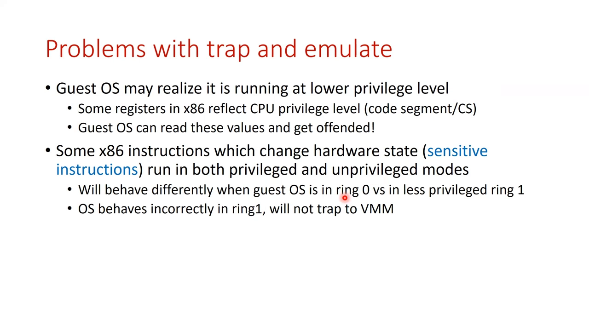

### 3.2 一个具体例子：`popf` 指令

EFLAGS 寄存器是一组 CPU 标志位，其中 IF（中断标志位）决定中断是开还是关，属于只有操作系统才能改的标志。x86 的 `popf` 指令把栈顶的值弹出并写入 EFLAGS，这是写 EFLAGS 的常规手段。[【跳转到 09:50】](https://www.youtube.com/watch?v=cVFyK1f5lDw&t=590)

`popf` 在 ring 0 和 ring 1 下都能执行，但结果不同：ring 0 下所有标志位都按栈顶值设置；ring 1 下只有非特权程序可访问的那些位被设置，IF 这类特权标志位不会被设置，而且**不产生异常**。[【跳转到 11:05】](https://www.youtube.com/watch?v=cVFyK1f5lDw&t=665)

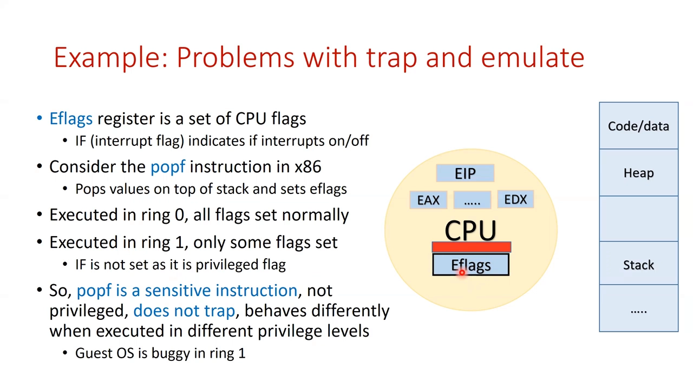

后果是：一个跑在 ring 1 的客户操作系统执行 `popf` 后，中断标志没被打开，它却毫无察觉，继续带着错误状态运行。如果这条指令会陷入，VMM 完全可以模拟它、把正确的值写进 EFLAGS；但它不陷入，VMM 连插手的时机都没有。[【跳转到 12:20】](https://www.youtube.com/watch?v=cVFyK1f5lDw&t=740)

### 3.3 Popek-Goldberg 定理：一条判据

Popek 与 Goldberg 的经典研究把这套直觉形式化了。他们定义：

- **敏感指令**：会改变硬件状态的指令；
- **特权指令**：只在特权模式下才能执行的指令（在其他环执行会陷入 ring 0）。

结论是：**想用陷入-模拟高效地构建 VMM，敏感指令集必须是特权指令集的子集**——任何会改变硬件状态的指令，都必须能被 VMM 截获。[【跳转到 13:20】](https://www.youtube.com/watch?v=cVFyK1f5lDw&t=800)

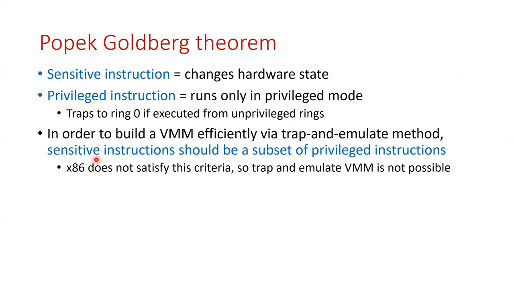

x86 恰恰不满足这个条件：它的敏感指令集不是特权指令集的子集。所以对 x86 来说，"纯靠截获-模拟"的 VMM 是建不起来的。[【跳转到 14:35】](https://www.youtube.com/watch?v=cVFyK1f5lDw&t=875)

### 3.4 为什么会这样：历史原因

不是 Intel 故意为难虚拟化，而是 x86 设计时没人预见到虚拟化会普及。所有人都假设操作系统永远运行在最高特权级，于是没人去保证"敏感 ⇒ 特权"。[【跳转到 08:55】](https://www.youtube.com/watch?v=cVFyK1f5lDw&t=535)

判据立起来之后，剩下的问题就变成工程问题：既然不能纯靠截获，那就想办法让敏感指令变得"可截获"。围绕这个目标，历史上出现了三条路径。
## 四、路径一：半虚拟化——改源码，换掉"偷偷做错事"

最直接的做法叫半虚拟化（para-virtualization）：改写客户操作系统的代码，把那些会"偷偷做错事"的特权操作从代码里删掉。

具体做法是让客户操作系统**知道自己正在被虚拟化**：它不再以为自己拥有全部硬件，不再直接执行特权操作，而是像用户进程发起系统调用那样，向 VMM 发起 **hypercall** 来请求特权动作。[【跳转到 14:59】](https://www.youtube.com/watch?v=cVFyK1f5lDw&t=899)

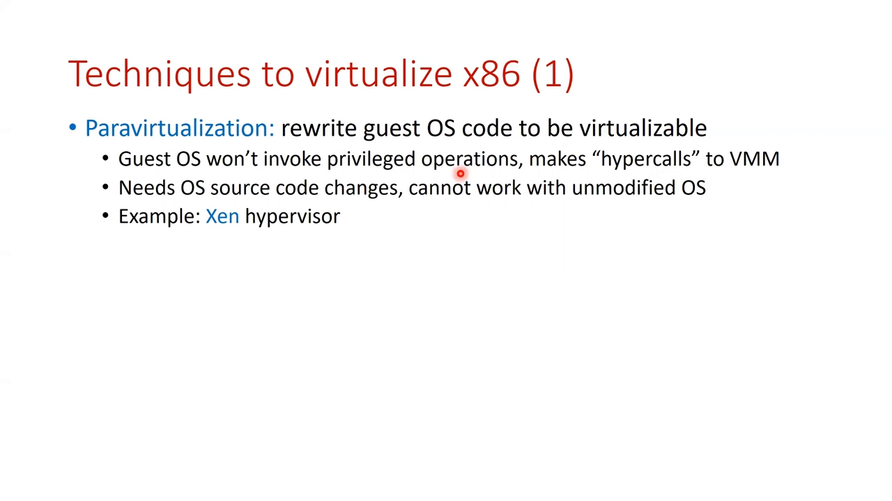

这条路的好处是**代价明确且很小**：既然客户操作系统主动配合，就不需要二进制翻译，也不需要硬件支持，性能接近原生。流行的 Xen 就是这么做的。[【跳转到 15:49】](https://www.youtube.com/watch?v=cVFyK1f5lDw&t=949)

代价也很硬：**必须改操作系统源码**。你不能随便下载一个 Linux 内核就指望它跑在半虚拟化的 VMM 上，必须拿到被这样改过的源码；未修改的通用操作系统根本跑不起来。这条限制在"云厂商要卖虚拟机给任意客户"的商业场景里几乎是致命的。[【跳转到 16:14】](https://www.youtube.com/watch?v=cVFyK1f5lDw&t=974)

## 五、路径二：全虚拟化——翻译二进制，而不是改源码

全虚拟化（full virtualization）换了个下手的地方：**不动源码，动编译好的二进制**。VMM 把客户操作系统的 CPU 指令翻译一遍，让那些敏感但没有被标记的指令改写成"陷入到 VMM"的形式。[【跳转到 16:39】](https://www.youtube.com/watch?v=cVFyK1f5lDw&t=999)

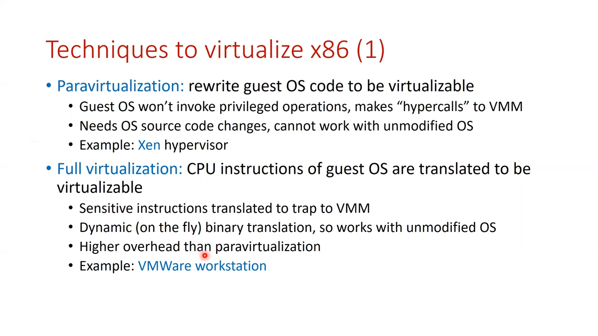

这条路的关键优势是**兼容未修改的操作系统**：你可以拿现成的操作系统镜像，直接在全虚拟化的 VMM 上跑。而且翻译不必提前做、也不必翻译整个操作系统——可以动态、即时地翻译，用到哪段代码就翻译哪段。[【跳转到 17:04】](https://www.youtube.com/watch?v=cVFyK1f5lDw&t=1024)

代价是**额外开销高于半虚拟化**：翻译本身要花时间，翻译出来的代码还要经过缓存、跳转等机制。这项技术最早由 VMware 在其 VMware Workstation 中实现，也是"没有硬件支持时怎么虚拟化 x86"这个问题的第一个工业级答案。[【跳转到 17:29】](https://www.youtube.com/watch?v=cVFyK1f5lDw&t=1049)

## 六、路径三：硬件辅助——把"该不该切回来"交给 CPU

### 6.1 思路：让 CPU 自己认识虚拟化

两条软件路径都各有硬伤之后，Intel 和 AMD 干脆把这件事做进硬件：CPU 现在能识别虚拟化，并提供专门的执行模式来运行虚拟机。Linux 上的 KVM 用的就是它。[【跳转到 17:54】](https://www.youtube.com/watch?v=cVFyK1f5lDw&t=1074)

这个模式叫 VMX 模式。x86 处理器在普通（非 VMX，也叫 root）模式下有四个环，在 VMX 模式下还有另外四个平行的环。客户应用跑在 ring 3，**客户操作系统直接跑在 VMX 模式的 ring 0**——它终于是"真的 ring 0"了，不必再被降到 ring 1 去踩前面那些坑。[【跳转到 18:19】](https://www.youtube.com/watch?v=cVFyK1f5lDw&t=1099)

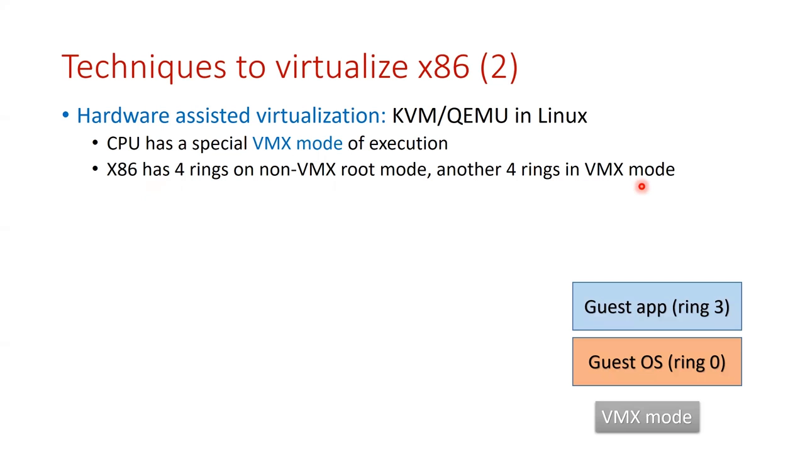

### 6.2 控制权怎么保住：退出点由 VMM 配置

客户操作系统跑在 ring 0，那 VMM 岂不是失控了？关键在于：**这个 ring 0 不等同于普通 ring 0，它没有那么强**。VMM 可以指定哪些指令或事件会让客户系统退出、回到 VMM。于是客户系统只要执行特定动作，VMM 就能配置让它退回普通 ring 0 去做处理。[【跳转到 19:09】](https://www.youtube.com/watch?v=cVFyK1f5lDw&t=1149)

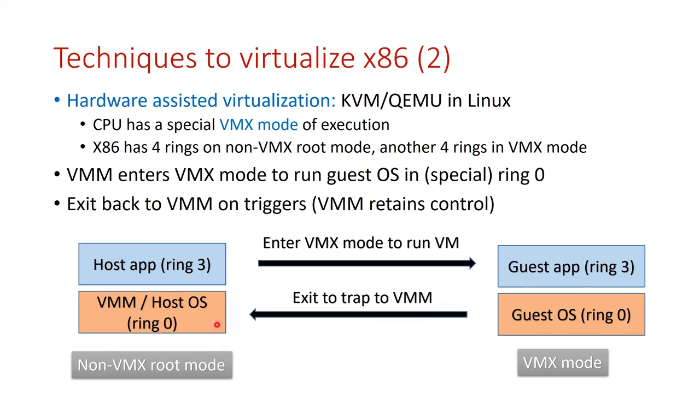

双方都满意：客户系统确实跑在自己的 ring 0 里，VMM 保留了对执行的掌控，客户机既不能完全访问硬件，也不能为所欲为地执行所有特权操作。[【跳转到 19:59】](https://www.youtube.com/watch?v=cVFyK1f5lDw&t=1199)

至于根模式与非根模式之间具体怎么切换、VMCS 里存了什么，属于下一小节的内容；这里只需要记住结论：**"什么时候该切回 VMM"这件事，从软件判断变成了硬件判断**。

### 6.3 为什么硬件辅助成了主流

把三条软件路径的代价摆在一起，答案就很清楚：

先看基线：陷入-模拟每次特权操作都要绕一圈 VMM，而且 x86 上还有敏感指令漏网，根本走不通。三条路径相对它的取舍是：

- 半虚拟化：性能好，但必须改操作系统源码，跑不了现成系统；
- 全虚拟化：能跑现成系统，但每次翻译都要付开销，实现也复杂；
- 硬件辅助：客户操作系统在 VMX ring 0 里接近原生速度运行，只有 VMM 配置的那些事件才退出，既不用改源码，也不用翻译指令。

所以它是今天用得最广的一种，因为大多数处理器都支持这个特性。[【跳转到 20:24】](https://www.youtube.com/watch?v=cVFyK1f5lDw&t=1224)

## 七、同一套逻辑的另外两个战场：内存与 I/O

处理器虚拟化定下基调之后，内存和 I/O 走的是同一条思路：**没有硬件支持就软件补，有硬件支持就交给硬件**。

### 7.1 内存：影子页表 vs 扩展页表

内存的问题在于地址要翻译两次。客户机以为自己拥有从 0 开始的整块 RAM，客户页表记录"客户虚拟地址 → 客户物理地址"（GVA → GPA）；但实际上客户机的"物理内存"只是宿主物理内存里散落的一些页，VMM 维护"客户物理地址 → 宿主物理地址"（GPA → HPA）。MMU 该用哪张页表？[【跳转到 20:48】](https://www.youtube.com/watch?v=cVFyK1f5lDw&t=1248)

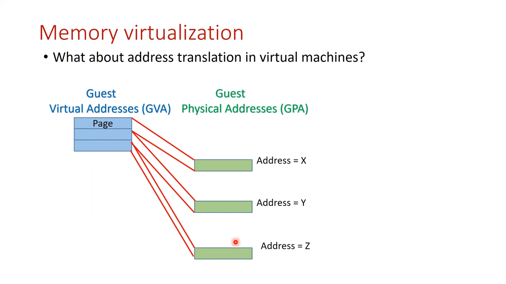

两种解法：

- **影子页表（shadow paging）**：VMM 把两张页表合成一张，直接从客户虚拟地址映射到宿主物理地址，把这张合成页表交给 MMU。代价是客户页表每改一次，影子页表都要跟着更新，VMM 必须跟踪客户页表的所有改动。
- **扩展页表（EPT）**：硬件识别出虚拟化的存在，MMU 同时拿到两张页表的指针，每次地址翻译都走两张表。因为不用维护影子页表，所以更高效，但需要硬件支持。[【跳转到 22:51】](https://www.youtube.com/watch?v=cVFyK1f5lDw&t=1371)

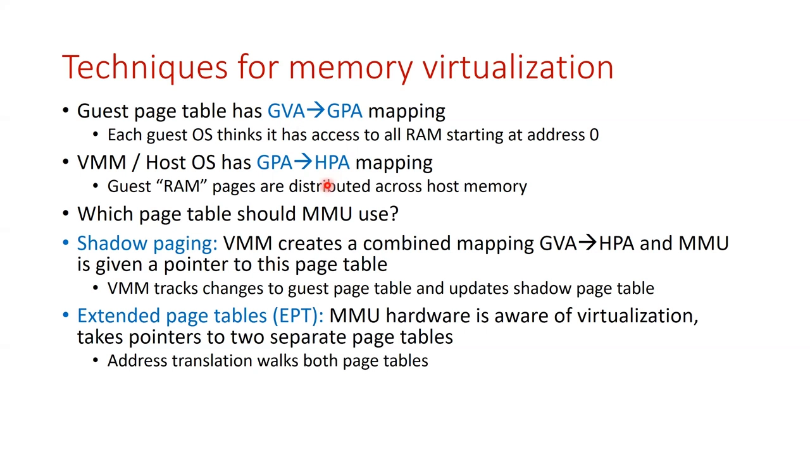

### 7.2 I/O：模拟 vs 设备直通

每个客户机都以为自己能访问键盘、鼠标、硬盘、网卡等所有 I/O 设备，但多台虚拟机同时运行时，VMM 不能把设备完全交给任何一个客户机。两种做法：

- **模拟（emulation）**：客户操作系统的每次 I/O 操作都陷入 VMM，由 VMM（实际上是宿主）代表客户机完成 I/O 并把数据返回；
- **设备直通（device pass-through）**：有些设备能被划分成多段，每段直接交给一台虚拟机，比模拟更快也更简单。[【跳转到 24:48】](https://www.youtube.com/watch?v=cVFyK1f5lDw&t=1488)

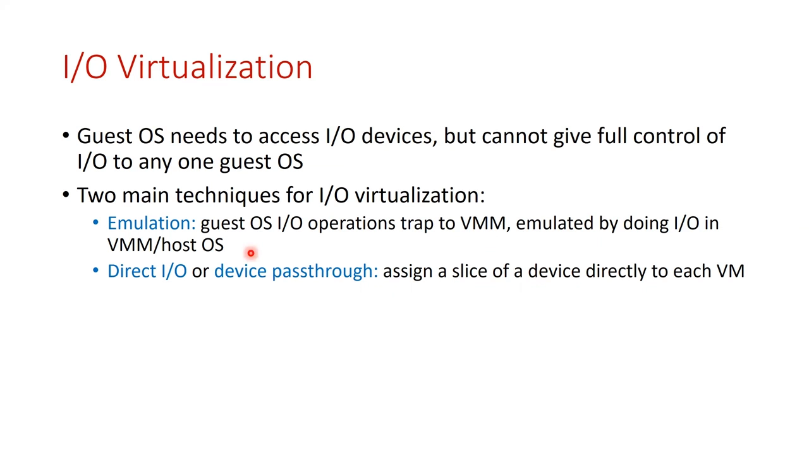

## 小结

- VMM 的本质是"把客户操作系统当成进程来调度"，但客户操作系统认为自己独占硬件，这是所有麻烦的来源。
- 基线方案是陷入-模拟：客户 OS 降到 ring 1，任何特权操作都陷入 ring 0 的 VMM 由它模拟。代价是每次特权操作都要多绕一层。
- 这条路在 x86 上撞墙，因为 x86 的敏感指令不是特权指令的子集（`popf` 就是典型），Popek-Goldberg 定理给出了判据。
- 半虚拟化用"改源码 + hypercall"绕开这个问题，代价是跑不了未修改的操作系统。
- 全虚拟化用"动态二进制翻译"绕开，代价是翻译开销，但能跑现成系统。
- 硬件辅助虚拟化把"该不该切回 VMM"交给 CPU：客户 OS 跑在 VMX 模式的 ring 0，只在 VMM 配置的事件上退出。它同时消掉了改源码和翻译两份代价，因此成为主流。
- 内存与 I/O 复用同一逻辑：没有硬件支持就用影子页表/设备模拟，有硬件支持就用 EPT/设备直通。

## 关键术语速查

| 术语 | 一句话解释 |
| --- | --- |
| VMM / hypervisor | 在物理机和客户操作系统之间的一层软件，负责把物理机分给多台虚拟机 |
| 陷入-模拟（trap and emulate） | 把客户 OS 放到低特权级，特权操作陷入 VMM，由 VMM 模拟执行 |
| 敏感指令 | 会改变硬件状态、但不一定只在特权模式下才能执行的指令，是 x86 难以虚拟化的根源 |
| 特权指令 | 只在 ring 0 才能执行、在其他环执行会陷入的指令 |
| Popek-Goldberg 定理 | 想用陷入-模拟高效构建 VMM，敏感指令集必须是特权指令集的子集 |
| 半虚拟化 | 改写客户 OS 源码，让它用 hypercall 主动向 VMM 请求特权操作（如 Xen） |
| 全虚拟化 | 不改源码，动态翻译客户 OS 的二进制指令，让敏感指令陷入 VMM（如 VMware Workstation） |
| 硬件辅助虚拟化 | CPU 提供专门的执行模式（如 VMX），客户 OS 在其中的 ring 0 运行，由硬件负责退出回 VMM |
| 影子页表 | VMM 把 GVA→GPA 和 GPA→HPA 合成一张页表交给 MMU，需跟踪客户页表改动 |
| EPT | 硬件支持的两级页表，MMU 同时使用客户页表和宿主页表完成翻译 |
| 设备直通 | 把物理设备切片直接分配给某台虚拟机，绕过 VMM 的模拟开销 |
