# 全虚拟化与二进制翻译：VMware如何虚拟化无硬件支持的x86

> 视频来源：[Virtualization and Cloud Computing Lecture 5: Full Virtualization](https://www.youtube.com/watch?v=MVxBxg_aNk0)（YouTube · Mythili Vutukuru，IIT Bombay）｜时长约 31 分钟
> 本文只讲"没有硬件虚拟化支持时，怎么用纯软件把 x86 虚拟化起来"这一件事：动态二进制翻译、world switch、cross page、分段保护。与 KVM/VMX 的对比只保留在"代价差在哪"的层面，根/非根模式的机制细节属于下一小节。

## 本讲要解决的核心问题（SCQA）

**背景**：上一节我们看到，虚拟化 x86 有三条软件路径，其中"全虚拟化"的卖点是能跑**未修改**的操作系统——不改源码，只翻译二进制。

**冲突**：但这条路要在最恶劣的条件下工作：底层 CPU 没有虚拟化支持，客户操作系统只能被降到 ring 1，而 x86 有一批敏感指令在 ring 1 下会静默地做错事，连陷入都不给你。也就是说，VMM 既要让客户 OS 跑在低特权级，又不能让那些"跑不对"的指令真的执行。

**疑问**：VMware Workstation 到底用了什么机制，让一个未修改的操作系统在 ring 1 上跑得对？

**回答（中心思想）**：它把"执行客户代码"这件事整个接了过来——**不直接运行客户操作系统的二进制，而是把它的基本块逐块翻译成 VMM 里的编译代码片段（CCF），在翻译时顺手把敏感指令改写成"陷入 VMM"**；再用一次纯软件的 **world switch** 在宿主上下文和客户上下文之间切换，用一块双面映射的 **cross page** 存放切换现场；最后用**截断段**把 VMM 占用的最高 4 MB 从客户机眼前藏起来。代价是：每一次切换、每一次翻译、每一次陷入都由软件完成，这也是它后来被硬件辅助虚拟化取代的原因。

## 一、全虚拟化要补的窟窿

全虚拟化之所以出现，是因为早期 x86 硬件没有虚拟化支持。前面几讲已经看到：有些指令在客户操作系统被降到低特权级后就不正常工作了，这让"陷入-模拟"式的 hypervisor 很难建。[【跳转到 00:30】](https://www.youtube.com/watch?v=MVxBxg_aNk0&t=30)

但历史上确实有这样的系统，最早的就是 VMware Workstation：即使底层指令集有这些难以虚拟化的问题，它依然高效地解决了"为 x86 构建陷入-模拟 hypervisor"这个难题。它是类型二 hypervisor 的例子，本讲研究的是它模型的一个简化版本。[【跳转到 00:55】](https://www.youtube.com/watch?v=MVxBxg_aNk0&t=55)

核心思路一句话：**二进制翻译**。把操作系统的二进制拿过来，凡是那些在低特权级下跑不对的问题指令，就翻译它们，让它们要么陷入 VMM，要么在低特权级下表现正确。而且这种翻译是动态的、按需的——不需要翻译整个操作系统镜像，只翻译接下来要执行的那部分代码。[【跳转到 01:05】](https://www.youtube.com/watch?v=MVxBxg_aNk0&t=65)

注意关键区别：这是翻译**二进制**，不是改写**源码**——后者是半虚拟化的思路。它比改源码容易，而且能跑未修改的操作系统。当然，如果硬件支持 VMX 模式，直接做硬件辅助虚拟化更好，因为二进制翻译相比原生运行总有额外开销；但在硬件支持不可用的年代，全虚拟化就是唯一的答案。[【跳转到 01:55】](https://www.youtube.com/watch?v=MVxBxg_aNk0&t=115)

## 二、VMM 的两段式结构：用户态进程 + 内核驱动

这套 VMM 和 KVM/QEMU 一样分成两部分：一个用户态组件，一个内核驱动组件。

用户态组件先 mmap 一段内存当作客户虚拟机的物理内存，然后发起一个 ioctl 与内核驱动通信，说"现在替我运行这台客户虚拟机"。用户态组件跑在 ring 3，内核驱动属于宿主操作系统、跑在 ring 0。[【跳转到 03:10】](https://www.youtube.com/watch?v=MVxBxg_aNk0&t=190)

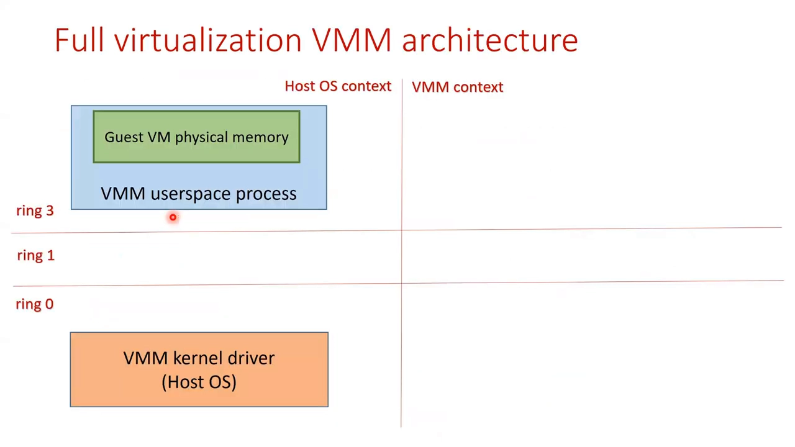

接下来是关键动作：就像 KVM/QEMU 切到 VMX 模式那样，这个 hypervisor 也要切到 VMM 上下文，这个动作叫 **world switch（世界切换）**。区别在于——**这里没有任何硬件支持，硬件里没有单独的运行模式，这完全是软件实现的上下文切换**。[【跳转到 02:40】](https://www.youtube.com/watch?v=MVxBxg_aNk0&t=160)

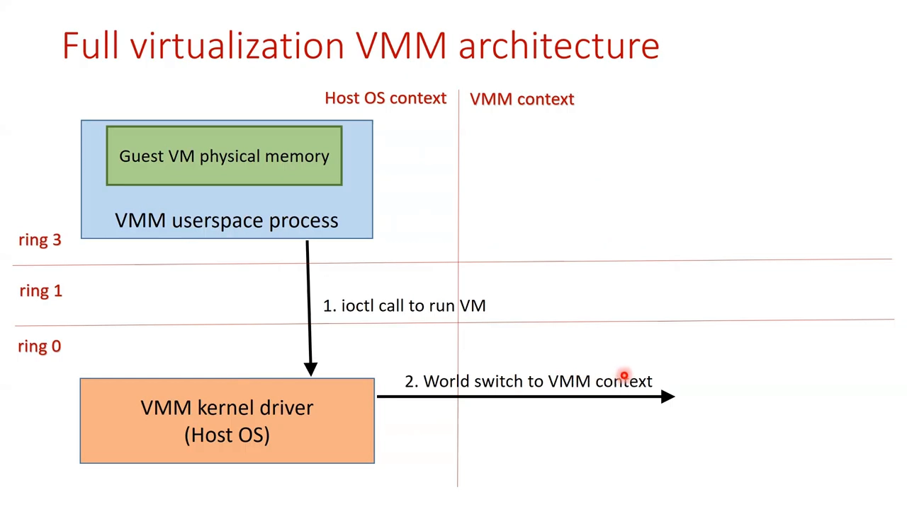

切过去之后，各个组件的位置是：VMM 跑在最高特权级 ring 0；客户操作系统被翻译过，跑在 ring 1；客户机的用户应用照常跑在 ring 3。[【跳转到 04:25】](https://www.youtube.com/watch?v=MVxBxg_aNk0&t=265)

客户操作系统每次要做特权操作，都陷入 VMM。VMM 自己在 ring 0，能独立处理一部分特权操作；但有些操作需要宿主操作系统支持（比如处理 I/O），这时 VMM 就退出、切回宿主操作系统上下文，宿主可能再返回到用户态进程，由用户态进程用现成的系统调用完成 I/O。做完之后 VMM 再切回去，在 VMM 上下文里继续运行客户操作系统。[【跳转到 05:15】](https://www.youtube.com/watch?v=MVxBxg_aNk0&t=315)

换句话说，VMM 不必自己实现全部系统调用逻辑，它只要回到宿主操作系统，由 VMM 的用户态进程代表客户机去做 I/O。

## 三、world switch 到底切了什么：两个上下文、两套地址空间

"宿主上下文"和"VMM 上下文"这两个词，说的就是一个**执行环境**：CPU 寄存器的值、指向页表和 IDT 的寄存器、以及它们所定义的地址空间。

- **宿主上下文**：宿主用户进程占低端虚拟地址，宿主操作系统占高端虚拟地址，页表把这些地址映射到物理内存；IDT 指向宿主的中断处理函数；宿主操作系统里还包含 VMM 的内核驱动，VMM 的用户态进程跑在宿主用户空间。
- **VMM 上下文**：客户用户进程照常跑在低端虚拟地址，客户操作系统跑在 ring 1、位于高端虚拟地址，而**所有客户进程地址空间最上面的 4 MB 被 VMM 代码占用**——有一段特殊的 VMM 代码把自己塞进了每个地址空间的顶部 4 MB，页表里最高 4 MB 的地址就指向 VMM 代码。[【跳转到 06:38】](https://www.youtube.com/watch?v=MVxBxg_aNk0&t=398)

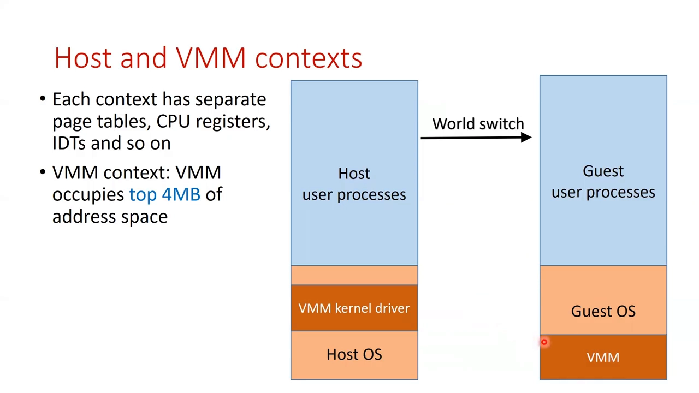

切换时要做的，就是保存所有 CPU 寄存器、页表、CR3 的值，再恢复另一套值。那么这些上下文存在哪？

答案是**一块特殊的内存页**，也叫 **cross page（交叉页）**。world switch 需要的代码和数据就存在这里，而这一页必须宿主和客户都能访问，因此它同时被映射进 VMM 内核驱动和 VMM 上下文里的 VMM 代码——也就是映射进两张页表：宿主地址空间里的某些地址和客户地址空间里的某些地址，指向同一个物理内存页。[【跳转到 08:18】](https://www.youtube.com/watch?v=MVxBxg_aNk0&t=498)

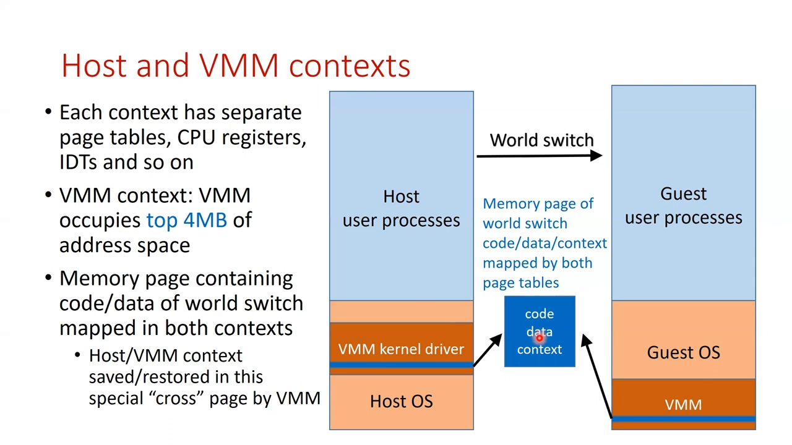

这样 VMM 内核驱动要切过来时，从这块内存保存/恢复上下文；客户要切回去时，也从同一块内存保存/恢复。**这块双面映射的页，就是纯软件 world switch 的支点。**[【跳转到 09:08】](https://www.youtube.com/watch?v=MVxBxg_aNk0&t=548)

## 四、和 KVM 的四处差异：代价到底差在哪

把有硬件支持的 QEMU/KVM 和这套纯软件设计摆在一起，差别集中在四件事上。

**第一，上下文存在哪、谁来存。** 这套设计需要一块 cross page 同时映射进两个地址空间，由软件手工保存和恢复。而 KVM 那边有一个叫 VMCS 的公共内存区，CPU 能直接访问它：CPU 知道 VMCS 在哪、知道该把上下文存到哪、从哪恢复，还有专门的 CPU 指令来启动和退出虚拟机，由指令完成上下文保存。你不需要往客户机或宿主里插入什么 cross page，CPU 自己处理了——这就是"硬件支持"的含义：**CPU 知道怎么在两个上下文之间切换**。[【跳转到 10:23】](https://www.youtube.com/watch?v=MVxBxg_aNk0&t=623)

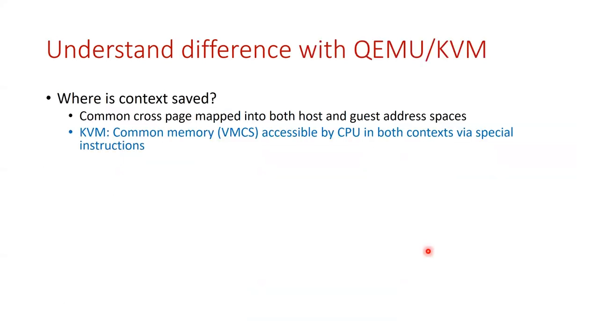

**第二，客户操作系统的特权级。** 这套设计里客户机只能跑在 ring 1，任何特权操作都要陷入 ring 0 的 VMM；而在 KVM 里客户操作系统直接跑在（特殊的）VMX ring 0，不需要任何翻译。[【跳转到 11:13】](https://www.youtube.com/watch?v=MVxBxg_aNk0&t=673)

**第三，陷入怎么发生。** 在 KVM 里，哪些指令该触发退出是可以配置的，硬件负责把"在 VMX 模式下不能执行的指令"变成一次退出，软件不用改写指令。而在这里没有硬件兜底，**必须显式改写指令**，让它们恰当地陷入 VMM。[【跳转到 12:03】](https://www.youtube.com/watch?v=MVxBxg_aNk0&t=723)

**第四，VMM 在哪。** 这套设计里 VMM 就位于客户上下文、属于客户地址空间的一部分（最高 4 MB），所以"陷入 VMM"只是客户操作系统跳到地址空间顶部去执行 VMM 代码；只有在 VMM 处理不了时，才需要退出回宿主、做一次真正的 world switch。而 KVM 里客户上下文里根本没有 VMM 代码，陷入就是一次 VM exit。[【跳转到 12:53】](https://www.youtube.com/watch?v=MVxBxg_aNk0&t=773)

抛开这些差别，高层思路是一样的：都有用户态进程、都有内核模块、都要切到客户上下文。**差别全部来自"没有硬件支持"这五个字。**[【跳转到 14:08】](https://www.youtube.com/watch?v=MVxBxg_aNk0&t=848)
## 五、二进制翻译的内部：翻译缓存、基本块、CCF

### 5.1 翻译缓存：客户 OS 从来不直接执行

在 VMM 上下文里，客户用户进程跑在 ring 3，客户操作系统位于某些虚拟地址——但**客户操作系统的代码是被翻译过的，放在 VMM 地址空间里的一块翻译缓存（translation cache，TC）中**。因为原始代码里可能有某些敏感的、非特权的指令在 ring 1 下运行不安全，所有这些指令都被恰当翻译后放进 TC，客户操作系统就从这里执行。[【跳转到 15:03】](https://www.youtube.com/watch?v=MVxBxg_aNk0&t=903)

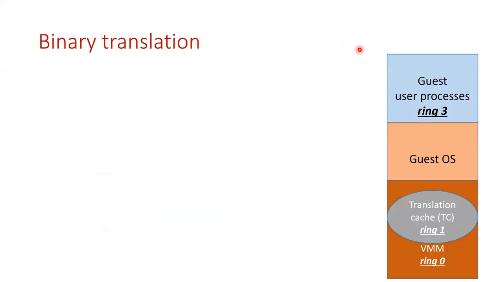

规则很干脆：**我们从不直接运行客户操作系统的二进制，永远运行翻译后的客户代码在 ring 1 上跑**；需要陷入时就跳到 ring 0 的 VMM 代码。[【跳转到 15:28】](https://www.youtube.com/watch?v=MVxBxg_aNk0&t=928)

大部分翻译其实很轻松：那些往寄存器里装值、做计算的代码，都不需要翻译，原样复制进 TC 即可。需要动手改的是两类：

- **敏感但非特权的指令**（就是在 ring 1 下会静默出错的那类）：改写成"陷入 VMM"，从而能在 ring 0 下被正确执行；
- **特权指令**：它们在 ring 1 下根本不能执行，本来就会陷入，VMM 负责模拟。[【跳转到 16:43】](https://www.youtube.com/watch?v=MVxBxg_aNk0&t=1003)

### 5.2 陷入之后：VMM 维护影子副本

特权指令的典型例子是"设置页表"：客户操作系统说"这是我的页表，把 CR3 设成这个值"，这条指令陷入 VMM。VMM 维护自己的一套数据结构副本（页表、IDT），它可以使用客户机给的值，也可以稍作修改，然后把自己的那份副本装进 CR3 或 IDT。[【跳转到 17:08】](https://www.youtube.com/watch?v=MVxBxg_aNk0&t=1028)

这些副本叫**影子副本（shadow copies）**，因为它们"遮蔽"了客户操作系统原有的东西：VMM 用一份类似的数据结构，让 CR3 或 IDT 指向自己的副本，客户操作系统却以为自己设置成功了。[【跳转到 18:48】](https://www.youtube.com/watch?v=MVxBxg_aNk0&t=1128)

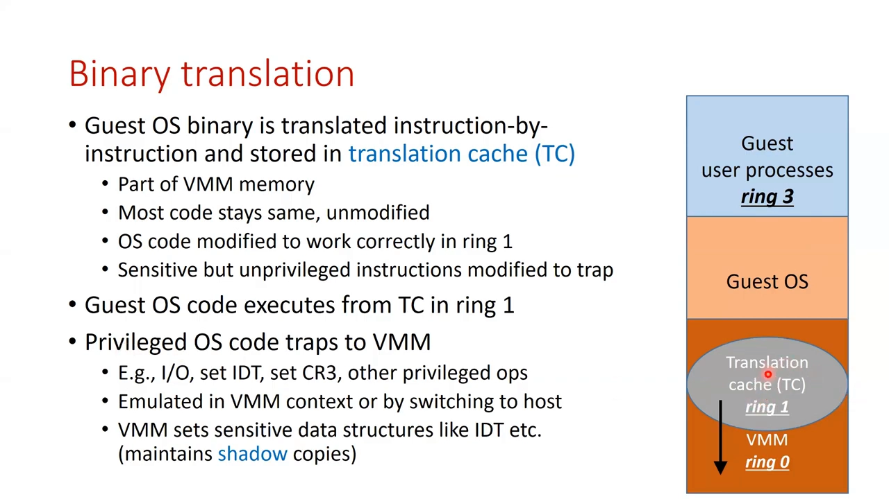

### 5.3 动态翻译：一个基本块一个 CCF

翻译是动态进行的，你不会翻译整个客户操作系统二进制。做翻译的是 VMM 的翻译器逻辑，它跑在 ring 0；翻译后的客户代码跑在 ring 1。

翻译器的工作循环是：到客户操作系统那里取**一个基本块（basic block）**——所谓基本块，就是从某处开始、直到遇到跳转或返回这类控制流改变为止的一串指令——把它翻译成**编译代码片段（CCF，compiled code fragment）**，存进翻译缓存，然后切到 ring 1 执行。[【跳转到 19:08】](https://www.youtube.com/watch?v=MVxBxg_aNk0&t=1148)

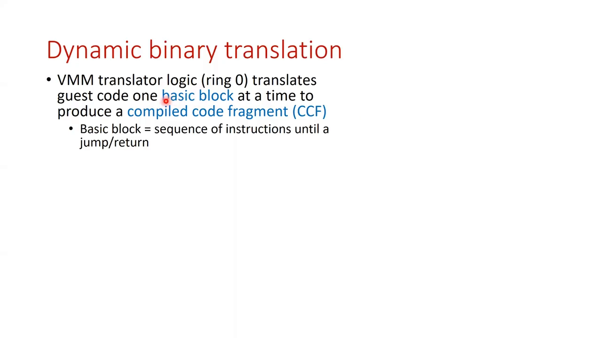

跑到 CCF 末尾时会遇到问题：它说"跳到某个位置"，但那个位置的代码还没翻译。于是控制权回到 VMM，翻译器取下个基本块、翻译、再切回 ring 1 执行。这个过程重复很多次——只要客户操作系统在跑，就一块一块地翻译、放进 TC、切到 ring 1 执行。[【跳转到 20:28】](https://www.youtube.com/watch?v=MVxBxg_aNk0&t=1228)

### 5.4 链接（chaining）：翻译一次，反复跳转

运行一段时间后，情况会好转：如果 CCF 说"跳到另一个地址"，而那个块之前已经被翻译过、还在 TC 里，你就可以直接跳过去运行，不必每次回去翻译。等客户操作系统里常用的代码大多翻译好之后，执行就变成在 TC 里的这些块之间跳来跳去。这个优化叫**链接（chaining）**。[【跳转到 20:53】](https://www.youtube.com/watch?v=MVxBxg_aNk0&t=1253)

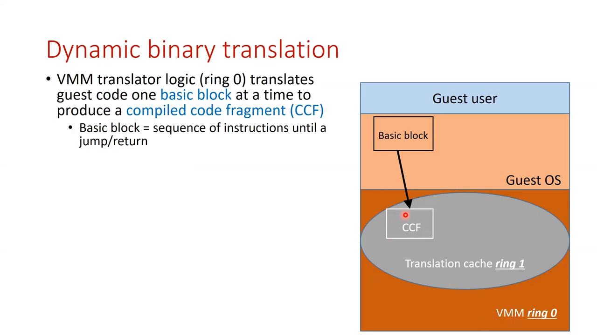

这就是二进制翻译的全貌：逐个基本块翻译、放进翻译缓存，然后 VMM 切到 ring 1，在 CPU 的 ring 1 上执行客户操作系统代码。[【跳转到 21:43】](https://www.youtube.com/watch?v=MVxBxg_aNk0&t=1303)

## 六、为什么还要动用分段：一位标志位不够用了

普通操作系统里，保护内核靠分页就够了：页表项里有"用户页/内核页"这一位，ring 3 下只能执行和读写用户页，ring 0 下才能访问内核页。现代操作系统里段都是平坦的（base 为 0、limit 为最大值），不做界限检查。[【跳转到 22:33】](https://www.youtube.com/watch?v=MVxBxg_aNk0&t=1353)

但虚拟化场景里出现了**三个实体**：客户用户空间、客户操作系统、VMM。一位标志位已经不够区分"内核页里的 VMM"和"内核页里的客户 OS"，于是分段被拉来做保护。[【跳转到 23:48】](https://www.youtube.com/watch?v=MVxBxg_aNk0&t=1428)

做法是**截断段（truncated segment）**：把 VMM 占用的最高 4 MB 从段里排除掉。

- **ring 3**：无论用户进程还是客户操作系统在跑，代码段、数据段都被截断成"0 到最大值减 4 MB"，最后 4 MB 不允许使用。客户用户进程一旦访问到这里，界限检查触发内存访问违规。
- **ring 1**：除**代码段**之外的所有段都被截断。为什么代码段例外？因为客户操作系统的代码（翻译缓存）就在 VMM 那 4 MB 里，不允许访问它就没法运行。
- **ring 0**：VMM 运行时，所有段都指向 VMM 的最高 4 MB 代码——只有 ring 0 被允许访问这段代码。[【跳转到 24:38】](https://www.youtube.com/watch?v=MVxBxg_aNk0&t=1478)

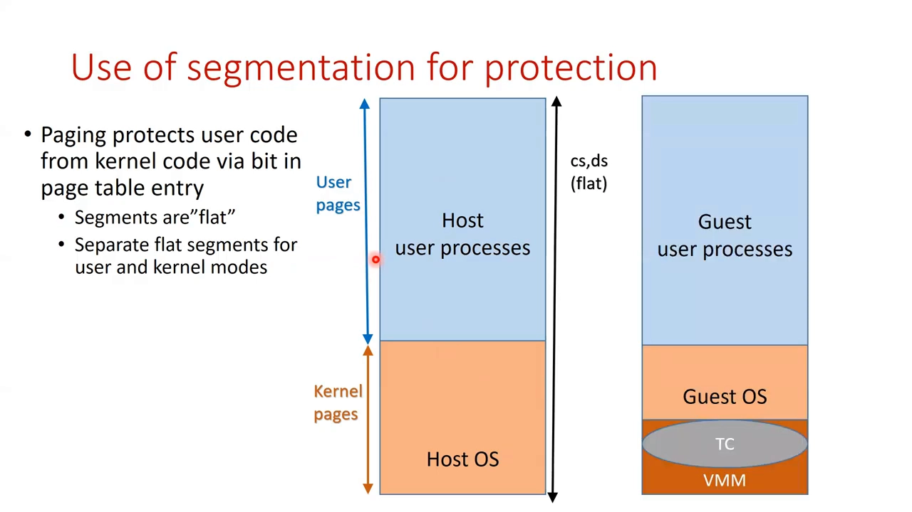

这里的关键洞察是：**你没法只用一位就保护这么多实体互不侵犯**，需求太复杂，所以分段被重新请回来提供隔离保证。[【跳转到 26:18】](https://www.youtube.com/watch?v=MVxBxg_aNk0&t=1578)

（讲者还提了一个选学细节：翻译后的客户代码有时需要访问 VMM 里的数据结构，比如保存的寄存器值、程序计数器，于是特殊的 **GS 段**被允许进入 VMM 那 4 MB 区域；原始客户代码里 GS 段很少用，所以冲突不大。[【跳转到 27:15】](https://www.youtube.com/watch?v=MVxBxg_aNk0&t=1635)）

## 七、代价清单：这套设计贵在哪

把整讲的内容收拢成一张清单，全虚拟化的开销来自四处：

1. **翻译开销**：基本块要逐块翻译成 CCF，翻译器本身跑在 ring 0，翻译期间客户代码不能执行；只有靠 chaining 和缓存命中才能把平均开销摊薄。
2. **陷入开销**：敏感指令被改写成陷入，特权指令本来就陷入，每次陷入都要进 VMM 模拟、维护影子副本。
3. **切换开销**：world switch 完全由软件完成，要手工保存/恢复寄存器、页表、CR3、IDT，还要靠一块双面映射的 cross page 做支点。
4. **保护开销**：为了把 VMM 藏起来，必须动用分段和截断段，而现代操作系统本来已经不用分段了。

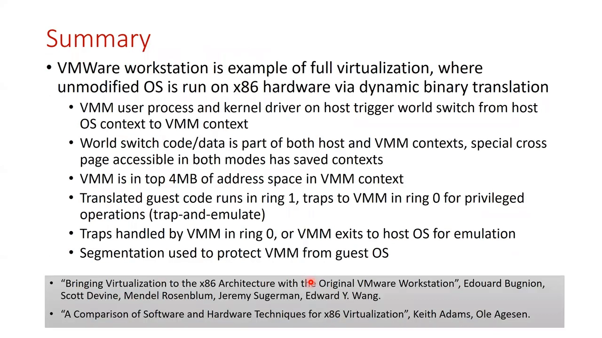

这也解释了它后来的命运：一旦 CPU 提供了 VMX 模式，前三项开销都可以交给硬件——客户操作系统直接跑在 VMX 的 ring 0，退出条件由 VMM 配置、由硬件触发，上下文由 CPU 存进 VMCS，软件既不用翻译指令，也不用手工做 world switch。**全虚拟化不是被设计得不好，而是它所有的开销都来自"替硬件干活"。**[【跳转到 30:23】](https://www.youtube.com/watch?v=MVxBxg_aNk0&t=1823)

## 小结

- 全虚拟化的目标：不改操作系统源码，让它在没有虚拟化支持的 x86 上跑起来。
- 手段是动态二进制翻译：不直接执行客户 OS 二进制，而是把基本块翻译成 CCF 放进 VMM 的翻译缓存，客户代码在 ring 1 上从缓存里执行。
- 翻译时顺手处理两类指令：敏感但非特权的指令改写成"陷入 VMM"，特权指令陷入后由 VMM 模拟并维护影子副本（CR3、IDT 等）。
- 上下文切换靠纯软件的 world switch：一块同时映射进宿主和客户地址空间的 cross page 存放切换现场。
- VMM 自己藏在每个客户地址空间的最高 4 MB，用截断段把这块内存从 ring 3 和 ring 1 的视野里切掉，只留 ring 1 的代码段可以进去取翻译缓存。
- 与 KVM 的四处差异——上下文存在哪、谁负责保存、客户 OS 的特权级、陷入怎么发生——全部源于"没有硬件支持"。
- 代价集中在翻译、陷入、切换、保护四处；硬件辅助虚拟化把这四项都交给 CPU，所以它成了主流。

## 关键术语速查

| 术语 | 一句话解释 |
| --- | --- |
| 全虚拟化 | 不改客户 OS 源码，通过翻译其二进制指令让它跑在虚拟机上 |
| 二进制翻译 | 把客户 OS 的机器指令改写成可在低特权级正确运行（或陷入 VMM）的形式 |
| 翻译缓存（TC） | VMM 内存里存放翻译后代码的区域，客户 OS 从这里以 ring 1 执行 |
| 基本块 | 从某处开始、直到遇到跳转或返回为止的一串指令，是翻译的最小单位 |
| CCF | 编译代码片段，一个基本块翻译后的产物 |
| 链接（chaining） | 下一个基本块的 CCF 已在缓存时直接跳过去，省掉回 VMM 重新翻译 |
| world switch | 纯软件实现的宿主上下文与 VMM 上下文之间的切换 |
| cross page | 同时映射进宿主和客户地址空间的特殊内存页，存放 world switch 的代码、数据与上下文 |
| 影子副本 | VMM 自己维护的页表、IDT 等数据结构副本，CR3/IDT 实际指向它们 |
| 截断段 | 把段界限截到"最大值减 4 MB"，从段层面挡住对 VMM 那 4 MB 的访问 |
