# 手写最小 KVM 客户端：从 `/dev/kvm` 到 `KVM_RUN` 的七个 ioctl

> 视频来源：[How to write your own KVM client from scratch](https://www.youtube.com/watch?v=-0HFbKvO2q8)（YouTube · linuxdev-br，讲者 Murilo Opsfelder Araújo，2019 年 Linux Developer Conference Brazil）｜时长约 34 分钟
> 导读：这是一场"照着代码走一遍"的演讲。讲者用 Josh Triplett 发表在 LWN 上的 kvmtest.c（约 90 行 C）把 KVM 的接口模型完整跑了一遍，并用 strace 抓出真实的 ioctl 序列。本文按这条调用链组织，适合第一次接触 KVM 接口的读者。

## 本讲要解决的核心问题（SCQA）

**背景**：KVM 从 Linux 2.6.x 时代就进了内核，接口十一年来保持兼容。但绝大多数人只见过 `qemu-system-x86_64` 这条命令，没见过 KVM 本身——它藏在 QEMU 背后，由一个字符设备驱动。

**冲突**：KVM 并没有提供"创建虚拟机"这样的系统调用。你在 `strace` 里看不到 `sys_vm_create` 之类的东西，只能看到一堆 ioctl(3, KVM_CREATE_VM, 0)。一个内核子系统，为什么把入口做成一个字符设备加一堆 ioctl？

**疑问**：如果我要自己写一个最小的 KVM 客户端，需要按什么顺序调用哪些接口？这些接口各自改变了内核里的什么状态？

**回答（中心思想）**：KVM 把"虚拟化硬件"这件事建模成**一个字符设备 `/dev/kvm` 上的命令流**——每个 ioctl 编号对应一个动作，返回的文件描述符对应一个内核对象。因此一个 KVM 客户端只需要七步：`open` → `KVM_GET_API_VERSION` → `KVM_CREATE_VM` → 分配内存并 `KVM_SET_USER_MEMORY_REGION` → `KVM_CREATE_VCPU` → 初始化寄存器 → 循环 `KVM_RUN`。所有 VMM（QEMU、kvmtool、novm、Kata）都是这套序列的不同写法。

## 一、KVM 的接口是"字符设备 + ioctl"，不是系统调用

### 1.1 ioctl 是系统调用之外的第二个内核入口

讲者在讲到 `KVM_GET_API_VERSION` 时停下来问了一句："这里有人不清楚 ioctl 是什么吗？"他的解释很干脆：

> ioctl 就是你和字符设备说话的方式——你往设备写一些特定的命令。每一个 API 名字实际上是一个数字，你把这个数字写给设备，内核侧的设备收到后按这个数字去执行相应动作。

这句话点出了 KVM 的设计选择。系统调用的接口表是**全局的、编号固定的**，加一个就要改 `unistd.h`、要过 ABI 评审；而 ioctl 的编号是**设备私有的**，一个字符设备驱动可以自己定义几百个命令号，互不干扰。KVM 正是这么做的：讲者准备幻灯片时，KVM 有 **128 个左右的 ioctl**，全部记录在内核文档 `Documentation/virtual/kvm/api.txt`（今天叫 `api.rst`）里，讲者称它为"KVM API 的权威文档" [【跳转到 06:36】](https://www.youtube.com/watch?v=-0HFbKvO2q8&t=396)。

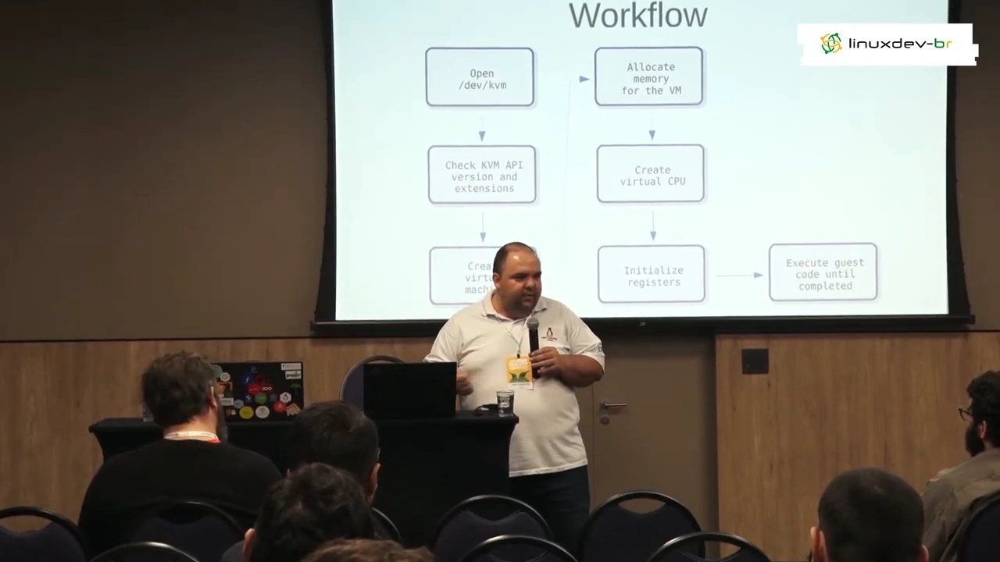

### 1.2 用文件描述符承载对象，让内核对象的生命周期跟着 fd 走

`open("/dev/kvm")` 返回的 fd 不是"一个设备句柄"这么简单，它是 KVM 子系统的根句柄。讲者强调：

> 你打开 KVM 设备，拿到一个 KVM 文件描述符，并在整个程序生命周期里保存它。只要还有引用，内核里对应的 KVM 结构就一直活着；最后一个引用关闭时，内核才释放内存。 [【跳转到 13:24】](https://www.youtube.com/watch?v=-0HFbKvO2q8&t=804)

这条规则后面每一步都复现一次：`KVM_CREATE_VM` 返回一个 VM fd，`KVM_CREATE_VCPU` 返回一个 vCPU fd。**对象的创建、引用计数、销毁全部复用 Unix 文件语义**，KVM 不需要发明新的生命周期管理机制。这也是为什么后面每个 ioctl 都要先问一句"该传哪个 fd"——传错 fd 就等于操作错对象。

### 1.3 128 个 ioctl 按"影响范围"分成四层

内核文档把这 128 个命令分成四类，分类依据是**这次调用改变了多大范围的状态** [【跳转到 07:16】](https://www.youtube.com/watch?v=-0HFbKvO2q8&t=436)：

| 层级 | 影响范围 | 典型命令 | 传哪个 fd |
| :--- | :--- | :--- | :--- |
| system | 整个 KVM 子系统 | `KVM_GET_API_VERSION`、`KVM_CREATE_VM` | KVM fd |
| VM | 某一台虚拟机 | `KVM_SET_USER_MEMORY_REGION`、`KVM_CREATE_VCPU` | VM fd |
| vCPU | 某一个虚拟处理器 | `KVM_GET_SREGS`、`KVM_SET_REGS`、`KVM_RUN` | vCPU fd |
| device | 某一个设备 | 设备属性类命令 | 设备 fd |

这张表是理解 KVM 接口的钥匙：**看到命令名，先问它作用在哪一层，就知道该拿哪个 fd 去调**。讲者说，QEMU 源码里正是按这个分层写了 `kvm_ioctl`、`vm_ioctl`、`vcpu_ioctl`、`device_ioctl` 四个包装函数。

### 1.4 版本号 12 是"接口稳定"的分界线

KVM 早期（2.6.x 时代）API 不稳定，版本号被频繁往上加；到 2.6.22 前后，版本号停在 **12** 并就此冻结，之后只做加法 [【跳转到 05:28】](https://www.youtube.com/watch?v=-0HFbKvO2q8&t=328)。所以任何 KVM 客户端的第一件事都是问一句"你支持到哪个版本"：

```c
ret = ioctl(kvm, KVM_GET_API_VERSION, NULL);
if (ret == -1)
    err(1, "KVM_GET_API_VERSION");
if (ret != 12)
    errx(1, "KVM_GET_API_VERSION %d, expected 12", ret);
```

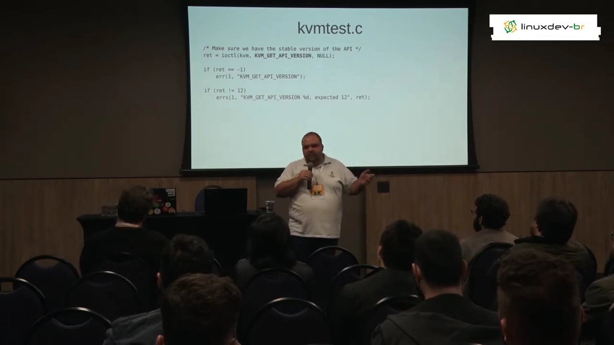

讲者的评价是：有人可能不同意"稳定"在这里的含义，但 API 大体上没变过，只是增加了新东西，最核心的部分十一年来一直兼容 [【跳转到 05:57】](https://www.youtube.com/watch?v=-0HFbKvO2q8&t=357)。这一点对写 VMM 的人很重要——**一个 2015 年的示例程序，2019 年还能直接编译运行**。

## 二、最小调用链：七个 ioctl 建起一台虚拟机

### 2.1 第 1 步：打开 `/dev/kvm`

```c
kvm = open("/dev/kvm", O_RDWR | O_CLOEXEC);
```

讲者说这是"标准路径，我不知道有没有哪个发行版把它放在别处" [【跳转到 01:52】](https://www.youtube.com/watch?v=-0HFbKvO2q8&t=112)。这一步同时也在探测宿主能力：设备节点存在，说明内核加载了 KVM 模块、CPU 支持 VT-x/AMD-V。

### 2.2 第 2 步：`KVM_CREATE_VM`——唯一改变全局状态的一步

```c
vmfd = ioctl(kvm, KVM_CREATE_VM, (unsigned long)0);
if (vmfd == -1)
    err(1, "KVM_CREATE_VM");
```

讲者特别指出：这个调用"会在内核里创建虚拟机结构，因此影响整个 KVM 子系统"，返回值是一个**虚拟机文件描述符**；失败时返回负数，这是内核 API 通知用户态出错的常见方式，只要不是负数就说明成功了 [【跳转到 15:30】](https://www.youtube.com/watch?v=-0HFbKvO2q8&t=930)。

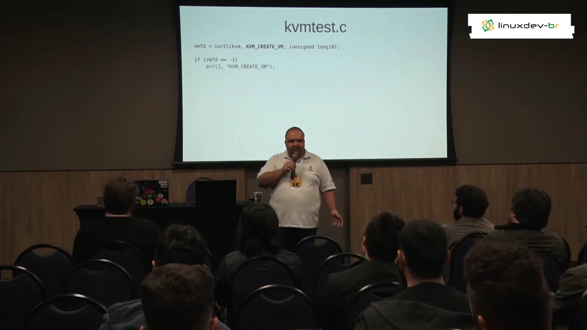

### 2.3 第 3 步：分配内存并用 `KVM_SET_USER_MEMORY_REGION` 登记

这一步是整条链里唯一"跨了两个世界"的动作。用户态先用 `mmap` 分配一块普通内存，再把它**登记**给 KVM：

```c
void *mem = mmap(NULL, 0x1000, PROT_READ | PROT_WRITE,
                 MAP_PRIVATE | MAP_ANONYMOUS, -1, 0);

struct kvm_userspace_memory_region region = {
    .slot = 0,
    .guest_phys_addr = 0x1000,
    .memory_size = 0x1000,
    .userspace_addr = (uint64_t)mem,
};
ret = ioctl(vmfd, KVM_SET_USER_MEMORY_REGION, &region);
```

讲者解释这个结构体的三个关键字段：**大小、用户态地址（刚 mmap 出来的指针）、以及它对应到客户机的哪个物理地址** [【跳转到 17:37】](https://www.youtube.com/watch?v=-0HFbKvO2q8&t=1057)。注意这里传的是 **VM fd 而不是 KVM fd**，因为这件事只影响这一台虚拟机。

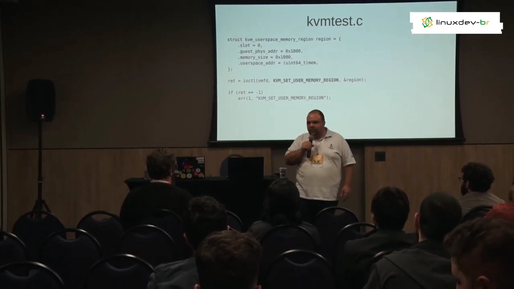

（slot 编号与客户机物理地址如何映射成一张表，属于本系列下一小节「1.2.3 内存区域注册与 KVM_SET_USER_MEMORY_REGION」的主题，这里只需要知道"登记之后 KVM 才认得这块内存"。）

### 2.4 第 4 步：`KVM_CREATE_VCPU` 与 `KVM_GET_VCPU_MMAP_SIZE`

```c
vcpufd = ioctl(vmfd, KVM_CREATE_VCPU, (unsigned long)0);
if (vcpufd == -1)
    err(1, "KVM_CREATE_VCPU");

int mmap_size = ioctl(kvm, KVM_GET_VCPU_MMAP_SIZE, NULL);
struct kvm_run *run = mmap(NULL, mmap_size, PROT_READ | PROT_WRITE,
                           MAP_SHARED, vcpufd, 0);
```

`KVM_CREATE_VCPU` 同样只影响这台虚拟机，所以传 VM fd，返回 vCPU fd [【跳转到 18:47】](https://www.youtube.com/watch?v=-0HFbKvO2q8&t=1127)。

紧接着的 `KVM_GET_VCPU_MMAP_SIZE` 值得单独说：它返回"KVM 一次可以执行的共享内存块"的大小，不同体系结构上这个值可能不同，所以要**先问再 mmap** [【跳转到 19:05】](https://www.youtube.com/watch?v=-0HFbKvO2q8&t=1145)。这块共享内存就是 kvm_run 结构体——用户态和内核之间传递"为什么退出"的窗口。它不是普通数据缓冲区，而是**共享映射**（`MAP_SHARED`），内核写、用户态读。

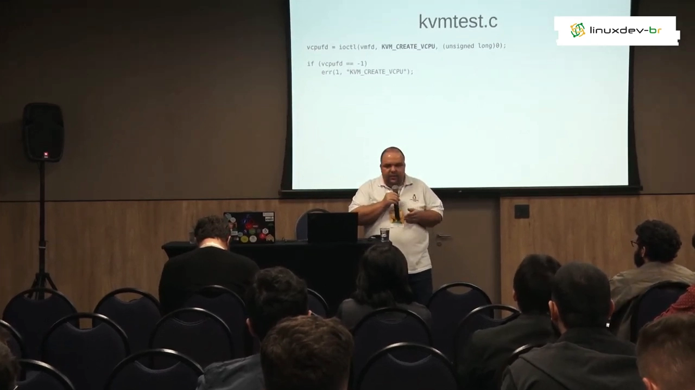

### 2.5 第 5 步：初始化寄存器——先读、改、再写

vCPU 刚创建时是一颗"复位状态"的 CPU，你得告诉它从哪里开始执行。x86 上分两步，先处理段寄存器（`SREGS`），再处理通用寄存器（`REGS`）。

段寄存器这一步是典型的**读—改—写**模式：

```c
struct kvm_sregs sregs;
ioctl(vcpufd, KVM_GET_SREGS, &sregs);   /* 先读出当前状态 */
sregs.cs.base = 0;                       /* 只改想改的字段 */
sregs.cs.selector = 0;
ioctl(vcpufd, KVM_SET_SREGS, &sregs);   /* 再整体写回 */
```

讲者强调这个模式很常见，"没什么新鲜的" [【跳转到 21:35】](https://www.youtube.com/watch?v=-0HFbKvO2q8&t=1295)。为什么要先读？因为 SREGS 结构体里有几十个字段，你只想改 CS，其余的必须原样写回，否则会把别的段寄存器清零。

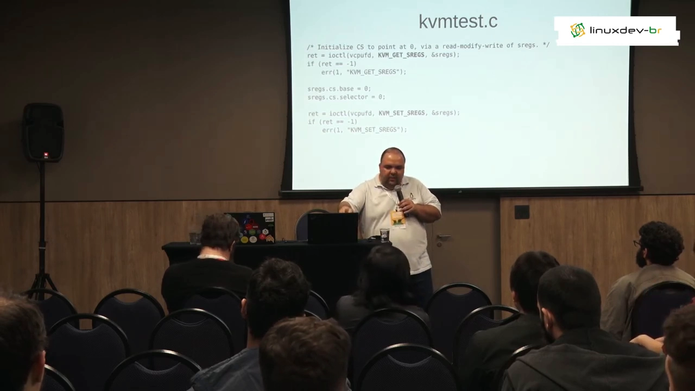

通用寄存器这一步则是直接构造结构体：

```c
struct kvm_regs regs = {
    .rip = 0x1000,   /* 客户机从这里开始取指 */
    .rax = 2,
    .rbx = 2,
    .rflags = 0x2,   /* x86 要求的初始标志位 */
};
ioctl(vcpufd, KVM_SET_REGS, &regs);
```

`rip = 0x1000` 正好是刚才登记给客户机的那块内存的客户机物理地址——**内存登记和寄存器初始化在这里对上了** [【跳转到 22:00】](https://www.youtube.com/watch?v=-0HFbKvO2q8&t=1320)。

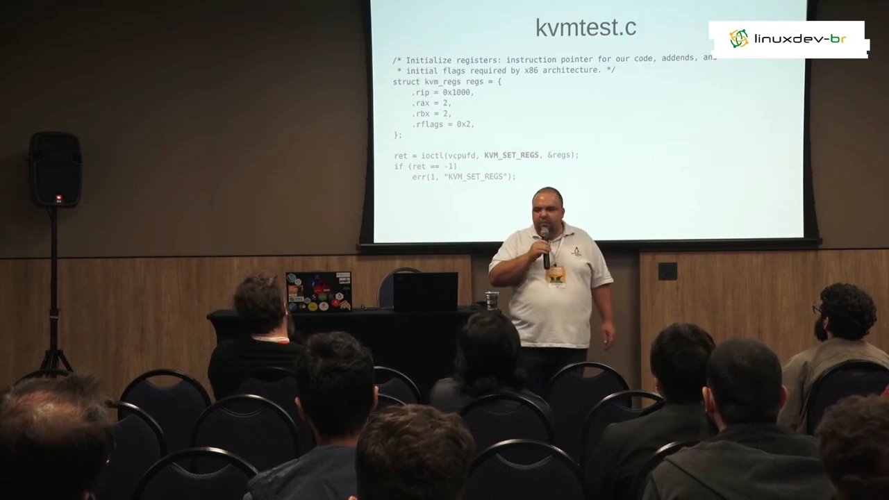

讲者还提醒：这部分**因体系结构而异**。在 PowerPC 上，对应的调用是读 MSR（机器状态寄存器），里面装着该 vCPU 的全部参数和状态；到了 QEMU 里，这些差异被抽象成 `kvm_arch_get_registers` / `kvm_arch_put_registers` 两个体系结构钩子 [【跳转到 20:20】](https://www.youtube.com/watch?v=-0HFbKvO2q8&t=1220)。

### 2.6 第 6 步：`KVM_RUN` 循环——虚拟机的"心跳"

前面所有调用都只发生一次，只有 `KVM_RUN` 会一直转下去：

```c
while (1) {
    ret = ioctl(vcpufd, KVM_RUN, NULL);
    if (ret == -1)
        err(1, "KVM_RUN");
    switch (run->exit_reason) {
    case KVM_EXIT_HLT:
        return 0;                      /* 客户机停机，结束 */
    case KVM_EXIT_IO:
        /* 客户机往 0x3f8 端口写了一个字节 —— 那是串口 */
        putchar(*(char *)run + run->io.data_offset);
        break;
    ...
    }
}
```

讲者对这段的概括是："虚拟机一直跑，直到 KVM 说它被彻底终止。因为此前已经把内存区域、寄存器都设好了，`KVM_RUN` 知道去内存的哪里取指令、从哪里开始执行客户机代码。" [【跳转到 23:40】](https://www.youtube.com/watch?v=-0HFbKvO2q8&t=1420)

每一轮循环都会得到一个**退出原因（exit reason）**，告诉用户态这次模拟为什么停下来。"KVM 能执行代码，但有些硬件必须由用户态来模拟"——这正是 QEMU 存在的原因，QEMU 要处理数量非常多的退出原因，才能完整模拟一个操作系统 [【跳转到 24:30】](https://www.youtube.com/watch?v=-0HFbKvO2q8&t=1470)。

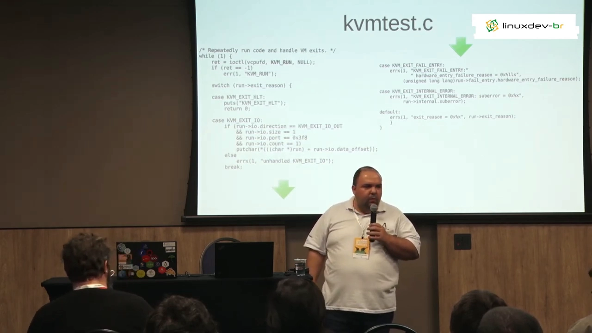

这个例子里只处理一种退出：`KVM_EXIT_IO`。因为客户机代码是"往串口写一个字节"，而串口在 x86 上固定在 I/O 端口 `0x3f8`，所以模拟方式就是**把客户机想写的数据抓出来，用 `putchar` 打到终端上** [【跳转到 25:20】](https://www.youtube.com/watch?v=-0HFbKvO2q8&t=1520)。讲者自嘲："这不是多高级的 I/O，但很好地展示了 `KVM_RUN` 循环长什么样。"

循环的三种出口：`KVM_EXIT_HLT`（客户机执行了 hlt，正常结束）、`KVM_EXIT_FAIL_ENTRY`（硬件进入失败）、`KVM_EXIT_INTERNAL_ERROR`（KVM 内部错误）[【跳转到 26:35】](https://www.youtube.com/watch?v=-0HFbKvO2q8&t=1595)。

## 三、实证：strace 抓出来的完整调用序列

讲者把这段代码编译运行，客户机做的事情是 `2 + 2` 然后写到串口，终端上打印出 `4`。用 strace 抓 ioctl，得到这样一串 [【跳转到 27:00】](https://www.youtube.com/watch?v=-0HFbKvO2q8&t=1620)：

```
ioctl(3, KVM_GET_API_VERSION, 0)                    = 12
ioctl(3, KVM_CREATE_VM, 0)                          = 4
ioctl(4, KVM_SET_USER_MEMORY_REGION, {...})         = 0
ioctl(4, KVM_CREATE_VCPU, 0)                        = 5
ioctl(3, KVM_GET_VCPU_MMAP_SIZE, 0)                 = 12288
ioctl(5, KVM_GET_SREGS, {...})                      = 0
ioctl(5, KVM_SET_SREGS, {...})                      = 0
ioctl(5, KVM_SET_REGS, {rax=0x2, rbx=0x2, rip=0x1000, rflags=0x2}) = 0
ioctl(5, KVM_RUN, 0)                                = 0
ioctl(5, KVM_RUN, 0)                                = 0
ioctl(5, KVM_RUN, 0)                                = 0
```

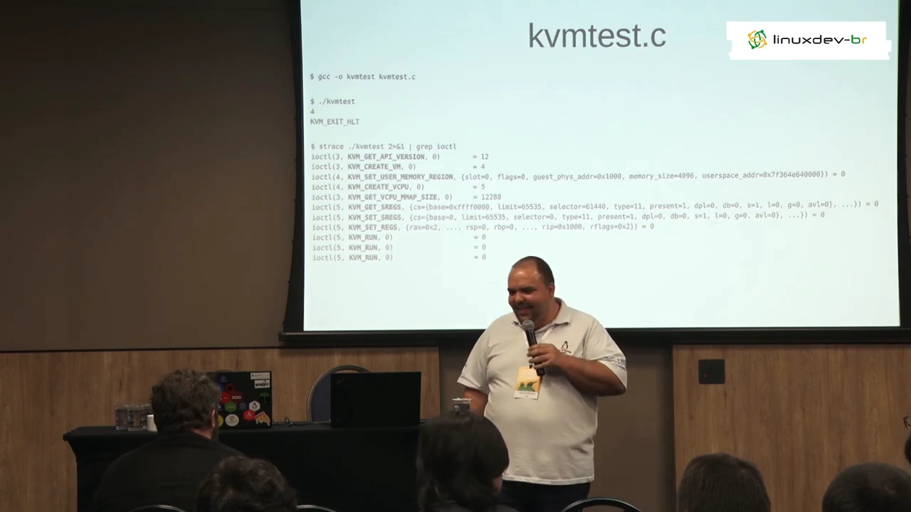

这张图几乎就是本文的目录。三个细节值得注意：

- **fd 编号的变化**：`3` 是 KVM fd，`4` 是 VM fd，`5` 是 vCPU fd。每一层的命令都打在自己那一层的 fd 上，和 1.3 节的四层分类严格对应。
- **`KVM_GET_VCPU_MMAP_SIZE` 打的是 KVM fd（3）**，不是 vCPU fd——它问的是"这个体系结构的 vCPU 共享区多大"，属于全局信息。
- **`KVM_RUN` 出现了三次**：那串字节码执行完需要三轮"进入—退出"，每轮之间用户态处理一次退出原因 [【跳转到 27:50】](https://www.youtube.com/watch?v=-0HFbKvO2q8&t=1670)。这就是最小 VMM 的全部工作量。

## 四、真实 VMM 只是把这套序列写得更讲究

讲者后半段翻 QEMU 源码，展示"工业级实现"和示例代码的差别——差别在工程化，不在接口。

### 4.1 按层级封装 ioctl

QEMU 写了 `kvm_ioctl`、`vm_ioctl`、`vcpu_ioctl`、`device_ioctl` 四个包装函数，把"这次调用影响哪一层"固化进函数名 [【跳转到 28:40】](https://www.youtube.com/watch?v=-0HFbKvO2q8&t=1720)。所以读 QEMU 代码时，看到 `kvm_ioctl` 就知道这个调用会影响整个 KVM 子系统。

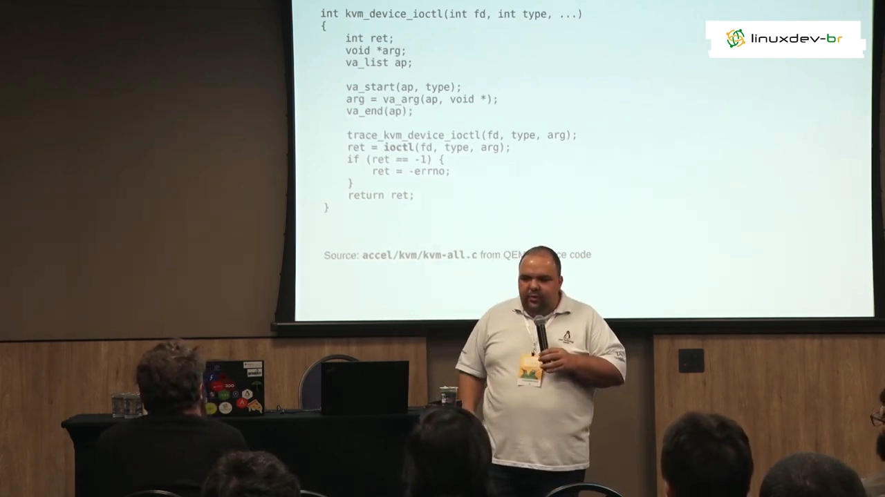

包装函数里还顺手做了两件示例代码不做的事：加 tracepoint（`trace_kvm_device_ioctl`），以及把 `errno` 统一转成负返回值。

### 4.2 版本检查来自"抄过来的内核头文件"

`kvm_init` 里同样检查 API 版本，但它比对的值来自 QEMU 仓库里一份**从内核复制过来的头文件**——QEMU 有一个目录专门存放各版本内核的头文件副本，所以这些定义和 Linux 版本能对上 [【跳转到 29:30】](https://www.youtube.com/watch?v=-0HFbKvO2q8&t=1770)。这一步之后还会检查扩展能力：宿主不一定具备 KVM 的全部能力，可能能跑 CPU 但创建不了设备。

### 4.3 同样的三步，换个体系结构再写一遍

QEMU 的 ARM 代码里，`open("/dev/kvm")` → `KVM_CREATE_VM` → `KVM_CREATE_VCPU` 一字不差 [【跳转到 30:45】](https://www.youtube.com/watch?v=-0HFbKvO2q8&t=1845)：

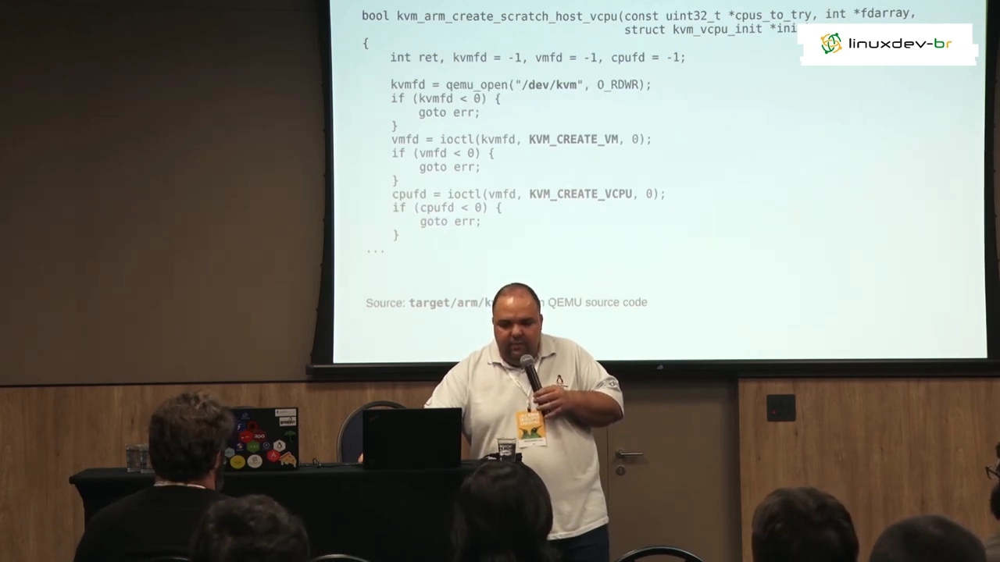

### 4.4 一个 vCPU 一个线程

QEMU 里有一个专门的 `vcpu_thread` 线程函数，因为一台虚拟机上可以有多个 CPU。"虚拟机有几个处理器，就有几份这个函数以 POSIX 线程的形式并行运行" [【跳转到 31:10】](https://www.youtube.com/watch?v=-0HFbKvO2q8&t=1870)。这就是"vCPU 是宿主上的普通线程"这一模型的来源——一个 vCPU 对应一个 POSIX 线程，虚拟机有几个处理器就有几份 `vcpu_thread` 在跑。

寄存器读写的体系结构差异，则被收进 `kvm_arch_get_registers` / `kvm_arch_put_registers` 两个钩子；讲者在 PowerPC 上实现过，对应的是 `get_spr` / `put_spr` [【跳转到 32:00】](https://www.youtube.com/watch?v=-0HFbKvO2q8&t=1920)。

## 五、这套接口设计带来一个意外的好处：不需要完整操作系统

讲者在讲完四层分类后插入了一段"所以呢"：你并不需要模拟或运行一个完整的操作系统，也可以借用 KVM 的硬件隔离能力，去跑你自己二进制里预先汇编好的指令；不必为了在沙箱里隔离地跑几个二进制而先启动一台 Linux 机器，也不必模拟一整套硬件，只模拟被隔离代码真正需要的那几件就够了 [【跳转到 08:47】](https://www.youtube.com/watch?v=-0HFbKvO2q8&t=527)。

正是这一点催生了一批"极简 KVM 客户端" [【跳转到 09:47】](https://www.youtube.com/watch?v=-0HFbKvO2q8&t=587)：

- **novm**：用 Go 写的轻量 hypervisor，只用几个步骤就把要执行的代码隔离起来，不需要启动 Linux 就能跑一个二进制；
- **kvmtool**：非常简单的轻量级 KVM 客户端，可以创建虚拟机、在 Linux 宿主上跑客户机；
- **Kata Containers**：最初由 Intel 发起，把每个容器或 Pod 都放进一个客户机里执行——因为创建一台虚拟机足够快，可以为每个容器起一台 VM、初始化所有寄存器，用硬件把容器和宿主隔得更开。

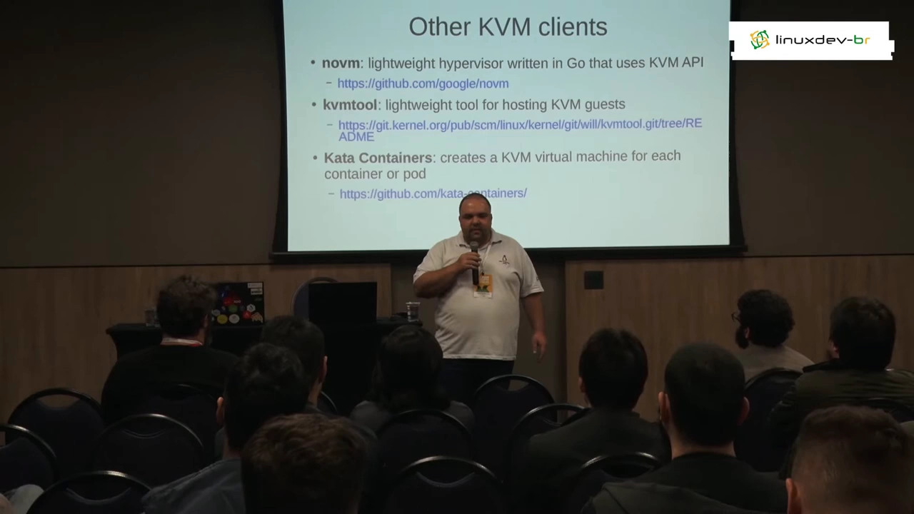

这也解释了本系列后面要讨论的 MicroVM 路线：起一台虚拟机在这套接口下本来就是七步、几十行代码的事，而 QEMU 要处理数量庞大的退出原因才能完整模拟硬件——**慢的是设备模型，不是 KVM**。

## 小结

- KVM 不提供系统调用，而是把虚拟化能力做成**字符设备 `/dev/kvm` 上的一串 ioctl**：命令号是设备私有的，可以扩展到 128 个以上，不必动全局系统调用表。
- 每个 ioctl 返回或接收一个**文件描述符**，内核对象的生命周期直接复用 Unix 的文件引用计数；最后一个引用关闭才释放。
- 128 个 ioctl 按**影响范围**分四层：system / VM / vCPU / device。传错 fd 就是操作错对象，这是读 KVM 代码最容易踩的坑。
- API 版本号冻结在 **12**，之后只做加法，十一年兼容——所以 2015 年的示例代码今天还能编译。
- 最小调用链七步：`open` → `KVM_GET_API_VERSION` → `KVM_CREATE_VM` → `KVM_SET_USER_MEMORY_REGION` → `KVM_CREATE_VCPU`（+ `KVM_GET_VCPU_MMAP_SIZE`）→ `KVM_SET_SREGS`/`KVM_SET_REGS` → `KVM_RUN` 循环。
- `KVM_RUN` 每次返回都带一个**退出原因**；用户态按原因模拟硬件，模拟完再进去。这台"最小虚拟机"只处理了串口一种退出。
- QEMU 与示例代码的差别在工程化（分层包装、tracepoint、体系结构钩子、一 vCPU 一线程），不在接口。

## 关键术语速查

| 术语 | 一句话解释 |
| :--- | :--- |
| ioctl | 系统调用之外的设备控制入口：往一个 fd 写一个命令号加一个参数指针，由驱动解释执行 |
| `/dev/kvm` | KVM 子系统的字符设备节点，所有 KVM 命令的根句柄 |
| KVM fd / VM fd / vCPU fd | 三层句柄，分别代表"整个 KVM 子系统""一台虚拟机""一个虚拟处理器" |
| `KVM_CREATE_VM` | 唯一改变全局状态的创建命令，返回 VM fd |
| `KVM_SET_USER_MEMORY_REGION` | 把一段用户态内存登记成客户机的物理内存，之后 KVM 才认得它 |
| kvm_run 结构体 | 与 vCPU fd 共享映射的一页内存，内核用它回传退出原因和退出参数 |
| exit reason | `KVM_RUN` 返回的原因码，如 `KVM_EXIT_IO`、`KVM_EXIT_HLT`、`KVM_EXIT_FAIL_ENTRY` |
| SREGS / REGS | x86 的段寄存器组与通用寄存器组，客户机启动前必须初始化 |
| kvmtool / novm / Kata | 三个不同量级的 KVM 客户端：轻量工具、Go 写的极简 hypervisor、容器沙箱运行时 |

## 参考资料

讲者在最后一页列出的四份资料 [【跳转到 32:50】](https://www.youtube.com/watch?v=-0HFbKvO2q8&t=1970)：

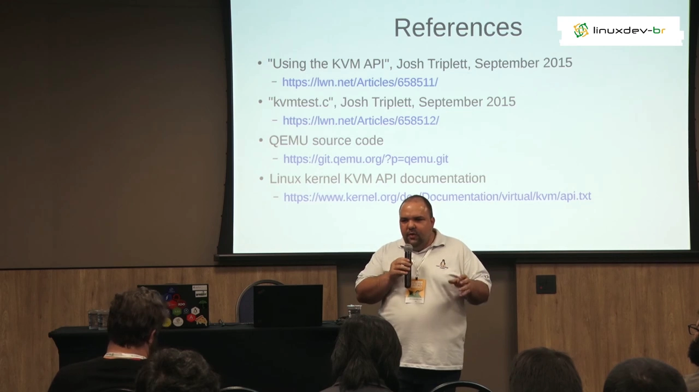

- Josh Triplett, "Using the KVM API", LWN, 2015：<https://lwn.net/Articles/658511/>
- Josh Triplett, "kvmtest.c", LWN, 2015：<https://lwn.net/Articles/658512/>
- QEMU 源码：<https://git.qemu.org/?p=qemu.git>
- 内核 KVM API 文档：<https://www.kernel.org/doc/Documentation/virtual/kvm/api.txt>