# 一台虚拟机就是一个文件描述符：KVM 三层 fd 的对象模型

> 视频来源：[Virtualization From the Inside: KVM, QEMU, qcow2 and QMP](https://www.youtube.com/watch?v=3ZrbSFlP1kI)（YouTube · Cloud Foundation from Scratch 第一季第 3 集）｜时长约 32 分钟
> 导读：这一集从"凌晨三点的三张工单"出发，把一台云主机从宿主侧拆开：它不是一个新物种，而是一个普通进程、几个 `/dev/kvm` 文件描述符、每颗 vCPU 一个线程。本文把镜头对准本小节的主题——KVM、VM、vCPU 三层 fd 的从属关系与生命周期；同一集里的镜像 overlay、cloud-init、QMP 与 TCG 对照，放在后半段作为"对象之外"的必要背景。

## 本讲要解决的核心问题（SCQA）

**背景**：上一小节已经看过 KVM 的七步调用链：`open("/dev/kvm")` → `KVM_CREATE_VM` → `KVM_SET_USER_MEMORY_REGION` → `KVM_CREATE_VCPU` → `KVM_RUN`。你也知道 QEMU 是跑在用户态的 VMM，KVM 是内核模块。

**冲突**：可是"创建了一台虚拟机"这句话，在宿主上究竟留下了什么？`ps` 里能看见它吗？如果把 QEMU 进程直接杀掉，内核里会不会剩下一台没有主人的虚拟机？为什么有的 fd 属于整台机器，有的只属于某一颗虚拟 CPU？

**疑问**：KVM、VM、vCPU 这三个对象，谁持有谁？它们的寿命由什么决定？多一颗 vCPU，到底多出了什么？

**回答（中心思想）**：**KVM 把三个对象串成一条文件描述符的从属链：系统 fd → VM fd → vCPU fd。三层都活在调用进程里，虚拟机没有独立于进程的存在；vCPU 是"一个 fd 加一个线程"；进程退出时内核关闭这些 fd，整棵树一起消失。** 理解这条链，就理解了 KVM 的对象模型。

## 一、三层 fd：每一层都由上一层"生"出来

### 1.1 strace 里的三个 fd 编号

视频用一个 22 字节的客户机程序（往串口打印 `Hi`，做一次加法，然后停机）跑通了最小 hypervisor。把它的系统调用抓出来，fd 的层级一目了然 [【跳转到 04:52】](https://www.youtube.com/watch?v=3ZrbSFlP1kI&t=292)：

```
open("/dev/kvm")                 -> fd 3   （系统层）
ioctl(3, KVM_CREATE_VM)          -> fd 4   （虚拟机层）
ioctl(4, KVM_SET_USER_MEMORY_REGION, {...})
ioctl(4, KVM_CREATE_VCPU)        -> fd 5   （vCPU 层）
ioctl(5, KVM_RUN)                -> 每次退出返回一次
```

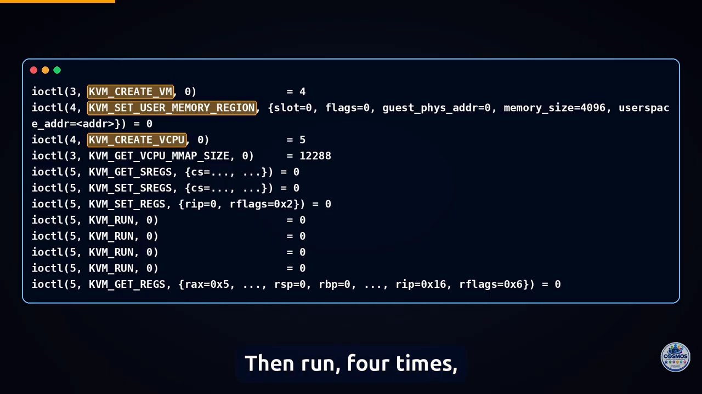

讲者的概括是：**三层文件描述符，每一层都由上一层返回**。fd 编号 3、4、5 只是这次运行的巧合，真正固定的是"谁生出了谁"。

### 1.2 每一层管的事情不一样

三层不是三个同样的句柄，而是三种职责 [【跳转到 05:17】](https://www.youtube.com/watch?v=3ZrbSFlP1kI&t=317)：

| 层级 | 谁返回它 | 它"知道"或"拥有"什么 |
| :--- | :--- | :--- |
| 系统 fd | `open("/dev/kvm")` | API 版本、宿主能力（capabilities） |
| VM fd | `KVM_CREATE_VM` | 客户机的内存区域（memory regions） |
| vCPU fd | `KVM_CREATE_VCPU` | 这颗 vCPU 的寄存器，以及 `KVM_RUN` 这个调用 |

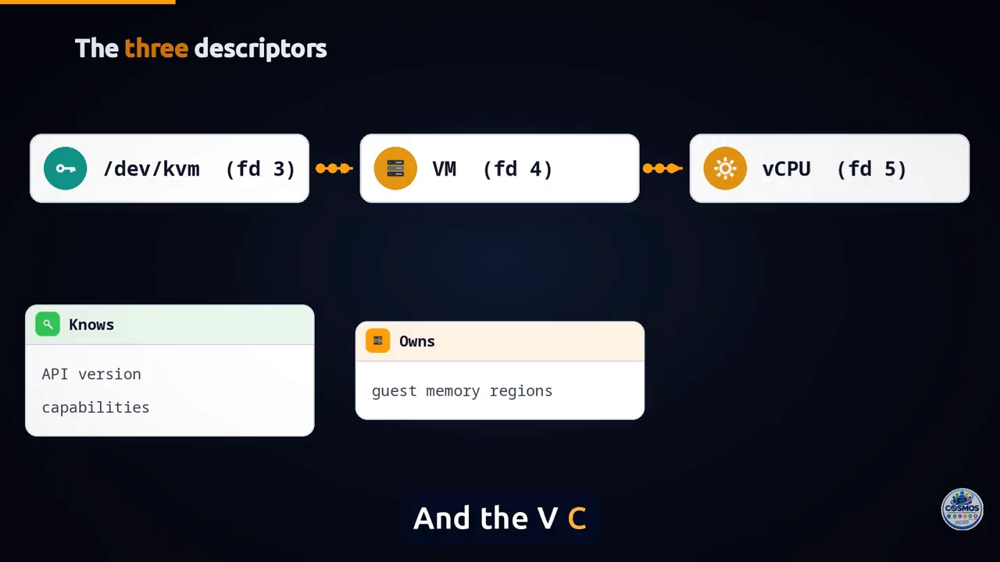

这张图解释了一个常见困惑：为什么 `KVM_SET_USER_MEMORY_REGION` 要发给 VM fd，而 `KVM_GET_REGS` 要发给 vCPU fd？因为**内存是整台机器共享的，寄存器是每颗 vCPU 私有的**。把命令发给哪一层，等于声明"这件事影响多大范围"。

`KVM_CREATE_VCPU` 的第三个参数（ioctl 的 arg）是 vCPU 的编号：最小客户端传 0，所以 fd 名是 `kvm-vcpu:0`；加第二颗时编号为 1，QMP 的 `query-cpus-fast` 也就列出 `cpu-index` 0 和 1。编号由调用者给，内核按编号区分同一台机器里的多颗 vCPU。

### 1.3 三层 fd 各自对应什么

用内核里的名字对照一下（视频没有展开源码，这里只给对应关系，细节属于后续小节）：

- 系统 fd 对应 KVM 子系统本身，它回答"这个内核支持到哪一版 API"；
- VM fd 对应一台虚拟机的容器，它持有客户机物理地址空间的登记表；
- vCPU fd 对应一颗虚拟处理器，它持有这颗 CPU 的寄存器状态和与用户态共享的 `kvm_run` 页。

所以"画从属关系"其实只要画三件事：**谁创建谁、谁拥有什么、谁先消失**。前两件已经清楚，第三件在下一节。

## 二、fd 即对象：三条直接推论

讲者从这条链推出三个结论 [【跳转到 05:45】](https://www.youtube.com/watch?v=3ZrbSFlP1kI&t=345)，它们正好覆盖了"生命周期"的三个侧面。

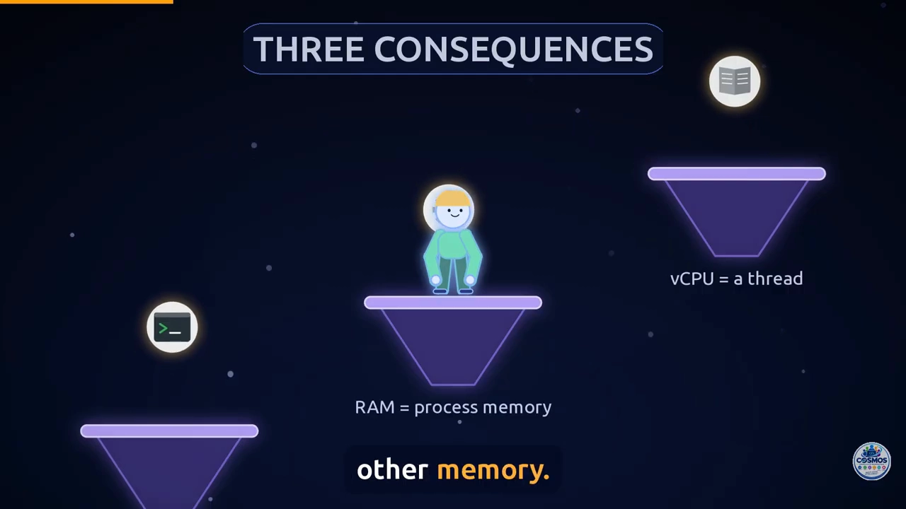

### 2.1 虚拟机是一个 fd：内核里没有"孤儿 VM"

> 一台虚拟机就是一个文件描述符。进程死掉时内核关闭它，这台机器就不存在了。内核里没有孤儿虚拟机，只有进程。

这句话是本小节最重要的一句。它意味着 KVM 不维护一份"全局虚拟机列表"等着别人来回收；VM 的寿命完全挂在持有它的 fd 上。谁打开、谁关闭，内核只认引用。

这也解释了为什么云平台的"实例"总能和某个 QEMU 进程对上号：**实例不是内核里的一个独立实体，而是进程里的一个 fd 树**。进程没了，树就没了。

### 2.2 客户机 RAM 是进程的匿名内存

> 客户机的 RAM 是调用进程里的匿名内存，所以它记在那个进程的 cgroup 上，和任何其他内存一样。

这条推论把"虚拟机的内存"从神秘概念拉回 Linux 的记账体系：`mmap` 出来的内存算在 QEMU 进程头上，内存 cgroup 的限制因此能约束客户机。视频用一个快速测验强调它：客户机 RAM 不在 cgroup 看不见的地方，不在 `/var` 的文件里，也不在 `/dev/kvm` 里面——它就是 QEMU 进程的匿名内存 [【跳转到 06:22】](https://www.youtube.com/watch?v=3ZrbSFlP1kI&t=382)。

（内存区域如何登记成客户机物理地址，属于下一小节「1.2.3 内存区域注册与 `KVM_SET_USER_MEMORY_REGION`」的主题。）

### 2.3 `KVM_RUN` 阻塞，所以 vCPU 是一个线程

> `run` 会一直阻塞到发生一次退出。一颗虚拟处理器，就是一个在循环里调用它的线程。

视频里的最小 hypervisor 主循环只有几行 [【跳转到 03:20】](https://www.youtube.com/watch?v=3ZrbSFlP1kI&t=200)：

```c
for (;;) {
    if (ioctl(vcpu, KVM_RUN, 0) < 0) die("KVM_RUN");   /* 只在退出时返回 */
    switch (run->exit_reason) {
    case KVM_EXIT_IO:  /* 客户机写串口：把字节打到终端 */
        ...
    case KVM_EXIT_HLT: goto done;
    }
}
```

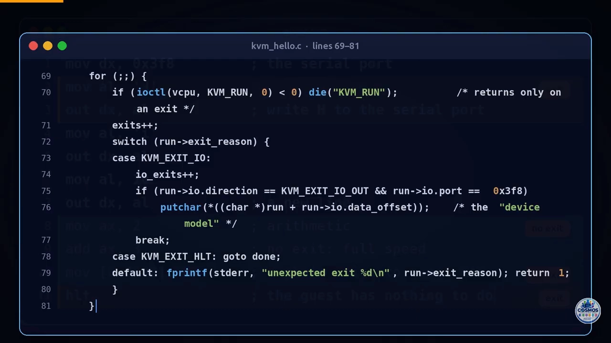

这段代码同时说明了三件事：`KVM_RUN` 是**阻塞**的；每次返回都带一个**退出原因**；"设备"在用户态就是**一段回答退出的代码**。而"一颗 vCPU 一个线程"的模型，到这里还只是推论，下一节去宿主上验证。

## 三、到宿主上核对：一个进程、三个 fd、每 vCPU 一个线程

### 3.1 `ps` 里它就是一个普通进程

视频在客户机启动后，从宿主侧找它 [【跳转到 13:22】](https://www.youtube.com/watch?v=3ZrbSFlP1kI&t=802)：

```
$ ps -o pid,rss,args -p 1358058
1358058 174632 qemu-system-x86_64 -accel kvm -cpu host -m 128 -smp 1 ...
```

命令行就是前面那条 QEMU 命令。所谓"云主机"，在这里只是一行 `ps` 输出。

### 3.2 `/proc/<pid>/fd` 里能看到三层 fd

接着看这个进程的文件描述符 [【跳转到 13:33】](https://www.youtube.com/watch?v=3ZrbSFlP1kI&t=813)：

```
$ ls -l /proc/1358058/fd | grep -E 'anon_inode:kvm|/dev/kvm' | ...
1 anon_inode:kvm-vcpu:0
1 anon_inode:kvm-vcpu-stats:0
1 anon_inode:kvm-vm
1 /dev/kvm
```

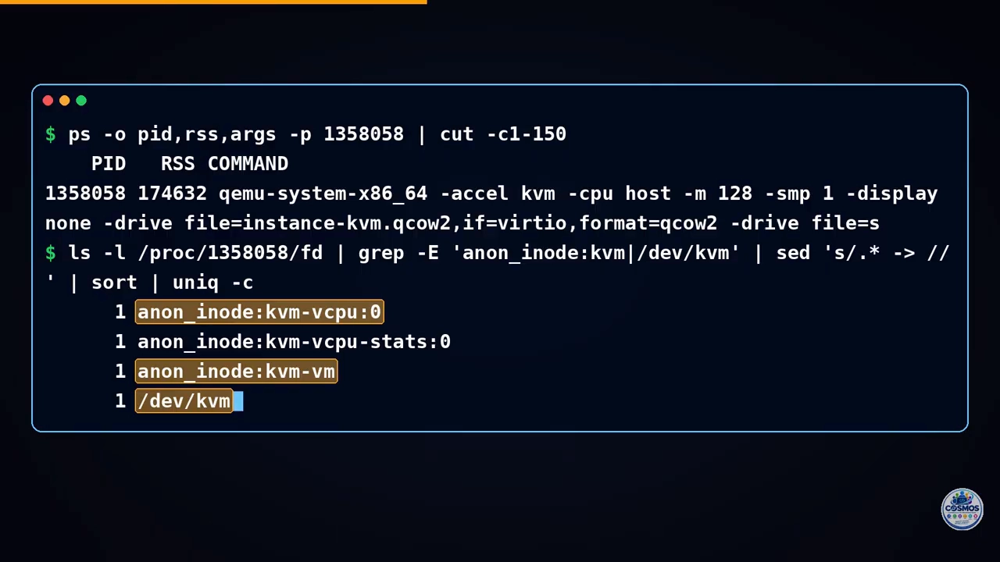

这四条正好把三层对象在宿主上"点名"了一次：`/dev/kvm` 是系统层，`kvm-vm` 是 VM 层，`kvm-vcpu:0` 是第 0 颗 vCPU。多出来的 `kvm-vcpu-stats` 是统计用的附加 fd，不改变层级关系。**对象不是抽象名词，它们在 `/proc` 里有对应的 inode。**

### 3.3 线程数与内存：只有一个数字可靠

同一个进程的 `status` 里，`VmRSS` 约 174632 kB，`Threads` 是 16 [【跳转到 13:47】](https://www.youtube.com/watch?v=3ZrbSFlP1kI&t=827)：

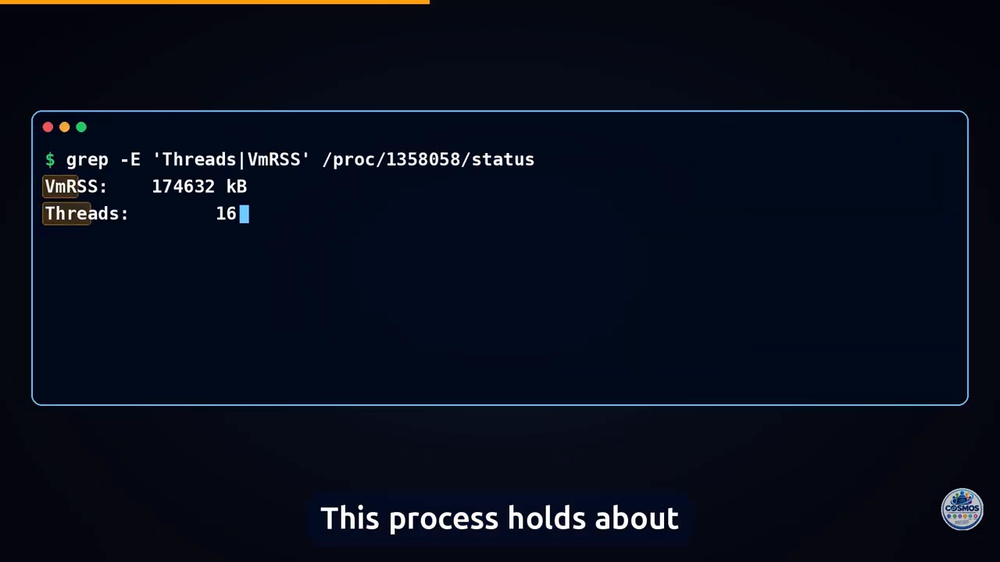

讲者特意提醒：**线程数不可靠**。同一条命令行，他见过 9、10、16、18 四种线程数；16 个线程里 15 个名字像 QEMU，另一个是内核辅助线程 `kvm-nx-lpage-re`。唯一可靠的事实是：**每颗 vCPU 一个线程，数量随 `-smp` 走**。

内存数字则更值得记住 [【跳转到 14:28】](https://www.youtube.com/watch?v=3ZrbSFlP1kI&t=868)：客户机配置 128 MB，进程常驻约 170 MB。客户机不可能碰超过自己内存的页，所以 QEMU 自身的代码、设备模型、缓冲区和线程栈至少占了 42 MB。

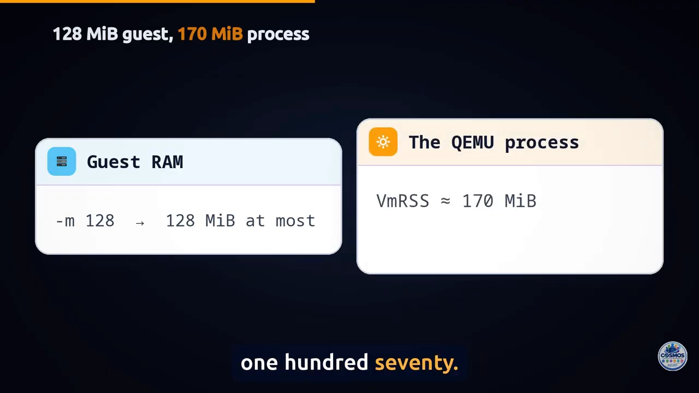

结论很实用：**把 cgroup 的内存上限设成"客户机内存大小"可能误杀 QEMU**。视频的第二个快速测验就考这一点——上限等于 128 MB 时，QEMU 自己那部分内存也计入限额，内核可能因此把它杀掉 [【跳转到 15:02】](https://www.youtube.com/watch?v=3ZrbSFlP1kI&t=902)。

## 四、加一颗 vCPU：多出来的是一个线程和一个 fd

### 4.1 `-smp 2` 之后，fd 列表多一项

视频的练习三把客户机改成 `-smp 2`，再用同样的宿主命令观察 [【跳转到 24:38】](https://www.youtube.com/watch?v=3ZrbSFlP1kI&t=1478)。结果是：QMP 的 `query-cpus-fast` 列出 `cpu-index` 0 和 1 两项，进程持有**两个 vCPU 描述符**；常驻内存与单 vCPU 时相差不到 1%。

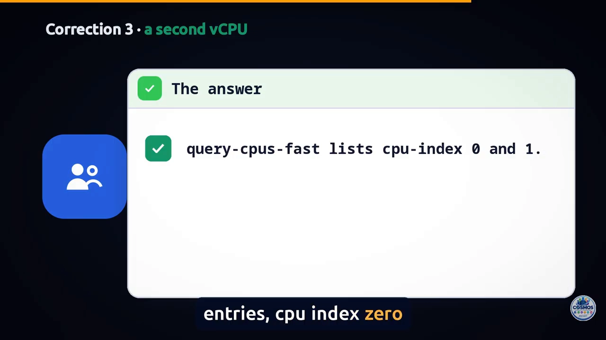

讲者用一句话总结：

> 第二颗虚拟处理器是**一个线程和一个描述符**，不是内存。

### 4.2 为什么 vCPU fd 必须各自独立

把这条实测和第一节的职责表拼起来，就能回答"多 vCPU 时 fd 如何各自独立"：

- **VM fd 只有一个**：内存区域、客户机物理地址空间是整台机器共享的，所有 vCPU 看到同一份 RAM。
- **vCPU fd 每颗一个**：寄存器、`KVM_RUN` 的调用现场是每颗 CPU 私有的，所以第 0 颗和第 1 颗各有自己的 fd。
- **线程也每颗一个**：每个 vCPU 线程阻塞在自己的 `KVM_RUN` 里，内核才能把多颗 vCPU 并行调度到多个物理核上。

这也解释了为什么线程数会"跳"：QEMU 还有 I/O、主循环等线程，数量随版本和负载变化；但 vCPU 线程数与 vCPU fd 数是一一对应的。

## 五、生命周期：暂停、恢复、关机

### 5.1 QMP 上的三个动词

客户机跑起来后，视频用 QMP（QEMU 的管理协议，JSON over socket）控制它 [【跳转到 16:23】](https://www.youtube.com/watch?v=3ZrbSFlP1kI&t=983)：

```
$ python3 qmp.py instance-kvm.qmp stop
{"return": {}}
$ python3 qmp.py instance-kvm.qmp query-status
{"return": {"status": "paused", "running": false}}
$ python3 qmp.py instance-kvm.qmp cont
$ python3 qmp.py instance-kvm.qmp system_powerdown
```

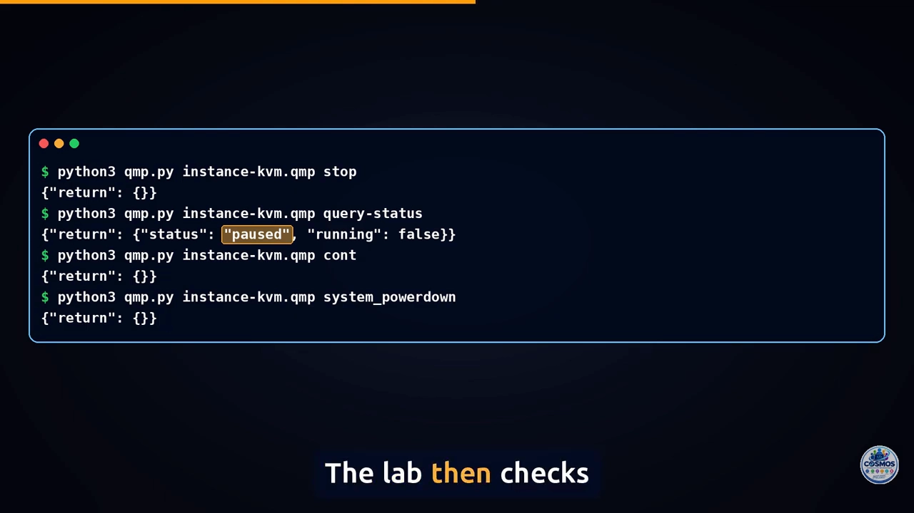

三个动作对应三种不同的"生命状态"：

- `stop` **暂停 vCPU，但保留进程、内存和描述符**——对象都还在，只是不再执行客户机指令；
- `cont` 让 vCPU 继续跑；
- `system_powerdown` 发一个 ACPI 电源键事件，客户机像真机一样自己关机；视频随后检查到 **QEMU 进程已经消失**。

讲者的总结是：任何 hypervisor API 上的"暂停/关机"，本质都是这几个命令的某种形式。

### 5.2 销毁顺序：内核替你做的那一半

视频没有演示显式 `close()` 的顺序，它直接让进程退出，由内核关闭所有 fd。这恰好说明了对象模型的最后一环：**VM 和 vCPU 的销毁不需要应用层排队**——进程退出时，内核按 fd 关闭，对象随之释放；因为 vCPU 的 fd 和线程都寄生在同一个进程里，不会出现"VM 没了但 vCPU 还在"的悬挂状态。

反过来说，应用层能控制的只是"什么时候不再持有"：先停 vCPU（`stop`）、再让进程退出，是最干净的一条路；直接 `kill -9` 也能清干净，代价是客户机没有机会刷盘。

## 六、对象之外：三层栈、加速器与设备

前面讲的是"对象在哪"，这一节补"对象周围有什么"。

先回答一个更靠前的问题：为什么云厂商不直接用容器？视频用上一集的结论作对比：容器只是宿主单一内核上的一个普通进程，它不能跑另一个操作系统、不能带自己的内核模块，安全性也只等于宿主内核的系统调用面。虚拟机有自己的内核，边界是虚拟硬件；代价是处理器本身必须被共享出来 [【跳转到 01:14】](https://www.youtube.com/watch?v=3ZrbSFlP1kI&t=74)。

共享处理器这件事由三层栈完成。视频用一张图把三层摆开 [【跳转到 01:50】](https://www.youtube.com/watch?v=3ZrbSFlP1kI&t=110)：

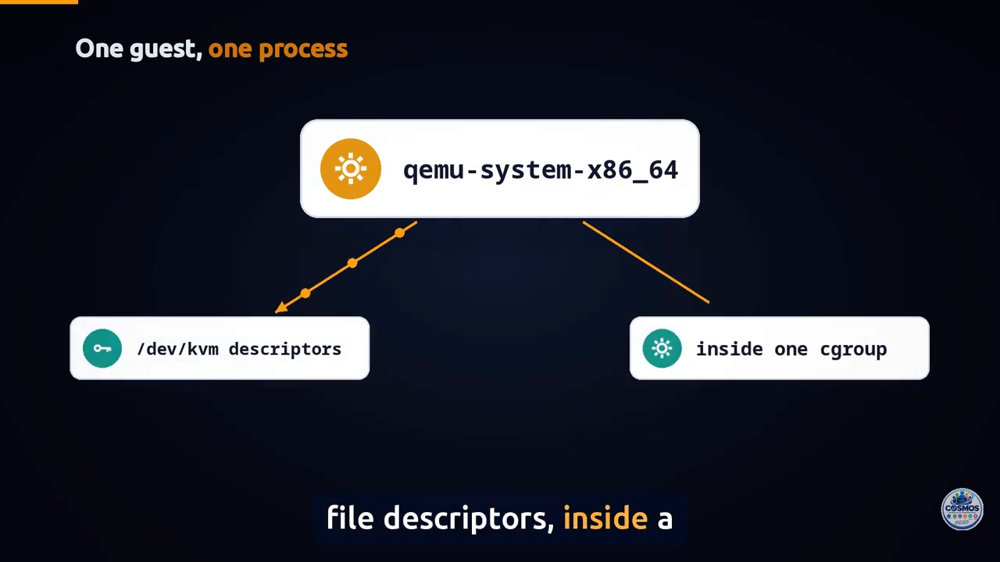

- **KVM**：内核模块，把 CPU 的虚拟化扩展变成文件描述符 API，回答"在这颗真 CPU 上跑这颗 vCPU"；
- **QEMU**：每台客户机一个用户态进程，提供内存、磁盘、网卡，并回答每一次退出；
- **libvirt**：管理守护进程，用 XML 描述客户机，负责建 cgroup、接网络与磁盘、套上强制访问控制（MAC）标签、监督进程。

同一份镜像换加速器，能直观看到 KVM 的价值：`-accel kvm` 启动到登录提示 11.3 秒，`-accel tcg`（纯软件翻译）27.5 秒，慢 2.4 倍；讲者提醒这个比例随机器变化（书上是 2.5，他自己另一次是 3.2），**方向比数值可靠** [【跳转到 17:33】](https://www.youtube.com/watch?v=3ZrbSFlP1kI&t=1053)。

设备侧则是"退出次数"的差别：全模拟的磁盘控制器每访问一个寄存器就退出一次；virtio 设备把环（ring）放在共享内存里， guest 和 host 都能读写，很多操作只需要一次通知 [【跳转到 07:31】](https://www.youtube.com/watch?v=3ZrbSFlP1kI&t=451)。这也是为什么实验里所有磁盘和网卡都用 virtio。

## 七、镜像也有依赖：overlay 离不开 base

视频后半段换了一个对象：磁盘。它和 fd 树有一个相似的形状——**一个对象依赖另一个对象**。

基础镜像（Glance 里存的那个）是只读、共享的；每台实例在它上面叠一个 QCOW2 overlay，把 base 当作 backing file [【跳转到 08:41】](https://www.youtube.com/watch?v=3ZrbSFlP1kI&t=521)。实测数字很夸张：base 20.7 MiB，overlay 的虚拟大小 112 MiB，但磁盘占用只有 196 KiB——因为读会穿透到 base，只有写才落进 overlay。

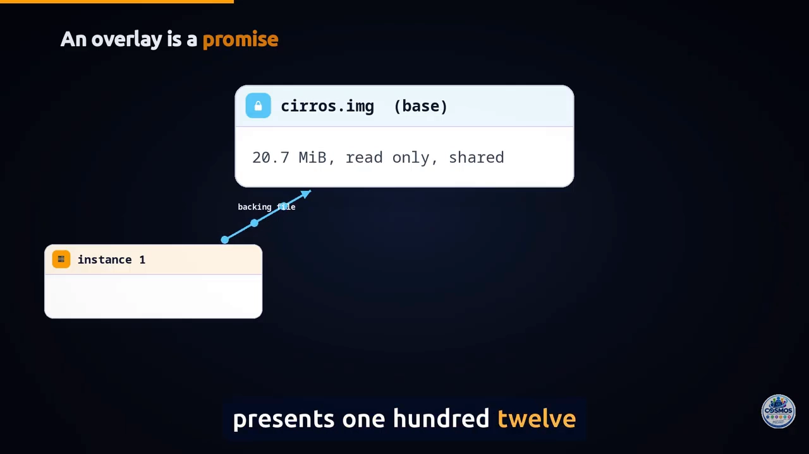

代价是依赖。视频做了一个小实验：base 由三个 64 KiB 簇组成，客户机在 offset 0 写了 4 KiB 的 `0x22`；随后有人把 base 整体改写成 `0x99`。再读 overlay：offset 0 和 8 KiB 不变（写时复制了整个簇），但 offset 72 KiB 变成了 `0x99`——**没有人碰过 overlay，它的内容却变了**，而且没有任何错误报告 [【跳转到 10:05】](https://www.youtube.com/watch?v=3ZrbSFlP1kI&t=605)。

所以镜像仓库把已发布的镜像当作**不可变对象**：要更新就发布一个新镜像，而不是原地改 base。这条规则和 fd 的引用计数不同——它是"命名依赖"，没有任何机制强制，只能靠流程保证。

## 八、身份与启动：镜像不知道你是谁

镜像是通用的，里面不会写"你的主机名是 web-1"或"这是你的 SSH 密钥"。所以客户机启动后要向数据源要身份，再由 cloud-init 之类的 agent 配置自己 [【跳转到 11:22】](https://www.youtube.com/watch?v=3ZrbSFlP1kI&t=682)。两种交付方式：

- **config drive**：一块小磁盘，卷标为 `CI data`，里面放 metadata 和 user data 两个文件；
- **metadata 服务**：通过网络访问 `169.254.169.254`。

视频用第一种启动，控制台日志给出四个事实：客户机知道自己在 KVM 上、在第二块 virtio 盘上找到了 config drive、从 metadata 采纳了主机名、执行了 user data。第二种（没有数据源）则表现为**反复探测 metadata 地址的循环**：25 秒还没有登录提示，云主机"起不来"的真相往往在这段控制台日志里，而不在控制面 [【跳转到 17:58】](https://www.youtube.com/watch?v=3ZrbSFlP1kI&t=1078)。

练习四把 config drive 里的 JSON 改坏（少一个逗号），结果比预想的更隐蔽：正常盘 12 秒出现登录提示，坏盘 90 秒都没有；控制台说"找到了盘但解析 JSON 失败"，然后客户机退回到探测 metadata 地址，和完全没有数据源时是同一条重试路径 [【跳转到 26:24】](https://www.youtube.com/watch?v=3ZrbSFlP1kI&t=1584)。

## 九、练习里的四个可复算结论

视频最后用七个练习把前面的结论变成可验证的数字，其中四个和对象模型直接相关：

1. **哪些操作会让 `KVM_RUN` 返回用户态？** 已映射内存的 store、第一次触碰新页、CPUID 都只让 `KVM_RUN` 返回一次（停机那次）；前两者由 KVM 在内核处理，CPUID 虽然在硬件层退出，也在内核里被回答。只有端口读会让 `KVM_RUN` 返回两次（读一次、停机一次）[【跳转到 22:36】](https://www.youtube.com/watch?v=3ZrbSFlP1kI&t=1356)。
2. **QMP 为什么必须先握手？** 不发 `capabilities` 就直接 `query-status`，会被拒绝，错误信息明确说"期望先协商能力"；握手后同样的命令就能用 [【跳转到 23:34】](https://www.youtube.com/watch?v=3ZrbSFlP1kI&t=1414)。
3. **第二颗 vCPU 多了什么？** 一个线程、一个描述符，内存几乎不变（见第四节）。
4. **一台 16 GB 的宿主能跑多少 256 MB 的客户机？** 按实测的 42 MB 下限估算：

$$
40 \times (256 + 42)\ \text{MiB} \approx 11.7\ \text{GiB}
$$

空闲时约 8.4 GiB，最坏情况约 11.7 GiB，留给宿主和控制面约 4.3 GiB；每台客户机的内存上限应设为 358 MB，而不是 256 MB [【跳转到 29:26】](https://www.youtube.com/watch?v=3ZrbSFlP1kI&t=1766)。

另外两个练习一个考"内存从 64 MB 到 256 MB 时常驻内存怎么变"（64 MB 时这台镜像根本进不了登录提示；128 MB 约 170 MB，256 MB 约 216 MB，说明 QEMU 开销既不是常数也不能简单按比例算），一个考"给 hypervisor 加第四种退出"：让客户机从端口读一个字节，设备把 `0x2A` 写进共享 run 页，客户机再把它存进内存——这个值在客户机代码里根本不存在，只能来自设备 [【跳转到 31:18】](https://www.youtube.com/watch?v=3ZrbSFlP1kI&t=1878)。

## 小结

- KVM 的对象模型是一条 **fd 从属链**：`open("/dev/kvm")` 得到系统 fd，`KVM_CREATE_VM` 得到 VM fd，`KVM_CREATE_VCPU` 得到 vCPU fd；每一层由上一层返回。
- 三层职责不同：系统 fd 知道 API 版本与能力，VM fd 拥有客户机内存区域，vCPU fd 持有寄存器与 `KVM_RUN`。
- **虚拟机是一个 fd**：进程死掉，内核关闭 fd，机器就不存在；内核里没有孤儿 VM。
- **客户机 RAM 是进程的匿名内存**，记在进程的 cgroup 上，所以内存上限必须大于客户机内存（实测 128 MB 客户机对应约 170 MB 进程）。
- **vCPU 是一个线程**：每个 vCPU 线程阻塞在自己的 `KVM_RUN` 里，`KVM_RUN` 只在退出时返回。
- **多一颗 vCPU = 多一个 fd + 多一个线程**，内存几乎不变；线程总数不可靠，可靠的是"每 vCPU 一线程"。
- 生命周期操作（`stop`/`cont`/`system_powerdown`）改变的是 vCPU 的执行状态；真正销毁对象的是进程退出时的 fd 关闭。
- 镜像 overlay 与 base 是另一种"依赖"：overlay 离不开它创建时的那份 base，所以已发布的镜像必须不可变。

## 关键术语速查

| 术语 | 一句话解释 |
| :--- | :--- |
| 系统 fd | `open("/dev/kvm")` 返回的句柄，代表整个 KVM 子系统，回答 API 版本与能力 |
| VM fd | `KVM_CREATE_VM` 返回的句柄，代表一台虚拟机，拥有客户机内存区域 |
| vCPU fd | `KVM_CREATE_VCPU` 返回的句柄，代表一颗虚拟 CPU，持有寄存器与 `KVM_RUN` |
| `kvm_run` 页 | 内核与用户态共享的一页内存，用来回传退出原因和退出参数 |
| exit（退出） | 客户机执行到需要宿主处理的操作时，`KVM_RUN` 返回一次 |
| QMP | QEMU 的管理协议，JSON over socket，可暂停、恢复、关机、查询状态 |
| cgroup 记账 | 客户机 RAM 是 QEMU 进程的匿名内存，因此计入该进程的 cgroup |
| QCOW2 overlay | 叠在只读 base 之上的可写层，读穿透、写落层，依赖 base 不变 |
| config drive | 携带 metadata 与 user data 的小磁盘，卷标 `CI data`，供客户机取身份 |