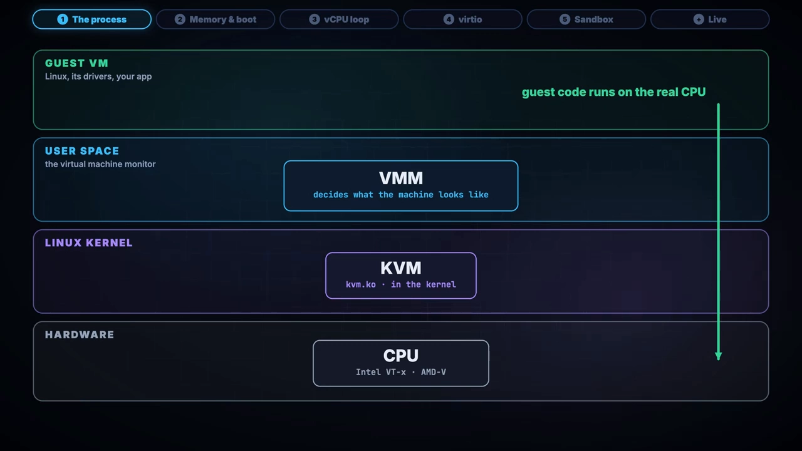
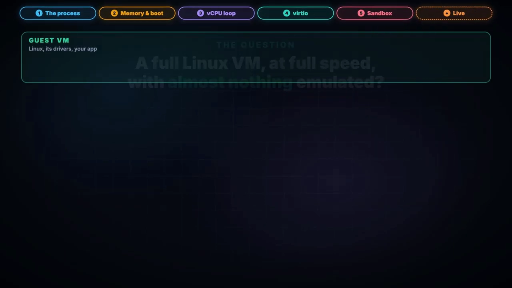
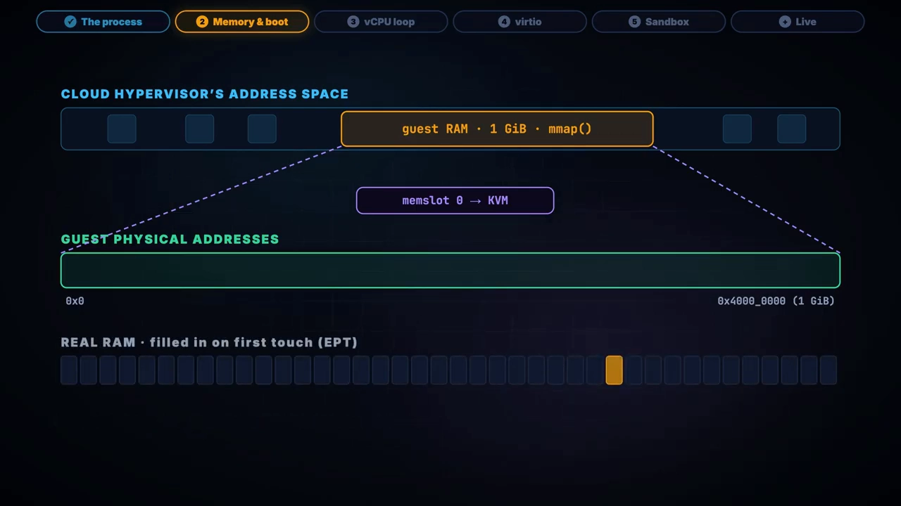
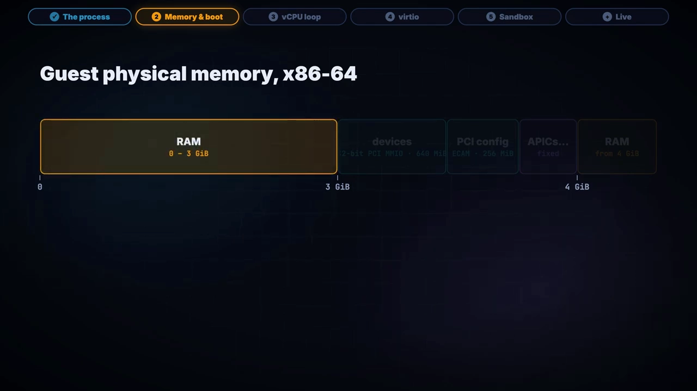
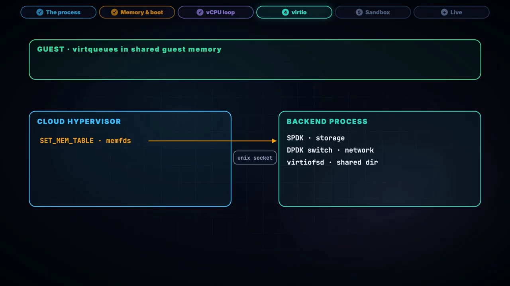
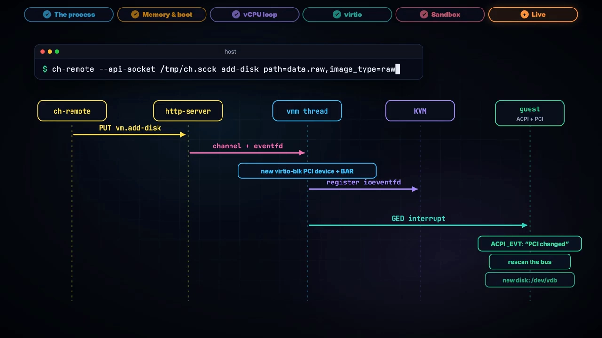
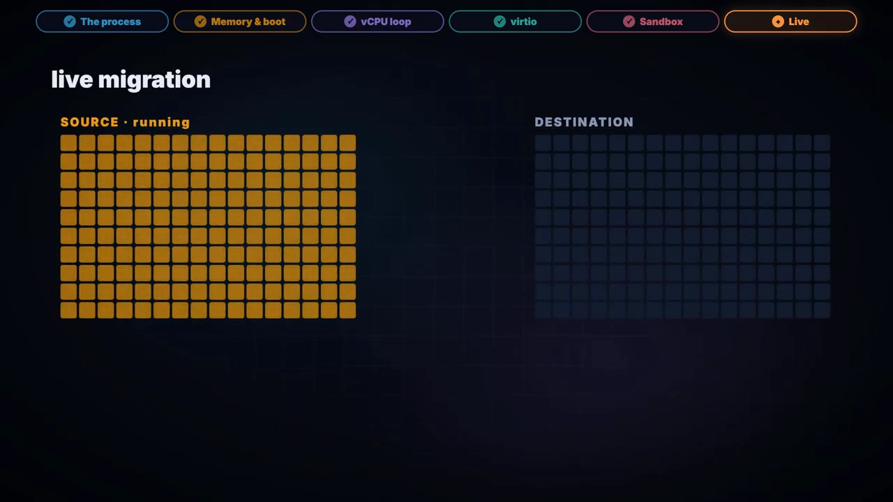
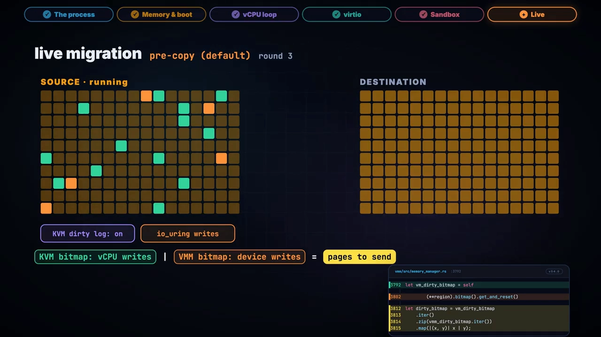
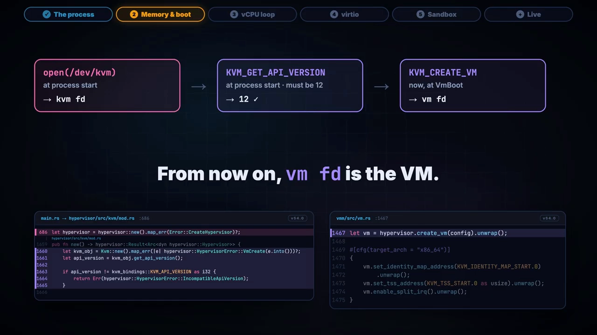
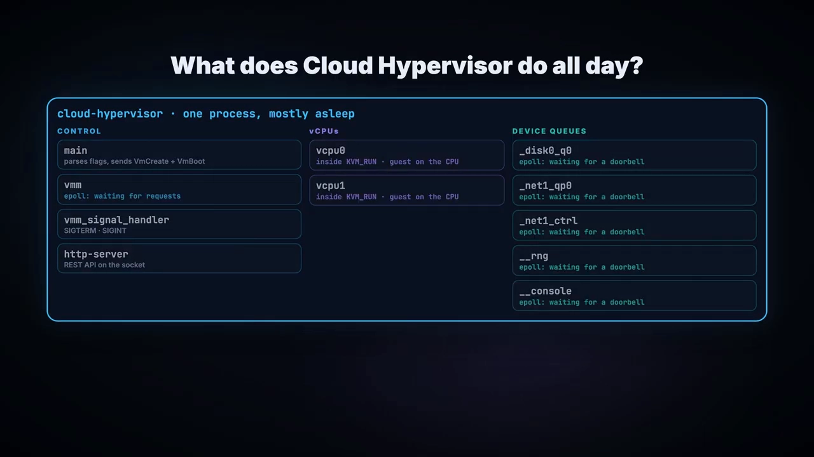

# 客户机内存就是 VMM 的内存：KVM 内存区域注册与 EPT 映射

> 视频来源：[Cloud Hypervisor Masterclass: How a Rust VMM Runs a VM](https://www.youtube.com/watch?v=UTrMyzA55Rs)（YouTube · XOR）｜时长约 20 分钟
> 导读：这支视频把一台 Cloud Hypervisor 虚拟机从命令行拆到一次磁盘读。本文只取其中「内存怎么登记给 KVM」这一段：一次 mmap、一次 ioctl、EPT 按需填表，以及登记之后才可能有的热插拔、脏页日志与共享内存。控制面 ioctl 与 fd 对象模型留给相邻小节。

## 本讲要解决的核心问题（SCQA）

**背景**：一台虚拟机要跑 Linux，客户机内核期待自己拥有一块从客户机物理地址（GPA，guest physical address）0 开始的物理内存。客户机里的页表、内核镜像、virtqueue 全都按 GPA 编址。

**冲突**：这块内存其实并不在任何「虚拟机专属」的地方，它就躺在宿主的一个普通用户态进程里——对 Cloud Hypervisor 来说，就是它自己进程里的一次 `mmap`。可是 KVM 在内核里，它既不知道这块内存在哪，也不会主动去猜。CPU 的二级页表（Intel 上叫 EPT，AMD 上叫 NPT）在建立之前，客户机一访问 GPA 就会触发 EPT violation。

**疑问**：用户态要怎样把「我进程里的这块内存」交给 KVM，让客户机访问 GPA 时正好落到这块内存上？

**回答（中心思想）**：KVM 的内存登记只有两步——VMM 先用 `mmap` 在自己的地址空间里拿到一块匿名内存，再用一次 `KVM_SET_USER_MEMORY_REGION` 把「客户机物理地址起点 + 长度 + 宿主虚拟地址 + 槽号（slot）」这四件事告诉 VM。KVM 据此建立 EPT 映射，之后客户机的每次访问都由硬件二级页表翻译到真实内存，**而这块内存始终是 VMM 自己的内存**——所以 VMM 可以直接读写客户机 RAM，零拷贝。



## 一、先分清职责：KVM 提供机制，VMM 决定内存的形状

视频一开头就把这条分工讲得很直白（[【跳转到 01:11】](https://www.youtube.com/watch?v=UTrMyzA55Rs&t=71)）：

- **KVM 是 Linux 内核的一部分**，它利用 CPU 的虚拟化扩展（Intel VT-x 或 AMD-V）让客户机指令直接跑在真实处理器上；
- **但「这台机器长什么样」不是 KVM 决定的**——多少内存、挂哪些磁盘、用哪块网卡——这些由用户态的虚拟机监视器（VMM）决定。

这个分工直接决定了内存的归属：内存的**分配**发生在 VMM 进程里，KVM 只负责**登记与翻译**。所以「给虚拟机加内存」在 VMM 眼里从来不是「向 KVM 申请内存」，而是「我先有内存，再把它登记进去」。



## 二、登记动作只有两步：一次 mmap，一次 ioctl

### 2.1 第一步：在 VMM 进程里 mmap 一块匿名内存

Cloud Hypervisor 的做法是（[【跳转到 04:31】](https://www.youtube.com/watch?v=UTrMyzA55Rs&t=271)）：

> 客户机 RAM 就是 Cloud Hypervisor 进程里的普通内存：一次 `mmap` 调用，匿名、私有，而且不预先占住。宿主只有在客户机第一次访问时才真正给出一页。

这句话里有三个值得初学者记住的点：

1. **匿名（anonymous）**：不挂在任何文件后面，就是一块裸内存。它不需要磁盘镜像来支撑，客户机 RAM 的初始内容是「没有内容」。
2. **私有（private）**：这块映射只属于这个 VMM 进程。后面会看到，一旦要让别的进程（vhost-user 后端）也看见它，就必须换成共享映射。
3. **不预先占住（not reserved up front）**：`mmap` 只是划了一段虚拟地址范围，物理页要等第一次访问才分配。这就是常说的按需分配 / overcommit——一台声明 1 GiB 的虚拟机，刚创建时并不真的吃掉 1 GiB 物理内存。

### 2.2 第二步：一次 ioctl 把这段内存登记给 VM

紧接着（[【跳转到 04:56】](https://www.youtube.com/watch?v=UTrMyzA55Rs&t=296)）：

> 然后一次 ioctl 告诉 KVM：客户机物理地址 0 就落在这个宿主地址上，长度 1 GiB。这就是 `KVM_SET_USER_MEMORY_REGION`。

这个 ioctl 打在**VM 的 fd** 上，而不是 `/dev/kvm` 的 fd 上——因为它描述的是「这一台虚拟机」的地址空间。它携带的信息可以拆成五个字段（KVM 文档里的 `struct kvm_userspace_memory_region`）：

| 字段 | 含义 | 本例取值 |
| --- | --- | --- |
| `slot` | 内存槽编号，KVM 用它索引这段区域；**由用户态自己指定** | 0 |
| `flags` | 位掩码：`KVM_MEM_LOG_DIRTY_PAGES`（记脏页）、`KVM_MEM_READONLY`（只读） | 0 |
| `guest_phys_addr` | 客户机物理地址起点（GPA），必须按页对齐 | 0 |
| `memory_size` | 区域长度，必须是页大小的整数倍 | 1 GiB |
| `userspace_addr` | 宿主虚拟地址（HVA），即 `mmap` 的返回值 | 进程内某地址 |

五个字段里，前四个是「客户机视角」的描述（哪一段 GPA、多长、什么属性），最后一个才是「宿主视角」的落点。KVM 做的事就是把这五个值存进一张表，之后每次 EPT 缺页都来查这张表。



### 2.3 slot 与 GPA 区间的关系，就是「一张表的两列」

把上面四个字段读成一张表，就很容易理解 slot 的作用：

```
slot 0 : GPA [0x0000_0000, 0x4000_0000)  ->  HVA 0x7f....  (1 GiB)
slot 1 : GPA [0x1_0000_0000, ...)        ->  HVA 0x7f....  (4 GiB 以上那段)
```

- **GPA 是客户机视角的地址**，客户机内核以为自己在访问物理内存；
- **HVA 是 VMM 视角的地址**，是 `mmap` 返回的那个指针；
- **slot 是这张映射表的行号**。KVM 用 slot 编号来增、改、删一段区域，所以同一个 slot 再次登记就是「改」，换一个 slot 就是「新增一段」。

由此可以推出两条对初学者最有用的结论：

1. **一个 GPA 只能属于一个 slot**。如果两段区域在 GPA 上重叠，KVM 无法判断这次访问该用哪段宿主内存，所以重叠的登记会被直接拒绝。
2. **区域必须按区间登记，不能假定整块 GPA 空间都是 RAM**。下一节就会看到，GPA 中间有一个洞。

### 2.4 slot 号由用户态决定，KVM 只负责查表

初学者最容易误解的一点是「slot 号是 KVM 分配的」。事实相反：**KVM 从不主动分配 slot 号，你传几就是几**。第一次登记就用 `slot = 7` 也完全合法，只要这个编号没被占用、且小于上限。KVM 需要的只是一个稳定的数组下标，好让「改」和「删」能精确指到某一行。

围绕这个编号，有四条实用规则：

1. **上限要问内核**。一个 VM 能有多少个 slot 不是常数，用 `KVM_CHECK_EXTENSION` 查 `KVM_CAP_NR_MEMSLOTS` 才知道；x86 上目前是 509（早期内核只有 32）。超过上限的登记返回错误。
2. **KVM 内部是一张按 GPA 排序的表**。内核把各个 slot 按 `guest_phys_addr` 排好序存进 `memslots` 数组，客户机访问某个 GPA 时用**二分查找**定位属于哪个 slot——所以查找是 $O(\log n)$，与 slot 号的顺序无关。
3. **同一个 slot 号再调一次就是「改」**。KVM 用「先摘掉旧的、再装新的」实现替换，调用方不需要先删再加。
4. **删除的写法是把 `memory_size` 设为 0**。长度为零表示「这个 slot 不再对应任何内存」，KVM 会把它从表里摘掉。这也是为什么 `memory_size` 必须是页大小的整数倍——KVM 内部按页记账，半页的区域没有意义。

> 对齐这件事值得单独记一句：`mmap` 返回的地址天然按页对齐，所以 `userspace_addr` 通常不成问题；真正容易踩坑的是 `memory_size` 和 `guest_phys_addr`，它们必须页对齐，否则 ioctl 直接返回 `EINVAL`。

## 三、登记之后，EPT 才建立起 GPA → HPA 的映射

登记完成的那一刻，KVM 手里有了「GPA 区间 → HVA」的对应关系，但真正干活的是 CPU 的第二级页表（[【跳转到 05:21】](https://www.youtube.com/watch?v=UTrMyzA55Rs&t=321)）：

> CPU 的第二级页表——Intel 上叫 EPT——会把客户机的物理地址映射到真实地址，KVM 按需把这些页表项填进去。

于是完整的翻译链变成两段：

$$
\text{GVA} \xrightarrow{\text{客户机页表}} \text{GPA} \xrightarrow{\text{EPT/NPT}} \text{HPA}
$$

第一段由客户机自己的页表完成，第二段由 KVM 建立、硬件执行。注意「**按需填**」三个字：因为第一步的 `mmap` 并没有预分配物理页，KVM 也就不可能在登记时把整张 EPT 填满；它只在客户机第一次碰到某个 GPA 时，才把那一页的映射补上（[【跳转到 05:21】](https://www.youtube.com/watch?v=UTrMyzA55Rs&t=321)）。这也解释了为什么一台 1 GiB 的虚拟机可以秒级启动——真正被触碰过的页可能只有几十兆。

### 3.1 最重要的一个结论：客户机内存就是 VMM 的内存

视频把这句话称为「本视频最重要的观点」（[【跳转到 05:21】](https://www.youtube.com/watch?v=UTrMyzA55Rs&t=321)）：

> 客户机内存同时也是 VMM 的内存。Cloud Hypervisor 可以直接读写客户机 RAM，不需要任何拷贝。

这条结论是所有后续优化的地基，视频里至少有三处直接用到它：

- **装载内核**：`payload_loader` 线程把内核读进客户机内存，此时机器其余部分还在搭建（[【跳转到 05:46】](https://www.youtube.com/watch?v=UTrMyzA55Rs&t=346)）；
- **virtio 数据面**：worker 线程直接读客户机内存里的 avail ring，`io_uring` 的 I/O 向量直接指向客户机 RAM，数据落地不用拷贝（[【跳转到 12:03】](https://www.youtube.com/watch?v=UTrMyzA55Rs&t=723)）；
- **设备后端**：vhost-user 把客户机内存的 fd 交给独立进程，后端直接读写同一块内存。

如果 KVM 的内存登记是「拷贝一份给内核」，这三件事一件都做不成。**「登记」登记的是指针，不是数据**——这是本节最需要记住的一句话。

## 四、GPA 空间不是一整块：3–4 GiB 的洞

内存区域为什么要按区间登记？因为 x86-64 的客户机物理地址空间本来就是分段的（[【跳转到 05:46】](https://www.youtube.com/watch?v=UTrMyzA55Rs&t=346)）：

> 更大的虚拟机会出现一个洞：RAM 到 3 GiB 为止，3 GiB 到 4 GiB 之间的空间留给设备寄存器和 PCI 配置，RAM 再从 4 GiB 往上继续。



图里从低到高依次是：

- `RAM 0 – 3 GiB`：低端内存；
- `devices`：64 位 PCI MMIO 窗口（图中标注 640 MiB）；
- `PCI config`：ECAM 配置空间（图中标注 256 MiB）；
- `APICs`：固定地址的中断控制器寄存器；
- `RAM from 4 GiB`：高端内存。

这个洞对内存登记有三个直接影响：

1. **一台 8 GiB 的虚拟机至少要两个 slot**：一个覆盖 `0 – 3 GiB`，一个覆盖 `4 GiB` 以上。这就是为什么 `slot` 不是可有可无的编号——它天生就是为多段区域准备的。
2. **RAM 区间不能和 MMIO 区间重叠**。设备寄存器要靠「客户机访问一个没有 RAM 的 GPA」来触发 VM exit，如果那段 GPA 被登记成了 RAM，设备就再也拦不到这次访问。
3. **这个洞是 x86 的历史包袱**，不是 KVM 的设计选择。它来自早年 32 位地址空间要留给设备的那套约定。

## 五、内存还必须能被别的进程看见：共享映射与 fd 传递

前面说 `mmap` 是「匿名、私有」的。但只要设备后端搬到 VMM 之外，这个前提就得改（[【跳转到 13:43】](https://www.youtube.com/watch?v=UTrMyzA55Rs&t=823)）：

> Cloud Hypervisor 通过一个 Unix socket 把一切交出去：客户机内存以文件描述符的形式交出——这正是那块内存必须是共享映射、不能是私有映射的原因。



图里那条 `SET_MEM_TABLE · memfds` 的箭头就是内存登记的第二条路径：不再是「把 HVA 告诉 KVM」，而是「把内存的 fd 交给另一个进程」。同一个思路还能用在同机升级上（[【跳转到 19:13】](https://www.youtube.com/watch?v=UTrMyzA55Rs&t=1153)）：

> 在同一台宿主机上，如果客户机内存是共享映射，memfd 模式会把它的文件描述符直接交给一个新的 Cloud Hypervisor 进程——不拷贝 RAM 就能升级运行中的虚拟机。

也就是说，**内存用匿名私有映射还是共享文件映射，决定了这台虚拟机能不能热升级、能不能接 vhost-user 后端**。这是初学者最容易忽略的一个设计选择：它写在 `mmap` 的参数里，却决定了后面所有功能的边界。

## 六、运行中改内存：`vm.resize` 与热插拔的收尾动作

登记不是一次性的。云上的虚拟机会在运行中变化（[【跳转到 17:46】](https://www.youtube.com/watch?v=UTrMyzA55Rs&t=1066)）：

> 加 vCPU 或加内存用 `vm.resize`，走的是同一套流程。

「同一套流程」指的是热插拔的完整闭环，视频用加磁盘演示了它（[【跳转到 17:21】](https://www.youtube.com/watch?v=UTrMyzA55Rs&t=1041)）：

1. 客户端发一个 HTTP 请求（`ch-remote add-disk` → `PUT vm.add-disk`）；
2. HTTP 线程把请求排进队列，敲一下 eventfd 唤醒 vmm 线程；
3. vmm 线程造出新设备、分配 BAR、把 doorbell 注册给 KVM；
4. **通过 ACPI 的 GED 发一个中断**，客户机 ACPI 代码读到「PCI 设备 / CPU / 内存变了」，重新扫描。



对内存来说，第 3 步是「再登记一个 slot」，第 4 步才是关键：**登记完 KVM 不会自动通知客户机**。客户机得先被 ACPI 事件叫醒，重新读一遍 e820/ACPI 表，才会知道「多了一段内存」。这就是为什么热插拔内存总是「宿主侧瞬间完成、客户机侧要等一次中断」。

## 七、脏页日志：登记时打开的一个开关，决定迁移能不能收敛

内存区域登记时还能带标志位。视频里最实用的一个就是脏页日志（dirty logging）：热迁移开始时（[【跳转到 17:53】](https://www.youtube.com/watch?v=UTrMyzA55Rs&t=1073)），

> Cloud Hypervisor 打开脏页日志，于是 KVM 记录 vCPU 写过的每一个客户机页。然后它把全部内存发过去，同时客户机继续运行。接着它问：这次拷贝期间哪些页变了？

对应到 API，就是登记时给这段区域加上 `KVM_MEM_LOG_DIRTY_PAGES` 标志——**它改变的不是映射关系，而是 KVM 是否替你记账**。`flags` 是一个位掩码，另一位常用的是 `KVM_MEM_READONLY`：标上它，这段区域对客户机就是只读的，客户机一写就触发 VM exit 交给 VMM 处理（典型用途是让客户机只读地看一块由宿主维护的数据，避免客户机把它改坏）。



但 KVM 只能记到「vCPU 的写」。如果写内存的不是 vCPU 呢？（[【跳转到 18:18】](https://www.youtube.com/watch?v=UTrMyzA55Rs&t=1098)）

> 当 `io_uring` 把磁盘块直接读进客户机内存时，KVM 根本看不到这次写。所以 Cloud Hypervisor 自己维护一份脏页位图，在读取完成时自己标记这些页，每轮把它和 KVM 的位图做按位或。



这个细节之所以重要，恰恰是因为「客户机内存就是 VMM 的内存」：**设备可以绕过 KVM 直接改客户机内存，所以脏页也必须由 VMM 自己补记**。漏一页，目的端就会留着旧字节。

## 八、历史遗留：identity map 与 TSS 地址

最后回到创建 VM 的那一刻。视频展示的代码里，x86 分支在 `KVM_CREATE_VM` 之后立刻做了三件事（[【跳转到 04:06】](https://www.youtube.com/watch?v=UTrMyzA55Rs&t=246)）：



图中的 `vm.set_identity_map_address(...)` 与 `vm.set_tss_address(...)` 对应 `KVM_SET_IDENTITY_MAP_ADDR` 和 `KVM_SET_TSS_ADDR` 两个 ioctl。它们和内存区域注册是同一类动作——**都是把「某块内存在哪」告诉 KVM**，只是描述方式更老、更专用：

- 前者告诉 KVM 实模式「恒等映射」那一段（GPA 等于 HPA 的低端 64 KiB）在宿主哪里，客户机进入实模式或 SMM 时 KVM 要用它；
- 后者告诉 KVM 任务状态段（TSS）的地址，客户机做特权级切换时要用它。

它们属于 KVM 早期 ABI 的遗留：现代 VMM 在建 VM 时一次性设好，之后不再碰。放在本节末尾看，正好说明一件事——**KVM 的内存接口是历史叠加出来的**：先有这些专用地址，后来才有通用的「内存区域 + slot」模型，而通用模型最终把前者的职责也覆盖了大半。

## 小结



视频最后把 VMM 的工作总结成一句话（[【跳转到 19:38】](https://www.youtube.com/watch?v=UTrMyzA55Rs&t=1178)）：

> 它真正干的活是「接线」：把客户机内存接进 KVM，把 doorbell 接成 eventfd，把中断接成 irqfd，把每个线程关进自己的 seccomp 笼子。接完之后就让开。

「把客户机内存接进 KVM」就是本节讲的这一次 `mmap` 加一次 ioctl。它只发生在启动阶段，却是后面所有数据面路径的前提。

- **分工**：内存由 VMM 分配（`mmap`），KVM 只负责登记与翻译；「给虚拟机加内存」本质是「先有内存，再登记」。
- **两步登记**：`mmap` 一块匿名内存 → `KVM_SET_USER_MEMORY_REGION` 把 `slot`、`flags`、`guest_phys_addr`、`memory_size`、`userspace_addr` 交给 VM 的 fd。
- **slot 是映射表的行号，编号由用户态指定**：KVM 只把它当数组下标，上限用 `KVM_CAP_NR_MEMSLOTS` 查；内部按 GPA 排序后二分查找。
- **改与删都靠同一个 ioctl**：同号再调一次是替换，`memory_size = 0` 是删除；`memory_size` 与 `guest_phys_addr` 必须页对齐。
- **一个 GPA 只能属于一个 slot**，重叠登记会被拒绝；x86-64 的 3–4 GiB 洞决定了一台大内存虚拟机至少要两个 slot。
- **登记的是指针不是数据**：EPT 按需填表，客户机内存就是 VMM 的内存，所以装载内核、virtio 数据面、vhost-user 后端都能零拷贝。
- **映射方式决定能力边界**：匿名私有映射够用，但热升级与 vhost-user 要求共享文件映射。
- **登记之后还要通知**：热插拔靠 ACPI GED 中断让客户机重新扫描；脏页日志是登记时打开的开关，且 VMM 必须补记设备直写的页。
- **历史遗留**：`KVM_SET_IDENTITY_MAP_ADDR` / `KVM_SET_TSS_ADDR` 是同一类「告诉 KVM 内存在哪」的早期接口。

## 关键术语速查

| 术语 | 一句话解释 |
| --- | --- |
| GPA | 客户机物理地址，客户机内核以为的「物理内存」地址 |
| HVA | 宿主虚拟地址，VMM 进程里 `mmap` 返回的那个指针 |
| HPA | 宿主物理地址，真正落在 DRAM 上的地址 |
| slot | 内存槽编号，由用户态指定，KVM 用来索引一段「GPA 区间 → HVA」的登记项 |
| `KVM_SET_USER_MEMORY_REGION` | 把一段用户态内存登记为某段 GPA 的 ioctl，打在 VM fd 上 |
| `KVM_CAP_NR_MEMSLOTS` | 查询一个 VM 最多能登记多少个 slot 的能力号 |
| `KVM_MEM_READONLY` | `flags` 里的一位，让这段区域对客户机只读，写入触发 VM exit |
| EPT / NPT | Intel / AMD 的二级页表，负责 GPA → HPA 的硬件翻译 |
| 脏页日志 | 让 KVM 记录被 vCPU 写过的页，热迁移预拷贝的依据 |
| memfd 模式 | 把客户机内存的 fd 交给新 VMM 进程，不拷贝 RAM 完成升级 |