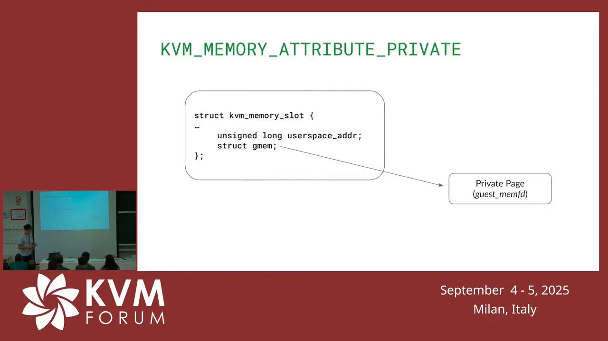
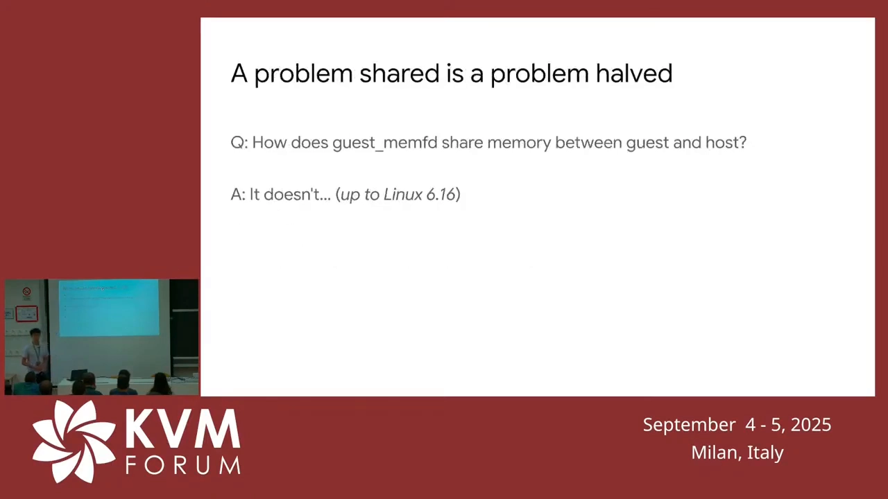
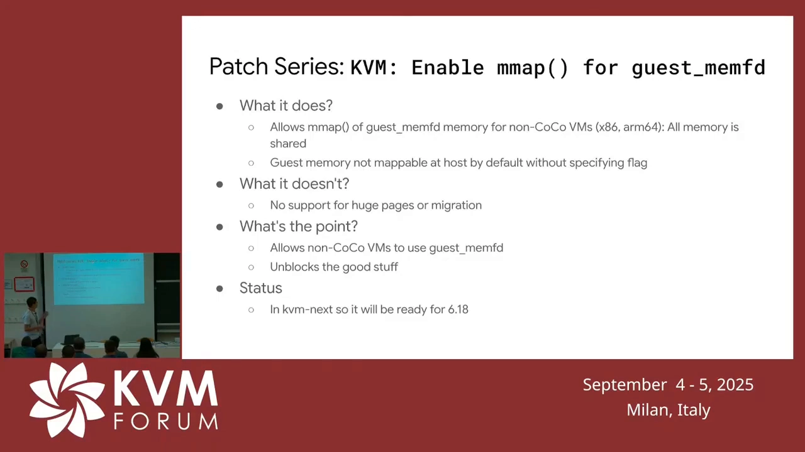
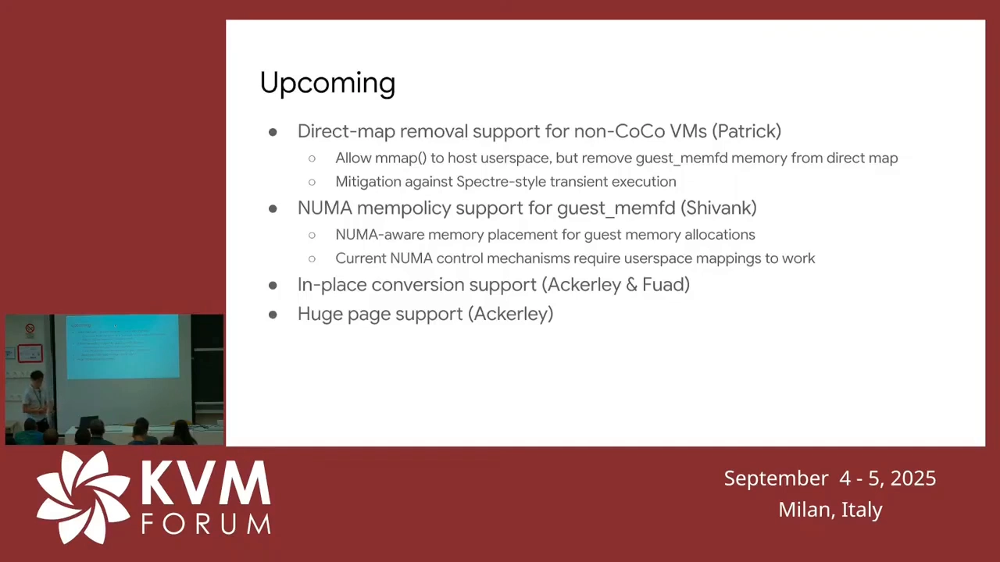
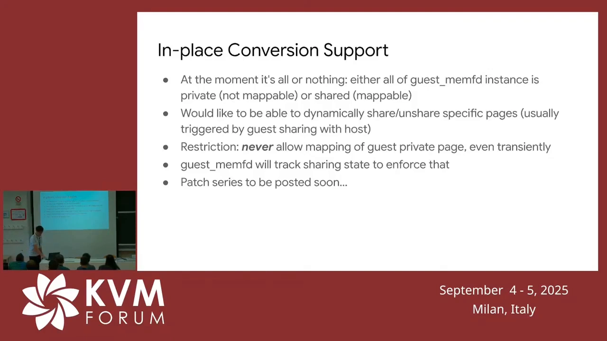
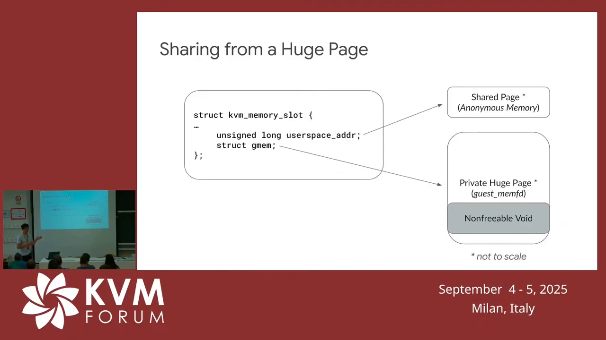
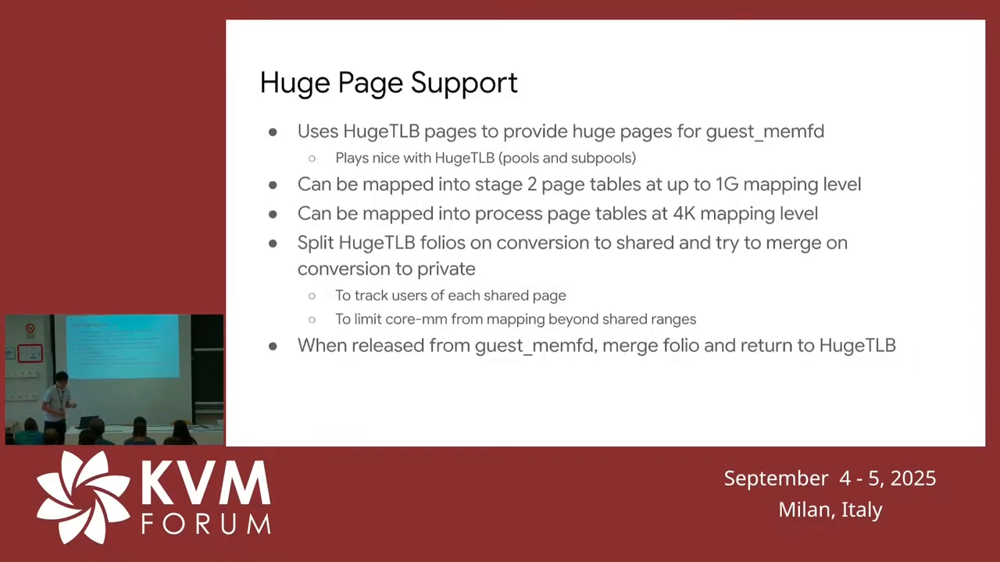

# 当内存改用文件描述符描述：guest_memfd 与私有内存的登记方式

> 视频来源：[guest_memfd: Unmapped Potential by Fuad Tabba & Ackerley Tng](https://www.youtube.com/watch?v=mB57TYNO8aY)（YouTube · KVM Forum 2025）｜时长约 13 分钟
> 导读：这是一场 KVM Forum 的补丁进展汇报，讲的是「客户机内存不再用用户态地址描述，而用文件描述符 + 偏移量描述」之后发生的事。本文把它接到 1.2.3 的内存登记话题上：传统 slot 靠什么登记、guest_memfd 换掉了哪个字段、私有与共享为什么难共存。字幕里的 GPM/guest MFD 均指 guest_memfd，616/618 指 Linux 6.16/6.18。

## 本讲要解决的核心问题（SCQA）

**背景**：上一节我们看到，把内存登记给 KVM 的标准做法是：VMM 用 `mmap` 拿到一个用户态地址（HVA），再把这个地址连同 GPA 起点、长度、slot 编号一起交给 KVM。这个模型的前提是——**内存一定在宿主的用户态地址空间里有一个地址**。

**冲突**：机密虚拟机（CoCo VM，如 TDX、SEV、SNP）打破了这个前提。这类虚拟机的客户机私有内存是加密的，宿主一旦尝试访问，可能导致宿主崩溃。既然如此，宿主就绝不能映射这块内存；可 KVM 的登记接口偏偏要的是一个宿主用户态地址。

**疑问**：如果一块内存「宿主看不见」，KVM 要怎样知道它在哪、客户机访问某个 GPA 时该去哪个物理页取数据？

**回答（中心思想）**：把内存槽的「后备描述」从**用户态地址**换成**文件描述符 + 偏移量**——这就是 guest_memfd。客户机做私有访问时，KVM 走 fd + offset 找到私有页；做共享访问时，才走 `userspace_addr`。这套改动让「同一段 GPA 可以同时有私有和共享两种视图」，也把内存登记从「一个地址」变成了「一对（fd, offset）」。

## 一、传统登记的前提，是一个宿主用户态地址

讲者一上来就把对比讲清楚了（[【跳转到 00:55】](https://www.youtube.com/watch?v=mB57TYNO8aY&t=55)）：

> 它和传统的内存槽配置方式正好相反：传统做法是把 `mmap` 返回的一个用户态地址交给 KVM，而 guest_memfd 用的是文件描述符加偏移量。

这句话点出了传统模型的关键：`userspace_addr` 不只是一个地址，它还是**宿主与 KVM 之间关于「这块内存长什么样」的共识**。有了它，KVM 才能：

- 在 EPT 缺页时把 GPA 翻译到对应的宿主页；
- 让 VMM 自己直接读写客户机 RAM（零拷贝）；
- 在需要时把这块内存 `mmap` 给别的进程（vhost-user 后端）。

而机密虚拟机要的恰恰相反：**这块内存不能有任何宿主映射**。

## 二、guest_memfd 是什么：一块宿主不能映射的客户机内存

guest_memfd 的定位可以用三句话概括（[【跳转到 00:30】](https://www.youtube.com/watch?v=mB57TYNO8aY&t=30)、[【跳转到 01:20】](https://www.youtube.com/watch?v=mB57TYNO8aY&t=80)）：

1. **guest-first memory**：内存首先属于客户机，宿主是二等公民；
2. **宿主无法在宿主页表里映射它**，所以也就不可能访问它；
3. 它最初为机密虚拟机而生，但长期目标是让**所有**客户机内存都用它，无论是否机密。

为什么「不映射」就能解决问题？讲者给了一个很干脆的因果链：机密虚拟机里宿主访问客户机私有内存会导致宿主崩溃，而**没有映射就不可能有访问**，问题自然消失。这是一个典型的「用接口约束代替运行时检查」的设计：与其每次访问都检查权限，不如让宿主根本没有办法表达这次访问。

## 三、6.16 之前：私有和共享是两块完全不同的内存

接下来是这场报告里最值得看的一张图（[【跳转到 02:10】](https://www.youtube.com/watch?v=mB57TYNO8aY&t=130)）。它画的是一个 KVM 内存槽里最要紧的两个字段：`userspace_addr` 和 `gmem`。

在 Linux 6.16 里，这两个字段指向**两个不同的地方**：

- `gmem` 指向一个 guest_memfd 实例，私有页从这块内存里来；
- `userspace_addr` 指向共享内存里的另一块，比如一块匿名内存。

于是访问路径分成两条（[【跳转到 02:35】](https://www.youtube.com/watch?v=mB57TYNO8aY&t=155)）：

- **私有访问**：KVM 查 `gmem`，进入 guest_memfd 实例，用 fd + 偏移量找到物理页；
- **共享访问**：KVM 查 `userspace_addr`，从另一块内存里取页。

这个设计能工作，但讲者用一句俏皮话点出了它的尴尬（[【跳转到 02:10】](https://www.youtube.com/watch?v=mB57TYNO8aY&t=130)）：

> 俗话说「问题分担了就减半」，但在 Linux 6.16 之前，guest_memfd 的内存其实并没有真正共享出去。

也就是说，客户机以为自己只有一份内存，实际上背后是两份：一份私有、一份共享。**同一页数据在私有视图和共享视图里是两个不同的物理页**。

## 四、为什么需要「原地共享」：转换不能靠拷贝

有些 hypervisor 并不加密客户机内存，只用 MMU 做保护——比如 Gunyah 和 pKVM：它们在二级页表（stage-2）上配额外的权限位，客户机内存本身是明文（[【跳转到 03:25】](https://www.youtube.com/watch?v=mB57TYNO8aY&t=205)）。

对这类实现来说，如果共享内存和私有内存各用一块后备内存，那么两者之间来回转换就要**大量拷贝**，既低效又浪费。于是需求变成：让同一页在原地从私有变成共享、再变回私有。

原地共享要同时满足两条看似矛盾的要求（[【跳转到 04:15】](https://www.youtube.com/watch?v=mB57TYNO8aY&t=255)）：

- **共享内存必须能被宿主 `mmap`，也必须能被 GUP（get_user_pages）取页**。因为普通虚拟机的全部机制——virtio 后端、vhost-user、io_uring——都建立在「宿主能拿到这块内存的页」之上；
- **私有内存永远不能在宿主用户态有有效映射**，哪怕只是短暂的。

实现方式是让两个字段指向同一页（[【跳转到 04:40】](https://www.youtube.com/watch?v=mB57TYNO8aY&t=280)）：`gmem` 指向 fd 以及 fd 内的偏移量，`userspace_addr` 则指向同一页的 mmap 结果。**同一块物理内存，两种描述方式**——这就是「原地」的含义。

## 五、mmap 补丁：一个标志位决定整块内存是共享还是私有

把上面这套落到代码，就是给 guest_memfd 加上 mmap 支持（[【跳转到 05:05】](https://www.youtube.com/watch?v=mB57TYNO8aY&t=305)）：

这张幻灯片的结构很适合当作读补丁的模板，它把一件事拆成四问：

- **做了什么**：允许在 x86 和 arm64 上为非机密虚拟机 `mmap` guest_memfd 内存；一旦设置这个标志，该实例里的**所有**内存都是共享的；
- **没做什么**：还不支持大页，也不支持迁移；
- **意义**：让非机密虚拟机也能开始用 guest_memfd，从而解锁后续补丁；
- **状态**：已进入 kvm-next，预计 6.18 可用。

注意这里的默认值（[【跳转到 05:30】](https://www.youtube.com/watch?v=mB57TYNO8aY&t=330)）：**不设标志时所有内存都是私有的**，同一个 guest_memfd 实例仍然可以给机密虚拟机用；设了标志就只给非机密虚拟机用。也就是说，共享/私有在现阶段是**实例级**的开关，粒度是「整个 guest_memfd」，不是「某一页」。

## 六、从「全有或全无」到按页转换

实例级开关显然不够用（[【跳转到 07:10】](https://www.youtube.com/watch?v=mB57TYNO8aY&t=430)）：

> 目前的做法基本是全有或全无：要么整个 guest 实例都是共享、可映射、给非机密虚拟机用；要么整个实例都是私有、不可映射、给机密虚拟机用。

想要的是**按页动态共享/取消共享**，在客户机运行时进行，通常由客户机主动与宿主共享来触发。而这件事的难点不在「怎么共享」，在「怎么保证不越界」（[【跳转到 07:35】](https://www.youtube.com/watch?v=mB57TYNO8aY&t=455)）：

> 客户机私有页永远不能进入宿主用户态页表，哪怕只是短暂的。

为了强制这一点，guest_memfd 要跟踪每一页的状态：是「客户机和宿主都可访问」（共享），还是「只归客户机所有、只有客户机能访问」（私有）。讲者给出的状态是：已经发了几版 RFC，下一版会在会议后不久发出。

## 七、大页带来的新问题：不可释放的空洞

最后一个话题是大页。为什么要给 guest_memfd 加大页支持（[【跳转到 08:25】](https://www.youtube.com/watch?v=mB57TYNO8aY&t=505)）？

- 大页能缩短 TLB miss 时的页表遍历，理想情况下还能减少 TLB miss；
- 如果大页来自 HugeTLB，还能拿到 HugeTLB 的虚拟内存映射优化，大约省下 1.6% 的内存——对大虚拟机来说可能是好几个 GB。

对非机密虚拟机，直接用 HugeTLB 做后备内存就能拿到这些好处；但机密虚拟机只能用 guest_memfd，所以这些好处必须补到 guest_memfd 上。

问题出在「共享一页」这件事上（[【跳转到 09:40】](https://www.youtube.com/watch?v=mB57TYNO8aY&t=580)）：客户机有一个私有大页，只想把里面的一页共享给宿主。最直接的想法是在大页里打一个洞，但打洞后的空间不能给别人用——因为一旦给别人用，就等于在这个大页里引入了碎片，无法保证这块空间能在整个大页释放时同时释放。

于是 6.16 的做法是：从别处再分配一页来支撑这次共享，私有大页里留下一个用不上也释放不掉的「不可释放空洞」（nonfreeable void）。代价很直接（[【跳转到 10:30】](https://www.youtube.com/watch?v=mB57TYNO8aY&t=630)）：

> 每共享一页，就要多占一倍内存；如果客户机恶意或有 bug，最多能占用它付费内存的两倍。

有了原地转换之后，那个空洞才能被重新用作共享页。而大页支持本身的设计是（[【跳转到 11:20】](https://www.youtube.com/watch?v=mB57TYNO8aY&t=680)）：

- 用 HugeTLB 页给 guest_memfd 提供大页，并遵守 HugeTLB 的配额、预留、池与子池；
- 这些大页在**二级页表里最多按 1 GiB 级别映射**，在**宿主用户页表里最多按 4 KiB 级别映射**；
- 转成共享时在运行时拆分大页，转回私有时尽量合并；
- 拆分是为了跟踪每个共享页的使用者，也是为了遵守内核 mm 的核心规则——沿用每页的引用计数，让原本在非机密虚拟机上能工作的机制在机密虚拟机上也能工作；
- 从 guest_memfd 释放时把 folio 合并回去，整块还给 HugeTLB。

## 八、回到 1.2.3：内存登记的描述方式在演进

把这场报告放回「内存区域注册」这一节，可以得到三条对初学者最有价值的认识：

1. **`userspace_addr` 不是内存本身，只是内存的一种描述方式**。传统登记用「宿主虚拟地址」描述，guest_memfd 用「fd + 偏移量」描述。用户态侧对应的就是带 gmem 字段的那版内存区域结构（`KVM_SET_USER_MEMORY_REGION2` 一类的接口），而 slot 编号、GPA 起点、长度这些字段的含义没有变。
2. **同一段 GPA 可以有两种视图**。私有视图走 fd + offset，共享视图走 `userspace_addr`；两者指向同一页时叫「原地共享」，指向两块内存时就要拷贝。
3. **内存的安全属性正在变成登记的一部分**。以前登记只关心「在哪、多长」，现在还关心「谁能看见」——私有页绝不允许出现在宿主用户态页表里，哪怕一瞬间。

## 小结

- 传统内存槽靠 `mmap` 返回的 `userspace_addr` 描述内存；机密虚拟机要求「宿主不可映射」，这个前提不再成立。
- guest_memfd 用**文件描述符 + 偏移量**描述客户机内存，宿主没有映射，也就无法访问。
- 6.16 之前私有与共享是两块不同的内存；原地共享要让 `gmem` 与 `userspace_addr` 指向同一页，前提是共享内存可 `mmap`、可 GUP。
- mmap 补丁是**实例级**开关：设了标志整块共享，不设则整块私有；预计 6.18。
- 下一步是按页动态转换，难点始终是「私有页永不被映射，哪怕短暂」。
- 大页支持用 HugeTLB，二级页表可按 1 GiB 映射、宿主页表按 4 KiB 映射；共享大页里的一页会留下不可释放空洞，最多让内存开销翻倍。

## 关键术语速查

| 术语 | 一句话解释 |
| --- | --- |
| mem slot | KVM 里一段「GPA 区间 → 后备内存」的登记项，用 slot 编号索引 |
| `userspace_addr` | 传统登记方式里指向后备内存的宿主虚拟地址 |
| guest_memfd | 一种客户机内存后端，用文件描述符引用，宿主默认无法映射 |
| gmem | 内存槽里指向 guest_memfd（fd + 偏移量）的字段 |
| CoCo VM | 机密计算虚拟机，如 TDX / SEV / SNP，客户机内存加密 |
| GUP | get_user_pages，内核把用户态地址「钉」成物理页的动作 |
| 原地转换 | 同一页在私有与共享之间切换，不拷贝数据 |
| HugeTLB | 内核的显式大页机制，有配额、预留与池的管理 |