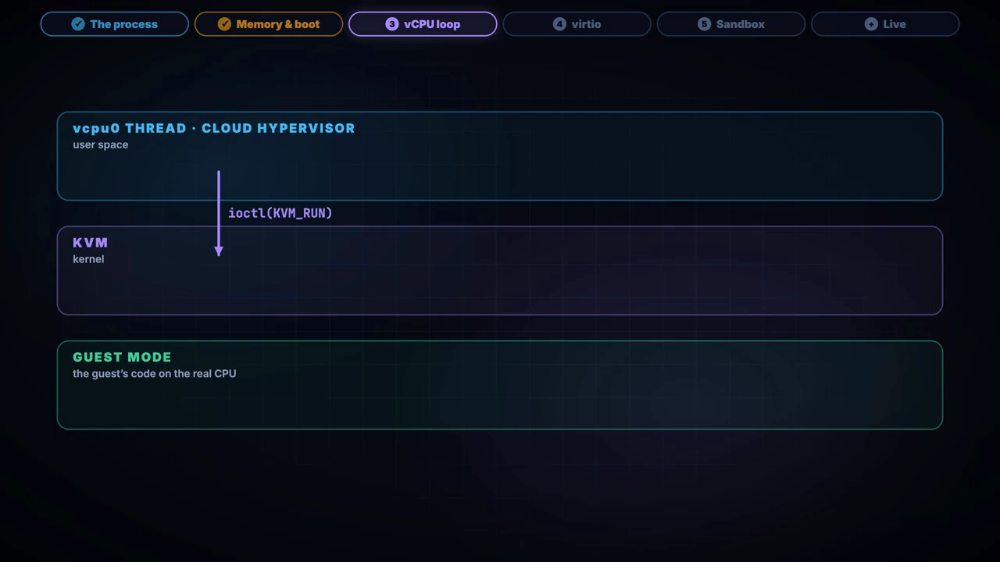
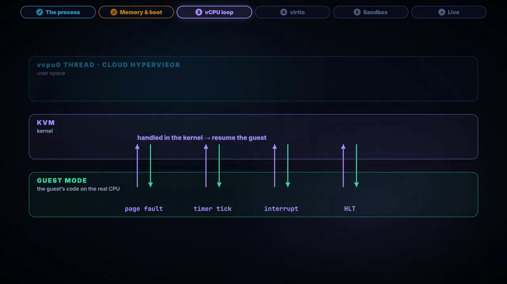
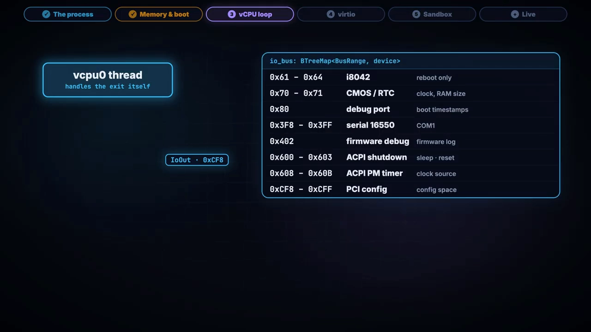
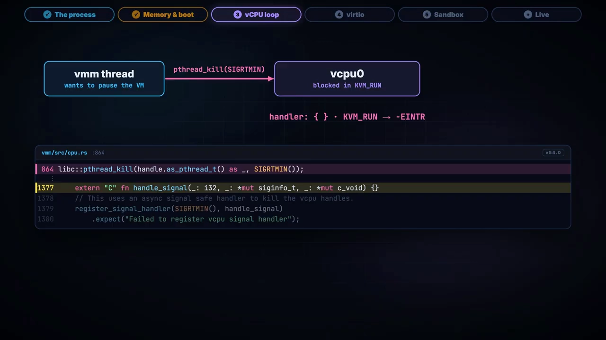
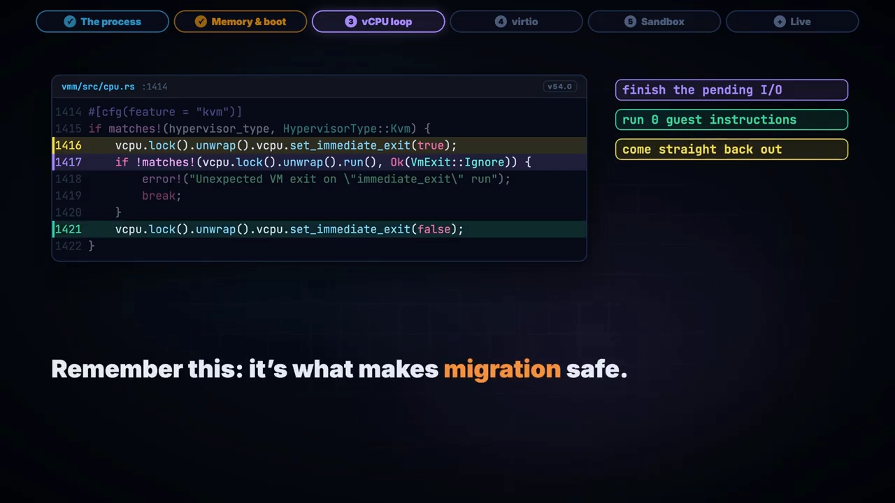
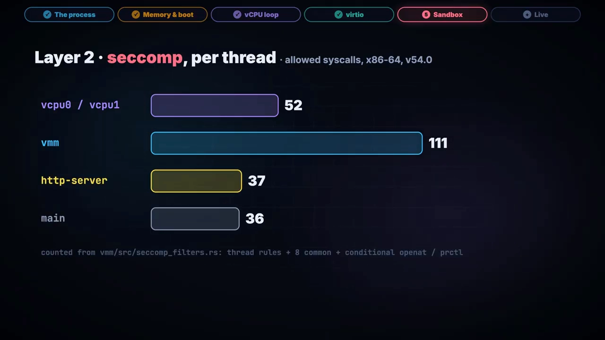

# vCPU 线程就是普通线程：Cloud Hypervisor 里 `KVM_RUN` 的阻塞、唤醒与暂停

> 视频来源：[Cloud Hypervisor Masterclass: How a Rust VMM Runs a VM](https://www.youtube.com/watch?v=UTrMyzA55Rs)（YouTube · XOR）｜时长约 21 分钟
> 导读：这支视频拿 Cloud Hypervisor v54.0 的真实源码（commit `038ce5a`）把一台 VM 拆开，逐个线程、逐次进入 KVM 的调用讲一遍，分六站：进程、内存与启动、vCPU 循环、virtio、沙箱、热迁移。本文只取与本小节相关的部分——vCPU 线程怎么建、`KVM_RUN` 为什么能一直不返回、返回之后由谁处理、以及怎么把一个正阻塞在 `KVM_RUN` 里的线程叫停。exit 的原因分类与 virtio 数据面留给相邻小节。

## 本讲要解决的核心问题（SCQA）

**背景**：上一小节你已经看到，VMM 用 `KVM_CREATE_VCPU` 拿到一个 vCPU 的 fd，然后反复用 `KVM_RUN` 让它跑起来。

**冲突**：但在真实 VMM 里，`KVM_RUN` 不是"主循环里的一个调用"，而是**每个 vCPU 线程各调各的**；而且这个调用一旦进去就很难叫醒——要暂停一台 VM、要做一次热迁移，第一件事都是把线程从 `KVM_RUN` 里弄出来。

**疑问**：vCPU 线程在宿主上到底是什么？`KVM_RUN` 什么时候返回？想让一个阻塞在里面的线程停下来，VMM 得做什么？

**回答（中心思想）**：**vCPU 线程就是进程里的普通线程，`KVM_RUN` 是它唯一的长阻塞点**。返回即 exit：大部分 exit 在内核里就被消化掉，`KVM_RUN` 继续阻塞；只有少数几种要穿透到用户态，由这个 vCPU 线程**自己就地**处理。而叫停的办法是给它发一个信号，让 handler 什么都不做——目的仅仅是让 `KVM_RUN` 返回 `-EINTR`。

## 一、一台 VM 在宿主上是一个进程，里面十几个线程

视频先给出这台 VM 的配置：一个内核、一个磁盘镜像、一块网卡、**两个 vCPU**、1 GiB 内存，外加一个 API socket。然后是一句关键的话：**对宿主来说，整个 VM 就是一个进程；进程里面有十几个线程，每个线程负责一件事**。[【跳转到 02:26】](https://www.youtube.com/watch?v=UTrMyzA55Rs&t=146)

这个进程内部的线程分工值得先看清楚，因为 vCPU 线程只是其中之一：

| 线程 | 职责 |
| --- | --- |
| main | 解析命令行参数，把配置转成 VM config，然后通过 channel 给 vmm 线程发 `VmCreate`、`VmBoot` |
| vmm | 拥有这台 VM，本身是一个事件循环，睡在 epoll 上等 6 个 eventfd |
| http-server | 提供 `/api/v1` 下的 REST 接口，`ch-remote` 只是它的客户端 |
| vcpu0 / vcpu1 | 每个 vCPU 一个，阻塞在 `KVM_RUN` 里 |
| `_disk0_q0`、`_net1_qp0` 等 | 每个 virtio 队列一个 worker，睡在 epoll 上等 doorbell |


这套"**channel 传数据，eventfd 叫醒**"的模式在代码库里到处都是：HTTP 线程把请求推到 channel 上，然后给 API eventfd 加一；vmm 线程从 epoll 里醒来，处理完再睡回去。[【跳转到 03:16】](https://www.youtube.com/watch?v=UTrMyzA55Rs&t=196)

请注意这里已经埋下了一个对比：vmm 线程"睡在 epoll 上"，是**可以被 eventfd 叫醒**的睡眠；而 vCPU 线程"睡在 `KVM_RUN` 里"，没有任何 eventfd 能叫醒它。这个不对称，是本文后半段的全部动机。

## 二、一个 vCPU = 一个 fd + 一个线程

到了 vCPU 这一站，视频的说法很直接：**每个 vCPU 早就有了 `KVM_CREATE_VCPU` 给出的 fd 和一份过滤过的 CPUID；现在每个 vCPU 再配一个线程，`vcpu0` 和 `vcpu1`。它们在 barrier 上等齐，然后一起启动。**[【跳转到 07:23】](https://www.youtube.com/watch?v=UTrMyzA55Rs&t=443)


这里有三个容易被忽略的细节：

1. **fd 先于线程存在**。`KVM_CREATE_VCPU` 是内核侧的动作，创建的是 KVM 里的 vCPU 对象；线程是用户态随后才起的执行体。两者一一对应，但不是同一件事。
2. **barrier 是为了同时起跑**。两个 vCPU 线程要等彼此都准备好才一起进 guest，否则 SMP guest 的启动时序会被打乱。
3. **CPUID 在建线程之前就过滤好了**。也就是说 vCPU 线程一出生，它要"假装"的那颗 CPU 长什么样就已经定死了。

## 三、最热的循环只有三个分支

接下来是全场最重要的一页：**这是 Cloud Hypervisor 里最热的循环，每个 vCPU 线程都在跑它**。[【跳转到 07:30】](https://www.youtube.com/watch?v=UTrMyzA55Rs&t=450)

伪代码只有三行判断：

```rust
loop {
    if paused { park(); }        // 暂停了？挂起
    if stop_requested { exit(); } // 被要求停？退出线程
    run();                        // 否则，调 run
}
```

而 `run` 就是一个 ioctl：`KVM_RUN`。



这张三层图（vCPU 线程 / KVM / guest mode）值得记住，因为它就是"一个 vCPU 的宿主形态"最紧凑的画法：**上面一层是线程，中间一层是内核里的 KVM，下面一层才是真正跑 guest 代码的物理 CPU**。

## 四、阻塞语义：线程进内核，CPU 去跑 guest

`KVM_RUN` 之后发生了什么，视频讲得很细：**线程进入内核，KVM 装载 guest 的寄存器，CPU 切换到 guest 模式；现在 guest 的代码直接在真 CPU 上跑，Cloud Hypervisor 完全不参与。** [【跳转到 07:42】](https://www.youtube.com/watch?v=UTrMyzA55Rs&t=462)

然后是阻塞语义的原话：**那个 ioctl 直到 guest 做了某件 KVM 不会自己处理的事情才返回，那就是一次 VM exit。** [【跳转到 07:57】](https://www.youtube.com/watch?v=UTrMyzA55Rs&t=477)

把这两句合起来读，就能回答"卡住的系统调用在干什么"：

- 线程确实停在 `KVM_RUN` 里没往下走，用户态的 `run()` 调用栈一直挂着；
- 但物理 CPU 没有闲着，它在满速执行 guest 的指令；
- "Cloud Hypervisor 完全不参与"是关键——热路径上没有任何用户态代码，这才是虚拟机接近原生性能的原因。

## 五、返回之后：大部分 exit 根本不出内核

`KVM_RUN` 返回，说明发生了一次 VM exit；但**返回给用户态**是另一回事。视频给了一个很强的判断：**大多数 exit 从不离开内核**——guest 内存上的缺页、时钟 tick、中断、HLT，KVM 处理完就恢复 guest。[【跳转到 08:05】](https://www.youtube.com/watch?v=UTrMyzA55Rs&t=485)



视频还补了一个有意思的细节：Cloud Hypervisor 的代码里**把 HLT exit 当成 bug**——因为 HLT（guest 让 CPU 停机等待中断）本该由 KVM 处理，如果它冒到用户态，说明哪里不对。[【跳转到 08:14】](https://www.youtube.com/watch?v=UTrMyzA55Rs&t=494)

这和上一小节讲的"轻量级 VM exit"是同一件事的两种说法：exit 发生了，但 `KVM_RUN` 没有返回给用户态，因为内核在内部就把它消化了。

## 六、真正回到用户态的三种 exit，由 vCPU 线程自己就地处理

那么什么才会真的返回到用户态？视频列了三种：**port I/O、KVM 不认识的 MMIO 地址、以及 shutdown 或 reset**。[【跳转到 08:20】](https://www.youtube.com/watch?v=UTrMyzA55Rs&t=500)

更值得注意的是谁来处理：**vCPU 线程自己就地处理这些 exit，不转手给另一个线程。** [【跳转到 08:27】](https://www.youtube.com/watch?v=UTrMyzA55Rs&t=507)

处理方式是查表：在两条总线之一上查地址，一条是 port I/O，一条是 MMIO，每条都是一个 `BTreeMap`——从地址区间到设备的排序映射。找到了就调那个设备的 read 或 write，带上地址在区间内的偏移；找不到的话，读返回 `0xFF`，写直接丢弃。然后**直接回到 `KVM_RUN`**。[【跳转到 08:38】](https://www.youtube.com/watch?v=UTrMyzA55Rs&t=518)



"不转手给另一个线程"这句话解释了一个常见误解：很多人以为设备模拟是"另一个线程在干活"。至少在 Cloud Hypervisor 的这条路径上不是——**陷入用户态的是 vCPU 线程本人，它处理完再自己回去**。这也意味着设备模拟的延迟直接算在这个 vCPU 的账上。

## 七、让一个阻塞在 `KVM_RUN` 里的线程停下来：发一个什么都不做的信号

现在回到第一节埋下的不对称：vmm 线程能被 eventfd 叫醒，vCPU 线程卡在 `KVM_RUN` 里，怎么叫？

视频的答案是信号。**要暂停一个 vCPU，Cloud Hypervisor 给它的线程发一个 `SIGRTMIN` 信号。handler 什么都不做。重点在于：`KVM_RUN` 会返回。** [【跳转到 09:58】](https://www.youtube.com/watch?v=UTrMyzA55Rs&t=598)



源码里能直接看到这个设计（`vmm/src/cpu.rs`）：

```rust
// vmm/src/cpu.rs:864
libc::pthread_kill(handle.as_pthread_t() as _, SIGRTMIN());

// vmm/src/cpu.rs:1377
extern "C" fn handle_signal(_: i32, _: *mut siginfo_t, _: *mut c_void) {}
// This uses an async signal safe handler to kill the vcpu handles.
register_signal_handler(SIGRTMIN(), handle_signal)
    .expect("Failed to register vcpu signal handler");
```

一个空 handler 看着像没写完，其实是精确的设计：**信号的作用不是"通知线程做事"，而是"把线程从阻塞的系统调用里弹出来"**。KVM 的 `KVM_RUN` 在等待期间被信号打断时返回 `-EINTR`，用户态的 `run()` 调用就返回了，线程这才有机会走到循环里的 `paused → park` 分支。

### 一个必须知道的微妙之处：挂起的 I/O 会在下一次 `KVM_RUN` 才完成

视频特意强调了一个来自 KVM 文档的细节：**如果 guest 当时正处于一次 I/O exit 的中间，那么这次访问只会在下一次 `KVM_RUN` 时完成。** [【跳转到 10:04】](https://www.youtube.com/watch?v=UTrMyzA55Rs&t=604)

换句话说，`-EINTR` 打断了等待，但被打断的那次 I/O 还悬着。所以**在 park 之前，线程会带着 `immediate_exit` 再进一次内核**：完成挂起的访问、跑 0 条 guest 指令、立刻出来。[【跳转到 10:11】](https://www.youtube.com/watch?v=UTrMyzA55Rs&t=611)



```rust
// vmm/src/cpu.rs:1416
vcpup.lock().unwrap().vcpu.set_immediate_exit(true);
if !matches!(vcpup.lock().unwrap().run(), Ok(VmExit::Ignore)) {
    error!("Unexpected VM exit on \"immediate_exit\" run");
    break;
}
vcpup.lock().unwrap().vcpu.set_immediate_exit(false);
```

视频用一句话总结了这段代码的分量：**记住这一点，它让迁移变得安全。** [【跳转到 10:21】](https://www.youtube.com/watch?v=UTrMyzA55Rs&t=621) 因为热迁移要在某个确定的时刻冻结 vCPU，如果有一条 I/O 半途而废，目的端恢复出来的状态就是错的。

这个动作在迁移那一站又出现了一次：**每个 vCPU 都被踢出 `KVM_RUN`，挂起的 exit 用 `immediate_exit` 收尾**，然后最后一批脏页、vCPU 寄存器和设备状态才传过去。[【跳转到 18:43】](https://www.youtube.com/watch?v=UTrMyzA55Rs&t=1123)

## 八、vCPU 线程的权限边界：52 个系统调用，没有 `clone`

vCPU 线程既然是普通线程，它也就受普通线程的沙箱约束。视频在沙箱那一站给出了逐线程的 seccomp 统计：**几乎每个线程在启动的那一刻就装好自己的系统调用过滤器**；在 x86 上，**一个 vCPU 线程最多可以发 52 个不同的系统调用**，它的 ioctl 被限制在 **28 个请求码**（`KVM_RUN` 在列），而且**没有 `clone`——它不能起线程**。[【跳转到 15:41】](https://www.youtube.com/watch?v=UTrMyzA55Rs&t=941)



对比一下就很清楚：干重活的 vmm 线程有 111 个系统调用，HTTP 服务只有 37 个，vCPU 线程 52 个。**越界就 `SIGSYS`，进程直接死**；为了能打印出线程名，vCPU 的过滤器还额外允许了恰好一个 `prctl` 操作——读自己的线程名。[【跳转到 16:19】](https://www.youtube.com/watch?v=UTrMyzA55Rs&t=979)

"没有 `clone`"这条限制，在别处还有一个直接后果。视频在 virtio 那一站讲到：guest 驱动往设备状态寄存器写 `DRIVER_OK` 时会发生一次 exit，落在某个 vCPU 线程上；而**这个线程的 seccomp 过滤器根本不允许它起线程**。于是它把活排进队列、给 vmm 线程的 eventfd 加一，然后在 barrier 上等 worker 都跑起来。[【跳转到 13:16】](https://www.youtube.com/watch?v=UTrMyzA55Rs&t=796)

这是一个很好的收尾例子：**vCPU 线程的能力被刻意压到最小——它只会跑 guest、处理自己撞上的那几个 exit，别的事情一律转交。**

## 九、所以 vCPU 线程一天到晚在做什么

视频最后给了一个漂亮的总结：**Cloud Hypervisor 一天到晚几乎什么都不干——guest 在跑的时候，vCPU 线程就坐在 `KVM_RUN` 里面。** [【跳转到 19:38】](https://www.youtube.com/watch?v=UTrMyzA55Rs&t=1178)

其余线程各有各的睡法：设备线程睡在 epoll 等 doorbell，vmm 线程等请求。VMM 真正的工作是**接线**：把 guest 内存接进 KVM，把 doorbell 接成 eventfd，把中断接成 irqfd，把每个线程关进它自己的 seccomp 盒子——然后让开。

## 小结

- **一台 VM 在宿主上是一个进程**，里面十几个线程，vCPU 线程只是其中之一；vmm 线程睡在 epoll 上（可被 eventfd 叫醒），vCPU 线程睡在 `KVM_RUN` 里（叫不醒）。
- **一个 vCPU = 一个 `KVM_CREATE_VCPU` 的 fd + 一个线程**；多个 vCPU 线程在 barrier 上等齐后一起起跑。
- **最热的循环只有三个分支**：paused 就 park，要求停就 exit，否则 `run()`——而 `run()` 就是一个 `KVM_RUN`。
- **阻塞语义**：线程进入内核后，KVM 装载 guest 寄存器、CPU 切到 guest 模式，guest 代码直接在真 CPU 上跑，VMM 完全不参与；这个 ioctl 直到 guest 做了 KVM 不自己处理的事才返回。
- **返回语义**：返回即 VM exit；但大多数 exit（缺页、时钟 tick、中断、HLT）在内核里就被处理掉，`KVM_RUN` 继续阻塞。
- **真正回到用户态的只有三种**：port I/O、未知 MMIO、shutdown/reset；而且由 vCPU 线程自己就地查表处理，不转手给别的线程。
- **叫停的办法是信号**：`pthread_kill(SIGRTMIN)`，handler 是空的，目的只是让 `KVM_RUN` 返回 `-EINTR`。
- **`immediate_exit` 收尾**：被打断时若有挂起的 I/O，要带 `immediate_exit` 再进一次内核，完成访问、跑 0 条 guest 指令、立刻返回——这是暂停与热迁移安全的前提。
- **权限边界**：vCPU 线程的 seccomp 只放行 52 个系统调用、28 个 ioctl 请求码，且没有 `clone`；需要起线程的活一律转交 vmm 线程。

## 关键术语速查

| 术语 | 一句话解释 |
| --- | --- |
| vCPU 线程 | 用户态为每个 vCPU 起的线程，平时阻塞在 `KVM_RUN` 里，返回时处理 exit |
| `KVM_RUN` | vCPU 线程调用的 ioctl；进入内核并切到 guest，直到发生 VM exit 才返回 |
| VM exit | guest 做了 KVM 不自己处理的事而被硬件拦下；多数在内核里消化，少数回到用户态 |
| barrier | 线程同步点；多个 vCPU 线程在这里等齐后一起进 guest |
| `SIGRTMIN` | Cloud Hypervisor 用来打断 `KVM_RUN` 的实时信号；handler 为空，只为让 ioctl 返回 |
| `-EINTR` | `KVM_RUN` 被信号打断时的返回值，是"暂停一个 vCPU"的实现基础 |
| `immediate_exit` | 让下一次 `KVM_RUN` 立刻返回的标志；用于收尾挂起的 I/O，保证暂停/迁移状态一致 |
| `io_bus` | 从地址区间到设备的 `BTreeMap`，vCPU 线程用它就地处理 port I/O 与 MMIO exit |
| seccomp | 逐线程的系统调用过滤器；vCPU 线程 52 个调用、28 个 ioctl 请求码、无 `clone` |