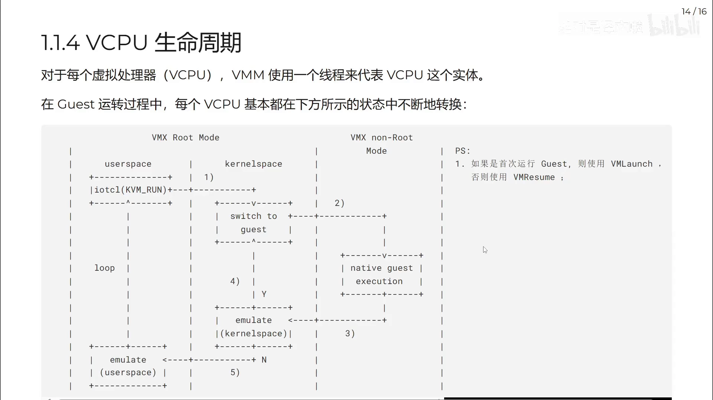
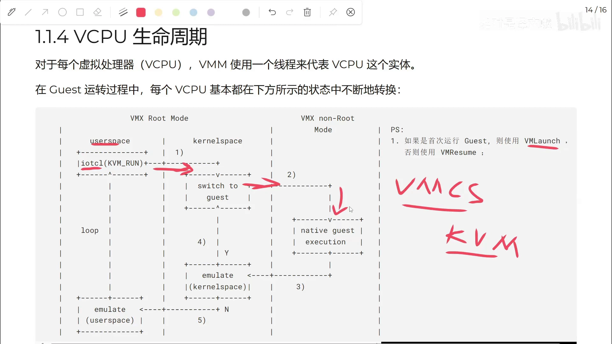
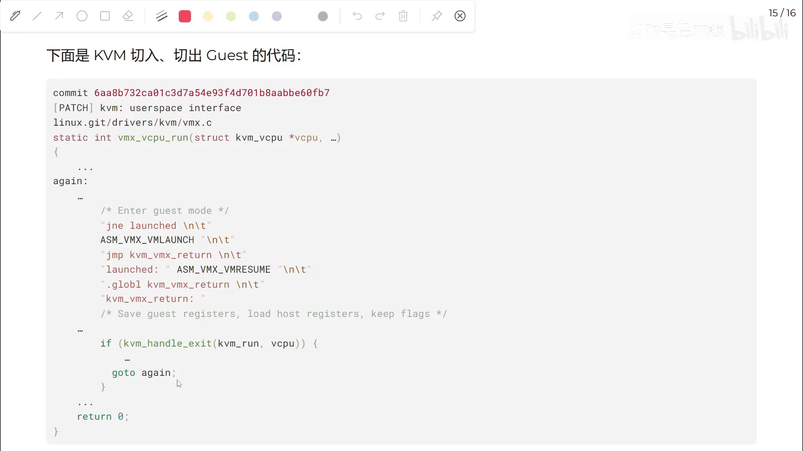
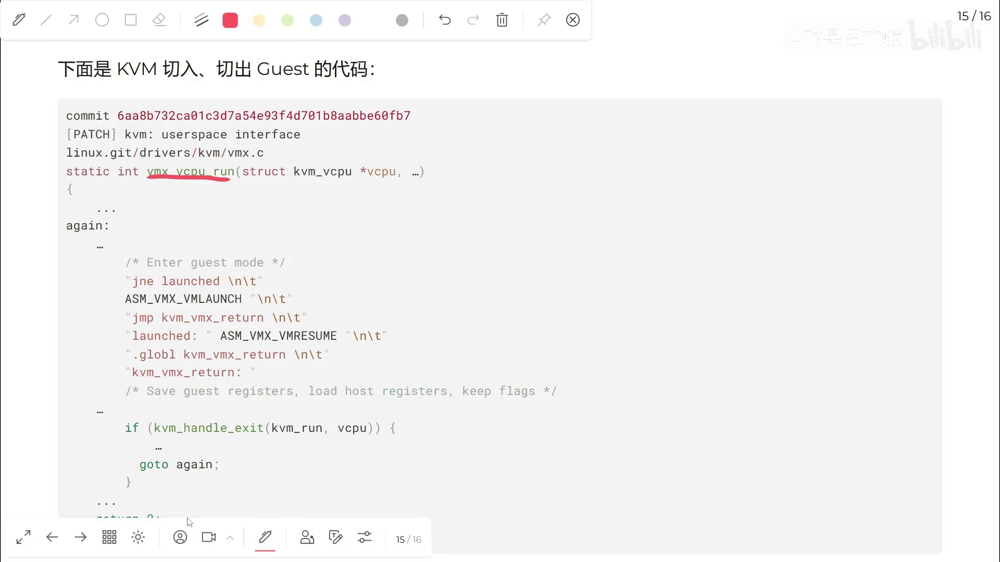
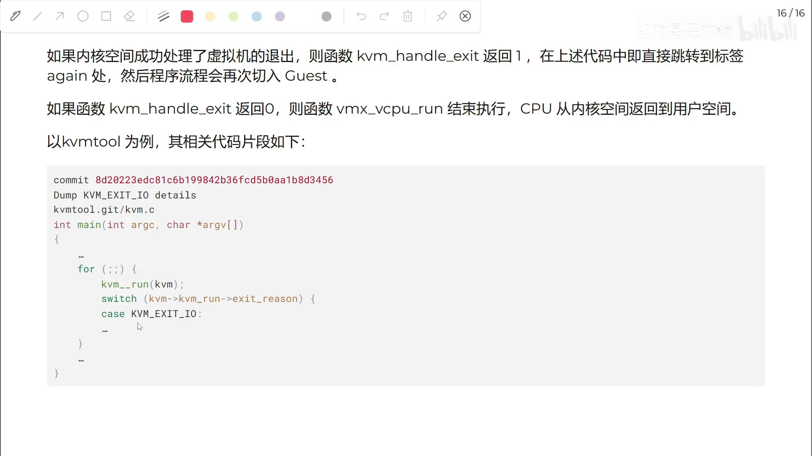
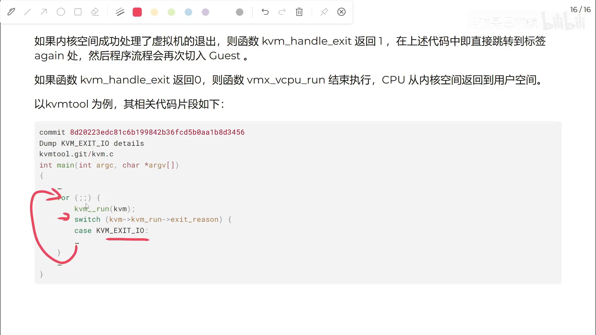

# 一个 vCPU 就是一个线程：`KVM_RUN` 的进入、阻塞与返回

> 视频来源：[【Learn KVM】1.1.4 VCPU生命周期](https://www.bilibili.com/video/BV1JKymYnEkc)（Bilibili · 绝对是泽文啦）｜时长约 6 分钟
> 导读：这支 6 分钟的视频只回答一个问题——一个 vCPU 在宿主上到底长什么样，`KVM_RUN` 这一次 ioctl 为什么能长时间不返回。它对应《深度探索 Linux 系统虚拟化：原理与实现》的 1.1.4 节，先给一张三栏状态图，再落到 `vmx_vcpu_run()` 与 kvmtool 两段真实代码。本文聚焦「线程模型 + `KVM_RUN` 的阻塞与返回语义」；VM exit 的原因分类、设备模拟在 exit 路径上的位置，留给相邻小节。

## 本讲要解决的核心问题（SCQA）

**背景**：你已经知道 VMM（虚拟机监视器，比如 QEMU、kvmtool、Cloud Hypervisor）是宿主上的一个普通用户态程序，它通过 `/dev/kvm` 上的 ioctl 指挥内核里的 KVM 模块干活。

**冲突**：可是 `KVM_RUN` 这个 ioctl 很反常——它可能几分钟都不返回。一个系统调用怎么会"卡"这么久？卡住的时候，那颗物理 CPU 到底在跑谁的代码？

**疑问**：vCPU 在宿主操作系统眼里究竟是什么东西？`KVM_RUN` 什么时候返回，返回又意味着什么？

**回答（中心思想）**：**一个 vCPU 就是一个宿主线程**。这个线程的生命周期里只有一个长阻塞点——`KVM_RUN`；它返回的那一刻，就是 guest 里发生了一次 **VM exit**（虚拟机退出）。返回之后的分岔只有两条：exit 能在内核里就地处理，`KVM_RUN` 内部直接 `goto again` 再次进入 guest；内核处理不了，函数返回、CPU 落回用户态，由 VMM 的用户空间接手，处理完再发起下一轮 `KVM_RUN`。

## 一、vCPU 的宿主形态：一个线程，一张三栏状态图

视频开篇就给了结论：**对于每个虚拟处理器（vCPU），VMM 使用一个线程来代表它这个实体**。[【跳转到 00:00】](https://www.bilibili.com/video/BV1JKymYnEkc/?t=0)

这句话的分量在于它把"虚拟"落到了实处：guest 里那颗"CPU"不是一个被解释执行的软件对象，而是宿主上一个有自己栈、自己调度实体、自己阻塞点的线程。后面所有关于 `KVM_RUN` 的讨论，都是这个线程的行为。



这张图是全片的主干，读法是从左上往下绕一圈：

1. **userspace 里的 `ioctl(KVM_RUN)`**：vCPU 线程在用户态发起请求。
2. **kernelspace 里的 `switch to guest`**：KVM 模块接手，把 CPU 切到 guest 模式。
3. **VMX non-Root Mode 里的 `native guest execution`**：guest 的指令在物理 CPU 上原生执行。
4. **回到 kernelspace 的 `emulate` 分支**：exit 之后，KVM 先判断自己能不能处理（图上的 `Y`）。
5. **落到 userspace 的 `emulate`**：内核处理不了（`N`），才回到用户态由 VMM 处理。

第 4 步的 `Y` 和第 5 步的 `N` 是这张图上最关键的一个分叉，也是本文后半段的主题。整圈第 1 到第 5 步，在虚拟机运转期间是**循环往复**的。[【跳转到 03:45】](https://www.bilibili.com/video/BV1JKymYnEkc/?t=225)

## 二、`KVM_RUN` 是一次交棒：从用户态进内核，再从内核进 guest

在用户空间把该准备的事情准备好以后，vCPU 所在的线程向内核中的 KVM 模块发起一个 ioctl 请求，**这个请求就是 `KVM_RUN`**。[【跳转到 00:25】](https://www.bilibili.com/video/BV1JKymYnEkc/?t=25)

它的语义值得逐字读一遍：`KVM_RUN` 是在告知内核"**用户空间的操作已经完成了，可以切入到 guest 模式中运行**"。也就是说，这个 ioctl 不是"帮我干一件事然后告诉我结果"，而是"接下来交给 guest，我在这儿等"。请求和交接写在同一句里，阻塞的种子从这一刻就埋下了。

进入内核态以后，KVM 模块调用 CPU 提供的虚拟化指令切入 guest 模式：**如果是首次运行，使用 `VMLAUNCH`；否则使用 `VMRESUME`**。[【跳转到 00:50】](https://www.bilibili.com/video/BV1JKymYnEkc/?t=50) 这两个指令的区别只在"第一次"和"之后每一次"，对上层来说是透明的。

切入过程中要做两次状态搬运：

- **host 状态**（宿主这一侧的 CPU 寄存器）保存在 VMCS（Virtual Machine Control Structure，一块由硬件读写的内存结构）当中，VMCS 里有一个专门储存 host 状态的区域；那**非 CPU 自动保存**的状态，就由 KVM 负责保存。[【跳转到 01:15】](https://www.bilibili.com/video/BV1JKymYnEkc/?t=75)
- 然后加载储存在 VMCS 当中的 **guest 状态**到这个物理 CPU 里面；同样地，非 CPU 自动恢复的部分还是由 KVM 负责恢复。[【跳转到 01:40】](https://www.bilibili.com/video/BV1JKymYnEkc/?t=100)

搬运完成，物理 CPU 切换到 guest 模式，它就去执行 guest 的指令了。注意此时"执行"的主体是**物理 CPU 本身**，不是 KVM，更不是 VMM——KVM 只是把现场摆好，然后放手。

## 三、阻塞语义：这个 ioctl 不返回，直到 guest 撞上敏感指令

接下来是全片最反直觉的一段：guest 在执行指令的时候，如果遇到了**敏感指令**，CPU 就会从 guest 模式切换回 host 模式的 ring 0，然后进入到 host 的内核 KVM 模块。[【跳转到 02:05】](https://www.bilibili.com/video/BV1JKymYnEkc/?t=125)

这句话反过来读，就是 `KVM_RUN` 的阻塞语义：

> **只要 guest 不撞上敏感指令，`KVM_RUN` 就一直不返回。**

所以那个“卡住的系统调用”其实一点也不闲——它所在的物理 CPU 正在满速执行 guest 的代码。线程确实停在 ioctl 里没往下走，但 CPU 的时间片被 guest 用掉了。这也是“guest 指令原生执行”这句话的实际含义：热路径上没有 VMM 的参与。



exit 发生时的状态搬运是进入时的镜像：首先 CPU 的状态，也就是 **guest 的状态**，会被保存到 VMCS 里储存 guest 状态的区域；然后加载储存在 VMCS 中的 **host 状态**到物理 CPU。[【跳转到 02:30】](https://www.bilibili.com/video/BV1JKymYnEkc/?t=150) 非 CPU 自动保存的状态，仍然由 KVM 模块负责。

现场换回来以后，处于内核态的 KVM 模块从 VMCS 里面读取**虚拟机退出的原因**，去尝试在这个内核里面处理。[【跳转到 02:55】](https://www.bilibili.com/video/BV1JKymYnEkc/?t=175)

## 四、返回语义：返回 1 就地重进，返回 0 才回用户态

拿到退出原因之后，KVM 面对的就是状态图上那个 `Y`/`N` 分叉。

**分支一：内核能处理。** 那么虚拟机就不需要再切换到 host 模式的用户态了，处理完以后直接快速地再切换回 guest。这种退出也被称为**轻量级的虚拟机退出**（lightweight VM exit）。[【跳转到 03:20】](https://www.bilibili.com/video/BV1JKymYnEkc/?t=200)

**分支二：内核处理不了。** 那么 vCPU 将会进行一次上下文切换，从 host 的内核态切换到 host 的用户态，由 VMM 的用户空间去处理；处理完以后，再次发起切入到 guest 模式的指令。[【跳转到 03:45】](https://www.bilibili.com/video/BV1JKymYnEkc/?t=225)

把这个分叉落到代码上，就是视频后半段分析的两段源码。第一段是内核侧的 `vmx_vcpu_run()`：



代码骨架是这样的（原视频展示的是 commit `6aa8b732ca01`，即 KVM 最初的 userspace interface 补丁）：

```c
static int vmx_vcpu_run(struct kvm_vcpu *vcpu, ...)
{
    ...
again:
    ...
    /* Enter guest mode */
    "jne launched \n\t"
    ASM_VMX_VMLAUNCH "\n\t"
    "jmp kvm_vmx_return \n\t"
    "launched: " ASM_VMX_VMRESUME "\n\t"
    ".globl kvm_vmx_return \n\t"
    "kvm_vmx_return: "
    /* Save guest registers, load host registers, keep flags */
    ...
    if (kvm_handle_exit(kvm_run, vcpu)) {
        ...
        goto again;
    }
    ...
    return 0;
}
```

对照视频的解读，这段代码只有两个出口：

- 如果内核空间**成功处理**了虚拟机的退出，`kvm_handle_exit()` 返回 **1**，代码通过 `goto` 语句再次跳转到 `again` 标签，然后通过那段汇编指令重新进入 guest 执行。[【跳转到 04:10】](https://www.bilibili.com/video/BV1JKymYnEkc/?t=250)
- 如果 `kvm_handle_exit()` 返回 **0**，则代表 `vmx_vcpu_run()` 结束执行，CPU 从内核空间再切换回用户空间。[【跳转到 04:35】](https://www.bilibili.com/video/BV1JKymYnEkc/?t=275)



于是"`KVM_RUN` 的返回值"有了确切含义：

| `kvm_handle_exit()` 返回值 | 内核动作 | 用户态看到的结果 |
| --- | --- | --- |
| 1（内核已处理） | `goto again`，重新进入 guest | 看不到这次 exit，`KVM_RUN` 仍在阻塞 |
| 0（内核处理不了） | `return 0`，退回用户态 | `KVM_RUN` 返回，VMM 读 `exit_reason` |

这张表解释了一个常被误解的现象：**guest 里发生的 VM exit 数量，远大于 VMM 感知到的 `KVM_RUN` 返回次数**。轻量级 exit 被内核这层循环吃掉了，只有真正需要设备模型的那些，才会穿透到用户态。

## 五、用户态那一层：kvmtool 的 `for(;;)`

第二段源码在用户态。视频以 kvmtool 为例，看 VMM 拿到返回值之后怎么组织循环：



```c
int main(int argc, char *argv[])
{
    ...
    for (;;) {
        kvm__run(kvm);
        switch (kvm->kvm_run->exit_reason) {
        case KVM_EXIT_IO:
            ...
        }
        ...
    }
}
```

根据代码可见，kvmtool 发起进入 guest 的代码是处在一个 `for` 循环当中的。当从 KVM 内核空间返回到用户空间以后，就是 `kvm__run()` 返回的那个位置；kvmtool 在用户空间去处理 guest 的请求，比如调用模拟设备处理这个 IO 的请求。当处理完这个 guest 请求以后，它相当于重新进入下一轮的 `for` 循环，然后再次去请求 KVM 模块切入到这个 guest 当中。[【跳转到 05:00】](https://www.bilibili.com/video/BV1JKymYnEkc/?t=300)



注意 `kvm_run` 这个结构体在两段代码里都出现了：内核侧把它交给 `kvm_handle_exit()`，用户态侧从 `kvm->kvm_run->exit_reason` 读退出原因。可以把它理解成这次 `KVM_RUN` 的参数区——内核在返回前把退出原因和这次 exit 的细节（比如 IO 的端口号和方向）写进去，用户态读同一块内存就知道发生了什么。所以 `kvm->kvm_run->exit_reason` 不是“另一个查询接口”，而是这次 `KVM_RUN` 的返回值本体。

## 六、把两层循环叠起来看：一次 guest IO 的完整往返

到这里可以把两层循环合成一张账。假设 guest 里的一条指令要读一个模拟设备的 IO 端口：

1. vCPU 线程在用户态调用 `ioctl(KVM_RUN)`，进入内核。
2. KVM 保存 host 状态、加载 guest 状态，`VMRESUME` 进入 guest。
3. guest 执行到那条 IO 指令，硬件拦下，VM exit 回到 host 的 ring 0。
4. KVM 保存 guest 状态、加载 host 状态，读 VMCS 拿到退出原因。
5. 这个原因 KVM 处理不了（要模拟设备），`kvm_handle_exit()` 返回 0，`vmx_vcpu_run()` 返回，CPU 落回用户态。
6. kvmtool 的 `for` 循环里 `switch` 到 `KVM_EXIT_IO`，调用模拟设备完成这次 IO。
7. 循环回到开头，再调一次 `kvm__run()`，也就是再发一次 `KVM_RUN`。
8. 回到第 2 步。

第 5 步到第 7 步这一段，就是"上下文切换 host 内核态 → host 用户态 → 再进内核"的全部代价。它也是后面所有性能话题的起点：**能留在内核里处理的 exit 越少穿透到用户态，虚拟机越快**。

## 小结

- **一个 vCPU 对应一个宿主线程**，这是理解 vCPU 生命周期的起点；状态图上的 1 到 5 步就是这个线程的循环。
- **`KVM_RUN` 是这次交棒的发起动作**，它的语义是"用户空间准备好了，请切到 guest 去跑"，而不是"请帮我算个结果"。
- **阻塞语义**：guest 不撞上敏感指令，`KVM_RUN` 就不返回；这段时间物理 CPU 在原生执行 guest 代码，VMM 完全不参与。
- **返回即 exit**：`KVM_RUN` 返回的那一刻，一定对应一次 VM exit。
- **返回 1 与返回 0 是两种命运**：1 表示内核已就地处理，`goto again` 重新进入 guest（轻量级 exit）；0 表示内核处理不了，退回用户态交给 VMM。
- **用户态是第二层循环**：kvmtool 的 `for(;;)` 里，`kvm__run()` 与 `switch(exit_reason)` 交替出现，处理完再进下一轮。
- 两层循环叠起来，才是"vCPU 运行循环"的完整形状。

## 关键术语速查

| 术语 | 一句话解释 |
| --- | --- |
| vCPU | 虚拟处理器；在宿主上由一个线程代表，在 KVM 里是一个内核对象 |
| `KVM_RUN` | vCPU 线程发起的 ioctl，进入 guest 并阻塞，直到发生 VM exit 才返回 |
| VMCS | 硬件读写的内存结构，保存 host 与 guest 两侧的 CPU 状态以及本次 exit 的原因 |
| VM entry | 从 host 切入 guest 的过程，首次用 `VMLAUNCH`，之后用 `VMRESUME` |
| VM exit | guest 遇到敏感指令等原因被硬件拦下、切回 host 的过程 |
| 轻量级 VM exit | 内核能自己处理、不需要回到用户态的 exit，`KVM_RUN` 内部 `goto again` 消化掉 |
| `kvm_run` | `KVM_RUN` 的共享参数区，内核写入 `exit_reason` 等细节，用户态直接读 |
| kvmtool | 一个精简的 KVM 用户态 VMM，用 `for(;;) { kvm__run(); switch(...) }` 组织主循环 |