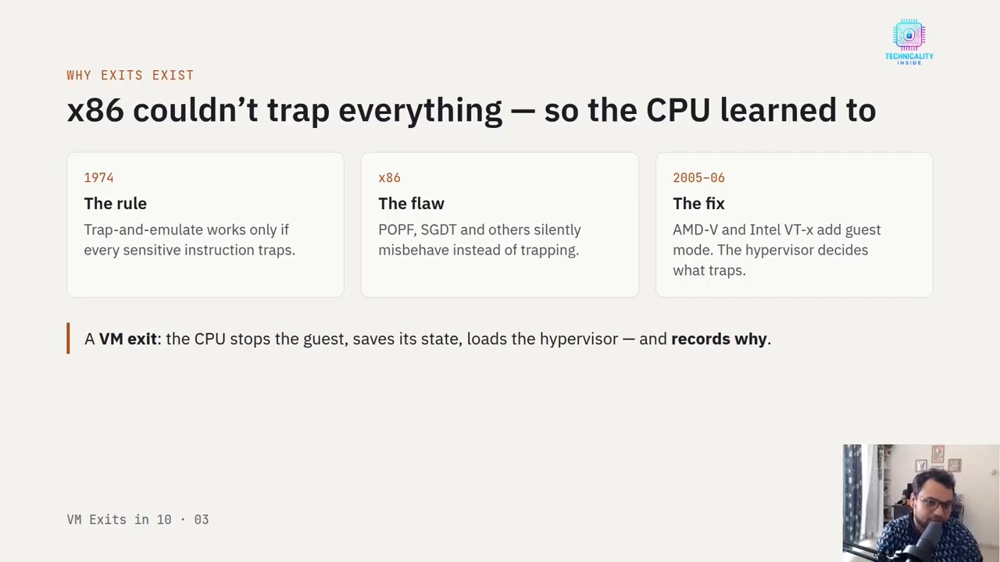
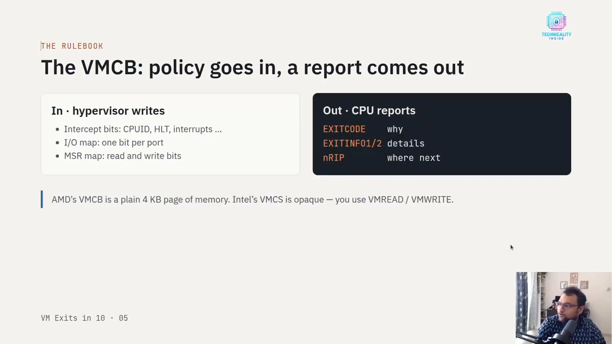
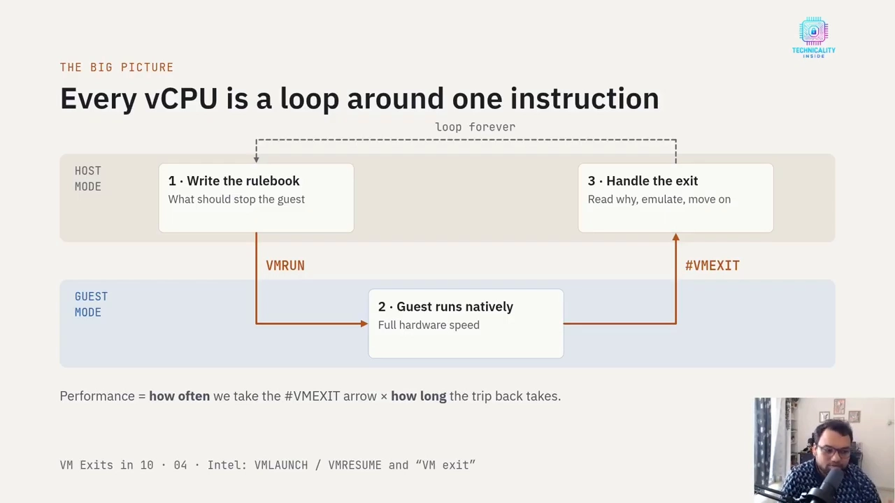
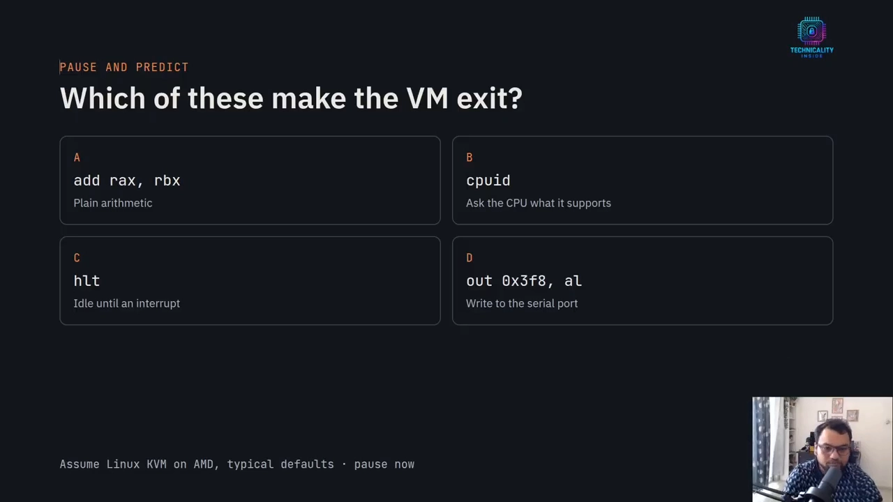
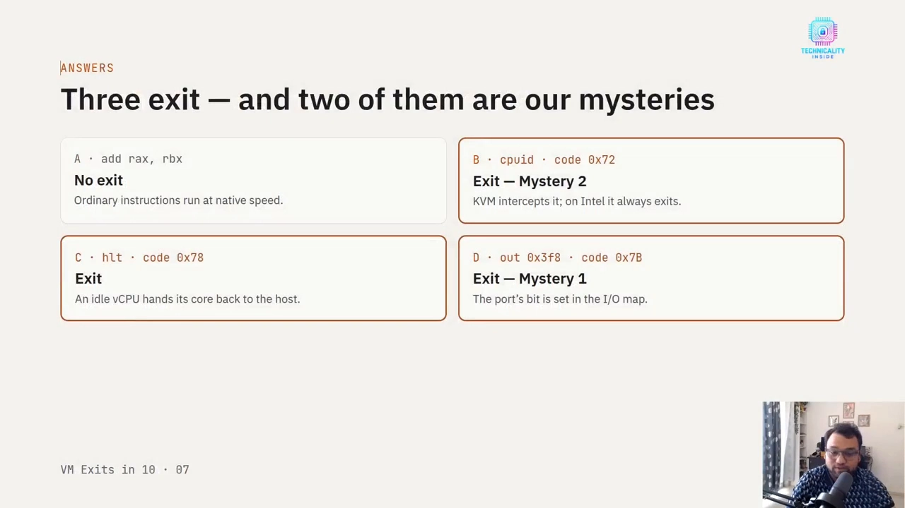
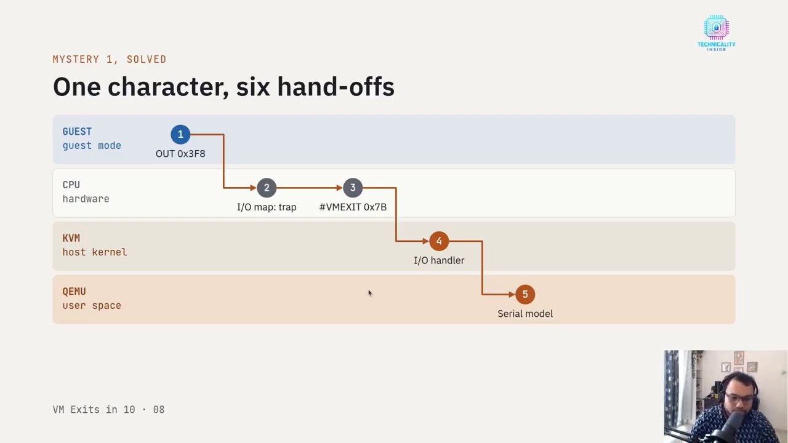
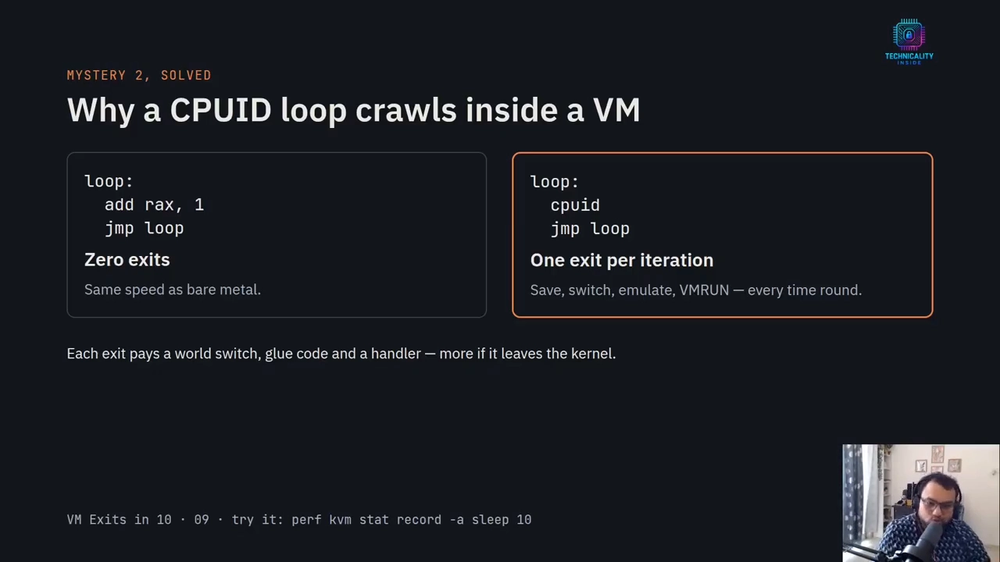
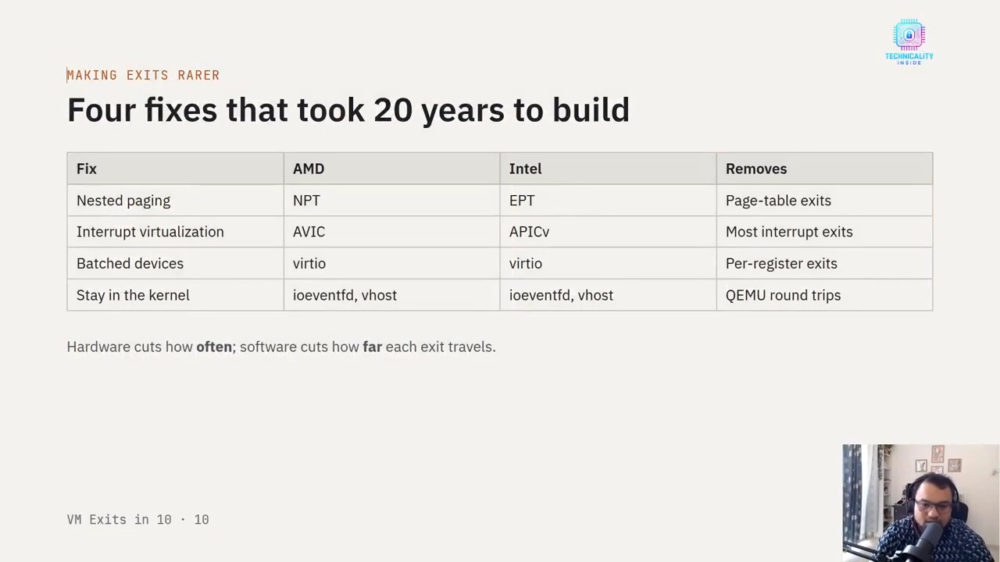
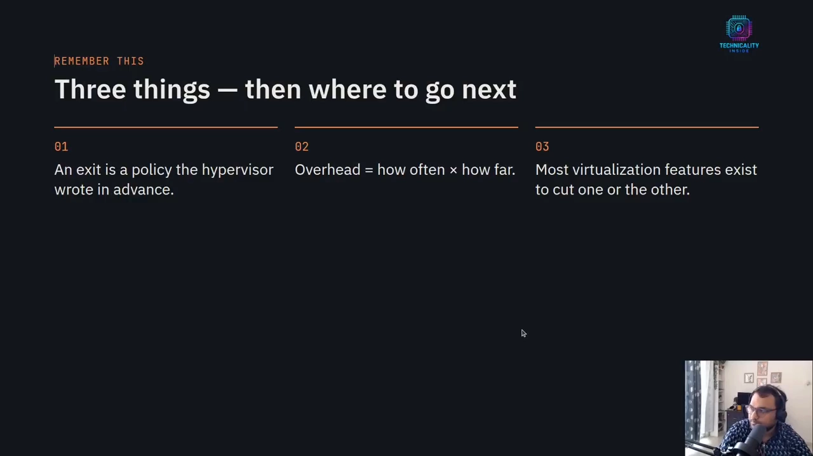

# VM exit 不是意外：退出原因的分类、分派与代价

> 视频来源：[Why This One Instruction Is SLOW Inside a VM | VM Exits Explained (AMD vs Intel)](https://www.youtube.com/watch?v=QQtgzjKqhAU)（YouTube · Technicality Inside）｜时长约 15 分钟
> 导读：这是一支"用两个谜题把 VM exit 讲透"的短片。讲者以 AMD SVM 为主例、随时对照 Intel 的 VMX，把"退出从哪来、带什么信息、由谁处理、贵在哪里、怎么减少"串成一条线。本文只讲**退出的分类与分派**；一次 MMIO 访问的完整往返留给同节的 1.3.3。

## 本讲要解决的核心问题（SCQA）

**背景**：虚拟机里的指令是由物理 CPU 直接执行的，所以虚拟机可以跑得接近原生速度。这一点已经是共识。

**冲突**：可同一台虚拟机，每秒会被"冻结"成千上万次——CPU 在一条指令中间停下，另一个程序接管，干完活再把它原样放回去。既然退出这么频繁，为什么有的虚拟机仍然接近原生，有的却慢得像爬？

**疑问**：一次 VM exit 到底由什么触发？它带回什么信息？这些退出分别由谁处理？代价又花在哪里？

**回答（中心思想）**：VM exit **不是意外，而是 hypervisor 事先写下的策略**——只有被写进"规则手册"的事件才会触发退出。每次退出由 CPU 附上一份"退出码 + 退出信息"的报告，先由内核里的 KVM 按处理表分派：内核里有设备认领就地处理，没人认领才返回用户态 VMM。因此虚拟机的性能等于 **退出频率 × 每次退出的行程**，而过去二十年的大部分虚拟化特性，都是在砍这两个因子之一。

## 一、VM exit 是提前写好的策略，不是意外

### 1.1 退出的历史来源：trap and emulate 的规则与 x86 的破例

1974 年，Popek 和 Goldberg 研究出一个问题：在什么条件下可以把一个操作系统跑在另一个操作系统里面。他们给出的技巧叫 **trap and emulate（陷入并模拟）**——让客户机在没有特权的状态下运行，每当它试图做敏感操作，CPU 就陷入 hypervisor，由 hypervisor 伪造一个结果 [【跳转到 01:06】](https://www.youtube.com/watch?v=QQtgzjKqhAU&t=66)。

这条路线只有一条铁律：**每一条敏感指令都必须陷入**。而 x86 恰恰破坏了这个规则：当年 x86 没有硬件虚拟化支持，像 `POPF`、`SGDT` 这样的指令在无特权运行时根本不陷入，只是悄悄做错事。于是 x86 上的虚拟化有很多年只能靠复杂的软件补丁硬撑 [【跳转到 01:31】](https://www.youtube.com/watch?v=QQtgzjKqhAU&t=91)。

直到 2005 至 2006 年，AMD 和 Intel 在硬件上把它修好了：增加一个叫**客户机模式（guest mode）**的新 CPU 模式，由 hypervisor 写一本"规则手册"，规定哪些动作必须让客户机停下、把控制权交回来。规则手册说"停"，那就是一次 VM exit [【跳转到 02:21】](https://www.youtube.com/watch?v=QQtgzjKqhAU&t=141)。

### 1.2 一句话定义：停客户机、存状态、装 hypervisor、记原因

讲者给了一句要背下来的话 [【跳转到 02:46】](https://www.youtube.com/watch?v=QQtgzjKqhAU&t=166)：

> CPU 让客户机停下、保存它的状态、装入 hypervisor，并**记录下自己为什么停下**。

最后半句是本节的关键：退出不只是"被打断"，它还自带一份报告。这份报告就是后面分类与分派的依据。

### 1.3 规则手册里写了什么：拦截位、I/O 位图、MSR 位图

在 AMD 上，这本规则手册叫 **VMCB（virtual machine control block）**，每个虚拟 CPU 一张，可以想成一个双向信箱 [【跳转到 06:00】](https://www.youtube.com/watch?v=QQtgzjKqhAU&t=360)：

- **进去的那一半（hypervisor 写）**：拦截位（在 CPUID 上停、在 HLT 上停、在中断上停）、一张每个 I/O 端口一位的位图（规定哪些 I/O 操作要退出）、以及一张 MSR 位图（规定哪些 MSR 读/写要退出）。
- **出来的那一半（CPU 写）**：退出码（为什么停）、退出信息（细节），以及 nRIP（下一条指令在哪）。

Intel 是同一套思路，结构叫 **VMCS**，只不过 VMCS 是个密封盒子，不能直接按字节访问，必须通过 `VMREAD` / `VMWRITE` 读写 [【跳转到 07:40】](https://www.youtube.com/watch?v=QQtgzjKqhAU&t=460)。

由此得到本节最重要的一句判断：**退出从来不是意外，它是 hypervisor 事先写下的决定；只有被写进规则的事件才会引发退出** [【跳转到 06:50】](https://www.youtube.com/watch?v=QQtgzjKqhAU&t=410)。

## 二、一次退出带回两样东西：退出码与退出信息

### 2.1 退出码回答"为什么停"

**退出码（exit code）** 是一个数字，回答"它为什么停"。hypervisor 靠它判断该走哪条处理分支——相当于 `switch` 语句里的那个 `case` 标签 [【跳转到 07:15】](https://www.youtube.com/watch?v=QQtgzjKqhAU&t=435)。

### 2.2 退出信息回答"细节是什么"，nRIP 回答"从哪继续"

光知道"为什么停"还不够。处理一次端口写，你得知道是哪个端口、写了几字节、写还是读、数据是什么。这些都在**退出信息（exit info）** 里。此外报告里还要有 **nRIP**（下一条指令指针），让 hypervisor 知道处理完之后从哪里接着跑。

### 2.3 用四条指令做一次分类

讲者出了一道小测：客户机里跑四条指令，哪一条会引发 VM exit [【跳转到 08:10】](https://www.youtube.com/watch?v=QQtgzjKqhAU&t=490)？

答案把退出原因分成了两类 [【跳转到 09:08】](https://www.youtube.com/watch?v=QQtgzjKqhAU&t=548)：

| 指令 | 是否退出 | 退出码 | 为什么 |
| :--- | :--- | :--- | :--- |
| `add rax, rbx` | 不退出 | — | 普通指令全速运行，没人去拦算术运算 |
| `cpuid` | 退出 | 0x72 | hypervisor 要拦住它，才能控制客户机看得见哪些 CPU 特性；在 Intel 上它无论如何都会退出 |
| `hlt` | 退出 | 0x78 | 客户机一空闲，宿主就想把 CPU 收回来调度别的活 |
| `out 0x3f8, al` | 退出 | 0x7B | 该端口在 I/O 位图里被置了位，于是被拦下 |

这张表就是"退出原因分类"的最小模型。把它推广开，常见的退出原因可以按"被谁拦下"归成三组：

1. **指令级拦截**：`CPUID`、`HLT`、控制寄存器访问、MSR 读写——规则手册里的拦截位或位图把它们标了出来。
2. **I/O 拦截**：端口 I/O（PIO）按 I/O 位图逐端口决定是否退出；这类退出的特点是"必须由软件模拟设备语义"。
3. **执行环境异常**：客户机触发了硬件无法自行满足的访存或状态条件（例如扩展页表 EPT 层面的违规），需要宿主侧介入。

后两组在配套的另一篇（`kvm_run` 里的 `exit_reason`）里有更细的字段级展开：本篇只负责说清"它们都是被规则手册标出来的、都带退出码与退出信息、都要经过一次分派"。

## 三、分派：内核先接，用户态兜底

### 3.1 四层泳道

讲者把一次端口写画成四条泳道 [【跳转到 09:58】](https://www.youtube.com/watch?v=QQtgzjKqhAU&t=598)：客户机、CPU、宿主内核里的 KVM、用户态里的普通程序 QEMU。**这条线走得越深，代价越大**。

### 3.2 六步走完一个字节

1. 客户机的串口驱动对 `0x3F8` 端口执行 `out` 指令。
2. CPU 查 I/O 位图，发现对应位被置上，于是陷入。
3. 退出发生，**退出码是 0x7B**，端口号、访问宽度和方向打包在退出信息里。
4. 内核里的 KVM 拿退出码去查自己的**处理表（handler table）**，问一句：内核里有设备认领这个端口吗？
5. 串口通常没有，于是 KVM 一路返回到 QEMU，由 QEMU 假装串口收下了这个字节。
6. QEMU 再调回 KVM，KVM 把客户机的指令指针推到 `out` 之后，重新 VM run；客户机继续跑，完全不知道底下发生了什么 [【跳转到 11:13】](https://www.youtube.com/watch?v=QQtgzjKqhAU&t=673)。

### 3.3 分派规则可以概括成一句话

**内核先接，按处理表判断有没有内核内设备认领；有就地处理，没有才返回用户态 VMM。** 讲者在第 4 步和第 5 步之间点出的正是这条规则：KVM 不会一遇到退出就甩给 QEMU，它先查表 [【跳转到 10:48】](https://www.youtube.com/watch?v=QQtgzjKqhAU&t=648)。

这条规则解释了一个常见困惑：为什么有些退出你在用户态 VMM 的代码里根本看不到？因为它们在内核里就被消化掉了，`KVM_RUN` 这个 ioctl 压根没返回。反过来，凡是能在用户态 VMM 的 `exit_reason` 分支里看到的退出，都意味着内核没有认领它。

## 四、代价模型：频率 × 行程

### 4.1 一个字符六次交接

谜题一的答案：**一个字节穿过四层，来回两次跨过内核/用户边界**。这就是逐个寄存器模拟"话多"的设备为什么慢 [【跳转到 11:38】](https://www.youtube.com/watch?v=QQtgzjKqhAU&t=698)。

### 4.2 CPUID 循环：每轮一次完整往返

谜题二更反直觉。左边是每次加一的循环，没有任何退出，按裸机速度跑；右边是同一个循环，但里面加了 `cpuid`，于是**每一轮迭代都触发一次完整退出**：CPU 保存客户机、切到 hypervisor、跑一段胶水代码、模拟 CPUID、推进指令指针，再 VM run 让客户机继续下一轮 [【跳转到 12:08】](https://www.youtube.com/watch?v=QQtgzjKqhAU&t=728)。

结论很干脆：**CPUID 本身没变慢，它悄悄变成了一次到 hypervisor 的往返**。也正因为如此，给 CPUID 计时成了软件检测"我在虚拟机里"的经典手法 [【跳转到 12:33】](https://www.youtube.com/watch?v=QQtgzjKqhAU&t=753)。

### 4.3 两个因子

把两个谜题合起来，就得到本节的核心公式：

$$
\text{虚拟化开销} \approx \text{退出频率} \times \text{每次退出的行程}
$$

- **频率**：客户机每秒被拦下多少次。
- **行程**：一次退出要走多深——只在内核里处理完，还是要一路掉到用户态 VMM 再爬回来。

## 五、抑制退出：硬件砍频率，软件砍行程

既然开销等于频率乘行程，过去二十年里很大一部分虚拟化特性就只为一件事而生——砍掉其中一个因子 [【跳转到 12:56】](https://www.youtube.com/watch?v=QQtgzjKqhAU&t=776)：

| 手段 | AMD | Intel | 消掉的是 |
| :--- | :--- | :--- | :--- |
| 嵌套分页 | NPT | EPT | 洪水般的页表退出（硬件自己走客户机页表） |
| 中断虚拟化 | AVIC | APICv | 大部分中断退出（中断直接投递给正在运行的客户机） |
| 批量设备 | virtio | virtio | 逐寄存器退出（把一批工作排进共享内存，只敲一次门铃） |
| 留在内核 | ioeventfd、vhost | ioeventfd、vhost | 到 QEMU 的往返（这次"敲门"在内核里就处理完） |

讲者把规律压成一句：**硬件减少"退出发生得多频繁"，软件减少"一次退出要走多远"** [【跳转到 14:11】](https://www.youtube.com/watch?v=QQtgzjKqhAU&t=851)。

这也解释了为什么第一张表里的"嵌套分页"能一次性消掉一整类退出：当年洪水般的页表退出被硬件接管之后，客户机改页表不再需要 hypervisor 逐次参与。

## 六、小结

- **VM exit 是策略，不是意外。** 只有被写进 VMCB/VMCS 的拦截位与位图的事件才会触发退出；`add` 不退出而 `cpuid` 退出，差别不在指令本身有多"敏感"，而在 hypervisor 有没有把它标出来。
- **每次退出都带一份报告。** 退出码回答"为什么停"，退出信息回答"细节是什么"，nRIP 回答"从哪继续"。
- **分派是两级的。** 内核 KVM 先按处理表判断有没有内核内设备认领；有就地处理，没有才返回用户态 VMM。看不到的退出，都是在内核里被消化掉的。
- **代价 = 频率 × 行程。** 一个串口字节要六次交接、两次跨内核/用户边界；一个 `cpuid` 循环每轮都是一次完整往返。
- **抑制手段分两类。** 硬件砍频率（嵌套分页、中断虚拟化），软件砍行程（virtio 批量、ioeventfd/vhost 留在内核）。

## 关键术语速查

| 术语 | 一句话解释 |
| :--- | :--- |
| VM exit | 客户机执行到被拦截的事件时，CPU 停下客户机、保存状态、切回 hypervisor 并记录原因的过程 |
| trap and emulate | 让客户机无特权运行，敏感操作全部陷入 hypervisor 由软件伪造结果 |
| VMCB / VMCS | AMD / Intel 的"规则手册"：既存 hypervisor 写下的拦截策略，也存 CPU 写出的退出报告 |
| 拦截位与 I/O 位图 | 逐项开关，决定哪些指令、哪些 I/O 端口访问必须让客户机停下 |
| 退出码（exit code） | 一个数字，回答"这次为什么停"，hypervisor 靠它选处理分支 |
| 退出信息（exit info） | 退出码之外的细节，例如端口号、访问宽度、读写方向 |
| nRIP | 下一条指令指针，告诉 hypervisor 处理完从哪里恢复执行 |
| handler table | 内核 KVM 里按退出码索引的处理表，用来判断这次退出能否在内核内解决 |
| CPUID 计时 | 通过测量 `cpuid` 的耗时判断自己是否运行在虚拟机里的经典手法 |
| NPT / EPT | AMD / Intel 的嵌套分页，硬件直接走客户机页表，消掉大量页表退出 |
| AVIC / APICv | AMD / Intel 的中断虚拟化，中断可直接投递给运行中的客户机而不退出 |
| ioeventfd / vhost | 把设备"敲门"的处理留在内核里完成，避免每次通知都掉到用户态 VMM |