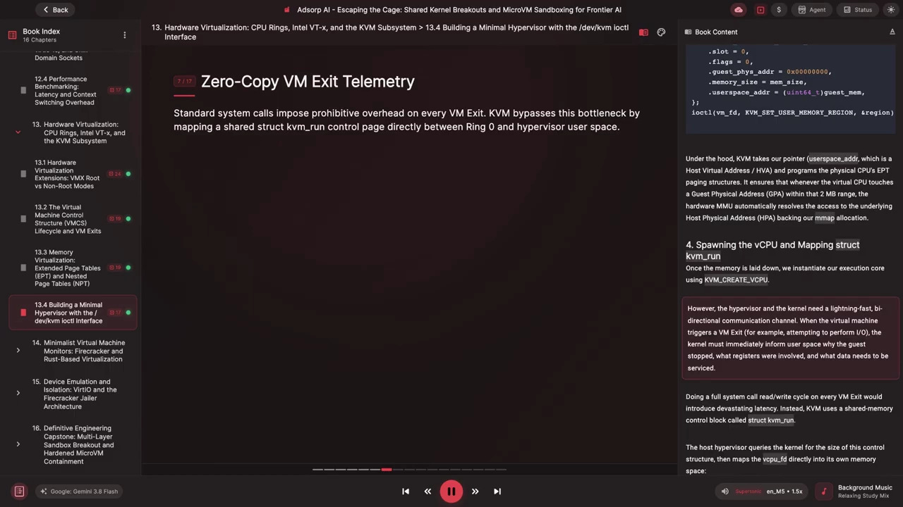
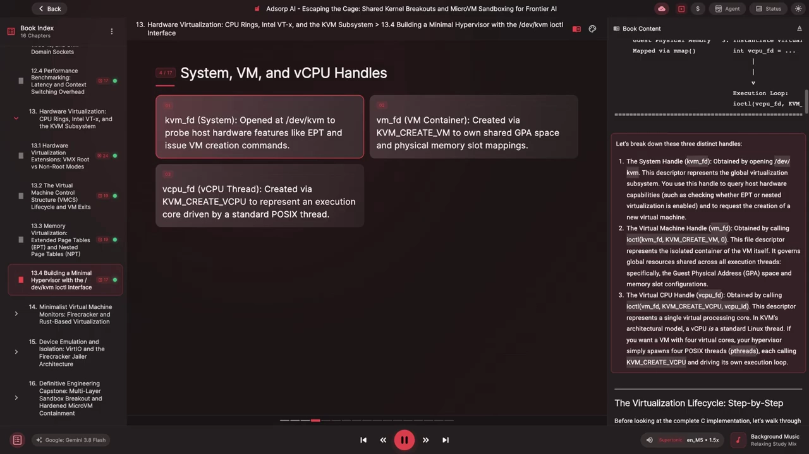
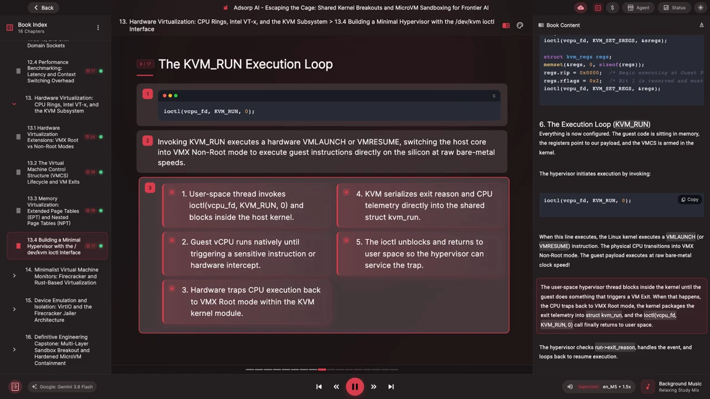
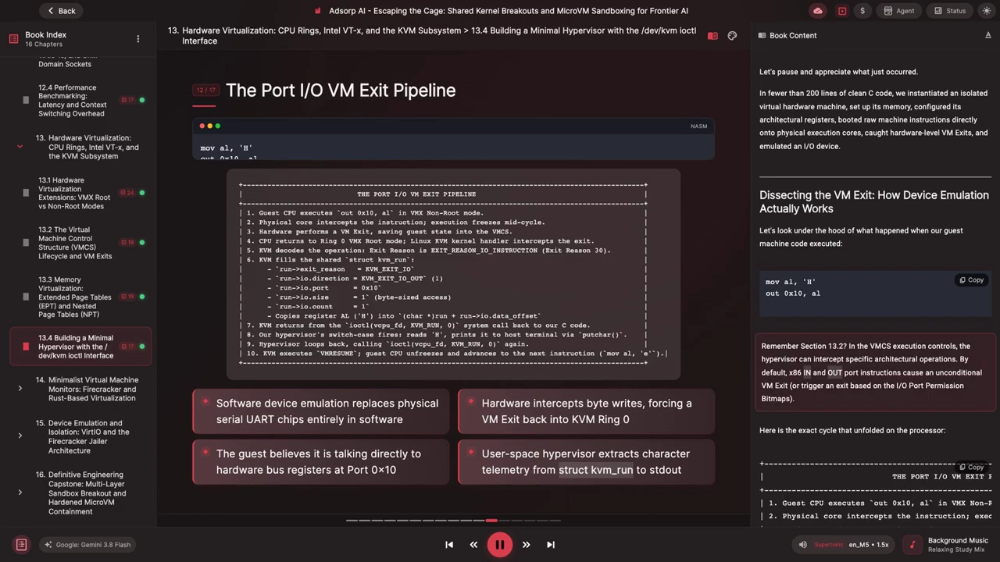
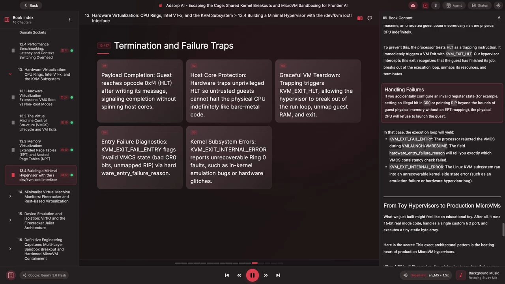
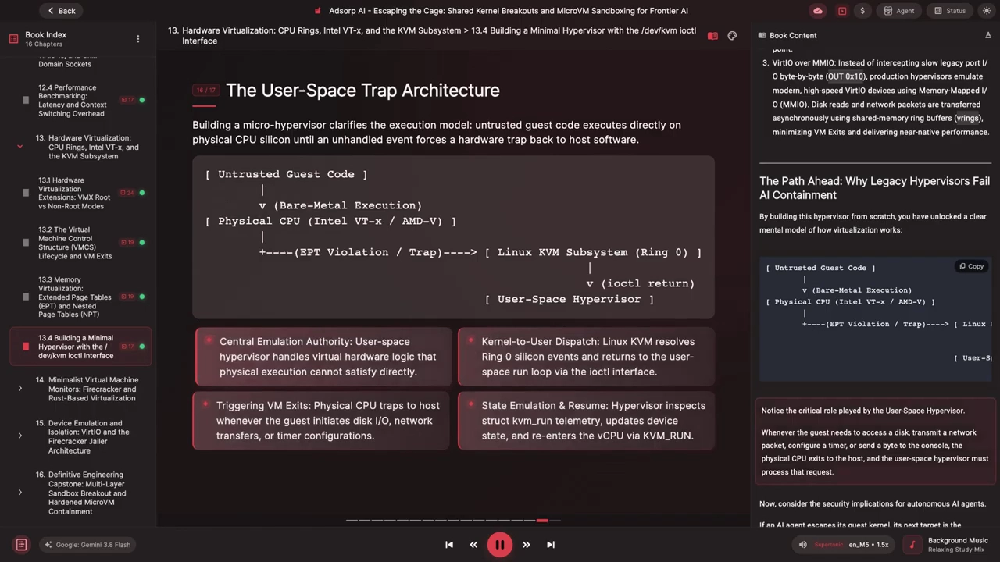
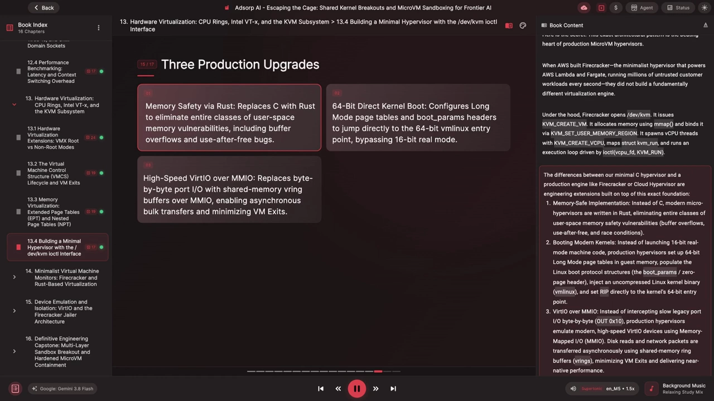

# `kvm_run` 里的 `exit_reason`：一次 IO 退出要带哪些字段

> 视频来源：[13.4 Building a Minimal Hypervisor with /dev/kvm | CPU Rings, Intel VT-x, and the KVM Subsystem](https://www.youtube.com/watch?v=HzwjwfxiZOw)（YouTube · Adsorp AI）｜时长约 16 分钟
> 导读：这支视频用不到 200 行 C 从零写了一个微型 hypervisor，然后专门停下来解剖"这次 VM exit 到底发生了什么"。本文只取它的**退出分类与分派**这一段：`struct kvm_run` 的共享通道、`exit_reason` 这个 case 标签、`KVM_EXIT_IO` 的字段、`KVM_EXIT_HLT` / `KVM_EXIT_FAIL_ENTRY` / `KVM_EXIT_INTERNAL_ERROR` 各自的含义。建立 VM、配置寄存器等步骤属于 1.3.1，这里只做必要回顾。

## 本讲要解决的核心问题（SCQA）

**背景**：VM exit 是 hypervisor 事先写下的策略，每次退出都带一份"退出码 + 退出信息"的报告，由内核 KVM 先按处理表分派。

**冲突**：可这份报告到底长什么样？用户态的 VMM 是怎么拿到它的？为什么有的退出在用户态代码里根本看不到，有的却必须由用户态处理？

**疑问**：`struct kvm_run` 里究竟有哪些字段？`exit_reason` 的每个取值分别代表什么、各自由谁处理？

**回答（中心思想）**：KVM 用一块 **mmap 共享的 `struct kvm_run`** 把退出遥测零拷贝地交给用户态。`exit_reason` 就是分派用的 `case` 标签，它后面的 union 按原因给出细节——`KVM_EXIT_IO` 给出方向、端口、宽度、次数和数据偏移。只有内核自己处理不了的原因才会让 `KVM_RUN` 这个 ioctl 返回用户态；能处理完的（比如页表填充、定时器、中断注入）就在内核里消化掉，用户态根本看不到。

## 一、先看通道：`struct kvm_run` 是零拷贝的退出报告

### 1.1 为什么不能用系统调用传报告

当虚拟机触发 VM exit（比如要做 I/O）时，内核必须立刻告诉用户态三件事：客户机停在哪、涉及哪些寄存器、还有哪些数据要处理 [【跳转到 05:37】](https://www.youtube.com/watch?v=HzwjwfxiZOw&t=337)。

如果每次退出都走一遍完整的 `read` / `write` 系统调用，延迟会非常可怕。所以 KVM 换了个办法：用一块名为 **`struct kvm_run`** 的共享内存控制块。



### 1.2 怎么拿到这块共享内存

做法只有两步：先问内核"这块结构有多大"，再把 `vcpu_fd` 直接 mmap 进自己的地址空间，权限是共享读写 [【跳转到 06:02】](https://www.youtube.com/watch?v=HzwjwfxiZOw&t=362)。映射完成后，`run` 就是一个普通指针，`run->exit_reason` 直接可读。

### 1.3 谁写谁读

分工是单向的：**内核填，用户态读**。每次 VM exit，内核把退出遥测数据填进这块共享结构，再把控制权交回用户态——没有数据拷贝，也没有多余的内存分配 [【跳转到 06:27】](https://www.youtube.com/watch?v=HzwjwfxiZOw&t=387)。

这就是"零拷贝"的含义：报告不是被复制过来的，它本来就写在你和内核共同映射的那一页上。

## 二、`exit_reason` 是分派用的 case 标签

### 2.1 三级句柄与执行循环（必要回顾）

回顾一下句柄层级：`kvm_fd` 是系统句柄（打开 `/dev/kvm` 得到，用来查硬件能力、申请建 VM），`vm_fd` 是虚拟机句柄（掌管客户机物理地址空间和内存槽），`vcpu_fd` 是虚拟 CPU 句柄——在 KVM 的架构模型里，**一个 vCPU 就是一条普通 Linux 线程** [【跳转到 03:32】](https://www.youtube.com/watch?v=HzwjwfxiZOw&t=212)。



### 2.2 循环的骨架就是一个 switch

真正驱动执行的只有一行 `ioctl(vcpu_fd, KVM_RUN, 0)`。它执行时，内核发出 VM launch 或 VM resume，物理 CPU 切入 VMX non-root 模式，客户机以裸机速度跑；用户态线程则阻塞在内核里，直到客户机做了某件会触发 VM exit 的事 [【跳转到 07:40】](https://www.youtube.com/watch?v=HzwjwfxiZOw&t=460)。



那一刻，CPU 陷回 VMX root 模式，内核把退出遥测打包进 `struct kvm_run`，`arch/x86/kvm/kvm.c` 最终返回到用户态。hypervisor 要做的事只有三件 [【跳转到 08:02】](https://www.youtube.com/watch?v=HzwjwfxiZOw&t=482)：

```c
/* 示意：视频里那个执行循环的骨架 */
while (1) {
    ioctl(vcpu_fd, KVM_RUN, 0);
    switch (run->exit_reason) {   /* 分派：这次为什么停？ */
    case KVM_EXIT_IO:    /* 端口 I/O，交给设备模型 */
    case KVM_EXIT_HLT:   /* 客户机停机，跳出循环 */
    case KVM_EXIT_FAIL_ENTRY:      /* 硬件拒绝进入客户机 */
    case KVM_EXIT_INTERNAL_ERROR:  /* 内核侧不可恢复错误 */
    }
}
```

**`exit_reason` 就是这个 switch 的标签**。它回答"为什么停"，后面的 union 回答"细节是什么"。这与上一篇讲的"退出码 + 退出信息"是同一件事，只是换成了 KVM 的具体字段名。

## 三、`KVM_EXIT_IO`：一次端口写的完整字段

### 3.1 硬件层：exit reason 30

视频里的客户机 payload 用 `out` 指令把 `"Hello KVM"` 一个字符一个字符写到 I/O 端口 `0x10`。默认情况下，x86 的 `IN` / `OUT` 端口指令会无条件触发 VM exit，或者按 I/O 端口权限位图决定是否退出 [【跳转到 10:03】](https://www.youtube.com/watch?v=HzwjwfxiZOw&t=603)。

在硬件层，KVM 解码出的退出原因是 **"IO 指令"，即 exit reason 30**。这是硬件给出的原因码，还不是用户态看到的那个枚举值。

### 3.2 用户态层：`KVM_EXIT_IO` 与它的五个字段

KVM 把这层硬件原因翻译成用户态的枚举 `KVM_EXIT_IO`，并填好 union 里的字段 [【跳转到 10:28】](https://www.youtube.com/watch?v=HzwjwfxiZOw&t=628)：

| 字段 | 这次的值 | 含义 |
| :--- | :--- | :--- |
| `run->exit_reason` | `KVM_EXIT_IO` | 分派标签：这是一次端口 I/O |
| `run->io.direction` | `KVM_EXIT_IO_OUT`（值为 1） | 方向是写；读则是 `KVM_EXIT_IO_IN` |
| `run->io.port` | `0x10` | 客户机访问的端口号 |
| `run->io.size` | `1` | 一次访问的宽度：1 字节 |
| `run->io.count` | `1` | 这次要处理几次访问 |
| `run->io.data_offset` | 数据在 `kvm_run` 内的偏移 | 真正要写出的字节放在 `run + data_offset` 处 |

注意最后一行：数据不是通过指针另给的，而是**直接放在同一块共享结构里**，用偏移量定位。这就是为什么 `size` 和 `count` 是必要的——它们决定了要从那个偏移处读几个字节、读几组。

### 3.3 十步流水线

把硬件、内核、用户态三段接起来，就是视频里那条完整的端口 I/O 退出流水线 [【跳转到 10:53】](https://www.youtube.com/watch?v=HzwjwfxiZOw&t=653)：



1. 客户机 CPU 在 VMX non-root 模式下执行 `out 0x10, al`。
2. 物理核拦截这条指令，执行在周期中间冻结。
3. 硬件完成 VM exit，把客户机状态存进 VMCS。
4. CPU 回到 ring 0 的 VMX root 模式，Linux KVM 的内核处理函数接手这次退出。
5. KVM 解码这个操作：退出原因是"IO 指令"，即 exit reason 30。
6. KVM 填充共享的 `struct kvm_run`（就是上面那张表的六个字段），并把寄存器 `AL` 里的 `H` 拷贝到 `run + run->io.data_offset` 指向的位置。
7. KVM 从 `ioctl(vcpu_fd, KVM_RUN)` 这个系统调用返回到 C 代码。
8. hypervisor 的 switch 分支被触发，读出 `H`，用 `putchar` 打到宿主终端。
9. hypervisor 回到循环，再次调用 `ioctl(vcpu_fd, KVM_RUN, 0)`。
10. KVM 执行 VM resume，客户机 CPU 解冻，推进到下一条指令。

这套交互就是软件设备模拟的地基：客户机以为自己在一块真实的串口芯片或主板 UART 上说话，实际上每一个字节的输出都触发一次退出，交给用户态程序截获 [【跳转到 11:18】](https://www.youtube.com/watch?v=HzwjwfxiZOw&t=678)。

## 四、`KVM_EXIT_HLT`：客户机不能真的把 CPU 停掉

payload 打印完后执行 `0xF4` 这个操作码，也就是 `HLT` 指令。在裸机上，`HLT` 会让核心停住，直到外部硬件中断到来；但在没有特权的虚拟机里，一个不可信的客户机理论上可以让物理 CPU 无限期停下去 [【跳转到 11:43】](https://www.youtube.com/watch?v=HzwjwfxiZOw&t=703)。

所以处理器把 `HLT` 当作会陷入的指令，立刻触发一次 VM exit，退出原因是 **`KVM_EXIT_HLT`**。hypervisor 接住这次退出，判断客户机已经干完活，跳出执行循环、解除映射、结束进程 [【跳转到 12:08】](https://www.youtube.com/watch?v=HzwjwfxiZOw&t=728)。

这里有个容易忽略的判断：**客户机看到的是"一条指令"，用户态看到的是"一个 exit_reason"**。同一个 `HLT`，在裸机上只是让核心停住；在虚拟机里却被硬件改写成一次退出。至于这次退出会不会一路掉到用户态，取决于内核有没有认领它——这正是上一篇讲的分派规则的另一面。

## 五、两类"出错"的退出：`FAIL_ENTRY` 与 `INTERNAL_ERROR`

除了"I/O 和停机"这类正常业务，还有两类退出专门报告错误 [【跳转到 12:33】](https://www.youtube.com/watch?v=HzwjwfxiZOw&t=753)：



- **`KVM_EXIT_FAIL_ENTRY`**：处理器在 VM launch 或 VM resume 时否决了 VMCS。典型原因是配置了非法的寄存器状态——比如在 `CR0` 里置了非法位，或者把 `RIP` 指到客户机物理内存边界之外又没有 EPT 映射。这时字段 `hardware_entry_failure_reason` 会告诉你究竟是哪一项一致性检查没过。
- **`KVM_EXIT_INTERNAL_ERROR`**：Linux KVM 子系统遇到不可恢复的内核侧状态错误，比如模拟失败，或硬件、hypervisor 自身的 bug。

这两类的共同点是：**它们都不是客户机的"请求"，而是"配置或内核出了问题"**。分派上，用户态 VMM 通常无法补救，只能记录原因并终止这台虚拟机。

## 六、EPT violation 与 MMIO：为什么生产 VMM 要把逐字节 I/O 换掉

### 6.1 用户态陷阱架构：哪些事件会掉到用户态

视频最后给了一张执行模型图：不可信客户机代码直接跑在物理 CPU 上，直到某个"未被处理的事件"迫使它硬件陷入回宿主软件 [【跳转到 14:38】](https://www.youtube.com/watch?v=HzwjwfxiZOw&t=878)。



图里那条 `(EPT Violation / Trap)` 的箭头值得单独说一句：**扩展页表违规也是会掉到内核 KVM 的一类退出**，它和陷阱（trap）一起被画进 ring 0 的 KVM 子系统，再由 ioctl 接口把需要用户态决策的部分交出去。也就是说，一次退出在到达用户态 VMM 之前，已经在内核里被"解析过一轮"了——这就是为什么"哪些退出由谁处理"不能只看退出原因的名字，还要看内核有没有对应的处理路径。

### 6.2 从逐字节端口 I/O 到 virtio over MMIO

逐字节拦截 `out 0x10` 的代价是：每一个字节都要一次完整退出。所以生产级 hypervisor 会做三处升级 [【跳转到 13:23】](https://www.youtube.com/watch?v=HzwjwfxiZOw&t=803)：



1. **内存安全实现**：用 Rust 而不是 C 写，消掉整类用户态内存安全漏洞（缓冲区溢出、释放后使用、竞态）。
2. **启动现代内核**：不再启动 16 位实模式机器码，而是搭好 64 位长模式页表、填充 Linux 启动协议结构（boot params / zero page header）、注入未压缩的 `vmlinux`，把 `RIP` 直接设到内核的 64 位入口点。
3. **virtio over MMIO**：不再一个字节一个字节地拦截慢速 legacy 端口 I/O，而是用内存映射 I/O 模拟现代高速 virtio 设备，磁盘读和网络包通过共享内存环形缓冲区（ring）异步传输，把 VM exit 降到最少。

第 3 条正好回到上一篇的公式：**退出频率 × 每次行程**。把"每个字节一次退出"换成"一批工作一次通知"，砍的是频率；把设备语义搬进共享内存环，砍的是行程。

## 七、小结

- **通道是共享内存，不是系统调用。** `struct kvm_run` 由 `mmap(vcpu_fd)` 得到，内核填、用户态读，零拷贝。
- **`exit_reason` 是分派标签。** 它对应 `switch` 的 `case`，后面的 union 按原因给出细节；`KVM_EXIT_IO` 的细节就是 `direction` / `port` / `size` / `count` / `data_offset` 五个字段。
- **看到哪些退出，取决于内核认领了哪些原因。** 端口 I/O 的语义只有设备模型知道，必须交给用户态；而 EPT 违规这类事件会先在内核 KVM 里被解析一轮，再按需通过 ioctl 交给用户态。
- **`KVM_EXIT_HLT` 是保护机制。** 客户机执行 `HLT` 时，硬件把它当陷入指令，避免不可信客户机让物理 CPU 无限期停住。
- **两类错误退出要单独认。** `KVM_EXIT_FAIL_ENTRY` 是 VMCS 一致性检查没过（用 `hardware_entry_failure_reason` 定位），`KVM_EXIT_INTERNAL_ERROR` 是内核侧不可恢复错误。
- **减少退出的方向很清楚。** 把逐字节端口 I/O 换成 virtio over MMIO 加共享内存环，同时砍频率与行程。

## 关键术语速查

| 术语 | 一句话解释 |
| :--- | :--- |
| `struct kvm_run` | 内核与用户态共享的退出报告页，用 `mmap(vcpu_fd)` 映射得到 |
| `exit_reason` | 退出原因枚举，用户态 VMM 用它做 `switch` 分派 |
| `KVM_EXIT_IO` | 端口 I/O 退出；细节在 `io.direction` / `io.port` / `io.size` / `io.count` / `io.data_offset` |
| `KVM_EXIT_IO_OUT` / `_IN` | 这次端口访问的方向：写还是读 |
| `KVM_EXIT_HLT` | 客户机执行 `HLT` 触发的退出，避免物理 CPU 被无限期停住 |
| `KVM_EXIT_FAIL_ENTRY` | 处理器在 VM launch / VM resume 时否决了 VMCS |
| `hardware_entry_failure_reason` | 配合 `FAIL_ENTRY` 使用，指出哪一项 VMCS 一致性检查没过 |
| `KVM_EXIT_INTERNAL_ERROR` | 内核侧不可恢复错误（模拟失败、硬件或 hypervisor bug） |
| exit reason 30 | 硬件层对"IO 指令"的退出原因编码，KVM 把它翻译成 `KVM_EXIT_IO` |
| EPT violation | 扩展页表违规，属于会掉到内核 KVM 的一类退出 |
| virtio over MMIO | 用内存映射 I/O 加共享内存环替代逐字节端口 I/O，大幅减少退出次数 |