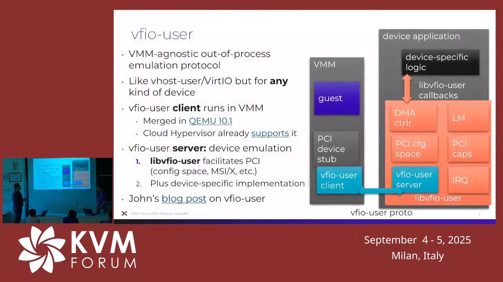
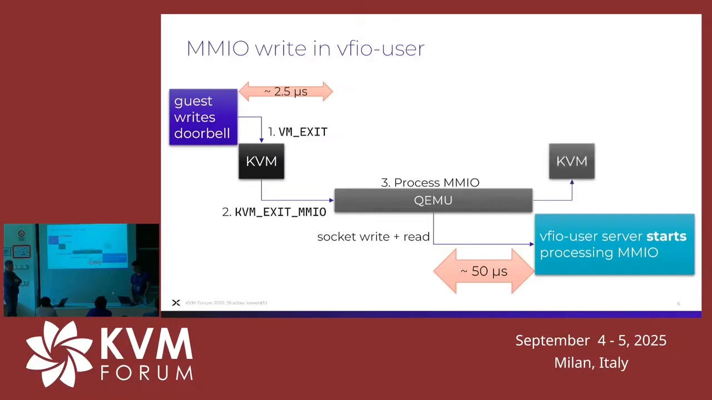
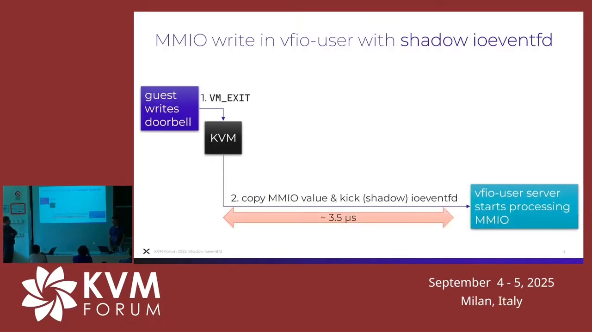
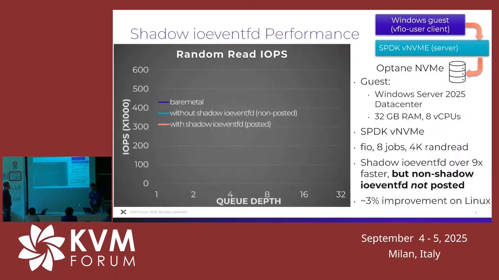

# MMIO exit 的代价：shadow ioeventfd 如何把用户态从路径上摘掉

> 视频来源：[Shadow ioeventfd: Accelerating MMIO in vfio-user with Kernel-Assisted Dispatch](https://www.youtube.com/watch?v=dBllBwdAlL8)（YouTube · KVM Forum 2025，John Levon / Thanos，Nutanix）｜时长约 28 分钟
> 导读：前两篇讲清了 MMIO exit 的路径（陷入 → QEMU 查地址 → 设备模型 → 返回）和 QEMU 内部如何查地址。这一篇换个角度：**把这条路径的时间账算出来**。讲者用 vfio-user 场景实测了每一段的微秒数，然后演示如何让 KVM 自己完成分发、把 QEMU 从路径上摘掉。本文只取与 1.3.3 相关的部分：exit 路径各段的开销、为什么"用户态处理"才是大头、以及内核协助分发这条优化方向。virtio 队列与 vhost 的细节留给第 3 章。

## 本讲要解决的核心问题（SCQA）

**背景**：设备模拟挂在 VM exit 路径上，这是实现"客户机看到真实设备"的唯一办法。

**冲突**：这条路径每次都要跨越 Guest → 内核 → 用户态 → 内核 → Guest。对于"每个 IO 都要写一次"的寄存器（典型的是 doorbell），代价会被放大到不可接受。

**疑问**：这条路径上到底哪一段最贵？如果最贵的不是"陷入"本身，那优化该往哪里使劲？

**回答（中心思想）**：实测显示，**陷入（trap）与恢复（resume）各只要 1.5–2.5 微秒，而用户态 VMM 的处理与跨进程消息往返要 50 微秒量级**。所以真正的优化方向不是"少陷入"，而是"**让陷入之后不必回到用户态**"：KVM 仍然 trap，但把写入的值拷进一块共享内存、再 kick 一个 ioeventfd 通知设备后端，全程不到 6 微秒。这就是 shadow ioeventfd 的思路，也是理解 exit 路径开销结构的最好样本。

## 一、先把这条路径的账算清楚

### 1.1 场景：设备模型不在 VMM 进程里

这场演讲讨论的是 **vfio-user**：一个与 VMM 无关的、进程外（out-of-process）设备模拟协议 [【跳转到 00:26】](https://www.youtube.com/watch?v=dBllBwdAlL8&t=26)。

它的定位可以这样理解 [【跳转到 01:07】](https://www.youtube.com/watch?v=dBllBwdAlL8&t=67)：

- 如果你要模拟一个设备，但不想把它做进内核、也不想做进 VMM（QEMU、Cloud Hypervisor）里，就可以用 vfio-user；
- 它和 vhost-user 很像，区别是 **vhost-user 围绕 virtio 设计**，而 vfio-user 更通用，可以模拟任意类型的设备，包括非 virtio 的设备、以及看起来像真实物理设备的设备 [【跳转到 01:32】](https://www.youtube.com/watch?v=dBllBwdAlL8&t=92)；
- 它叫 vfio-user 不是因为有内核组件，而是因为它刻意模仿了 VFIO 在 VMM 与 VFIO 内核驱动之间使用的那套协议——**但 vfio-user 完全没有内核组件，整条链路都在用户态** [【跳转到 02:47】](https://www.youtube.com/watch?v=dBllBwdAlL8&t=167)。

这个设定很重要：**它把"用户态处理"这一段放大成了两个进程之间的消息往返**，从而让每一段的耗时都能被单独测量。对理解普通 QEMU 场景同样有参考价值——只是普通场景里"另一个进程"变成了"同一个进程里的另一个线程"。

### 1.2 一次 MMIO 写的五段耗时

视频给出的例子是：客户机写一个由 vfio-user 模拟的 NVMe 控制器的提交队列尾门铃（submission queue tail doorbell）[【跳转到 07:27】](https://www.youtube.com/watch?v=dBllBwdAlL8&t=447)。

拆开看 [【跳转到 07:27】](https://www.youtube.com/watch?v=dBllBwdAlL8&t=447)：

| 段 | 动作 | 耗时 |
| :--- | :--- | :--- |
| 1 | 客户机写 doorbell，KVM 拦住写入，带着 `KVM_EXIT_MMIO` 返回 QEMU | 约 2.5 微秒 |
| 2 | QEMU 处理这次 MMIO 写，调用 vfio-user client 发出 region write 消息 | — |
| 3 | 从 QEMU 发出消息到 server 被唤醒 | 约 50 微秒 |
| 4 | 从 QEMU 被唤醒到它再次调用 KVM | 约 50 微秒 |
| 5 | KVM 恢复客户机执行 | 约 1.5 微秒 |

> 讲者特别注明：这个拆分假设写是 posted 的（后面会提到）。

结论很直接：**在 QEMU 里处理这次 MMIO 写、再把值通过 socket 送到 server，占掉了绝大部分时间** [【跳转到 08:17】](https://www.youtube.com/watch?v=dBllBwdAlL8&t=497)。换句话说，`KVM_EXIT_MMIO` 这个"陷入"本身只花了 2.5 微秒，真正贵的是"陷入之后要去用户态走一遭"。

于是最自然的优化思路就是：**把 QEMU 从 MMIO 处理路径上完全摘掉** [【跳转到 08:42】](https://www.youtube.com/watch?v=dBllBwdAlL8&t=522)。

### 1.3 为什么 doorbell 这种地址特别敏感

这种高开销在某些情况下会非常致命，比如当地址是一个**设备 doorbell** 的时候——每一次 doorbell 写都要付一次 heavyweight exit，性能就崩了 [【跳转到 05:22】](https://www.youtube.com/watch?v=dBllBwdAlL8&t=322)。

> **术语**：doorbell（门铃）是设备寄存器里一个特殊的写入口，驱动把"队列里有新请求了"这件事通过写门铃告诉设备。它不承载数据，只承载"有新工作了"这个信号，所以**写入频率等于 IO 频率**。

## 二、virtio 早就绕开过一次，但 NVMe 绕不开

### 2.1 virtio 的做法：不需要值

virtio 解决这个问题的办法是：为这个地址配置一个 **ioeventfd**，并且**完全不要求写入的具体值** [【跳转到 05:22】](https://www.youtube.com/watch?v=dBllBwdAlL8&t=322)。

也就是说，KVM 拦住写入后，只要 kick 一下 ioeventfd 通知后端"有人写了这个地址"，值本身可以丢掉。**这条路把"用户态处理"彻底省掉了**。

### 2.2 NVMe 的困境：门铃必须带值

但 virtio 的方案对 vfio-user 不适用，因为某些类型的 PCI 设备——比如他们关心的 NVMe——**确实需要 doorbell 的值** [【跳转到 05:47】](https://www.youtube.com/watch?v=dBllBwdAlL8&t=347)。

原因在 NVMe 的队列模型：NVMe 里有一个环形队列存放命令描述符，驱动把请求加进队列后，必须告诉控制器"最后一个请求加在队列的哪个位置"，做法就是把队列尾索引写进对应的 doorbell 寄存器，而这个寄存器住在 BAR0 里 [【跳转到 06:37】](https://www.youtube.com/watch?v=dBllBwdAlL8&t=397)。

### 2.3 NVMe 的 shadow doorbell：把门铃搬进客户机内存

NVMe 有一个叫 **shadow doorbell** 的特性（注意别和 shadow ioeventfd 搞混）：控制器改为去看另一组门铃，这组门铃住在**客户机内存**里，而不是设备区域 [【跳转到 05:47】](https://www.youtube.com/watch?v=dBllBwdAlL8&t=347)。

这样在真实硬件上就不存在那次 PCI 写——而在 vfio-user 场景里，那次写本来会变成一次 MMIO exit；控制器改为主动轮询 shadow doorbell 来发现新请求 [【跳转到 07:02】](https://www.youtube.com/watch?v=dBllBwdAlL8&t=422)。在 SPDK 的虚拟 NVMe 里，shadow doorbell 消除了大部分昂贵的写 [【跳转到 06:12】](https://www.youtube.com/watch?v=dBllBwdAlL8&t=372)。

**但 shadow doorbell 只在 Linux 上支持，而且看起来短期内不会在 Windows 上支持**——这就是这项工作的主要动机 [【跳转到 06:12】](https://www.youtube.com/watch?v=dBllBwdAlL8&t=372)。

## 三、shadow ioeventfd：KVM 仍然 trap，但不出到用户态

### 3.1 思路：用"轻量 exit"替代"重量 exit"

一句话概括：**把 heavyweight exit 换成 lightweight exit** [【跳转到 08:55】](https://www.youtube.com/watch?v=dBllBwdAlL8&t=535)。

具体做法是：

1. KVM 仍然拦住这次写，但**不再退出到 QEMU**；
2. KVM 把 MMIO 的值拷贝到一块私有内存——只由 QEMU 与 vfio-user server 共享的 **shadow memory**；
3. KVM kick 一个与该 MMIO 地址关联的 ioeventfd，通知 server "这个地址被写了" [【跳转到 09:20】](https://www.youtube.com/watch?v=dBllBwdAlL8&t=560)。

时间账随之改变：从 doorbell 被 trap 到 server 被唤醒约 **3.5 微秒**，KVM 随后恢复客户机，**整件事不到 6 微秒**。而且 QEMU 完全不参与 MMIO 的处理 [【跳转到 09:45】](https://www.youtube.com/watch?v=dBllBwdAlL8&t=585)。

对比一下就很清楚：原来是 2.5 + 50 + 50 + 1.5 微秒的量级，现在是 3.5 微秒加一次恢复。**省掉的正是"用户态处理"那两段 50 微秒。**

### 3.2 配置：两个文件描述符 + 一个内核标志位

每个需要由 shadow ioeventfd 处理的 MMIO 地址，需要两个文件描述符 [【跳转到 10:10】](https://www.youtube.com/watch?v=dBllBwdAlL8&t=610)：

- 一个 FD 指向 KVM 存放 MMIO 值的那块内存（shadow memory）；
- 一个 ioeventfd，KVM 在地址被写时 kick 它，从而通知 vfio-user server。

设备实现通过 vfio-user 的 create-ioeventfd 操作把这样的 FD 对传给 vfio-user [【跳转到 10:10】](https://www.youtube.com/watch?v=dBllBwdAlL8&t=610)。

当 QEMU 在客户机里建立设备区域时，vfio-user server 会把 shadow ioeventfd 的配置回给它；对每个 shadow ioeventfd，server 会 mmap 那块 shadow memory 并调用 `KVM_SET_IOEVENTFD` [【跳转到 10:35】](https://www.youtube.com/watch?v=dBllBwdAlL8&t=635)。

内核侧的改动很小：`KVM_SET_IOEVENTFD` 增加一个字段用来存放 shadow memory，并新增一个标志 `KVM_IOEVENTFD_FLAG_MMIO_COMMIT`。当控制流走到内核里的 `ioeventfd_write` 时，KVM 检查这个标志是否置位，如果置位就把 MMIO 值拷贝到 ioeventfd 里的 shadow memory，然后照常 kick ioeventfd [【跳转到 11:00】](https://www.youtube.com/watch?v=dBllBwdAlL8&t=660)。

> **这段是整场演讲最贴近 1.3.3 的地方**：它把"exit 处理"这件事从用户态搬进了内核的 exit 处理函数里。原本 `KVM_EXIT_MMIO` 是"交出去"，现在变成了"就地处理完 + 通知一下"。

### 3.3 两个语义性质，决定了它能用在哪

**性质一：saturating（可覆盖）**。前一个 MMIO 值不需要被 server 消费掉，就可以被下一个值覆盖 [【跳转到 11:25】](https://www.youtube.com/watch?v=dBllBwdAlL8&t=685)。这对 NVMe doorbell 是理想的——因为我们只关心最后一个值，不关心中间值。

**性质二：MMIO 写永远是 posted**。这会带来一个隐患：前一次对非内存映射区域的写，其效果可能还没完成 [【跳转到 11:50】](https://www.youtube.com/watch?v=dBllBwdAlL8&t=710)。对 NVMe doorbell 来说这不是问题，主要因为门铃本身的性质，以及客户机本来就不该读 NVMe doorbell、只该写它 [【跳转到 11:50】](https://www.youtube.com/watch?v=dBllBwdAlL8&t=710)。

这两条性质说明了一件事：**"把用户态摘掉"不是无代价的，它要求设备语义允许"值可以被覆盖""写不需要立即完成"**。换成有读-写依赖的设备寄存器，这套机制就不能直接套用（演讲的问答部分也讨论了 read-after-write 的竞态 [【跳转到 23:59】](https://www.youtube.com/watch?v=dBllBwdAlL8&t=1439)）。

### 3.4 目前的限制

- **只支持 BAR**：因为需要把"被 trap 的地址"设成客户机物理地址，而这个地址是客户机通过写 PCI 配置空间的 BAR 寄存器告诉 VMM 的 [【跳转到 11:25】](https://www.youtube.com/watch?v=dBllBwdAlL8&t=685)；
- **只能在设备初始化时配置**：因为那是 VMM 唯一查询设备区域的时刻，之后新增的 shadow ioeventfd 不会被 VMM 注意到；要支持动态配置，需要在 vfio-user 协议里加一个"server 通知 client 设备区域变了"的机制 [【跳转到 16:36】](https://www.youtube.com/watch?v=dBllBwdAlL8&t=996)。

## 四、实测：9 倍以上提升，达到裸机 93%

测试环境：guest 是 Windows Server 2025（不支持 NVMe shadow doorbell），32GB 内存、8 个 vCPU，存储是 Intel Optane NVMe；用 FIO 在 SPDK 虚拟 NVMe 上做 4K 随机读，8 个 job，变动队列深度 [【跳转到 12:40】](https://www.youtube.com/watch?v=dBllBwdAlL8&t=760)。

结果 [【跳转到 13:05】](https://www.youtube.com/watch?v=dBllBwdAlL8&t=785)：

- NVMe 本身能跑到 580K IOPS 以上；
- Windows 在**没有** shadow ioeventfd 时不到十分之一，最高 57.4K 4K IOPS；
- 启用 shadow ioeventfd 后性能随队列深度稳步提升，达到**裸机性能的 93%**；
- 在支持 shadow doorbell 的 Linux 上做同样测试，性能提升 3%。

讲者很诚实地补充了一个干扰因素：因为 QEMU 里一个最近才修掉的 bug，非 shadow ioeventfd 场景下的写**不是 posted** 的，这应该对巨大的性能差异有一定贡献，他们计划在这个问题稳定后重跑基准 [【跳转到 13:17】](https://www.youtube.com/watch?v=dBllBwdAlL8&t=797)。

延迟侧：纵轴是对数坐标，对裸机来说延迟大致随队列深度线性增长；Windows 在没有 shadow ioeventfd 时，1 个未完成 IO 的延迟高达 235 微秒（约 17 倍），32 个未完成 IO 时是 4.7 毫秒（约 11 倍）；启用后 1 个未完成 IO 的延迟不到原来的一半，并且增长更慢 [【跳转到 14:17】](https://www.youtube.com/watch?v=dBllBwdAlL8&t=857)。

CPU 侧：启用 shadow ioeventfd 后 Windows guest 是 CPU 受限的，SPDK 的 CPU 利用率比非 shadow 场景高很多，但因为性能提升更多，**每次 IO 的 CPU 成本反而更小** [【跳转到 15:16】](https://www.youtube.com/watch?v=dBllBwdAlL8&t=916)。

关于"性能提升到底来自哪里"，讲者的回答直接印证了前面的时间账：**shadow ioeventfd 下 VM exit 依然存在，但没有任何 QEMU 侧的处理；因为把用户态处理这段全部砍掉了，性能提升的大部分就来自这里** [【跳转到 26:51】](https://www.youtube.com/watch?v=dBllBwdAlL8&t=1611)。

## 五、回到 1.3.3：这条路径的三条优化线

把这场演讲放回"设备模拟在 exit 路径上的位置"这个题目里，可以得到一张很清晰的优化地图：

| 优化方向 | 做法 | 代表 |
| :--- | :--- | :--- |
| 减少 exit 次数 | 把高频交互挪出 MMIO，改用共享内存里的队列 | virtio 的 virtqueue、NVMe 的 shadow doorbell |
| 减少 exit 处理成本 | 让 KVM 在 exit 处理函数里就地完成分发，不再回用户态 | ioeventfd、shadow ioeventfd |
| 移动设备模型的位置 | 设备模型从 VMM 进程搬到独立进程（甚至另一台机器） | vfio-user、vhost-user |

这三条线共同说明了一个事实：**"设备模拟在 exit 路径上"是一个位置，而不是一个实现**。设备模型可以放在 VMM 进程里（QEMU 的常规做法），可以放在独立进程里（vfio-user / vhost-user），也可以把其中"只需要通知"的部分下沉到内核（ioeventfd）。而无论放在哪里，路径的两端始终是同一个：客户机的一次访存，和 VMM 填回去的一个结果。

顺带一个容易被忽略的细节：演讲问答里提到，**如果设备后端是轮询式的（polling），最快的方式其实是把 MMIO 页直接映射进客户机**，根本不需要 exit；但一旦有多个 VM，你就得在"设备后端的隔离"和"快路径"之间做选择 [【跳转到 18:41】](https://www.youtube.com/watch?v=dBllBwdAlL8&t=1121)。这也解释了为什么 MicroVM 场景里会同时看到"直通/共享内存"和"exit+后端"两套方案并存。

## 小结

- 一次 MMIO 写的耗时分布是：trap 约 2.5 微秒、用户态处理与跨进程往返各约 50 微秒、恢复约 1.5 微秒——**大头在用户态，不在陷入本身**。
- doorbell 这类"每次 IO 都要写一次"的寄存器会把 exit 开销放大到不可接受，所以设备设计上一直在想办法把它挪出 MMIO。
- virtio 用 ioeventfd 做到了"不需要值"，因此可以完全跳过用户态；NVMe 的 doorbell 需要值，所以做不到。
- NVMe 的 shadow doorbell 把门铃搬进客户机内存，但只在 Linux 上支持，Windows 上短期无解——这是 shadow ioeventfd 的动机。
- shadow ioeventfd 让 KVM 仍然 trap，但把值拷进 shadow memory 并 kick ioeventfd，全程不到 6 微秒，QEMU 不参与。
- 它的代价是两个语义前提：值可覆盖（saturating）、写是 posted；目前只支持 BAR，且只能在设备初始化时配置。
- 实测在 Windows guest + SPDK vNVMe 上达到裸机 93% 的 4K 随机读性能；性能提升主要来自"砍掉用户态处理"。
- 优化 exit 路径有三条线：减少 exit 次数、降低单次 exit 处理成本、移动设备模型的位置。

## 关键术语速查

| 术语 | 一句话解释 |
| :--- | :--- |
| heavyweight exit / lightweight exit | 需要回到用户态 VMM 处理的 exit / 在内核里就能处理完的 exit |
| vfio-user | 与 VMM 无关的进程外设备模拟协议，模仿 VFIO 的通信格式但没有内核组件 |
| vhost-user | 基于 virtio 的进程外设备后端协议，与 vfio-user 定位相似但绑定 virtio |
| doorbell | 设备寄存器里的写入口，驱动写它来通知设备"队列里有新请求" |
| ioeventfd | KVM 机制：客户机写某地址时只 kick 一个 eventfd 通知后端，不需要值 |
| shadow ioeventfd | 在 ioeventfd 基础上增加"把值拷进共享内存"的能力，让后端仍能拿到写入值 |
| shadow memory | 只由 VMM 与设备后端共享的内存，KVM 把 MMIO 值写到这里 |
| `KVM_EXIT_MMIO` | `KVM_RUN` 返回的原因之一，表示客户机访问了 KVM 不认识的 MMIO 地址 |
| posted write | 写操作不需要等待完成即可继续执行，会带来读-写顺序上的竞态风险 |
| saturating | 新值可以覆盖尚未被消费的旧值，适合"只关心最新值"的寄存器 |